# Chapter 01 — বাংলাদেশের ভূগোল ও ভূপ্রকৃতি | Geography & Landforms

> **BCS Written · Bangladesh Affairs · Official Unit 1**  
> **মূল ভাষা:** বাংলা; প্রশ্ন ও টেকনিক্যাল টার্ম: English  
> **Source review:** ২১ অক্টোবর ২০২৬ · **পাঠের বিন্যাস:** মূল ধারণা → কারণ–ফল বিশ্লেষণ → মানচিত্র ও চিত্র → বিগত প্রশ্নের বিশ্লেষণ → ৩৩টি নমুনা উত্তর।

[← মূল ১৬ অধ্যায়ের সূচি](../README.md)

> 📱 **Mobile-friendly diagrams:** চিত্রগুলো এখন responsive SVG image হিসেবে দেখানো হচ্ছে, তাই Mermaid render না হলেও diagram দেখা যাবে। মূল Mermaid source প্রতিটি চিত্রের নিচে খুলে দেখা যাবে। ছবিগুলো উপলভ্য content width ব্যবহার করে; বড় সারণি ফোনে প্রয়োজন হলে horizontal scroll করা যাবে.


<a id="top"></a>

> [!NOTE]
> 🔵 **পড়ার পদ্ধতি:** **মূল ধারণা → ব্যাখ্যা → চিত্র → কারণ–ফল বিশ্লেষণ → পরীক্ষার উত্তর → পুনরালোচনা।** প্রতিটি গুরুত্বপূর্ণ সংখ্যার সঙ্গে তার উৎসের নাম দেখুন। খুব বড় অংশ পড়ার পর [সূচিতে](#top) ফিরে যান।

### 🟨🟩 রঙের সংকেত — Reading Colour Code

| রং | GitHub-এ কী দেখবেন | কী করবেন |
|---|---|---|
| 🟨 **Yellow · Key Facts** | গুরুত্বপূর্ণ বাক্যের **পেছনে একই inline highlight** | সাল, সংখ্যা ও মূল ধারণা আগে পড়ুন |
| 🟩 **Green · Recall Cue** | সবুজ GitHub **TIP** callout-এ এক লাইনের সূত্র | ১০ সেকেন্ড না দেখে মনে করুন |
| 🟦 **Blue · Source Evidence** | নীল **NOTE** তথ্যবক্স | প্রতিষ্ঠানের নাম + প্রকাশনার নাম শিখুন |
| 🟪 **Purple · Must Know** | **IMPORTANT** তথ্যবক্স | সংজ্ঞা ও মূল ব্যাখ্যা ভালোভাবে বুঝুন |

> [!TIP]
> 🟢 **পুনরালোচনার পদ্ধতি (Read → Recall → Check):** একটি ছোট অংশ পড়ুন → বই বন্ধ রেখে ৩টি মূল শব্দ মনে করুন → ছবি/সারণির সঙ্গে মিলিয়ে দেখুন → শেষে একটি ইংরেজি প্রশ্নের উত্তর বাংলায় নিজে ব্যাখ্যা করুন।

> [!WARNING]
> 🟡 **একটি সতর্কতা:** সব লাইন রঙিন করলে গুরুত্বপূর্ণ লাইন আর আলাদা করে চোখে পড়ে না। তাই **শুধু পরীক্ষায় প্রয়োজনীয় সংখ্যা/তথ্য হলুদ**, **স্মরণ-সহায়ক সূত্র সবুজ**, এবং **উৎস নীল** রাখা হয়েছে। GitHub README-তে নিজের পছন্দমতো CSS background রং নির্ভরযোগ্য নয়। তাই গুরুত্বপূর্ণ বাক্যের পেছনে সর্বত্র একই HTML marker ব্যবহার করা হয়েছে। GitHub-এর light/dark theme অনুযায়ী marker-এর নির্দিষ্ট রং কিছুটা বদলাতে পারে; তবে **এক ধরনের তথ্যের জন্য একটি অভিন্ন highlighting পদ্ধতিই ব্যবহার করা হয়েছে**। লেখা কপি করা যাবে।

### বিষয়সূচি — সরাসরি অংশে যান

### অধ্যায় ১-এর গুরুত্বপূর্ণ উদ্ধৃতি

> [!IMPORTANT]
> **[➡️ CLICK HERE: English Quotations + বাংলা অর্থ + Source Links](./QUOTATIONS.md)**  
> আলাদা পেজে সব উদ্ধৃতি ও উৎস রাখা হয়েছে, যাতে এই দীর্ঘ অধ্যায় স্ক্রল করতে না হয়।


| শুরু ও শেখার ধাপ | বিষয়ভিত্তিক অধ্যায় | প্রশ্ন ও উৎস |
|---|---|---|
| [🎯 কী জানতে হবে](#start) | [১. Location ও Delta Formation](#location) | [📚 Previous BCS Question Audit](#pyq) |
| [🔑 Key Terms বাংলা–English](#keywords) | [২. Physiography: তিন ভূমিরূপ](#physiography) | [✍️ Answer Writing Strategy](#strategy) |
| [অধ্যায়ের ৭টি মূল ধারণা](#story) | [৩. Region-by-Region Analysis](#regions) | [❓ ৩৩টি English–বাংলা Q&A](#questions) |
| [📌 Syllabus Coverage](#syllabus-map) | [৪. Rivers & Changes Over Time](#rivers) | [📝 ৫/১০/২০ নম্বর Sample Answer](#worked) |
| [🖼️ Quick Revision Visual Notes](#quick-revision-visual-notes) | [৫. Bay of Bengal & Maritime Law](#maritime) | [⚡ One-page Revision](#revision) |
| [🗺️ Maps at a Glance](#maps) | [৬. BDP 2100: Policy](#delta-plan) | [🔗 Full Source Register](#sources) |
| [📋 Memory Check](#memory-check) | [৭. People, Culture & Geography](#people) | [✅ Accuracy & Limitations](#accuracy) |
| [💬 Quotations / উদ্ধৃতি](./QUOTATIONS.md) | [৮. Exam-ready Source Lines](./QUOTATIONS.md#quote-lines) | [🔗 Quote Source Register](./QUOTATIONS.md#quote-sources) |

> [!TIP]
> **নেভিগেশন নির্দেশনা:** যে টপিকের নাম ক্লিক করবেন, সরাসরি সেখানে চলে যাবেন। বড় সেকশন শেষ হলে থাকা **[⬆️ Go to Contents](#top)**-এ ক্লিক করুন। আর ছবিতে ক্লিক করলে পূর্ণ আকারে দেখবেন।

---

## 📑 Syllabus & Learning Goals — পাঠের উদ্দেশ্য ও পরীক্ষার লক্ষ্য

**সরকারি সিলেবাসের বিষয়:** বাংলাদেশের ভৌগোলিক পরিচিতি, বিভিন্ন অঞ্চল ও সময়ের সঙ্গে পরিবর্তিত ভূপ্রকৃতি—BPSC-এর *Syllabus for BCS (Written) Examination*, Bangladesh Affairs, Subject 005, Unit 1, p.6 **[S1 — Bangladesh Public Service Commission (BPSC)]**।

**এ অধ্যায় শেষে আপনি পারবেন:** অবস্থান–সীমারেখা ব্যাখ্যা; ৩ প্রধান ভূপ্রাকৃতিক শ্রেণি ও উপঅঞ্চল পার্থক্য; নদীর গতিপথ–বদ্বীপ সৃষ্টি–ভাঙন ব্যাখ্যা; ভূপ্রকৃতি থেকে কৃষি ও বসতির সম্পর্ক নির্মাণ; বঙ্গোপসাগর ও সমুদ্র আইনের মৌলিক পার্থক্য লেখা; অতীত প্রশ্নের ৫/১০/২০ নম্বরের উত্তর সাজানো।

**Citation policy:** [S2]-এর মানে শুধু ওয়েবসাইটের link নয়—নিচের পূর্ণ source register-এ প্রতিষ্ঠান, নিবন্ধ ও URL আছে। খাতায় যেমন লিখবেন: *“Source: Banglapedia, Asiatic Society of Bangladesh, ‘Bangladesh Geography’.”* সরকারী আইনের ক্ষেত্রে: *“Source: Territorial Waters and Maritime Zones Act, 1974 (amended 2021), Government of Bangladesh.”* সমসাময়িক পরিসংখ্যানের পাশে observation year ও সংজ্ঞা ছাড়া সংখ্যা লিখবেন না।


<a id="start"></a>

## অধ্যায় পরিচিতি — ৮ মিনিটে মূল বিষয়গুলো

**অধ্যায়ের মূল ধারণা:** উত্তরের নদী পলি নিয়ে আসে → পলি বদ্বীপ গড়ে → ভূমিরূপ তিনভাবে আলাদা হয় → নদী ও মানুষ সেই ভূমিকে বদলায় → অঞ্চলভেদে কৃষি, বসতি ও ঝুঁকি আলাদা হয় → বঙ্গোপসাগর সুযোগ ও বিপদ তৈরি করে → রাষ্ট্র পরিকল্পনা করে।

> [!IMPORTANT]
> **শিখনফল:** এই অধ্যায় শেষে আপনি ব্যাখ্যা করতে পারবেন— বাংলাদেশ কোথায়, ভূপ্রকৃতি কেমন, কেন এক অঞ্চলের ভূমি আরেকটির থেকে আলাদা, শতাব্দী ধরে নদী ও ভূমি কীভাবে বদলেছে, এবং এসব পরিবর্তন অর্থনীতি–জীবন–সংস্কৃতি ও নীতিকে কীভাবে প্রভাবিত করে।

**পরীক্ষার জন্য গুরুত্বপূর্ণ বিষয়**

- **Location:** অক্ষাংশ, দ্রাঘিমাংশ, প্রতিবেশী দেশ, বঙ্গোপসাগরের আপেক্ষিক অবস্থান।
- **Origin:** গঙ্গা–ব্রহ্মপুত্র–মেঘনা নদীপ্রণালি, পলি, ক্ষয়, সঞ্চয় ও বদ্বীপ।
- **Three Landforms:** নদীর নবীন প্লাবনভূমি, অপেক্ষাকৃত প্রাচীন সোপানভূমি ও পাহাড়ি অঞ্চল।
- **Regional Contrast:** বরেন্দ্র–মধুপুর–হাওর–পার্বত্য চট্টগ্রাম–চর–সুন্দরবন।
- **Time Dimension:** নদীর গতিপথ পরিবর্তন, চর গঠন, মোহনার ক্ষয় ও সঞ্চয়।
- **Application:** কৃষি, সেচ, নৌপথ, বসতি, সাংস্কৃতিক বৈচিত্র্য, উপকূলীয় নিরাপত্তা।
- **Important Numbers:** ১২–২৪–২০০ nautical miles; ২০১২ ও ২০১৪ সালের সামুদ্রিক সীমানা-সংক্রান্ত সিদ্ধান্ত।
- **Policy:** বাংলাদেশ ব-দ্বীপ পরিকল্পনা ২১০০ ও ছয়টি Hotspot।
- **Evidence:** তথ্যের উৎসের প্রতিষ্ঠান, প্রকাশনা ও সাল—অনুমান ও পর্যবেক্ষিত তথ্য আলাদা।

<a id="syllabus-map"></a>

### 📌 BPSC Official Syllabus — কোন অংশ কোথায় আছে?

Bangladesh Affairs (Subject Code 005)-এর প্রথম ইউনিটে **বাংলাদেশের ভূগোল, বিভিন্ন অঞ্চলের ভূপ্রকৃতি এবং সময়ের সঙ্গে সেগুলোর বিকাশ/পরিবর্তন** আলোচনার নির্দেশনা রয়েছে।

| Official syllabus requirement | এই অধ্যায়ের নির্দিষ্ট অংশ | পরীক্ষার উত্তর দেওয়ার লক্ষ্য |
|---|---|---|
| Geography of Bangladesh | §১ ও §৫ | অবস্থান, সীমানা, নদী–সাগর, কৌশলগত গুরুত্ব |
| Topographical features | §২ | Floodplain, Terrace ও Hills-এর বৈশিষ্ট্য |
| Different areas / regions | §৩ | বরেন্দ্র, মধুপুর, হাওর, পাহাড়, চর ও উপকূল |
| Developments over time | §৪ + Timeline | নদীপথ, ক্ষয়–সঞ্চয় ও বদ্বীপের পরিবর্তন |
| Applied explanation | §৫–§৭ | ভূমিরূপ থেকে অর্থনীতি, ঝুঁকি ও নীতি |
| Past-paper themes | §৮–§১০ | ব্যাখ্যা, তুলনা, মূল্যায়ন ও source-backed answer |

> [!NOTE]
> **Source — পরীক্ষায় উল্লেখযোগ্য:** **Bangladesh Public Service Commission (BPSC)**, *Syllabus for BCS (Written) Examination*, Bangladesh Affairs, Subject Code 005, Unit 1। [সরকারি সিলেবাস](https://bpsc.portal.gov.bd/sites/default/files/files/bpsc.portal.gov.bd/page/732e9da5_9514_4252_9a33_119f8c000cc5/SYLLABUS%20FOR%20BCS%20%28WRITTEN%29%20EXAMINATION.pdf)।

### পরীক্ষায় গুরুত্বপূর্ণ ৬টি তথ্য

| চিহ্ন | **এক নজরে গুরুত্বপূর্ণ তথ্য** | পরীক্ষায় কী লিখবেন |
|---|---|---|
| 🟨 **20°34′–26°38′ N** | উত্তর অক্ষাংশ | **Banglapedia — “Bangladesh”** [S4] |
| 🟨 **88°01′–92°41′ E** | পূর্ব দ্রাঘিমাংশ | **Banglapedia — “Bangladesh”** [S4] |
| 🟩 **F–T–H** | **Floodplain → Terrace → Hill** | Banglapedia — *Bangladesh Geography* [S2] |
| 🟨 **<mark>80–8–12</mark>** | পুরোনো একটি প্রকাশিত শ্রেণিবিন্যাসের **আনুমানিক** ভূপ্রাকৃতিক অনুপাত (%) | সরকার-হোস্টকৃত baseline report [S5]; **২০২৬ সালের নতুন জরিপ নয়** |
| 🟨 **<mark>12–24–200</mark> NM** | Territorial Sea → Contiguous Zone → EEZ | *Territorial Waters and Maritime Zones Act, 1974 (amended 2021)* [S8] |
| 🟩 **<mark>6 hotspots</mark>** | উপকূল → বরেন্দ্র → হাওর → পাহাড় → নদী–মোহনা → নগর | **GED, Bangladesh Delta Plan 2100** [S6] |

> [!WARNING]
> 🟡 **সতর্কতা—সাধারণ ভুল:** **80–8–12** একটি উৎসনির্ভর **approximate classification**। এ অনুপাত দিয়ে জমির বর্তমান পরিমাণ বা সাম্প্রতিক বছরভিত্তিক বৃদ্ধি–হ্রাস হিসাব করবেন না। **12–24–200** হলো সমুদ্র অঞ্চলের সর্বোচ্চ আইনি দূরত্ব; সব অঞ্চলে একই ধরনের সার্বভৌমত্ব বোঝায় না।

> [!NOTE]
> 🔵 **Named sources:** **Banglapedia, Asiatic Society of Bangladesh — “Bangladesh Geography”** [S2]; **Government-hosted Environmental and Social Baseline** [S5]; **General Economics Division (GED), Bangladesh Planning Commission — “Bangladesh Delta Plan 2100”** [S6]; **Ministry of Law, Justice and Parliamentary Affairs — “Territorial Waters and Maritime Zones Act”** [S8]। বিস্তারিত লিংক [Sources](#sources)-এ।

<a id="keywords"></a>

### মূল পরিভাষা — English term, বাংলা অর্থ ও সংক্ষিপ্ত ব্যাখ্যা

> [!TIP]
 > 🟢 **পরিভাষা শেখার পদ্ধতি:** প্রথমে **English Term** দেখুন → **সহজ বাংলা অর্থ** বুঝুন → **Easy English Meaning** নিজের ভাষায় বলুন → বাংলাদেশের উদাহরণ মনে করুন। ইংরেজি সংজ্ঞাগুলো মুখস্থযোগ্য সহজ ভাষায় লেখা; এগুলো সরকারি সংজ্ঞার হুবহু উদ্ধৃতি নয়।

| English Term | সহজ বাংলা অর্থ | Easy English Meaning | বাংলাদেশের উদাহরণ |
|---|---|---|---|
| Geography | পৃথিবীর স্থান, পরিবেশ ও মানুষের স্থানিক সম্পর্কের অধ্যয়ন | The study of places, people, and the natural environment. | নদী ও বসতি |
| Absolute Location | অক্ষাংশ–দ্রাঘিমাংশ দিয়ে নির্দিষ্ট অবস্থান | The exact position of a place using latitude and longitude. | ২০°৩৪′–২৬°৩৮′ উত্তর |
| Relative Location | অন্য স্থান, দেশ বা সমুদ্রের তুলনায় অবস্থান | Where a place is in relation to other places. | ভারত ও মিয়ানমারের প্রতিবেশী; দক্ষিণে বঙ্গোপসাগর |
| Topography | ভূমির উচ্চতা, ঢাল ও বাহ্যিক রূপ | The shape, height, and slope of the land. | হাওর নিচু, বরেন্দ্র উঁচু |
| Physiography | ভূগঠন ও ভূমিরূপের ভিত্তিতে অঞ্চলবিভাগ | Grouping land into regions by its natural features and formation. | Floodplain–Terrace–Hill |
| Geomorphology | ভূমিরূপের সৃষ্টি ও পরিবর্তনের বিজ্ঞান | The study of how landforms are made and changed. | চর সৃষ্টি ও নদীভাঙন |
| Alluvium | নদীবাহিত পলি | Sand, silt, or clay left behind by flowing water. | যমুনার চর |
| Sediment | পানি বা বাতাসে পরিবাহিত বালি–পলি–কাদা | Small pieces of material carried by water, wind, or ice. | বদ্বীপ গঠনের উপাদান |
| Erosion | পানি, বাতাস ইত্যাদির প্রভাবে ভূমিক্ষয় | The wearing away or removal of soil and rock. | নদীতীর ভাঙন |
| Deposition / Accretion | পলি জমা / পলি সঞ্চয়ে ভূমি বৃদ্ধি | Deposition: material settles. Accretion: land builds up gradually. | নতুন চর জাগা |
| Floodplain | নদীর প্লাবনের সঙ্গে সম্পর্কিত সমতল ভূমি | Flat land beside a river that can be flooded. | পদ্মা–যমুনা প্লাবনভূমি |
| Pleistocene Terrace | প্লাইস্টোসিন যুগের অপেক্ষাকৃত প্রাচীন উঁচু সোপান | Old, raised land formed during the Pleistocene period. | বরেন্দ্রভূমি ও মধুপুর গড় |
| Tertiary Hills | প্রাচীন ভূতাত্ত্বিক স্তরের পাহাড়ি ভূমিরূপ | Hills formed from older rocks and sediments. | পার্বত্য চট্টগ্রাম |
| Delta | নদীর মোহনায় পলি সঞ্চয়ে গঠিত বিস্তৃত ভূমি | Low land built by river sediment near the sea. | গঙ্গা–ব্রহ্মপুত্র বদ্বীপ |
| Active Delta | পলি সঞ্চয় ও নদীপ্রক্রিয়ায় সক্রিয় বদ্বীপীয় অঞ্চল | A delta area where rivers still actively deposit sediment. | পরিবর্তনশীল মোহনাভূমি |
| Moribund Delta | মূল নদীর সক্রিয় পলিপ্রবাহ কমে যাওয়া পুরোনো বদ্বীপ | An older delta area where active river deposition has greatly declined. | পশ্চিমাঞ্চলের কিছু পুরোনো নদীখাত |
| Tributary / Distributary | উপনদী / মূল নদী থেকে বের হওয়া শাখানদী | Tributary: joins a larger river. Distributary: branches away from it. | নদীজালের শাখা-প্রশাখা |
| Channel Migration | নদীখাত বা মূল প্রবাহের স্থান পরিবর্তন | The movement of a river channel to a new position. | ব্রহ্মপুত্র–যমুনা |
| Char | নদী বা মোহনায় পলি জমে ওঠা ভূমি | New land or a sandbar formed by river sediment. | যমুনার চর |
| Haor / Beel / Baor | মৌসুমি অববাহিকাজলাভূমি / নিচু জলাশয় / বিচ্ছিন্ন নদীবাঁকের জলাশয় | Haor: seasonal wetland basin. Beel: low-lying lake or wetland. Baor: an old river bend cut off from the river. | সুনামগঞ্জের হাওর ও দক্ষিণ-পশ্চিমের বাঁওড় |
| Flash Flood | অল্প সময়ে দ্রুত সৃষ্ট আকস্মিক বন্যা | A flood that rises very quickly after heavy rain or sudden water flow. | হাওরে আগাম পাহাড়ি ঢল |
| Mangrove | লবণাক্ত ও জোয়ারভাটার পরিবেশে অভিযোজিত বন | Coastal trees and forests adapted to salty, tidal water. | সুন্দরবন |
| Estuary | নদীর মিঠাপানি ও সাগরের লবণপানির মিলনস্থল | A place where river water meets and mixes with seawater. | মেঘনা মোহনা |
| Geopolitics | ভূঅবস্থান ও আন্তর্জাতিক রাজনীতির সম্পর্ক | How location and geography affect relations between countries. | সমুদ্রসীমা ও আঞ্চলিক যোগাযোগ |
| Blue Economy | সমুদ্রসম্পদনির্ভর টেকসই অর্থনৈতিক কর্মকাণ্ড | Using ocean resources for economic growth while protecting the sea. | বন্দর, মৎস্য ও সামুদ্রিক গবেষণা |
| Territorial Sea | উপকূলীয় রাষ্ট্রের সার্বভৌমত্বাধীন নির্দিষ্ট সমুদ্রাঞ্চল | Sea near a country's coast where it has sovereignty, subject to international law. | সর্বোচ্চ ১২ nautical miles |
| EEZ (Exclusive Economic Zone) | সামুদ্রিক সম্পদ-সম্পর্কিত বিশেষ সার্বভৌম অধিকারের অঞ্চল | A sea zone where a country has special rights to explore and use resources. | সর্বোচ্চ ২০০ nautical miles |
| Adaptive Delta Management | তথ্য ও ঝুঁকির পরিবর্তন অনুযায়ী বদ্বীপ ব্যবস্থাপনা | Planning a delta's future and changing plans when conditions change. | Bangladesh Delta Plan 2100 |
| Hotspot | বিশেষ ঝুঁকি বা বৈশিষ্ট্যের ভিত্তিতে চিহ্নিত অঞ্চল | An area that needs special attention because of its risks. | Haor and Flash Flood Areas |

> [!NOTE]
> 🔵 **Source Basis:** **Banglapedia — Asiatic Society of Bangladesh, “Bangladesh Geography”**; **General Economics Division (GED), “Bangladesh Delta Plan 2100”**; **Ministry of Law, Justice and Parliamentary Affairs, “Territorial Waters and Maritime Zones Act, 1974” (amended 2021)**। [Banglapedia](https://en.banglapedia.org/index.php?title=Bangladesh_Geography) · [GED / BDP 2100](https://bcdp.gov.bd/) · [Maritime law](https://bdlaws.minlaw.gov.bd/act-print-467.html)।

> [!IMPORTANT]
> 🟣 **Exam Memory Tip:** **Delta = sediment builds land**; **Erosion = land is removed**; **Floodplain = flat flooded land**; **Terrace = old raised land**; **EEZ = resource rights, not complete sovereignty**।

> [!TIP]
> **স্মরণ-সহায়ক সূত্র:** **“স্থান–পলি–ভূমি–নদী–মানুষ–সমুদ্র–পরিকল্পনা”**। এই সাতটি ধারণা অধ্যায়ের বিষয়গুলোকে পরস্পরের সঙ্গে যুক্ত করে।

<a id="story"></a>


<a id="visual-revision-notes"></a>
<a id="quick-revision-visual-notes"></a>

### Quick Revision Visual Notes — PNG Visual Atlas

**Chapter 1-এর দ্রুত পুনরালোচনার জন্য তোমার দেওয়া ৮টি visual note এখানে ধারাবাহিকভাবে রাখা হয়েছে।** প্রতিটি ছবিতে ক্লিক করলে পূর্ণ আকারে খুলবে। বড় স্ক্রলে না গিয়ে নিচের Quick Jump লিংক ব্যবহার করো।

#### Quick Jump — সরাসরি ছবিতে যাও

[01 · বাংলাদেশ এক নজরে](#vr-01) · [02 · ভূপ্রাকৃতিক অঞ্চল ও ভূমিরূপ](#vr-02) · [03 · বাংলাদেশের ভৌগোলিক পরিচিতি](#vr-03) · [04 · নদী, বদ্বীপ ও পরিবর্তনশীল ভূমিরূপ](#vr-04) · [05 · চর, হাওর, বিল ও বাঁওড়](#vr-05) · [06 · বঙ্গোপসাগর, উপকূল ও সামুদ্রিক অঞ্চল](#vr-06) · [07 · দুর্যোগ, অভিযোজন ও ব-দ্বীপ পরিকল্পনা ২১০০](#vr-07) · [08 · ভূগোলের প্রভাব: কৃষি, পরিবহন ও সংস্কৃতি](#vr-08)

---

<a id="vr-01"></a>

#### 01 · বাংলাদেশ এক নজরে | Bangladesh Geography — Final Revision Sheet

অধ্যায় ১-এর মূল তথ্য, BCS high-frequency triggers এবং answer-writing formula.

<p align="center"><a href="./assets/visual-revision/bangladesh_geography_final_revision_infographic.png" title="Open bangladesh_geography_final_revision_infographic.png at full size">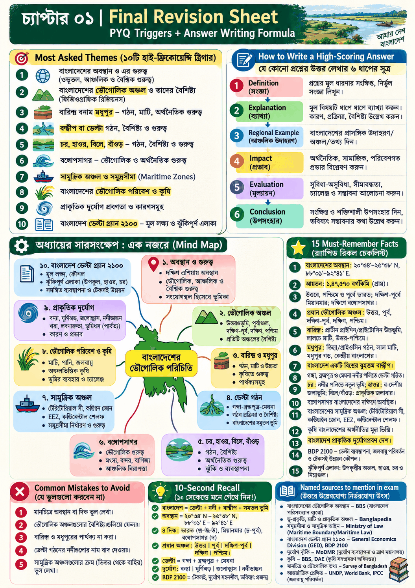</a></p>

<p align="center"><a href="./assets/visual-revision/bangladesh_geography_final_revision_infographic.png">🔎 Open full-size PNG</a> · <a href="#quick-revision-visual-notes">⬆️ Back to Visual Revision index</a> · <a href="#top">⬆️ Chapter top</a></p>

---

<a id="vr-02"></a>

#### 02 · ভূপ্রাকৃতিক অঞ্চল ও ভূমিরূপ | Physiographic Regions & Landforms

Floodplain, Pleistocene Terrace ও Tertiary Hills-এর বৈশিষ্ট্য, অবস্থান ও তুলনা.

<p align="center"><a href="./assets/visual-revision/bangladesh_physiographic_regions_revision_poster.png" title="Open bangladesh_physiographic_regions_revision_poster.png at full size">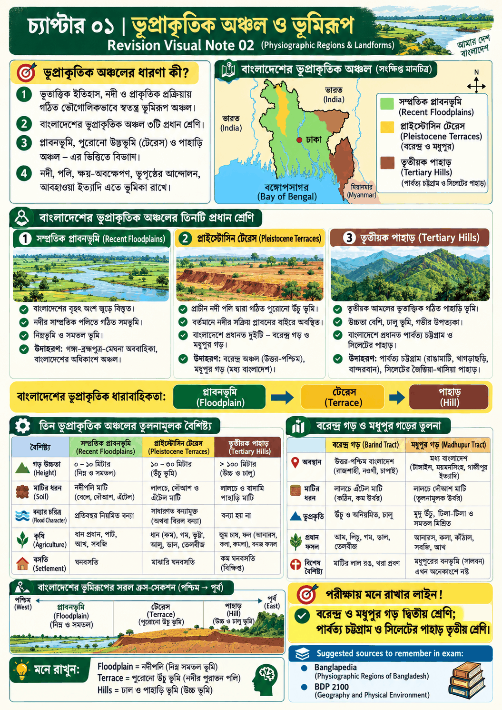</a></p>

<p align="center"><a href="./assets/visual-revision/bangladesh_physiographic_regions_revision_poster.png">🔎 Open full-size PNG</a> · <a href="#quick-revision-visual-notes">⬆️ Back to Visual Revision index</a> · <a href="#top">⬆️ Chapter top</a></p>

---

<a id="vr-03"></a>

#### 03 · বাংলাদেশের ভৌগোলিক পরিচিতি | Bangladesh Geography Overview

অবস্থান, সীমানা, নদী–বদ্বীপ, বঙ্গোপসাগর ও ভূপ্রকৃতির দ্রুত পুনরালোচনা.

<p align="center"><a href="./assets/visual-revision/bangladesh_geography_visual_revision_sheet.png" title="Open bangladesh_geography_visual_revision_sheet.png at full size">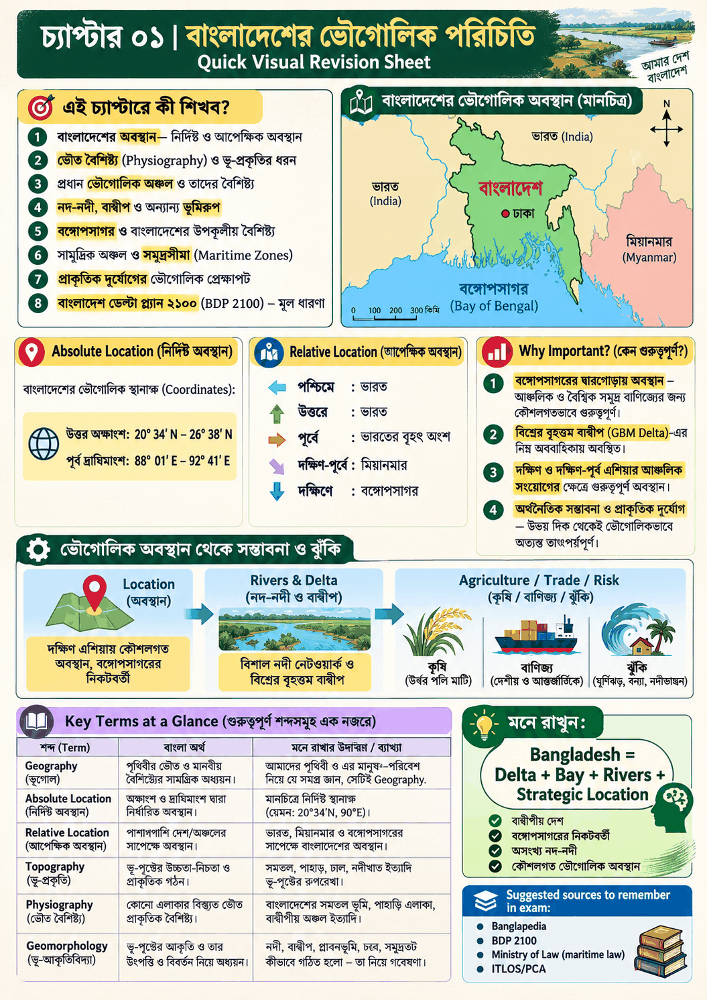</a></p>

<p align="center"><a href="./assets/visual-revision/bangladesh_geography_visual_revision_sheet.png">🔎 Open full-size PNG</a> · <a href="#quick-revision-visual-notes">⬆️ Back to Visual Revision index</a> · <a href="#top">⬆️ Chapter top</a></p>

---

<a id="vr-04"></a>

#### 04 · নদী, বদ্বীপ ও পরিবর্তনশীল ভূমিরূপ | Rivers, Delta & Dynamic Landforms

ক্ষয়, পরিবহন, সঞ্চয়, চর গঠন এবং নদীর গতিপথ পরিবর্তনের প্রক্রিয়া.

<p align="center"><a href="./assets/visual-revision/bangladesh_rivers_delta_dynamic_landforms_revision_sheet.png" title="Open bangladesh_rivers_delta_dynamic_landforms_revision_sheet.png at full size">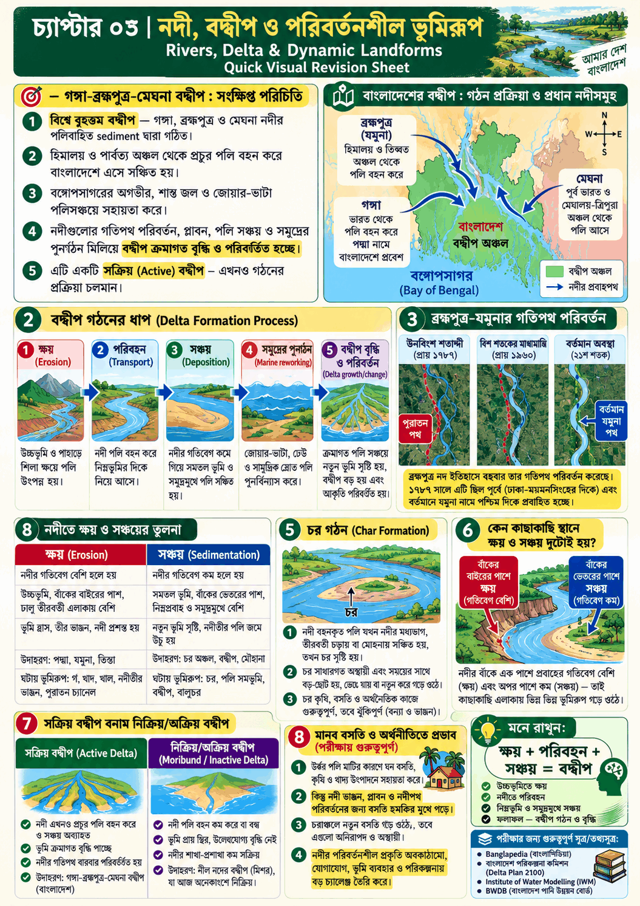</a></p>

<p align="center"><a href="./assets/visual-revision/bangladesh_rivers_delta_dynamic_landforms_revision_sheet.png">🔎 Open full-size PNG</a> · <a href="#quick-revision-visual-notes">⬆️ Back to Visual Revision index</a> · <a href="#top">⬆️ Chapter top</a></p>

---

<a id="vr-05"></a>

#### 05 · চর, হাওর, বিল ও বাঁওড় | Char, Haor, Beel & Baor

চার ধরনের ভূমি/জলাভূমির গঠন, পানির অবস্থা, জীবিকা ও ঝুঁকির তুলনা.

<p align="center"><a href="./assets/visual-revision/bangladesh_wetlands_revision_sheet.png" title="Open bangladesh_wetlands_revision_sheet.png at full size">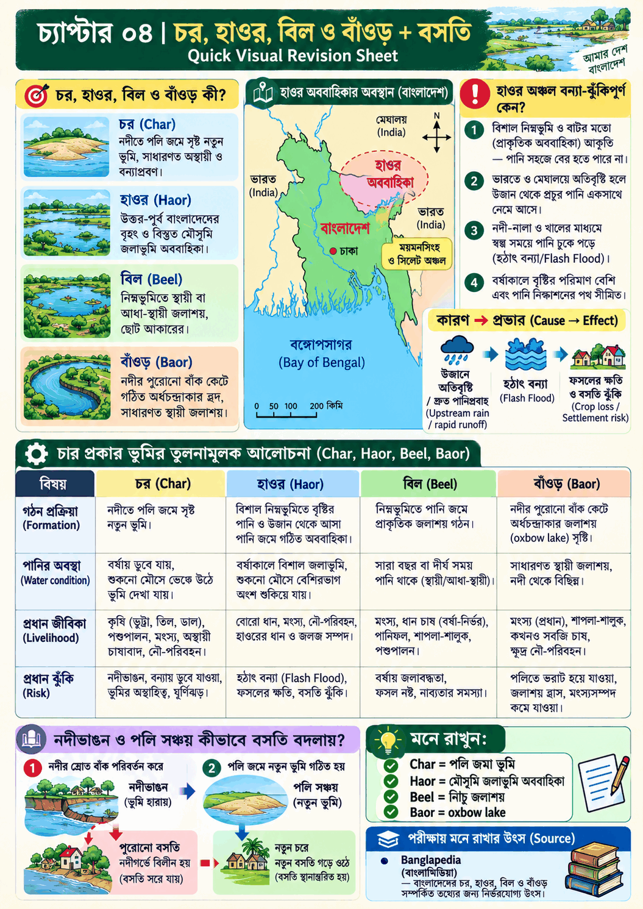</a></p>

<p align="center"><a href="./assets/visual-revision/bangladesh_wetlands_revision_sheet.png">🔎 Open full-size PNG</a> · <a href="#quick-revision-visual-notes">⬆️ Back to Visual Revision index</a> · <a href="#top">⬆️ Chapter top</a></p>

---

<a id="vr-06"></a>

#### 06 · বঙ্গোপসাগর, উপকূল ও সামুদ্রিক অঞ্চল | Bay of Bengal, Coast & Maritime Zones

উপকূলীয় সুযোগ–সীমাবদ্ধতা, Blue Economy এবং সামুদ্রিক অঞ্চলের মূল ধারণা.

<p align="center"><a href="./assets/visual-revision/bay_of_bengal_coastal_revision_sheet.png" title="Open bay_of_bengal_coastal_revision_sheet.png at full size">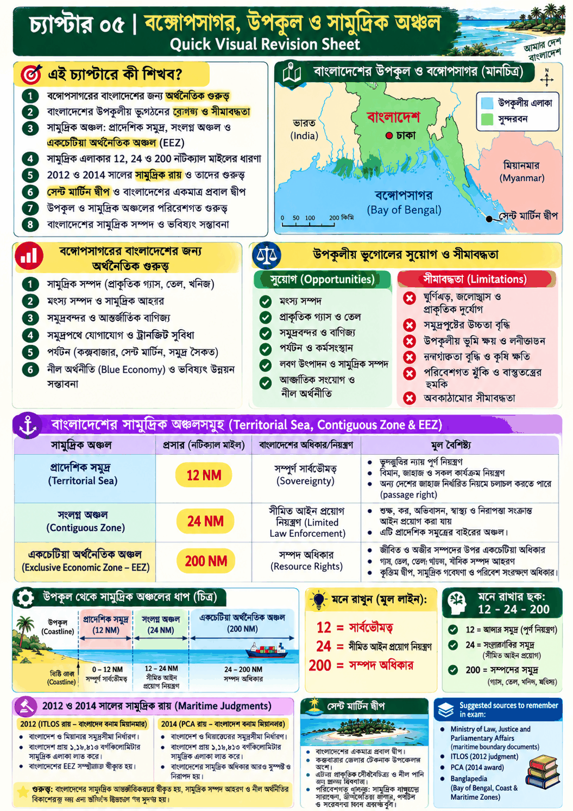</a></p>

<p align="center"><a href="./assets/visual-revision/bay_of_bengal_coastal_revision_sheet.png">🔎 Open full-size PNG</a> · <a href="#quick-revision-visual-notes">⬆️ Back to Visual Revision index</a> · <a href="#top">⬆️ Chapter top</a></p>

---

<a id="vr-07"></a>

#### 07 · দুর্যোগ, অভিযোজন ও ব-দ্বীপ পরিকল্পনা ২১০০ | Disaster Geography & BDP 2100

বাংলাদেশের দুর্যোগপ্রবণতার কারণ, অভিযোজন ও Delta Plan-এর ছয়টি hotspot.

<p align="center"><a href="./assets/visual-revision/bangladesh_delta_plan_disaster_study_note.png" title="Open bangladesh_delta_plan_disaster_study_note.png at full size">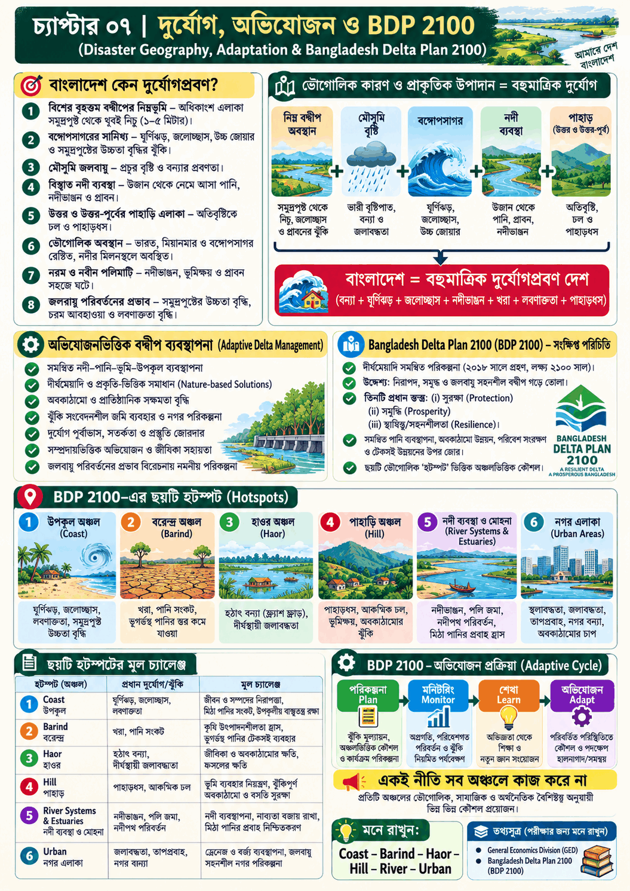</a></p>

<p align="center"><a href="./assets/visual-revision/bangladesh_delta_plan_disaster_study_note.png">🔎 Open full-size PNG</a> · <a href="#quick-revision-visual-notes">⬆️ Back to Visual Revision index</a> · <a href="#top">⬆️ Chapter top</a></p>

---

<a id="vr-08"></a>

#### 08 · ভূগোলের প্রভাব: কৃষি, পরিবহন ও সংস্কৃতি | Geography’s Impact

ভূপ্রকৃতি, পানি ও জলবায়ু কীভাবে কৃষি, যোগাযোগ, সংস্কৃতি ও জীবনযাত্রাকে প্রভাবিত করে.

<p align="center"><a href="./assets/visual-revision/geography_s_impact_in_bangladesh_visual_revision.png" title="Open geography_s_impact_in_bangladesh_visual_revision.png at full size">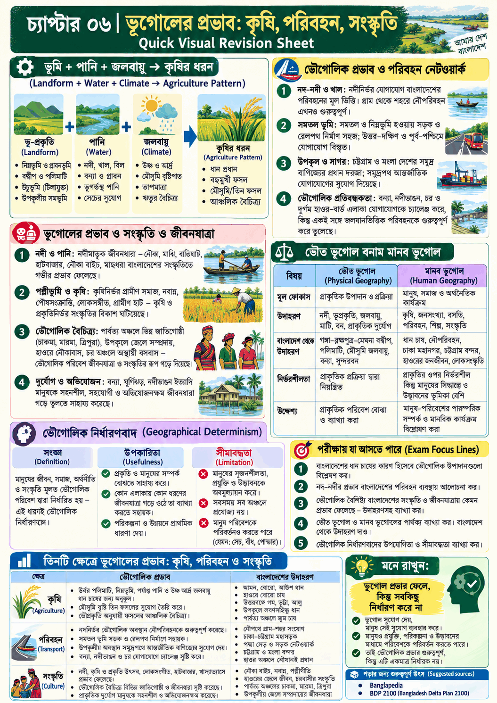</a></p>

<p align="center"><a href="./assets/visual-revision/geography_s_impact_in_bangladesh_visual_revision.png">🔎 Open full-size PNG</a> · <a href="#quick-revision-visual-notes">⬆️ Back to Visual Revision index</a> · <a href="#top">⬆️ Chapter top</a></p>

---

> [!TIP]
> **১০-সেকেন্ড রিভিশন:** প্রতিটি ছবির শিরোনাম দেখে ৩টি keyword, একটি কারণ–ফল সম্পর্ক এবং একটি বাংলাদেশি উদাহরণ না দেখে বলার চেষ্টা করো। এরপর [Previous BCS Question Audit](#pyq) ও [নমুনা প্রশ্নোত্তর](#questions) অংশে গিয়ে লিখে অনুশীলন করো।

> [!NOTE]
> **তথ্য যাচাই:** ছবিগুলো দ্রুত মনে রাখার সহায়ক। পরীক্ষার উত্তরে আইন, সীমানা, সাল, পরিসংখ্যান বা নীতির তথ্য লিখলে সংশ্লিষ্ট সরকারি/প্রামাণ্য উৎস এবং অধ্যায়ের [পূর্ণ Source Register](#sources) মিলিয়ে নেবে।

---

<a id="visual-atlas"></a>

### মানচিত্র, মাঠপর্যায়ের ছবি ও স্যাটেলাইট চিত্র

**প্রথমে ছবি পর্যবেক্ষণ করুন, তারপর সংশ্লিষ্ট ব্যাখ্যা পড়ুন।** প্রতিটি ছবি সংশ্লিষ্ট বিষয়ের মধ্যেও রাখা আছে। এখানে দ্রুত যাওয়ার পথ:

| Topic / Image | Click to learn |
|---|---|
| 🌍 বাংলাদেশের উচ্চতা ও Relief Map | [Map & location](#maps) |
| 🛰️ ESA Satellite: GBM Delta | [How the delta formed](#location) |
| 🌾 বরেন্দ্রভূমি, নওগাঁ — বাস্তব কৃষিভূমি | [Barind Tract](#barind-photo) |
| 🌳 মধুপুরের বন ও Locator Map | [Madhupur Tract](#madhupur-photo) |
| 🌊 টাঙ্গুয়ার হাওর | [Haor Basin](#haor-photo) |
| ⛰️ সাজেকের পাহাড় ও locator map | [Chattogram Hill Tracts](#cht-photo) |
| 🌿 NASA Landsat 9: বাংলাদেশের উপকূল ও সুন্দরবন | [Coastal ecosystem](#coastal-photo) |
| 🐂 যমুনার চরে জীবিকা | [River Char](#char-photo) |
| 🛰️ NASA MODIS: মেঘনা থেকে সাগরে পলি | [River sediment](#sediment-photo) |

> [!WARNING]
> **Photo ≠ Geological Survey:** কোনো কৃষিজমি বা বনের ছবি দিয়ে মাটির বয়স, শ্রেণি বা আয়তন প্রমাণ করা যায় না। ছবি অঞ্চলটি বুঝতে সাহায্য করে; শ্রেণিবিন্যাস ও সংখ্যা নিতে হবে **Banglapedia, FAO/সরকারি প্রতিবেদন এবং বৈজ্ঞানিক তথ্যসূত্র** থেকে।

[⬆️ Go to Contents](#top)

---
### অধ্যায়ের ৭টি মূল ধারণা — সংক্ষিপ্ত পর্যালোচনা

**১. ভৌগোলিক অবস্থান (Location):** বাংলাদেশ দক্ষিণ এশিয়ার উত্তর-পূর্বাংশে অবস্থিত। পশ্চিম, উত্তর ও পূর্বের বড় অংশে ভারতের সীমান্ত; দক্ষিণ-পূর্বে মিয়ানমার এবং দক্ষিণে বঙ্গোপসাগর। এই অবস্থান নদীপ্রবাহ, আঞ্চলিক যোগাযোগ ও সামুদ্রিক বাণিজ্যের সঙ্গে বাংলাদেশের সম্পর্ক নির্ধারণে গুরুত্বপূর্ণ।

**২. পলি সঞ্চয় ও বদ্বীপ গঠন (Sediment and Delta Formation):** উজানের নদী অববাহিকা থেকে নদীগুলো পলি বহন করে বাংলাদেশের নিম্নভূমিতে নিয়ে আসে। পলি সঞ্চয়ে প্লাবনভূমি, চর ও বদ্বীপ গঠিত হয়; একই সঙ্গে নদীভাঙন ও গতিপথের পরিবর্তনও ঘটে।

**৩. প্রধান ভূপ্রাকৃতিক অঞ্চল (Major Landforms):** বাংলাদেশের ভূপ্রকৃতির প্রধান শ্রেণি হলো প্লাবনভূমি (Floodplain), সোপানভূমি (Terrace) ও পাহাড়ি অঞ্চল (Hill). এসব অঞ্চলের মাটি, উচ্চতা, পানি নিষ্কাশন ও ভূমি ব্যবহারে পার্থক্য রয়েছে।

**৪. নদীর গতিশীলতা (River Dynamics):** নদীভাঙন, পলি সঞ্চয়, গতিপথ পরিবর্তন ও চর গঠন বাংলাদেশের ভূমিরূপকে সময়ের সঙ্গে বদলে দেয়। তাই অতীত ও বর্তমানের নদীমানচিত্রে পার্থক্য দেখা যেতে পারে।

**৫. অঞ্চলভিত্তিক ঝুঁকি (Regional Risks):** বরেন্দ্র অঞ্চলে শুষ্ক মৌসুমের পানিসংকট, হাওরে আকস্মিক বন্যা, পাহাড়ি এলাকায় ভূমিধস, নদীতীরে ভাঙন এবং উপকূলে ঘূর্ণিঝড়, জলোচ্ছ্বাস ও লবণাক্ততার ঝুঁকি গুরুত্বপূর্ণ। এসব ঝুঁকির ধরন ভিন্ন হওয়ায় ব্যবস্থাপনাও অঞ্চলভিত্তিক হওয়া প্রয়োজন।

**৬. বঙ্গোপসাগর ও সামুদ্রিক অধিকার (Bay of Bengal and Maritime Zones):** বঙ্গোপসাগর বন্দর, মৎস্যসম্পদ ও আন্তর্জাতিক নৌবাণিজ্যের সুযোগ তৈরি করে; একই সঙ্গে উপকূলীয় দুর্যোগের ঝুঁকিও রয়েছে। Territorial Sea, Contiguous Zone ও Exclusive Economic Zone-এর আইনি অধিকার এক নয়; তাই ১২–২৪–২০০ nautical miles-এর পার্থক্য নির্ভুলভাবে ব্যাখ্যা করা প্রয়োজন।

**৭. নীতি ও অভিযোজন (Policy and Adaptation):** বাংলাদেশের ভিন্ন ভিন্ন ভূপ্রাকৃতিক অঞ্চলের সমস্যা মোকাবিলায় দীর্ঘমেয়াদি, তথ্যনির্ভর ও অভিযোজনযোগ্য পরিকল্পনা প্রয়োজন। বাংলাদেশ ব-দ্বীপ পরিকল্পনা ২১০০ পানি নিরাপত্তা, জীবিকা, পরিবেশ ও দুর্যোগঝুঁকিকে সমন্বিতভাবে বিবেচনার একটি নীতিগত কাঠামো।

> [!IMPORTANT]
> **এক মিনিটে পুনরালোচনা:** Location → Sediment and Delta Formation → Floodplain/Terrace/Hill → River Dynamics → Regional Risks → Maritime Zones → Bangladesh Delta Plan 2100। প্রশ্নের ধরন অনুযায়ী এই ধারার প্রাসঙ্গিক অংশ নির্বাচন করে উত্তর সাজান।

**তথ্যসূত্রের ভিত্তি:** **Banglapedia (Asiatic Society of Bangladesh), “Bangladesh Geography”**; **General Economics Division (GED), Bangladesh Planning Commission, Bangladesh Delta Plan 2100**; **Ministry of Law, “Territorial Waters and Maritime Zones Act, 1974” (amended 2021)**।

[⬆️ Go to Contents](#top)

---

<a id="location"></a>

## ১. বাংলাদেশের ভৌগোলিক অবস্থান ও বদ্বীপীয় ভূপ্রকৃতি

উত্তর দিক থেকে প্রবাহিত নদীগুলো পাহাড় ও সমভূমি পেরিয়ে বাংলাদেশের নিম্ন অববাহিকায় প্রবেশ করে। নদীগুলো বালি, পলি ও কাদা বহন করে। ঋতুভেদে পানির পরিমাণ পরিবর্তিত হয়; কোথাও চর গঠিত হয়, কোথাও নদীতীর ক্ষয়প্রাপ্ত হয়, আবার কোথাও পুরোনো নদীখাত দেখা যায়। দক্ষিণে নদীগুলো বঙ্গোপসাগরের জোয়ার-ভাটার প্রভাবে প্রভাবিত হয়। **এটাই বাংলাদেশের ভূপ্রকৃতির সবচেয়ে বড় কেন্দ্রীয় ধারণা: ভূখণ্ডটি স্থির নয়, একটি পরিবর্তনশীল river–delta system।** [S2 — Banglapedia, ‘Bangladesh Geography’; S3 — Banglapedia, ‘ভূ-প্রকৃতি’]

এখানে তিন ধরনের বাস্তবতা পাশাপাশি: পদ্মা–যমুনা–মেঘনার সদ্য জমা পললভূমি; বরেন্দ্র–মধুপুরের অপেক্ষাকৃত পুরোনো ও উঁচু সোপান; চট্টগ্রাম ও সিলেটের পাহাড়-টিলা। একই দেশে কোথাও নদীভাঙনের চিন্তা, কোথাও খরার, কোথাও আগাম বন্যা বা ভূমিধসের। তাই ভৌগোলিক পরিচিতি কেবল অবস্থান ও সীমানা বর্ণনায় সীমাবদ্ধ নয়; এটি উন্নয়ন, রাজনীতি, কৃষি, পরিবেশ ও মানুষের জীবন ব্যাখ্যা করতেও সহায়তা করে। [S2; S6 — GED, Bangladesh Delta Plan 2100]

### ১.১ Location & Boundaries — ভৌগোলিক অবস্থান ও সীমানা

| পরীক্ষা-উপযোগী বিষয় | তথ্য | উৎস—খাতায় লিখবার নাম |
|---|---|---|
| অবস্থান | দক্ষিণ এশিয়া; গঙ্গা–ব্রহ্মপুত্র–মেঘনা অববাহিকার নিম্নাংশ | Banglapedia — *Bangladesh* [S4] |
| অক্ষাংশ (Latitude) | <mark>২০°৩৪′–২৬°৩৮′</mark> N | Banglapedia — *Bangladesh* [S4] |
| দ্রাঘিমাংশ (Longitude) | <mark>৮৮°০১′–৯২°৪১′</mark> E | Banglapedia — *Bangladesh* [S4] |
| প্রচলিত আয়তন | ১,৪৭,৫৭০ বর্গকিমি (Banglapedia-তে প্রকাশিত প্রচলিত স্থল-রাষ্ট্রের আয়তন; অন্যান্য dataset-এ পদ্ধতি ভিন্ন হতে পারে) | Banglapedia — *Bangladesh* [S4] |
| পশ্চিম ও উত্তর | ভারতের বিভিন্ন রাজ্য | Banglapedia — *Bangladesh* [S4] |
| পূর্ব | ভারত ও মিয়ানমার | Banglapedia — *Bangladesh* [S4] |
| দক্ষিণ | বঙ্গোপসাগর | Banglapedia — *Bangladesh* [S4] |
| মান সময় | UTC+06:00 | Banglapedia — *Bangladesh* [S4] |

**ব্যাখ্যা:** ‘Absolute Location’ হলো অক্ষাংশ–দ্রাঘিমাংশ; ‘Relative Location’ হলো প্রতিবেশী রাষ্ট্র, বঙ্গোপসাগর, আঞ্চলিক নদী ও বাণিজ্যপথের তুলনায় অবস্থান। ৫ নম্বরের প্রশ্নে অক্ষাংশ–দ্রাঘিমাংশ, চারদিকের সীমানা ও ২ বাক্যে গুরুত্ব; ১০ নম্বরে মানচিত্র, অর্থনৈতিক সম্ভাবনা ও ঝুঁকি।

<a id="maps"></a>

### ১.২ Bangladesh Maps — Relief Map ও বাস্তব মানচিত্র

<p align="center"><a href="https://commons.wikimedia.org/wiki/File:Bangladesh_physical_map.svg"></a></p>

**Figure 1 — Physical Relief Map of Bangladesh.** Creator: Urutseg; Wikimedia Commons, *Bangladesh physical map.svg*, 2011; License **CC0 1.0**. [Original file, author and license](https://commons.wikimedia.org/wiki/File:Bangladesh_physical_map.svg)। মানচিত্রটি ভূপ্রকৃতি শেখার জন্য; আধুনিক প্রশাসনিক বা সমুদ্রসীমার নিশ্চয়তার জন্য নয়।

<p align="center"><a href="https://commons.wikimedia.org/wiki/File:Map_of_Bangladesh-en.svg"></a></p>

**Figure 2 — Topographic Map of Bangladesh.** Creator: **Oona Räisänen (Mysid)**, 2010; sources include SRTM relief data, archival CIA cartography and NGDC bathymetry; Wikimedia Commons, **CC BY 3.0 / GFDL**. [Original file and terms](https://commons.wikimedia.org/wiki/File:Map_of_Bangladesh-en.svg)। কিছু স্থাননাম/পরিবহন স্তর পুরোনো; সাম্প্রতিক প্রশাসনিক মানচিত্র হিসেবে ব্যবহার নয়।

<a id="physiography"></a>

<p align="center"><a href="https://commons.wikimedia.org/wiki/File:Ganges_Delta_ESA22274217.jpeg"></a></p>

*🖼️ Figure 2A — **Ganges–Brahmaputra Delta from Space**। **কী দেখবেন:** নদীর পলি, মোহনার প্রবাহ ও বদ্বীপের বিস্তার। **Credit:** European Space Agency / Copernicus Sentinel-3 (2020-03-31); **License:** Copernicus Sentinel attribution required; **Image source:** [Wikimedia Commons file page](https://commons.wikimedia.org/wiki/File:Ganges_Delta_ESA22274217.jpeg)। ছবিতে ক্লিক করলে মূল ফাইলের উচ্চ রেজল্যুশন এবং সম্পূর্ণ লাইসেন্স পাওয়া যাবে।*

> [!TIP]
 > **চিত্র পর্যবেক্ষণ:** নদীর পলি, মোহনার প্রবাহ ও বদ্বীপের বিস্তার—ছবিতে দৃশ্যমান একটি বৈশিষ্ট্য চিহ্নিত করে তার একটি কারণ ও একটি সম্ভাব্য প্রভাব ব্যাখ্যা করুন।


> [!IMPORTANT]
> 🟣 **পরীক্ষায় গুরুত্বপূর্ণ সারাংশ:** বাংলাদেশ একটি গতিশীল বদ্বীপীয় দেশ। ভৌগোলিক অবস্থান থেকে নদীপথ ও সাগর, নদীপথ থেকে ভূমিরূপ, ভূমিরূপ থেকে মানুষের জীবিকা এবং জীবিকা থেকে রাষ্ট্রীয় পরিকল্পনার সম্পর্ক ব্যাখ্যা করা—এটাই এই ইউনিটের মূল দক্ষতা।

> [!NOTE]
> 🔵 **Primary Reference:** **Banglapedia — Asiatic Society of Bangladesh, “Bangladesh Geography”**, [মূল নিবন্ধ](https://en.banglapedia.org/index.php?title=Bangladesh_Geography); **Food and Agriculture Organization of the United Nations (FAO)**, [“Bangladesh” country paper](https://www.fao.org/4/x6900e/x6900e06.htm)। প্রথমটি অঞ্চলের ব্যাখ্যায়, দ্বিতীয়টি 80/8/12 আনুপাতিক শ্রেণিবিন্যাসের উৎস হিসেবে ব্যবহার করুন।


## ২. Physiography — বাংলাদেশের তিন প্রধান ভূপ্রাকৃতিক অঞ্চল

> [!TIP]
> 🟢 **Three-step mental picture:** **নতুন চর (Floodplain)** → **পুরোনো উঁচু গড় (Terrace)** → **ঢালু পাহাড় (Hill)**। পরীক্ষার খাতায় তিনটি পাশে পাশে ছোট স্কেচ আঁকুন।

Banglapedia অনুসারে দেশকে বৃহৎ তিনটি শ্রেণিতে—**<mark>Floodplains, Terraces, Hills</mark>**—ভাগ করা যায়; বিস্তারিত শ্রেণিবিন্যাসে **২৪টি sub-region ও ৫৪টি unit** বর্ণিত। [S2 — *Bangladesh Geography*; S3 — *ভূ-প্রকৃতি*]

| শ্রেণি | গঠন ও সাধারণ রূপ | উদাহরণ | মূল সুযোগ | প্রধান ঝুঁকি |
|---|---|---|---|---|
| নবীন প্লাবনভূমি (Recent Floodplain) | নদীর অপেক্ষাকৃত নতুন পলি, নিচু/মাঝারি ভূমি, সক্রিয় নদীখাত | যমুনা, মেঘনা, গঙ্গা-পদ্মা সমভূমি, চর ও বদ্বীপ | পলিমাটি, পানি, মৎস্য, নৌযোগাযোগ | বন্যা, নদীভাঙন, চ্যানেল পরিবর্তন |
| প্লাইস্টোসিন সোপান (Pleistocene Terrace) | পুরোনো অপেক্ষাকৃত উঁচু পৃষ্ঠ, অনেক স্থানে লালচে রঙের মাটি | বরেন্দ্রভূমি, মধুপুর গড়, লালমাই অঞ্চলের সোপান | বসতি, বন, কৃষি ও অবকাঠামো | অঞ্চলভেদে খরা, পানির চাপ ও ভূমি-অবক্ষয় |
| টারশিয়ারি পাহাড় (Tertiary Hills) | ভাঁজযুক্ত পাহাড়, ঢাল, উপত্যকা ও টিলা | পার্বত্য চট্টগ্রাম, সিলেটের টিলা-পাহাড় | বন, পর্যটন, জীববৈচিত্র্য | ভূমিধস, ঢালক্ষয়, প্রবাহ-ব্যবস্থাপনা |

### ২.১ Data Visual — ভূমিরূপের প্রকাশিত আনুমানিক অনুপাত

একটি **বাংলাদেশ সরকারের ওয়েবসাইটে প্রকাশিত environmental and social baseline report** দেশের ভূমিকে ভূতাত্ত্বিক গঠনভিত্তিক মোটামুটি **<mark>Floodplain 80%, Pleistocene Terrace 8%, Tertiary Hills 12%</mark>**—এই অনুপাতে শ্রেণিবদ্ধ করেছে। এটি **ঐ রিপোর্টের classification**, সর্বশেষ ভূমি-জরিপের সমার্থক নয়; Banglapedia-র ভিন্ন শ্রেণিকাঠামোর সঙ্গে সংখ্যা বিনা ব্যাখ্যায় মিশিয়ে ফেলবেন না। [S5 — Wage Earners' Welfare Board-hosted *Environmental and Social Baseline Data*, land environment]

<p>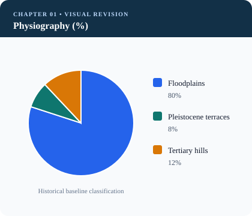</p>

<details>
<summary>ডায়াগ্রামের মূল Mermaid source দেখুন</summary>

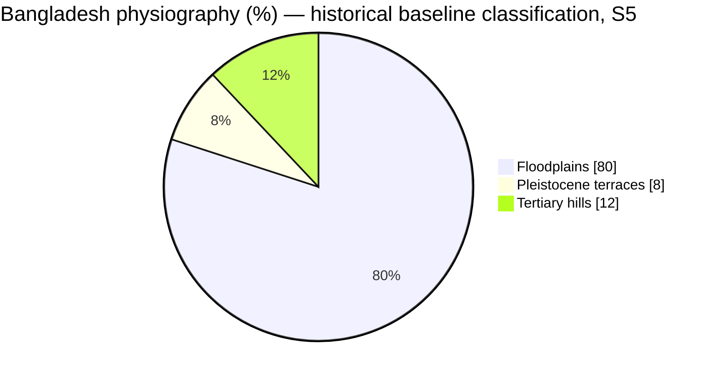

</details>

**Exam caption:** *Figure: Approximate physiographic shares. Source: Government-hosted Environmental and Social Baseline Data, land-environment section (S5); figures are classification-dependent.*

### ২.২ Cause–Effect Flowchart — ভূমিরূপ থেকে জীবিকার সম্পর্ক

<p>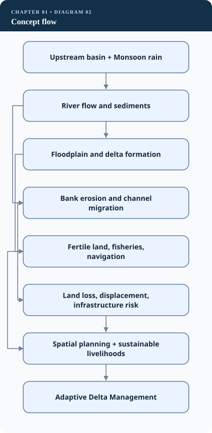</p>

<details>
<summary>ডায়াগ্রামের মূল Mermaid source দেখুন</summary>

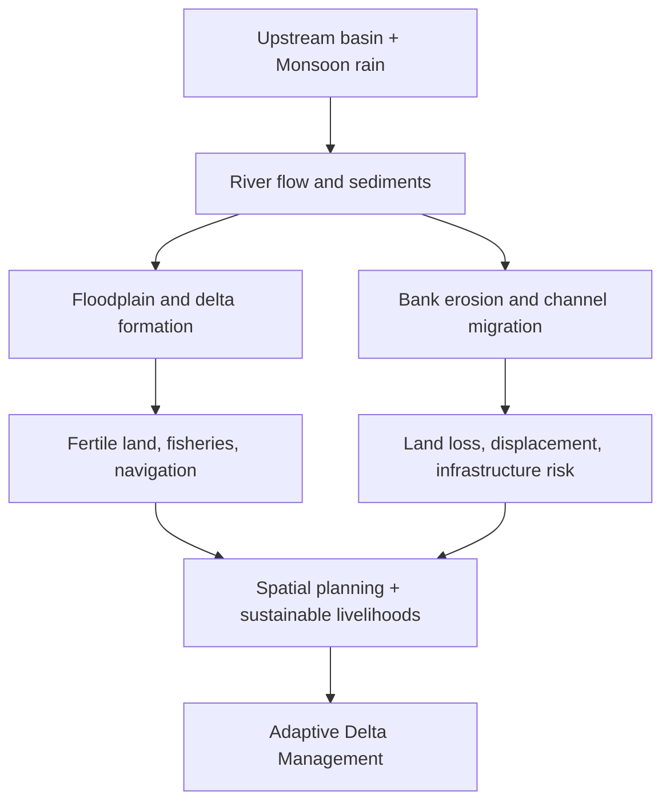

</details>

**Figure 3 — Conceptual causal diagram, editorial synthesis from Banglapedia [S2] and GED Delta Plan [S6].** এটি ব্যাখ্যামূলক, পরিমাপভিত্তিক data chart নয়।

<a id="regions"></a>

## ৩. Region-by-Region Analysis — বাংলাদেশের প্রধান ভূপ্রাকৃতিক অঞ্চল

### ৩.১ Barind Tract — উত্তর-পশ্চিমের বরেন্দ্রভূমি ও পানির চাপ

#### বিস্তারিত ব্যাখ্যা — বরেন্দ্রভূমি: কী, কোথায়, কেন, কীভাবে ও প্রভাব

**মূল বৈশিষ্ট্য ও প্রভাব:** উত্তর-পশ্চিমাঞ্চলের প্রাচীন সোপানভূমি; সাম্প্রতিক নদীপলিতে গঠিত চর নয়। রাজশাহী, নওগাঁ ও আশপাশের উত্তর-পশ্চিমাঞ্চল; সুনির্দিষ্ট ভূপ্রাকৃতিক সীমা জেলা-সীমানার সঙ্গে পুরোপুরি মেলে না। প্লাইস্টোসিন যুগের অপেক্ষাকৃত পুরোনো ভূমিপৃষ্ঠ ও পরবর্তী ভূপ্রক্রিয়া একে আশপাশের নবীন প্লাবনভূমি থেকে আলাদা করেছে। অঞ্চলটির পূর্ণ বৈশিষ্ট্য ব্যাখ্যা করতে ভূমির উৎপত্তি, বর্তমান জীবিকা এবং সংশ্লিষ্ট ঝুঁকির সম্পর্ক বিশ্লেষণ করা প্রয়োজন।

1. **🟪 কী (What):** উত্তর-পশ্চিমাঞ্চলের প্রাচীন সোপানভূমি; সাম্প্রতিক নদীপলিতে গঠিত চর নয়।
2. **🧭 কোথায় (Where):** রাজশাহী, নওগাঁ ও আশপাশের উত্তর-পশ্চিমাঞ্চল; সুনির্দিষ্ট ভূপ্রাকৃতিক সীমা জেলা-সীমানার সঙ্গে পুরোপুরি মেলে না।
3. **🟨 কেন এমন (Why):** প্লাইস্টোসিন যুগের অপেক্ষাকৃত পুরোনো ভূমিপৃষ্ঠ ও পরবর্তী ভূপ্রক্রিয়া একে আশপাশের নবীন প্লাবনভূমি থেকে আলাদা করেছে।
4. **⚙️ কীভাবে কাজ করে (How / Mechanism):** বর্ষায় বৃষ্টি হলেও শুষ্ক মৌসুমে পানির চাহিদা বাড়ে। মাটির বৈশিষ্ট্য, বৃষ্টিপাতের সময়গত বৈষম্য, সেচনির্ভর কৃষি ও ভূগর্ভস্থ পানি উত্তোলন একত্রে পানির চাপ সৃষ্টি করতে পারে।
5. **🌾 প্রভাব (Impact):** ধানসহ কৃষি উৎপাদনে সেচের ভূমিকা বাড়ে; অতিরিক্ত ভূগর্ভস্থ পানি নির্ভরতা দীর্ঘমেয়াদি ঝুঁকি সৃষ্টি করতে পারে।
6. **🟩 করণীয় (Solutions / Policy):** দক্ষ সেচ, উপযোগী ফসল নির্বাচন, পানি সংরক্ষণ ও ভূগর্ভস্থ পানি পর্যবেক্ষণ।

**Cause → Effect → Response (কারণ–ফল–করণীয়)**

<p>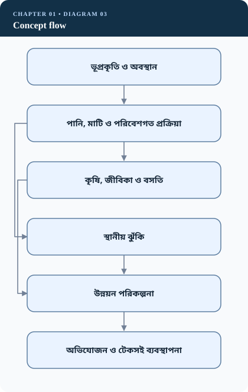</p>

<details>
<summary>ডায়াগ্রামের মূল Mermaid source দেখুন</summary>

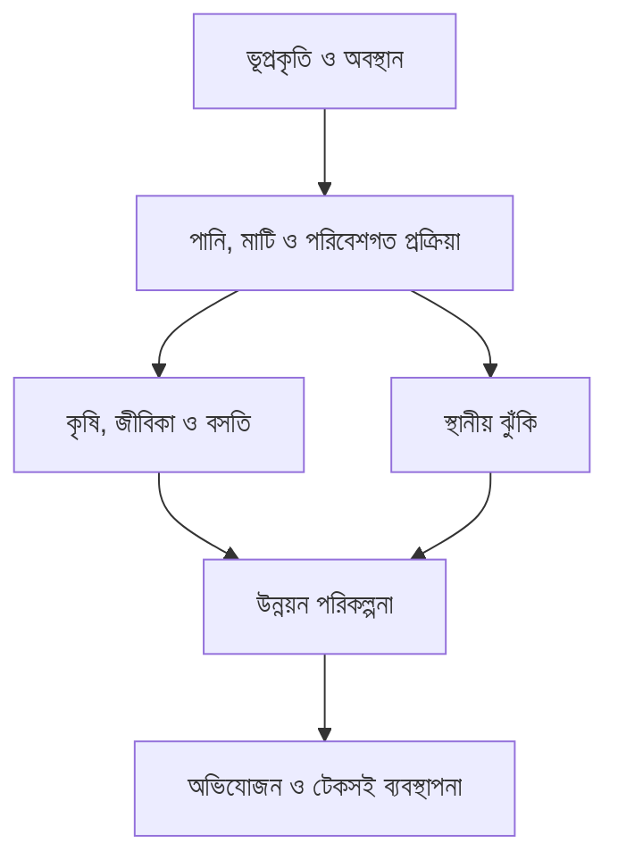

</details>

> [!WARNING]
> 🟨 **পরীক্ষায় প্রয়োগ:** কেন বরেন্দ্রভূমিকে প্লাবনভূমি বলা যায় না? খরা মোকাবিলায় অঞ্চলভিত্তিক কী পরিকল্পনা প্রয়োজন?

> [!TIP]
> 🟩 **স্ব-পরীক্ষা:** বই বন্ধ করে ৩০ সেকেন্ডে বলুন: **কী → কোথায় → কেন → কীভাবে → প্রভাব → সমাধান**। তারপর একটি বাংলাদেশের উদাহরণ যোগ করুন।

> [!NOTE]
> 🟦 **Named sources (মূল আলোচনা যাচাইয়ের জন্য):** Banglapedia — Asiatic Society of Bangladesh, Bangladesh Geography; GED — Bangladesh Delta Plan 2100। মূল নথির লিংক [Sources & Evidence](#sources) অংশে রয়েছে।


#### বিস্তারিত বিশ্লেষণ — বরেন্দ্রভূমি: কী, কোথায়, কেন, কীভাবে ও প্রভাব

**তুলনামূলক উদাহরণ:** যমুনার চর সাধারণত নবীন পললভূমি; বরেন্দ্রভূমি অপেক্ষাকৃত প্রাচীন ও উঁচু সোপানভূমি। উভয় অঞ্চলে কৃষিকাজ হলেও মাটির বয়স, পানি নিষ্কাশন ও সেচের প্রয়োজন ভিন্ন। এই তুলনা বরেন্দ্রভূমির স্বতন্ত্র বৈশিষ্ট্য ব্যাখ্যা করে।

**১. কী? (What is the Barind Tract?)** <mark>বরেন্দ্রভূমি একটি প্রাচীন প্লাইস্টোসিন সোপানভূমি (Pleistocene Terrace)</mark>। এটি সদ্য সৃষ্ট নদীচর নয়। এখানকার পুরোনো পলিতে দীর্ঘ সময়ের আবহবিকারের (Weathering) প্রভাব পড়েছে। এ জন্য অনেক স্থানে লালচে-বাদামি মাটি দেখা যায়। সব জায়গায় একই রঙ, উচ্চতা বা ভূগঠন থাকে না।

**২. কোথায়? (Where?)** বাংলাদেশের উত্তর-পশ্চিমে, বিশেষত রাজশাহী, নওগাঁ ও আশপাশের বিস্তৃত এলাকার সঙ্গে এর সম্পর্ক রয়েছে। **ভূপ্রাকৃতিক সীমানা (Physiographic Boundary)** এবং জেলার সীমানা অভিন্ন নয়। মানচিত্রে বরেন্দ্রকে একটি অঞ্চলের রূপে দেখান, একটিমাত্র জেলার নাম হিসেবে নয়।

**৩. কেন এই ভূমিরূপ? (Why?)** পুরোনো অবক্ষেপ নতুন প্লাবনভূমির পলির মতো প্রতি বর্ষায় নতুন স্তরে ঢাকা পড়ে না। ভূ-গঠন, পলি সঞ্চয়, পরবর্তী আবহবিকার ও ভূমির ধীর পরিবর্তন মিলিয়ে পুরোনো সোপান তৈরি হয়েছে। Banglapedia-এর *Alluvium* নিবন্ধ পুরোনো পলি ও নবীন পলির পার্থক্য এবং মধুপুর–বরেন্দ্র–লালমাই অঞ্চলের বৈশিষ্ট্য ব্যাখ্যা করে। নির্দিষ্ট একটি ভূতাত্ত্বিক কারণকে একমাত্র কারণ হিসেবে লিখবেন না।

**৪. কীভাবে পানির সমস্যা হয়? (Mechanism)**

- শুষ্ক মৌসুমে বৃষ্টির সরবরাহ কমে → কৃষিতে সেচের প্রয়োজন বাড়ে।
- ভূমির উচ্চতা, মাটির স্তর ও স্থানীয় নিষ্কাশনের বৈশিষ্ট্য → জমিতে পানি ধরে রাখা বা নিচে সরে যাওয়ার মাত্রা বদলায়।
- সেচের জন্য ভূগর্ভস্থ পানি উত্তোলন বেশি হলে → পানিসম্পদের ওপর বাড়তি চাপ পড়তে পারে।
- পানি ব্যবহারের দক্ষতা, ভূগর্ভস্থ পানি পুনর্ভরণ (Recharge) ও ফসলের ধরন → দীর্ঘমেয়াদি কৃষির স্থায়িত্বকে প্রভাবিত করে।

**৫. প্রভাব (Impact):** কৃষককে সেচের খরচ বিবেচনা করতে হয়; উপযুক্ত ফসল নির্বাচন জরুরি হয়; পানির ওপর কৃষি ও পরিবারের বিভিন্ন চাহিদার চাপ তৈরি হতে পারে। তবে 'পুরো বরেন্দ্র এলাকায় সবসময় খরা'—এমন সাধারণীকরণ ভুল।

**৬. করণীয় (Policy Response):** পানি সাশ্রয়ী সেচ, বৃষ্টির পানি সংরক্ষণ, ফসল বৈচিত্র্য, বৈজ্ঞানিক পানি-পর্যবেক্ষণ ও স্থানীয় অংশগ্রহণ। বাংলাদেশের ব-দ্বীপ পরিকল্পনা ২১০০-তে **Barind and Drought-prone Areas** পৃথক হটস্পট।

<p>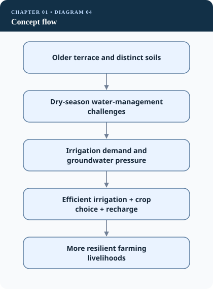</p>

<details>
<summary>ডায়াগ্রামের মূল Mermaid source দেখুন</summary>

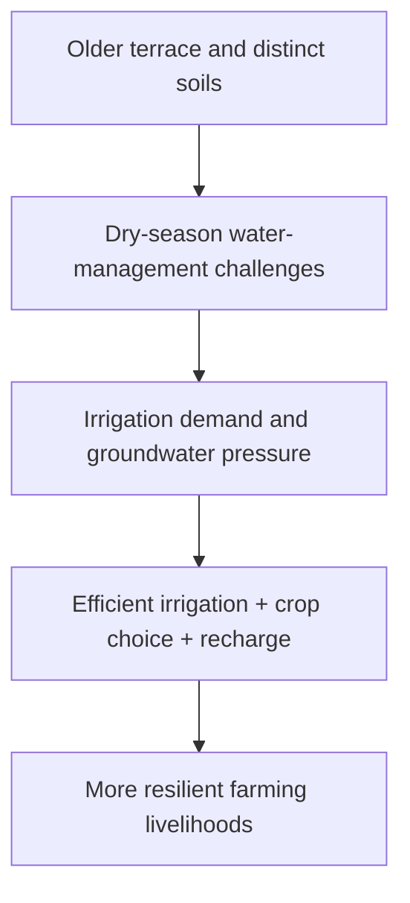

</details>

> [!TIP]
> 🟩 **Memory Formula:** <mark>পুরোনো সোপান → ভিন্ন মাটি → শুষ্ক মৌসুমে পানির চাপ → দক্ষ সেচ → কৃষির স্থায়িত্ব</mark>।

> [!NOTE]
> 🔵 **Sources:** **Banglapedia, Asiatic Society of Bangladesh — [“Bangladesh Geography”](https://en.banglapedia.org/index.php?title=Bangladesh_Geography)** ও **[“Alluvium”](https://en.banglapedia.org/index.php/Alluvium)**; **General Economics Division (GED), Bangladesh Planning Commission — [BDP 2100 Regional Hotspots](https://bcdp.gov.bd/)**।

**প্রশ্ন যেভাবেই আসুক:** *Describe* হলে সংজ্ঞা+অবস্থান+ভূপ্রকৃতি; *Why drought-prone?* হলে মাটি–ঋতু–পানি–সেচের কারণ; *Compare Barind and Madhupur* হলে পুরোনো সোপানের মিল ও পরিবেশগত পার্থক্য; *Recommend* হলে সেচ ও পানি ব্যবস্থাপনার সুপারিশ।

---


**আঞ্চলিক উদাহরণ:** উত্তর-পশ্চিমাঞ্চলের বরেন্দ্রভূমি তুলনামূলক উঁচু ও প্রাচীন সোপানভূমি। এখানে বর্ষা ও শুষ্ক মৌসুমে পানির প্রাপ্যতা ভিন্ন হওয়ায় পানি ব্যবস্থাপনা গুরুত্বপূর্ণ।

- 🧭 **কোথায় (Location):** রাজশাহী–নওগাঁ–চাঁপাইনবাবগঞ্জসহ উত্তর-পশ্চিমের বিস্তৃত অঞ্চলের সঙ্গে বরেন্দ্রভূমির সম্পর্ক রয়েছে। **ভূপ্রাকৃতিক সীমানা** ও জেলার প্রশাসনিক সীমানা এক নয়।
- 🪨 **কেমন (Landform):** অপেক্ষাকৃত প্রাচীন **<mark>Pleistocene Terrace</mark>**; নতুন চর বা সাম্প্রতিক প্লাবনভূমির তুলনায় আলাদা পৃষ্ঠভাগ।
- 💧 **সমস্যা (Challenge):** শুষ্ক মৌসুমে **<mark>drought, groundwater stress</mark> ও irrigation efficiency** গুরুত্বপূর্ণ।
- 🌱 **সমাধান (Response):** দক্ষ পানি ব্যবহার, ফসল পরিকল্পনা ও অঞ্চলভিত্তিক পানিসম্পদ ব্যবস্থাপনা।

> [!TIP]
> 🟢 **স্মরণ-সহায়ক সূত্র — BARIND = Old high land + Dry-season water pressure.**

> [!NOTE]
> 🔵 **Source:** **Banglapedia — Asiatic Society of Bangladesh, “Bangladesh Geography”** [S2]; **General Economics Division (GED), “Bangladesh Delta Plan 2100”** [S6]।

<a id="barind-photo"></a>

<p align="center"><a href="https://commons.wikimedia.org/wiki/File:The_Neon_Veil_of_Barind-_A_Twilight_Study_in_Naogaon.jpg"></a></p>

*🖼️ Figure 3 — **Barind Agricultural Landscape, Naogaon**। **কী দেখবেন:** নওগাঁর বরেন্দ্র অঞ্চলের গ্রামীণ কৃষি; এটি মাটির ভূতাত্ত্বিক প্রমাণ নয়। **Credit:** S. H. Tanim (2026-03-12); **License:** CC BY-SA 4.0; **Image source:** [Wikimedia Commons file page](https://commons.wikimedia.org/wiki/File:The_Neon_Veil_of_Barind-_A_Twilight_Study_in_Naogaon.jpg)। ছবিতে ক্লিক করলে মূল ফাইলের উচ্চ রেজল্যুশন এবং সম্পূর্ণ লাইসেন্স পাওয়া যাবে।*

> [!TIP]
 > **চিত্র পর্যবেক্ষণ:** নওগাঁর বরেন্দ্র অঞ্চলের গ্রামীণ কৃষি; এটি মাটির ভূতাত্ত্বিক প্রমাণ নয়—ছবিতে দৃশ্যমান একটি বৈশিষ্ট্য চিহ্নিত করে তার একটি কারণ ও একটি সম্ভাব্য প্রভাব ব্যাখ্যা করুন।

 [⬆️ Go to Contents](#top)

### ৩.২ Madhupur Tract — মধ্যাঞ্চলের মধুপুর গড়

#### বিস্তারিত ব্যাখ্যা — মধুপুর গড়: কী, কোথায়, কেন, কীভাবে ও প্রভাব

**মূল বৈশিষ্ট্য ও প্রভাব:** মধ্যবাংলার অপেক্ষাকৃত উঁচু ও পুরোনো সোপানভূমি। টাঙ্গাইল–গাজীপুর–ময়মনসিংহ অঞ্চলের মধ্যবর্তী মধুপুরভূমি। প্লাইস্টোসিন সোপানের পুরোনো পৃষ্ঠ ও মাটির বৈশিষ্ট্য পার্শ্ববর্তী নদীবাহিত নবীন সমভূমির থেকে পৃথক। অঞ্চলটির পূর্ণ বৈশিষ্ট্য ব্যাখ্যা করতে ভূমির উৎপত্তি, বর্তমান জীবিকা এবং সংশ্লিষ্ট ঝুঁকির সম্পর্ক বিশ্লেষণ করা প্রয়োজন।

1. **🟪 কী (What):** মধ্যবাংলার অপেক্ষাকৃত উঁচু ও পুরোনো সোপানভূমি।
2. **🧭 কোথায় (Where):** টাঙ্গাইল–গাজীপুর–ময়মনসিংহ অঞ্চলের মধ্যবর্তী মধুপুরভূমি।
3. **🟨 কেন এমন (Why):** প্লাইস্টোসিন সোপানের পুরোনো পৃষ্ঠ ও মাটির বৈশিষ্ট্য পার্শ্ববর্তী নদীবাহিত নবীন সমভূমির থেকে পৃথক।
4. **⚙️ কীভাবে কাজ করে (How / Mechanism):** একই এলাকায় বন, কৃষি, বসতি ও যোগাযোগ অবকাঠামোর ব্যবহার প্রতিযোগিতায় আসে; উঁচু-নিচু ভূমিরূপ পানি নিষ্কাশন ও মাটির ব্যবহারকে প্রভাবিত করে।
5. **🌾 প্রভাব (Impact):** বনাঞ্চল সংকোচন ও জীববৈচিত্র্যের চাপ, অন্যদিকে কৃষি ও যোগাযোগের সুযোগ।
6. **🟩 করণীয় (Solutions / Policy):** বন সংরক্ষণ, ভূমি ব্যবহারের পরিকল্পনা, মাটি ও জলাধার রক্ষা।

**Cause → Effect → Response (কারণ–ফল–করণীয়)**

<p></p>

<details>
<summary>ডায়াগ্রামের মূল Mermaid source দেখুন</summary>


</details>

> [!WARNING]
> 🟨 **পরীক্ষায় প্রয়োগ:** মধুপুর ও বরেন্দ্রের মিল-অমিল কী? ভূমিরূপ কীভাবে ভূমি ব্যবহার নিয়ন্ত্রণ করে?

> [!TIP]
> 🟩 **স্ব-পরীক্ষা:** বই বন্ধ করে ৩০ সেকেন্ডে বলুন: **কী → কোথায় → কেন → কীভাবে → প্রভাব → সমাধান**। তারপর একটি বাংলাদেশের উদাহরণ যোগ করুন।

> [!NOTE]
> 🟦 **Named sources (মূল আলোচনা যাচাইয়ের জন্য):** Banglapedia — Asiatic Society of Bangladesh, Bangladesh Geography। মূল নথির লিংক [Sources & Evidence](#sources) অংশে রয়েছে।


#### বিস্তারিত বিশ্লেষণ — মধুপুর গড়: একই যুগের সোপান, ভিন্ন পরিবেশ

**ব্যাখ্যা:** বরেন্দ্রভূমির মতো মধুপুর গড়ও একটি অপেক্ষাকৃত প্রাচীন ও উঁচু ভূপ্রাকৃতিক অঞ্চল। নবীন নদীপললভূমির মধ্যে এর বিচ্ছিন্ন উঁচু ভূমিখণ্ড দেখা যায়। একে **মধুপুর গড় (Madhupur Tract)** বলা হয়।

**১. কী (Definition):** মধুপুর গড়ও একটি **Pleistocene Terrace**। অর্থাৎ এর পুরোনো মাটির উৎপত্তি এবং অপেক্ষাকৃত উঁচু ভূমিরূপ নতুন নদীচরের পলির চেয়ে ভিন্ন। কিছু জায়গায় খাঁজকাটা উপত্যকা, বন ও লালচে-বাদামি মাটির বৈশিষ্ট্য দেখা যায়।

**২. কোথায় (Location):** বৃহত্তর টাঙ্গাইল–গাজীপুর–ময়মনসিংহসহ মধ্যাঞ্চলে এর বিস্তার। সঠিক সীমানা বুঝতে বাংলাদেশের সরকারি **Physiographic Map** বা মানচিত্র ব্যবহার করুন; 'পুরো জেলা = পুরোটাই মধুপুর গড়' এমন নয়।

**৩. কেন গঠিত (Origin):** পুরোনো পলি সঞ্চয় ও পরবর্তী দীর্ঘ আবহবিকার, ভূগাঠনিক প্রক্রিয়া এবং নদীর ক্ষয়ে এর ভূমিরূপে বৈচিত্র্য দেখা যায়। পুরোনো পলি অনেক সময় লালচে-বাদামি—এই তথ্য Banglapedia-র *Alluvium* নিবন্ধে রয়েছে। এটি শুধুই 'লাল মাটির নাম' নয়; একটি ভূপ্রাকৃতিক অঞ্চল।

**৪. কীভাবে প্রকৃতি ও মানুষকে প্রভাবিত করে:**

- তুলনামূলক উঁচু পৃষ্ঠ ও বিচ্ছিন্ন নিচু উপত্যকা → নিষ্কাশন ও ভূমির ব্যবহারে পার্থক্য।
- বনের উপস্থিতি ও মাটির বৈশিষ্ট্য → স্থানীয় জীববৈচিত্র্য, আর্দ্রতা ও কৃষির ধরনকে প্রভাবিত করে।
- সড়ক, বসতি ও নগর সম্প্রসারণ → বনভূমি ও কৃষিজমির ওপর চাপ বাড়াতে পারে।
- অপরিকল্পিত ভূমি পরিবর্তন → বাস্তুতন্ত্রের ক্ষতি ও মাটিক্ষয়ের ঝুঁকি বাড়াতে পারে।

**৫. প্রভাব (Impact):** মধুপুর গড় ভূতত্ত্বের পাশাপাশি বনসংরক্ষণ, স্থানীয় জনগোষ্ঠীর জীবিকা, ভূমি ব্যবহার ও অবকাঠামো পরিকল্পনার ক্ষেত্রেও গুরুত্বপূর্ণ।

**৬. Comparison—বরেন্দ্র বনাম মধুপুর**

| বিষয় | বরেন্দ্রভূমি (Barind) | মধুপুর গড় (Madhupur) |
|---|---|---|
| অবস্থান | উত্তর-পশ্চিম | মধ্যবাংলা |
| সাধারণ শ্রেণি | পুরোনো সোপানভূমি | পুরোনো সোপানভূমি |
| পরীক্ষার গুরুত্বপূর্ণ সমস্যা | শুষ্ক মৌসুমের পানি ও সেচ | বন, মাটি ও ভূমি ব্যবহার |
| মূলনীতি | দক্ষ পানি ব্যবস্থাপনা | বন রক্ষা ও উপযুক্ত ভূমি পরিকল্পনা |

> [!WARNING]
> 🟨 **Common mistake:** <mark>বরেন্দ্র ও মধুপুর একই ভূতাত্ত্বিক শ্রেণিতে পড়লেও একই অঞ্চল নয়</mark>।

> [!NOTE]
> 🔵 **Sources:** **Banglapedia, Asiatic Society of Bangladesh — [“Alluvium”](https://en.banglapedia.org/index.php/Alluvium)**; **Bangladesh Bank, [project baseline “Physiography / Madhupur Tract”, §4.1.2](https://www.bb.org.bd/aboutus/dept/ipff/ipffproject/rtl_executive_summary.pdf)**; **Bangladesh Climate Development Partnership, [BDP 2100 Hotspots](https://bcdp.gov.bd/)**।

**পরীক্ষায় প্রয়োগ:** *What?*—সোপানভূমি; *Where?*—মধ্যবাংলা; *Why?*—পুরোনো পলি ও ভূমিগঠন; *How?*—মাটি ও ভূমি ব্যবহার; *Impact?*—কৃষি–বন–বসতি; *Solution?*—অঞ্চলভিত্তিক ভূমি পরিকল্পনা।

---


**বরেন্দ্রভূমি ও মধুপুর গড়ের তুলনা:** উভয়ই অপেক্ষাকৃত প্রাচীন সোপানভূমি, তবে ভৌগোলিক অবস্থান, পরিবেশ ও ভূমি ব্যবহারের প্রেক্ষাপট ভিন্ন।

- 🧭 **অবস্থান:** মধ্যবাংলার মধুপুর অঞ্চল।
- 🪨 **ভূপ্রকৃতি:** **<mark>Pleistocene Terrace</mark>**—চারপাশের নবীন নদীপললভূমি থেকে আলাদা।
- 🌳 **বৈশিষ্ট্য:** বনভূমি, মাটি ও ভূমি ব্যবহারের পরিবর্তন বোঝার জন্য গুরুত্বপূর্ণ।
- 🏙️ **চ্যালেঞ্জ:** বন রক্ষা, বসতি ও অবকাঠামো সম্প্রসারণের মধ্যে ভারসাম্য।

> [!TIP]
> 🟢 **স্মরণ-সহায়ক সূত্র:** **বরেন্দ্র = উত্তর-পশ্চিমের সোপান; মধুপুর = মধ্যাঞ্চলের সোপান।** একই বড় ভূতাত্ত্বিক শ্রেণি, ভিন্ন স্থানিক প্রেক্ষাপট।

> [!NOTE]
> 🔵 **Source:** **Banglapedia — Asiatic Society of Bangladesh, “Bangladesh Geography”** [S2] ও **“ভূ-প্রকৃতি”** [S3]।

<p align="center"><a href="https://commons.wikimedia.org/wiki/File:Madhupur_tract_locator_map.svg"></a></p>

*🗺️ **Madhupur Tract Locator Map** — বাংলাদেশের মানচিত্রে মধুপুর গড়ের অবস্থান দেখুন। **Creator:** Tanvir Anjum Adib, 2025; **License:** CC BY-SA 4.0; [Original Wikimedia Commons map](https://commons.wikimedia.org/wiki/File:Madhupur_tract_locator_map.svg)। এটি অবস্থান বুঝতে সাহায্য করে; ভূতাত্ত্বিক মাটির বয়সের সরাসরি প্রমাণ নয়।*

> [!NOTE]
> 🔵 **Official Physio Map (important source): Bangladesh Agricultural Research Council (BARC), “Physiography — Land Resources Information Map Products of Bangladesh”**। [সরকারি রঙিন Physiographic Units Map (PDF)](https://apps.barc.gov.bd/maps/LRI-Map%20Products-Bangladesh.pdf)। **BARC-এর উপ-একক (units) এবং Banglapedia-এর ২৪টি sub-region/৫৪টি unit একই শ্রেণিবিন্যাস নয়**—উৎসভেদে পদ্ধতি পৃথক। বরেন্দ্র, মধুপুর, নদীর প্লাবনভূমি ও উপকূল একসঙ্গে চিহ্নিত করতে সরকারি মানচিত্রটি ব্যবহার করুন।

<a id="madhupur-photo"></a>

<p align="center"><a href="https://commons.wikimedia.org/wiki/File:Madhupur_forest.jpg"></a></p>

*🖼️ Figure 4 — **Madhupur National Park Forest**। **কী দেখবেন:** মধুপুর অঞ্চলের বনভূমি ও ভূমি ব্যবহার। **Credit:** S. M. Tanim (2017-10-09); **License:** CC BY-SA 4.0; **Image source:** [Wikimedia Commons file page](https://commons.wikimedia.org/wiki/File:Madhupur_forest.jpg)। ছবিতে ক্লিক করলে মূল ফাইলের উচ্চ রেজল্যুশন এবং সম্পূর্ণ লাইসেন্স পাওয়া যাবে।*

> [!TIP]
 > **চিত্র পর্যবেক্ষণ:** মধুপুর অঞ্চলের বনভূমি ও ভূমি ব্যবহার—ছবিতে দৃশ্যমান একটি বৈশিষ্ট্য চিহ্নিত করে তার একটি কারণ ও একটি সম্ভাব্য প্রভাব ব্যাখ্যা করুন।

 [⬆️ Go to Contents](#top)

### ৩.৩ Haor Basin — উত্তর-পূর্বের হাওর ও আকস্মিক বন্যা

#### বিস্তারিত ব্যাখ্যা — হাওর অববাহিকা: কী, কোথায়, কেন, কীভাবে ও প্রভাব

**মূল বৈশিষ্ট্য ও প্রভাব:** মৌসুমি জলাভূমিসমৃদ্ধ নিচু অববাহিকা; বর্ষায় বিস্তৃত জলরাশি, শুষ্ক মৌসুমে কৃষিজমি দেখা যায়। উত্তর-পূর্ব বাংলাদেশ, বিশেষত সুনামগঞ্জ ও পার্শ্ববর্তী হাওরাঞ্চল। নিচু অববাহিকায় বৃষ্টির পানি ও উজান থেকে নেমে আসা প্রবাহ জমে; মৌসুমি পানির ওঠানামা ভূমি ব্যবহারকে নির্ধারণ করে। অঞ্চলটির পূর্ণ বৈশিষ্ট্য ব্যাখ্যা করতে ভূমির উৎপত্তি, বর্তমান জীবিকা এবং সংশ্লিষ্ট ঝুঁকির সম্পর্ক বিশ্লেষণ করা প্রয়োজন।

1. **🟪 কী (What):** মৌসুমি জলাভূমিসমৃদ্ধ নিচু অববাহিকা; বর্ষায় বিস্তৃত জলরাশি, শুষ্ক মৌসুমে কৃষিজমি দেখা যায়।
2. **🧭 কোথায় (Where):** উত্তর-পূর্ব বাংলাদেশ, বিশেষত সুনামগঞ্জ ও পার্শ্ববর্তী হাওরাঞ্চল।
3. **🟨 কেন এমন (Why):** নিচু অববাহিকায় বৃষ্টির পানি ও উজান থেকে নেমে আসা প্রবাহ জমে; মৌসুমি পানির ওঠানামা ভূমি ব্যবহারকে নির্ধারণ করে।
4. **⚙️ কীভাবে কাজ করে (How / Mechanism):** উজানের ভারী বৃষ্টি থেকে দ্রুত ঢল নামলে বোরো ধান কাটার আগেই পানি বাড়তে পারে। তাই নদীপ্রবাহ, আবহাওয়া ও ফসল কাটার সময় একে অন্যের সঙ্গে যুক্ত।
5. **🌾 প্রভাব (Impact):** ধান উৎপাদন, মাছ ও জলাভূমির জীববৈচিত্র্য লাভবান হতে পারে; আগাম বন্যায় ফসল, ঘরবাড়ি ও যোগাযোগ ক্ষতিগ্রস্ত হয়।
6. **🟩 করণীয় (Solutions / Policy):** আগাম বন্যা সতর্কতা, ফসলের সময়সূচি, জলাভূমির স্বাভাবিক প্রবাহ রক্ষা এবং স্থানীয়ভাবে উপযুক্ত অবকাঠামো।

**Cause → Effect → Response (কারণ–ফল–করণীয়)**

<p></p>

<details>
<summary>ডায়াগ্রামের মূল Mermaid source দেখুন</summary>


</details>

> [!WARNING]
> 🟨 **পরীক্ষায় প্রয়োগ:** Flash flood কেন হয়? হাওরের অর্থনীতি ও পরিবেশের মধ্যে কী ভারসাম্য প্রয়োজন?

> [!TIP]
> 🟩 **স্ব-পরীক্ষা:** বই বন্ধ করে ৩০ সেকেন্ডে বলুন: **কী → কোথায় → কেন → কীভাবে → প্রভাব → সমাধান**। তারপর একটি বাংলাদেশের উদাহরণ যোগ করুন।

> [!NOTE]
> 🟦 **Named sources (মূল আলোচনা যাচাইয়ের জন্য):** Banglapedia — Asiatic Society of Bangladesh, Bangladesh Geography; GED — Bangladesh Delta Plan 2100। মূল নথির লিংক [Sources & Evidence](#sources) অংশে রয়েছে।


#### বিস্তারিত বিশ্লেষণ — হাওর অববাহিকা: এক জমি, দুই মৌসুমের দুই ছবি

**উদাহরণ:** উত্তর-পূর্বাঞ্চলের হাওরে শুষ্ক মৌসুমে বোরো ধান চাষ হয়। তবে উজানের পাহাড়ি অববাহিকায় ভারী বৃষ্টি হলে দ্রুত পানি বেড়ে ফসল কাটার আগেই জমি প্লাবিত হতে পারে। তাই হাওর অঞ্চলে কৃষির সম্ভাবনা ও আকস্মিক বন্যার ঝুঁকি একসঙ্গে বিবেচনা করা প্রয়োজন।

**১. কী (What):** হাওর উত্তর-পূর্ব বাংলাদেশের নিচু, বিস্তৃত **মৌসুমি জলাভূমি–অববাহিকা**। শুষ্ক মৌসুমে বিভিন্ন জমিতে কৃষি হয়; বর্ষায় বিস্তীর্ণ অঞ্চল জলমগ্ন হয়। **হাওর, বিল, বাঁওড় ও চর একই জিনিস নয়**।

**২. কোথায় (Where):** সিলেট–সুনামগঞ্জ–কিশোরগঞ্জ–নেত্রকোনা অঞ্চলের বিস্তৃত অংশ হাওর ব্যবস্থার সঙ্গে যুক্ত। Banglapedia *Bangladesh Geography* অনুযায়ী অববাহিকাটি উত্তর দিকে মেঘালয় মালভূমির পাদদেশ এবং পশ্চিমে পুরোনো ব্রহ্মপুত্র প্লাবনভূমির সঙ্গে সম্পর্কিত।

**৩. কেন নিচু (Why):** ভূতাত্ত্বিক অবনমন, প্রাচীন নদীপললভূমি ও পার্শ্ববর্তী উচ্চভূমির গঠন একটি বাটির মতো নিচু অঞ্চল তৈরি করেছে। Banglapedia একে **saucer-shaped depression** বলে বর্ণনা করে। ফলে মৌসুমি পানি এখানে বিস্তৃতভাবে জমে।

**৪. কীভাবে আকস্মিক বন্যা (Flash Flood Mechanism):**

1. উজানের পাহাড়ে প্রবল বৃষ্টি হয়।
2. পাহাড়ি ঢাল বেয়ে পানি দ্রুত নেমে আসে (**Rapid Runoff**)।
3. নদী ও খালে পানির উচ্চতা অল্প সময়ে বাড়ে।
4. নিম্নাঞ্চলে দ্রুত প্লাবন ঘটে।
5. বোরো ধান কাটার আগে প্লাবিত হলে বড় কৃষিক্ষতি হতে পারে।

**৫. ইতিবাচক প্রভাব:** বোরো চাষ, মাছ, জলজ জীববৈচিত্র্য, পানির মৌসুমি ধারণক্ষমতা ও স্থানীয় নৌ-সংস্কৃতির বিকাশ।

**৬. নেতিবাচক প্রভাব:** ফসল নষ্ট, যোগাযোগ বিচ্ছিন্ন, স্কুল ও স্বাস্থ্যসেবা পৌঁছানো কঠিন এবং জেলেদের/কৃষকের আয় অনিশ্চিত হওয়ার ঝুঁকি।

**৭. সমাধান:** আগাম বন্যার পূর্বাভাস, তথ্যভিত্তিক ফসল কাটার সময়সূচি, যথাযথ বাঁধ ও পানি চলাচলের পথ, দুর্যোগ-প্রস্তুতি এবং হাওরের পরিবেশগত ভারসাম্য রক্ষা। সব জায়গায় শুধু উঁচু বাঁধ তৈরি করলে স্থানীয় পানি নিষ্কাশনে ক্ষতি হতে পারে।

<p>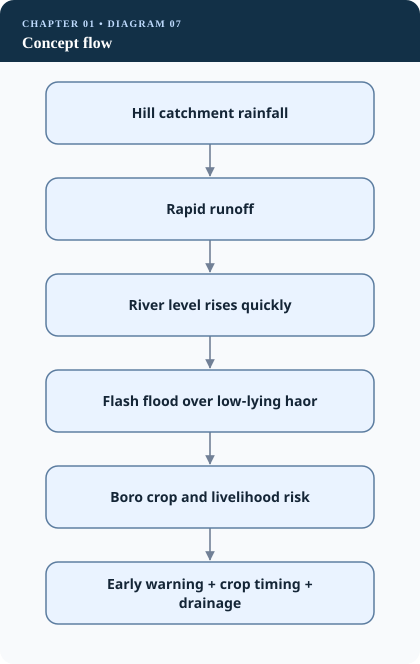</p>

<details>
<summary>ডায়াগ্রামের মূল Mermaid source দেখুন</summary>

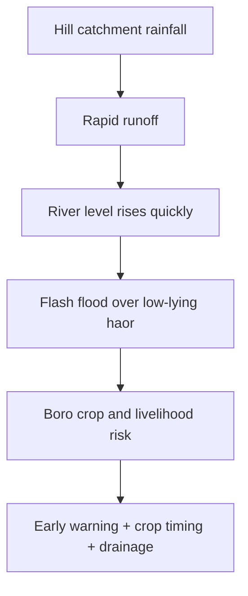

</details>

> [!TIP]
> 🟩 **Memory Formula:** <mark>নিচু অববাহিকা + উজানের ভারী বৃষ্টি → দ্রুত ঢল → আগাম বন্যা → বোরো ঝুঁকি</mark>।

> [!NOTE]
> 🔵 **Sources:** **Banglapedia, Asiatic Society of Bangladesh — [“Bangladesh Geography”, section “Haor Basin”](https://en.banglapedia.org/index.php?title=Bangladesh_Geography)**; **GED / Planning Commission — [BDP 2100 Regional Hotspots](https://bcdp.gov.bd/)**।

**যে প্রশ্নই আসুক:** *Define Haor*—অববাহিকা ও মৌসুমি প্রকৃতি; *Why vulnerable?*—উজান থেকে rapid runoff; *Importance*—কৃষি–মৎস্য–প্রতিবেশ; *Policy*—early warning + adaptive cropping + wetland drainage।

---


**এবার উত্তর-পূর্বের নিচু হাওরে পৌঁছালেন।** শুষ্ক মৌসুমে বিস্তৃত জমিতে <mark>বোরো ধান</mark> হতে পারে; বর্ষাকালে একই জায়গা পানিতে ভরে যায়। ফসল কাটার আগে পাহাড়ি ঢল এলে ক্ষতি কেন হয়—এবার বিষয়টি সহজে বোঝা যায়।

- 🧭 **অবস্থান:** উত্তর-পূর্বাঞ্চলের নিচু অববাহিকাগুলো; সুনামগঞ্জের হাওর পরিচিত উদাহরণ।
- 🌊 **ভূপ্রকৃতি:** মৌসুমি জলাভূমি; শুষ্ক ও বর্ষা মৌসুমে দৃশ্য ভিন্ন।
- 🌾 **জীবিকা:** বোরো ধান, মাছ ও জলাভূমির সম্পদ।
- ⚠️ **ঝুঁকি:** **<mark>Flash Flood</mark>**—অল্প সময়ে পানির প্রবাহ ও উচ্চতা বেড়ে আগাম প্লাবন।
- ✅ **ব্যবস্থাপনা:** আগাম সতর্কতা, ফসলের সময়সূচি, উপযুক্ত পানি নিষ্কাশন ও পরিবেশসম্মত অবকাঠামো।

> [!TIP]
> 🟢 **স্মরণ-সহায়ক সূত্র — HAOR = Basin + Boro + Flash Flood.**

> [!NOTE]
> 🔵 **Source:** **Banglapedia — “Bangladesh Geography”** [S2]; **GED, “Bangladesh Delta Plan 2100”** [S6]।

<a id="haor-photo"></a>

<p align="center"><a href="https://commons.wikimedia.org/wiki/File:%E0%A6%9F%E0%A6%BE%E0%A6%99%E0%A7%8D%E0%A6%97%E0%A7%81%E0%A6%AF%E0%A6%BC%E0%A6%BE%E0%A6%B0_%E0%A6%B9%E0%A6%BE%E0%A6%93%E0%A6%B0.JPG"></a></p>

*🖼️ Figure 5 — **Tanguar Haor**। **কী দেখবেন:** হাওরের মৌসুমি জলাভূমির দৃশ্য। **Credit:** Sarkershuvro (2015-03-09); **License:** CC BY-SA 4.0; **Image source:** [Wikimedia Commons file page](https://commons.wikimedia.org/wiki/File:%E0%A6%9F%E0%A6%BE%E0%A6%99%E0%A7%8D%E0%A6%97%E0%A7%81%E0%A6%AF%E0%A6%BC%E0%A6%BE%E0%A6%B0_%E0%A6%B9%E0%A6%BE%E0%A6%93%E0%A6%B0.JPG)। ছবিতে ক্লিক করলে মূল ফাইলের উচ্চ রেজল্যুশন এবং সম্পূর্ণ লাইসেন্স পাওয়া যাবে।*

> [!TIP]
 > **চিত্র পর্যবেক্ষণ:** হাওরের মৌসুমি জলাভূমির দৃশ্য—ছবিতে দৃশ্যমান একটি বৈশিষ্ট্য চিহ্নিত করে তার একটি কারণ ও একটি সম্ভাব্য প্রভাব ব্যাখ্যা করুন।

 [⬆️ Go to Contents](#top)

### ৩.৪ Chattogram Hill Tracts — পাহাড়ি ভূপ্রকৃতি ও ঢালের ঝুঁকি

#### বিস্তারিত ব্যাখ্যা — পার্বত্য চট্টগ্রাম: কী, কোথায়, কেন, কীভাবে ও প্রভাব

**মূল বৈশিষ্ট্য ও প্রভাব:** ঢাল, শৈলশিরা ও উপত্যকাবিশিষ্ট পাহাড়ি অঞ্চল। রাঙামাটি, বান্দরবান ও খাগড়াছড়ি জেলার পার্বত্য অঞ্চল। ভূতাত্ত্বিক গঠন, ভাঁজ ও দীর্ঘমেয়াদি ক্ষয়প্রক্রিয়া পাহাড়ি ভূমিরূপ সৃষ্টি করেছে; এটি নবীন বদ্বীপীয় সমতল থেকে আলাদা। অঞ্চলটির পূর্ণ বৈশিষ্ট্য ব্যাখ্যা করতে ভূমির উৎপত্তি, বর্তমান জীবিকা এবং সংশ্লিষ্ট ঝুঁকির সম্পর্ক বিশ্লেষণ করা প্রয়োজন।

1. **🟪 কী (What):** ঢাল, শৈলশিরা ও উপত্যকাবিশিষ্ট পাহাড়ি অঞ্চল।
2. **🧭 কোথায় (Where):** রাঙামাটি, বান্দরবান ও খাগড়াছড়ি জেলার পার্বত্য অঞ্চল।
3. **🟨 কেন এমন (Why):** ভূতাত্ত্বিক গঠন, ভাঁজ ও দীর্ঘমেয়াদি ক্ষয়প্রক্রিয়া পাহাড়ি ভূমিরূপ সৃষ্টি করেছে; এটি নবীন বদ্বীপীয় সমতল থেকে আলাদা।
4. **⚙️ কীভাবে কাজ করে (How / Mechanism):** প্রবল বৃষ্টিতে ঢালু ভূমিতে দ্রুত পানি নেমে যায়; পাহাড় কাটা, বনহানি ও অনিরাপদ নির্মাণ ঢালের স্থিতিশীলতা কমাতে পারে।
5. **🌾 প্রভাব (Impact):** ভূমিধস ও মাটিক্ষয়ের ঝুঁকি; বন, পর্যটন, স্থানীয় সংস্কৃতি ও জীববৈচিত্র্যের গুরুত্বপূর্ণ ভূমিকা।
6. **🟩 করণীয় (Solutions / Policy):** ঝুঁকিভিত্তিক ভূমি ব্যবহার, পাহাড় না কেটে অবকাঠামো, ঢালের পানি নিষ্কাশন এবং স্থানীয় জনগোষ্ঠীর অংশগ্রহণ।

**Cause → Effect → Response (কারণ–ফল–করণীয়)**

<p></p>

<details>
<summary>ডায়াগ্রামের মূল Mermaid source দেখুন</summary>


</details>

> [!WARNING]
> 🟨 **পরীক্ষায় প্রয়োগ:** পার্বত্য অঞ্চল ও প্লাবনভূমির পার্থক্য কী? ভূমিধসের প্রাকৃতিক ও মানবসৃষ্ট কারণ কী?

> [!TIP]
> 🟩 **স্ব-পরীক্ষা:** বই বন্ধ করে ৩০ সেকেন্ডে বলুন: **কী → কোথায় → কেন → কীভাবে → প্রভাব → সমাধান**। তারপর একটি বাংলাদেশের উদাহরণ যোগ করুন।

> [!NOTE]
> 🟦 **Named sources (মূল আলোচনা যাচাইয়ের জন্য):** Banglapedia — Asiatic Society of Bangladesh, Bangladesh Geography; GED — Bangladesh Delta Plan 2100। মূল নথির লিংক [Sources & Evidence](#sources) অংশে রয়েছে।


**সমতল ছেড়ে পাহাড়ে উঠুন।** একই বৃষ্টিপাত সমতলে জমে থাকতে পারে, কিন্তু ঢালু পাহাড়ে দ্রুত নেমে যায়; অপরিকল্পিত পাহাড় কাটায় সেই ঢাল আরও ঝুঁকিপূর্ণ হতে পারে।

- ⛰️ **ভূপ্রকৃতি:** পাহাড়, শৈলশিরা, উপত্যকা, ঢাল ও দ্রুত প্রবাহ।
- 🗺️ **অবস্থান:** পার্বত্য চট্টগ্রাম; সিলেটের টিলা-পাহাড়কে একই ভূঅঞ্চল ধরে নেওয়া ঠিক নয়।
- ⚠️ **ঝুঁকি:** <mark>ভূমিধস, মাটিক্ষয়</mark>, বনহানি ও অনিয়ন্ত্রিত নির্মাণ।
- 🌳 **ব্যবস্থাপনা:** পরিবেশসম্মত ভূমি ব্যবহার, বন সংরক্ষণ ও সঠিক drainage।

> [!TIP]
> 🟢 **স্মরণ-সহায়ক সূত্র — HILL = Slope + Forest + Landslide Risk.**

> [!NOTE]
> 🔵 **Source:** **Banglapedia — “Bangladesh Geography”** [S2], **“ভূ-প্রকৃতি”** [S3]; **GED, “Bangladesh Delta Plan 2100”** [S6]।

<a id="cht-photo"></a>

<p align="center"><a href="https://commons.wikimedia.org/wiki/File:Sajek_Valley_00.jpg"></a></p>

*🖼️ Figure 6 — **Sajek Valley — Chattogram Hill Tracts**। **কী দেখবেন:** পাহাড়ের ঢাল ও শৈলশিরা। **Credit:** Ahnaf010 (2022-07-03); **License:** CC BY-SA 4.0; **Image source:** [Wikimedia Commons file page](https://commons.wikimedia.org/wiki/File:Sajek_Valley_00.jpg)। ছবিতে ক্লিক করলে মূল ফাইলের উচ্চ রেজল্যুশন এবং সম্পূর্ণ লাইসেন্স পাওয়া যাবে।*

> [!TIP]
 > **চিত্র পর্যবেক্ষণ:** পাহাড়ের ঢাল ও শৈলশিরা—ছবিতে দৃশ্যমান একটি বৈশিষ্ট্য চিহ্নিত করে তার একটি কারণ ও একটি সম্ভাব্য প্রভাব ব্যাখ্যা করুন।

<p align="center"><a href="https://commons.wikimedia.org/wiki/File:Chittagong_Hill_Tracts.PNG"></a></p>

*🖼️ Figure 6B — **Chittagong Hill Tracts locator map**। **কী দেখবেন:** পার্বত্য অঞ্চলের অবস্থান; পুরোনো জেলা সীমানা। **Credit:** Armanaziz / AnonyLog (2009); **License:** GFDL / CC license on file page; **Image source:** [Wikimedia Commons file page](https://commons.wikimedia.org/wiki/File:Chittagong_Hill_Tracts.PNG)। ছবিতে ক্লিক করলে মূল ফাইলের উচ্চ রেজল্যুশন এবং সম্পূর্ণ লাইসেন্স পাওয়া যাবে।*

> [!TIP]
 > **চিত্র পর্যবেক্ষণ:** পার্বত্য অঞ্চলের অবস্থান; পুরোনো জেলা সীমানা—ছবিতে দৃশ্যমান একটি বৈশিষ্ট্য চিহ্নিত করে তার একটি কারণ ও একটি সম্ভাব্য প্রভাব ব্যাখ্যা করুন।

[⬆️ Go to Contents](#top)

### ৩.৫ Tidal Delta & Sundarbans — দক্ষিণ-পশ্চিমের জোয়ারভাটার বনভূমি

#### বিস্তারিত ব্যাখ্যা — সুন্দরবন ও জোয়ারভাটার বদ্বীপ: কী, কোথায়, কেন, কীভাবে ও প্রভাব

**মূল বৈশিষ্ট্য ও প্রভাব:** জোয়ারভাটা, নদীপলি ও লবণাক্ততার প্রভাবে গড়ে ওঠা উপকূলীয় ম্যানগ্রোভ পরিবেশ। বাংলাদেশের দক্ষিণ-পশ্চিম উপকূল, বিশেষত খুলনা–সাতক্ষীরা–বাগেরহাটের উপকূলীয় অংশ। মিঠাপানি ও লবণপানির মিশ্রণ, জোয়ারভাটা, পলি এবং উদ্ভিদের অভিযোজন একত্রে এই প্রতিবেশব্যবস্থার বৈশিষ্ট্য গড়ে তোলে। অঞ্চলটির পূর্ণ বৈশিষ্ট্য ব্যাখ্যা করতে ভূমির উৎপত্তি, বর্তমান জীবিকা এবং সংশ্লিষ্ট ঝুঁকির সম্পর্ক বিশ্লেষণ করা প্রয়োজন।

1. **🟪 কী (What):** জোয়ারভাটা, নদীপলি ও লবণাক্ততার প্রভাবে গড়ে ওঠা উপকূলীয় ম্যানগ্রোভ পরিবেশ।
2. **🧭 কোথায় (Where):** বাংলাদেশের দক্ষিণ-পশ্চিম উপকূল, বিশেষত খুলনা–সাতক্ষীরা–বাগেরহাটের উপকূলীয় অংশ।
3. **🟨 কেন এমন (Why):** মিঠাপানি ও লবণপানির মিশ্রণ, জোয়ারভাটা, পলি এবং উদ্ভিদের অভিযোজন একত্রে এই প্রতিবেশব্যবস্থার বৈশিষ্ট্য গড়ে তোলে।
4. **⚙️ কীভাবে কাজ করে (How / Mechanism):** উজানের মিঠাপানির প্রবাহ, লবণাক্ততা, ঘূর্ণিঝড় ও পলি পরিবহনের পরিবর্তন বন ও মানুষের জীবিকার ওপর প্রভাব ফেলে।
5. **🌾 প্রভাব (Impact):** জীববৈচিত্র্য, মৎস্যসম্পদ ও ঝড়ের প্রভাব কমাতে উপকূলীয় বন গুরুত্বপূর্ণ; লবণাক্ততা ও পরিবেশগত চাপ জীবিকা ঝুঁকিতে ফেলে।
6. **🟩 করণীয় (Solutions / Policy):** ম্যানগ্রোভ সংরক্ষণ, নদীর প্রবাহের সুশাসন, স্থানীয় জীবিকার বিকল্প ও পরিবেশগত পর্যবেক্ষণ।

**Cause → Effect → Response (কারণ–ফল–করণীয়)**

<p></p>

<details>
<summary>ডায়াগ্রামের মূল Mermaid source দেখুন</summary>


</details>

> [!WARNING]
> 🟨 **পরীক্ষায় প্রয়োগ:** ম্যানগ্রোভ বন কেন গড়ে ওঠে? সুন্দরবন সংরক্ষণ কেন জাতীয় উন্নয়নের বিষয়?

> [!TIP]
> 🟩 **স্ব-পরীক্ষা:** বই বন্ধ করে ৩০ সেকেন্ডে বলুন: **কী → কোথায় → কেন → কীভাবে → প্রভাব → সমাধান**। তারপর একটি বাংলাদেশের উদাহরণ যোগ করুন।

> [!NOTE]
> 🟦 **Named sources (মূল আলোচনা যাচাইয়ের জন্য):** UNESCO World Heritage Centre — The Sundarbans; Banglapedia — Bangladesh Geography। মূল নথির লিংক [Sources & Evidence](#sources) অংশে রয়েছে।


**নদী ও সমুদ্রের সংযোগস্থল:** নদীর মিঠাপানি ও সাগরের লবণাক্ত পানির মিশ্রণ, জোয়ার-ভাটা এবং পলি সঞ্চয় সুন্দরবনের ম্যানগ্রোভ পরিবেশ গঠনে ভূমিকা রাখে।

- 🌊 **পরিবেশ:** <mark>Tidal Floodplain</mark>—জোয়ারভাটা, লবণাক্ততা ও নদীর পলির সম্মিলিত প্রভাব।
- 🌿 **জীববৈচিত্র্য:** Mangrove Ecosystem ও উপকূলীয় জীবনযাত্রা।
- 🟨 **ঐতিহাসিক তথ্য:** বাংলাদেশের **The Sundarbans** UNESCO World Heritage List-এ **<mark>১৯৯৭ সালে</mark>** অন্তর্ভুক্ত।
- ⚠️ **পার্থক্য:** সমগ্র বনাঞ্চল এবং UNESCO-inscribed World Heritage property-এর সীমানা/আয়তন এক নয়।

> [!TIP]
> 🟢 **স্মরণ-সহায়ক সূত্র — SUNDARBANS = Tide + Mangrove + 1997 UNESCO.**

> [!NOTE]
> 🔵 **Source:** **UNESCO World Heritage Centre — “The Sundarbans”, World Heritage List No. 798** [S11]; **Banglapedia — “Bangladesh Geography”** [S2]।

<a id="coastal-photo"></a>

<p align="center"><a href="https://commons.wikimedia.org/wiki/File:Landset_9_image_of_Bangladesh_coast.jpg"></a></p>

*🖼️ Figure 7 — **Bangladesh Coast: Landsat-9 Natural Colour**। **কী দেখবেন:** সুন্দরবনের বনভূমি, কৃষিজমি ও উপকূলের পার্থক্য। **Credit:** NASA / USGS Landsat program (2022-02-08); **License:** Public domain (NASA); **Image source:** [Wikimedia Commons file page](https://commons.wikimedia.org/wiki/File:Landset_9_image_of_Bangladesh_coast.jpg)। ছবিতে ক্লিক করলে মূল ফাইলের উচ্চ রেজল্যুশন এবং সম্পূর্ণ লাইসেন্স পাওয়া যাবে।*

> [!TIP]
 > **চিত্র পর্যবেক্ষণ:** সুন্দরবনের বনভূমি, কৃষিজমি ও উপকূলের পার্থক্য—ছবিতে দৃশ্যমান একটি বৈশিষ্ট্য চিহ্নিত করে তার একটি কারণ ও একটি সম্ভাব্য প্রভাব ব্যাখ্যা করুন।

 [⬆️ Go to Contents](#top)

### ৩.৬ Coastal Plain — মোহনা, চর, দ্বীপ ও উপকূল

#### বিস্তারিত ব্যাখ্যা — উপকূল, মোহনা ও চর: কী, কোথায়, কেন, কীভাবে ও প্রভাব

**মূল বৈশিষ্ট্য ও প্রভাব:** নদীর পলি ও সামুদ্রিক প্রক্রিয়ায় পরিবর্তিত সমতল, মোহনা, চর ও দ্বীপসমূহ। মেঘনা মোহনা, বঙ্গোপসাগর উপকূল এবং দক্ষিণ ও দক্ষিণ-পূর্বের বিভিন্ন উপকূলীয় অঞ্চল। নদী পলি বহন করে; ঢেউ, জোয়ারভাটা ও স্রোত কোথায় পলি জমবে এবং কোথায় ক্ষয় হবে তা প্রভাবিত করে। অঞ্চলটির পূর্ণ বৈশিষ্ট্য ব্যাখ্যা করতে ভূমির উৎপত্তি, বর্তমান জীবিকা এবং সংশ্লিষ্ট ঝুঁকির সম্পর্ক বিশ্লেষণ করা প্রয়োজন।

1. **🟪 কী (What):** নদীর পলি ও সামুদ্রিক প্রক্রিয়ায় পরিবর্তিত সমতল, মোহনা, চর ও দ্বীপসমূহ।
2. **🧭 কোথায় (Where):** মেঘনা মোহনা, বঙ্গোপসাগর উপকূল এবং দক্ষিণ ও দক্ষিণ-পূর্বের বিভিন্ন উপকূলীয় অঞ্চল।
3. **🟨 কেন এমন (Why):** নদী পলি বহন করে; ঢেউ, জোয়ারভাটা ও স্রোত কোথায় পলি জমবে এবং কোথায় ক্ষয় হবে তা প্রভাবিত করে।
4. **⚙️ কীভাবে কাজ করে (How / Mechanism):** নদীর গতিপথ ও পলি সরবরাহ বদলালে চর জাগতে বা ভাঙতে পারে। এক উপকূলের পরিবর্তনের হার অন্য উপকূলের মতো হবে এমন নয়।
5. **🌾 প্রভাব (Impact):** মৎস্য, বন্দর, নৌপরিবহন ও নতুন ভূমির সুযোগ; ভাঙন, ঘূর্ণিঝড়, জলোচ্ছ্বাস ও লবণাক্ততার ঝুঁকি।
6. **🟩 করণীয় (Solutions / Policy):** স্থানভিত্তিক shoreline monitoring, দুর্যোগ সতর্কতা, উপকূলীয় বাঁধের রক্ষণাবেক্ষণ ও ecosystem-based adaptation।

**Cause → Effect → Response (কারণ–ফল–করণীয়)**

<p></p>

<details>
<summary>ডায়াগ্রামের মূল Mermaid source দেখুন</summary>


</details>

> [!WARNING]
> 🟨 **পরীক্ষায় প্রয়োগ:** চর কেন সৃষ্টি হয়? একই উপকূলে ভূমি বৃদ্ধি ও ক্ষয় একসঙ্গে কীভাবে ঘটে?

> [!TIP]
> 🟩 **স্ব-পরীক্ষা:** বই বন্ধ করে ৩০ সেকেন্ডে বলুন: **কী → কোথায় → কেন → কীভাবে → প্রভাব → সমাধান**। তারপর একটি বাংলাদেশের উদাহরণ যোগ করুন।

> [!NOTE]
> 🟦 **Named sources (মূল আলোচনা যাচাইয়ের জন্য):** Banglapedia — Asiatic Society of Bangladesh, Bangladesh Geography; GED — Bangladesh Delta Plan 2100। মূল নথির লিংক [Sources & Evidence](#sources) অংশে রয়েছে।


**শেষে বঙ্গোপসাগরের দিকে তাকান।** নদী পলি নিয়ে আসে; সাগরের তরঙ্গ, জোয়ার ও স্রোত সেই পলি কোথায় জমবে বা কোথায় ক্ষয় হবে, তা প্রভাবিত করে। তাই উপকূল একটানা একই রকম থাকে না।

- 🏝️ **ভূপ্রক্রিয়া:** **<mark>Accretion</mark>** (পলি জমে ভূমি বৃদ্ধি) এবং **<mark>Erosion</mark>** (ভূমিক্ষয়) পাশাপাশি ঘটে।
- 🧭 **আঞ্চলিক ভিন্নতা:** মেঘনা মোহনা, কক্সবাজার ও অন্য উপকূলীয় অংশের ভূমিরূপ এক নয়।
- 🛰️ **মানচিত্র-সতর্কতা:** সরকারি প্রশাসনিক আয়তন, একটি নির্দিষ্ট দিনের satellite shoreline এবং দীর্ঘমেয়াদি ভূপ্রাকৃতিক সীমারেখা আলাদা ধারণা।
- ⚓ **প্রয়োগ:** বন্দর, নৌপথ, মৎস্য, উপকূলীয় কৃষি ও দুর্যোগ পরিকল্পনা।

> [!TIP]
> 🟢 **স্মরণ-সহায়ক সূত্র — COAST = River Sediment + Sea Waves + Changing Shoreline.**

> [!NOTE]
> 🔵 **Source:** **Banglapedia — “Bangladesh Geography”** [S2] এবং **“ভূ-প্রকৃতি”** [S3]।

<a id="rivers"></a>

<a id="char-photo"></a>

<p align="center"><a href="https://commons.wikimedia.org/wiki/File:Cattle_on_a_Char_(27917537222).jpg"></a></p>

*🖼️ Figure 8 — **Livelihoods on a Jamuna River Char**। **কী দেখবেন:** চরে গবাদিপশু পালন ও মানুষের জীবিকা; চর কীভাবে তৈরি তা দেখায় না। **Credit:** David Stanley (2016-02-10); **License:** CC BY 2.0; **Image source:** [Wikimedia Commons file page](https://commons.wikimedia.org/wiki/File:Cattle_on_a_Char_(27917537222).jpg)। ছবিতে ক্লিক করলে মূল ফাইলের উচ্চ রেজল্যুশন এবং সম্পূর্ণ লাইসেন্স পাওয়া যাবে।*

> [!TIP]
 > **চিত্র পর্যবেক্ষণ:** চরে গবাদিপশু পালন ও মানুষের জীবিকা; চর কীভাবে তৈরি তা দেখায় না—ছবিতে দৃশ্যমান একটি বৈশিষ্ট্য চিহ্নিত করে তার একটি কারণ ও একটি সম্ভাব্য প্রভাব ব্যাখ্যা করুন।

 [⬆️ Go to Contents](#top)

## ৪. River Dynamics — বাংলাদেশের ভূপ্রকৃতি গঠনে নদীর ভূমিকা

### ৪.১ নদীর দ্বৈত ভূমিকা — সম্পদ ও ঝুঁকির উৎস

উদাহরণ হিসেবে, যমুনার তীরবর্তী একটি কৃষক পরিবারের অভিজ্ঞতা বিবেচনা করা যায়। বর্ষায় নদীর পানি ও পলি জমির উর্বরতা বাড়াতে পারে; তবে নদীভাঙনে একই পরিবার জমি ও বসতভিটা হারাতে পারে। অন্যদিকে, পলি সঞ্চয়ে নতুন চর গঠিত হলে সেখানে কৃষিকাজের সুযোগ তৈরি হতে পারে। **তাই নদীকে কেবল ‘বন্যার কারণ’ অথবা ‘উর্বরতার উৎস’ হিসেবে ব্যাখ্যা করলে এর সামগ্রিক ভূমিকা বোঝা যায় না।** নদীর পানি, পলি, গতিপথ, ভূখণ্ড ও মানুষের সিদ্ধান্ত—সব মিলেই ফল নির্ধারিত হয়।

> [!IMPORTANT]
> **মূল বক্তব্য:** <mark>বাংলাদেশের নদীপ্রণালি একটি পরিবর্তনশীল জল–পলি–ভূমি ব্যবস্থা (dynamic water–sediment–land system)।</mark> তাই নদী ব্যবস্থাপনা মানে শুধু বাঁধ দেওয়া নয়; স্রোত, পলি, নৌপথ, নদীর অধিকারভূমি, ক্ষয়–সঞ্চয়, পরিবেশ ও মানুষের জীবিকা একসঙ্গে বোঝা।

### ৪.২ What & Where — তিন প্রধান নদীপ্রণালি

| River System | কোথায়/কীভাবে প্রবাহের সঙ্গে যুক্ত | নদীর ভূপ্রাকৃতিক ভূমিকা | পরীক্ষায় জিজ্ঞেস হতে পারে |
|---|---|---|---|
| **Ganges–Padma** | পশ্চিম দিক থেকে প্রবাহিত গঙ্গা বাংলাদেশের পদ্মা ব্যবস্থার অংশ; পরে যমুনার সঙ্গে মিলিত হয় | পলি, প্লাবনভূমি, দক্ষিণ-পশ্চিমের নদীজাল | গঙ্গা-পদ্মার শাখানদী, floodplain ও delta |
| **Brahmaputra–Jamuna** | উত্তরে প্রবেশ করে যমুনা নামে প্রধান দক্ষিণমুখী প্রবাহ; পুরোনো ব্রহ্মপুত্র পৃথক ঐতিহাসিক খাত | braided channel, চর সৃষ্টি, নদীভাঙন ও পরিবর্তিত প্রবাহপথ | Avulsion, Channel Migration, Jamuna chars |
| **Surma–Kushiyara–Meghna** | উত্তর-পূর্বের পাহাড়ি অববাহিকা ও হাওরের পানি গ্রহণ করে মেঘনা ব্যবস্থার দিকে প্রবাহ | হাওর, আকস্মিক বন্যা, মোহনায় মিঠাপানি–লবণপানির সংযোগ | Haor flood, estuary, coastal sediment |

**কেন তিনটি একসঙ্গে শিখবেন?** দেশের মধ্যে নদীর পানি দেখা গেলেও অনেক পানির উৎস ও অববাহিকা দেশের বাইরে। তাই উজানের বৃষ্টি, প্রবাহ, আন্তঃসীমান্ত সহযোগিতা ও মোহনার পরিবর্তন আলাদা করা যায় না। বিস্তারিত: [Banglapedia — *Bangladesh Geography*](https://en.banglapedia.org/index.php?title=Bangladesh_Geography), [Banglapedia — *Ganges-Padma River System*](https://en.banglapedia.org/index.php?title=Ganges-Padma_River_System)।

### ৪.৩ How It Works — নদী কীভাবে ভাঙে ও গড়ে?

**প্রক্রিয়া A — পলি পরিবহন (Sediment Transport)**

1. উজানের পাহাড় ও ভূমি থেকে ক্ষয়ে আসা বালি–সিল্ট–কাদা নদীতে মেশে।
2. প্রবাহের বেগ ও বহনক্ষমতা বেশি হলে নদী পলি বহন করে; কোথাও বেগ কমলে কিছু কণা জমতে থাকে।
3. চর, তীরবর্তী পলি ও প্লাবনভূমি গড়ে উঠতে পারে। তবে <mark>পলি জমলেই সব জায়গায় চিরস্থায়ী নতুন জমি হয় না</mark>—পরের বর্ষায় সেই চর আবার ক্ষয়ে যেতে পারে।
4. মোহনায় নদীর প্রবাহের সঙ্গে সাগরের জোয়ার, ঢেউ ও স্রোতের মিথস্ক্রিয়া হয়।

**প্রক্রিয়া B — নদীভাঙন (Riverbank Erosion)**

- বাঁক, শক্তিশালী স্রোত ও স্থানীয় তীরের মাটির বৈশিষ্ট্য তীর ক্ষয়ের ওপর প্রভাব ফেলে।
- নদীতীর ভাঙলে বসতি, রাস্তা, বিদ্যালয়, বাজার ও কৃষিজমি ক্ষতিগ্রস্ত হতে পারে।
- নদীভাঙন **প্রাকৃতিক ভূপ্রক্রিয়া**; মানুষের অবকাঠামো ও ভূমি ব্যবহারের কারণে ক্ষতির মাত্রা বাড়তে বা কমতে পারে।

**প্রক্রিয়া C — নদীখাত বদল (Channel Migration ও Avulsion)**

- **Migration:** নদীর চ্যানেল ধীরে ধীরে পাশে সরে যেতে পারে।
- **Avulsion:** প্রধান প্রবাহ তুলনামূলক দ্রুত অন্য খাত গ্রহণ করতে পারে; কিন্তু নতুন খাতের বিস্তার ও পুরোনো খাতের পরিত্যাগ বহু বছর ধরে ঘটতে পারে।
- নতুন নদীখাতের সঙ্গে পলি সঞ্চয়, নৌপথ, জনবসতি ও কৃষিজমির অবস্থানও পাল্টায়।

<p>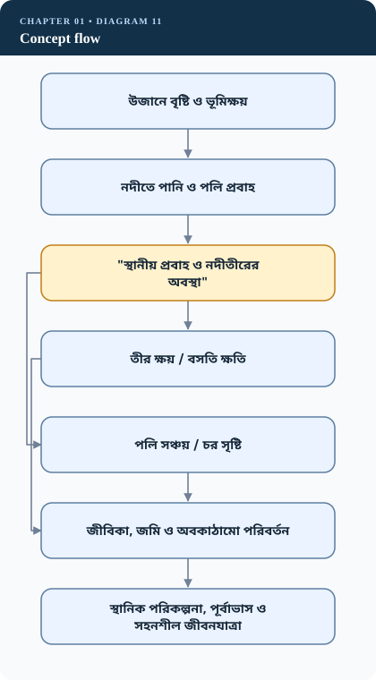</p>

<details>
<summary>ডায়াগ্রামের মূল Mermaid source দেখুন</summary>

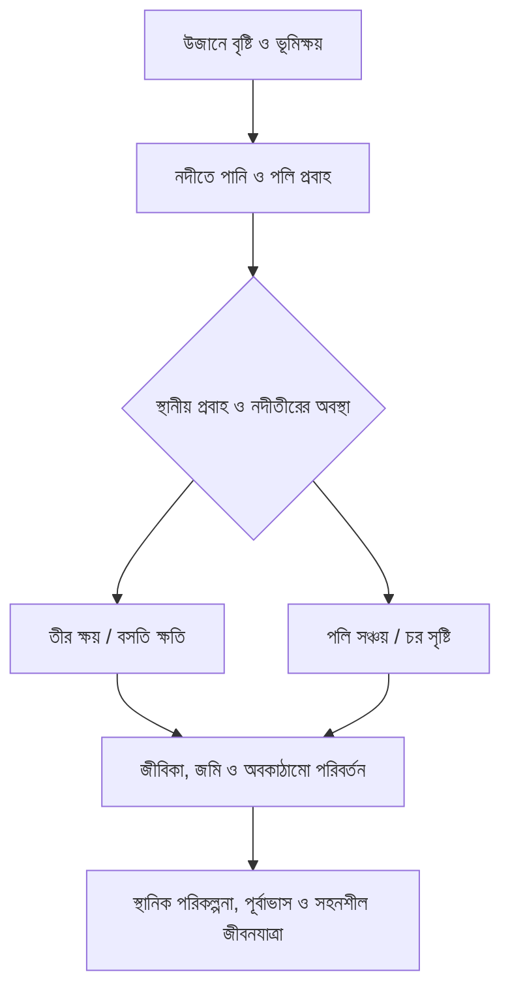

</details>

*Conceptual teaching figure; based on [Banglapedia — Bangladesh Geography](https://en.banglapedia.org/index.php?title=Bangladesh_Geography) ও [GED — Bangladesh Delta Plan 2100](https://bdp2100kp.gov.bd/BDP2100/Overview)। এটি প্রকৃত নদীর গতিপথের বৈজ্ঞানিক simulation নয়।*

### ৪.৪ History Matters — ১৭৮৭ সালের তিস্তা ও ব্রহ্মপুত্র–যমুনা কি একই ঘটনা?

**না। ইতিহাস ও বৈজ্ঞানিক ব্যাখ্যা আলাদা করে পড়ুন।**

| Timeline | কী ঘটেছে | প্রমাণের প্রকৃতি |
|---|---|---|
| **১৭৮৭** | বড় বন্যার পর **তিস্তা** পুরোনো গঙ্গামুখী প্রবাহপথ ছেড়ে ব্রহ্মপুত্রের সঙ্গে সংযোগ গড়ে তোলে—এই ইতিহাস Banglapedia-তে বর্ণিত | [Banglapedia — *Brahmaputra–Jamuna River System*](https://en.banglapedia.org/index.php/Brahmaputra-Jamuna_River_System) |
| ১৮শ শতকের শেষভাগ–১৯শ শতক | ব্রহ্মপুত্রের প্রধান প্রবাহ পুরোনো ব্রহ্মপুত্র খাত থেকে যমুনার পথে সরে যাওয়ার প্রক্রিয়া ধাপে ধাপে সম্পন্ন হয় | [2021 peer-reviewed geomorphology review](https://www.sciencedirect.com/science/article/pii/S0169555X21001045) |
| আনুমানিক ১৮৫৫–৬০ | গবেষণাটির cartographic analysis অনুসারে নতুন যমুনা চ্যানেল প্রধান প্রবাহের ভূমিকা প্রায় পুরোপুরি গ্রহণ করে | একই **2021 research** |

> [!WARNING]
> 🟨 **Common Mistake:** <mark>“১৭৮৭ সালেই ব্রহ্মপুত্রের সম্পূর্ণ নতুন গতিপথ চূড়ান্ত হয়েছিল”</mark>—এমন সরল দাবি করবেন না। ১৭৮৭-এর বন্যা ও তিস্তার পরিবর্তন একটি ঐতিহাসিক ঘটনা; ব্রহ্মপুত্রের প্রধান প্রবাহের পশ্চিমমুখী স্থানান্তর **দীর্ঘমেয়াদি প্রক্রিয়া**। ব্যাখ্যায় ঐতিহাসিক মানচিত্র, নদীর স্রোত ও ভূপ্রাকৃতিক প্রক্রিয়ার ভূমিকা উল্লেখ করুন।

### ৪.৫ People & Development — নদী বদলালে কার জীবনে কী প্রভাব?

| ক্ষেত্র | Positive Mechanism | Negative Mechanism | Balanced response |
|---|---|---|---|
| **Agriculture** | নতুন পলি, সেচ ও কৃষিজমি | জমি ভাঙন, অসময়ে প্লাবন | ফসলের ধরন, সতর্কতা, জমি ব্যবহার |
| **Settlement** | নদীতীরবর্তী যোগাযোগ ও বাজার | বাস্তুচ্যুতি ও অবকাঠামো ক্ষতি | ঝুঁকিমানচিত্র, পরিকল্পিত পুনর্বাসন |
| **Transport** | অভ্যন্তরীণ নৌযোগাযোগ | নাব্যতার পরিবর্তন, চর ও প্রবাহের সমস্যা | নিয়মিত হাইড্রোগ্রাফিক পর্যবেক্ষণ |
| **Ecosystem** | মাছ, জলাভূমি ও পলি চক্র | আবাসস্থল পরিবর্তন, দূষণ | প্রবাহ-সংযোগ ও পরিবেশগত ব্যবস্থাপনা |
| **Governance** | আন্তঃঅঞ্চল যোগাযোগ | উজান-ভাটির স্বার্থের টানাপোড়েন | অববাহিকাভিত্তিক সহযোগিতা |

### ৪.৬ Critical Thinking — শুধু নদীশাসন/বাঁধ কি যথেষ্ট?

**পক্ষ:** ঝুঁকিপূর্ণ স্থানে তীররক্ষা, পূর্বাভাস, সেচ ও অবকাঠামো রক্ষায় প্রকৌশল কাজে লাগে। **সীমাবদ্ধতা:** নদী তার খাত ও পলি বহন পরিবর্তন করতে পারে; কঠিন স্থাপনা এক স্থানের ঝুঁকি অন্যত্র সরিয়ে দিতে পারে—তাই পরিবেশ, পলি, ব্যয় ও মানুষের ওপর প্রভাব বিচার জরুরি। **সুষম উপসংহার:** নির্দিষ্ট স্থানে উপযুক্ত প্রকৌশল + নদী অববাহিকার তথ্য + প্রাকৃতিক প্রবাহ সংরক্ষণ + ক্ষতিগ্রস্ত মানুষের সহায়তা।

> [!TIP]
> 🟩 **Memory Chain: WATER → SEDIMENT → CHANNEL → LAND → PEOPLE → POLICY.** যেকোনো ৫/১০/২০ নম্বরের উত্তরে প্রয়োজন অনুযায়ী এই ছয়টি ধাপ ব্যবহার করুন।

<a id="sediment-photo"></a>

<p align="center"><a href="https://commons.wikimedia.org/wiki/File:Meghna_River_sediment_in_the_Bay_of_Bengal_(MODIS_2019-11-24).jpg"></a></p>

*🛰️ **Satellite reading:** মেঘনা মোহনায় বিভিন্ন রঙের পানি ও পলির বিস্তার দেখুন। দৃশ্যমান রং থেকে **নির্দিষ্ট পরিমাণ পলি বা ক্ষয়ের হার গণনা করা যায় না**। Creator: NASA GSFC/MODIS; Wikimedia Commons [original & license](https://commons.wikimedia.org/wiki/File:Meghna_River_sediment_in_the_Bay_of_Bengal_(MODIS_2019-11-24).jpg)।*

[⬆️ Contents](#top)


<a id="maritime"></a>

## ৫. Bay of Bengal & Maritime Geography — সমুদ্রসীমা থেকে সুনীল অর্থনীতি

### ৫.১ বঙ্গোপসাগরের ভৌগোলিক ও অর্থনৈতিক গুরুত্ব

বাংলাদেশের দক্ষিণ সীমায় বঙ্গোপসাগর আছে—এ তথ্যটি শুধু মানচিত্রের নয়। নদী ও সাগরের মিলন দেশের **নৌবাণিজ্য, বন্দর, মৎস্য, উপকূলীয় কৃষি, পরিবেশ ও নিরাপত্তা**কে একই সঙ্গে প্রভাবিত করে। উদাহরণ হিসেবে চিন্তা করুন, চট্টগ্রাম বন্দরের সঙ্গে অভ্যন্তরীণ সড়ক–রেলযোগাযোগের প্রয়োজন কেন: সমুদ্র দিয়ে আসা পণ্য স্থলভাগে পৌঁছাতে হবে। আবার মাছ ধরার নৌকা ও সামুদ্রিক জীববৈচিত্র্যের প্রয়োজন বাণিজ্যিক জাহাজের প্রয়োজনের সমান নয়। তাই সমুদ্রকে শুধু সম্পদের ভাণ্ডার হিসেবে দেখলে governance-এর দিকটি বাদ পড়ে।

**কী → কোথায় → কেন:** বঙ্গোপসাগর হলো ভারত মহাসাগরের উত্তর-পূর্বাংশে একটি বৃহৎ সাগরীয় উপসাগর। দক্ষিণমুখী নদীপ্রবাহ ও মোহনা বাংলাদেশের উপকূলের সাথে সরাসরি যুক্ত; এখানে জোয়ারভাটা, পলি, ঘূর্ণিঝড় ও লবণাক্ততা গুরুত্বপূর্ণ প্রক্রিয়া। এসব প্রক্রিয়ার কারণে একদিকে খাদ্য ও বাণিজ্যের সুযোগ, অন্যদিকে উপকূলীয় ঝুঁকি তৈরি হয়।

### ৫.২ Maritime Legal Zones — ১২/২৪/২০০ কোথা থেকে মাপা হয়, অধিকার কী?

**<mark>12 / 24 / 200 nautical miles</mark>** তিনটি পৃথক সামুদ্রিক আইনগত অঞ্চল বোঝায়। সব দূরত্ব সমুদ্রসীমা নির্ধারণে প্রযোজ্য **baseline** থেকে বিবেচিত হয়; প্রতিবেশী দেশের সঙ্গে overlap থাকলে ঘোষিত সর্বোচ্চ দূরত্ব স্বয়ংক্রিয়ভাবে কার্যকর দ্বিপক্ষীয় সীমানা নয়।

| Zone | Maximum distance from baseline | রাষ্ট্রের অধিকার ও সীমা | False claim to avoid |
|---|---|---|---|
| Territorial Sea | **১২ NM** | সার্বভৌমত্ব—তবে আন্তর্জাতিক সমুদ্র আইনে অন্য রাষ্ট্রের নির্দিষ্ট নৌচলাচলের অধিকার আছে | অন্য দেশের জাহাজ কখনো যেতে পারে না |
| Contiguous Zone | **২৪ NM** | মূলত শুল্ক, রাজস্ব, অভিবাসন ও স্বাস্থ্যসংক্রান্ত নির্দিষ্ট আইন প্রয়োগে নিয়ন্ত্রণ | সমগ্র অঞ্চলই territorial sea |
| Exclusive Economic Zone (EEZ) | **২০০ NM** | সম্পদ অনুসন্ধান, আহরণ ও সংশ্লিষ্ট অর্থনৈতিক কার্যক্রমে বিশেষ সার্বভৌম অধিকার; আন্তর্জাতিক নৌচলাচলের স্বাধীনতা অব্যাহত | পূর্ণ স্থলসার্বভৌমত্ব |
| Continental Shelf | সমুদ্রতলের ভূতাত্ত্বিক/আইনি ভিত্তিতে নির্ধারিত; কিছু ক্ষেত্রে ২০০ NM ছাড়িয়ে যেতে পারে | সমুদ্রতল ও তার নিচের সম্পদের অধিকার; উপরের জলরাশির অধিকার থেকে আলাদা | EEZ ও continental shelf একই ধারণা |

> [!NOTE]
> 🔵 **Primary Law:** [Ministry of Law, Justice and Parliamentary Affairs — *Territorial Waters and Maritime Zones Act, 1974*, amended 2021](https://bdlaws.minlaw.gov.bd/act-print-467.html)। সমুদ্রের আইনি শব্দের ক্ষেত্রে এই আইন এবং **UNCLOS**-এর ভাষাই মূল; এখানে পরীক্ষার সুবিধার্থে সরলীকরণ করা হয়েছে।

### ৫.৩ Which Judgment Did What? — ২০১২ ও ২০১৪

**বাংলাদেশ–মিয়ানমার (ITLOS, ১৪ মার্চ ২০১২):** সমুদ্রসীমার বিরোধ নিষ্পত্তিতে **International Tribunal for the Law of the Sea**, Case No. 16 রায় দেয়। সমুদ্রসীমা ও মহীসোপানের ধারণা বোঝাতে এই রায় জরুরি। [ITLOS official case & judgment](https://itlos.org/en/main/cases/list-of-cases/case-no-16/)।

**বাংলাদেশ–ভারত (PCA-administered arbitration, ৭ জুলাই ২০১৪):** UNCLOS Annex VII অনুসারে গঠিত সালিসি ট্রাইব্যুনাল সমুদ্রসীমার বিষয়ে **Award** দেয়। *PCA* সালিসি কার্যক্রমের প্রশাসনিক সহায়তা দিয়েছে—এটিকে সরলভাবে “PCA আদালতের রায়” না বলে **PCA-administered arbitral award** বলা অধিক নির্ভুল। [PCA official release](https://pca-cpa.org/en/news/bay-of-bengal-maritime-boundary-arbitration-between-bangladesh-and-india-bangladesh-v-india/)।

> [!WARNING]
> 🟨 **Exam Difference:** <mark>২০১২—মিয়ানমার—ITLOS Judgment</mark> | <mark>২০১৪—ভারত—Arbitral Award</mark>। আইনি সিদ্ধান্ত মানেই সব প্রাকৃতিক সম্পদ আবিষ্কৃত বা বাণিজ্যিকভাবে উত্তোলিত—এটি দাবি করবেন না।

### ৫.৪ Blue Economy — প্রকৃত সুযোগ ও প্রয়োজনীয় শর্ত

| সম্ভাবনার খাত | কীভাবে উপকার হতে পারে | কিসে আটকে যেতে পারে | করণীয় |
|---|---|---|---|
| Maritime Trade | বন্দর ও জাহাজ চলাচলে বাণিজ্য | সংযোগ, নিরাপত্তা, দূষণ | নির্ভরযোগ্য logistics, নিরাপত্তা ও পরিবেশরক্ষা |
| Fisheries | খাদ্য, কর্মসংস্থান ও মূল্য সংযোজন | অতিআহরণ, দূষণ ও তথ্যের ঘাটতি | মজুত নিরূপণ, সংরক্ষণ ও নিয়মতান্ত্রিক আহরণ |
| Marine Research | সাগরের তথ্যভিত্তিক সম্পদ ব্যবস্থাপনা | গবেষণা, জাহাজ ও দক্ষতার অভাব | oceanography, GIS, মৎস্য গবেষণা |
| Coastal Tourism | স্থানীয় আয় ও সেবা | বর্জ্য, habitat loss, seasonal pressure | স্থানীয় অংশগ্রহণ ও carrying capacity |
| Offshore Energy | সম্ভাব্য শক্তি ও বিনিয়োগ | খরচ, পরিবেশ ও অনিশ্চয়তা | exploration evidence ও পূর্ণ environmental assessment |

**Blue Economy বনাম Coastal Exploitation:** যেকোনো সামুদ্রিক সম্পদ আহরণই সুনীল অর্থনীতি নয়। একটি ভালো উত্তরে **অর্থনৈতিক উন্নয়ন + ecosystem health + সামাজিক ন্যায় + দীর্ঘমেয়াদি sustainability** দেখাতে হবে।

### ৫.৫ Why Cyclones & Salinity Matter — উপকূলের ভৌগোলিক যুক্তি

- **ঘূর্ণিঝড়:** বঙ্গোপসাগরে সৃষ্ট ঝড়, উপকূলের ভূমির উচ্চতা, জোয়ার এবং স্থানীয় তটরেখার আকৃতি—সব মিলিয়ে বিপদ বাড়তে পারে।
- **জলোচ্ছ্বাস (Storm Surge):** ঝড়ের কারণে সমুদ্রের পানির স্তর সাময়িকভাবে স্বাভাবিকের ওপরে ওঠে; এটিকে শুধু স্বাভাবিক জোয়ার বলবেন না।
- **লবণাক্ততা (Salinity):** নদীর মিঠাপানি ও সমুদ্রের লবণাক্ত পানির মিথস্ক্রিয়া; শুষ্ক মৌসুমের প্রবাহ, জোয়ার, ভূমি ব্যবহার ও অন্যান্য স্থানীয় বিষয় ভূমিকা রাখে।
- **ঝুঁকির মাত্রা:** প্রাকৃতিক hazard এবং মানুষের **exposure** ও **vulnerability** একসঙ্গে বিচার করলে ক্ষতির প্রকৃত ধারণা মেলে।

<p>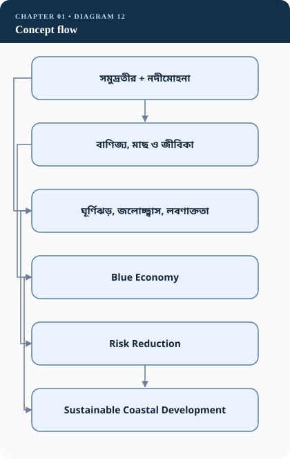</p>

<details>
<summary>ডায়াগ্রামের মূল Mermaid source দেখুন</summary>

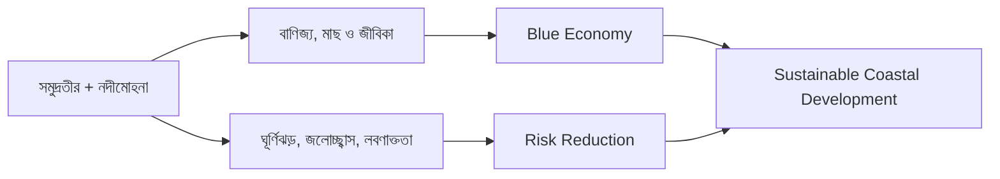

</details>

### ৫.৬ ২০ নম্বরের প্রশ্নে কীভাবে মূল্যায়ন করবেন?

**Proposition:** “The Bay of Bengal is an economic opportunity as well as a security challenge for Bangladesh.”

উত্তর সাজান: (i) অবস্থান ও আইনগত অঞ্চল; (ii) বাণিজ্য, মৎস্য ও বিজ্ঞান; (iii) ITLOS/PCA-র রায় ও কূটনৈতিক তাৎপর্য; (iv) ঘূর্ণিঝড়–সুনামি–লবণাক্ততা–পরিবেশ ঝুঁকির প্রাসঙ্গিকতা (সুনামি বিষয়ে বাংলাদেশের নির্দিষ্ট ঝুঁকি আলাদাভাবে যাচাইযোগ্য); (v) সীমা ও counterargument—নির্ধারিত সীমানা মানেই আয় নয়; (vi) গবেষণা ও সক্ষমতা; (vii) সুষম উপসংহার।

> [!TIP]
> 🟩 **Recall in one breath:** **LAW → LIVELIHOOD → LOGISTICS → LIMITS → LONG-TERM GOVERNANCE.**

[⬆️ Contents](#top)


<a id="delta-plan"></a>

## ৬. Bangladesh Delta Plan 2100 — ভূপ্রকৃতি থেকে বাস্তব নীতি

### ৬.১ ব-দ্বীপ পরিকল্পনার প্রয়োজনীয়তা — অঞ্চলভেদে ভিন্ন ব্যবস্থাপনা

বাংলাদেশের ছয়টি অঞ্চল মনে করুন—**উপকূল, বরেন্দ্র, হাওর, পার্বত্য চট্টগ্রাম, নদী–মোহনা এবং শহর**। উপকূলে লবণাক্ততার সমস্যা; বরেন্দ্রে শুষ্ক মৌসুমের পানি; হাওরে ফসল কাটার আগে পাহাড়ি ঢল; পাহাড়ে ভূমিধস; নদীতীরে ভাঙন; শহরে জলাবদ্ধতা। একই প্রকৌশলগত সমাধান সব অঞ্চলে চাপিয়ে দিলে কোথাও কার্যকর হবে, কোথাও নতুন সমস্যা তৈরি হতে পারে।

এই কারণেই [GED Knowledge Portal — *BDP 2100 Overview*](https://bdp2100kp.gov.bd/BDP2100/Overview) পানি, ভূমি, জলবায়ু, জীবিকা, বাস্তুসংস্থান ও অর্থনীতিকে **integrated and adaptive planning**-এর মাধ্যমে বিচার করে। এটি কোনো একক বাঁধ, খাল বা নির্মাণ প্রকল্প নয়; বহু দশকব্যাপী পরিকল্পনা কাঠামো।

### ৬.২ What & When — ইতিহাস, দর্শন এবং লক্ষ্য

- **নাম:** Bangladesh Delta Plan 2100 (BDP 2100)।
- **অনুমোদন:** <mark>৪ সেপ্টেম্বর ২০১৮</mark>—বাংলাদেশ পানি উন্নয়ন বোর্ডের সরকারি বিবরণ অনুযায়ী জাতীয় অর্থনৈতিক পরিষদের অনুমোদন।
- **দীর্ঘমেয়াদি দর্শন:** *Safe, climate-resilient and prosperous delta*—নিরাপদ, জলবায়ু-সহনশীল ও সমৃদ্ধ বদ্বীপ।
- **নীতি:** শুধুই বন্যা নিয়ন্ত্রণ নয়; পানি নিরাপত্তা, নদী–মোহনা ব্যবস্থাপনা, জলাভূমি সংরক্ষণ, সুশাসন এবং ভূমির কার্যকর ব্যবহার।
- **পরিকল্পনার উদাহরণ:** Investment Plan-এর প্রথম ধাপ (২০৩০ পর্যন্ত) **৮০টি প্রকল্প: ৬৫টি ভৌত ও ১৫টি প্রাতিষ্ঠানিক/জ্ঞানভিত্তিক**। এগুলো ঐ পরিকল্পনার **প্রাথমিক কর্মসূচির সংখ্যা**; সব সম্পন্ন হওয়ার দাবি নয়।

> [!NOTE]
> 🔵 **Government sources:** [BWDB — ব-দ্বীপ পরিকল্পনা বাস্তবায়ন](https://bwdb.portal.gov.bd/pages/static-pages/6922e0d4933eb65569e28c0f); [GED — BDP 2100 Overview](https://bdp2100kp.gov.bd/BDP2100/Overview); [GED — *Investment Plan*, vol. 2, part 1](https://gedkp.gov.bd/wp-content/uploads/2021/02/BDP-2100-Volume-2-Investment-Plan-Part-1-The-Plan.pdf)।

### ৬.৩ BDP's Six Goals — শুধু ‘৬টি Hotspot’ নয়, ৬টি লক্ষ্যও আছে

**Six Delta-Specific Goals:**

1. বন্যা ও জলবায়ুসংশ্লিষ্ট দুর্যোগ থেকে নিরাপত্তা।
2. পানিনিরাপত্তা ও পানি ব্যবহারের দক্ষতা বৃদ্ধি।
3. নদী ও মোহনার সমন্বিত টেকসই ব্যবস্থাপনা।
4. জলাভূমি ও বাস্তুসংস্থান সংরক্ষণ এবং বিচক্ষণ ব্যবহার।
5. দেশীয় ও আন্তঃসীমান্ত পানি ব্যবস্থাপনায় কার্যকর প্রতিষ্ঠান ও ন্যায়সংগত সুশাসন।
6. ভূমি ও পানিসম্পদের সর্বোত্তম ব্যবহার।

<mark>“৬টি Goal” এবং “৬টি Hotspot” এক জিনিস নয়।</mark> একটি **কী অর্জন করতে চাই**, অন্যটি **কোন অঞ্চলে অগ্রাধিকার প্রয়োগ করব**। [Source: GED, *BDP 2100 Overview*](https://bdp2100kp.gov.bd/BDP2100/Overview)।

### ৬.৪ Six Hotspots — কোথায়, কেন, কীভাবে নীতি আলাদা?

| Hotspot | Area in BDP Investment Plan (km²) | প্রক্রিয়া ও ঝুঁকি | উপযোগী নীতির ধরন |
|---|---:|---|---|
| **Coastal Zone** | **27,738** | জোয়ারভাটা, লবণাক্ততা, ঘূর্ণিঝড় | উপকূলরক্ষা, লবণাক্ততা-সহনশীল কৃষি, পরিবেশ |
| **Barind & Drought-prone** | **22,848** | মৌসুমি পানির অভাব, পানি উত্তোলন | দক্ষ সেচ, জলাধার, crop planning |
| **Haor & Flash Flood** | **16,574** | আগাম বন্যা, মৌসুমি জলাভূমি | আগাম সতর্কতা, ফসলের সময়, জলপ্রবাহ |
| **Chattogram Hill Tracts** | **13,295** | ভূমিধস ও ঢালের প্রবাহ | ভূমি ব্যবহার ও বন ব্যবস্থাপনা |
| **Rivers & Estuaries** | **35,204** | নদীভাঙন, পলি সঞ্চয়, নাব্যতা | নদী–অববাহিকার তথ্য, navigation |
| **Urban Areas** | **19,823** | জলাবদ্ধতা, অপরিকল্পিত ভূমি ব্যবহার | stormwater drainage, zoning |

> [!WARNING]
> 🟨 **Data note:** এখানে area হলো **BDP Investment Plan-এর পরিকল্পনাগত hotspot area**, সাধারণ জেলা বা বাংলাদেশের মোট ভূমির নতুন জরিপ নয়। একই জেলার বিভিন্ন পরিকল্পনাগত অংশ overlap করতে পারে। <mark>ছয়টি আয়তন যোগ করে বাংলাদেশের আয়তন বা land share হিসাব করা যাবে না।</mark> [GED Investment Plan, pp. 6–7](https://gedkp.gov.bd/wp-content/uploads/2021/02/BDP-2100-Volume-2-Investment-Plan-Part-1-The-Plan.pdf)।

### ৬.৫ How Adaptive Planning Works — ‘Adaptive’ শব্দটির আসল অর্থ

**ধাপ ১: পর্যবেক্ষণ (Observe)** — নদীর গভীরতা, খরা, বন্যা, লবণাক্ততা, বৃষ্টির ধরন ও জীবন-জীবিকা নিয়ে তথ্য সংগ্রহ।

**ধাপ ২: ভবিষ্যৎ নিয়ে একাধিক সম্ভাবনা (Scenarios)** — জলবায়ু, জনসংখ্যা ও অবকাঠামোর পরিবর্তন এক রকম হবে ধরে না নিয়ে একাধিক পরিস্থিতি দেখা।

**ধাপ ৩: এখন যে কাজ দরকার (No-regret/Early Measures)** — আগাম সতর্কতা, পানি ব্যবস্থাপনা, তথ্যভিত্তিক মানচিত্র ও সক্ষমতা উন্নয়ন।

**ধাপ ৪: পর্যালোচনা (Monitor & Review)** — প্রকল্প বাস্তবে ঝুঁকি কমাল কি না দেখা; প্রয়োজনে নীতি বদলানো।

**ধাপ ৫: সমন্বয় (Coordinate)** — কৃষি, পানি, বন, দুর্যোগ, নগর ও স্থানীয় জনগণের অংশগ্রহণ একসঙ্গে রাখা।

<p>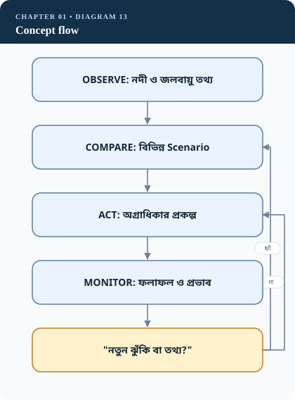</p>

<details>
<summary>ডায়াগ্রামের মূল Mermaid source দেখুন</summary>

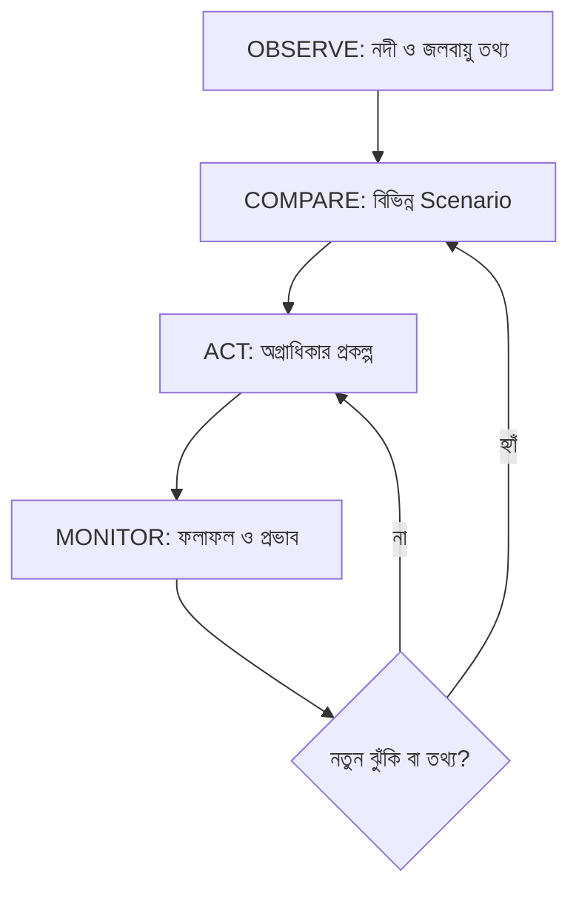

</details>

**এটি conceptual illustration**, GED-এর কোনও নির্দিষ্ট প্রকল্পের প্রত্যক্ষ output নয়।

### ৬.৬ Critical Evaluation — কেন শুধু পরিকল্পনা থাকলেই সফলতা আসে না?

**শক্তি:** আঞ্চলিক বৈচিত্র্য বোঝা, ঝুঁকি ও বিনিয়োগকে দীর্ঘমেয়াদে যুক্ত করা এবং পরিবেশকে অর্থনীতির সঙ্গে বিবেচনা। **প্রয়োগগত সমস্যা:** তহবিল, প্রতিষ্ঠানগুলোর সমন্বয়, মানসম্মত তথ্য, দীর্ঘমেয়াদি রক্ষণাবেক্ষণ, স্থানীয় অংশগ্রহণ ও ফলাফল পরিমাপ। **মূল কথা:** প্রকল্পের সংখ্যা বা ঘোষিত অর্থ বরাদ্দকে প্রকল্প-সম্পন্ন বা ঝুঁকি-হ্রাসের প্রমাণ ধরা যাবে না। সফলতা যাচাই করতে হবে বাস্তব সূচক দিয়ে—যেমন ফসল ক্ষতি কমা, নিরাপদ পানি পাওয়া, জলাবদ্ধতা বা নদীভাঙন ঝুঁকি কমা, বাস্তুসংস্থানের অবস্থা।

> [!TIP]
> 🟩 **Two Sixes:** **৬টি Goal = What we want**; **৬টি Hotspot = Where we act**। **Adaptive = Observe → Decide → Monitor → Adjust**।

[⬆️ Contents](#top)


<a id="people"></a>

## ৭. Human Geography, Culture & Geographical Determinism — মানুষ কীভাবে ভূগোল বদলায়?

### ৭.১ Physical Geography ও Human Geography — বিশ্লেষণের পার্থক্য

পদ্মা নদীর তীরে দুজন গবেষক কাজ করছেন। একজন দেখছেন **নদীটি কেন বাঁক বদলায়, কোথায় পলি জমে**—এটি *Physical Geography*। অন্যজন দেখছেন **নদীভাঙনে পরিবার কোথায় যায়, কীভাবে কর্মসংস্থান বদলায়, স্কুলে যাতায়াত কঠিন হয় কি না**—এটি *Human Geography*। দুটি গবেষণা মিললে নদীর তীররক্ষার সিদ্ধান্ত মানুষের জন্য কার্যকর হয়।

| দৃষ্টিকোণ | মূল প্রশ্ন | তথ্য | উদাহরণ |
|---|---|---|---|
| Physical Geography | ভূমিরূপ ও প্রাকৃতিক প্রক্রিয়া কীভাবে কাজ করে? | নদীর গতি, মাটি, ঢাল, বৃষ্টি | যমুনায় চর গঠন |
| Human Geography | মানুষ কোথায় বাস করে ও কেন? | বসতি, জীবিকা, যোগাযোগ, ঝুঁকি | চরবাসীর স্থানান্তর |
| Human–Environment Interaction | মানুষ ও প্রকৃতি পরস্পরকে কীভাবে বদলায়? | বাঁধ, খাল, সেচ, ভূমি ব্যবহার | জলাবদ্ধতা বা কৃষিজমি |

### ৭.২ Geography & Livelihood — অঞ্চলের সঙ্গে পেশার যোগসূত্র

- **নদী অববাহিকা:** কৃষি, মাছ, নৌবাণিজ্য; একই সঙ্গে নদীভাঙনে জীবিকার অনিশ্চয়তা।
- **হাওর:** মৌসুমি জলচক্রের সঙ্গে কৃষিক্যালেন্ডার, নৌপথ ও মাছের সম্পর্ক।
- **পাহাড়:** ঢাল ও বনভূমি ভূমি ব্যবহার, যোগাযোগের খরচ এবং বসতিস্থান নির্বাচনে প্রভাব ফেলে।
- **উপকূল:** জোয়ারভাটা, লবণাক্ততা ও সাগরের সম্পদ কৃষি ও মাছ-ভিত্তিক জীবিকাকে প্রভাবিত করে।
- **বরেন্দ্র:** পানির মৌসুমি প্রাপ্যতা ও সেচ কৌশল চাষাবাদের সিদ্ধান্তে প্রভাব ফেলে।

এগুলো **ভূগোলগত প্রভাব**, কোনো অঞ্চলের মানুষের একমাত্র নির্ধারিত পেশা নয়; শিক্ষা, সম্পদ, বাজার, প্রযুক্তি ও রাষ্ট্রীয় নীতিও সমান গুরুত্বপূর্ণ হতে পারে।

### ৭.৩ Geographic Determinism — পরিবেশ কি মানুষের সংস্কৃতি ‘নির্ধারণ’ করে?

**Definition:** *Geographical/Environmental Determinism* হলো এমন দৃষ্টিভঙ্গি, যেখানে মানুষের সমাজ ও সংস্কৃতি গঠনে প্রাকৃতিক পরিবেশকে প্রধান বা প্রায় নির্ধারক শক্তি ধরা হয়।

**ভৌগোলিক প্রভাবের বাস্তব যুক্তি:**

1. নদীমাতৃক জীবন কৃষি, মাছ, নৌপরিবহন ও লোকজ অভিজ্ঞতার সঙ্গে যুক্ত।
2. মৌসুমি বৃষ্টিপাত কৃষির সময়, ঘরবাড়ির নকশা ও যাতায়াতকে প্রভাবিত করতে পারে।
3. পাহাড় ও জলাভূমি বসতি ও যোগাযোগে ভিন্ন ভিন্ন সীমা ও সুযোগ তৈরি করে।
4. উপকূলের ঝড় বা লবণাক্ততা জীবিকার অভিযোজনকে প্রভাবিত করতে পারে।

**কিন্তু Determinism-এর সীমা কোথায়?**

- একই ভৌগোলিক অঞ্চলে নানা ভাষা, সামাজিক প্রতিষ্ঠান, ধর্ম ও সংস্কৃতি থাকতে পারে।
- প্রযুক্তি, সড়ক, বাঁধ, বাজার, শিক্ষা ও রাজনৈতিক সিদ্ধান্ত প্রাকৃতিক সীমাবদ্ধতা বদলাতে পারে।
- মানুষের সংস্কৃতিকে একমাত্র ভূগোলের ‘অবধারিত ফল’ বলা ঐতিহাসিক ও সামাজিক বাস্তবতাকে উপেক্ষা করে।
- **Possibilism** পরিবেশ সুযোগ ও সীমা তৈরি করে, কিন্তু মানুষের সিদ্ধান্তও পরিবর্তনের পথ খুলে দেয়—এই যুক্তি দিতে সাহায্য করে।

> [!IMPORTANT]
> **Critical thesis:** <mark>ভূগোল মানুষের জীবন ও সংস্কৃতিকে প্রভাবিত করে; কিন্তু একাই সম্পূর্ণ নির্ধারণ করে না।</mark> পরীক্ষায় **influence** ও **determine** শব্দদুটির পার্থক্য দেখালে উত্তর গভীর হয়।

### ৭.৪ Geography & Settlement — বসতির অবস্থান ও পরিবর্তনের কারণ

একটি বসতি গড়ে ওঠার প্রশ্নে অন্তত পাঁচটি বিষয় বিচার করুন: **(১) পানির প্রাপ্যতা, (২) ভূমির উচ্চতা/বন্যার ঝুঁকি, (৩) সড়ক–নৌযোগাযোগ, (৪) জীবিকার সুযোগ, (৫) সামাজিক ও প্রাতিষ্ঠানিক নিরাপত্তা।** নদীতীরের কাছে বাজার সুবিধাজনক হলেও তীরভাঙনের ঝুঁকি থাকতে পারে; উঁচু সোপানে বন্যার চাপ অপেক্ষাকৃত কম হলেও শুষ্ক মৌসুমে পানির সমস্যা বেশি হতে পারে। একটি মাত্র ভৌগোলিক কারণ দিয়ে সিদ্ধান্ত ব্যাখ্যা করা তাই অসম্পূর্ণ।

### ৭.৫ Evaluation Matrix — ‘ভূগোল সংস্কৃতিকে কতটা প্রভাবিত করেছে?’

| Claim | Supporting example | Counterpoint | Balanced conclusion |
|---|---|---|---|
| নদী জীবনধারা প্রভাবিত করে | নদীপথ, মৎস্য ও কৃষি | প্রযুক্তি ও বাণিজ্য জীবন বদলায় | প্রভাব আছে, নির্ধারণবাদ নয় |
| ভূমিরূপ বসতিকে প্রভাবিত করে | হাওর, পাহাড়, চর | পরিকল্পনা ও অবকাঠামো অভিযোজন সম্ভব | সীমাবদ্ধতা + মানবিক agency |
| পরিবেশ ঝুঁকি তৈরি করে | বন্যা, ভূমিধস, ঘূর্ণিঝড় | প্রস্তুতি ও সুশাসন ক্ষতি কমায় | Hazard ≠ inevitable disaster |
| সম্পদ অর্থনীতির সুযোগ দেয় | নদী ও সমুদ্র | গবেষণা/বিনিয়োগ/সুশাসন ছাড়া আয় নিশ্চয় নয় | Geography + Institution = Outcome |

**প্রশ্ন: “Evaluate the influence of geography on Bangladeshi culture.”**

**উত্তর:** ভূমিকা → দেশের নদী–মৌসুম–পাহাড়–সমুদ্রের বৈশিষ্ট্য → কৃষি ও মৎস্যের জীবনধারা → পরিবহন, বসতি ও স্থানীয় অভিযোজন → সমালোচনা: সংস্কৃতির গঠন ইতিহাস, সামাজিক রীতি, শিক্ষা ও রাজনৈতিক প্রক্রিয়ায়ও নির্ভরশীল → উপসংহার: geography is influential but not all-determining।

> [!NOTE]
> 🔵 **Evidence basis:** [Banglapedia — *Bangladesh Geography*](https://en.banglapedia.org/index.php?title=Bangladesh_Geography); [GED — *BDP 2100* (livelihoods, equitable water governance)](https://bdp2100kp.gov.bd/BDP2100/Overview)। Determinism বনাম Possibilism অংশটি ভূগোলচর্চার ধারণাগত পাঠ-ব্যাখ্যা; সরাসরি Banglapedia-র উদ্ধৃতি নয়।

[⬆️ Contents](#top)


<a id="pyq"></a>

## ৮. Previous BCS Questions — বিগত প্রশ্নের উৎসভিত্তিক বিশ্লেষণ

নিচের সারণিতে BCS EXAM নামের **তৃতীয় পক্ষের পুনর্গঠিত প্রশ্নসংকলন**-এ পাওয়া বিষয়গুলোর **English rendering** দেওয়া হলো। প্রশ্নসংকলন নিজেই জানিয়েছে এগুলো BPSC মূল কাগজ থেকে সরাসরি টাইপ করা নয়; কয়েকটি পত্র অসম্পূর্ণও থাকতে পারে। **Status: secondary-source match; NOT independently authenticated official paper.** আপনার দেওয়া বইয়ের ছবিগুলো এই অধ্যায়ের বিষয়বস্তুর সঙ্গে ব্যবহার করা হয়েছে, কিন্তু ফটোর সাল-লেবেলকেও মূল BPSC প্রমাণ ধরা হয়নি।

| BCS | English + বাংলা প্রশ্ন (ভাবানুবাদ) | Marks indicated in archive | Archive | Source status |
|---|---|---:|---|---|
| 35th | **English:** Explain Bangladesh's geographical position in South Asia. **বাংলা:** দক্ষিণ এশিয়ায় বাংলাদেশের ভৌগোলিক অবস্থান ব্যাখ্যা করুন। | 5 | [S14] | FAO — Food and Agriculture Organization of the UN | *Country Papers: Bangladesh*, physiographic landform 80/8/12 and river basin | [FAO reference](https://www.fao.org/4/ac623e/ac623e0b.htm) |
| [S15] | Peer-reviewed geomorphology (2021) | *Avulsion of the Brahmaputra in Bangladesh during the 18th–19th century: A review based on cartographic and literary evidence* | [Scientific article](https://www.sciencedirect.com/science/article/pii/S0169555X21001045) |
| [S16] | GED Knowledge Portal — Government of Bangladesh | *Bangladesh Delta Plan 2100: Overview, Goals, Strategies, Hotspots* (approved 4 September 2018) | [GED official portal](https://bdp2100kp.gov.bd/BDP2100/Overview) |
| [S17] | GED, Planning Commission — Bangladesh Government | *Bangladesh Delta Plan 2100, Volume 2, Investment Plan, Part 1: The Plan* | [Official investment plan PDF](https://gedkp.gov.bd/wp-content/uploads/2021/02/BDP-2100-Volume-2-Investment-Plan-Part-1-The-Plan.pdf) |
| [S18] | FAO — Food and Agriculture Organization of the UN | *Study on Livelihood Systems Assessment in Drought-prone Areas of NW Bangladesh*; Barind, Nachole, Porsha and Sapahar | [FAO Barind study](https://www.fao.org/4/ag257e/AG257E06.htm) |
| [S19] | Banglapedia — Asiatic Society of Bangladesh | *St Martin's Island*, Sifatul Quader Chowdhury; island geology, coral ecology and environment | [Banglapedia official entry](https://en.banglapedia.org/index.php/St_Martin%27s_Island) |
| [S20] | University of Rajshahi | *Varendra Research Museum*; institution's history and founding team | [University official museum history](https://www.ru.ac.bd/facilities/varendra-research-museum/) |
| [S21] | Banglapedia — Asiatic Society of Bangladesh | *Tista River*, Mesbah-us-Saleheen; river origin and 1787 course change | [Banglapedia river article](https://en.banglapedia.org/index.php/Tista_River) |
| [IM1] | Wikimedia Commons, Fahad Faisal | *Coral Reef of Saint Martin Island Bangladesh.JPG*, 2012, CC BY-SA 4.0 | [Image, creator and license](https://commons.wikimedia.org/wiki/File:Coral_Reef_of_Saint_Martin_Island_Bangladesh.JPG) |
| [Q1] | Secondary archive |
| 35th | **English:** What is the economic importance of the Bay of Bengal? **বাংলা:** বঙ্গোপসাগরের অর্থনৈতিক গুরুত্ব কী? | 5 | [Q1] | Secondary archive |
| 36th | **English:** What is meant by inactive or moribund delta regions? **বাংলা:** নিষ্ক্রিয় বা মরিবান্ড বদ্বীপ বলতে কী বোঝায়? | 5 | [Q2] | Secondary archive |
| 36th | **English:** Explain the importance of the Barind region (question grouped with other subtopics). **বাংলা:** বরেন্দ্র অঞ্চলের গুরুত্ব ব্যাখ্যা করুন (একই প্রশ্নে অন্যান্য উপবিষয়ও ছিল)। | 5 | [Q2] | Secondary archive |
| 40th | **English:** Describe Bangladesh's geographical location and physiography. **বাংলা:** বাংলাদেশের ভৌগোলিক অবস্থান ও ভূপ্রকৃতি বর্ণনা করুন। | 10 | [Q3] | Secondary archive |
| 40th | **English:** Discuss Bangladesh's geopolitical importance and risks. **বাংলা:** বাংলাদেশের ভূ-কৌশলগত গুরুত্ব ও ঝুঁকি আলোচনা করুন। | 10 | [Q3] | Secondary archive |
| 40th | **English:** Short note: Blue Economy. **বাংলা:** সংক্ষিপ্ত টীকা: সুনীল অর্থনীতি (Blue Economy)। | note, question set | [Q3] | Secondary archive |
| 43rd | **English:** Define Bangladesh's geographical location. **বাংলা:** বাংলাদেশের ভৌগোলিক অবস্থান নির্ণয় করুন। | 5 | [Q4] | Secondary archive |
| 43rd | **English:** Identify the districts associated with the Barind region. **বাংলা:** বরেন্দ্র অঞ্চলের সংশ্লিষ্ট জেলাগুলো চিহ্নিত করুন। | 5 | [Q4] | Secondary archive |
| 43rd | **English:** Describe regional topographical features. **বাংলা:** বাংলাদেশের অঞ্চলভিত্তিক ভূপ্রকৃতি বর্ণনা করুন। | 10 | [Q4] | Secondary archive |
| 47th | **English:** Define geographical determinism and assess geographical factors in Bangladeshi culture. **বাংলা:** ভৌগোলিক নিয়ন্ত্রণবাদের সংজ্ঞা দিন এবং বাংলাদেশের সংস্কৃতিতে ভূগোলের প্রভাব মূল্যায়ন করুন। | 20 | [Q5] | Secondary archive; recent collection, verify official copy |

**Trend interpretation (not statistical forecast):** অবস্থান + ভূপ্রকৃতি; বরেন্দ্র ও বদ্বীপ; ভূরাজনীতি ও বঙ্গোপসাগর; এবং ভূগোলের সমাজ-সংস্কৃতির প্রভাব—এসব recurring question *themes*। প্রশ্নের wording, marks ও সাল BPSC মূল PDF স্ক্যান পাওয়া গেলে পুনরায় মিলিয়ে দেখতে হবে। এই ছোট online corpus থেকে কোনো ‘উত্তর আসবেই’ probability গণনা করা হয়নি।

<a id="strategy"></a>


### 🎯 PYQ Coverage Map — বিগত প্রশ্নের উত্তর কোন Q-এ পাবেন?

এটি secondary question archives-এর **English rendering** অনুযায়ী thematic mapping; মূল BPSC প্রশ্নপত্র থেকে শব্দশব্দ যাচাইয়ের দাবি নয়।

| Archive year | English question theme | বাংলা প্রশ্নের বিষয় | প্রস্তুত উত্তর |
|---|---|---|---|
| **35th** | Geographical location, Bay of Bengal economy | অবস্থান ও বঙ্গোপসাগরের অর্থনীতি | [Q01](#q01), [Q04](#q04) |
| **36th** | Coral island, inactive delta, Barind/Varendra | প্রবাল দ্বীপ, নিষ্ক্রিয় বদ্বীপ, বরেন্দ্র ও জাদুঘর | [Q31](#q31), [Q05](#q05), [Q07](#q07), [Q32](#q32) |
| **37th** | Location and geographical advantage | অবস্থানের সুবিধা | [Q01](#q01), [Q03](#q03) |
| **38th** | Strategic geography in International Affairs | অন্য পত্রে ভূ-কৌশলগত গুরুত্ব | [Q03](#q03) |
| **40th** | Topography and geopolitical risk | ভূপ্রকৃতি ও ভূরাজনীতি | [Q02](#q02), [Q03](#q03) |
| **41st** | Maritime boundary settlement | সমুদ্রসীমা নিষ্পত্তি | [Q16](#q16) |
| **43rd** | Location and Barind/topographical regions | অবস্থান, বরেন্দ্র ও অঞ্চলভিত্তিক ভূপ্রকৃতি | [Q01](#q01), [Q07](#q07), [Q02](#q02) |
| **45th** | Teesta river water sharing | তিস্তার পানি বণ্টন | [Q33](#q33) |
| **46th** | Marine resources: problems and opportunities | সামুদ্রিক সম্পদের সমস্যা ও সম্ভাবনা | [Q04](#q04), [Q30](#q30) |
| **47th** | Geographical determinism and culture | ভূগোল ও সংস্কৃতির সম্পর্ক | [Q19](#q19), [Q20](#q20) |

> [!WARNING]
> 🟨 **আলাদা রাখুন:** ৩৮তমের সংশ্লিষ্ট ভূ-কৌশলগত প্রশ্নটি **International Affairs** পত্রে; ৪৫তমের তিস্তা ও ৪৬তমের সামুদ্রিক সম্পদ প্রশ্ন অন্য সিলেবাস ইউনিটের সঙ্গেও সম্পর্কিত। ৪৪তম থেকে সরাসরি Unit-1 প্রশ্ন নিশ্চিত করে পাওয়া যায়নি। **অনুপস্থিতির অর্থ সে বছরে প্রশ্ন ছিল না—এমন নয়।**

[⬆️ Back to Question Finder](#question-index) · [🏠 Contents](#top)

### বিগত প্রশ্নের উৎসভিত্তিক বিশ্লেষণ — ৩৫তম থেকে ৪৭তম

> [!WARNING]
> **প্রমাণের স্তর:** **B = named third-party archived question paper**, **C = পাশের ইউনিট বা অন্য পত্র থেকে সংশ্লিষ্ট বিষয়**, **P = editorial predicted question**। মূল BPSC question-paper PDF দিয়ে হুবহু যাচাই না হওয়ায় এখানে কোনো প্রশ্নকে **A = official-original verified** বলা হয়নি। English wording হলো শিক্ষার সুবিধার্থে অনুবাদ বা ভাবানুবাদ।

| BCS | English + বাংলা প্রশ্ন | Marks / paper | Evidence & named archive |
|---|---|---|---|
| 35th | **English:** Describe Bangladesh's geographical position in South Asia; explain the economic importance of the Bay of Bengal. **বাংলা:** দক্ষিণ এশিয়ায় বাংলাদেশের অবস্থান ও বঙ্গোপসাগরের অর্থনৈতিক গুরুত্ব ব্যাখ্যা করুন। | ৫+৫; Bangladesh Affairs | **B — [BCS EXAM, 35th archive](https://bcsexam.org/written-questions/35th-bcs-written)** |
| 36th | **English:** Explain the importance of the coral island; inactive delta; Barind region and Varendra Museum. **বাংলা:** প্রবাল দ্বীপ, নিষ্ক্রিয় বদ্বীপ, বরেন্দ্র অঞ্চল ও বরেন্দ্র গবেষণা জাদুঘরের গুরুত্ব ব্যাখ্যা করুন। | ৫+৫+৫; Bangladesh Affairs | **B — [BCS EXAM, 36th archive](https://bcsexam.org/written-questions/36th-bcs-written)** |
| 37th | **English:** Describe Bangladesh's geographical position and its advantages. **বাংলা:** বাংলাদেশের ভৌগোলিক অবস্থান ও এর সুবিধাগুলো বর্ণনা করুন। | ৩+৭; Bangladesh Affairs | **B — [BCS EXAM, 37th archive](https://bcsexam.org/written-questions/37th-bcs-written)** |
| 38th | **English:** Strategic position of Bangladesh — a neighbouring paper's related theme. **বাংলা:** বাংলাদেশের ভূ-কৌশলগত অবস্থান—ভিন্ন পত্রের সংশ্লিষ্ট বিষয়। | International Affairs; **Bangladesh Affairs নয়** | **C — [BCS EXAM, 38th archive](https://bcsexam.org/written-questions/38th-bcs-written)** |
| 40th | **English:** Describe geographical location and topography; discuss strategic position and geopolitical risks. **বাংলা:** বাংলাদেশের অবস্থান ও ভূপ্রকৃতি বর্ণনা করুন; ভূ-কৌশলগত গুরুত্ব ও ঝুঁকি আলোচনা করুন। | ১০+১০; Bangladesh Affairs | **B — [BCS EXAM, 40th archive](https://bcsexam.org/written-questions/40th-bcs-written)** |
| 41st | **English:** Short note: Bangladesh's maritime-boundary settlement. **বাংলা:** সংক্ষিপ্ত টীকা: বাংলাদেশের সমুদ্রসীমা নির্ধারণে অর্জন। | Short note; Bangladesh Affairs | **B — [BCS EXAM, 41st archive](https://bcsexam.org/written-questions/41st-bcs-written)** |
| 43rd | **English:** Locate Bangladesh; identify the Barind districts; describe regional topography. **বাংলা:** বাংলাদেশের অবস্থান, বরেন্দ্র অঞ্চলের জেলা এবং অঞ্চলভিত্তিক ভূপ্রকৃতি বর্ণনা করুন। | ৫+৫+১০; Bangladesh Affairs | **B — [BCS EXAM, 43rd archive](https://bcsexam.org/written-questions/43rd-bcs-written)** |
| 44th | **English:** Environmental and river-process descriptions in other papers, without evidence of a direct Unit-1 Bangladesh Affairs geography question. **বাংলা:** অন্য পত্রে পরিবেশ ও নদীপ্রক্রিয়া-সংক্রান্ত আলোচনা; সরাসরি এ ইউনিটের প্রশ্ন হিসেবে যাচাইকৃত নয়। | Cross-paper context, not claimed as Unit-1 PYQ | **C — [BCS EXAM, 44th archive](https://bcsexam.org/written-questions/44th-bcs-written)** |
| 45th | **English:** Why is a Teesta water-sharing agreement necessary? **বাংলা:** তিস্তার পানি বণ্টন চুক্তি কেন প্রয়োজন? | ২০; Bangladesh Affairs (cross-unit) | **C — [BCS EXAM, 45th archive](https://bcsexam.org/written-questions/45th-bcs-written)** |
| 46th | **English:** Evaluate the problems and prospects of marine-resource extraction in Bangladesh. **বাংলা:** বাংলাদেশে সামুদ্রিক সম্পদ আহরণের সমস্যা ও সম্ভাবনা মূল্যায়ন করুন। | ২০; Bangladesh Affairs (mainly natural resources unit) | **C — [BCS EXAM, 46th archive](https://bcsexam.org/written-questions/46th-bcs-written)** |
| 47th | **English:** Define geographical determinism and evaluate geographical influence on Bangladeshi culture. **বাংলা:** ভৌগোলিক নিয়ন্ত্রণবাদের সংজ্ঞা দিন এবং বাংলাদেশের সংস্কৃতিতে ভৌগোলিক পরিবেশের প্রভাব মূল্যায়ন করুন। | ২০; Bangladesh Affairs (geography–culture link) | **B — [BCS EXAM, 47th archive](https://bcsexam.org/written-questions/47th-bcs-written)** |

**৪০তমের প্রশ্নদুটি সবচেয়ে গুরুত্বপূর্ণ শিক্ষণীয় জুটি:** আগে *location + topography* বর্ণনা, পরে *geopolitical importance + risk* মূল্যায়ন। একই মূল ধারণা থেকে দুটি ভিন্ন cognitive task এসেছে। তাই তথ্যের পাশে কারণ, প্রভাব, উদাহরণ ও নীতি লিখে পড়া আবশ্যক।

**৩৬তমের প্রশ্নে বিশেষ সতর্কতা:** *Barind region* এবং *Varendra Museum* একই উপপ্রশ্নে এলেও জাদুঘরটির আলোচনা ঐতিহ্য ও প্রত্নতত্ত্বের সঙ্গে জড়িত; বরেন্দ্রভূমির ভূতত্ত্বের সমার্থক নয়। Coral island-এর জন্য সেন্ট মার্টিন এবং inactive delta-এর জন্য নদীপ্রবাহ ও sediment supply আলাদাভাবে পড়ুন।

**৪৭তমের বিশ্লেষণ:** ভৌগোলিক নিয়ন্ত্রণবাদ (Geographical Determinism) বলতে পরিবেশের প্রভাবকে অতিরিক্ত একমুখীভাবে ব্যাখ্যার ধারণা বোঝায়। ভালো উত্তরে বাংলাদেশের নদী, বৃষ্টি, উপকূল, পাহাড়ের সাংস্কৃতিক প্রভাব স্বীকার করে শিক্ষা, প্রযুক্তি, সামাজিক সিদ্ধান্ত ও ইতিহাসের স্বাধীন ভূমিকা দেখাতে হবে।

> [!TIP]
> **Trend Memory: Fact → Comparison → Cause → Evaluation → Policy.** প্রথমে স্থানাঙ্ক ও শ্রেণি জানুন; তারপর বরেন্দ্র বনাম হাওর তুলনা করুন; পরে নদী ও পলির কারণ ব্যাখ্যা করুন; সর্বশেষ ভূরাজনীতি, সংস্কৃতি ও টেকসই উন্নয়নে যুক্তি প্রয়োগ করুন। এই ধারা **qualitative thematic interpretation**, ভবিষ্যৎ প্রশ্নের নির্দিষ্ট সম্ভাবনা নয়।

| Question verb | কোন তথ্য স্মরণ করবেন | পরীক্ষার visual |
|---|---|---|
| Define / Identify | সহজ সংজ্ঞা + উদাহরণ | ১ লাইনের সূত্র |
| Classify / Compare | তিন ভূমিরূপ, অঞ্চলের পার্থক্য | comparative table |
| Explain / Describe | নদী–পলি–ভূমিরূপের কারণ | cause–effect flowchart |
| Analyse | সুযোগ, সীমাবদ্ধতা, stakeholders | opportunity–risk matrix |
| Evaluate | শক্তি, দুর্বলতা, পাল্টা যুক্তি | ২-পক্ষীয় তুলনা |
| Recommend | অঞ্চলভিত্তিক evidence ও সিদ্ধান্ত | BDP hotspot policy chart |

[⬆️ Go to Contents](#top)

---

## ৯. পরীক্ষার উত্তর লেখার কৌশল — প্রশ্নের নির্দেশক শব্দ অনুযায়ী কাঠামো

### ৯.১ প্রশ্নের Verb দেখেই উত্তর পরিকল্পনা করুন

| Question verb | পরীক্ষক কী দেখতে চান | লিখবেন কীভাবে |
|---|---|---|
| **Define / What is** | সঠিক অর্থ ও সীমানা | ১–২ বাক্যে সংজ্ঞা + উদাহরণ |
| **Describe** | উপাদান ও বৈশিষ্ট্যের সংগঠিত বর্ণনা | location → features → example |
| **Explain Why/How** | cause → mechanism → effect | ৩–৫ ধাপের causal chain |
| **Compare / Distinguish** | মিল ও পার্থক্য | ৩–৪ মানদণ্ডের comparative table |
| **Analyse** | কয়েকটি কারণ ও তাদের সম্পর্ক | cause + stakeholder + impact |
| **Evaluate / Assess** | শক্তি, সীমাবদ্ধতা ও বিচার | pros → cons → evidence → reasoned judgment |
| **Recommend / Suggest** | সমস্যা অনুযায়ী বাস্তবসম্মত প্রস্তাব | problem → intervention → feasibility → expected effect |

### ৯.২ Marks-Based Structure — উত্তর ছোট–বড় করবেন কীভাবে?

**৫ নম্বর:** ১ বাক্যে সংজ্ঞা; ৩টি নির্ভুল পয়েন্ট; ১টি উদাহরণ; প্রয়োজন হলে ১টি source name। উদাহরণ: **Floodplain vs Terrace**—উৎপত্তি, উচ্চতা, ব্যবহার।

**১০ নম্বর:** ভূমিকা → ৪টি বিশ্লেষণী শিরোনাম → labelled map বা ছোট comparative table → সীমাবদ্ধতা → ২ বাক্যের উপসংহার। উদাহরণ: **Bangladesh’s regional topography**—প্লাবনভূমি, সোপান, পাহাড়, কৃষি ও ঝুঁকি।

**২০ নম্বর:** বক্তব্য (thesis) → ভৌগোলিক প্রেক্ষাপট → **why/how** → অঞ্চলভিত্তিক উদাহরণ → positive/negative impacts → counterargument → নীতিগত সুপারিশ → প্রমাণভিত্তিক উপসংহার। ২০ নম্বরের উত্তরে শুধু তালিকা দিলে বিশ্লেষণ প্রমাণ হয় না।

### ৯.৩ The W-H-I-P-C Method — সব প্রশ্নের জন্য ৫টি প্রশ্ন

> [!TIP]
> 🟩 **W-H-I-P-C:** **What** (সংজ্ঞা) → **How/Why** (প্রক্রিয়া ও কারণ) → **Impact** (ফলাফল) → **Policy** (করণীয়) → **Critical view** (সীমাবদ্ধতা)। অবস্থানভিত্তিক প্রশ্নে **Where** আলাদাভাবে যুক্ত করুন।

**নিজের উত্তর পরীক্ষা করার rubric:**

| Criteria | ১০-এর মধ্যে self-check |
|---|---:|
| প্রশ্নের সঙ্গে উত্তর সরাসরি মেলে | ২ |
| সংজ্ঞা ও প্রক্রিয়ার সঠিকতা | ২ |
| বাংলাদেশের নির্দিষ্ট উদাহরণ | ২ |
| কারণ–ফল ও পাল্টা যুক্তি | ২ |
| পরিষ্কার উপসংহার, মূল উৎস ও উপস্থাপনা | ২ |

*এটি একটি self-study rubric; BPSC-এর সরকারি নম্বর বণ্টন নয়।*

### ৯.৪ Source Citing in the Exam

“**According to Banglapedia (Asiatic Society of Bangladesh), Bangladesh Geography**, physiographic regions can be grouped as floodplains, terraces and hills.” অথবা “**GED, Bangladesh Delta Plan 2100 (approved 2018)** identifies six regional hotspots.” আইনি প্রশ্নে “**ITLOS (2012)**” অথবা “**Arbitral Award in Bangladesh–India maritime delimitation (2014)**”—নাম ও সাল উল্লেখ করা যায়। প্রশ্নে প্রয়োজন ছাড়া URL লিখতে হয় না।

[⬆️ Contents](#top)


<a id="questions"></a>

## ১০. Important English Questions — ৩৩টি বাংলা Model Answer

> Past-paper-derived *themes* and original predictions are labelled individually. **Expanded model answers:** every answer includes structured Bengali explanation, examples, and a conceptual Mermaid diagram; comparison tables are used where appropriate. 5/10/20-mark depth should still be adjusted to the question's exact command and available exam time.

<a id="question-index"></a>

### ৩৩টি প্রশ্নের সূচি

**পদ্ধতি:** English question নির্বাচন করুন → ছোট ধাপে সাজানো বাংলা উত্তর পড়ুন → নীল Source Box থেকে উদ্ধৃতিযোগ্য প্রতিষ্ঠানের নাম শিখুন।

#### A. Location & Strategy

- [Q01 — Explain the geographical location of Bangladesh and its significance in South Asia.](#q01) — *বাংলাদেশের ভৌগোলিক অবস্থান ব্যাখ্যা করুন এবং দক্ষিণ এশিয়ায় এর গুরুত্ব মূল্যায়ন করুন।*
- [Q02 — Describe the major topographical features of Bangladesh with regional examples.](#q02) — *বাংলাদেশের প্রধান ভূপ্রাকৃতিক বৈশিষ্ট্যগুলো আঞ্চলিক উদাহরণসহ বর্ণনা করুন।*
- [Q03 — Assess the strategic geopolitical position and risks of Bangladesh.](#q03) — *বাংলাদেশের ভূ-কৌশলগত অবস্থান ও সংশ্লিষ্ট ঝুঁকি মূল্যায়ন করুন।*
- [Q04 — What is the economic importance of the Bay of Bengal for Bangladesh?](#q04) — *বাংলাদেশের জন্য বঙ্গোপসাগরের অর্থনৈতিক গুরুত্ব কী?*

#### B. Delta & Landforms

- [Q05 — Differentiate between an active delta and an inactive or moribund delta.](#q05) — *সক্রিয় ও নিষ্ক্রিয় (Moribund) বদ্বীপের পার্থক্য দেখান।*
- [Q06 — Explain the origin of the Ganges–Brahmaputra–Meghna delta.](#q06) — *গঙ্গা–ব্রহ্মপুত্র–মেঘনা বদ্বীপের উৎপত্তি ব্যাখ্যা করুন।*
- [Q07 — Explain the differences between the Barind Tract and Madhupur Tract.](#q07) — *বরেন্দ্রভূমি ও মধুপুর গড়ের মধ্যে পার্থক্য ব্যাখ্যা করুন।*
- [Q08 — Why is the Barind region prone to drought-related stress?](#q08) — *বরেন্দ্র অঞ্চলে খরাজনিত পানিসংকট কেন দেখা দেয়?*
- [Q09 — How did the Brahmaputra–Jamuna change its course historically?](#q09) — *ঐতিহাসিকভাবে ব্রহ্মপুত্র–যমুনা নদীর গতিপথ কীভাবে পরিবর্তিত হয়েছে?*

#### C. Regional Geography & Livelihoods

- [Q10 — Compare char, haor, beel and baor in the context of Bangladesh.](#q10) — *বাংলাদেশের চর, হাওর, বিল ও বাঁওড়ের তুলনা করুন।*
- [Q11 — Why is the Haor Basin vulnerable to flash floods?](#q11) — *হাওর অববাহিকা আকস্মিক বন্যার ঝুঁকিতে থাকে কেন?*
- [Q12 — Explain how river erosion and sedimentation shape human settlement.](#q12) — *নদীভাঙন ও পলি সঞ্চয় কীভাবে মানুষের বসতি ও জীবনযাত্রাকে প্রভাবিত করে?*
- [Q13 — Discuss the importance of the Sundarbans as a deltaic ecosystem.](#q13) — *বদ্বীপীয় প্রতিবেশব্যবস্থা হিসেবে সুন্দরবনের গুরুত্ব আলোচনা করুন।*
- [Q14 — What are the opportunities and limitations of Bangladesh’s coastal geography?](#q14) — *বাংলাদেশের উপকূলীয় ভূগোলের সুযোগ ও সীমাবদ্ধতা কী?*

#### D. Marine Law & Coastal Economy

- [Q15 — Distinguish territorial sea, contiguous zone and exclusive economic zone.](#q15) — *Territorial Sea, Contiguous Zone ও Exclusive Economic Zone (EEZ)-এর পার্থক্য দেখান।*
- [Q16 — Describe the significance of the 2012 and 2014 Bay of Bengal maritime judgments.](#q16) — *২০১২ ও ২০১৪ সালের বঙ্গোপসাগরের সমুদ্রসীমা-সংক্রান্ত সিদ্ধান্তগুলোর গুরুত্ব বর্ণনা করুন।*

#### E. Human Geography & Risks

- [Q17 — How does geography influence agricultural patterns in Bangladesh?](#q17) — *বাংলাদেশের ভৌগোলিক বৈশিষ্ট্য কৃষির ধরনকে কীভাবে প্রভাবিত করে?*
- [Q18 — Explain the geographical basis of Bangladesh's transport network.](#q18) — *বাংলাদেশের পরিবহন নেটওয়ার্কের ভৌগোলিক ভিত্তি ব্যাখ্যা করুন।*
- [Q19 — Evaluate the impact of geographical features on Bangladesh’s culture.](#q19) — *বাংলাদেশের সংস্কৃতিতে ভূপ্রাকৃতিক বৈশিষ্ট্যের প্রভাব মূল্যায়ন করুন।*
- [Q20 — Define geographical determinism and critically examine its relevance to Bangladesh.](#q20) — *Geographical Determinism কী? বাংলাদেশের ক্ষেত্রে এর প্রাসঙ্গিকতা সমালোচনামূলকভাবে পরীক্ষা করুন।*
- [Q21 — Why does the position of Bangladesh make it disaster-prone?](#q21) — *বাংলাদেশের ভৌগোলিক অবস্থান দেশটিকে দুর্যোগপ্রবণ করে তোলে কেন?*

#### F. Adaptation, Planning & Mapping

- [Q22 — Explain the concept of adaptive delta management in the context of BDP 2100.](#q22) — *বাংলাদেশ ব-দ্বীপ পরিকল্পনা ২১০০-এর প্রেক্ষাপটে Adaptive Delta Management-এর ধারণা ব্যাখ্যা করুন।*
- [Q23 — Compare physical geography and human geography with Bangladeshi examples.](#q23) — *বাংলাদেশের উদাহরণ দিয়ে Physical Geography ও Human Geography-এর তুলনা করুন।*
- [Q24 — Why is the Pleistocene terrace geologically distinct from recent floodplains?](#q24) — *প্লাইস্টোসিন সোপানভূমি ভূতাত্ত্বিকভাবে নবীন প্লাবনভূমি থেকে কীভাবে পৃথক?*
- [Q25 — Discuss the environmental services provided by floodplains.](#q25) — *প্লাবনভূমির পরিবেশগত সেবাগুলো আলোচনা করুন।*
- [Q26 — Explain the importance of the six hotspots under the Bangladesh Delta Plan 2100.](#q26) — *বাংলাদেশ ব-দ্বীপ পরিকল্পনা ২১০০-এর ছয়টি হটস্পটের গুরুত্ব ব্যাখ্যা করুন।*
- [Q27 — What is the difference between delta formation and coastal erosion?](#q27) — *বদ্বীপ গঠন ও উপকূলীয় ক্ষয়ের মধ্যে পার্থক্য কী?*
- [Q28 — What is meant by a physiographic region? Illustrate with examples.](#q28) — *ভূপ্রাকৃতিক অঞ্চল বলতে কী বোঝায়? উদাহরণসহ ব্যাখ্যা করুন।*
- [Q29 — Explain why geomorphological maps are useful for public planning.](#q29) — *সরকারি পরিকল্পনায় ভূ-আকৃতিগত মানচিত্র কেন গুরুত্বপূর্ণ?*
- [Q30 — How does the Bay of Bengal influence Bangladesh’s economic and environmental security?](#q30) — *বঙ্গোপসাগর বাংলাদেশের অর্থনৈতিক ও পরিবেশগত নিরাপত্তাকে কীভাবে প্রভাবিত করে?*

#### G. Secondary PYQ Coverage Gaps — অতিরিক্ত গুরুত্বপূর্ণ প্রশ্ন

- [Q31 — Explain why St Martin's Island is important as a coral-bearing island of Bangladesh.](#q31) — *সেন্ট মার্টিনের ভূতাত্ত্বিক, পরিবেশগত ও অর্থনৈতিক গুরুত্ব ব্যাখ্যা করুন।*
- [Q32 — Explain the significance of Varendra Research Museum and distinguish it from Barind Tract.](#q32) — *বরেন্দ্র গবেষণা জাদুঘরের ঐতিহাসিক ও সাংস্কৃতিক গুরুত্ব ব্যাখ্যা করুন।*
- [Q33 — Why is a Teesta water-sharing agreement important for Bangladesh?](#q33) — *তিস্তা নদীর পানি বণ্টন চুক্তি কেন গুরুত্বপূর্ণ?*

[⬆️ Go to Contents](#top)

---

<a id="q01"></a>

### 01. Explain the geographical location of Bangladesh and its significance in South Asia.

**বাংলা প্রশ্ন:** বাংলাদেশের ভৌগোলিক অবস্থান ব্যাখ্যা করুন এবং দক্ষিণ এশিয়ায় এর গুরুত্ব মূল্যায়ন করুন।

**Type:** Past-paper theme — 35th (secondary archive); English rendering, not verbatim original · **Suggested marks:** 10–20

**✅ Model Answer (বাংলা) — Definition → Explanation → Analysis**

**ভূমিকা:** <mark>বাংলাদেশ দক্ষিণ এশিয়ার উত্তর-পূর্বাংশে, গঙ্গা–ব্রহ্মপুত্র–মেঘনা নদীব্যবস্থার নিম্ন অববাহিকায়</mark> অবস্থিত একটি ব-দ্বীপীয় রাষ্ট্র। অবস্থান বোঝাতে **Absolute Location** (অক্ষাংশ–দ্রাঘিমাংশ) এবং **Relative Location** (প্রতিবেশী ও সমুদ্রের তুলনায় অবস্থান)—দুটিই বলতে হবে।

**অবস্থান ও সীমানা:**
1. **জ্যোতির্বৈজ্ঞানিক অবস্থান:** প্রায় **২০°৩৪′–২৬°৩৮′ উত্তর অক্ষাংশ** ও **৮৮°০১′–৯২°৪১′ পূর্ব দ্রাঘিমাংশ** [S4]।
2. **আপেক্ষিক অবস্থান:** পশ্চিম, উত্তর ও পূর্বের বড় অংশে ভারত; দক্ষিণ-পূর্বে মিয়ানমার; দক্ষিণে বঙ্গোপসাগর। বাংলাদেশের প্রধান নদীগুলো বৃহত্তর আন্তঃসীমান্ত অববাহিকার অংশ।
3. **ভূপ্রকৃতি:** অধিকাংশ অঞ্চল অপেক্ষাকৃত নিচু পললভূমি; বরেন্দ্র–মধুপুর সোপান এবং পূর্ব–দক্ষিণ-পূর্বের পাহাড় ব্যতিক্রম [S2]।

**দক্ষিণ এশিয়ায় গুরুত্ব:** বঙ্গোপসাগর আন্তর্জাতিক নৌবাণিজ্যে প্রবেশের সুযোগ দেয়; চট্টগ্রাম ও মোংলা বন্দর এবং আঞ্চলিক স্থল–নদী সংযোগ অর্থনৈতিক সম্ভাবনা বাড়ায়। নদীবাহিত পলি কৃষি ও মৎস্যজীবিকার ভিত্তি গড়ে। একই অবস্থান মৌসুমি বন্যা, ঘূর্ণিঝড়, লবণাক্ততা এবং আন্তঃসীমান্ত পানি ব্যবস্থাপনার চ্যালেঞ্জও তৈরি করে।

**চিত্র — অবস্থান কীভাবে সুযোগ ও ঝুঁকি তৈরি করে:**

<p>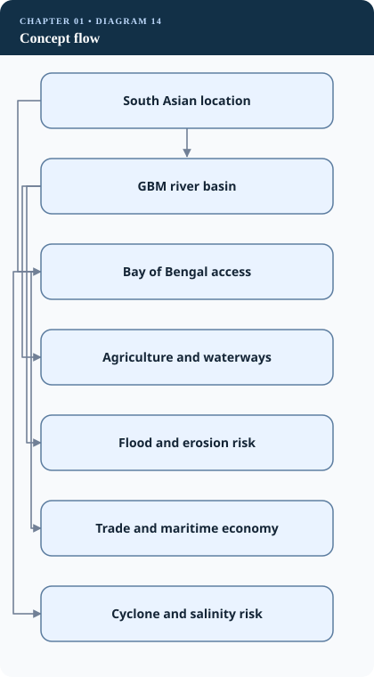</p>

<details>
<summary>ডায়াগ্রামের মূল Mermaid source দেখুন</summary>

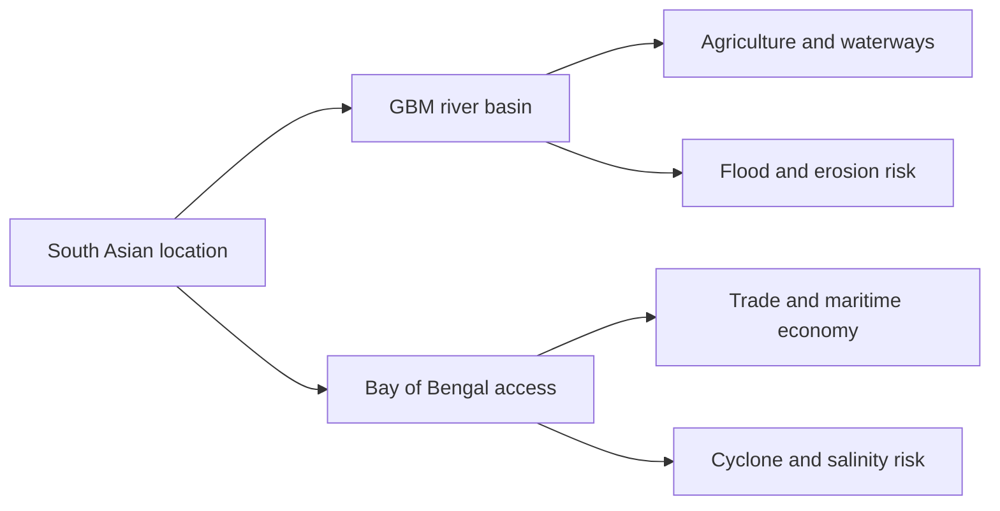

</details>

#### তুলনামূলক সারণি

| অবস্থানের ধরন | কী জানায় | বাংলাদেশ থেকে উদাহরণ | গুরুত্বপূর্ণ প্রভাব |
|---|---|---|---|
| **Absolute Location** | নির্দিষ্ট latitude–longitude | ২০°৩৪′–২৬°৩৮′ N; ৮৮°০১′–৯২°৪১′ E | বিশ্বমানচিত্রে অবস্থান |
| **Relative Location** | অন্য দেশ/সাগরের তুলনায় অবস্থান | ভারত, মিয়ানমার, বঙ্গোপসাগর | আঞ্চলিক যোগাযোগ |
| **River Basin Location** | উজান থেকে ভাটিতে পানির চলাচল | GBM অববাহিকার নিম্নাংশ | পলি, কৃষি, বন্যা |
| **Maritime Location** | সামুদ্রিক সুযোগ ও দুর্যোগের অবস্থান | বঙ্গোপসাগরসংলগ্ন উপকূল | বন্দর, মৎস্য, ঘূর্ণিঝড় |

#### বিশ্লেষণ ও পরীক্ষায় প্রয়োগ — কী, কেন, কীভাবে এবং মূল্যায়ন

**কেন বিষয়টি গুরুত্বপূর্ণ (Why):** ভৌগোলিক অবস্থানের দুই দিক আলাদা করুন। অক্ষাংশ–দ্রাঘিমাংশ বাংলাদেশের পৃথিবীপৃষ্ঠে নির্দিষ্ট অবস্থান দেখায়; অন্যদিকে সমুদ্র, প্রতিবেশী দেশ, উজানের নদীপ্রণালি ও আন্তর্জাতিক নৌপথের তুলনায় অবস্থান অর্থনৈতিক ও কূটনৈতিক তাৎপর্য বোঝায়। শুধু চারদিকের সীমানা লিখলে প্রশ্নের 'significance' অংশের উত্তর হয় না।

**ধাপে ধাপে প্রক্রিয়া (How):** গঙ্গা–ব্রহ্মপুত্র–মেঘনা অববাহিকায় বাংলাদেশ ভাটির দেশ হওয়ায় উজানের বৃষ্টিপাত ও নদীর প্রবাহ দেশের কৃষি, পলি সঞ্চয় ও বন্যাকে প্রভাবিত করে। দক্ষিণে বঙ্গোপসাগর থাকায় নদীভিত্তিক অভ্যন্তরীণ যোগাযোগ সামুদ্রিক বাণিজ্যের সঙ্গে যুক্ত হতে পারে। তবে উপসাগরের ঘূর্ণিঝড় ও জলোচ্ছ্বাস উপকূলীয় নিরাপত্তার চ্যালেঞ্জও তৈরি করে।

**বাংলাদেশভিত্তিক প্রয়োগ (Case Study):** যেমন, সমুদ্রবন্দরে আসা পণ্য ভেতরের বাজারে নিতে সড়ক, রেল ও নৌযোগাযোগ প্রয়োজন; অন্যদিকে একই উপকূলের জনবসতিকে সাইক্লোন আশ্রয় ও পূর্বাভাসের ওপর নির্ভর করতে হয়। এই দ্বৈততা মানচিত্রে একটি সমুদ্রতীর ও নদীপ্রণালির ওপর চিহ্নিত করুন।

**সমালোচনামূলক মূল্যায়ন (Evaluation):** **সারকথা:** অবস্থান নিজে উন্নয়ন ঘটায় না; অবকাঠামো, সুশাসন, প্রতিবেশীদের সঙ্গে সহযোগিতা ও দুর্যোগ-প্রস্তুতি সেই সম্ভাবনাকে বাস্তব ফলাফলে রূপ দেয়।

> [!TIP]
> 🟩 **চিত্রভিত্তিক উত্তর অনুশীলন:** একটি হাতে আঁকা মানচিত্রে উত্তর/পশ্চিম/পূর্বের স্থলপ্রতিবেশী এবং দক্ষিণে Bay of Bengal লিখুন; তারপর এক পাশে Trade Opportunity এবং অপর পাশে Flood/Cyclone Risk—দুটি তীরচিহ্ন দিন।

**উত্তরে ভালো নম্বর পাওয়ার কৌশল:** শুধু তথ্য তালিকা নয়—**কারণ → প্রক্রিয়া → আঞ্চলিক উদাহরণ → ইতিবাচক/নেতিবাচক প্রভাব → বাস্তবসম্মত সিদ্ধান্ত** এই ধারায় লিখুন। ৫ নম্বরের ক্ষেত্রে প্রাসঙ্গিক ২–৩টি ধাপ, ১০ নম্বরে তুলনা/চিত্র এবং ২০ নম্বরে পাল্টা যুক্তি ও নীতি যুক্ত করুন।

**উপসংহার:** বাংলাদেশের ভৌগোলিক অবস্থান একই সঙ্গে **অর্থনৈতিক সংযোগের সম্পদ** এবং **জলবায়ু–দুর্যোগ ব্যবস্থাপনার দায়িত্ব**। তাই খাতায় একটি ছোট মানচিত্র এঁকে দক্ষিণে বঙ্গোপসাগর, তিন নদী ও প্রতিবেশী রাষ্ট্র চিহ্নিত করলে উত্তর স্পষ্ট হয়।

> [!NOTE]
> 🔵 **পরীক্ষায় উল্লেখযোগ্য তথ্যসূত্র:** Banglapedia — Asiatic Society of Bangladesh — *Bangladesh (অবস্থান, আয়তন ও সীমান্ত)* [S4]; Banglapedia — Asiatic Society of Bangladesh — *Bangladesh Geography (ভূপ্রকৃতি, বদ্বীপ, নদী ও অঞ্চল)* [S2]।

> [!TIP]
> 🟢 **Q01 · Recall in 10 Seconds:** **South Asia → GBM Rivers → Bay of Bengal**। অবস্থান বোঝাতে মানচিত্র+সুযোগ+ঝুঁকি লিখুন।

<a id="q02"></a>

### 02. Describe the major topographical features of Bangladesh with regional examples.

**বাংলা প্রশ্ন:** বাংলাদেশের প্রধান ভূপ্রাকৃতিক বৈশিষ্ট্যগুলো আঞ্চলিক উদাহরণসহ বর্ণনা করুন।

**Type:** Past-paper theme — 40th/43rd (secondary archive); English rendering, not verbatim original · **Suggested marks:** 10–20

**✅ Model Answer (বাংলা) — Definition → Explanation → Analysis**

**ভূমিকা:** <mark>ভূমির উচ্চতা, গঠন, বয়স, ঢাল ও মাটির বৈশিষ্ট্য অনুযায়ী বাংলাদেশের ভূপ্রকৃতিকে তিনটি প্রধান ভাগে</mark> বিশ্লেষণ করা যায়—**নবীন প্লাবনভূমি**, **প্লাইস্টোসিন সোপান** এবং **পাহাড়ি অঞ্চল** [S2][S3]।

| প্রধান ভূমিরূপ | কোথায় দেখা যায় | বৈশিষ্ট্য | জীবিকা ও ঝুঁকি |
|---|---|---|---|
| **Recent Floodplain** | পদ্মা–যমুনা–মেঘনা, হাওর, মোহনা | নবীন পলি, নিচু ভূমি, নিয়মিত নদীপ্রভাব | ধান, মাছ, নৌযান; বন্যা ও ভাঙন |
| **Pleistocene Terrace** | বরেন্দ্র, মধুপুর গড়, লালমাই-সংলগ্ন উঁচু পৃষ্ঠ | অপেক্ষাকৃত প্রাচীন, উঁচু ও শক্ত মাটির স্তর | কৃষি, বন; পানি-স্বল্পতা বা ভূমি ব্যবহারের চাপ |
| **Hilly Region** | পার্বত্য চট্টগ্রাম, সিলেটের পাহাড় | ঢাল, উপত্যকা ও তুলনামূলক পুরোনো শিলাস্তর | পাহাড়ি কৃষি, বন; ভূমিধস ও ক্ষয় |

**ব্যাখ্যা:** প্লাবনভূমি নদীর বয়ে আনা পলি দিয়ে তৈরি ও পরিবর্তিত হয়। সোপানভূমির মাটি পুরোনো এবং অনেক জায়গায় লালচে–বাদামি; বরেন্দ্রে শুষ্ক মৌসুমের সেচচাপ গুরুত্বপূর্ণ। পাহাড়ে ভূমির ঢাল পানি ও মাটির গতি দ্রুত করে; নির্বিচারে পাহাড় কাটা ক্ষয় বাড়াতে পারে।

**ভিজ্যুয়াল — তিন ভূপ্রাকৃতিক স্তর:**

<p>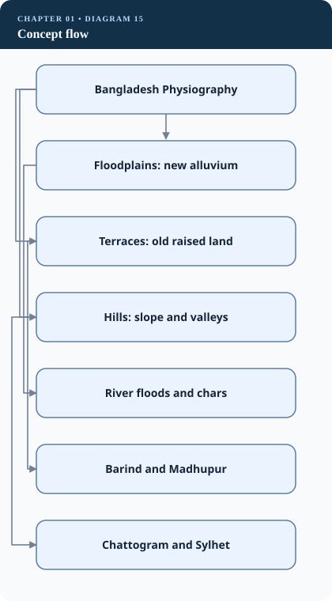</p>

<details>
<summary>ডায়াগ্রামের মূল Mermaid source দেখুন</summary>

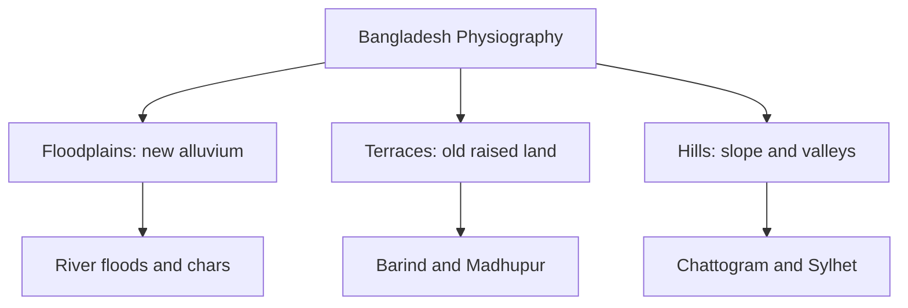

</details>

**বিশ্লেষণ:** একই ধরনের উন্নয়ননীতি তিন অঞ্চলে সমান ফল দেয় না। প্লাবনভূমিতে বন্যা-সহনশীল বসতি, সোপানে পানি ব্যবস্থাপনা এবং পাহাড়ে ঢাল সংরক্ষণ জরুরি।

#### বিশ্লেষণ ও পরীক্ষায় প্রয়োগ — কী, কেন, কীভাবে এবং মূল্যায়ন

**কেন বিষয়টি গুরুত্বপূর্ণ (Why):** ‘Topography’ বলতে মাটির উচ্চতা ও বাহ্যিক ভূমিরূপ বোঝালেও 'Physiography'তে ভূতাত্ত্বিক বয়স, গঠন, নদীর পলি ও ভূপ্রক্রিয়া যুক্ত হয়। তাই তিন ধরনের ভূমি কেবল উঁচু–নিচু নয়; তিনটির গঠনের ইতিহাসও আলাদা। নবীন প্লাবনভূমি নদীপলি থেকে ক্রমাগত বদলায়; প্লাইস্টোসিন সোপান তুলনামূলক পুরোনো; পাহাড়ের ঢাল ও শিলাস্তর ভিন্ন।

**ধাপে ধাপে প্রক্রিয়া (How):** প্লাবনভূমিতে প্রবাহের সঙ্গে নতুন পলি আসতে পারে, ফলে আবাদ, নৌপথ ও বসতি বদলায়। সোপানে নদীর বার্ষিক নতুন পলি তুলনামূলক কম পৌঁছায়, তাই স্থানীয় মাটি ও পানির ব্যবস্থাপনা পৃথক। পাহাড়ে বৃষ্টির পানি ঢাল বেয়ে দ্রুত নামে, ফলে মাটিক্ষয়, ভূমিধস ও যোগাযোগ অবকাঠামোর ঝুঁকি আলাদা।

**বাংলাদেশভিত্তিক প্রয়োগ (Case Study):** যমুনার চর, নওগাঁর বরেন্দ্র, টাঙ্গাইলের মধুপুর এবং রাঙামাটির পাহাড়—চারটি উদাহরণ দিলে তিন শ্রেণির স্থানিক বিস্তার বোঝানো যায়। একই রকম কৃষি, বাঁধ বা রাস্তার নকশা সব অঞ্চলে কেন ঠিক নয়, তা প্রতিটির পাশে একটি করে ঝুঁকি লিখে দেখান।

**সমালোচনামূলক মূল্যায়ন (Evaluation):** <mark>80–8–12</mark> একটি প্রকাশিত আনুমানিক classification; Banglapedia-র ২৪ উপ-অঞ্চল ও ৫৪টি unit অন্য স্তরের শ্রেণিবিন্যাস। এগুলোকে একই dataset-এর সংখ্যা বলে মিশিয়ে লেখা যাবে না।

> [!TIP]
> 🟩 **চিত্রভিত্তিক উত্তর অনুশীলন:** উত্তরে একটি সোপানভূমির উঁচু আড়াআড়ি রেখা, মাঝখানে নিচু বন্যাপ্রবণ সমতল, পূর্বে ত্রিভুজাকার পাহাড় আঁকুন; তিনটির নিচে Formation, Land Use, Risk লিখুন।

**উত্তরে ভালো নম্বর পাওয়ার কৌশল:** শুধু তথ্য তালিকা নয়—**কারণ → প্রক্রিয়া → আঞ্চলিক উদাহরণ → ইতিবাচক/নেতিবাচক প্রভাব → বাস্তবসম্মত সিদ্ধান্ত** এই ধারায় লিখুন। ৫ নম্বরের ক্ষেত্রে প্রাসঙ্গিক ২–৩টি ধাপ, ১০ নম্বরে তুলনা/চিত্র এবং ২০ নম্বরে পাল্টা যুক্তি ও নীতি যুক্ত করুন।

**উপসংহার:** **Floodplain–Terrace–Hill**—প্রতিটির *অবস্থান + গঠন + ব্যবহার + ঝুঁকি* উল্লেখ করলেই উত্তর পূর্ণাঙ্গ হয়। [S2]-এর ২৪টি উপঅঞ্চল ও ৫৪টি একক আরও সূক্ষ্ম শ্রেণিবিন্যাস; এই তিনটি প্রধান ভাগের বিকল্প নয়।

> [!NOTE]
> 🔵 **পরীক্ষায় উল্লেখযোগ্য তথ্যসূত্র:** Banglapedia — Asiatic Society of Bangladesh — *Bangladesh Geography (ভূপ্রকৃতি, বদ্বীপ, নদী ও অঞ্চল)* [S2]; Banglapedia — Asiatic Society of Bangladesh — *ভূ-প্রকৃতি (বাংলা)* [S3]।

> [!TIP]
> 🟢 **Q02 · Recall in 10 Seconds:** **Floodplain → Terrace → Hills**। প্রতিটির একটি উদাহরণ ও একটি ঝুঁকি লিখুন।

<a id="q03"></a>

### 03. Assess the strategic geopolitical position and risks of Bangladesh.

**বাংলা প্রশ্ন:** বাংলাদেশের ভূ-কৌশলগত অবস্থান ও সংশ্লিষ্ট ঝুঁকি মূল্যায়ন করুন।

**Type:** Past-paper theme — 40th (secondary archive); English rendering, not verbatim original · **Suggested marks:** 10–20

**✅ Model Answer (বাংলা) — Definition → Explanation → Analysis**

**ভূমিকা:** <mark>কোনো দেশের **ভূরাজনৈতিক অবস্থান** বলতে তার ভূগোল কীভাবে নিরাপত্তা</mark>, বাণিজ্য, প্রতিবেশী সম্পর্ক ও রাষ্ট্রীয় নীতিকে প্রভাবিত করে তা বোঝায়। বাংলাদেশ দক্ষিণ এশিয়ার স্থলভাগ ও বঙ্গোপসাগরের সামুদ্রিক পথের সংযোগস্থলে গুরুত্বপূর্ণ অবস্থানে রয়েছে।

**কৌশলগত সুযোগ:**
1. **সমুদ্রবন্দর ও বাণিজ্য:** চট্টগ্রাম, মোংলা ও পায়রা-সংলগ্ন বন্দর অবকাঠামো আন্তর্জাতিক বাণিজ্যের সম্ভাবনা তৈরি করে; বাস্তব সুবিধা নির্ভর করে সক্ষমতা ও সংযোগের ওপর।
2. **আঞ্চলিক সংযোগ:** সড়ক–রেল–নদীপথে প্রতিবেশী অঞ্চলের সঙ্গে যোগাযোগ বাড়লে পরিবহন ও সরবরাহব্যবস্থার সুযোগ বাড়ে।
3. **সমুদ্রসম্পদ ও আইনগত অধিকার:** ২০১২ সালের ITLOS এবং ২০১৪ সালের PCA সিদ্ধান্ত বাংলাদেশ–মিয়ানমার ও বাংলাদেশ–ভারতের সমুদ্রসীমা নির্ধারণে গুরুত্বপূর্ণ [S9][S10]।
4. **নদী ও পরিবেশগত সহযোগিতা:** অভিন্ন নদী, বন্যাপূর্বাভাস ও জলবায়ু অভিযোজন নিয়ে সীমান্তপারের সমন্বয়ের প্রয়োজন রয়েছে।

**প্রধান ঝুঁকি ও ব্যবস্থাপনা:**

| ঝুঁকি | কেন গুরুত্বপূর্ণ | যুক্তিযুক্ত করণীয় |
|---|---|---|
| অভিন্ন নদীর পানি–পলি | কৃষি, নাব্যতা, বন্যা | তথ্য বিনিময় ও অববাহিকাভিত্তিক আলোচনা |
| উপকূলীয় ঘূর্ণিঝড় | বন্দর, বসতি, জীবিকা | সহনশীল বন্দর, আশ্রয় ও সতর্কতা |
| সীমান্ত ও অবৈধ কার্যক্রম | নিরাপত্তা ও বাণিজ্য | সহযোগিতা, আইন প্রয়োগ, বৈধ বাণিজ্য |
| সামুদ্রিক দূষণ | মৎস্য ও বাস্তুতন্ত্র | নজরদারি, পরিবেশ আইন ও আঞ্চলিক সমন্বয় |

<p>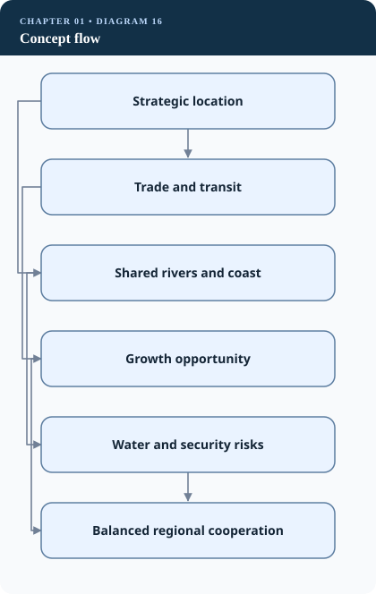</p>

<details>
<summary>ডায়াগ্রামের মূল Mermaid source দেখুন</summary>

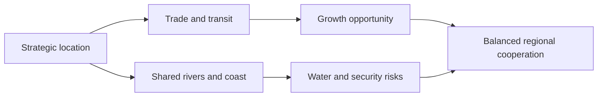

</details>

**মূল্যায়ন:** ভূরাজনৈতিক গুরুত্ব শুধু সামরিক অবস্থান নয়; **অর্থনৈতিক সুযোগ + মানবিক নিরাপত্তা + কূটনৈতিক ভারসাম্য** একসঙ্গে বিবেচনা করতে হয়। উন্নত নৌযোগাযোগ, বহুপক্ষীয় সংলাপ ও বাংলাদেশ ব-দ্বীপ পরিকল্পনা ২১০০-ভিত্তিক অভিযোজন এতে সহায়ক।

#### বিশ্লেষণ ও পরীক্ষায় প্রয়োগ — কী, কেন, কীভাবে এবং মূল্যায়ন

**কেন বিষয়টি গুরুত্বপূর্ণ (Why):** Geopolitical importance অর্থ শুধু সামরিক অবস্থান নয়; এটি সমুদ্রপথে বাণিজ্য, প্রতিবেশী রাষ্ট্রের সঙ্গে সংযোগ, সীমান্তের ব্যবস্থাপনা, আন্তঃসীমান্ত নদী এবং আঞ্চলিক সিদ্ধান্তে বাংলাদেশের অবস্থানের প্রভাব বোঝায়। ঝুঁকি বা সুবিধা—কোনোটিই ভৌগোলিক মানচিত্র দেখিয়ে একাই প্রমাণ হয় না।

**ধাপে ধাপে প্রক্রিয়া (How):** প্রতিবেশী দেশের সঙ্গে স্থলপথে সংযোগ বাড়লে আমদানি–রপ্তানির খরচ কমার সম্ভাবনা আছে, কিন্তু সড়ক, শুল্কপ্রক্রিয়া, নিরাপত্তা ও পারস্পরিক চুক্তি প্রয়োজন। বঙ্গোপসাগরে সমুদ্রসীমা নির্ধারণে আইনগত নিশ্চয়তা তৈরি হলেও বন্দরসক্ষমতা, মৎস্য ব্যবস্থাপনা ও সামুদ্রিক গবেষণা ছাড়া সম্ভাবনা পুরোপুরি ব্যবহার করা যায় না।

**বাংলাদেশভিত্তিক প্রয়োগ (Case Study):** উদাহরণ: ২০১২ সালের বাংলাদেশ–মিয়ানমার ITLOS Judgment এবং ২০১৪ সালের বাংলাদেশ–ভারত arbitral award বঙ্গোপসাগরে সীমা নির্ধারণের সঙ্গে যুক্ত। একটি ২০ নম্বরের উত্তরে এই দুটি ঘটনাকে ‘আইনভিত্তিক বিরোধ নিষ্পত্তি’ হিসেবে দেখান, সামরিক দখল বা স্বয়ংক্রিয় সম্পদ আহরণ হিসেবে নয়।

**সমালোচনামূলক মূল্যায়ন (Evaluation):** কৌশলগত গুরুত্ব যত বেশি, সমন্বয়ের প্রয়োজনও তত বেশি। জলবায়ু ঝুঁকি, উজান-ভাটি প্রবাহ, অবকাঠামো সুরক্ষা ও আঞ্চলিক সম্পর্ক—সব ক্ষেত্রেই অর্থনৈতিক সুযোগের সঙ্গে রাজনৈতিক ও পরিবেশগত খরচ বিচার করতে হবে।

> [!TIP]
> 🟩 **চিত্রভিত্তিক উত্তর অনুশীলন:** দুটি কলামের Opportunity–Risk Matrix আঁকুন: Port Connectivity↔Congestion, Transboundary River↔Water Cooperation, Maritime Rights↔Resource Governance, Location↔Cyclone Exposure।

**উত্তরে ভালো নম্বর পাওয়ার কৌশল:** শুধু তথ্য তালিকা নয়—**কারণ → প্রক্রিয়া → আঞ্চলিক উদাহরণ → ইতিবাচক/নেতিবাচক প্রভাব → বাস্তবসম্মত সিদ্ধান্ত** এই ধারায় লিখুন। ৫ নম্বরের ক্ষেত্রে প্রাসঙ্গিক ২–৩টি ধাপ, ১০ নম্বরে তুলনা/চিত্র এবং ২০ নম্বরে পাল্টা যুক্তি ও নীতি যুক্ত করুন।

**উপসংহার:** বাংলাদেশের অবস্থান একটি সম্ভাবনাময় সংযোগকেন্দ্র, কিন্তু সুযোগ পেতে হলে পরিবেশগত ঝুঁকি ও প্রতিবেশী সহযোগিতার প্রশ্নও কার্যকরভাবে সামলাতে হবে।

> [!NOTE]
> 🔵 **পরীক্ষায় উল্লেখযোগ্য তথ্যসূত্র:** General Economics Division (GED), Bangladesh Planning Commission — *Bangladesh Delta Plan 2100, investment plan / six hotspot descriptions* [S6]; Ministry of Law, Justice and Parliamentary Affairs — Laws of Bangladesh — *The Territorial Waters and Maritime Zones Act, 1974 (as amended in 2021)* [S8]; International Tribunal for the Law of the Sea (ITLOS) — *Case No.16, Bangladesh/Myanmar, Judgment, 14 March 2012* [S9]; Permanent Court of Arbitration (PCA) — *Bay of Bengal Maritime Boundary Arbitration (Bangladesh v India), Award, 7 July 2014* [S10]।

> [!TIP]
> 🟢 **Q03 · Recall in 10 Seconds:** **Trade → River Cooperation → Coastal Risks**। সুযোগ ও ঝুঁকি দুটিই দেখান।

<a id="q04"></a>

### 04. What is the economic importance of the Bay of Bengal for Bangladesh?

**বাংলা প্রশ্ন:** বাংলাদেশের জন্য বঙ্গোপসাগরের অর্থনৈতিক গুরুত্ব কী?

**Type:** Past-paper theme — 35th (secondary archive); English rendering, not verbatim original · **Suggested marks:** 10–20

**✅ Model Answer (বাংলা) — Definition → Explanation → Analysis**

**ভূমিকা:** <mark>বঙ্গোপসাগর বাংলাদেশের দক্ষিণের সমুদ্রসীমা এবং আন্তর্জাতিক নৌপথ, উপকূলীয় জীবন ও সামুদ্রিক</mark> সম্পদের সঙ্গে দেশের অর্থনীতিকে যুক্ত করে। **Blue Economy** বলতে সামুদ্রিক সম্পদ ব্যবহারের সঙ্গে দীর্ঘমেয়াদি পরিবেশ সংরক্ষণের সমন্বয় বোঝায়।

**অর্থনৈতিক গুরুত্ব:**
1. **বৈদেশিক বাণিজ্য:** সমুদ্রপথে পণ্য পরিবহন, বন্দর-লজিস্টিকস ও কনটেইনার সেবা আমদানি–রপ্তানির গুরুত্বপূর্ণ অবকাঠামো।
2. **মৎস্য ও খাদ্য:** সামুদ্রিক মাছ ও সংশ্লিষ্ট সংগ্রহ, প্রক্রিয়াকরণ ও সরবরাহব্যবস্থা উপকূলীয় জীবিকা ও পুষ্টিতে ভূমিকা রাখে।
3. **সমুদ্রসম্পদ:** অনুমোদিত আইনি পরিসরে সামুদ্রিক গবেষণা ও সম্পদ অন্বেষণের সুযোগ রয়েছে; সম্ভাব্য সম্পদকে ইতিমধ্যে উত্তোলিত বা প্রমাণিত মজুত ধরে নেওয়া ঠিক নয়।
4. **পর্যটন ও সেবা:** সমুদ্রসৈকত, দ্বীপ ও উপকূলীয় পর্যটন স্থানীয় কর্মসংস্থান তৈরি করতে পারে; বর্জ্য ও জীববৈচিত্র্যের চাপ ব্যবস্থাপনা জরুরি।
5. **কৌশলগত সুবিধা:** সমুদ্রসীমা-সংক্রান্ত বিচারিক সিদ্ধান্তগুলো আইনি নিশ্চয়তা বৃদ্ধি করেছে [S9][S10]।

| সুযোগ | কীভাবে আয় বা উপকার হয় | সুরক্ষার শর্ত |
|---|---|---|
| বন্দর | পরিবহন, গুদাম, সরবরাহ | দক্ষতা ও নৌনিরাপত্তা |
| মৎস্য | খাদ্য, কর্মসংস্থান | টেকসই আহরণ |
| পর্যটন | স্থানীয় ব্যবসা | উপকূল ও বর্জ্য ব্যবস্থাপনা |
| গবেষণা | সম্পদের তথ্য | পরিবেশগত প্রভাব মূল্যায়ন |

<p>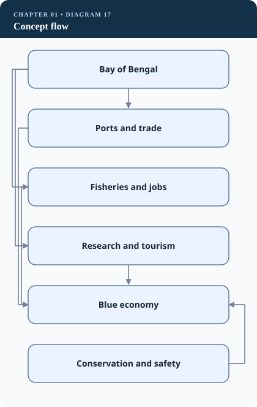</p>

<details>
<summary>ডায়াগ্রামের মূল Mermaid source দেখুন</summary>

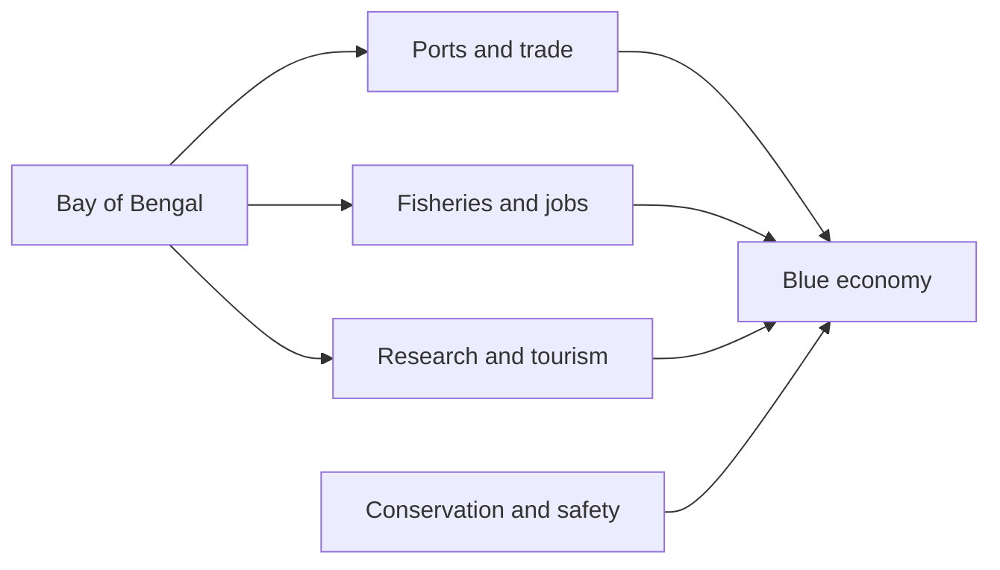

</details>

#### বিশ্লেষণ ও পরীক্ষায় প্রয়োগ — কী, কেন, কীভাবে এবং মূল্যায়ন

**কেন বিষয়টি গুরুত্বপূর্ণ (Why):** সমুদ্রকে একটি ‘resource warehouse’ ভাবলে Blue Economy-র অর্থ অসম্পূর্ণ থাকে। অর্থনৈতিক গুরুত্ব চার স্তরে: (১) নৌপথ ও বন্দর; (২) মৎস্য ও খাদ্য; (৩) গবেষণা ও সম্ভাব্য জ্বালানি; (৪) উপকূলীয় পর্যটন ও স্থানীয় সেবা। প্রতিটি খাত অর্থনৈতিকভাবে কার্যকর হতে বিনিয়োগ ও পরিবেশ ব্যবস্থাপনার ওপর নির্ভরশীল।

**ধাপে ধাপে প্রক্রিয়া (How):** বন্দর দিয়ে পণ্য আসা–যাওয়ার জন্য জাহাজ, কনটেইনার পরিচালনা, স্থলযোগাযোগ ও কাস্টমস ব্যবস্থার সমন্বয় লাগে। মৎস্যসম্পদের জন্য মাছের মজুত সম্পর্কে বিজ্ঞানসম্মত তথ্য এবং অতিআহরণ রোধ প্রয়োজন। উপকূলীয় পর্যটনে উপার্জন বাড়লেও বর্জ্য, জীববৈচিত্র্য ও বাসস্থানের ওপর চাপ তৈরি হতে পারে।

**বাংলাদেশভিত্তিক প্রয়োগ (Case Study):** ধরা যাক, একটি বন্দর এলাকার জাহাজ চলাচল দ্রুত হচ্ছে। শুধু জাহাজের সংখ্যা নয়—পরিবহন সময়, নিরাপত্তা, পরিবেশগত প্রভাব, উপকূলবাসীর জীবিকা এবং পশ্চাৎভূমিতে সড়ক–রেলসংযোগ বিবেচনা করলে সেটি প্রকৃত development analysis হয়।

**সমালোচনামূলক মূল্যায়ন (Evaluation):** <mark>সমুদ্রসীমা নির্ধারণ ≠ সম্পদ আবিষ্কার ≠ বাণিজ্যিক উৎপাদন ≠ রাষ্ট্রীয় আয়।</mark> এই চার ধাপের পার্থক্য দেখালে অযাচিত বিশাল সম্পদ বা আয় দাবি করা থেকে বিরত থাকা যায়।

> [!TIP]
> 🟩 **চিত্রভিত্তিক উত্তর অনুশীলন:** Port → Logistics → Trade ও Fisheries → Stock Assessment → Sustainable Catch—দুটি সমান্তরাল flowchart দিয়ে শেষে Environmental Safeguard যুক্ত করুন।

**উত্তরে ভালো নম্বর পাওয়ার কৌশল:** শুধু তথ্য তালিকা নয়—**কারণ → প্রক্রিয়া → আঞ্চলিক উদাহরণ → ইতিবাচক/নেতিবাচক প্রভাব → বাস্তবসম্মত সিদ্ধান্ত** এই ধারায় লিখুন। ৫ নম্বরের ক্ষেত্রে প্রাসঙ্গিক ২–৩টি ধাপ, ১০ নম্বরে তুলনা/চিত্র এবং ২০ নম্বরে পাল্টা যুক্তি ও নীতি যুক্ত করুন।

**উপসংহার:** বঙ্গোপসাগরের প্রকৃত অর্থনৈতিক মূল্য শুধু সম্পদ আহরণে নয়; **টেকসই ব্যবস্থাপনা, নিরাপদ বন্দর ও সুনীল অর্থনীতির সুশাসনে** নিহিত।

> [!NOTE]
> 🔵 **পরীক্ষায় উল্লেখযোগ্য তথ্যসূত্র:** Ministry of Law, Justice and Parliamentary Affairs — Laws of Bangladesh — *The Territorial Waters and Maritime Zones Act, 1974 (as amended in 2021)* [S8]; International Tribunal for the Law of the Sea (ITLOS) — *Case No.16, Bangladesh/Myanmar, Judgment, 14 March 2012* [S9]; Permanent Court of Arbitration (PCA) — *Bay of Bengal Maritime Boundary Arbitration (Bangladesh v India), Award, 7 July 2014* [S10]।

> [!TIP]
> 🟢 **Q04 · Recall in 10 Seconds:** **Port → Fish → Maritime Law → Conservation**। শুধু সম্পদ নয়, সুশাসনও লিখুন।

<a id="q05"></a>

### 05. Differentiate between an active delta and an inactive or moribund delta.

**বাংলা প্রশ্ন:** সক্রিয় ও নিষ্ক্রিয় (Moribund) বদ্বীপের পার্থক্য দেখান।

**Type:** Past-paper theme — 36th (secondary archive); English rendering, not verbatim original · **Suggested marks:** 10–20

**✅ Model Answer (বাংলা) — Definition → Explanation → Analysis**

**ভূমিকা:** <mark>বদ্বীপের সব অংশে নদীর পলি সঞ্চয়ের মাত্রা এক নয়</mark>। এ পার্থক্য বোঝাতে **Active Delta** এবং **Moribund/Inactive Delta** পরিভাষা ব্যবহৃত হয় [S2]।

| বিচার্য বিষয় | সক্রিয় বদ্বীপ | অপেক্ষাকৃত নিষ্ক্রিয়/মরিবান্ড বদ্বীপ |
|---|---|---|
| পলির প্রবাহ | নতুন পলি সরবরাহ ও জমার প্রক্রিয়া বেশি সক্রিয় | মূল নদী থেকে নতুন পলির সরবরাহ তুলনামূলক কম |
| ভূমিরূপ | নতুন চর, খাত পরিবর্তন, মোহনা গঠন | পুরোনো নদীখাত ও অপেক্ষাকৃত স্থিত পৃষ্ঠ |
| পরিবর্তন | ক্ষয়–সঞ্চয়ে দ্রুত পরিবর্তন দেখা যেতে পারে | পরিবর্তন ধীর হতে পারে; পুরোপুরি বন্ধ নয় |
| উদাহরণ | সক্রিয় নদী–মোহনা ও চরাঞ্চল | দক্ষিণ-পশ্চিমের কিছু পুরোনো বদ্বীপীয় অংশ |

**কারণ:** নদীর গতিপথ বদলে গেলে পলি নতুন শাখায় বেশি পৌঁছায়; আগের শাখায় পলি কমলে সে অংশ তুলনামূলকভাবে মরিবান্ড হয়ে উঠতে পারে। তবে সাগরের জোয়ার, ভাঙন, জলাবদ্ধতা বা লবণাক্ততার প্রভাব দুই অবস্থাতেই থাকতে পারে।

<p>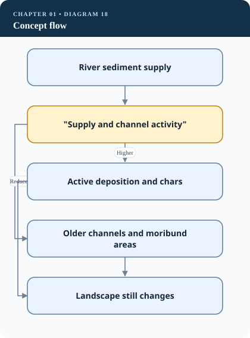</p>

<details>
<summary>ডায়াগ্রামের মূল Mermaid source দেখুন</summary>

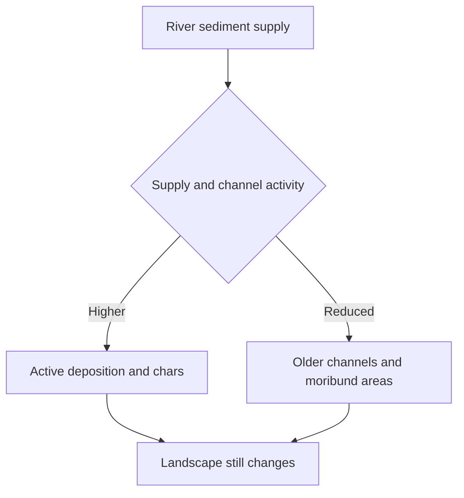

</details>

**ভুল এড়ান:** 'Active = সব জায়গায় ভূমি বাড়ে' কিংবা 'Moribund = কোনো ঝুঁকি নেই'—এ দুটো বক্তব্যই ভুল।

#### বিশ্লেষণ ও পরীক্ষায় প্রয়োগ — কী, কেন, কীভাবে এবং মূল্যায়ন

**কেন বিষয়টি গুরুত্বপূর্ণ (Why):** একটি বদ্বীপের সব শাখায় সমান পরিমাণ পলি পৌঁছায় না। প্রধান নদীখাত সরে গেলে পুরোনো শাখায় পানির সঙ্গে পলি সরবরাহ কমতে পারে; নতুন প্রবাহপথে বেশি পলি ও ভূমির পরিবর্তন ঘটে। তাই Active ও Moribund হলো নদী–পলি প্রক্রিয়ার কার্যক্রম বোঝাতে ব্যবহৃত শ্রেণি, সব অঞ্চলে একই মাত্রার ভূমি বৃদ্ধি/ক্ষয় নয়।

**ধাপে ধাপে প্রক্রিয়া (How):** Active অংশে নতুন চর, চ্যানেল ও সঞ্চয়প্রক্রিয়া বেশি চোখে পড়তে পারে। অপেক্ষাকৃত নিষ্ক্রিয় অংশে পুরোনো খাত, বিল ও পানিনিষ্কাশনের পৃথক সমস্যা থাকতে পারে। জোয়ারভাটা, স্থানীয় ভূমি অবনমন বা বাঁধের কারণে পুরোনো বদ্বীপেও জলাবদ্ধতা তৈরি হতে পারে।

**বাংলাদেশভিত্তিক প্রয়োগ (Case Study):** প্রশ্নে পশ্চিম বাংলাদেশের পুরোনো বদ্বীপীয় অংশ এবং মেঘনা মোহনার সক্রিয় পলিসঞ্চয়পূর্ণ অংশ তুলনা করা যায়—কিন্তু পুরো পশ্চিমাঞ্চলকে স্থির বা পুরো মোহনাকে চিরবর্ধনশীল বলা ভুল।

**সমালোচনামূলক মূল্যায়ন (Evaluation):** পরীক্ষায় শুধু দুটো সংজ্ঞা লিখে শেষ করবেন না; **পলি সরবরাহ, মূল নদীর চ্যানেল, বর্তমান ভূমি পরিবর্তন, পানি নিষ্কাশন ও মানুষের ব্যবহার**—এই পাঁচ মানদণ্ডে তুলনা দিন।

> [!TIP]
> 🟩 **চিত্রভিত্তিক উত্তর অনুশীলন:** Active Delta: Strong river sediment → new deposition; Moribund Delta: Reduced main-channel sediment → older deltaic surfaces। নিচে লেখুন: 'Local erosion can occur in both.'

**উত্তরে ভালো নম্বর পাওয়ার কৌশল:** শুধু তথ্য তালিকা নয়—**কারণ → প্রক্রিয়া → আঞ্চলিক উদাহরণ → ইতিবাচক/নেতিবাচক প্রভাব → বাস্তবসম্মত সিদ্ধান্ত** এই ধারায় লিখুন। ৫ নম্বরের ক্ষেত্রে প্রাসঙ্গিক ২–৩টি ধাপ, ১০ নম্বরে তুলনা/চিত্র এবং ২০ নম্বরে পাল্টা যুক্তি ও নীতি যুক্ত করুন।

**উপসংহার:** বদ্বীপের শ্রেণি বুঝতে **পলি সরবরাহ, নদীপথ ও ভূমিরূপের পরিবর্তন**—এই তিনটি সূচক তুলনা করতে হয়।

> [!NOTE]
> 🔵 **পরীক্ষায় উল্লেখযোগ্য তথ্যসূত্র:** Banglapedia — Asiatic Society of Bangladesh — *Bangladesh Geography (ভূপ্রকৃতি, বদ্বীপ, নদী ও অঞ্চল)* [S2]।

> [!TIP]
> 🟢 **Q05 · Recall in 10 Seconds:** **Active = new sediment; Moribund = reduced active deposition**।

[⬆️ Back to Question Finder](#question-index) · [🏠 Table of Contents](#top)

---

<a id="q06"></a>

### 06. Explain the origin of the Ganges–Brahmaputra–Meghna delta.

**বাংলা প্রশ্ন:** গঙ্গা–ব্রহ্মপুত্র–মেঘনা বদ্বীপের উৎপত্তি ব্যাখ্যা করুন।

**Type:** Editorial high-priority practice (not a previous exam question) · **Suggested marks:** 5–10

**✅ Model Answer (বাংলা) — Definition → Explanation → Analysis**

**ভূমিকা:** <mark>গঙ্গা–ব্রহ্মপুত্র–মেঘনা (GBM) বদ্বীপ নদী, পলি, সমুদ্রের জোয়ার এবং ভূ-অবনমনের দীর্ঘমেয়াদি যৌথ</mark> প্রক্রিয়ায় গড়ে উঠেছে। এটি একবার তৈরি হয়ে স্থির থাকা ভূমি নয়।

**গঠনের ধাপ:**
1. **পলি উৎপাদন:** হিমালয় ও বৃহত্তর অববাহিকার শিলা–মাটির ক্ষয় থেকে বালি, পলি ও কাদা তৈরি হয়।
2. **পলি পরিবহন:** গঙ্গা, ব্রহ্মপুত্র ও মেঘনা এবং শাখানদী বিপুল পলি নিম্ন অববাহিকায় আনে।
3. **পলি সঞ্চয়:** নদীর গতি কমা, মোহনা ও প্লাবনের প্রভাবে পলি জমে প্লাবনভূমি, চর ও বদ্বীপীয় জমি গঠিত হয়।
4. **সমুদ্রের প্রভাব:** জোয়ার–ভাটা, তরঙ্গ, উপকূলীয় স্রোত ও লবণাক্ততা নতুন পলিভূমিকে পুনর্গঠন করে।
5. **পরিবর্তন:** নদীর খাত স্থানান্তর, ক্ষয়, ভূমির অবনমন ও সমুদ্রস্তর পরিবর্তনে বদ্বীপের আকৃতি বদলায়।

**প্রক্রিয়া-চিত্র:**

<p>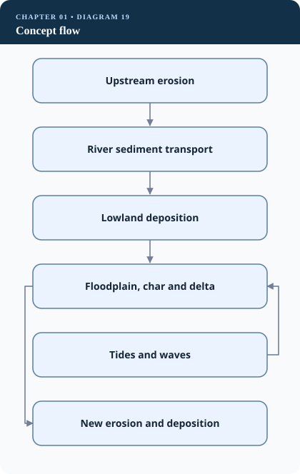</p>

<details>
<summary>ডায়াগ্রামের মূল Mermaid source দেখুন</summary>

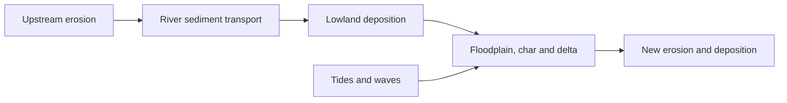

</details>

**কারণ–ফল:** পলল মাটি কৃষিকাজে সহায়ক এবং নদী–জলাভূমি মাছ ও জলজ বাস্তুতন্ত্রে অবদান রাখে। বিপরীতে, নদীভাঙন, বন্যা, চর হারানো ও উপকূলীয় লবণাক্ততা বসতি ও অবকাঠামোর ঝুঁকি তৈরি করে।

#### তুলনামূলক সারণি

| বদ্বীপ সৃষ্টির ধাপ | কী ঘটে | দৃশ্যমান ভূমিরূপ |
|---|---|---|
| **Erosion at source** | পাহাড় ও ভূমি থেকে কণা নদীতে আসে | নদীতে বালি ও পলি |
| **River Transport** | প্রবাহের সঙ্গে কণা ভাটিতে আসে | পানি–পলির স্রোত |
| **Deposition** | প্রবাহের শক্তি বদলে পলি জমে | চর, প্লাবনভূমি |
| **Marine Reworking** | জোয়ার, ঢেউ ও স্রোত পলি পুনর্বণ্টন করে | মোহনা ও উপকূলের পরিবর্তন |
| **Continuous Adjustment** | নতুন ভূমি সৃষ্টি ও ক্ষয় পাশাপাশি চলে | গতিশীল বদ্বীপ |

#### বিশ্লেষণ ও পরীক্ষায় প্রয়োগ — কী, কেন, কীভাবে এবং মূল্যায়ন

**কেন বিষয়টি গুরুত্বপূর্ণ (Why):** GBM বদ্বীপের উৎপত্তির ব্যাখ্যায় নদী, পলি, নিম্নভূমি ও সমুদ্রের সম্পর্ক একত্রে প্রয়োজন। শুধু ‘তিন নদীর পলি জমে’ বললে আংশিক উত্তর হয়, কারণ বদ্বীপের কোন অংশে কত পলি থাকবে তা জোয়ার, ঢেউ, স্রোত, উপকূলরেখা ও ভূতাত্ত্বিক পরিবর্তনের সঙ্গে সম্পর্কিত।

**ধাপে ধাপে প্রক্রিয়া (How):** উজানে ভূক্ষয় নদীতে পলি যোগ করে; নদীর প্রবাহ সেই পলি ভাটিতে আনে; সমতলে বা মোহনায় পরিবহনক্ষমতা বদলালে অবক্ষেপণ ঘটে; জোয়ারভাটা ও সামুদ্রিক স্রোত পুনরায় সেই পলি সরাতে পারে। কোথাও নতুন ভূমি তৈরি হলেও আরেক স্থানে ক্ষয় চলতে পারে।

**বাংলাদেশভিত্তিক প্রয়োগ (Case Study):** মেঘনা মোহনার স্যাটেলাইট ছবিতে পলিমিশ্রিত জলরাশির রং আলাদা দেখা যায়; কিন্তু ছবির রং দেখে প্রতি বছর কত বর্গকিলোমিটার ভূমি বাড়ছে বলা যাবে না। সেই পরিমাপের জন্য নির্দিষ্ট সময়ের মানচিত্র, জোয়ারের অবস্থা ও পর্যবেক্ষণের পদ্ধতি প্রয়োজন।

**সমালোচনামূলক মূল্যায়ন (Evaluation):** একটি শক্তিশালী উত্তরের শেষ অংশে উল্লেখ করুন—বদ্বীপ একটি living system; নদী নিয়ন্ত্রণ, বন্যা ব্যবস্থাপনা, সমুদ্রপৃষ্ঠের পরিবর্তন ও ভূমি ব্যবহারকে পৃথক করে দীর্ঘমেয়াদি পরিকল্পনা করা যায় না।

> [!TIP]
> 🟩 **চিত্রভিত্তিক উত্তর অনুশীলন:** Upland weathering → Sediment → River transport → Floodplain/Estuary deposition → Tidal redistribution → Changing delta (cycle)।

**উত্তরে ভালো নম্বর পাওয়ার কৌশল:** শুধু তথ্য তালিকা নয়—**কারণ → প্রক্রিয়া → আঞ্চলিক উদাহরণ → ইতিবাচক/নেতিবাচক প্রভাব → বাস্তবসম্মত সিদ্ধান্ত** এই ধারায় লিখুন। ৫ নম্বরের ক্ষেত্রে প্রাসঙ্গিক ২–৩টি ধাপ, ১০ নম্বরে তুলনা/চিত্র এবং ২০ নম্বরে পাল্টা যুক্তি ও নীতি যুক্ত করুন।

**উপসংহার:** পরীক্ষায় **ক্ষয় → পরিবহন → সঞ্চয় → জোয়ারের পুনর্গঠন** ধারাটি একটি সরল চিত্রে দেখালে উৎপত্তি ও চলমান পরিবর্তন—দুই দিকই ব্যাখ্যা করা যায়। [S2][S3]

> [!NOTE]
> 🔵 **পরীক্ষায় উল্লেখযোগ্য তথ্যসূত্র:** Banglapedia — Asiatic Society of Bangladesh — *Bangladesh Geography (ভূপ্রকৃতি, বদ্বীপ, নদী ও অঞ্চল)* [S2]; Banglapedia — Asiatic Society of Bangladesh — *ভূ-প্রকৃতি (বাংলা)* [S3]; UNESCO World Heritage Centre — *The Sundarbans (Bangladesh), World Heritage List no.798; inscribed 1997* [S11]।

> [!TIP]
> 🟢 **Q06 · Recall in 10 Seconds:** **Upstream sediments → river transport → delta deposition**।

<a id="q07"></a>

### 07. Explain the differences between the Barind Tract and Madhupur Tract.

**বাংলা প্রশ্ন:** বরেন্দ্রভূমি ও মধুপুর গড়ের মধ্যে পার্থক্য ব্যাখ্যা করুন।

**Type:** Past-paper theme — 43rd-related (secondary archive); English rendering, not verbatim original · **Suggested marks:** 5–10

**✅ Model Answer (বাংলা) — Definition → Explanation → Analysis**

**ভূমিকা:** <mark>বরেন্দ্রভূমি ও মধুপুর গড়—উভয়ই বাংলাদেশের</mark> **প্লাইস্টোসিন সোপানভূমি**। তবে অবস্থান, প্রাকৃতিক পরিবেশ ও ভূমি ব্যবহারে পার্থক্য রয়েছে [S2][S3]।

| তুলনার বিষয় | বরেন্দ্রভূমি (Barind) | মধুপুর গড় (Madhupur) |
|---|---|---|
| অবস্থান | উত্তর-পশ্চিম; রাজশাহী–নওগাঁ–দিনাজপুর অঞ্চলের অংশ | মধ্য বাংলাদেশ; টাঙ্গাইল–ময়মনসিংহ–গাজীপুর-সংলগ্ন অঞ্চল |
| ভূপ্রকৃতি | উঁচু পুরোনো সোপান ও খণ্ডিত পৃষ্ঠ | উঁচু গড়, ছোট ঢাল ও উপত্যকা |
| মাটি | প্রাচীন লালচে–বাদামি সোপান-মাটি | অনুরূপ পুরোনো লালচে–বাদামি মাটি |
| প্রধান পরিবেশগত সমস্যা | শুষ্ক মৌসুমে সেচ ও ভূগর্ভস্থ পানির চাপ | বনভূমি, নগরায়ণ ও ভূমি ব্যবহার পরিবর্তন |
| ব্যবস্থাপনা | পানি সাশ্রয়ী সেচ ও ফসল পরিকল্পনা | বন সংরক্ষণ ও সুষম ভূমি ব্যবহার |

**ব্যাখ্যা:** প্লাবনভূমির নতুন পলির বিপরীতে দুই অঞ্চলের ভূমি তুলনামূলক প্রাচীন ও উঁচু। তবে বরেন্দ্রকে সম্পূর্ণ মরুভূমি বা মধুপুরকে সম্পূর্ণ বন—কোনোটিই বলা যায় না; উভয় এলাকায় কৃষি ও বসতি আছে।

<p>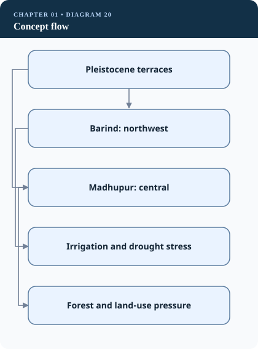</p>

<details>
<summary>ডায়াগ্রামের মূল Mermaid source দেখুন</summary>

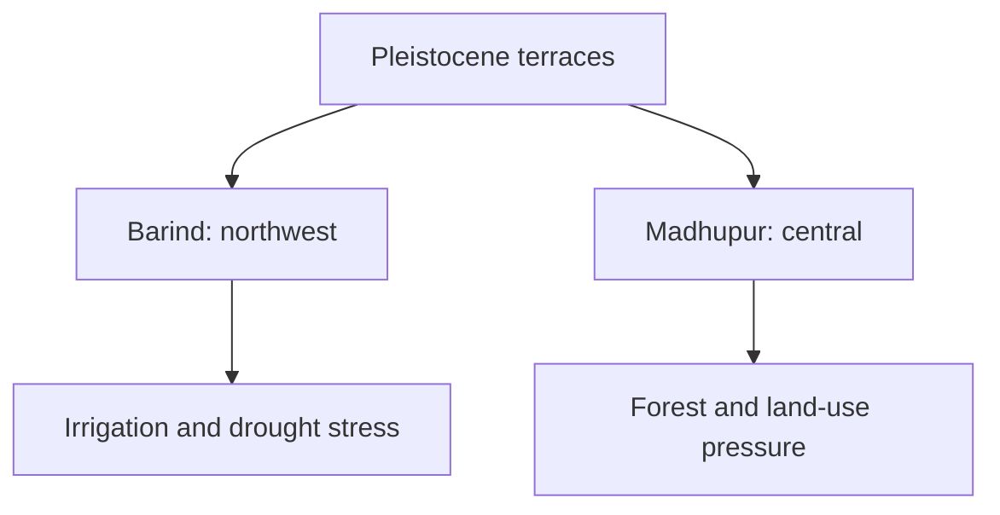

</details>

#### বিশ্লেষণ ও পরীক্ষায় প্রয়োগ — কী, কেন, কীভাবে এবং মূল্যায়ন

**কেন বিষয়টি গুরুত্বপূর্ণ (Why):** বরেন্দ্র ও মধুপুরকে একই geological-age group-এর অন্তর্ভুক্ত করলে তাদের সব বৈশিষ্ট্য এক হয়ে যায় না। বয়সের মিল থাকা সত্ত্বেও বৃষ্টিপাত, বন, মাটির স্থানীয় গঠন, জনবসতি ও পানির প্রাপ্যতার ভিন্নতায় ভূমি ব্যবহার আলাদা।

**ধাপে ধাপে প্রক্রিয়া (How):** বরেন্দ্রে মৌসুমি পানির ঘাটতি ও সেচনির্ভর কৃষি আলোচনা জরুরি; মধুপুরে বনাঞ্চল ও পরিবর্তিত ভূমি ব্যবহার গুরুত্বপূর্ণ। দুটোই পাশের নদী-পললভূমি থেকে তুলনামূলক উঁচু, কিন্তু দুটির নির্দিষ্ট অবস্থান, পার্শ্ববর্তী নদী ও মানবীয় চাপ এক নয়।

**বাংলাদেশভিত্তিক প্রয়োগ (Case Study):** একটি তুলনামূলক উত্তর আঁকুন: Barind—NW Bangladesh—water stress—irrigation strategy; Madhupur—Central Bangladesh—forest/land-use pressure—conservation zoning। এরপর উভয়ের common box-এ Pleistocene Terrace লিখুন।

**সমালোচনামূলক মূল্যায়ন (Evaluation):** ‘বরেন্দ্র = খরা, মধুপুর = বন’ একটি স্মরণসূত্র; বাস্তবে দুটি অঞ্চলের ভেতরেও বৈচিত্র্য আছে। তাই স্থানীয় মানচিত্র ও গবেষণা ছাড়া সমগ্র অঞ্চল সম্পর্কে অতিরঞ্জিত দাবি করবেন না।

> [!TIP]
> 🟩 **চিত্রভিত্তিক উত্তর অনুশীলন:** Venn diagram-এর মাঝখানে OLD TERRACE; বামে NW + Water Management; ডানে Central + Forest Management।

**উত্তরে ভালো নম্বর পাওয়ার কৌশল:** শুধু তথ্য তালিকা নয়—**কারণ → প্রক্রিয়া → আঞ্চলিক উদাহরণ → ইতিবাচক/নেতিবাচক প্রভাব → বাস্তবসম্মত সিদ্ধান্ত** এই ধারায় লিখুন। ৫ নম্বরের ক্ষেত্রে প্রাসঙ্গিক ২–৩টি ধাপ, ১০ নম্বরে তুলনা/চিত্র এবং ২০ নম্বরে পাল্টা যুক্তি ও নীতি যুক্ত করুন।

**উপসংহার:** **উৎপত্তি একই ধরনের পুরোনো সোপান; অবস্থান ও ব্যবস্থাপনা-অগ্রাধিকার ভিন্ন**—এই তুলনাই উত্তরের মূল বক্তব্য।

> [!NOTE]
> 🔵 **পরীক্ষায় উল্লেখযোগ্য তথ্যসূত্র:** Banglapedia — Asiatic Society of Bangladesh — *Bangladesh Geography (ভূপ্রকৃতি, বদ্বীপ, নদী ও অঞ্চল)* [S2]; Banglapedia — Asiatic Society of Bangladesh — *ভূ-প্রকৃতি (বাংলা)* [S3]; General Economics Division (GED), Bangladesh Planning Commission — *Bangladesh Delta Plan 2100, investment plan / six hotspot descriptions* [S6]।

> [!TIP]
> 🟢 **Q07 · Recall in 10 Seconds:** **Barind = NW; Madhupur = central; both = old terraces**।

<a id="q08"></a>

### 08. Why is the Barind region prone to drought-related stress?

**বাংলা প্রশ্ন:** বরেন্দ্র অঞ্চলে খরাজনিত পানিসংকট কেন দেখা দেয়?

**Type:** Editorial high-priority practice (not a previous exam question) · **Suggested marks:** 5–10

**✅ Model Answer (বাংলা) — Definition → Explanation → Analysis**

**ভূমিকা:** <mark>বরেন্দ্র অঞ্চলের পানিসংকটকে শুধু কম বৃষ্টিপাত দিয়ে বোঝানো যায় না</mark>। ভূমিরূপ, মৌসুমি বৃষ্টির বণ্টন, ভূগর্ভস্থ পানি উত্তোলন এবং কৃষির পানিচাহিদা একসঙ্গে খরাজনিত চাপ বাড়ায়।

**প্রধান কারণ:**
1. **উঁচু সোপান ও মাটি:** কিছু পুরোনো সোপানভূমিতে পানি দ্রুত নেমে যায় বা মাটির স্তরের কারণে বৃষ্টির পানি ধারণ–প্রবেশ সীমিত হয়; অবস্থাভেদে ভিন্নতা আছে।
2. **মৌসুমি বৃষ্টি:** বর্ষার বাইরে দীর্ঘ শুষ্ক মৌসুমে পানির প্রাপ্যতা ও ফসলের চাহিদার মধ্যে অসামঞ্জস্য দেখা দেয়।
3. **সেচের ওপর নির্ভরতা:** ভূগর্ভস্থ পানি-নির্ভর সেচের চাপ স্থানীয় পুনর্ভরণের তুলনায় বেশি হলে স্তর নামতে পারে।
4. **তাপ ও খরা:** শুষ্ক আবহাওয়া ও উচ্চ তাপমাত্রায় বাষ্পীভবন ও ফসলের পানি চাহিদা বাড়ে।
5. **ব্যবস্থাপনার সীমাবদ্ধতা:** স্থানীয় জলাধার, পৃষ্ঠজল ব্যবহার ও দক্ষ সেচের ঘাটতি ঝুঁকি বাড়াতে পারে।

<p>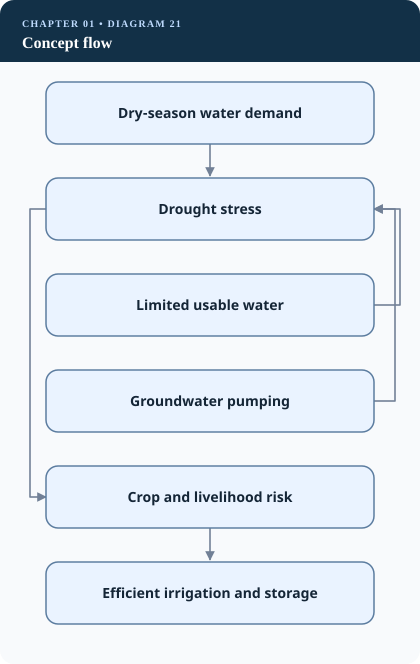</p>

<details>
<summary>ডায়াগ্রামের মূল Mermaid source দেখুন</summary>

```mermaid
flowchart TD
    A["Dry-season water demand"] --> C["Drought stress"]
    B["Limited usable water"] --> C
    D["Groundwater pumping"] --> C
    C --> E["Crop and livelihood risk"]
    E --> F["Efficient irrigation and storage"]
```

</details>

**সমাধান:** ড্রিপ/স্প্রিংকলার যেখানে উপযোগী, সেচের সময় ঠিক করা, কম পানি-নির্ভর ফসল, পুকুর–জলাধার সংরক্ষণ, বৃষ্টির পানি ধরে রাখা এবং পৃষ্ঠজল–ভূগর্ভস্থ পানির যৌথ ব্যবস্থাপনা।

**নীতির সঙ্গে সম্পর্ক:** বাংলাদেশ ব-দ্বীপ পরিকল্পনা ২১০০-এ **Barind and Drought-Prone Areas** একটি বিশেষ হটস্পট [S6]।

#### তুলনামূলক সারণি

| পানিসংকটের ধরন | এর অর্থ | বরেন্দ্রে কেন প্রাসঙ্গিক |
|---|---|---|
| **Meteorological drought** | স্বাভাবিকের তুলনায় দীর্ঘ সময় বৃষ্টির ঘাটতি | বৃষ্টিনির্ভর পানি যোগান কমতে পারে |
| **Agricultural drought** | ফসলের প্রয়োজনীয় মাটির আর্দ্রতার অভাব | ফলন ও ফসল ক্যালেন্ডারে প্রভাব |
| **Hydrological stress** | নদী/ভূগর্ভস্থ উৎসে পর্যাপ্ত পানি পাওয়া কঠিন | শুষ্ক মৌসুমে সেচের চাপ |
| **Management pressure** | পানির ব্যবহার ও পরিচালনার অসামঞ্জস্য | দক্ষ সেচ ও পর্যবেক্ষণ দরকার |

#### বিশ্লেষণ ও পরীক্ষায় প্রয়োগ — কী, কেন, কীভাবে এবং মূল্যায়ন

**কেন বিষয়টি গুরুত্বপূর্ণ (Why):** খরা (Meteorological Drought), মাটির আর্দ্রতার ঘাটতি (Agricultural Drought) এবং পানির যোগানের চাপ (Hydrological Stress) এক নয়। বরেন্দ্রের কৃষিতে শুষ্ক মৌসুমের উচ্চ সেচ চাহিদা ও ভূগর্ভস্থ পানির ওপর নির্ভরতা সংকট বাড়াতে পারে।

**ধাপে ধাপে প্রক্রিয়া (How):** বর্ষায় বৃষ্টি হলেও অনেক ক্ষেত্রে শুষ্ক মৌসুমে আবাদ চালাতে সেচ প্রয়োজন হয়। উত্তোলন, পুনর্ভরণ (Recharge), জমির উচ্চতা, মাটির ধরন ও ফসল নির্বাচন মিলিয়ে পানির ভারসাম্য বিচার করা উচিত। বৃষ্টির একটি কম বছরকে দীর্ঘমেয়াদি খরার প্রমাণ বলা যায় না।

**বাংলাদেশভিত্তিক প্রয়োগ (Case Study):** একজন কৃষক যদি শুষ্ক মৌসুমে বেশি পানিপ্রয়োজনীয় ফসল করেন, সেচের চাপ বাড়বে; অন্যদিকে ফসল ক্যালেন্ডার বদল, সেচের সময় সঠিক রাখা এবং মাটি অনুযায়ী জলধারণ ব্যবস্থা খরচ কমাতে পারে। তবে সব স্থানে একই প্রযুক্তি কার্যকর হবে না।

**সমালোচনামূলক মূল্যায়ন (Evaluation):** বাংলাদেশ ব-দ্বীপ পরিকল্পনায় বরেন্দ্রকে পৃথক hotspot করা হয়েছে; অর্থাৎ জলবায়ু সমস্যার পাশাপাশি ফসল, ভূগর্ভস্থ পানি ও প্রতিষ্ঠানভিত্তিক ব্যবস্থাপনার প্রয়োজন স্বীকার করা হয়েছে।

> [!TIP]
> 🟩 **চিত্রভিত্তিক উত্তর অনুশীলন:** Demand for Irrigation ↑ + Dry-season Availability ↓ → Water Stress → Crop Adjustment + Efficient Irrigation + Groundwater Monitoring।

**উত্তরে ভালো নম্বর পাওয়ার কৌশল:** শুধু তথ্য তালিকা নয়—**কারণ → প্রক্রিয়া → আঞ্চলিক উদাহরণ → ইতিবাচক/নেতিবাচক প্রভাব → বাস্তবসম্মত সিদ্ধান্ত** এই ধারায় লিখুন। ৫ নম্বরের ক্ষেত্রে প্রাসঙ্গিক ২–৩টি ধাপ, ১০ নম্বরে তুলনা/চিত্র এবং ২০ নম্বরে পাল্টা যুক্তি ও নীতি যুক্ত করুন।

**উপসংহার:** বরেন্দ্রের খরা মূলত **প্রাকৃতিক পানির সীমাবদ্ধতা ও ব্যবহারের চাপের যৌথ ফল**; সমাধানও সমন্বিত হতে হবে।

> [!NOTE]
> 🔵 **পরীক্ষায় উল্লেখযোগ্য তথ্যসূত্র:** General Economics Division (GED), Bangladesh Planning Commission — *Bangladesh Delta Plan 2100, investment plan / six hotspot descriptions* [S6]; Bangladesh Water Development Board (BWDB) — *ব-দ্বীপ পরিকল্পনা বাস্তবায়নে বাংলাদেশ পানি উন্নয়ন বোর্ড, updated 2023* [S7]।

> [!TIP]
> 🟢 **Q08 · Recall in 10 Seconds:** **Drought pressure → irrigation planning → efficient water use**।

<a id="q09"></a>

### 09. How did the Brahmaputra–Jamuna change its course historically?

**বাংলা প্রশ্ন:** ঐতিহাসিকভাবে ব্রহ্মপুত্র–যমুনা নদীর গতিপথ কীভাবে পরিবর্তিত হয়েছে?

**Type:** Editorial high-priority practice (not a previous exam question) · **Suggested marks:** 5–10

**✅ Model Answer (বাংলা) — Definition → Explanation → Analysis**

**ভূমিকা:** <mark>ব্রহ্মপুত্রের প্রধান প্রবাহ একসময় ময়মনসিংহ-সংলগ্ন</mark> **পুরাতন ব্রহ্মপুত্র** খাতে প্রবাহিত হতো; পরে পশ্চিমদিকে **যমুনা** খাত প্রধান প্রবাহের ভূমিকা নেয়। এটি একদিনের ঘটনা নয়—বহু দশক ধরে সংঘটিত নদীখাত পরিবর্তন বা **Avulsion** [S12][S14][S15]।

**পরিবর্তনের ধারাবাহিকতা:**
1. **১৮শ শতকের মানচিত্র:** পুরোনো ব্রহ্মপুত্রের পূর্বমুখী–দক্ষিণ-পূর্বমুখী প্রবাহপথ গুরুত্বপূর্ণ ছিল।
2. **১৭৮৭ সালের বন্যা:** তিস্তার গতিপথে বড় পরিবর্তন ঘটে। এই ঘটনার সঙ্গে ব্রহ্মপুত্র–যমুনার পশ্চিমমুখী স্থানান্তরের সরাসরি সম্পর্ক কতটা ছিল—গবেষণায় মতভেদ রয়েছে; তাই **'১৭৮৭ সালেই যমুনার নতুন গতিপথ সম্পূর্ণ হয়ে যায়' লেখা ভুল**।
3. **১৮শ শতকের শেষভাগ–১৯শ শতক:** বিভিন্ন ঐতিহাসিক মানচিত্র ও ভূ-আকৃতিগত গবেষণা যমুনার নতুন পথের গুরুত্ব বৃদ্ধির দীর্ঘ প্রক্রিয়া নির্দেশ করে। সমাপ্তির নির্দিষ্ট সময়রেখা নিয়ে গবেষণায় পার্থক্য আছে [S14][S15]।
4. **পরিণতি:** যমুনায় চর, নদীভাঙন, নাব্যতা, যোগাযোগ, কৃষিজমি ও বসতির ধরন বদলায়।

| বিষয় | সরল ব্যাখ্যা |
|---|---|
| **Channel Migration** | নদীর খাত ধীরে পাশে সরে যাওয়া |
| **Avulsion** | প্রধান প্রবাহ নতুন বা অন্য বিদ্যমান খাতের দিকে চলে যাওয়া |
| **Sedimentation** | পলি জমে চর/প্লাবনভূমি তৈরি |
| **Erosion** | নদীতীর ভেঙে ভূমি হারানো |

**ইতিহাসের সরল টাইমলাইন (নির্দিষ্ট সমাপ্তি সাল দাবি নয়):**

<p>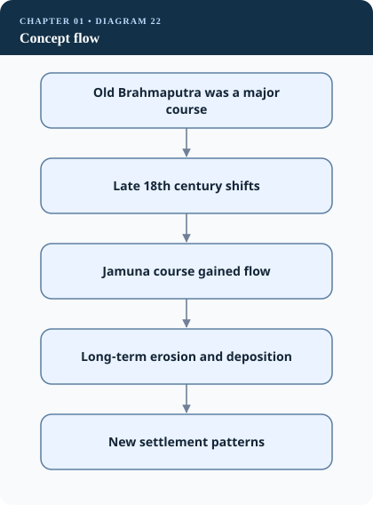</p>

<details>
<summary>ডায়াগ্রামের মূল Mermaid source দেখুন</summary>

```mermaid
flowchart LR
    A["Old Brahmaputra was a major course"] --> B["Late 18th century shifts"]
    B --> C["Jamuna course gained flow"]
    C --> D["Long-term erosion and deposition"]
    D --> E["New settlement patterns"]
```

</details>

**মূল্যায়ন:** নদীর গতিপথ পরিবর্তনে পলি, প্রবাহবেগ, পুরোনো শাখানদীর পথ, বন্যা ও ভূ-আকৃতিগত অবস্থা কাজ করে। তাই **তিস্তার ১৭৮৭ সালের ঘটনা** এবং **ব্রহ্মপুত্র–যমুনার দীর্ঘমেয়াদি স্থানান্তর** আলাদা করে ব্যাখ্যা করুন।

#### বিশ্লেষণ ও পরীক্ষায় প্রয়োগ — কী, কেন, কীভাবে এবং মূল্যায়ন

**কেন বিষয়টি গুরুত্বপূর্ণ (Why):** ব্রহ্মপুত্র–যমুনার ইতিহাস একটি ঘটনা, একটি সাল ও একটি নতুন চ্যানেলের নাম দিয়ে সম্পূর্ণ ব্যাখ্যা করা যায় না। নদীপথ বদল একটি দীর্ঘস্থায়ী প্রক্রিয়া—বিভিন্ন বন্যা, পলি, প্রবাহের চাপ ও পুরোনো খাতের সম্পর্ক এতে ভূমিকা রাখে।

**ধাপে ধাপে প্রক্রিয়া (How):** পুরোনো ব্রহ্মপুত্র দিয়ে একসময় উল্লেখযোগ্য প্রধান প্রবাহ যেত; পরে ধীরে ধীরে পশ্চিমে যমুনা চ্যানেল প্রধানধারা হয়ে ওঠে। ১৭৮৭ সালের তিস্তা নদী-সম্পর্কিত বড় বন্যা/পথপরিবর্তন এই অঞ্চলের নদী ইতিহাসে গুরুত্বপূর্ণ হলেও একে যমুনার পূর্ণ রূপান্তরের একমাত্র কারণ বা চূড়ান্ত তারিখ বলা যায় না।

**বাংলাদেশভিত্তিক প্রয়োগ (Case Study):** দুটি সময়ের মানচিত্র তুলনা করতে হলে নদীখাতের অবস্থান, চরের বিস্তার, মানচিত্রের সাল ও মানচিত্রের নির্ভুলতা পরীক্ষা করুন। ১৮শ–১৯শ শতাব্দীর চিত্র এবং আধুনিক satellite view-তে একই স্থানের নদীপথ এক নাও হতে পারে।

**সমালোচনামূলক মূল্যায়ন (Evaluation):** নদীশাসন, সেতু নির্মাণ, নদীতীর-নিরাপত্তা ও ভূমি ব্যবস্থাপনা পরিকল্পনায় নদীর গতিশীল ইতিহাস জানা জরুরি। ‘নদী একবার পথ পাল্টেছে, এখন স্থির’—এমন অনুমান বাস্তবসম্মত নয়।

> [!TIP]
> 🟩 **চিত্রভিত্তিক উত্তর অনুশীলন:** Old Brahmaputra route → Progressive channel redistribution → Jamuna main course; একটি টাইমলাইনে '1787 Teesta shift' আলাদা তীরচিহ্নে দেখান।

**উত্তরে ভালো নম্বর পাওয়ার কৌশল:** শুধু তথ্য তালিকা নয়—**কারণ → প্রক্রিয়া → আঞ্চলিক উদাহরণ → ইতিবাচক/নেতিবাচক প্রভাব → বাস্তবসম্মত সিদ্ধান্ত** এই ধারায় লিখুন। ৫ নম্বরের ক্ষেত্রে প্রাসঙ্গিক ২–৩টি ধাপ, ১০ নম্বরে তুলনা/চিত্র এবং ২০ নম্বরে পাল্টা যুক্তি ও নীতি যুক্ত করুন।

**উপসংহার:** এ ইতিহাসের শিক্ষা হলো, নদীর বর্তমান পথকে চিরস্থায়ী ধরে অবকাঠামো নির্মাণ বা ভূমি পরিকল্পনা করা নিরাপদ নয়।

> [!NOTE]
> 🔵 **পরীক্ষায় উল্লেখযোগ্য তথ্যসূত্র:** Banglapedia — Asiatic Society of Bangladesh — *Bangladesh Geography (ভূপ্রকৃতি, বদ্বীপ, নদী ও অঞ্চল)* [S2]; Banglapedia — Asiatic Society of Bangladesh — *Brahmaputra-Jamuna River System; history of the Tista and Brahmaputra course shifts* [S12]।

> [!TIP]
> 🟢 **Q09 · Recall in 10 Seconds:** **Historic river course change → bank erosion → shifting settlements**।

<a id="q10"></a>

### 10. Compare char, haor, beel and baor in the context of Bangladesh.

**বাংলা প্রশ্ন:** বাংলাদেশের চর, হাওর, বিল ও বাঁওড়ের তুলনা করুন।

**Type:** Editorial high-priority practice (not a previous exam question) · **Suggested marks:** 5–10

**✅ Model Answer (বাংলা) — Definition → Explanation → Analysis**

**ভূমিকা:** <mark>চর, হাওর, বিল ও বাঁওড়—চারটি শব্দই বাংলাদেশের জল–ভূমির সঙ্গে সম্পর্কিত, কিন্তু</mark> **উৎপত্তি, আকৃতি, মৌসুম ও ব্যবহার** এক নয়।

| ধরন | সহজ সংজ্ঞা ও গঠন | প্রধান উদাহরণ/অঞ্চল | জীবিকা ও ঝুঁকি |
|---|---|---|---|
| **চর (Char)** | নদী বা মোহনায় পলি জমে জেগে ওঠা ভূমি | যমুনা–পদ্মা–মেঘনার চর | মৌসুমি চাষ, বসতি; ভাঙন |
| **হাওর (Haor)** | বড় নিচু অববাহিকা, বর্ষায় বিস্তৃত জলরাশি | সুনামগঞ্জ–কিশোরগঞ্জ অঞ্চল | বোরো ধান ও মাছ; আগাম বন্যা |
| **বিল (Beel)** | স্বাভাবিক নিচু জলাশয়/ডিপ্রেশন | চলনবিল | মাছ, জলজ উদ্ভিদ; জলাবদ্ধতা |
| **বাঁওড় (Baor)** | নদীর বিচ্ছিন্ন পুরোনো বাঁক বা oxbow lake | যশোর অঞ্চলের বাঁওড় | মৎস্য ও জলাধার সংরক্ষণ |

**পার্থক্যের ব্যাখ্যা:** চর মূলত **পলি সঞ্চয়**, হাওর **অববাহিকাগত মৌসুমি প্লাবন**, বিল **স্থানীয় নিম্নভূমির জলধারণ**, আর বাঁওড় **নদীবাঁক বিচ্ছিন্ন হওয়ার** ফল। তাই একই 'জলাভূমি' নামে সবগুলোকে এক করলে গঠনগত পার্থক্য হারিয়ে যায়।

<p>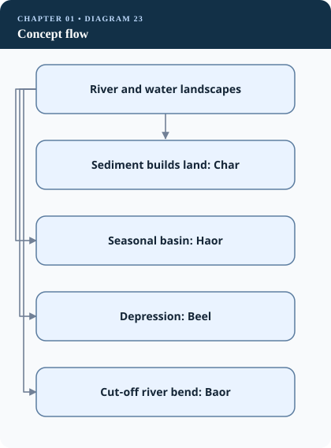</p>

<details>
<summary>ডায়াগ্রামের মূল Mermaid source দেখুন</summary>

```mermaid
flowchart TD
    A["River and water landscapes"] --> B["Sediment builds land: Char"]
    A --> C["Seasonal basin: Haor"]
    A --> D["Depression: Beel"]
    A --> E["Cut-off river bend: Baor"]
```

</details>

**ব্যবস্থাপনা:** চরে নিরাপদ বসতি ও ভূমি অধিকার, হাওরে আগাম বন্যার পূর্বাভাস, বিলে জলপ্রবাহ সংরক্ষণ এবং বাঁওড়ে টেকসই মৎস্য চাষ বেশি প্রাসঙ্গিক।

#### বিশ্লেষণ ও পরীক্ষায় প্রয়োগ — কী, কেন, কীভাবে এবং মূল্যায়ন

**কেন বিষয়টি গুরুত্বপূর্ণ (Why):** চর, হাওর, বিল ও বাঁওড়কে সবসময় 'জলাশয়' বললে ভুল হবে। চর মূলত পলি জমে ওঠা ভূমি; হাওর মৌসুমি জলাভূমিসম্পন্ন অববাহিকা; বিল নিচু জলাশয়; বাঁওড় মূল নদীর বিচ্ছিন্ন পুরোনো বাঁকের জলাধার। এদের জন্মপদ্ধতি আলাদা, তাই ব্যবহার ও ঝুঁকিও ভিন্ন।

**ধাপে ধাপে প্রক্রিয়া (How):** বাঁক ঘুরে নদী নিজের পুরোনো পথ কেটে দিলে বিচ্ছিন্ন বাঁক বাঁওড় হতে পারে; পলি জমলে চর; নিচু অববাহিকায় মৌসুমি পানি জমে হাওরের জলচক্র তৈরি হয়। বিলের উৎপত্তি ও জলধারণকাল অঞ্চলভেদে বদলায়।

**বাংলাদেশভিত্তিক প্রয়োগ (Case Study):** প্রয়োগ: চরে বসতি পরিকল্পনার আগে নদীভাঙনের ঝুঁকি, হাওরে বোরো ধানের সময়সূচি, বিলে পানি ও জীববৈচিত্র্য এবং বাঁওড়ে মাছ ও পানির গুণগত মান দেখা প্রয়োজন। একই উন্নয়ন প্রকল্প চার জায়গায় এক নকশায় প্রয়োগ করা যুক্তিযুক্ত নয়।

**সমালোচনামূলক মূল্যায়ন (Evaluation):** শুধু আকার নয়—**Origin, Water Cycle, Livelihood, Risk** দিয়ে পৃথক করুন। ইংরেজি প্রশ্নে 'Compare' থাকলে পয়েন্ট নয়, তুলনামূলক টেবিল বেশি কার্যকর।

> [!TIP]
> 🟩 **চিত্রভিত্তিক উত্তর অনুশীলন:** চারটি ছোট স্কেচ: (1) river with sandbar = Char; (2) bowl with seasonal water = Haor; (3) shallow depression = Beel; (4) severed river loop = Baor।

**উত্তরে ভালো নম্বর পাওয়ার কৌশল:** শুধু তথ্য তালিকা নয়—**কারণ → প্রক্রিয়া → আঞ্চলিক উদাহরণ → ইতিবাচক/নেতিবাচক প্রভাব → বাস্তবসম্মত সিদ্ধান্ত** এই ধারায় লিখুন। ৫ নম্বরের ক্ষেত্রে প্রাসঙ্গিক ২–৩টি ধাপ, ১০ নম্বরে তুলনা/চিত্র এবং ২০ নম্বরে পাল্টা যুক্তি ও নীতি যুক্ত করুন।

**উপসংহার:** পরীক্ষায় **গঠন + অবস্থান + জীবিকা + ঝুঁকি**—এই চারটি কলামে তুলনা করলে চার পরিভাষার বিভ্রান্তি দূর হয়। [S2][S3]

> [!NOTE]
> 🔵 **পরীক্ষায় উল্লেখযোগ্য তথ্যসূত্র:** Banglapedia — Asiatic Society of Bangladesh — *Bangladesh Geography (ভূপ্রকৃতি, বদ্বীপ, নদী ও অঞ্চল)* [S2]; Banglapedia — Asiatic Society of Bangladesh — *ভূ-প্রকৃতি (বাংলা)* [S3]।

> [!TIP]
> 🟢 **Q10 · Recall in 10 Seconds:** **Char = new river land; Haor = seasonal basin; Beel = wetland; Baor = cut-off bend**।

[⬆️ Back to Question Finder](#question-index) · [🏠 Table of Contents](#top)

---

<a id="q11"></a>

### 11. Why is the Haor Basin vulnerable to flash floods?

**বাংলা প্রশ্ন:** হাওর অববাহিকা আকস্মিক বন্যার ঝুঁকিতে থাকে কেন?

**Type:** Editorial high-priority practice (not a previous exam question) · **Suggested marks:** 5–10

**✅ Model Answer (বাংলা) — Definition → Explanation → Analysis**

**ভূমিকা:** <mark>হাওর হলো বাংলাদেশের উত্তর-পূর্বাঞ্চলের বিস্তৃত নিচু অববাহিকা, যেখানে বর্ষায় বড় জলরাশি সৃষ্টি</mark> হয় এবং শুষ্ক মৌসুমে জমিতে বোরো ধান চাষ হয়। তাই **আগাম আকস্মিক বন্যা (Flash Flood)** কৃষি ও জীবিকার বড় ঝুঁকি।

**কেন ঝুঁকি বেশি?**
1. **অববাহিকার আকৃতি:** চারপাশের তুলনায় নিচু হাওরে বন্যার পানি দ্রুত জমা হতে পারে।
2. **উজানের পাহাড়ি বৃষ্টি:** সংলগ্ন পাহাড় ও উজানের অববাহিকায় প্রবল বৃষ্টির পানি নদী–ছড়া দিয়ে দ্রুত নিচে নেমে আসে।
3. **কম প্রতিক্রিয়া-সময়:** আকস্মিক প্রবাহ বেড়ে গেলে ফসল বা সম্পদ সরানোর জন্য হাতে সময় কম থাকে।
4. **ফসলের সংবেদনশীল সময়:** মার্চ–এপ্রিলের আগাম বন্যা বোরো ধান পাকতে বা কাটতে না কাটতেই হলে ক্ষতি বেশি হতে পারে; নির্দিষ্ট মৌসুমের সময় বছরভেদে ভিন্ন।
5. **পানি নিষ্কাশনের সীমা:** নদীর পলি, স্থানীয় জলপ্রবাহে বাধা এবং অপরিকল্পিত স্থাপনা কিছু স্থানে জলাবদ্ধতা বাড়াতে পারে।

**কারণ–ফল চিত্র:**

<p>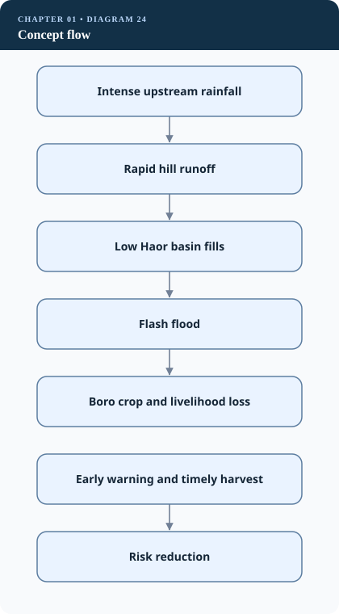</p>

<details>
<summary>ডায়াগ্রামের মূল Mermaid source দেখুন</summary>

```mermaid
flowchart TD
    A["Intense upstream rainfall"] --> B["Rapid hill runoff"]
    B --> C["Low Haor basin fills"]
    C --> D["Flash flood"]
    D --> E["Boro crop and livelihood loss"]
    F["Early warning and timely harvest"] --> G["Risk reduction"]
```

</details>

| প্রতিরোধের স্তর | করণীয় |
|---|---|
| পূর্বাভাস | উজানের বৃষ্টিপাত ও নদীর স্তর পর্যবেক্ষণ |
| কৃষি | স্থানীয় উপযোগী স্বল্পমেয়াদি জাত ও সময়মতো ফসল কাটা |
| অবকাঠামো | ঝুঁকিভিত্তিক বাঁধ রক্ষণাবেক্ষণ, প্রাকৃতিক প্রবাহ বজায় রাখা |
| সমাজ | স্থানীয় সতর্কতা, নৌযান প্রস্তুতি ও নিরাপদ আশ্রয় |

#### বিশ্লেষণ ও পরীক্ষায় প্রয়োগ — কী, কেন, কীভাবে এবং মূল্যায়ন

**কেন বিষয়টি গুরুত্বপূর্ণ (Why):** হাওরে আকস্মিক বন্যার ঝুঁকি শুধু বাংলাদেশের স্থানীয় বৃষ্টিপাত দিয়ে ব্যাখ্যা করা যায় না। পার্শ্ববর্তী উজানের পাহাড়ি এলাকায় ভারী বৃষ্টির পর স্বল্প সময়ে পানি নিচু অববাহিকায় আসতে পারে। হাওরের নিচু আকৃতি, মৌসুমি পানি চলাচলের পথ এবং ফসলের সময়ও প্রভাব ফেলে।

**ধাপে ধাপে প্রক্রিয়া (How):** শুষ্ক মৌসুমে জমিতে বোরো ফসল হয়; কিন্তু আগাম পাহাড়ি ঢলে পানি বেড়ে গেলে ফসল কাটার আগে জমি ডুবে যেতে পারে। নদীখাতের পানিবহনের ক্ষমতা, স্থানীয় বাঁধের অবস্থা এবং পানি নিষ্কাশনের পথ ক্ষতির মাত্রা প্রভাবিত করে।

**বাংলাদেশভিত্তিক প্রয়োগ (Case Study):** সুনামগঞ্জের একটি হাওর গ্রামের উদাহরণ ধরে উত্তর লিখুন: উজানে বৃষ্টি → দ্রুত প্রবাহ → নিচু হাওরে পানি বাড়া → বোরো ধানের ক্ষতি → কৃষকের আয় ও খাদ্য নিরাপত্তার চাপ। তারপর forecast, ফসল কাটার প্রস্তুতি ও নিরাপদ পানি চলাচলের সুপারিশ দিন।

**সমালোচনামূলক মূল্যায়ন (Evaluation):** শুধু বেশি উঁচু বাঁধ বানানো সবসময় সমাধান নয়; স্থানীয় মাছ, জলাভূমি ও স্বাভাবিক নদী–হাওর সংযোগ ক্ষতিগ্রস্ত হওয়ার আশঙ্কাও বিবেচনা করতে হবে।

> [!TIP]
> 🟩 **চিত্রভিত্তিক উত্তর অনুশীলন:** Rainfall in upland basin → Fast runoff → Haor inundation → Crop-loss risk; Forecast + Drainage + Appropriate crop calendar।

**উত্তরে ভালো নম্বর পাওয়ার কৌশল:** শুধু তথ্য তালিকা নয়—**কারণ → প্রক্রিয়া → আঞ্চলিক উদাহরণ → ইতিবাচক/নেতিবাচক প্রভাব → বাস্তবসম্মত সিদ্ধান্ত** এই ধারায় লিখুন। ৫ নম্বরের ক্ষেত্রে প্রাসঙ্গিক ২–৩টি ধাপ, ১০ নম্বরে তুলনা/চিত্র এবং ২০ নম্বরে পাল্টা যুক্তি ও নীতি যুক্ত করুন।

**উপসংহার:** হাওরের বন্যা কেবল অতিবৃষ্টি নয়; **উজানের দ্রুত প্রবাহ + নিচু অববাহিকা + কৃষির মৌসুমি সময়**—এই সমন্বিত প্রক্রিয়া। BDP 2100-এ এ অঞ্চল আলাদা hotspot [S6]।

> [!NOTE]
> 🔵 **পরীক্ষায় উল্লেখযোগ্য তথ্যসূত্র:** Banglapedia — Asiatic Society of Bangladesh — *Bangladesh Geography (ভূপ্রকৃতি, বদ্বীপ, নদী ও অঞ্চল)* [S2]; General Economics Division (GED), Bangladesh Planning Commission — *Bangladesh Delta Plan 2100, investment plan / six hotspot descriptions* [S6]; Bangladesh Water Development Board (BWDB) — *ব-দ্বীপ পরিকল্পনা বাস্তবায়নে বাংলাদেশ পানি উন্নয়ন বোর্ড, updated 2023* [S7]।

> [!TIP]
> 🟢 **Q11 · Recall in 10 Seconds:** **Upland rain → rapid runoff → early flash flood → crop risk**।

<a id="q12"></a>

### 12. Explain how river erosion and sedimentation shape human settlement.

**বাংলা প্রশ্ন:** নদীভাঙন ও পলি সঞ্চয় কীভাবে মানুষের বসতি ও জীবনযাত্রাকে প্রভাবিত করে?

**Type:** Editorial high-priority practice (not a previous exam question) · **Suggested marks:** 5–10

**✅ Model Answer (বাংলা) — Definition → Explanation → Analysis**

**ভূমিকা:** <mark>নদীভাঙন (Erosion) নদীতীর থেকে মাটি সরিয়ে নেয়; পলি সঞ্চয় (Deposition/Accretion) অন্য জায়গায়</mark> নতুন ভূমি বা চর গড়ে। বাংলাদেশের বসতি ও জীবিকা এই দুই বিপরীত অথচ সম্পর্কযুক্ত প্রক্রিয়ায় বদলায় [S2]।

**বসতিতে প্রভাব:**
1. **ভিটা ও জমি হারানো:** ভাঙনে বাড়িঘর, কৃষিজমি ও স্থানীয় রাস্তা বিলীন হলে পরিবার স্থানান্তরে বাধ্য হতে পারে।
2. **জীবিকার পরিবর্তন:** জমির মালিকানা বা চাষের সুযোগ হারিয়ে মানুষ অন্য পেশা, দিনমজুরি অথবা শহরমুখী কাজ খুঁজতে পারে।
3. **নতুন চরের সম্ভাবনা:** পলি জমে চর তৈরি হলে চাষাবাদ ও বসতির সুযোগ বাড়ে; তবে চর টেকসই হবে কি না নিশ্চিত নয়।
4. **সেবা ও অবকাঠামো:** বিদ্যালয়, স্বাস্থ্যকেন্দ্র, বাজার, সেতু ও নৌঘাটের অবস্থান পরিবর্তন প্রয়োজন হতে পারে।
5. **সামাজিক সমস্যা:** পুনর্বাসন, জমির অধিকার, নিরাপদ পানি ও নারীদের সেবাপ্রাপ্তি বড় প্রশ্ন হয়ে ওঠে।

**দুই প্রক্রিয়া একসঙ্গে:**

<p>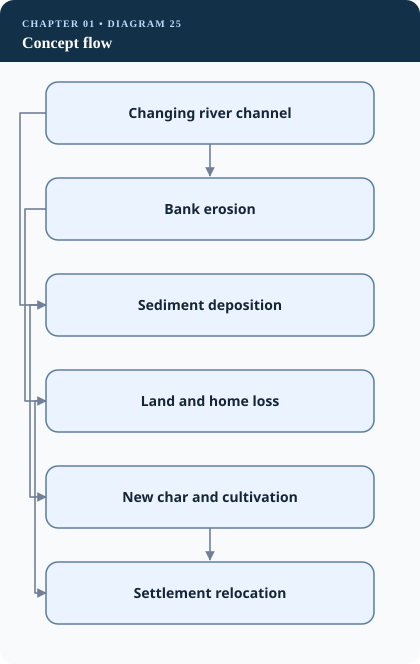</p>

<details>
<summary>ডায়াগ্রামের মূল Mermaid source দেখুন</summary>

```mermaid
flowchart LR
    A["Changing river channel"] --> B["Bank erosion"]
    A --> C["Sediment deposition"]
    B --> D["Land and home loss"]
    C --> E["New char and cultivation"]
    D --> F["Settlement relocation"]
    E --> F
```

</details>

**অভিযোজনের পথ:** ভাঙনপ্রবণ তীরের নিয়মিত মানচিত্রায়ণ, বন্যাপ্রবাহের স্থান অক্ষত রাখা, স্থানভিত্তিক নদীশাসন, উপযুক্ত পুনর্বাসন, নিরাপদ আবাসন ও চরের শিক্ষা–স্বাস্থ্যসেবা জরুরি। সব নদীতে একই প্রকৌশল পদ্ধতি কার্যকর হবে না।

#### তুলনামূলক সারণি

| একই নদীর দুই ঘটনা | পলি ও ভূমি কীভাবে বদলায় | মানুষের ফলাফল | নীতিগত অগ্রাধিকার |
|---|---|---|---|
| **Bank Erosion** | নদীতীরের উপাদান সরে যায় | ঘর–জমি ক্ষতি, স্থানান্তর | ঝুঁকি ও পুনর্বাসন পরিকল্পনা |
| **Char Deposition** | পলি জমে নতুন চর হতে পারে | অস্থায়ী কৃষি/বসতির সুযোগ | নিরাপদ ব্যবহার ও অধিকারের প্রশ্ন |
| **Channel Migration** | প্রধান নদীখাত সরে যায় | সেতু/নৌপথ/বাজারের চ্যালেঞ্জ | দীর্ঘমেয়াদি নদীপর্যবেক্ষণ |

#### বিশ্লেষণ ও পরীক্ষায় প্রয়োগ — কী, কেন, কীভাবে এবং মূল্যায়ন

**কেন বিষয়টি গুরুত্বপূর্ণ (Why):** নদীভাঙন ও পলি সঞ্চয়কে পরস্পর বিরোধী প্রক্রিয়া ভাবা ঠিক নয়; একই নদী একই সময়ে ভিন্ন স্থানে দুই কাজ করতে পারে। ফলে মানচিত্রে নতুন চর দেখে পুরো এলাকার ভূমি বৃদ্ধি বা একটি ভাঙন দেখে সবকিছু কমে যাচ্ছে সিদ্ধান্ত নেওয়া যায় না।

**ধাপে ধাপে প্রক্রিয়া (How):** নদীর স্রোত তীরের মাটি সরিয়ে নিতে পারে; অপেক্ষাকৃত শান্ত প্রবাহে কণা জমে নতুন চর গড়তে পারে। যেখানে আগের পরিবার বসতি হারিয়েছে, নতুন চরে নতুন পরিবার চাষাবাদ শুরু করতে পারে; কিন্তু নতুন চরের স্থায়িত্ব ও জমির আইনি পরিস্থিতি আলাদা করে পরীক্ষা করা প্রয়োজন।

**বাংলাদেশভিত্তিক প্রয়োগ (Case Study):** দুটি পরিবারের তুলনা দিন: Family A নদীভাঙনে বাড়ি হারিয়ে অন্যত্র যেতে বাধ্য; Family B চরভূমিতে অস্থায়ী কৃষি সুযোগ পেলেও বন্যা ও ভাঙনের ঝুঁকি বহন করে। ফলে ভূমি পরিবর্তনের সঙ্গে শিক্ষা, চিকিৎসা, বাজার ও নিরাপত্তার প্রশ্নও যুক্ত।

**সমালোচনামূলক মূল্যায়ন (Evaluation):** নীতি শুধু বাঁধ নয়—ঝুঁকিমানচিত্র, আগাম সতর্কতা, সামাজিক সুরক্ষা, নিরাপদ বসতি পরিকল্পনা এবং পরিবেশের সঙ্গে উপযোগী riverbank protection-এর সমন্বয় হওয়া উচিত।

> [!TIP]
> 🟩 **চিত্রভিত্তিক উত্তর অনুশীলন:** Erosion → Land Loss → Migration; Deposition → New Char → Farming Opportunity + Renewed Hazard। দুই পথকে Settlement Planning-এ মিলিয়ে দিন।

**উত্তরে ভালো নম্বর পাওয়ার কৌশল:** শুধু তথ্য তালিকা নয়—**কারণ → প্রক্রিয়া → আঞ্চলিক উদাহরণ → ইতিবাচক/নেতিবাচক প্রভাব → বাস্তবসম্মত সিদ্ধান্ত** এই ধারায় লিখুন। ৫ নম্বরের ক্ষেত্রে প্রাসঙ্গিক ২–৩টি ধাপ, ১০ নম্বরে তুলনা/চিত্র এবং ২০ নম্বরে পাল্টা যুক্তি ও নীতি যুক্ত করুন।

**উপসংহার:** নদীর পলি **নতুন ভূমি তৈরি** করে, আর ভাঙন **পুরোনো বসতি বিলীন** করে; তাই উন্নয়ন পরিকল্পনায় দুটোকেই ধরতে হয়।

> [!NOTE]
> 🔵 **পরীক্ষায় উল্লেখযোগ্য তথ্যসূত্র:** Banglapedia — Asiatic Society of Bangladesh — *Bangladesh Geography (ভূপ্রকৃতি, বদ্বীপ, নদী ও অঞ্চল)* [S2]; General Economics Division (GED), Bangladesh Planning Commission — *Bangladesh Delta Plan 2100, investment plan / six hotspot descriptions* [S6]।

> [!TIP]
> 🟢 **Q12 · Recall in 10 Seconds:** **Erosion → displacement; deposition → char; both → land-use planning**।

<a id="q13"></a>

### 13. Discuss the importance of the Sundarbans as a deltaic ecosystem.

**বাংলা প্রশ্ন:** বদ্বীপীয় প্রতিবেশব্যবস্থা হিসেবে সুন্দরবনের গুরুত্ব আলোচনা করুন।

**Type:** Editorial high-priority practice (not a previous exam question) · **Suggested marks:** 5–10

**✅ Model Answer (বাংলা) — Definition → Explanation → Analysis**

**ভূমিকা:** <mark>সুন্দরবন বাংলাদেশের দক্ষিণ-পশ্চিমে গঙ্গা–ব্রহ্মপুত্র–মেঘনা বদ্বীপের মোহনা-সংলগ্ন একটি</mark> জোয়ারভাটা-প্রভাবিত **ম্যানগ্রোভ প্রতিবেশব্যবস্থা**। এটি জীববৈচিত্র্য, উপকূলীয় সুরক্ষা ও মানুষের জীবিকার সঙ্গে যুক্ত [S11]।

**প্রধান গুরুত্ব:**
1. **জীববৈচিত্র্যের আবাস:** বাঘ, কুমির, হরিণ, পাখি, মাছ ও নানা ম্যানগ্রোভ উদ্ভিদের জন্য বিশেষ পরিবেশ।
2. **প্রাকৃতিক সুরক্ষা:** বৃক্ষ ও জলাভূমির কাঠামো ঝড়ের ঢেউয়ের শক্তি কিছুটা কমাতে সহায়তা করতে পারে; এটি ঘূর্ণিঝড়ের সম্পূর্ণ বিকল্প প্রতিরক্ষা নয়।
3. **মৎস্যের সহায়ক বাস্তুতন্ত্র:** মোহনা ও খাঁড়ি মাছ ও জলজ প্রাণীর খাদ্য, আবাস ও প্রজননের সঙ্গে সম্পর্কিত।
4. **কার্বন ও পুষ্টিচক্র:** মাটি–উদ্ভিদে কার্বন ধারণ, পলি আটকানো এবং পুষ্টির পুনঃচক্রায়ণ হয়।
5. **জীবিকা ও সংস্কৃতি:** স্থানীয় মানুষের মাছ ধরা, মধু সংগ্রহ এবং বননির্ভর জীবনযাত্রার সঙ্গে সম্পর্ক আছে; ব্যবহার অবশ্যই সংরক্ষণ আইনসম্মত হতে হবে।

| পরিবেশগত সেবা | উপকার |
|---|---|
| Habitat | বন্যপ্রাণ ও জলজ বৈচিত্র্য |
| Coastal buffering | কিছু ঢেউ/ঝড়প্রভাব প্রশমনে সহায়তা |
| Nursery habitat | মৎস্য সম্পদের বাসস্থান |
| Livelihoods | স্থানীয় আয়ের সুযোগ |
| Conservation value | গবেষণা ও বিশ্ব ঐতিহ্য রক্ষা |

<p>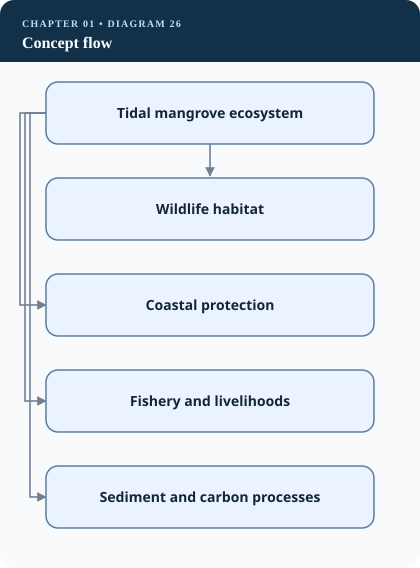</p>

<details>
<summary>ডায়াগ্রামের মূল Mermaid source দেখুন</summary>

```mermaid
flowchart TD
    A["Tidal mangrove ecosystem"] --> B["Wildlife habitat"]
    A --> C["Coastal protection"]
    A --> D["Fishery and livelihoods"]
    A --> E["Sediment and carbon processes"]
```

</details>

**ঐতিহাসিক তথ্য:** UNESCO বাংলাদেশের **The Sundarbans** বিশ্ব ঐতিহ্য সম্পত্তি **১৯৯৭ সালে** তালিকাভুক্ত করে। গুরুত্বপূর্ণ পার্থক্য হলো, UNESCO-র নিবন্ধিত অংশটি পুরো বাংলাদেশ অংশের সুন্দরবনের সমার্থক নয় [S11]।

#### বিশ্লেষণ ও পরীক্ষায় প্রয়োগ — কী, কেন, কীভাবে এবং মূল্যায়ন

**কেন বিষয়টি গুরুত্বপূর্ণ (Why):** সুন্দরবনের গুরুত্ব 'কাঠের বন' কিংবা শুধু পর্যটনস্থল বললে ধরা পড়ে না। ম্যানগ্রোভ বন নদীর পলি, জোয়ারভাটা, লবণাক্ততা ও ভূমিরূপের সঙ্গে অভিযোজিত। ফলে এই বনের বাস্তুসংস্থান এবং উপকূলবাসীর জীবিকা ঘনিষ্ঠভাবে সম্পর্কিত।

**ধাপে ধাপে প্রক্রিয়া (How):** ম্যানগ্রোভ শিকড়, জোয়ারভাটার খাল ও বনভূমির গঠন অনেক স্থানে স্রোত ও ঢেউয়ের শক্তি কমাতে সাহায্য করতে পারে; কিন্তু কোনো বনই প্রতিটি ঘূর্ণিঝড় সম্পূর্ণ ঠেকাতে পারে না। বন বাসস্থান তৈরি করে মাছ ও অন্যান্য জীবের খাদ্যজাল সমর্থন করে।

**বাংলাদেশভিত্তিক প্রয়োগ (Case Study):** UNESCO World Heritage List-এ বাংলাদেশের The Sundarbans ১৯৯৭ সালে অন্তর্ভুক্ত—এটি পরীক্ষার নির্দিষ্ট তথ্য। তবে UNESCO তালিকাভুক্ত সম্পত্তি ও সমগ্র সংরক্ষিত বনকে একই আয়তন ধরে লিখবেন না।

**সমালোচনামূলক মূল্যায়ন (Evaluation):** সুন্দরবন সংরক্ষণকে একসঙ্গে ecological services, উপকূলীয় ঝুঁকি হ্রাস, স্থানীয় জীবিকা ও biodiversity governance হিসেবে ব্যাখ্যা করলে পূর্ণাঙ্গ উত্তর হয়। জলপথে দূষণ, বননিধন বা অতিরিক্ত আহরণ মোকাবিলায় স্থানীয় জনগণের ভূমিকা যুক্ত করুন।

> [!TIP]
> 🟩 **চিত্রভিত্তিক উত্তর অনুশীলন:** Tidal Forest → Habitat + Fisheries + Wave Attenuation → Coastal Livelihood; অতিরিক্ত মানবীয় চাপ থেকে Conservation-এর দিকে প্রতিক্রিয়া দেখান।

**উত্তরে ভালো নম্বর পাওয়ার কৌশল:** শুধু তথ্য তালিকা নয়—**কারণ → প্রক্রিয়া → আঞ্চলিক উদাহরণ → ইতিবাচক/নেতিবাচক প্রভাব → বাস্তবসম্মত সিদ্ধান্ত** এই ধারায় লিখুন। ৫ নম্বরের ক্ষেত্রে প্রাসঙ্গিক ২–৩টি ধাপ, ১০ নম্বরে তুলনা/চিত্র এবং ২০ নম্বরে পাল্টা যুক্তি ও নীতি যুক্ত করুন।

**উপসংহার:** সুন্দরবনকে শুধু বনজ সম্পদের উৎস না ভেবে **প্রাকৃতিক প্রতিরক্ষা + জীববৈচিত্র্য + জীবিকা**—এই তিনটির সমন্বিত ব্যবস্থা হিসেবে রক্ষা করতে হবে।

> [!NOTE]
> 🔵 **পরীক্ষায় উল্লেখযোগ্য তথ্যসূত্র:** UNESCO World Heritage Centre — *The Sundarbans (Bangladesh), World Heritage List no.798; inscribed 1997* [S11]।

> [!TIP]
> 🟢 **Q13 · Recall in 10 Seconds:** **Sundarbans = tidal mangrove + habitat + 1997 UNESCO**।

<a id="q14"></a>

### 14. What are the opportunities and limitations of Bangladesh’s coastal geography?

**বাংলা প্রশ্ন:** বাংলাদেশের উপকূলীয় ভূগোলের সুযোগ ও সীমাবদ্ধতা কী?

**Type:** Editorial high-priority practice (not a previous exam question) · **Suggested marks:** 5–10

**✅ Model Answer (বাংলা) — Definition → Explanation → Analysis**

**ভূমিকা:** <mark>বাংলাদেশের উপকূলীয় ভূগোল বঙ্গোপসাগর, মোহনা, জোয়ারভাটা, পলি সঞ্চয়, ঘূর্ণিঝড় ও লবণাক্ততার দ্বারা</mark> গঠিত। ফলে একদিকে অর্থনৈতিক সুযোগ, অন্যদিকে ঝুঁকি ও পরিবেশগত সীমা আছে।

| ক্ষেত্র | সুযোগ | সীমাবদ্ধতা |
|---|---|---|
| বন্দর ও পরিবহন | আন্তর্জাতিক বাণিজ্য ও কর্মসংস্থান | ঘূর্ণিঝড়, পলি জমা, নৌনিরাপত্তা |
| মৎস্য ও জলজ সম্পদ | খাদ্য, রপ্তানি ও জীবিকা | অতিরিক্ত আহরণ, দূষণ |
| কৃষি | উপযুক্ত এলাকায় ধান–শাকসবজি–অন্যান্য চাষ | লবণাক্ততা, জলোচ্ছ্বাস, পানির সংকট |
| পর্যটন | সৈকত ও দ্বীপভিত্তিক আয় | বর্জ্য, ক্ষয়, বাস্তুতন্ত্রের চাপ |
| উপকূলীয় বসতি | নৌযোগাযোগ ও বাজার | ঝড়, ক্ষয়, বাস্তুচ্যুতির ঝুঁকি |

**ভূ-প্রক্রিয়া:** নদীর পলি কোনো স্থানে নতুন চর তৈরি করে, আবার সাগরের তরঙ্গ ও স্রোত অন্য স্থানের তীর ক্ষয় করতে পারে। সব উপকূল একই হারে বাড়ছে বা কমছে—এ ধারণা সঠিক নয়।

**কারণ–ফল ভিজ্যুয়াল:**

<p>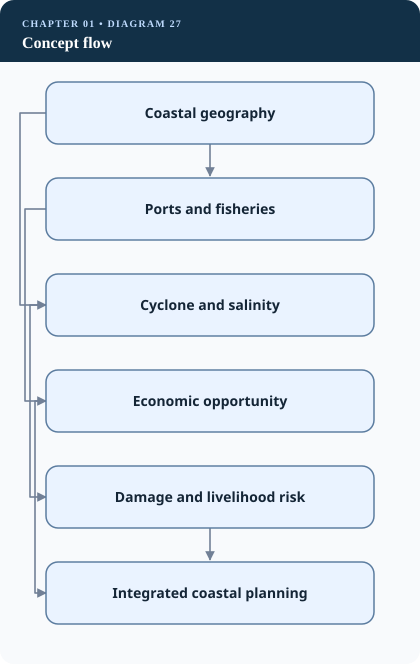</p>

<details>
<summary>ডায়াগ্রামের মূল Mermaid source দেখুন</summary>

```mermaid
flowchart LR
    A["Coastal geography"] --> B["Ports and fisheries"]
    A --> C["Cyclone and salinity"]
    B --> D["Economic opportunity"]
    C --> E["Damage and livelihood risk"]
    D --> F["Integrated coastal planning"]
    E --> F
```

</details>

**করণীয়:** উপকূলীয় আগাম সতর্কতা, আশ্রয়কেন্দ্র, দুর্যোগ-সহনশীল সড়ক–বন্দর, ম্যানগ্রোভ সংরক্ষণ, নিরাপদ পানীয় জল, ভূমি ব্যবহার পরিকল্পনা ও স্থানীয় জনগোষ্ঠীর অংশগ্রহণ। BDP 2100-এর Coastal Zone Hotspot এ ধরনের সমন্বিত পরিকল্পনাকে গুরুত্ব দেয় [S6]।

#### বিশ্লেষণ ও পরীক্ষায় প্রয়োগ — কী, কেন, কীভাবে এবং মূল্যায়ন

**কেন বিষয়টি গুরুত্বপূর্ণ (Why):** বাংলাদেশের উপকূলের ‘সুযোগ’ ও ‘সীমাবদ্ধতা’ একই ভূপ্রক্রিয়া থেকে আসতে পারে। নদীমোহনায় পলি সঞ্চয় নতুন ভূমির সম্ভাবনা তৈরি করলেও স্রোত/ঢেউ পাশের তীর ক্ষয় করতে পারে। সমুদ্র মৎস্য ও বাণিজ্যের সুযোগ দেয়, কিন্তু ঝড় ও লবণাক্ততার ঝুঁকিও থাকে।

**ধাপে ধাপে প্রক্রিয়া (How):** পলি পরিবহন, wave action, জোয়ারভাটা ও নদীর মিঠাপানির প্রবাহ একসঙ্গে তটরেখা পরিবর্তন করে। উন্নয়ন স্থাপনা, উপকূলীয় বাঁধ, ম্যানগ্রোভ ও মানুষের বসতির বিন্যাস ফলাফলে প্রভাব ফেলে; তাই সব উপকূলকে একই ধরনের লবণাক্ত বা ভাঙনপ্রবণ ধরে নেওয়া উচিত নয়।

**বাংলাদেশভিত্তিক প্রয়োগ (Case Study):** মেঘনা মোহনার চর ও কক্সবাজারের সমুদ্রসৈকত দুটোই উপকূল, কিন্তু চর গঠন ও ঢেউ/তটরেখার প্রকৃতি এক নয়। প্রশ্নে অঞ্চলভেদে ঝুঁকির দুই উদাহরণ ব্যবহার করলে সাধারণ বক্তব্যের চেয়ে বেশি বিশ্লেষণ হয়।

**সমালোচনামূলক মূল্যায়ন (Evaluation):** সুপারিশে ম্যানগ্রোভ, ঘূর্ণিঝড় পূর্বাভাস, আশ্রয়কেন্দ্র, নিরাপদ বসতি, পানি ব্যবস্থাপনা ও পরিবেশগত মূল্যায়ন রাখুন; বড় নির্মাণের আগে স্থানীয় erosion/accretion evidence দেখার প্রয়োজন উল্লেখ করুন।

> [!TIP]
> 🟩 **চিত্রভিত্তিক উত্তর অনুশীলন:** Coastal Opportunities (Trade, Fishing, Tourism) ↔ Coastal Risks (Cyclone, Salinity, Erosion) → Resilient Planning।

**উত্তরে ভালো নম্বর পাওয়ার কৌশল:** শুধু তথ্য তালিকা নয়—**কারণ → প্রক্রিয়া → আঞ্চলিক উদাহরণ → ইতিবাচক/নেতিবাচক প্রভাব → বাস্তবসম্মত সিদ্ধান্ত** এই ধারায় লিখুন। ৫ নম্বরের ক্ষেত্রে প্রাসঙ্গিক ২–৩টি ধাপ, ১০ নম্বরে তুলনা/চিত্র এবং ২০ নম্বরে পাল্টা যুক্তি ও নীতি যুক্ত করুন।

**উপসংহার:** উপকূল উন্নয়নের সঠিক পথ হলো **অর্থনৈতিক ব্যবহার ও প্রকৃতির সহনক্ষমতার ভারসাম্য**।

> [!NOTE]
> 🔵 **পরীক্ষায় উল্লেখযোগ্য তথ্যসূত্র:** General Economics Division (GED), Bangladesh Planning Commission — *Bangladesh Delta Plan 2100, investment plan / six hotspot descriptions* [S6]; Bangladesh Water Development Board (BWDB) — *ব-দ্বীপ পরিকল্পনা বাস্তবায়নে বাংলাদেশ পানি উন্নয়ন বোর্ড, updated 2023* [S7]; UNESCO World Heritage Centre — *The Sundarbans (Bangladesh), World Heritage List no.798; inscribed 1997* [S11]।

> [!TIP]
> 🟢 **Q14 · Recall in 10 Seconds:** **Coastal opportunity + cyclone/salinity risk → integrated management**।

<a id="q15"></a>

### 15. Distinguish territorial sea, contiguous zone and exclusive economic zone.

**বাংলা প্রশ্ন:** Territorial Sea, Contiguous Zone ও Exclusive Economic Zone (EEZ)-এর পার্থক্য দেখান।

**Type:** Editorial high-priority practice (not a previous exam question) · **Suggested marks:** 5–10

**✅ Model Answer (বাংলা) — Definition → Explanation → Analysis**

**ভূমিকা:** <mark>একটি রাষ্ট্রের সমুদ্র-অধিকার সব জলরাশিতে সমান নয়</mark>। **Territorial Sea**, **Contiguous Zone** এবং **Exclusive Economic Zone (EEZ)** ভিন্ন আইনি অঞ্চল। নিচের দূরত্বগুলো সাধারণভাবে **Territorial Sea Baseline** থেকে মাপা হয় [S8]।

| বৈশিষ্ট্য | Territorial Sea | Contiguous Zone | EEZ |
|---|---|---|---|
| সর্বোচ্চ বিস্তার | **১২ NM** | **২৪ NM** | **২০০ NM** |
| মূল আইনি চরিত্র | সার্বভৌমত্ব; আইনি ব্যতিক্রম ও নিরীহ অতিক্রমের অধিকারসহ | নির্দিষ্ট আইন প্রয়োগে প্রতিরোধ/শাস্তিমূলক নিয়ন্ত্রণ | সম্পদ অনুসন্ধান, আহরণ ও ব্যবস্থাপনায় **sovereign rights** |
| উদ্দেশ্য | উপকূলীয় রাষ্ট্রের সামুদ্রিক সার্বভৌম পরিসর | কাস্টমস, অভিবাসন, স্বাস্থ্যসহ আইনে নির্ধারিত নিয়ন্ত্রণ | মৎস্য, সম্পদ ও সংশ্লিষ্ট অর্থনৈতিক কর্মকাণ্ড |

**যা মনে রাখবেন:** Contiguous Zone ও EEZ এমন জলাঞ্চল নয় যেখানে স্থলভাগের মতো সার্বভৌমত্ব চলে। আন্তর্জাতিক আইনসঙ্গত অন্য রাষ্ট্রের নৌচলাচলের অধিকারসহ নানা বিধান থাকে। পাশের রাষ্ট্রের সীমানা একে অন্যকে ছেদ করলে **delimitation** প্রয়োজন; ২০০ NM আইনগত দূরত্ব মানেই সবদিকে অবিচ্ছিন্ন বাস্তব সীমানা নয়।

**দূরত্বের স্কিম্যাটিক (মাপ অনুপাতে আঁকা নয়):**

<p>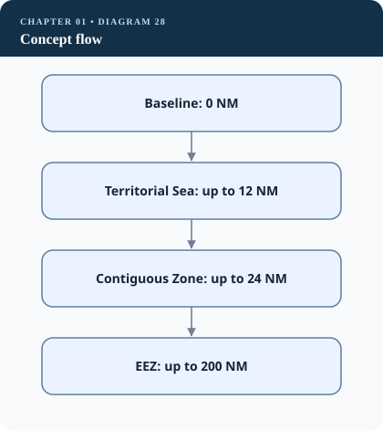</p>

<details>
<summary>ডায়াগ্রামের মূল Mermaid source দেখুন</summary>

```mermaid
flowchart LR
    A["Baseline: 0 NM"] --> B["Territorial Sea: up to 12 NM"]
    B --> C["Contiguous Zone: up to 24 NM"]
    C --> D["EEZ: up to 200 NM"]
```

</details>

**উদাহরণ:** কোনো উপকূলীয় রাষ্ট্র EEZ-তে মাছ ও অন্যান্য সামুদ্রিক সম্পদের ব্যবস্থাপনায় বিশেষ অধিকার পায়, কিন্তু তাই বলে বিদেশি জাহাজের সকল বৈধ চলাচল নির্বিচারে নিষিদ্ধ করতে পারে না।

#### বিশ্লেষণ ও পরীক্ষায় প্রয়োগ — কী, কেন, কীভাবে এবং মূল্যায়ন

**কেন বিষয়টি গুরুত্বপূর্ণ (Why):** সমুদ্রসীমায় রাষ্ট্রের অধিকার স্থানভেদে কেন বদলায় তা বোঝা জরুরি। Territorial Sea-তে সার্বভৌমত্ব থাকলেও আন্তর্জাতিক আইনে অন্য জাহাজের নির্দিষ্ট নৌচলাচলের অধিকার আছে; Contiguous Zone মূলত নির্দিষ্ট আইন প্রয়োগের নিয়ন্ত্রণ; EEZ সম্পদ অনুসন্ধান ও ব্যবস্থাপনায় বিশেষ sovereign rights দেয়।

**ধাপে ধাপে প্রক্রিয়া (How):** তিনটির বাহিরের সীমা baseline থেকে যথাক্রমে সর্বোচ্চ ১২, ২৪ ও ২০০ nautical miles। এগুলো পরস্পর লাগোয়া তিনটি আলাদা চৌকো বাক্স নয়: ২৪ NM হলো baseline থেকে মোট দূরত্ব, ১২ NM-এর পর অতিরিক্ত ২৪ NM নয়। প্রতিবেশীর সঙ্গে overlapping claim হলে কার্যকর সীমারেখা আন্তর্জাতিক সিদ্ধান্ত বা চুক্তিতে নির্ধারিত হতে পারে।

**বাংলাদেশভিত্তিক প্রয়োগ (Case Study):** ধরা যাক, একটি বিদেশি বাণিজ্যিক জাহাজ বাংলাদেশের EEZ দিয়ে আন্তর্জাতিক পথে যাচ্ছে। EEZ-তে বাংলাদেশের সম্পদসংক্রান্ত অধিকার থাকলেও তা এই অঞ্চলে সব নৌচলাচল নিষিদ্ধ করার সম্পূর্ণ অধিকার বোঝায় না।

**সমালোচনামূলক মূল্যায়ন (Evaluation):** পরীক্ষায় টেবিলের চতুর্থ কলামে 'Sovereignty vs Sovereign Rights' আলাদা করুন। Continental Shelf সমুদ্রতল ও মাটির নিচের অধিকার; EEZ জলরাশি-সংক্রান্ত সম্পদও অন্তর্ভুক্ত—দুটো এক নয়।

> [!TIP]
> 🟩 **চিত্রভিত্তিক উত্তর অনুশীলন:** Baseline → 12 Territorial Sea → 24 Contiguous Outer Limit → 200 EEZ Outer Limit. প্রতিটি বিন্দুর নিচে যথাক্রমে Sovereignty / Specific Control / Resource Rights লিখুন।

**উত্তরে ভালো নম্বর পাওয়ার কৌশল:** শুধু তথ্য তালিকা নয়—**কারণ → প্রক্রিয়া → আঞ্চলিক উদাহরণ → ইতিবাচক/নেতিবাচক প্রভাব → বাস্তবসম্মত সিদ্ধান্ত** এই ধারায় লিখুন। ৫ নম্বরের ক্ষেত্রে প্রাসঙ্গিক ২–৩টি ধাপ, ১০ নম্বরে তুলনা/চিত্র এবং ২০ নম্বরে পাল্টা যুক্তি ও নীতি যুক্ত করুন।

**উপসংহার:** **১২ = সার্বভৌমত্ব, ২৪ = নির্দিষ্ট আইন প্রয়োগ, ২০০ = সম্পদ-সংক্রান্ত অধিকার**—এই স্মরণসূত্রের সঙ্গে আইনি পার্থক্য ব্যাখ্যা করুন।

> [!NOTE]
> 🔵 **পরীক্ষায় উল্লেখযোগ্য তথ্যসূত্র:** Ministry of Law, Justice and Parliamentary Affairs — Laws of Bangladesh — *The Territorial Waters and Maritime Zones Act, 1974 (as amended in 2021)* [S8]।

> [!TIP]
> 🟢 **Q15 · Recall in 10 Seconds:** **12/24/200 NM ≠ equal sovereignty**।

[⬆️ Back to Question Finder](#question-index) · [🏠 Table of Contents](#top)

---

<a id="q16"></a>

### 16. Describe the significance of the 2012 and 2014 Bay of Bengal maritime judgments.

**বাংলা প্রশ্ন:** ২০১২ ও ২০১৪ সালের বঙ্গোপসাগরের সমুদ্রসীমা-সংক্রান্ত সিদ্ধান্তগুলোর গুরুত্ব বর্ণনা করুন।

**Type:** Editorial high-priority practice (not a previous exam question) · **Suggested marks:** 10–20

**✅ Model Answer (বাংলা) — Definition → Explanation → Analysis**

**ভূমিকা:** <mark>বঙ্গোপসাগরে প্রতিবেশী রাষ্ট্রের সঙ্গে ওভারল্যাপিং সমুদ্রসীমা নির্ধারণ বাংলাদেশের জন্য</mark> গুরুত্বপূর্ণ আইনগত ও কৌশলগত বিষয়। **২০১২** ও **২০১৪** সালের দুটি বিচারিক সিদ্ধান্ত এই প্রশ্নে বড় অগ্রগতি আনে।

| সাল ও সংস্থা | কোন বিরোধ | মূল তাৎপর্য |
|---|---|---|
| **১৪ মার্চ ২০১২, ITLOS** | বাংলাদেশ বনাম মিয়ানমার | সমুদ্রসীমা নির্ধারণ-সংক্রান্ত রায়; Territorial Sea, EEZ ও continental shelf সম্পর্কিত বিরোধের নিষ্পত্তিতে ভূমিকা |
| **৭ জুলাই ২০১৪, PCA-এর অধীনে ট্রাইব্যুনাল** | বাংলাদেশ বনাম ভারত | Territorial Sea, EEZ ও continental shelf-এ সীমারেখার গতিপথ নির্ধারণে Award [S10] |

**সিদ্ধান্তগুলোর গুরুত্ব:**
1. **আইনি স্পষ্টতা:** কোন অঞ্চলে রাষ্ট্রের কোন সামুদ্রিক অধিকার প্রযোজ্য তা নির্ধারণে অনিশ্চয়তা কমেছে।
2. **সম্পদ ব্যবস্থাপনা:** মৎস্য, গবেষণা ও বৈধ অনুসন্ধান পরিকল্পনার জন্য সুস্পষ্ট সীমানার ভিত্তি তৈরি হয়েছে।
3. **নৌনিরাপত্তা ও কূটনীতি:** বিরোধের আইনভিত্তিক নিষ্পত্তি শান্তিপূর্ণ সমাধানের একটি উদাহরণ।
4. **পরিকল্পনা:** দীর্ঘমেয়াদি সামুদ্রিক পরিবেশ ও বন্দরকেন্দ্রিক নীতিতে আইনগত ভিত্তি পাওয়া যায়।

<p>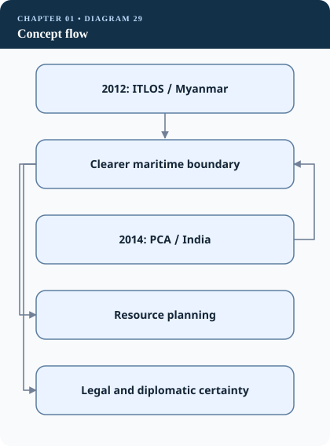</p>

<details>
<summary>ডায়াগ্রামের মূল Mermaid source দেখুন</summary>

```mermaid
flowchart LR
    A["2012: ITLOS / Myanmar"] --> C["Clearer maritime boundary"]
    B["2014: PCA / India"] --> C
    C --> D["Resource planning"]
    C --> E["Legal and diplomatic certainty"]
```

</details>

**বিশ্লেষণ:** এই সিদ্ধান্তগুলোকে 'সমুদ্রে নতুন সার্বভৌম ভূখণ্ড লাভ' হিসেবে সহজীকরণ করা উচিত নয়। Territorial Sea, EEZ এবং Continental Shelf-এর অধিকার আলাদা; বিচারিক সীমা নির্ধারণও সে ভিন্নতা বজায় রাখে [S8][S9][S10]।

#### বিশ্লেষণ ও পরীক্ষায় প্রয়োগ — কী, কেন, কীভাবে এবং মূল্যায়ন

**কেন বিষয়টি গুরুত্বপূর্ণ (Why):** ২০১২ ও ২০১৪ সালের সিদ্ধান্ত দুটি একই সাগর নিয়ে হলেও দুটি আলাদা প্রতিবেশী রাষ্ট্র এবং দুটি আলাদা বিচারিক প্রক্রিয়ার সঙ্গে সম্পর্কিত। সমুদ্রসীমায় overlapping দাবি থাকলে কোন রাষ্ট্র কোন অঞ্চলে উপকূলীয় অধিকার প্রয়োগ করবে তা আইনগতভাবে স্থির করা জরুরি; এর সঙ্গে মৎস্য, সামুদ্রিক গবেষণা, নিরাপত্তা ও জ্বালানি-সংক্রান্ত বিনিয়োগের সম্ভাবনা যুক্ত।

**ধাপে ধাপে প্রক্রিয়া (How):** ২০১২ সালে ITLOS বাংলাদেশ–মিয়ানমারের সমুদ্রসীমা বিষয়ে রায় দেয়। ২০১৪ সালে UNCLOS Annex VII-এর অধীনে গঠিত সালিসি ট্রাইব্যুনাল বাংলাদেশ–ভারতের সীমানা নিয়ে সিদ্ধান্ত দেয়; PCA প্রশাসনিক সহায়তা করে। এ সিদ্ধান্তগুলো সীমারেখা সম্পর্কে আইনগত নিশ্চয়তা বাড়ায়, কিন্তু বন্দর নির্মাণ, গবেষণা বা সম্পদ আহরণের কাজ স্বয়ংক্রিয়ভাবে সম্পন্ন করে না।

**বাংলাদেশভিত্তিক প্রয়োগ (Case Study):** ধরা যাক, একটি সামুদ্রিক গবেষণা প্রকল্প মাছের মজুত পর্যবেক্ষণ করতে চায়। কোথায় বাংলাদেশের সম্পদ-সম্পর্কিত অধিকার আছে তা জানা গবেষণা পরিকল্পনা ও অনুমোদনের জন্য গুরুত্বপূর্ণ। কিন্তু মজুতের পরিমাণ জানতে জাহাজ, নমুনা, উপাত্ত এবং বৈজ্ঞানিক মূল্যায়ন দরকার।

**সমালোচনামূলক মূল্যায়ন (Evaluation):** সঠিক পরিভাষা লিখুন: <mark>ITLOS Judgment (Bangladesh/Myanmar, 2012)</mark> বনাম <mark>Arbitral Award (Bangladesh/India, 2014)</mark>। স্থলভাগের মতো সমুদ্রের সব অধিকার একই নয়; আইন ও বাস্তব সক্ষমতার পার্থক্য পরীক্ষায় দেখাতে হবে।

> [!TIP]
> 🟩 **চিত্রভিত্তিক উত্তর অনুশীলন:** Legal dispute → International ruling/award → Clarified maritime delimitation → Research/Investment planning → Sustainable implementation।

**উত্তর সমৃদ্ধ করার সূত্র:** তথ্যের সঙ্গে causal mechanism, আঞ্চলিক উদাহরণ, policy trade-off ও source-backed সিদ্ধান্ত যোগ করুন। ২০ নম্বরের ক্ষেত্রে counterargument ছাড়া শুধু সুযোগ/সমস্যা লিখে থামবেন না।

**উপসংহার:** ২০১২ ও ২০১৪ বাংলাদেশের **সমুদ্রসীমার আইনভিত্তিক নিশ্চয়তা** বৃদ্ধির মাইলফলক।

> [!NOTE]
> 🔵 **পরীক্ষায় উল্লেখযোগ্য তথ্যসূত্র:** International Tribunal for the Law of the Sea (ITLOS) — *Case No.16, Bangladesh/Myanmar, Judgment, 14 March 2012* [S9]; Permanent Court of Arbitration (PCA) — *Bay of Bengal Maritime Boundary Arbitration (Bangladesh v India), Award, 7 July 2014* [S10]।

> [!TIP]
> 🟢 **Q16 · Recall in 10 Seconds:** **ITLOS 2012 → Myanmar; PCA 2014 → India**।

<a id="q17"></a>

### 17. How does geography influence agricultural patterns in Bangladesh?

**বাংলা প্রশ্ন:** বাংলাদেশের ভৌগোলিক বৈশিষ্ট্য কৃষির ধরনকে কীভাবে প্রভাবিত করে?

**Type:** Editorial high-priority practice (not a previous exam question) · **Suggested marks:** 5–10

**✅ Model Answer (বাংলা) — Definition → Explanation → Analysis**

**ভূমিকা:** <mark>বাংলাদেশের কৃষির ধরন নির্ভর করে ভূমির উচ্চতা, মাটির প্রকৃতি, পানির প্রাপ্যতা, বন্যার মৌসুম ও</mark> লবণাক্ততার ওপর। তাই দেশের সব স্থানে একই ফসল বা সেচব্যবস্থা উপযুক্ত নয়।

| অঞ্চল | ভৌগোলিক প্রভাব | কৃষিতে তার প্রতিফলন |
|---|---|---|
| নদীর পললভূমি | নবীন পলি ও মৌসুমি প্লাবন | ধান, শাকসবজি ও অঞ্চলভেদে বিভিন্ন ফসল |
| হাওর | বর্ষায় বিস্তৃত প্লাবন, শুষ্ক মৌসুমে জমি উন্মুক্ত | শুষ্ক মৌসুমের বোরো ধান; আগাম বন্যা ঝুঁকি |
| বরেন্দ্র | অপেক্ষাকৃত উঁচু সোপান ও শুষ্ক মৌসুমে পানিচাপ | পানি-সাশ্রয়ী সেচ ও ফসল নির্বাচন জরুরি |
| উপকূল | জোয়ারভাটা ও কিছু স্থানে লবণাক্ততা | সহনশীল জাত ও মিঠাপানি ব্যবস্থাপনা |
| পাহাড় | ঢাল ও মাটিক্ষয়ের সম্ভাবনা | ঢাল-উপযোগী কৃষি ও মাটির সুরক্ষা |

**কারণ–ফল চিত্র:**

<p>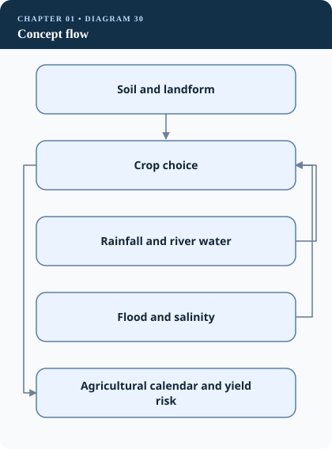</p>

<details>
<summary>ডায়াগ্রামের মূল Mermaid source দেখুন</summary>

```mermaid
flowchart TD
    A["Soil and landform"] --> D["Crop choice"]
    B["Rainfall and river water"] --> D
    C["Flood and salinity"] --> D
    D --> E["Agricultural calendar and yield risk"]
```

</details>

**বিশ্লেষণ:** ভৌগোলিক অবস্থা ফসল নির্বাচন সীমিত বা সহায়ক করলেও সেচপ্রযুক্তি, উন্নত জাত, বাজার ও কৃষকের সিদ্ধান্ত ফল পাল্টাতে পারে। তাই 'ভূগোলই সব নির্ধারণ করে' বলা অযৌক্তিক।

**করণীয়:** অঞ্চলভিত্তিক ফসল ক্যালেন্ডার, বন্যা–খরা–লবণাক্ততা সহনশীল কৃষি, পানি ব্যবস্থাপনা, মাটির স্বাস্থ্য রক্ষা ও স্থানীয় কৃষক-জ্ঞান ব্যবহার করা উচিত।

#### বিশ্লেষণ ও পরীক্ষায় প্রয়োগ — কী, কেন, কীভাবে এবং মূল্যায়ন

**কেন বিষয়টি গুরুত্বপূর্ণ (Why):** কৃষি ব্যবস্থা শুধু মাটির উর্বরতার ওপর নির্ভর করে না; ভূমির উচ্চতা, বন্যার স্থায়িত্ব, বৃষ্টির মৌসুম, সেচের পানি ও লবণাক্ততা একসঙ্গে ফসল নির্বাচন ও চাষাবাদের সময় নির্ধারণে ভূমিকা রাখে। তাই দেশের সব অঞ্চলে একই ফসল ক্যালেন্ডার বাস্তবসম্মত নয়।

**ধাপে ধাপে প্রক্রিয়া (How):** প্লাবনভূমিতে নদীপলি ও মৌসুমি পানি আবাদে সহায়ক হতে পারে, কিন্তু দীর্ঘস্থায়ী প্লাবন বা নদীভাঙন ক্ষতি করে। হাওরে বর্ষায় পানির আধিক্য থাকার কারণে শুষ্ক মৌসুমের বোরো চাষ গুরুত্বপূর্ণ; বরেন্দ্রে শুষ্ক মৌসুমের সেচ ব্যবস্থাপনা বড় বিষয়; উপকূলে স্থানীয় লবণাক্ততা পানি ও ফসল নির্বাচনে সীমা তৈরি করতে পারে।

**বাংলাদেশভিত্তিক প্রয়োগ (Case Study):** একই বছরে তিনজন কৃষক আলাদা সিদ্ধান্ত নিতে পারেন: হাওরের কৃষক আগাম ঢলের আগে বোরো কাটার সময় ঠিক করেন, বরেন্দ্রের কৃষক সেচখরচ বিচার করেন, উপকূলের কৃষক জমির ও পানির লবণাক্ততার সঙ্গে উপযোগী ফসল বাছেন। এটি ভৌগোলিক প্রভাবের সরাসরি উদাহরণ।

**সমালোচনামূলক মূল্যায়ন (Evaluation):** ভূগোল সম্ভাবনা ও সীমা তৈরি করলেও কৃষিপ্রযুক্তি, বাজারদর, কৃষিঋণ, বীজ, সেচ ও সরকারি নীতি ফল নির্ধারণে গুরুত্বপূর্ণ। কঠোর ‘ভূগোলই সব’ সিদ্ধান্ত এড়িয়ে সম্ভাবনা–প্রযুক্তি–নীতি সমন্বিত ব্যাখ্যা লিখুন।

> [!TIP]
> 🟩 **চিত্রভিত্তিক উত্তর অনুশীলন:** Landform + Rainfall + Water Availability + Salinity → Cropping Calendar → Yield/Risk → Adaptation (Variety, Irrigation, Warning)।

**উত্তর সমৃদ্ধ করার সূত্র:** তথ্যের সঙ্গে causal mechanism, আঞ্চলিক উদাহরণ, policy trade-off ও source-backed সিদ্ধান্ত যোগ করুন। ২০ নম্বরের ক্ষেত্রে counterargument ছাড়া শুধু সুযোগ/সমস্যা লিখে থামবেন না।

**উপসংহার:** **Landform + Water + Climate → Cropping Pattern**—এই সূত্র কৃষির আঞ্চলিক বৈচিত্র্য ব্যাখ্যা করে [S2][S6]।

> [!NOTE]
> 🔵 **পরীক্ষায় উল্লেখযোগ্য তথ্যসূত্র:** Banglapedia — Asiatic Society of Bangladesh — *Bangladesh Geography (ভূপ্রকৃতি, বদ্বীপ, নদী ও অঞ্চল)* [S2]; General Economics Division (GED), Bangladesh Planning Commission — *Bangladesh Delta Plan 2100, investment plan / six hotspot descriptions* [S6]।

> [!TIP]
> 🟢 **Q17 · Recall in 10 Seconds:** **Landform → water → crop pattern → livelihood**।

<a id="q18"></a>

### 18. Explain the geographical basis of Bangladesh's transport network.

**বাংলা প্রশ্ন:** বাংলাদেশের পরিবহন নেটওয়ার্কের ভৌগোলিক ভিত্তি ব্যাখ্যা করুন।

**Type:** Editorial high-priority practice (not a previous exam question) · **Suggested marks:** 5–10

**✅ Model Answer (বাংলা) — Definition → Explanation → Analysis**

**ভূমিকা:** <mark>বাংলাদেশের পরিবহনব্যবস্থা নদীজাল, নিম্ন প্লাবনভূমি, সোপানভূমি, পাহাড় ও উপকূলের উপর দাঁড়িয়ে গড়ে</mark> উঠেছে। ভূপ্রকৃতি কোনো স্থানে যোগাযোগ সহজ করে, অন্য স্থানে ব্যয় ও ঝুঁকি বাড়ায়।

**ভৌগোলিক প্রভাব:**
1. **নদীপথ:** পদ্মা–যমুনা–মেঘনাসহ নৌপথ পণ্য ও যাত্রী পরিবহনের ঐতিহ্যবাহী ভিত্তি; কিন্তু নাব্যতা ও খাত পরিবর্তন চলাচলে প্রভাব ফেলে।
2. **সড়ক ও সেতু:** বহু নদী, খাল ও প্লাবনভূমির কারণে সেতু, কালভার্ট ও উঁচু রাস্তা দরকার হয়; বাঁধসদৃশ সড়ক পরিকল্পনা ছাড়া করলে জলপ্রবাহ বাধাগ্রস্ত হতে পারে।
3. **রেল যোগাযোগ:** তুলনামূলক সমতল ভূমি রেলপথের সুযোগ দেয়; নদী পারাপার ও জলাবদ্ধ এলাকায় বিশেষ নকশা লাগে।
4. **পাহাড়ি অঞ্চল:** খাড়া ঢাল, ভূমিধস ও ক্ষয় সড়ক স্থাপন ও রক্ষণাবেক্ষণ জটিল করে।
5. **উপকূলীয় বন্দর:** বঙ্গোপসাগরের অবস্থান নৌবাণিজ্যের সুযোগ দিলেও ঘূর্ণিঝড়, জলোচ্ছ্বাস ও মোহনার পলি পরিকল্পনায় ধরতে হয়।

| ভূপ্রকৃতি | সম্ভাবনা | প্রকৌশল সমস্যা |
|---|---|---|
| প্লাবনভূমি | স্থল–নৌ বহুমুখী যোগাযোগ | বন্যা, সেতু, পানি নিষ্কাশন |
| পাহাড় | আঞ্চলিক সড়ক সংযোগ | ঢাল স্থিতিশীলতা |
| উপকূল | সমুদ্রবন্দর ও নৌপথ | জলোচ্ছ্বাস ও নাব্যতা |

<p>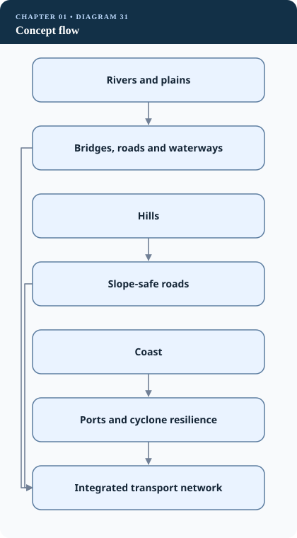</p>

<details>
<summary>ডায়াগ্রামের মূল Mermaid source দেখুন</summary>

```mermaid
flowchart LR
    A["Rivers and plains"] --> B["Bridges, roads and waterways"]
    C["Hills"] --> D["Slope-safe roads"]
    E["Coast"] --> F["Ports and cyclone resilience"]
    B --> G["Integrated transport network"]
    D --> G
    F --> G
```

</details>

#### বিশ্লেষণ ও পরীক্ষায় প্রয়োগ — কী, কেন, কীভাবে এবং মূল্যায়ন

**কেন বিষয়টি গুরুত্বপূর্ণ (Why):** বাংলাদেশে নদী ও নিচু ভূমির বিস্তার পরিবহনে একসঙ্গে সুযোগ ও বাধা। নদীপথ কম অবকাঠামোয় বড় পণ্য পরিবহনে সহায়ক হতে পারে; কিন্তু নদীর চ্যানেল বদল ও নাব্যতা সমস্যা তৈরি করে। সমতলে সড়ক সহজতর হলেও অসংখ্য নদী ও প্লাবন এলাকা সেতু, কালভার্ট ও flood-compatible design দাবি করে।

**ধাপে ধাপে প্রক্রিয়া (How):** সড়ক নির্মাণে নদী–খাল–জলাভূমি পারাপারের ব্যবস্থা প্রয়োজন; সেতুর উচ্চতা ও নদীর প্রবাহ বিবেচনা করতে হয়। নদীপথে চলাচলে depth, channel position ও ঋতুভিত্তিক পরিবর্তন জরুরি; পাহাড়ে ঢাল ও ভূমিধসের ঝুঁকি সড়কের নকশা ও রক্ষণাবেক্ষণকে প্রভাবিত করে।

**বাংলাদেশভিত্তিক প্রয়োগ (Case Study):** যমুনা পারাপারে সেতু যোগাযোগের ধারা বদলায়; আবার হাওরের ওপর দিয়ে অপরিকল্পিত সড়ক দিলে পানির স্বাভাবিক প্রবাহ আটকে স্থানীয় জলাবদ্ধতা ও জীববৈচিত্র্যের সমস্যা হতে পারে। উদাহরণ দুটি একসঙ্গে লিখলে ভৌগোলিক engineering trade-off বোঝা যায়।

**সমালোচনামূলক মূল্যায়ন (Evaluation):** একটি ভালো পরিবহন নীতি ‘নতুন রাস্তা’ নয়; **Road–Rail–River Multimodal Network + Environmental Flow + Maintenance**। Geography-এর সঙ্গে অর্থনৈতিক চাহিদা, যাত্রীসেবা, বিনিয়োগ ও জলবায়ু ঝুঁকিও বিচার্য।

> [!TIP]
> 🟩 **চিত্রভিত্তিক উত্তর অনুশীলন:** Physical Barrier (River/Hill/Floodplain) → Engineering Design → Multimodal Access → Trade and Services; Environmental Check প্রতিটি ধাপে।

**উত্তর সমৃদ্ধ করার সূত্র:** তথ্যের সঙ্গে causal mechanism, আঞ্চলিক উদাহরণ, policy trade-off ও source-backed সিদ্ধান্ত যোগ করুন। ২০ নম্বরের ক্ষেত্রে counterargument ছাড়া শুধু সুযোগ/সমস্যা লিখে থামবেন না।

**উপসংহার:** বাংলাদেশের পরিবহন পরিকল্পনায় **মাল্টিমোডাল সংযোগের পাশাপাশি নদীর স্বাভাবিক প্রবাহ ও দুর্যোগঝুঁকি** বিবেচনা অপরিহার্য।

> [!NOTE]
> 🔵 **পরীক্ষায় উল্লেখযোগ্য তথ্যসূত্র:** Banglapedia — Asiatic Society of Bangladesh — *Bangladesh Geography (ভূপ্রকৃতি, বদ্বীপ, নদী ও অঞ্চল)* [S2]; General Economics Division (GED), Bangladesh Planning Commission — *Bangladesh Delta Plan 2100, investment plan / six hotspot descriptions* [S6]।

> [!TIP]
> 🟢 **Q18 · Recall in 10 Seconds:** **River networks → transport opportunity + channel hazards**।

<a id="q19"></a>

### 19. Evaluate the impact of geographical features on Bangladesh’s culture.

**বাংলা প্রশ্ন:** বাংলাদেশের সংস্কৃতিতে ভূপ্রাকৃতিক বৈশিষ্ট্যের প্রভাব মূল্যায়ন করুন।

**Type:** Past-paper theme — 47th-related (secondary archive); English rendering, not verbatim original · **Suggested marks:** 10–20

**✅ Model Answer (বাংলা) — Definition → Explanation → Analysis**

**ভূমিকা:** <mark>ভৌগোলিক বৈশিষ্ট্য মানুষের খাদ্য, পেশা, চলাচল, উৎসব ও দৈনন্দিন জীবনের পরিবেশ তৈরি করে</mark>। বাংলাদেশের সংস্কৃতি নদী, হাওর, পাহাড়, বরেন্দ্র ও উপকূলের সঙ্গে গভীরভাবে সম্পর্কযুক্ত, তবে ভূগোল একমাত্র নির্ধারক নয়।

**উদাহরণসহ প্রভাব:**
1. **নদীমাতৃক জীবন:** নৌকা, নৌকার গান, নদীঘাট ও জলপথকেন্দ্রিক বাজার ঐতিহাসিকভাবে নদীপাড়ের জীবনের অংশ।
2. **হাওরের মৌসুমি জীবন:** বর্ষার জলরাশি ও শুষ্ক মৌসুমের বোরো কৃষি বাসস্থান, যাতায়াত ও কাজের সময়সূচিতে প্রভাব ফেলে।
3. **উপকূলীয় সংস্কৃতি:** মৎস্যজীবিকা, জোয়ার–ভাটার অভিজ্ঞতা, ঝড় মোকাবিলা ও লবণাক্ত পরিবেশ স্থানীয় চর্চাকে প্রভাবিত করে।
4. **পাহাড়ি সংস্কৃতি:** ভৌগোলিক বিচ্ছিন্নতা, বন–ঢাল–উপত্যকা ঐতিহ্যগত জীবিকায় ভূমিকা রাখে; তবে বিভিন্ন জাতিগোষ্ঠীর সংস্কৃতি বোঝার জন্য তাঁদের ইতিহাস, ভাষা ও নিজস্ব সিদ্ধান্তকেও সমান গুরুত্ব দিতে হবে।
5. **বরেন্দ্র ও সমভূমি:** পানি প্রাপ্যতা ও মৌসুমি কৃষি কাজের ছন্দ নির্ধারণে ভূমিকা রাখে।

<p>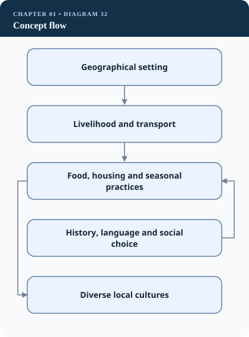</p>

<details>
<summary>ডায়াগ্রামের মূল Mermaid source দেখুন</summary>

```mermaid
flowchart TD
    A["Geographical setting"] --> B["Livelihood and transport"]
    B --> C["Food, housing and seasonal practices"]
    D["History, language and social choice"] --> C
    C --> E["Diverse local cultures"]
```

</details>

**সমালোচনামূলক মূল্যায়ন:** একই নদীতীরের মানুষের ভাষা, পেশা, ধর্মীয় চর্চা বা উৎসব ভিন্ন হতে পারে। তাই **geographical influence ≠ geographical determinism**; সমাজ, প্রযুক্তি, ইতিহাস ও রাজনৈতিক–অর্থনৈতিক সিদ্ধান্ত সংস্কৃতি গড়ে।

#### তুলনামূলক সারণি

| ভৌগোলিক প্রভাব | জীবন/সংস্কৃতিতে সম্ভাব্য প্রতিফলন | একমাত্র কারণ নয় কেন |
|---|---|---|
| নদী ও জলাভূমি | নৌযাত্রা, কৃষি–মৎস্যের অভিজ্ঞতা | শিক্ষা, বাজার ও প্রযুক্তি পেশা বদলায় |
| মৌসুমি বৃষ্টি | চাষাবাদ ও যাতায়াতের ঋতুচক্র | অবকাঠামো ও সেচ পরিবর্তন আনে |
| পাহাড় ও ঢাল | বসতি ও যোগাযোগের বিশেষ অভিযোজন | সংস্কৃতির বৈচিত্র্য ইতিহাসনির্ভরও |
| উপকূলীয় ঝুঁকি | ঝড়ের প্রস্তুতি, পানির ব্যবহার | প্রতিষ্ঠান ও পূর্বাভাস ঝুঁকি কমায় |

#### বিশ্লেষণ ও পরীক্ষায় প্রয়োগ — কী, কেন, কীভাবে এবং মূল্যায়ন

**কেন বিষয়টি গুরুত্বপূর্ণ (Why):** মানুষের সংস্কৃতি খাদ্য, পেশা, বসতি, গান, উৎসব, ভাষা ও ঐতিহাসিক অভিজ্ঞতা নিয়ে গড়ে ওঠে। নদী ও মৌসুমি পরিবেশ এসবের অনেক উপাদানকে প্রভাবিত করতে পারে, কিন্তু একটি অঞ্চলের জনগোষ্ঠীর সংস্কৃতি ভূগোলের অবধারিত ফল নয়।

**ধাপে ধাপে প্রক্রিয়া (How):** নদীতীরের যোগাযোগ নৌযাত্রা ও মাছধরার অভিজ্ঞতা তৈরি করতে পারে; হাওরে ঋতু বদলের সঙ্গে যাতায়াত ও জীবিকা পাল্টায়; উপকূলে ঝড়ের প্রস্তুতি ও পানির ব্যবস্থাপনা জীবনযাত্রায় প্রভাব ফেলে। অন্যদিকে শিক্ষা, সামাজিক প্রতিষ্ঠান, ধর্ম, অভিবাসন, গণমাধ্যম ও প্রযুক্তি একই সমাজে পরিবর্তন আনতে পারে।

**বাংলাদেশভিত্তিক প্রয়োগ (Case Study):** ধরা যাক, একই নদীতীরের দুই পরিবারের একজন মাছ ধরে, অন্যজন শহরে চাকরি করে। পরিবেশ দুজনের সুযোগ-সীমা তৈরি করলেও পেশা নির্বাচনের চূড়ান্ত কারণ আলাদা—এই উদাহরণ 'influence vs determine' পার্থক্য বোঝায়।

**সমালোচনামূলক মূল্যায়ন (Evaluation):** পরীক্ষায় স্থানীয় গান বা সংস্কৃতির উদাহরণ লিখলে নির্দিষ্ট উৎস ছাড়া কোনো রীতি সমগ্র জাতিগোষ্ঠীর একমাত্র বৈশিষ্ট্য বলে দাবি করবেন না। নদীকেন্দ্রিক সংস্কৃতিকে ‘ভূগোলের প্রভাব’ এবং ইতিহাস/সমাজকে ‘মানবিক agency’ হিসেবে আলাদা রাখুন।

> [!TIP]
> 🟩 **চিত্রভিত্তিক উত্তর অনুশীলন:** Environment → Opportunities/Constraints → Human Choices ↔ Technology/Society/History → Diverse Cultural Outcomes।

**উত্তর সমৃদ্ধ করার সূত্র:** তথ্যের সঙ্গে causal mechanism, আঞ্চলিক উদাহরণ, policy trade-off ও source-backed সিদ্ধান্ত যোগ করুন। ২০ নম্বরের ক্ষেত্রে counterargument ছাড়া শুধু সুযোগ/সমস্যা লিখে থামবেন না।

**উপসংহার:** বাংলাদেশের সংস্কৃতি বুঝতে **প্রাকৃতিক পরিবেশ + মানুষের ইতিহাস + সামাজিক সৃজনশীলতা**—সবই প্রয়োজন।

> [!NOTE]
> 🔵 **পরীক্ষায় উল্লেখযোগ্য তথ্যসূত্র:** Banglapedia — Asiatic Society of Bangladesh — *Bangladesh Geography (ভূপ্রকৃতি, বদ্বীপ, নদী ও অঞ্চল)* [S2]; Banglapedia — Asiatic Society of Bangladesh — *ভূ-প্রকৃতি (বাংলা)* [S3]।

> [!TIP]
> 🟢 **Q19 · Recall in 10 Seconds:** **Geographical influence does not mean cultural determinism**।

<a id="q20"></a>

### 20. Define geographical determinism and critically examine its relevance to Bangladesh.

**বাংলা প্রশ্ন:** Geographical Determinism কী? বাংলাদেশের ক্ষেত্রে এর প্রাসঙ্গিকতা সমালোচনামূলকভাবে পরীক্ষা করুন।

**Type:** Past-paper theme — 47th-related (secondary archive); English rendering, not verbatim original · **Suggested marks:** 10–20

**✅ Model Answer (বাংলা) — Definition → Explanation → Analysis**

**সংজ্ঞা:** <mark>**Geographical Determinism** হলো সেই মতবাদ, যেখানে মানুষের সমাজ, </mark>সংস্কৃতি ও অর্থনৈতিক বিকাশকে প্রধানত প্রাকৃতিক পরিবেশের দ্বারা নির্ধারিত বলে বিবেচনা করা হয়। আধুনিক মানবভূগোল এই কঠোর মতকে সীমিত মনে করে।

**বাংলাদেশে ভৌগোলিক প্রভাবের উদাহরণ:**
1. নদী, পললমাটি ও মৌসুমি প্লাবন কৃষি, বসতি ও নৌযোগাযোগের সুযোগ তৈরি করেছে।
2. উপকূলীয় অবস্থান মৎস্য, বন্দর, ঘূর্ণিঝড় ও লবণাক্ততার সঙ্গে জীবনযাত্রাকে যুক্ত করেছে।
3. হাওর–পাহাড়–বরেন্দ্র অঞ্চলের ভূমিরূপ ও পানি প্রাপ্যতা পেশা ও পরিবহনকে প্রভাবিত করে।

**কেন কঠোর Determinism যথেষ্ট নয়?**
1. **প্রযুক্তি:** বাঁধ, পূর্বাভাস, সেচ, বীজের উন্নয়ন ও সেতু মানুষের অভিযোজনক্ষমতা বাড়ায়।
2. **নীতি ও প্রতিষ্ঠান:** শিক্ষা, ভূমি অধিকার, দুর্যোগ প্রস্তুতি, অবকাঠামো ও স্বাস্থ্যসেবার মান ভিন্ন হলে একই ঝুঁকির ফলও ভিন্ন হয়।
3. **মানুষের সিদ্ধান্ত:** সংস্কৃতি, বাজার, অভিবাসন ও সৃজনশীলতা পরিবেশগত সীমা বদলাতে বা মোকাবিলা করতে পারে।

| ধারণা | বক্তব্য | মূল্যায়ন |
|---|---|---|
| কঠোর Determinism | প্রকৃতি প্রায় সব ফল নির্ধারণ করে | অতিরিক্ত সরলীকরণ |
| পরিবেশগত প্রভাব | প্রকৃতি সুযোগ ও সীমা দেয় | বাস্তবসম্মত |
| অভিযোজন/Agency | মানুষ প্রযুক্তি ও নীতিতে প্রতিক্রিয়া দেয় | পূর্ণাঙ্গ ব্যাখ্যার অংশ |

<p></p>

<details>
<summary>ডায়াগ্রামের মূল Mermaid source দেখুন</summary>

```mermaid
flowchart LR
    A["Natural environment"] --> C["Opportunities and constraints"]
    B["Technology, policy and culture"] --> D["Human choices"]
    C --> E["Actual social outcomes"]
    D --> E
```

</details>

#### বিশ্লেষণ ও পরীক্ষায় প্রয়োগ — কী, কেন, কীভাবে এবং মূল্যায়ন

**কেন বিষয়টি গুরুত্বপূর্ণ (Why):** Geographical Determinism পরীক্ষা করে কেন ভৌগোলিক পরিবেশের প্রভাবকে একমাত্র নির্ধারক হিসেবে ধরা যায় না। পরিবেশ সমাজকে সীমা ও সুযোগ দেয়—এটি সত্য; কিন্তু মানুষের প্রতিষ্ঠান, জ্ঞান, প্রযুক্তি এবং ঐতিহাসিক সিদ্ধান্ত পরিবেশের প্রভাবকে বদলে দিতে পারে।

**ধাপে ধাপে প্রক্রিয়া (How):** একটি হাওরে নৌকা ও মৌসুমি কৃষির গুরুত্ব বাড়তে পারে; কিন্তু উন্নত যোগাযোগ, বাজার ও প্রযুক্তি এ নির্ভরতা পরিবর্তন করতে পারে। পাহাড়ি অঞ্চলে ঢাল পরিবহনের চ্যালেঞ্জ তৈরি করলেও প্রকৌশল, নিরাপদ পরিকল্পনা ও স্থানীয় জনগণের অংশগ্রহণ নতুন সুযোগ সৃষ্টি করে।

**বাংলাদেশভিত্তিক প্রয়োগ (Case Study):** নদীভাঙনপ্রবণ একটি পরিবার আগে শুধু স্থানীয় কৃষিতে নির্ভরশীল হতে পারে; পরে শিক্ষা ও নতুন কর্মসংস্থানে যুক্ত হলে তার জীবনধারা বদলায়—ভূগোল আগের মতো থাকলেও সামাজিক ফল বদলায়। এটিই environment–agency relationship বোঝায়।

**সমালোচনামূলক মূল্যায়ন (Evaluation):** **Determinism**-এর শক্তি: পরিবেশের বাস্তব ভূমিকা সামনে আনে। **সীমা:** মানুষের সিদ্ধান্ত ও ইতিহাসকে ছোট করে দেখে। **Possibilism** পরিবেশ-নির্ধারিত একমাত্র ফলের বদলে বিকল্প পথের গুরুত্ব দেখায়। উপসংহারে লিখুন: <mark>Environment influences, but does not alone determine.</mark>

> [!TIP]
> 🟩 **চিত্রভিত্তিক উত্তর অনুশীলন:** Determinism: Environment → Human Outcome (one-way); Balanced Approach: Environment ↔ Technology + Institutions + Human Choices → Multiple Outcomes।

**উত্তর সমৃদ্ধ করার সূত্র:** তথ্যের সঙ্গে causal mechanism, আঞ্চলিক উদাহরণ, policy trade-off ও source-backed সিদ্ধান্ত যোগ করুন। ২০ নম্বরের ক্ষেত্রে counterargument ছাড়া শুধু সুযোগ/সমস্যা লিখে থামবেন না।

**উপসংহার:** বাংলাদেশের উদাহরণ প্রমাণ করে, ভূগোল গুরুত্বপূর্ণ **প্রভাবক**, কিন্তু মানুষের সমাজের **অপরিবর্তনীয় নিয়ন্তা নয়**। সমালোচনামূলক উত্তরে প্রভাব স্বীকার করার সঙ্গে মানবিক agency-ও দেখাতে হবে।

> [!NOTE]
> 🔵 **পরীক্ষায় উল্লেখযোগ্য তথ্যসূত্র:** Banglapedia — Asiatic Society of Bangladesh — *Bangladesh Geography (ভূপ্রকৃতি, বদ্বীপ, নদী ও অঞ্চল)* [S2]; General Economics Division (GED), Bangladesh Planning Commission — *Bangladesh Delta Plan 2100, investment plan / six hotspot descriptions* [S6]।

> [!TIP]
> 🟢 **Q20 · Recall in 10 Seconds:** **Environment shapes choices; history, policy and technology also matter**।

[⬆️ Back to Question Finder](#question-index) · [🏠 Table of Contents](#top)

---

<a id="q21"></a>

### 21. Why does the position of Bangladesh make it disaster-prone?

**বাংলা প্রশ্ন:** বাংলাদেশের ভৌগোলিক অবস্থান দেশটিকে দুর্যোগপ্রবণ করে তোলে কেন?

**Type:** Editorial high-priority practice (not a previous exam question) · **Suggested marks:** 10–20

**✅ Model Answer (বাংলা) — Definition → Explanation → Analysis**

**ভূমিকা:** বাংলাদেশের দুর্যোগপ্রবণতা শুধু আবহাওয়ার কারণে নয়; দেশের **নিম্ন ব-দ্বীপীয় অবস্থান, বৃহৎ আন্তঃসীমান্ত নদী, মৌসুমি বৃষ্টি ও বঙ্গোপসাগর** মিলে নানা ধরনের ঝুঁকি তৈরি করে।

**প্রধান ভৌগোলিক কারণ:**
1. **নিম্নভূমি:** বিশাল প্লাবনভূমিতে নদীর পানি ছড়িয়ে বন্যা ও জলাবদ্ধতা দেখা দিতে পারে।
2. **উজান–ভাটির সম্পর্ক:** প্রতিবেশী বৃহৎ অববাহিকায় বৃষ্টি হলে নদীর পানি ও পলি বাংলাদেশের নিম্নাংশ দিয়ে প্রবাহিত হয়।
3. **বঙ্গোপসাগরের উপকূল:** ঘূর্ণিঝড় ও জলোচ্ছ্বাসের ঝুঁকি বিশেষ করে ঘনবসতিপূর্ণ উপকূলীয় জনপদকে প্রভাবিত করে।
4. **উত্তর-পূর্বের হাওর:** উজানের পাহাড়ি ঢল নিচু হাওরে দ্রুত জমে আগাম বন্যা তৈরি করতে পারে।
5. **উত্তর-পশ্চিমের সোপান:** শুষ্ক মৌসুমে পানি প্রাপ্যতা ও সেচচাপের কারণে খরাজনিত সংকট বাড়ে।
6. **পাহাড়ি ঢাল:** অতিবৃষ্টি, বন উজাড় ও অপরিকল্পিত পাহাড় কাটা ভূমিধসের ঝুঁকি বাড়াতে পারে।

| অঞ্চল | বিশেষ ঝুঁকি | প্রয়োজনীয় ব্যবস্থা |
|---|---|---|
| নদীবিধৌত সমভূমি | বন্যা, নদীভাঙন | পূর্বাভাস ও ঝুঁকিভিত্তিক বসতি |
| উপকূল | ঘূর্ণিঝড়, জলোচ্ছ্বাস | আশ্রয়, ম্যানগ্রোভ, নিরাপদ অবকাঠামো |
| হাওর | আকস্মিক বন্যা | উজানভিত্তিক সতর্কতা, ফসল পরিকল্পনা |
| বরেন্দ্র | খরা ও পানিচাপ | দক্ষ সেচ ও পানির পুনর্ভরণ |
| পাহাড় | ভূমিধস | ঢাল সংরক্ষণ ও নিরাপদ ভূমি ব্যবহার |

<p></p>

<details>
<summary>ডায়াগ্রামের মূল Mermaid source দেখুন</summary>

```mermaid
flowchart TD
    A["Delta location"] --> B["Flood and erosion"]
    C["Bay of Bengal"] --> D["Cyclone and surge"]
    E["Regional hills and terraces"] --> F["Flash flood or drought"]
    B --> G["Local disaster risk plans"]
    D --> G
    F --> G
```

</details>

#### বিশ্লেষণ ও পরীক্ষায় প্রয়োগ — কী, কেন, কীভাবে এবং মূল্যায়ন

**কেন বিষয়টি গুরুত্বপূর্ণ (Why):** বাংলাদেশ দুর্যোগপ্রবণ হওয়ার পেছনে চারটি ভৌগোলিক বাস্তবতা কাজ করে—(১) বৃহৎ নদী অববাহিকার নিম্নপ্রবাহে অবস্থান; (২) মৌসুমি বৃষ্টির ঘনত্ব; (৩) উপসাগরীয় ঝড় ও জলোচ্ছ্বাস; (৪) নিচু প্লাবনভূমি, পাহাড় ও হাওরের অঞ্চলগত বৈচিত্র্য। তবে দুর্যোগের ক্ষতি শুধু প্রাকৃতিক ঘটনাপ্রবাহের নয়; জনবসতির exposure ও vulnerability-ও গুরুত্বপূর্ণ।

**ধাপে ধাপে প্রক্রিয়া (How):** উজানের প্রবল প্রবাহ প্লাবনভূমির পানির উচ্চতা বাড়ায়; উপকূলীয় ঘূর্ণিঝড় জলোচ্ছ্বাস তৈরি করতে পারে; পাহাড়ে তীব্র বৃষ্টি ও অনিরাপদ ঢাল ভূমিধসের ঝুঁকি বাড়ায়; হাওরে দ্রুত ঢল ফসল ক্ষতিগ্রস্ত করে। এ ঘটনাগুলোর সময়, গতি, স্থান ও স্থানীয় প্রস্তুতি ক্ষতির মাত্রা নির্ধারণ করে।

**বাংলাদেশভিত্তিক প্রয়োগ (Case Study):** একই মাত্রার বন্যার পানিতে একটি উঁচু প্লিন্থে নির্মিত বাড়ি কম ক্ষতিগ্রস্ত হতে পারে, নিচু ও দুর্বল বাড়ি বেশি ক্ষতিগ্রস্ত হতে পারে। অর্থাৎ ‘hazard’ এক হলেও vulnerability ও exposure আলাদা।

**সমালোচনামূলক মূল্যায়ন (Evaluation):** <mark>Disaster Risk ≈ Hazard × Exposure × Vulnerability</mark> একটি ধারণাগত সম্পর্ক, পরীক্ষায় লিখতে পারেন; এটি নির্দিষ্ট পরিসংখ্যানের গাণিতিক সূত্র নয়। Early warning, land-use planning, resilient infrastructure ও community preparedness দিয়ে ক্ষতি কমানো যায়।

> [!TIP]
> 🟩 **চিত্রভিত্তিক উত্তর অনুশীলন:** Flood/Cyclone/Landslide Hazard + People/Assets Exposed + Vulnerability → Risk → Early Warning & Adaptation।

**উত্তর সমৃদ্ধ করার সূত্র:** তথ্যের সঙ্গে causal mechanism, আঞ্চলিক উদাহরণ, policy trade-off ও source-backed সিদ্ধান্ত যোগ করুন। ২০ নম্বরের ক্ষেত্রে counterargument ছাড়া শুধু সুযোগ/সমস্যা লিখে থামবেন না।

**উপসংহার:** বাংলাদেশের দুর্যোগ একরকম নয়। তাই **স্থানভিত্তিক পূর্বাভাস, নিরাপদ অবকাঠামো ও সামাজিক সুরক্ষা** একসঙ্গে দরকার [S2][S6]।

> [!NOTE]
> 🔵 **পরীক্ষায় উল্লেখযোগ্য তথ্যসূত্র:** Banglapedia — Asiatic Society of Bangladesh — *Bangladesh Geography (ভূপ্রকৃতি, বদ্বীপ, নদী ও অঞ্চল)* [S2]; General Economics Division (GED), Bangladesh Planning Commission — *Bangladesh Delta Plan 2100, investment plan / six hotspot descriptions* [S6]; Bangladesh Water Development Board (BWDB) — *ব-দ্বীপ পরিকল্পনা বাস্তবায়নে বাংলাদেশ পানি উন্নয়ন বোর্ড, updated 2023* [S7]।

> [!TIP]
> 🟢 **Q21 · Recall in 10 Seconds:** **Delta + monsoon + Bay → region-specific disaster risks**।

<a id="q22"></a>

### 22. Explain the concept of adaptive delta management in the context of BDP 2100.

**বাংলা প্রশ্ন:** বাংলাদেশ ব-দ্বীপ পরিকল্পনা ২১০০-এর প্রেক্ষাপটে <mark>Adaptive Delta Management</mark>-এর ধারণা ব্যাখ্যা করুন।

**Type:** Editorial high-priority practice (not a previous exam question) · **Suggested marks:** 5–10

**✅ Model Answer (বাংলা) — Definition → Explanation → Analysis**

**সংজ্ঞা:** **Adaptive Delta Management** হলো দীর্ঘমেয়াদি লক্ষ্য ঠিক রেখে নদী, জলবায়ু, ভূমি ব্যবহার ও অর্থনীতির পরিবর্তন **পর্যবেক্ষণ করে ধাপে ধাপে নীতি ও বিনিয়োগ বদলানো**। এটি একবারে স্থির পরিকল্পনা করে ফেলে রাখার পদ্ধতি নয়।

**BDP 2100-এর সঙ্গে সম্পর্ক:** বাংলাদেশ ব-দ্বীপ পরিকল্পনা ২১০০ বন্যা, নদীভাঙন, লবণাক্ততা, খরা, নগর জলাবদ্ধতা ও জলবায়ু ঝুঁকি মোকাবিলায় দীর্ঘমেয়াদি সমন্বিত কাঠামো দেয় [S6]।

**প্রধান ধাপ:**
1. **লক্ষ্য নির্ধারণ:** নিরাপদ পানি, খাদ্য, বাসস্থান, অর্থনীতি ও পরিবেশের কাঙ্ক্ষিত ফল ঠিক করা।
2. **ঝুঁকি ও বিকল্প চিহ্নিত:** সম্ভাব্য জলবায়ু, নদী ও জনসংখ্যা পরিবর্তনের কয়েকটি বাস্তবসম্মত scenario বিবেচনা।
3. **স্বল্পমেয়াদি পদক্ষেপ:** সবচেয়ে জরুরি এলাকায় পূর্বাভাস, পানি ব্যবস্থাপনা ও অবকাঠামো উন্নয়ন।
4. **Monitoring:** পানিস্তর, লবণাক্ততা, নদীখাত, কৃষি ও বাস্তুতন্ত্রের ফল নিয়মিত পর্যবেক্ষণ।
5. **Trigger ও সংশোধন:** নির্দিষ্ট ঝুঁকি বেড়ে গেলে পরিকল্পনার পরবর্তী ধাপ, প্রকল্প বা অগ্রাধিকার বদলানো।
6. **প্রতিষ্ঠান ও জনগণের অংশগ্রহণ:** স্থানীয় অভিজ্ঞতা, অর্থায়ন ও প্রশাসনিক সমন্বয় ধরে রাখা।

**Adaptive pathway চিত্র:**

<p></p>

<details>
<summary>ডায়াগ্রামের মূল Mermaid source দেখুন</summary>

```mermaid
flowchart LR
    A["Set long-term goals"] --> B["Select initial actions"]
    B --> C["Monitor risk indicators"]
    C --> D{"Are targets at risk?"}
    D -->|No| C
    D -->|Yes| E["Adjust projects or pathways"]
    E --> C
```

</details>

**সহজ উদাহরণ:** কোনো উপকূলে লবণাক্ততা প্রত্যাশার চেয়ে দ্রুত বাড়লে শুধু আগের বাঁধ পরিকল্পনা বজায় না রেখে পানীয় জল, কৃষি ও প্রাকৃতিক সুরক্ষার নতুন সংমিশ্রণ নেওয়া হতে পারে।

#### তুলনামূলক সারণি

| Adaptive step | কী করবেন | উদাহরণ |
|---|---|---|
| **Observe** | নদী, বৃষ্টি, লবণাক্ততা ও জনজীবনের তথ্য নিন | উপকূলীয় পানির গুণমান |
| **Scenario** | সম্ভাব্য ভবিষ্যৎ পরিস্থিতি তুলনা করুন | শুষ্ক মৌসুমে বাড়তি লবণাক্ততা |
| **Decide & Act** | প্রয়োজনমাফিক বিনিয়োগ/নীতি বাছুন | নিরাপদ পানি ও সেচ পরিকল্পনা |
| **Monitor** | বাস্তব ফল মাপুন | কৃষি ও পানির অবস্থার পরিবর্তন |
| **Adjust** | তথ্য অনুযায়ী নীতি সংশোধন করুন | স্থানীয় ব্যবস্থার পুনর্বিন্যাস |

#### বিশ্লেষণ ও পরীক্ষায় প্রয়োগ — কী, কেন, কীভাবে এবং মূল্যায়ন

**কেন বিষয়টি গুরুত্বপূর্ণ (Why):** Adaptive Delta Management-এ অনিশ্চয়তা স্বীকার করা হয়—অর্থাৎ আগামী দশকের বৃষ্টি, সাগরপৃষ্ঠ, নদীপথ, অর্থনীতি ও জনসংখ্যা একটি স্থির পূর্বাভাস অনুযায়ী চলবে এমন ধরে দীর্ঘমেয়াদি প্রকল্প সাজানো ঠিক নয়। পরিকল্পনা নির্দিষ্ট লক্ষ্য রাখবে, কিন্তু প্রয়োজন অনুযায়ী পদ্ধতি বদলাবে।

**ধাপে ধাপে প্রক্রিয়া (How):** প্রথমে নদী, ভূমি, পানি ও জীবিকার অবস্থা পর্যবেক্ষণ; তারপর একাধিক ভবিষ্যৎ পরিস্থিতি তৈরি; এর ভিত্তিতে অগ্রাধিকারপ্রাপ্ত ব্যবস্থা; পরে বাস্তব ফল পর্যবেক্ষণ করে কৌশল সংশোধন। এ জন্য অর্থায়ন, তথ্যপ্রযুক্তি, প্রতিষ্ঠানগুলোর সমন্বয় ও স্থানীয় অংশগ্রহণ প্রয়োজন।

**বাংলাদেশভিত্তিক প্রয়োগ (Case Study):** একটি উপকূলীয় অঞ্চলে প্রথমে আগাম সতর্কতা ও পানির উৎস সুরক্ষা করা হলো। কয়েক বছর পর লবণাক্ততা দ্রুত বাড়লে ফসলের ধরন, পানির অবকাঠামো ও পুনর্বাসনসহ নতুন কৌশল বেছে নেওয়া হতে পারে। আগের প্রকল্পের ফল খারাপ হলে পর্যালোচনা করে পরিবর্তনই adaptive approach।

**সমালোচনামূলক মূল্যায়ন (Evaluation):** BDP 2100-এর **৬টি লক্ষ্য** পানি/ভূমি/নিরাপত্তা-সংক্রান্ত কাঙ্ক্ষিত ফল; **৬টি hotspot** পরিকল্পনার ভৌগোলিক ক্ষেত্র। দুটিকে এক মনে করলে প্রশ্নের উত্তরে তথ্যগত ভুল হবে। ২০১৮-তে অনুমোদিত পরিকল্পনার ঘোষিত প্রকল্পকে সব সম্পন্ন হয়েছে বলে দাবি করবেন না।

> [!TIP]
> 🟩 **চিত্রভিত্তিক উত্তর অনুশীলন:** Data → Scenarios → Decision → Project → Monitoring → Feedback to Decision (closed loop)।

**উত্তর সমৃদ্ধ করার সূত্র:** তথ্যের সঙ্গে causal mechanism, আঞ্চলিক উদাহরণ, policy trade-off ও source-backed সিদ্ধান্ত যোগ করুন। ২০ নম্বরের ক্ষেত্রে counterargument ছাড়া শুধু সুযোগ/সমস্যা লিখে থামবেন না।

**উপসংহার:** BDP 2100-এর মূল শিক্ষা **Plan → Monitor → Learn → Adapt**।

> [!NOTE]
> 🔵 **পরীক্ষায় উল্লেখযোগ্য তথ্যসূত্র:** General Economics Division (GED), Bangladesh Planning Commission — *Bangladesh Delta Plan 2100, investment plan / six hotspot descriptions* [S6]; Bangladesh Water Development Board (BWDB) — *ব-দ্বীপ পরিকল্পনা বাস্তবায়নে বাংলাদেশ পানি উন্নয়ন বোর্ড, updated 2023* [S7]।

> [!TIP]
> 🟢 **Q22 · Recall in 10 Seconds:** **Monitor → adapt → invest → review (BDP 2100)**।

<a id="q23"></a>

### 23. Compare physical geography and human geography with Bangladeshi examples.

**বাংলা প্রশ্ন:** বাংলাদেশের উদাহরণ দিয়ে Physical Geography ও Human Geography-এর তুলনা করুন।

**Type:** Editorial high-priority practice (not a previous exam question) · **Suggested marks:** 5–10

**✅ Model Answer (বাংলা) — Definition → Explanation → Analysis**

**ভূমিকা:** <mark>ভূগোলকে সাধারণভাবে দুটি ঘনিষ্ঠ ক্ষেত্রে দেখা যায়—</mark>**Physical Geography** ও **Human Geography**। প্রথমটি প্রকৃতি কীভাবে কাজ করে, দ্বিতীয়টি সেই স্থানে মানুষ কীভাবে বাস ও কাজ করে তা বিশ্লেষণ করে।

| তুলনার বিষয় | Physical Geography | Human Geography |
|---|---|---|
| আলোচ্য বিষয় | ভূমিরূপ, নদী, জলবায়ু, মাটি, বাস্তুতন্ত্র | জনসংখ্যা, বসতি, কৃষি, শিল্প, পরিবহন, সংস্কৃতি |
| মূল প্রশ্ন | কোথায় ও কীভাবে প্রাকৃতিক পরিবর্তন ঘটে? | মানুষ কোথায়, কেন ও কীভাবে সংগঠিত হয়? |
| তথ্য | উচ্চতা, বৃষ্টি, নদীর প্রবাহ, মাটির মান | জনসংখ্যা, জমির ব্যবহার, আয়, চলাচল |
| উদাহরণ | যমুনার চর তৈরি | চরে বসতি, স্কুল ও বাজারের অবস্থান |
| পরিকল্পনায় ব্যবহার | বন্যার মানচিত্র ও ভূমিরূপ | ঝুঁকিপূর্ণ মানুষের পুনর্বাসন |

**বাংলাদেশের দুটি সমন্বিত উদাহরণ:**
1. **হাওর:** পাহাড়ি ঢল ও নিচু অববাহিকা—Physical Geography; বোরো ধান কাটার সময়, মৌসুমি যাতায়াত ও বসতি—Human Geography।
2. **উপকূল:** জোয়ার–ভাটা ও লবণাক্ততা—Physical Geography; মৎস্য, বন্দর, পর্যটন ও জলবায়ু অভিযোজন—Human Geography।

<p></p>

<details>
<summary>ডায়াগ্রামের মূল Mermaid source দেখুন</summary>

```mermaid
flowchart TD
    A["Geography"] --> B["Physical: rivers, soil, climate"]
    A --> C["Human: people, economy, culture"]
    B --> D["Floodplain formation"]
    C --> E["Settlement and farming"]
    D --> F["Integrated regional planning"]
    E --> F
```

</details>

**বিশ্লেষণ:** প্রকৃতি ও মানুষকে সম্পূর্ণ বিচ্ছিন্ন করলে একটি এলাকার বাস্তব সমস্যা বোঝা যায় না। যেমন শুধু বন্যার পানির গভীরতা নয়, কত পরিবার ও প্রতিষ্ঠান ক্ষতিগ্রস্ত হবে তাও গুরুত্বপূর্ণ।

#### বিশ্লেষণ ও পরীক্ষায় প্রয়োগ — কী, কেন, কীভাবে এবং মূল্যায়ন

**কেন বিষয়টি গুরুত্বপূর্ণ (Why):** Physical Geography ও Human Geography-কে সম্পূর্ণ বিচ্ছিন্ন করা যায় না। একটি নদীর স্রোত, পলি ও খাত বিশ্লেষণ প্রকৃতিবিজ্ঞানের কাজ; একই নদীতীরের মানুষ কোথায় বসতি স্থাপন করে, কী কাজ করে ও কোথায় স্থানান্তরিত হয়—এটি মানবভূগোলের কাজ।

**ধাপে ধাপে প্রক্রিয়া (How):** নদীভাঙনের ভৌত তথ্য দিয়ে ঝুঁকিমানচিত্র তৈরি হয়; বসতি, জমি, আয় ও বিদ্যালয়ের অবস্থান জানলে কোন এলাকার মানুষ বেশি বিপদে তা নির্ধারণ করা যায়। দুটি dataset মিলিয়ে উন্নয়ন প্রকল্পের অগ্রাধিকার বদলানো যায়।

**বাংলাদেশভিত্তিক প্রয়োগ (Case Study):** একটি চরের মানচিত্রে নতুন ভূমি দেখালেও সেখানে স্কুল, স্বাস্থ্যকেন্দ্র, নৌপথ ও নিরাপদ আশ্রয় না থাকলে উন্নয়নের পূর্ণ মূল্যায়ন হয় না। আবার সামাজিক জরিপে নদীর গতিপথ বিবেচনা না করলে নিরাপদ বসতি পরিকল্পনা দুর্বল হবে।

**সমালোচনামূলক মূল্যায়ন (Evaluation):** পরীক্ষায় **Subject of Study, Main Data, Example, Planning Use**—এই চারটি মানদণ্ডে তুলনা দিন। শেষে 'মানুষ প্রকৃতিকে বদলায় এবং প্রকৃতিও মানুষের বিকল্পের পরিসর নির্ধারণে ভূমিকা রাখে' লিখে সমন্বিত উপসংহার দিন।

> [!TIP]
> 🟩 **চিত্রভিত্তিক উত্তর অনুশীলন:** River Flow Data (Physical) + Settlement and Livelihood Data (Human) → Integrated Land-use/Disaster Planning।

**উত্তর সমৃদ্ধ করার সূত্র:** তথ্যের সঙ্গে causal mechanism, আঞ্চলিক উদাহরণ, policy trade-off ও source-backed সিদ্ধান্ত যোগ করুন। ২০ নম্বরের ক্ষেত্রে counterargument ছাড়া শুধু সুযোগ/সমস্যা লিখে থামবেন না।

**উপসংহার:** **Physical = Environment; Human = People and Activities**—দুটির সমন্বয়ে কার্যকর আঞ্চলিক পরিকল্পনা হয়।

> [!NOTE]
> 🔵 **পরীক্ষায় উল্লেখযোগ্য তথ্যসূত্র:** Banglapedia — Asiatic Society of Bangladesh — *Bangladesh Geography (ভূপ্রকৃতি, বদ্বীপ, নদী ও অঞ্চল)* [S2]; Banglapedia — Asiatic Society of Bangladesh — *Bangladesh (অবস্থান, আয়তন ও সীমান্ত)* [S4]।

> [!TIP]
> 🟢 **Q23 · Recall in 10 Seconds:** **Physical = land/water; Human = settlement/livelihood**।

<a id="q24"></a>

### 24. Why is the Pleistocene terrace geologically distinct from recent floodplains?

**বাংলা প্রশ্ন:** প্লাইস্টোসিন সোপানভূমি ভূতাত্ত্বিকভাবে নবীন প্লাবনভূমি থেকে কীভাবে পৃথক?

**Type:** Editorial high-priority practice (not a previous exam question) · **Suggested marks:** 5–10

**✅ Model Answer (বাংলা) — Definition → Explanation → Analysis**

**ভূমিকা:** বাংলাদেশের **<mark>প্লাইস্টোসিন সোপানভূমি (Pleistocene Terrace)</mark>** পুরোনো উঁচু ভূমিরূপ; **Recent Floodplain** তুলনামূলক নবীন নদীবাহিত পলি দিয়ে গঠিত। বয়স, মাটি, উচ্চতা ও গঠন-প্রক্রিয়ায় এদের পার্থক্য রয়েছে [S2][S3]।

| বৈশিষ্ট্য | Pleistocene Terrace | Recent Floodplain |
|---|---|---|
| ভূতাত্ত্বিক বয়স | অপেক্ষাকৃত প্রাচীন পৃষ্ঠভাগ | সাম্প্রতিক নদী-পলি সঞ্চয়ের ফল |
| ভূমির উচ্চতা | চারপাশের সমভূমির তুলনায় সাধারণত উঁচু | সাধারণত নিম্ন বা অল্প ঢালযুক্ত |
| মাটির বৈশিষ্ট্য | অনেক স্থানে লালচে–বাদামি, পুরোনো ও অপেক্ষাকৃত দৃঢ় | নতুন পলল, স্থানভেদে বালি–পলি–কাদা |
| প্রধান গঠনপ্রক্রিয়া | পুরোনো পৃষ্ঠের আবহবিকার ও ক্ষয় | নদীর প্লাবন, ক্ষয় ও অবক্ষেপণ |
| উদাহরণ | বরেন্দ্র ও মধুপুর | পদ্মা–যমুনার প্লাবনভূমি |

**ব্যাখ্যা:** একই নদীর কাছে থেকেও একটি উঁচু পুরোনো সোপান প্রতি বর্ষায় নতুন পলিতে আবৃত নাও হতে পারে। অন্যদিকে সক্রিয় প্লাবনভূমিতে নদীখাত পরিবর্তন বা নতুন পলি সঞ্চয়ের প্রভাব বেশি দেখা যায়। মাটির জলধারণ, নিষ্কাশন ও কৃষির উপযোগিতা তাই ভিন্ন হতে পারে।

<p></p>

<details>
<summary>ডায়াগ্রামের মূল Mermaid source দেখুন</summary>

```mermaid
flowchart LR
    A["Older land surface"] --> B["Terrace: Barind, Madhupur"]
    C["Recent river deposits"] --> D["Floodplain: Padma, Jamuna"]
    B --> E["Different soil and water needs"]
    D --> E
```

</details>

#### বিশ্লেষণ ও পরীক্ষায় প্রয়োগ — কী, কেন, কীভাবে এবং মূল্যায়ন

**কেন বিষয়টি গুরুত্বপূর্ণ (Why):** Pleistocene Terrace এবং Recent Floodplain-এর পার্থক্য শুধু ভূমির উচ্চতা নয়; জমি গঠনের সময়, পলি আসার বর্তমান সক্রিয়তা, weathering-এর ইতিহাস, মাটির গঠন ও drainage-এর বৈশিষ্ট্যও আলাদা। তাই দুটো জমি পাশাপাশি হলেও বিভিন্ন কৃষি বা অবকাঠামো পরিকল্পনার প্রয়োজন হতে পারে।

**ধাপে ধাপে প্রক্রিয়া (How):** সোপানভূমি অপেক্ষাকৃত পুরোনো এবং অনেক জায়গায় উঁচু; দীর্ঘদিন ধরে মাটির পরিবর্তন ও আবহবিকারের প্রভাব পড়েছে। নতুন প্লাবনভূমিতে বর্তমান নদী ও পলি সঞ্চয়ের প্রভাব তুলনামূলক বেশি। তবে সব floodplain প্রতি বছর একই গভীরতায় ডোবে না; অবস্থানভেদে উঁচু নদীতীর ও নিচু অববাহিকা থাকে।

**বাংলাদেশভিত্তিক প্রয়োগ (Case Study):** বরেন্দ্র/মধুপুরের উঁচু ভূমি বনাম পদ্মা–যমুনার অপেক্ষাকৃত নতুন চর—মাটি, পলি সঞ্চয় ও মৌসুমি প্লাবনের ভিন্নতা দিয়ে তুলনা করুন। এরপর কেন একই বন্যাপ্রতিরোধক নকশা দুই অঞ্চলে সমান প্রযোজ্য নয় তা ব্যাখ্যা করুন।

**সমালোচনামূলক মূল্যায়ন (Evaluation):** বয়সের বিষয়ে নির্দিষ্ট absolute age উল্লেখ করতে হলে সাম্প্রতিক ভূতাত্ত্বিক standard ও স্থানীয় stratigraphy জানতে হয়। শুধুমাত্র ‘মাটি লাল, তাই নিশ্চয়ই প্লাইস্টোসিন’ এমন যুক্তি যথেষ্ট নয়।

> [!TIP]
> 🟩 **চিত্রভিত্তিক উত্তর অনুশীলন:** Old surface → weathering → raised terrace; River channel → recent deposition → floodplain. পাশে Cross-section (উঁচু বনাম নিচু) আঁকুন।

**উত্তর সমৃদ্ধ করার সূত্র:** তথ্যের সঙ্গে causal mechanism, আঞ্চলিক উদাহরণ, policy trade-off ও source-backed সিদ্ধান্ত যোগ করুন। ২০ নম্বরের ক্ষেত্রে counterargument ছাড়া শুধু সুযোগ/সমস্যা লিখে থামবেন না।

**উপসংহার:** **পুরোনো–উঁচু–আবহবিকারকৃত সোপান** বনাম **নবীন–পলি জমা–নদীপ্রভাবিত সমভূমি**—এই তুলনা ভূতাত্ত্বিক পার্থক্য পরিষ্কার করে।

> [!NOTE]
> 🔵 **পরীক্ষায় উল্লেখযোগ্য তথ্যসূত্র:** Banglapedia — Asiatic Society of Bangladesh — *Bangladesh Geography (ভূপ্রকৃতি, বদ্বীপ, নদী ও অঞ্চল)* [S2]; Banglapedia — Asiatic Society of Bangladesh — *ভূ-প্রকৃতি (বাংলা)* [S3]।

> [!TIP]
> 🟢 **Q24 · Recall in 10 Seconds:** **Terrace = older raised land; Floodplain = younger river alluvium**।

<a id="q25"></a>

### 25. Discuss the environmental services provided by floodplains.

**বাংলা প্রশ্ন:** প্লাবনভূমির পরিবেশগত সেবাগুলো আলোচনা করুন।

**Type:** Editorial high-priority practice (not a previous exam question) · **Suggested marks:** 5–10

**✅ Model Answer (বাংলা) — Definition → Explanation → Analysis**

**ভূমিকা:** <mark>প্লাবনভূমি শুধু বন্যায় ডোবা অনুৎপাদনশীল জমি নয়</mark>। স্বাভাবিক নদী–জলাভূমি সংযোগ বজায় থাকলে এটি পানি, মাটি, জীববৈচিত্র্য ও মানুষের জন্য নানা **Ecosystem Services** দেয়।

**প্রধান পরিবেশগত সেবা:**
1. **বন্যার পানি ধারণ:** বিস্তৃত সমভূমিতে পানি ছড়িয়ে সাময়িকভাবে জমতে পারে; কোথায় কতটা উপকার হবে তা স্থানীয় ভূমিরূপ ও জলপ্রবাহনির্ভর।
2. **পলি ও পুষ্টি বণ্টন:** বন্যার সঙ্গে বহনকৃত পলি কোথাও মাটির গুণমান ও ভূমি গঠনে ভূমিকা রাখে।
3. **মৎস্যের আবাস:** মৌসুমি পানিবদ্ধ স্থান মাছ ও জলজ জীবের খাদ্য ও প্রজননক্ষেত্র হতে পারে।
4. **জলধারণ ও ভূগর্ভস্থ পুনর্ভরণ:** উপযুক্ত মাটিতে পানি জমে ধীরে নিচে যেতে পারে; সব স্থানে সমান নয়।
5. **কৃষি ও জীবিকা:** মৌসুমি আর্দ্রতা, উর্বরতা ও জলজ সম্পদ বহু মানুষের জীবিকার অংশ।

| সেবা | মানুষের উপকার | বিপন্ন হওয়ার কারণ |
|---|---|---|
| Flood storage | কিছু স্থানে প্রবাহচাপ ছড়িয়ে দেওয়া | অপরিকল্পিত ভরাট |
| Nutrient cycling | মাটির উর্বরতায় সহায়তা | দূষণ |
| Fish habitat | খাদ্য ও স্থানীয় আয় | বিচ্ছিন্ন জলপ্রবাহ |
| Seasonal wetland | জীববৈচিত্র্য | অপরিকল্পিত স্থাপনা |

<p></p>

<details>
<summary>ডায়াগ্রামের মূল Mermaid source দেখুন</summary>

```mermaid
flowchart TD
    A["Connected floodplain"] --> B["Temporary water storage"]
    A --> C["Sediment and nutrients"]
    A --> D["Fish and wetland habitat"]
    B --> E["People and ecosystem benefits"]
    C --> E
    D --> E
```

</details>

**ঝুঁকি ও করণীয়:** প্লাবনভূমি ভরাট, নদীর স্বাভাবিক ছড়ানো প্রবাহ বন্ধ, দূষণ ও অতিরিক্ত অবকাঠামো পরিবেশগত সেবা কমাতে পারে। তাই ভূমি ব্যবহার পরিকল্পনা, নদী–জলাভূমির সংযোগ ও নিরাপদ বসতি একসঙ্গে বিবেচনা করা জরুরি।

#### বিশ্লেষণ ও পরীক্ষায় প্রয়োগ — কী, কেন, কীভাবে এবং মূল্যায়ন

**কেন বিষয়টি গুরুত্বপূর্ণ (Why):** প্লাবনভূমিকে কেবল ‘বন্যায় ক্ষতিগ্রস্ত জমি’ ভাবলে তার ecosystem services অদৃশ্য থাকে। নদীর সঙ্গে জলাভূমির সংযোগ থাকলে প্লাবনের পানি বিস্তার, মাছের প্রজনন ও আবাস, পুষ্টি বহন এবং মৌসুমি কৃষি হতে পারে।

**ধাপে ধাপে প্রক্রিয়া (How):** বন্যার সময়ে পানি নদীতীর ছাড়িয়ে নিচু ভূমিতে ছড়িয়ে যায়, এতে কোথাও পানি সাময়িক সঞ্চিত হতে পারে। কাদা ও পলি জমে মাটির বৈশিষ্ট্য বদলায়; পানির সঙ্গে মাছ ও জলজ জীবের চলাচলের পথ তৈরি হতে পারে। তবে অতিরিক্ত দীর্ঘ প্লাবন বা দূষিত পানি একই অঞ্চলে ক্ষতিকর হতে পারে।

**বাংলাদেশভিত্তিক প্রয়োগ (Case Study):** ধরা যাক, একটি বিলে স্বাভাবিক বর্ষার পানিপ্রবাহ পুরোপুরি বন্ধ করে স্থায়ী ভরাট করা হলো। কিছু স্থানে বসতি বা রাস্তার সুবিধা বাড়লেও বর্ষায় পাশের গ্রামের জলাবদ্ধতা, মাছের আবাস ও পানি নিষ্কাশন ক্ষতিগ্রস্ত হওয়ার আশঙ্কা থাকে।

**সমালোচনামূলক মূল্যায়ন (Evaluation):** পরিকল্পনায় **Flood Storage, Sediment/Nutrient Cycle, Habitat, Livelihood** একসঙ্গে মূল্যায়ন করতে হবে। এটি সব জায়গায় বন্যাকে ভালো বলার যুক্তি নয়; জীবনরক্ষা ও ecosystem conservation-এর ভারসাম্য প্রয়োজন।

> [!TIP]
> 🟩 **চিত্রভিত্তিক উত্তর অনুশীলন:** Seasonal Flood → Water Storage + Nutrients + Fish Habitat; Floodplain Blocking → Drainage Pressure + Habitat Loss।

**উত্তর সমৃদ্ধ করার সূত্র:** তথ্যের সঙ্গে causal mechanism, আঞ্চলিক উদাহরণ, policy trade-off ও source-backed সিদ্ধান্ত যোগ করুন। ২০ নম্বরের ক্ষেত্রে counterargument ছাড়া শুধু সুযোগ/সমস্যা লিখে থামবেন না।

**উপসংহার:** প্লাবনভূমিকে শুধু 'বন্যার সমস্যা' নয়, **প্রাকৃতিক পানি ব্যবস্থাপনা ও জীবিকা-সহায়ক সম্পদ** হিসেবে দেখতে হবে।

> [!NOTE]
> 🔵 **পরীক্ষায় উল্লেখযোগ্য তথ্যসূত্র:** Banglapedia — Asiatic Society of Bangladesh — *Bangladesh Geography (ভূপ্রকৃতি, বদ্বীপ, নদী ও অঞ্চল)* [S2]; General Economics Division (GED), Bangladesh Planning Commission — *Bangladesh Delta Plan 2100, investment plan / six hotspot descriptions* [S6]।

> [!TIP]
> 🟢 **Q25 · Recall in 10 Seconds:** **Floodplain = flood storage + nutrients + fisheries**।

[⬆️ Back to Question Finder](#question-index) · [🏠 Table of Contents](#top)

---

<a id="q26"></a>

### 26. Explain the importance of the six hotspots under the Bangladesh Delta Plan 2100.

**বাংলা প্রশ্ন:** বাংলাদেশ ব-দ্বীপ পরিকল্পনা ২১০০-এর ছয়টি হটস্পটের গুরুত্ব ব্যাখ্যা করুন।

**Type:** Editorial high-priority practice (not a previous exam question) · **Suggested marks:** 5–10

**✅ Model Answer (বাংলা) — Definition → Explanation → Analysis**

**ভূমিকা:** <mark>বাংলাদেশ ব-দ্বীপ পরিকল্পনা ২১০০ (BDP 2100) দেশের বিভিন্ন অঞ্চলে আলাদা জলবায়ু–পানি–ভূমি সমস্যার জন্য</mark> **ছয়টি বিশেষ Hotspot** নির্ধারণ করে। Hotspot বলতে এমন ঝুঁকিগুচ্ছপূর্ণ অঞ্চল বোঝায় যেখানে একধরনের পরিকল্পনা ও বিনিয়োগকে অগ্রাধিকার দেওয়া যায় [S6]।

| BDP 2100 Hotspot | প্রধান সমস্যা | পরিকল্পনায় অগ্রাধিকার |
|---|---|---|
| **১. Coastal Zone** | জলোচ্ছ্বাস, লবণাক্ততা ও ক্ষয় | উপকূল রক্ষা ও নিরাপদ পানি |
| **২. Barind and Drought-Prone Areas** | খরা, সেচচাপ ও পানির ঘাটতি | দক্ষ পানি ব্যবহার |
| **৩. Haor and Flash Flood Areas** | পাহাড়ি ঢল ও আগাম বন্যা | পূর্বাভাস, ফসল সুরক্ষা |
| **৪. Chattogram Hill Tracts** | ভূমিধস ও ঢালক্ষয় | পরিবেশবান্ধব ভূমি ব্যবহার |
| **৫. River Systems and Estuaries** | নদীভাঙন, পলি ও নাব্যতা | নদী–মোহনা ব্যবস্থাপনা |
| **৬. Urban Areas** | জলাবদ্ধতা, পানি ও বর্জ্য চাপ | ড্রেনেজ ও নগর স্থিতিস্থাপকতা |

**ছয় হটস্পটের তাৎপর্য:**
1. **অঞ্চলভিত্তিক ঝুঁকি শনাক্ত:** সব জায়গায় একই সমস্যা ধরে পরিকল্পনা করা হয় না।
2. **বিনিয়োগের অগ্রাধিকার:** প্রয়োজন অনুযায়ী অবকাঠামো, প্রকৃতি-ভিত্তিক সমাধান ও সামাজিক সুরক্ষায় জোর দেওয়া যায়।
3. **প্রতিষ্ঠান সমন্বয়:** পানি উন্নয়ন, কৃষি, পরিবেশ, স্থানীয় সরকার ও পরিবহন খাত একসঙ্গে কাজ করতে পারে।
4. **দীর্ঘমেয়াদি অভিযোজন:** তথ্য বদলালে পরিকল্পনা ও প্রকল্প ধাপে ধাপে সংশোধন করা সম্ভব।

<p></p>

<details>
<summary>ডায়াগ্রামের মূল Mermaid source দেখুন</summary>

```mermaid
flowchart TD
    A["BDP 2100"] --> B["Coast"]
    A --> C["Barind"]
    A --> D["Haor"]
    A --> E["Hills"]
    A --> F["Rivers and estuaries"]
    A --> G["Urban areas"]
```

</details>

#### বিশ্লেষণ ও পরীক্ষায় প্রয়োগ — কী, কেন, কীভাবে এবং মূল্যায়ন

**কেন বিষয়টি গুরুত্বপূর্ণ (Why):** BDP 2100 ছয়টি hotspot তৈরি করেছে কারণ বাংলাদেশের জলবায়ু ও পানিসম্পর্কিত সমস্যার ধরন ভৌগোলিকভাবে আলাদা। বরেন্দ্রে খরা–সেচ, হাওরে আগাম ঢল, উপকূলে জলোচ্ছ্বাস–লবণাক্ততা, পাহাড়ে ভূমিধস, নদীতে ভাঙন আর শহরে জলাবদ্ধতা—এসবের একই রকম সমাধান সম্ভব নয়।

**ধাপে ধাপে প্রক্রিয়া (How):** Hotspot approach প্রথমে অঞ্চল শনাক্ত করে, তারপর সেই অঞ্চলের জলপ্রবাহ, জীবিকা ও ঝুঁকির সঙ্গে উপযোগী বিনিয়োগ মেলায়। উপকূলীয় আশ্রয়কেন্দ্রের নকশা আর পাহাড়ের ঢাল ব্যবস্থাপনা এক নয়; শহরের drainage-ও বরেন্দ্রের সেচনীতির বিকল্প নয়।

**বাংলাদেশভিত্তিক প্রয়োগ (Case Study):** সরকারি BDP hotspot area দেখাতে চাইলে Coastal 27,738; Barind 22,848; Haor 16,574; CHT 13,295; Rivers 35,204; Urban 19,823 বর্গকিমি—এই ছয়টি রিপোর্টেড পরিকল্পনাগত মান ব্যবহার করতে পারেন। এগুলো mutually exclusive দেশের ভূমি ভাগ নয়; শতাংশ করে pie chart আঁকা যাবে না।

**সমালোচনামূলক মূল্যায়ন (Evaluation):** সফলতা নির্ধারণে শুধু কত প্রকল্প নেওয়া হয়েছে নয়—বন্যা ক্ষতি, নিরাপদ পানি, ফসলের নিরাপত্তা, বন রক্ষা, নদীতীরের ঝুঁকি ও জলাবদ্ধতার বাস্তব পরিবর্তন বিচার করতে হবে।

> [!TIP]
> 🟩 **চিত্রভিত্তিক উত্তর অনুশীলন:** Six Hotspots → Six Region-specific Risk Profiles → Targeted Investments → Monitor Actual Outcomes. বার চার্টে ছয়টি রিপোর্টেড area দেখান; pie chart নয়।

**উত্তর সমৃদ্ধ করার সূত্র:** তথ্যের সঙ্গে causal mechanism, আঞ্চলিক উদাহরণ, policy trade-off ও source-backed সিদ্ধান্ত যোগ করুন। ২০ নম্বরের ক্ষেত্রে counterargument ছাড়া শুধু সুযোগ/সমস্যা লিখে থামবেন না।

**উপসংহার:** **Coast–Barind–Haor–Hill–River–Urban** স্মরণসূত্রটি মুখস্থ করুন; সঙ্গে প্রতিটির **একটি ঝুঁকি ও একটি প্রতিকার** লিখলে উত্তর সম্পূর্ণ হয়। এখানে কোনো কল্পিত শতাংশ বা হটস্পটের আয়তন দেওয়া হয়নি।

> [!NOTE]
> 🔵 **পরীক্ষায় উল্লেখযোগ্য তথ্যসূত্র:** General Economics Division (GED), Bangladesh Planning Commission — *Bangladesh Delta Plan 2100, investment plan / six hotspot descriptions* [S6]; Bangladesh Water Development Board (BWDB) — *ব-দ্বীপ পরিকল্পনা বাস্তবায়নে বাংলাদেশ পানি উন্নয়ন বোর্ড, updated 2023* [S7]।

> [!TIP]
> 🟢 **Q26 · Recall in 10 Seconds:** **Coast–Barind–Haor–CHT–Rivers–Urban**।

<a id="q27"></a>

### 27. What is the difference between delta formation and coastal erosion?

**বাংলা প্রশ্ন:** বদ্বীপ গঠন ও উপকূলীয় ক্ষয়ের মধ্যে পার্থক্য কী?

**Type:** Editorial high-priority practice (not a previous exam question) · **Suggested marks:** 5–10

**✅ Model Answer (বাংলা) — Definition → Explanation → Analysis**

**ভূমিকা:** <mark>বদ্বীপ গঠন (Delta Formation) ও উপকূলীয় ক্ষয় (Coastal Erosion) উভয়ই নদী–সাগরের গতিশীল প্রক্রিয়া</mark>, কিন্তু প্রথমটি মূলত **ভূমি বা পলির সঞ্চয়ন**, দ্বিতীয়টি **ভূমি বা তীরের উপাদান অপসারণ** বোঝায়।

| বিষয় | Delta Formation | Coastal Erosion |
|---|---|---|
| প্রধান প্রক্রিয়া | পলি জমা ও ভূমি গঠন | তরঙ্গ–স্রোত–জোয়ারে মাটি/পলি সরে যাওয়া |
| প্রয়োজনীয় অবস্থা | পলি সরবরাহ এবং সঞ্চয়ের উপযুক্ত পরিবেশ | ক্ষয়কারী শক্তি উপকূলের প্রতিরোধ ছাড়িয়ে যায় |
| দৃশ্যমান ফল | নতুন চর বা ভূমিরূপ | তীররেখা পিছিয়ে যাওয়া বা জমি হারানো |
| সম্ভাব্য প্রভাব | কৃষি, জলাভূমি ও নতুন ভূমির সম্ভাবনা | বসতি, অবকাঠামো ও জীবিকার ক্ষতি |

**একই উপকূলে দুটোই কীভাবে হয়?** নদী থেকে আসা পলি এক মোহনায় জমতে পারে; একই সময়ে পাশের এলাকায় স্রোত বা ঢেউ উপকূলের জমি সরাতে পারে। মৌসুম, নদীর গতিপথ, জোয়ারের প্রভাব ও ভূমি ব্যবহারের পরিবর্তনে এই ভারসাম্য বদলায়।

**ভিজ্যুয়াল:**

<p></p>

<details>
<summary>ডায়াগ্রামের মূল Mermaid source দেখুন</summary>

```mermaid
flowchart TD
    A["Sediment supply"] --> B{"Local sediment balance"}
    B -->|Gain| C["Deposition and new land"]
    B -->|Loss| D["Erosion and retreat"]
    C --> E["Changing coastline"]
    D --> E
```

</details>

**ব্যবস্থাপনা:** পরিবর্তিত তীররেখার স্যাটেলাইট পর্যবেক্ষণ, চর ও মোহনার স্থানীয় সমীক্ষা, ম্যানগ্রোভ/প্রাকৃতিক সুরক্ষা এবং অবকাঠামোর ঝুঁকি-উপযোগী অবস্থান নির্বাচন জরুরি।

#### বিশ্লেষণ ও পরীক্ষায় প্রয়োগ — কী, কেন, কীভাবে এবং মূল্যায়ন

**কেন বিষয়টি গুরুত্বপূর্ণ (Why):** Delta Formation ও Coastal Erosion দুটি বিপরীতমুখী ভূমি পরিবর্তনের ধারণা হলেও একই উপকূলে একসঙ্গে ঘটতে পারে। একটি নদীর মুখে পলি জমে চর তৈরি হতে পারে, অথচ পাশের তটরেখায় ঢেউ বা স্রোতের কারণে মাটি সরে যেতে পারে।

**ধাপে ধাপে প্রক্রিয়া (How):** নদী ও সাগর যখন স্থানীয় পরিবহনক্ষমতার তুলনায় বেশি পলি আনতে/জমাতে সহায়তা করে, সঞ্চয় হতে পারে; যখন ঢেউ, স্রোত বা নদীর প্রবাহ স্থানীয় ভূমি সরিয়ে নিয়ে যায়, ক্ষয় হতে পারে। এই দুই প্রক্রিয়ার ফল নির্ভর করে সময়, জোয়ার, নদীর মৌসুমি প্রবাহ ও স্থানভেদে।

**বাংলাদেশভিত্তিক প্রয়োগ (Case Study):** উপকূলের দুই অংশে উপগ্রহচিত্র নিয়ে এক অংশের নতুন চর এবং অন্য অংশের তীরপিছু হটা দেখানো যায়। তবে ছবির তোলার সময়, জোয়ারের উচ্চতা, মৌসুম ও resolution আলাদা হলে দৃশ্যমান shoreline-এর পার্থক্যকে প্রকৃত ভূমি বৃদ্ধির হার বলা যাবে না।

**সমালোচনামূলক মূল্যায়ন (Evaluation):** উপকূলরক্ষার আগে শুধু ভাঙনবিরোধী বাঁধ নয়; নদীর পলিচক্র, প্রতিবেশী এলাকার ওপর প্রভাব, জোয়ারের পথ ও প্রাকৃতিক ecosystem বিশ্লেষণ প্রয়োজন।

> [!TIP]
> 🟩 **চিত্রভিত্তিক উত্তর অনুশীলন:** SEDIMENT INPUT > REMOVAL → Accretion; REMOVAL > INPUT → Erosion. এটি conceptual balance, কোনো নির্দিষ্ট স্থানের পরিমাপক সমীকরণ নয়।

**উত্তর সমৃদ্ধ করার সূত্র:** তথ্যের সঙ্গে causal mechanism, আঞ্চলিক উদাহরণ, policy trade-off ও source-backed সিদ্ধান্ত যোগ করুন। ২০ নম্বরের ক্ষেত্রে counterargument ছাড়া শুধু সুযোগ/সমস্যা লিখে থামবেন না।

**উপসংহার:** **সঞ্চয় মানে সর্বত্র স্থায়ী ভূমিবৃদ্ধি নয়; ক্ষয় মানেও পুরো দেশের উপকূল সর্বত্র কমছে নয়**। স্থান ও সময়ভেদে দুই প্রক্রিয়াই সত্য হতে পারে [S2]।

> [!NOTE]
> 🔵 **পরীক্ষায় উল্লেখযোগ্য তথ্যসূত্র:** Banglapedia — Asiatic Society of Bangladesh — *Bangladesh Geography (ভূপ্রকৃতি, বদ্বীপ, নদী ও অঞ্চল)* [S2]; UNESCO World Heritage Centre — *The Sundarbans (Bangladesh), World Heritage List no.798; inscribed 1997* [S11]।

> [!TIP]
> 🟢 **Q27 · Recall in 10 Seconds:** **Accretion builds; erosion removes. Both can occur on one coast**।

<a id="q28"></a>

### 28. What is meant by a physiographic region? Illustrate with examples.

**বাংলা প্রশ্ন:** ভূপ্রাকৃতিক অঞ্চল বলতে কী বোঝায়? উদাহরণসহ ব্যাখ্যা করুন।

**Type:** Editorial high-priority practice (not a previous exam question) · **Suggested marks:** 5–10

**✅ Model Answer (বাংলা) — Definition → Explanation → Analysis**

**সংজ্ঞা:** **<mark>Physiographic Region (ভূপ্রাকৃতিক অঞ্চল)</mark>** হলো ভূমিরূপ, ভূগঠন, উচ্চতা, ঢাল, মাটি ও পানি নিষ্কাশনের তুলনামূলক মিলের ভিত্তিতে চিহ্নিত ভৌগোলিক এলাকা। এর লক্ষ্য হলো প্রকৃতিগত বৈশিষ্ট্য অনুযায়ী ভূমিকে বোঝা, শুধু প্রশাসনিক জেলা অনুযায়ী নয়।

**বাংলাদেশের প্রধান উদাহরণ:**

| বৃহৎ শ্রেণি | অঞ্চল | চেনার বৈশিষ্ট্য |
|---|---|---|
| **Floodplain** | যমুনা প্লাবনভূমি, হাওর, মোহনাভূমি | নবীন পলি ও নদী–বন্যার প্রভাব |
| **Pleistocene Terrace** | বরেন্দ্র, মধুপুর | অপেক্ষাকৃত পুরোনো ও উঁচু পৃষ্ঠ |
| **Hilly Region** | পার্বত্য চট্টগ্রাম, সিলেটের পাহাড় | ঢাল, উপত্যকা ও পাহাড়ি শিলাস্তর |

**কেন এই শ্রেণিবিভাগ প্রয়োজন?**
1. কৃষি ও মাটির উপযোগিতা অঞ্চলভেদে বুঝতে।
2. বন্যা, খরা, ভূমিধস ও ক্ষয়ের ঝুঁকি আলাদা করতে।
3. সড়ক, বসতি, পানি সংরক্ষণ ও পরিবেশ রক্ষার পরিকল্পনা করতে।
4. ভিন্ন প্রকৃতির এলাকাকে একই উন্নয়ননীতিতে না ফেলতে।

<p></p>

<details>
<summary>ডায়াগ্রামের মূল Mermaid source দেখুন</summary>

```mermaid
flowchart TD
    A["Landform and geological evidence"] --> B["Physiographic classification"]
    B --> C["Floodplain"]
    B --> D["Terrace"]
    B --> E["Hill"]
    C --> F["Region-specific planning"]
    D --> F
    E --> F
```

</details>

**সূক্ষ্ম শ্রেণিবিন্যাস:** Banglapedia বাংলাদেশের **২৪টি উপ-অঞ্চল ও ৫৪টি একক**-এর একটি শ্রেণিবিন্যাস বর্ণনা করে [S2]। এগুলো তিন প্রধান শ্রেণির আরও বিস্তারিত ভৌগোলিক ভাগ, সমান্তরাল অন্য তিনটি শ্রেণি নয়।

#### বিশ্লেষণ ও পরীক্ষায় প্রয়োগ — কী, কেন, কীভাবে এবং মূল্যায়ন

**কেন বিষয়টি গুরুত্বপূর্ণ (Why):** Physiographic Region নির্ধারণে শুধু প্রশাসনিক জেলা বা একটি নদীর নাম যথেষ্ট নয়। ভূমির উচ্চতা, ভূতাত্ত্বিক বয়স, পলি, drainage, ঢাল এবং গঠনপ্রক্রিয়া দিয়ে একটি তুলনামূলক একরূপ অঞ্চল শনাক্ত করা হয়।

**ধাপে ধাপে প্রক্রিয়া (How):** প্রথমে ভূমিরূপ ও ঢাল পর্যবেক্ষণ, তারপর পলি/শিলা ও ভূতাত্ত্বিক ইতিহাস, নদী–পানি নিষ্কাশন এবং স্যাটেলাইট/মানচিত্রের স্থানিক তথ্য দেখে শ্রেণিবিভাগ করা হয়। একই জেলার ভেতরে চর, সোপান বা নিচু জলাশয়ের ভিন্ন অংশ থাকতে পারে।

**বাংলাদেশভিত্তিক প্রয়োগ (Case Study):** বরেন্দ্রভূমি বা মধুপুর সোপান জেলা-সীমানা অতিক্রম করে; তাই জেলা-ভিত্তিক মানচিত্রের সঙ্গে physiographic map মিলিয়ে দেখা উচিত। Banglapedia-তে তিন প্রধান শ্রেণির অধীনে ২৪ উপ-অঞ্চল ও ৫৪ unit উল্লেখ আছে—এটি অন্য গবেষণার শ্রেণিসংখ্যার সঙ্গে মিশিয়ে ফেলবেন না।

**সমালোচনামূলক মূল্যায়ন (Evaluation):** শ্রেণিবিভাগ কৃষি, পানি, দুর্যোগ ও অবকাঠামো নীতি নির্ধারণে সাহায্য করে। তবে কোনো শ্রেণির ভেতরেই স্থানীয় বৈচিত্র্য থাকতে পারে; বড় স্কেলের (coarse) মানচিত্র দিয়ে প্লট-ভিত্তিক প্রকৌশল সিদ্ধান্ত নেওয়া উচিত নয়।

> [!TIP]
> 🟩 **চিত্রভিত্তিক উত্তর অনুশীলন:** Location → Relief/Slope → Geology/Sediment → Drainage → Physiographic Unit → Appropriate Land-use।

**উত্তর সমৃদ্ধ করার সূত্র:** তথ্যের সঙ্গে causal mechanism, আঞ্চলিক উদাহরণ, policy trade-off ও source-backed সিদ্ধান্ত যোগ করুন। ২০ নম্বরের ক্ষেত্রে counterargument ছাড়া শুধু সুযোগ/সমস্যা লিখে থামবেন না।

**উপসংহার:** ভূপ্রাকৃতিক অঞ্চল বুঝতে **মাটি + উচ্চতা + গঠন + নদীপ্রভাব** দেখুন; তারপর বাংলাদেশের উপযুক্ত উদাহরণ দিন।

> [!NOTE]
> 🔵 **পরীক্ষায় উল্লেখযোগ্য তথ্যসূত্র:** Banglapedia — Asiatic Society of Bangladesh — *Bangladesh Geography (ভূপ্রকৃতি, বদ্বীপ, নদী ও অঞ্চল)* [S2]; Banglapedia — Asiatic Society of Bangladesh — *ভূ-প্রকৃতি (বাংলা)* [S3]।

> [!TIP]
> 🟢 **Q28 · Recall in 10 Seconds:** **Physiographic Region = formation + landform + drainage + relief**।

<a id="q29"></a>

### 29. Explain why geomorphological maps are useful for public planning.

**বাংলা প্রশ্ন:** সরকারি পরিকল্পনায় ভূ-আকৃতিগত মানচিত্র কেন গুরুত্বপূর্ণ?

**Type:** Editorial high-priority practice (not a previous exam question) · **Suggested marks:** 5–10

**✅ Model Answer (বাংলা) — Definition → Explanation → Analysis**

**ভূমিকা:** **<mark>Geomorphological Map (ভূ-আকৃতিগত মানচিত্র)</mark>** হলো নদীখাত, চর, প্লাবনভূমি, সোপান, পাহাড়, ঢাল ও ভূমিরূপের অবস্থান দেখানো মানচিত্র। এটি প্রশাসনিক সীমানার মানচিত্রের মতো শুধু জায়গার নাম দেখায় না; ভূমি কীভাবে গঠিত ও পরিবর্তিত হয় সে সম্পর্কেও ধারণা দেয়।

**সরকারি পরিকল্পনায় ব্যবহার:**
1. **বন্যা ঝুঁকি:** নিচু প্লাবনভূমি, পুরোনো নদীখাত ও সম্ভাব্য জলধারণক্ষেত্র বোঝা।
2. **সড়ক–সেতু নির্বাচন:** ঢাল, তীরক্ষয়, নদীপথের পরিবর্তন ও মাটির প্রকৃতি দেখে অবস্থান বেছে নেওয়া।
3. **শহর পরিকল্পনা:** জলাবদ্ধতা-সংবেদনশীল এলাকা ও প্রাকৃতিক পানি নিষ্কাশনের পথ শনাক্ত।
4. **কৃষি পরিকল্পনা:** মাটি, পানি ও সোপানের পার্থক্য অনুযায়ী জমির ব্যবহার নির্ধারণ।
5. **নদীভাঙন পর্যবেক্ষণ:** ঐতিহাসিক ও নতুন স্যাটেলাইট চিত্র তুলনা করে খাত স্থানান্তরের প্রবণতা বোঝা।
6. **দুর্যোগ ব্যবস্থাপনা:** পাহাড়ি ঢাল ও সম্ভাব্য ভূমিধসপ্রবণ জমি শনাক্ত করতে সহায়তা।

| ম্যাপের স্তর (Layer) | সিদ্ধান্তে ভূমিকা |
|---|---|
| Elevation/Slope | ঢাল ও নিম্নভূমি শনাক্ত |
| River channel/Char | ভাঙন ও নাব্যতার প্রেক্ষাপট |
| Soil and landform | অবকাঠামো ও কৃষির উপযোগিতা |
| Settlement/Infrastructure | ঝুঁকিপূর্ণ মানুষ ও সম্পদ শনাক্ত |

<p></p>

<details>
<summary>ডায়াগ্রামের মূল Mermaid source দেখুন</summary>

```mermaid
flowchart LR
    A["Landform and elevation data"] --> B["Geomorphological map"]
    C["Satellite and field survey"] --> B
    B --> D["Flood and erosion planning"]
    B --> E["Road and urban site selection"]
```

</details>

**সতর্কতা:** মানচিত্রের **Scale, Publication Year, Projection ও Data Source** যাচাই করতে হবে। পুরোনো মানচিত্র দিয়ে বর্তমান নদীখাত বা আধুনিক প্রশাসনিক সীমানা নিশ্চিত করা যায় না।

#### বিশ্লেষণ ও পরীক্ষায় প্রয়োগ — কী, কেন, কীভাবে এবং মূল্যায়ন

**কেন বিষয়টি গুরুত্বপূর্ণ (Why):** Geomorphological Map কোন জায়গা নদীখাত, চর, পাহাড়, সোপান বা প্লাবনভূমি তা দেখায়। উন্নয়ন প্রকল্প ভুল স্থানে বসলে বন্যা, ভূমিধস, নদীভাঙন বা পানি নিষ্কাশনের সমস্যায় ব্যয় বাড়তে পারে; তাই মানচিত্র শুধু বইয়ের ছবি নয়, পরিকল্পনার উপকরণ।

**ধাপে ধাপে প্রক্রিয়া (How):** ভূপ্রাকৃতিক মানচিত্রের সঙ্গে DEM/elevation, নদীপ্রবাহ, মাটির বৈশিষ্ট্য, জনবসতি এবং অবকাঠামো GIS-এ মিলিয়ে ঝুঁকিবিশ্লেষণ করা হয়। এরপর সম্ভাব্য সড়ক, বিদ্যালয়, আশ্রয়কেন্দ্র বা সেচ প্রকল্পের জন্য বিকল্প স্থান তুলনা করা যায়।

**বাংলাদেশভিত্তিক প্রয়োগ (Case Study):** একটি স্কুল নদীর সক্রিয় ভাঙনবেল্টে না বসিয়ে তুলনামূলক নিরাপদ জায়গায় বসানোর সিদ্ধান্তে নদীর পরিবর্তন মানচিত্র দরকার। আবার পাহাড়ের ঝুঁকিপূর্ণ ঢালে সড়ক বসালে erosion control ও drainage পর্যবেক্ষণ প্রয়োজন।

**সমালোচনামূলক মূল্যায়ন (Evaluation):** প্রকাশনার সাল, মানচিত্রের scale, resolution ও measurement method না দেখে একে সাম্প্রতিক অবস্থার প্রমাণ মনে করা ভুল। একটি জাতীয় মানচিত্র স্থানীয় প্রকল্পের নিখুঁত site survey-এর বিকল্প নয়।

> [!TIP]
> 🟩 **চিত্রভিত্তিক উত্তর অনুশীলন:** Geomorphology + Population + Infrastructure + Hazard → GIS Overlay → Site Options → Evidence-led Decision।

**উত্তর সমৃদ্ধ করার সূত্র:** তথ্যের সঙ্গে causal mechanism, আঞ্চলিক উদাহরণ, policy trade-off ও source-backed সিদ্ধান্ত যোগ করুন। ২০ নম্বরের ক্ষেত্রে counterargument ছাড়া শুধু সুযোগ/সমস্যা লিখে থামবেন না।

**উপসংহার:** ভূ-আকৃতিগত মানচিত্র প্রাকৃতিক বৈশিষ্ট্যকে **প্রমাণভিত্তিক স্থানিক সিদ্ধান্তে** রূপ দেয়।

> [!NOTE]
> 🔵 **পরীক্ষায় উল্লেখযোগ্য তথ্যসূত্র:** Banglapedia — Asiatic Society of Bangladesh — *Bangladesh Geography (ভূপ্রকৃতি, বদ্বীপ, নদী ও অঞ্চল)* [S2]; General Economics Division (GED), Bangladesh Planning Commission — *Bangladesh Delta Plan 2100, investment plan / six hotspot descriptions* [S6]।

> [!TIP]
> 🟢 **Q29 · Recall in 10 Seconds:** **Map → flood risk → land-use decisions → resilient investment**।

<a id="q30"></a>

### 30. How does the Bay of Bengal influence Bangladesh’s economic and environmental security?

**বাংলা প্রশ্ন:** বঙ্গোপসাগর বাংলাদেশের অর্থনৈতিক ও পরিবেশগত নিরাপত্তাকে কীভাবে প্রভাবিত করে?

**Type:** Editorial high-priority practice (not a previous exam question) · **Suggested marks:** 5–10

**✅ Model Answer (বাংলা) — Definition → Explanation → Analysis**

**ভূমিকা:** <mark>বঙ্গোপসাগর বাংলাদেশের বাণিজ্য</mark>, মৎস্য, বন্দর, উপকূলীয় জীবন ও সামুদ্রিক আইনগত অধিকারকে প্রভাবিত করে। কিন্তু একই সমুদ্র ঘূর্ণিঝড়, জলোচ্ছ্বাস, লবণাক্ততা ও পরিবেশগত ক্ষয়ের উৎসও হতে পারে। তাই **অর্থনৈতিক নিরাপত্তা** ও **পরিবেশগত নিরাপত্তা** আলাদা করে বিচার করতে হবে।

**অর্থনৈতিক নিরাপত্তায় ইতিবাচক প্রভাব:**
1. **বন্দর ও বৈদেশিক বাণিজ্য:** সমুদ্রপথ দেশের পণ্য পরিবহন ও সরবরাহশৃঙ্খলের গুরুত্বপূর্ণ অংশ।
2. **মৎস্য ও কর্মসংস্থান:** সামুদ্রিক জীবসম্পদ ও উপকূলীয় বাজার খাদ্য ও স্থানীয় আয়ে ভূমিকা রাখে।
3. **আইনগত নিশ্চয়তা:** ২০১২ ও ২০১৪ সালের বিচারিক সিদ্ধান্তসমূহ সমুদ্রসীমা নির্ধারণে সহায়ক [S9][S10]।
4. **সম্ভাব্য সুনীল অর্থনীতি:** গবেষণা, পরিবহন, পর্যটন ও পরিবেশবান্ধব সম্পদ ব্যবস্থাপনায় উন্নয়নের সুযোগ।

**পরিবেশগত নিরাপত্তায় ঝুঁকি:**
1. ঘূর্ণিঝড়, জলোচ্ছ্বাস ও উপকূলীয় ক্ষয় মানুষের জীবন ও অবকাঠামো ক্ষতিগ্রস্ত করতে পারে।
2. লবণাক্ত পানি অনুপ্রবেশ কৃষি, পানি সরবরাহ ও কিছু বাস্তুতন্ত্রে চাপ তৈরি করে।
3. দূষণ, অতিরিক্ত সম্পদ আহরণ ও ম্যানগ্রোভ ক্ষতি দীর্ঘমেয়াদে মাছ ও উপকূলীয় সুরক্ষা দুর্বল করে।

| নিরাপত্তার দিক | প্রধান সুযোগ/চাপ | করণীয় |
|---|---|---|
| অর্থনৈতিক | বন্দর, মৎস্য, নৌপথ | সুশাসন ও অবকাঠামো |
| পরিবেশগত | ঝড়, ক্ষয়, দূষণ | আগাম সতর্কতা ও সংরক্ষণ |
| মানবিক | উপকূলীয় বসতি ও জীবিকা | নিরাপদ পানি, আশ্রয়, বিকল্প আয় |

<p></p>

<details>
<summary>ডায়াগ্রামের মূল Mermaid source দেখুন</summary>

```mermaid
flowchart TD
    A["Bay of Bengal"] --> B["Trade, fisheries and jobs"]
    A --> C["Cyclone, salinity and pollution"]
    B --> D["Economic security"]
    C --> E["Environmental security risks"]
    D --> F["Sustainable blue economy"]
    E --> F
```

</details>

**নীতিগত করণীয়:** বন্দর স্থিতিস্থাপকতা, টেকসই মৎস্যনীতি, আইনগত অধিকার রক্ষা, উপকূলীয় আগাম সতর্কতা, সুন্দরবন ও ম্যানগ্রোভ সংরক্ষণ এবং স্থানীয় জনগোষ্ঠীর অভিযোজনকে একসঙ্গে এগোতে হবে।

#### বিশ্লেষণ ও পরীক্ষায় প্রয়োগ — কী, কেন, কীভাবে এবং মূল্যায়ন

**কেন বিষয়টি গুরুত্বপূর্ণ (Why):** Economic Security বলতে নির্ভরযোগ্য বাণিজ্য, খাদ্য ও জীবিকার সুযোগ বোঝায়; Environmental Security বলতে পরিবেশগত প্রক্রিয়া ও সম্পদের অবক্ষয় থেকে মানুষ, উপকূল ও বাস্তুসংস্থানকে সুরক্ষিত রাখা বোঝায়। বঙ্গোপসাগর দুটো ক্ষেত্রেই গুরুত্বপূর্ণ।

**ধাপে ধাপে প্রক্রিয়া (How):** বন্দর ও নৌবাণিজ্য আয়-ব্যবসার সুযোগ তৈরি করতে পারে; মৎস্য খাদ্য ও কর্মসংস্থান দেয়। একই সঙ্গে দূষণ, অতিআহরণ, ঘূর্ণিঝড়, জলোচ্ছ্বাস, লবণাক্ততা বা তটরেখা পরিবর্তন সরবরাহ ব্যবস্থা, কৃষি ও নিরাপদ পানিকে প্রভাবিত করতে পারে।

**বাংলাদেশভিত্তিক প্রয়োগ (Case Study):** ধরা যাক, বন্দর সম্প্রসারণের সিদ্ধান্ত নেওয়া হচ্ছে। শুধু পণ্য সামলানোর সক্ষমতা নয়—ঘূর্ণিঝড়ে কার্যক্রম বন্ধ হওয়ার ঝুঁকি, তেল/বর্জ্য দূষণ নিয়ন্ত্রণ, মৎস্যজীবীর প্রবেশপথ, প্রাকৃতিক habitat ও পর্যাপ্ত সড়ক–রেলসংযোগ বিচার করতে হবে।

**সমালোচনামূলক মূল্যায়ন (Evaluation):** সাগরকে সুযোগ ও বিপদ—দুই পরিচয়ে মূল্যায়ন করে **Integrated Maritime Governance** প্রস্তাব করুন: resource science, pollution control, maritime safety, climate-resilient ports, fisheries regulation ও coastal adaptation।

> [!TIP]
> 🟩 **চিত্রভিত্তিক উত্তর অনুশীলন:** Bay of Bengal → Trade/Food/Jobs (economic) + Cyclone/Salinity/Pollution (environmental) → Integrated Maritime Security।

**উত্তর সমৃদ্ধ করার সূত্র:** তথ্যের সঙ্গে causal mechanism, আঞ্চলিক উদাহরণ, policy trade-off ও source-backed সিদ্ধান্ত যোগ করুন। ২০ নম্বরের ক্ষেত্রে counterargument ছাড়া শুধু সুযোগ/সমস্যা লিখে থামবেন না।

**উপসংহার:** **Sea as opportunity + Sea as hazard = Integrated Maritime Security**। অর্থনৈতিক প্রবৃদ্ধি টেকসই হবে তখনই, যখন পরিবেশ ও মানুষের নিরাপত্তা রক্ষা পাবে।

> [!NOTE]
> 🔵 **পরীক্ষায় উল্লেখযোগ্য তথ্যসূত্র:** Ministry of Law, Justice and Parliamentary Affairs — Laws of Bangladesh — *The Territorial Waters and Maritime Zones Act, 1974 (as amended in 2021)* [S8]; International Tribunal for the Law of the Sea (ITLOS) — *Case No.16, Bangladesh/Myanmar, Judgment, 14 March 2012* [S9]; Permanent Court of Arbitration (PCA) — *Bay of Bengal Maritime Boundary Arbitration (Bangladesh v India), Award, 7 July 2014* [S10]; UNESCO World Heritage Centre — *The Sundarbans (Bangladesh), World Heritage List no.798; inscribed 1997* [S11]।

> [!TIP]
> 🟢 **Q30 · Recall in 10 Seconds:** **Bay = trade + resources + maritime rights + environmental security**।


<a id="q31"></a>

### 31. Explain why St Martin's Island is important as a coral-bearing island of Bangladesh.

**বাংলা প্রশ্ন:** বাংলাদেশের প্রবালসমৃদ্ধ দ্বীপ সেন্ট মার্টিনের ভূতাত্ত্বিক, পরিবেশগত ও অর্থনৈতিক গুরুত্ব ব্যাখ্যা করুন।

**Type:** 36th BCS-এর তৃতীয় পক্ষের প্রশ্নসংকলনে *coral island* বিষয়ে প্রশ্নধারার সঙ্গে সম্পর্কিত; এখানে প্রশ্নের English wording শিক্ষামূলক ভাবানুবাদ, BPSC-এর মূল প্রশ্নপত্র নয়। **Suggested:** ১০–২০ নম্বর।

**ভূমিকা ও অবস্থান:** বাংলাদেশের দক্ষিণতম অংশে, কক্সবাজারের টেকনাফ উপদ্বীপের দক্ষিণে বঙ্গোপসাগরে সেন্ট মার্টিন অবস্থিত। স্থানীয়ভাবে নারিকেল জিঞ্জিরা নামে পরিচিত। এখানে প্রবালকলোনি, খোলসযুক্ত চুনাপাথর (shelly limestone), সামুদ্রিক বালু ও উত্থিত ভূতাত্ত্বিক কাঠামো রয়েছে। Banglapedia-তে দ্বীপটির ভূতাত্ত্বিক গঠন এবং জীবিত ও মৃত প্রবালকলোনির পার্থক্য ব্যাখ্যা করা হয়েছে।

#### Coral, Coral Reef & Limestone — তিনটি শব্দের পার্থক্য

| বিষয় | কী | কোথায়/কেন গুরুত্বপূর্ণ |
|---|---|---|
| **Living coral colony** | জীবন্ত প্রবাল পলিপের উপনিবেশ | অগভীর সমুদ্রের নির্দিষ্ট অনুকূল পরিবেশে বৃদ্ধি |
| **Dead/Fossil coral** | মৃত বা জীবাশ্ম প্রবালের অবশেষ | অতীতের সামুদ্রিক পরিবেশ ও ভূমির উত্থানের প্রমাণ হতে পারে |
| **Coralline / Shelly Limestone** | প্রবাল ও সামুদ্রিক জীবের খোলস-সম্পর্কিত চুনাপাথর | দ্বীপের ভূতাত্ত্বিক ইতিহাস বোঝার উপাদান |
| **Coral reef ecosystem** | প্রবাল, মাছ, শৈবাল ও অন্যান্য জীবের পারস্পরিক আবাস | জীববৈচিত্র্য, মৎস্য ও পরিবেশ সুরক্ষায় গুরুত্বপূর্ণ |

**কেন গুরুত্বপূর্ণ (Why)**

1. **ভূতাত্ত্বিক শিক্ষা:** দ্বীপের উত্থিত শিলাস্তর, খোলসযুক্ত চুনাপাথর ও প্রবালসমষ্টি সমুদ্রতল ও ভূ-পরিবর্তনের ইতিহাস সম্পর্কে ধারণা দেয়।
2. **জীববৈচিত্র্য:** প্রবাল ও উপকূলীয় বাস্তুসংস্থানের ক্ষতি হলে সংশ্লিষ্ট মাছ ও অন্যান্য সামুদ্রিক জীবের আবাস ক্ষতিগ্রস্ত হতে পারে।
3. **অর্থনীতি ও জীবিকা:** স্থানীয় মৎস্য, নৌপরিবহন, পর্যটন ও সেবা খাতের সঙ্গে দ্বীপের পরিবেশগত মান সম্পর্কিত।
4. **দুর্বলতা:** সীমিত মিঠাপানি, বর্জ্য, পর্যটনজনিত চাপ ও পরিবেশগত অবক্ষয় দ্বীপের টেকসই ব্যবস্থাপনায় গুরুত্বপূর্ণ।

**কীভাবে সুরক্ষা (How):** উপকূলীয় বাস্তুসংস্থানের বৈজ্ঞানিক পর্যবেক্ষণ, বর্জ্য ও পয়োনিষ্কাশনের ব্যবস্থাপনা, নৌযানের পরিবেশগত আচরণ নিয়ন্ত্রণ, মিঠাপানির উৎস সুরক্ষা এবং স্থানীয় মানুষের জীবিকার সঙ্গে সামঞ্জস্য রেখে পর্যটন পরিচালনা করা দরকার।

<p align="center"><a href="https://commons.wikimedia.org/wiki/File:Coral_Reef_of_Saint_Martin_Island_Bangladesh.JPG"></a></p>

*🖼️ **Real Photo — St Martin's coral reef, 2012.** Creator: **Fahad Faisal**; **Wikimedia Commons, CC BY-SA 4.0**। [মূল ছবি ও লাইসেন্স](https://commons.wikimedia.org/wiki/File:Coral_Reef_of_Saint_Martin_Island_Bangladesh.JPG)। এটি একটি নির্দিষ্ট সময়ের দৃশ্য; বর্তমান প্রবালের স্বাস্থ্য বা সংখ্যা এই ছবি দিয়ে নির্ণয় করা যাবে না।*

<p></p>

<details>
<summary>ডায়াগ্রামের মূল Mermaid source দেখুন</summary>

```mermaid
flowchart TD
A["St Martin's Island"] --> B["Geology: uplift, shell limestone, coral"]
A --> C["Ecosystem: coral + associated marine life"]
B --> D["Scientific importance"]
C --> E["Fishing + tourism + habitat"]
D --> F["Conservation and research"]
E --> F
```

</details>

**সমালোচনামূলক মূল্যায়ন:** ‘বাংলাদেশের প্রবাল দ্বীপ’ পরিচয় থাকলেই পুরো দ্বীপ জীবন্ত প্রবালে গঠিত বা বর্তমান সব প্রবাল সুস্থ—এ কথা বলা যায় না। ভূতাত্ত্বিক স্তর ও বর্তমান জীবন্ত প্রবাল আলাদা প্রমাণ দাবি করে। অনিরীক্ষিত বর্তমান প্রজাতিসংখ্যা, জনসংখ্যা বা প্রবাল ধ্বংসের শতাংশ লিখবেন না।

**উপসংহার:** সেন্ট মার্টিনের গুরুত্ব ভূতাত্ত্বিক ইতিহাস, সামুদ্রিক জীববৈচিত্র্য, স্থানীয় জীবিকা এবং পরিবেশগত নিরাপত্তার সমন্বয়ে। তাই <mark>পর্যটন ও সম্পদের ব্যবহার অবশ্যই বিজ্ঞানভিত্তিক সংরক্ষণের সঙ্গে সামঞ্জস্যপূর্ণ হতে হবে।</mark>

> [!NOTE]
> 🟦 **Named sources / Sources:** **Banglapedia — Asiatic Society of Bangladesh, “St Martin's Island”, Sifatul Quader Chowdhury**। [মূল নিবন্ধ](https://en.banglapedia.org/index.php/St_Martin%27s_Island); photo [Fahad Faisal, Wikimedia Commons](https://commons.wikimedia.org/wiki/File:Coral_Reef_of_Saint_Martin_Island_Bangladesh.JPG)।

> [!TIP]
> 🟩 **Recall:** **Location → Geology → Coral → Biodiversity → Livelihood → Conservation.**

---

<a id="q32"></a>

### 32. Explain the historical and cultural significance of Varendra Research Museum and distinguish it from the Barind Tract.

**বাংলা প্রশ্ন:** বরেন্দ্র গবেষণা জাদুঘরের ঐতিহাসিক ও সাংস্কৃতিক গুরুত্ব ব্যাখ্যা করুন এবং বরেন্দ্রভূমির সঙ্গে এর পার্থক্য দেখান।

**Type:** 36th BCS-এর *Barind region & Varendra Museum* সম্পর্কিত secondary archived question-এর আলোকে পূর্ণাঙ্গ উত্তর।

**ভূমিকা:** ‘বরেন্দ্রভূমি’ বাংলাদেশের উত্তর-পশ্চিমের একটি **ভূপ্রাকৃতিক অঞ্চল (Barind Tract)**; অন্যদিকে **বরেন্দ্র গবেষণা জাদুঘর (Varendra Research Museum)** রাজশাহীর একটি **প্রত্নতাত্ত্বিক ও ঐতিহাসিক গবেষণাপ্রতিষ্ঠান**। দুটি শব্দের আঞ্চলিক সম্পর্ক আছে, কিন্তু একটি মাটির বয়স–ভূমিরূপ বোঝায়, অন্যটি ইতিহাস–সংস্কৃতির নিদর্শন সংরক্ষণ করে।

#### প্রতিষ্ঠা ও গুরুত্ব — তথ্যক্রম

1. **১৯১০:** রাজশাহীতে বরেন্দ্র গবেষণা সমিতি ও জাদুঘরের যাত্রা শুরু হয়।
2. **উদ্যোক্তা:** **কুমার শরৎকুমার রায়**, **অক্ষয়কুমার মৈত্রেয়** ও **রামপ্রসাদ চন্দ** প্রাচীন বাংলার ইতিহাস ও প্রত্ননিদর্শন অনুসন্ধান এবং সংরক্ষণে অগ্রণী ভূমিকা রাখেন।
3. **সংগ্রহ ও গবেষণা:** প্রাচীন ও মধ্যযুগের ভাস্কর্য, শিলালিপি, মুদ্রা, পাণ্ডুলিপি ও অন্যান্য নিদর্শন গবেষণায় ব্যবহার করা হয়।
4. **ঐতিহ্যের গুরুত্ব:** বরেন্দ্র ও বৃহত্তর বঙ্গের রাজনৈতিক, ধর্মীয়, শিল্প-সাংস্কৃতিক এবং সামাজিক ইতিহাস বুঝতে জাদুঘরটির সংরক্ষিত উপাদান সহায়ক।
5. **বর্তমান প্রতিষ্ঠানগত পরিচয়:** এটি রাজশাহী বিশ্ববিদ্যালয়ের অধীন পরিচালিত—তথ্যসূত্র **University of Rajshahi, Varendra Research Museum**।

| তুলনার বিষয় | Barind Tract — বরেন্দ্রভূমি | Varendra Research Museum — জাদুঘর |
|---|---|---|
| প্রকৃতি | ভূতাত্ত্বিক/ভূপ্রাকৃতিক অঞ্চল | প্রত্নতাত্ত্বিক গবেষণা ও সংগ্রহশালা |
| মূল প্রশ্ন | মাটি কীভাবে গঠিত, পানি ও কৃষিতে প্রভাব কী? | অঞ্চলের অতীত ইতিহাস ও সংস্কৃতি কীভাবে জানা যায়? |
| গবেষণার উপাত্ত | মাটি, উচ্চতা, পলি, বৃষ্টি, ভূমিরূপ | ভাস্কর্য, লিপি, মুদ্রা, পাণ্ডুলিপি |
| প্রয়োগ | কৃষি–সেচ–দুর্যোগ পরিকল্পনা | ঐতিহ্য সংরক্ষণ, শিক্ষা ও গবেষণা |
| পরীক্ষার উত্তরে | Physiography | History, culture and heritage |

<p></p>

<details>
<summary>ডায়াগ্রামের মূল Mermaid source দেখুন</summary>

```mermaid
flowchart LR
A["Varendra / Barind Region"] --> B["Physical Landscape"]
A --> C["Historical Civilisation"]
B --> D["Barind Tract: terrace + water use"]
C --> E["Varendra Museum: artefacts + research"]
```

</details>

**কেন গুরুত্বপূর্ণ:** কোনো অঞ্চলের ভূগোল ও ইতিহাস একই সঙ্গে শেখা গেলে সম্পূর্ণ পরিচিতি তৈরি হয়। বরেন্দ্রের মাটি বা খরা দিয়ে রাজশাহীর প্রত্নতাত্ত্বিক ইতিহাস পুরো ব্যাখ্যা করা যায় না; আবার জাদুঘরের প্রতিষ্ঠার সাল জানলেই বরেন্দ্রের ভৌগোলিক বৈশিষ্ট্য জানা হয়ে যায় না।

**উপসংহার:** <mark>বরেন্দ্রভূমি একটি প্রাচীন সোপানভূমি; বরেন্দ্র গবেষণা জাদুঘর সেই অঞ্চলের ঐতিহাসিক ও সাংস্কৃতিক ঐতিহ্যের গবেষণা ও সংরক্ষণকেন্দ্র।</mark> প্রশ্নে কোনটির কথা চাওয়া হয়েছে তা আগে শনাক্ত করা অপরিহার্য।

> [!NOTE]
> 🟦 **Sources:** **University of Rajshahi — “Varendra Research Museum”**, [official institution page](https://www.ru.ac.bd/facilities/varendra-research-museum/); **Banglapedia — “Varendra Research Society”**, [historical account](https://en.banglapedia.org/index.php/Varendra_Research_Society); **Banglapedia — “Bangladesh Geography”**, [Barind physiography](https://en.banglapedia.org/index.php?title=Bangladesh_Geography)।

> [!TIP]
> 🟩 **Mnemonic: LAND vs LEGACY.** **BARIND = landform**; **VARENDRA MUSEUM = archaeological heritage**।

---

<a id="q33"></a>

### 33. Why is a Teesta water-sharing agreement important for Bangladesh?

**বাংলা প্রশ্ন:** বাংলাদেশের জন্য তিস্তা নদীর পানি বণ্টন চুক্তি কেন গুরুত্বপূর্ণ? কারণ, প্রভাব ও করণীয় বিশ্লেষণ করুন।

**Type:** 45th BCS Bangladesh Affairs-এর তৃতীয় পক্ষের প্রশ্নসংকলনে পাওয়া cross-unit transboundary-water theme; original paper wording এখানেও সরাসরি যাচাই করা হয়নি। **Suggested marks:** ২০।

**ভূমিকা:** তিস্তা বাংলাদেশের উত্তরাঞ্চলের একটি গুরুত্বপূর্ণ **আন্তঃসীমান্ত নদী (Transboundary River)**। উজান থেকে আসা পানি দুই দেশের পরিবেশ, কৃষি, নদীর প্রবাহ ও মানুষের জীবিকাকে প্রভাবিত করে। নদীটি সিকিম–পশ্চিমবঙ্গ হয়ে বাংলাদেশে প্রবেশ করে এবং উত্তরাঞ্চলের জলপ্রবাহের অংশ হিসেবে গুরুত্বপূর্ণ। তাই পানি বণ্টনের প্রশ্ন শুধু কূটনীতি নয়—এটি ভৌগোলিক, কৃষিভিত্তিক ও সামাজিক সমস্যা।

#### কেন প্রয়োজন — চার স্তরের বিশ্লেষণ

**১. পানির সময়গত বৈষম্য (Seasonal Flow):** বর্ষায় পানির আধিক্য আর শুষ্ক মৌসুমে প্রবাহের ঘাটতি এক ধরনের সমস্যা নয়। কৃষকের সেচের প্রয়োজন ও নদীর পরিবেশগত প্রবাহ (ecological flow) একই সময়ে চাপের মুখে পড়তে পারে।

**২. কৃষি ও খাদ্য নিরাপত্তা:** উত্তরাঞ্চলের কৃষি ও সেচ নির্ভরযোগ্য পানির ওপর নির্ভর করে। প্রবাহ সম্পর্কে পূর্বপরিকল্পনা থাকলে ফসল ক্যালেন্ডার, পানি সংরক্ষণ ও সেচ ব্যবস্থাপনায় সিদ্ধান্ত নেওয়া সহজ হয়।

**৩. নদী ও জলজ প্রতিবেশ:** নদীর পানির পরিমাণ ও মৌসুমি গতি পলি পরিবহন, মাছ, জলজ আবাস, নৌযোগাযোগ ও স্থানীয় ভূগর্ভস্থ পানি ব্যবস্থাকে প্রভাবিত করতে পারে। অতএব চুক্তি শুধুমাত্র 'কত পানি' নয়—'কখন, কীভাবে এবং কোন প্রক্রিয়ায় ব্যবস্থাপনা' এই প্রশ্নও তোলে।

**৪. প্রতিবেশী সহযোগিতা:** উজানের ও ভাটির তথ্য বিনিময়, বৃষ্টিপাত ও প্রবাহ পর্যবেক্ষণ, বন্যার আগাম সতর্কতা এবং সংকটকালে যৌথ আলোচনার প্রতিষ্ঠান—সবকিছু দীর্ঘমেয়াদি আস্থা ও নীতির ধারাবাহিকতায় সাহায্য করে।

#### Teesta Water Governance — সমস্যা থেকে নীতিতে

| সমস্যা | কীভাবে প্রভাব পড়ে | যৌক্তিক নীতিগত অগ্রাধিকার |
|---|---|---|
| শুষ্ক মৌসুমে প্রবাহের অনিশ্চয়তা | সেচ ও জীবিকা পরিকল্পনায় চাপ | প্রবাহ পর্যবেক্ষণ, তথ্য ভাগাভাগি, fair allocation framework |
| অতিবৃষ্টির সময় দ্রুত প্রবাহ | বন্যা ও অবকাঠামোর ঝুঁকি | উজান–ভাটির real-time flood information |
| পলি ও নদীখাতের পরিবর্তন | চর, তীরভাঙন ও কৃষিজমি | Basin-wide sediment study, river corridor management |
| পানি নিয়ে পারস্পরিক অনিশ্চয়তা | দ্বিপক্ষীয় আলোচনায় চাপ | কার্যকর যৌথ প্রাতিষ্ঠানিক সংলাপ |

<p></p>

<details>
<summary>ডায়াগ্রামের মূল Mermaid source দেখুন</summary>

```mermaid
flowchart LR
A["Upstream Rainfall + River Flow"] --> B["Transboundary Teesta"]
B --> C["Dry-season irrigation"]
B --> D["Wet-season flood risk"]
B --> E["River ecology"]
C --> F["Joint flow information + dialogue"]
D --> F
E --> F
F --> G["Predictable, fair and sustainable water governance"]
```

</details>

**ঐতিহাসিক নদী-পরিবর্তনের সঙ্গে সম্পর্ক:** Banglapedia-র *Tista River* নিবন্ধে **১৭৮৭ সালের বন্যা** এবং পুরোনো গঙ্গামুখী গতিপথ থেকে নদীর নতুন প্রবাহপথের ইতিহাস বর্ণিত। এটি উত্তরাঞ্চলের নদীভূগোল যে পরিবর্তনশীল, তার উদাহরণ; বর্তমান পানি বণ্টনের নির্দিষ্ট সংখ্যাগত প্রস্তাবের প্রমাণ নয়।

**Critical Evaluation:** চুক্তি থাকলেই শুষ্ক মৌসুমের পানিসংকট শেষ হয়ে যায় না—বৃষ্টিপাতের পরিবর্তন, স্থানীয় সেচদক্ষতা, নদীর অববাহিকার পরিবেশ ও বাস্তব প্রয়োগও গুরুত্বপূর্ণ। একইভাবে নির্ভরযোগ্য যৌথ তথ্য ও পরিকল্পনা ছাড়া শুধু একপক্ষের অবকাঠামো সব সমস্যার স্থায়ী সমাধান নয়। প্রশ্নটি সমসাময়িক চুক্তির বর্তমান অবস্থা জানতে চাইলে সর্বশেষ সরকারি নথি আলাদাভাবে যাচাই করতে হবে; এখানে কোনো চুক্তি স্বাক্ষরিত হয়েছে বা হয়নি—সেই পরিবর্তনশীল দাবি করা হয়নি।

**উপসংহার:** <mark>তিস্তার যৌক্তিক পানি ব্যবস্থাপনা মানে ন্যায়সংগত বণ্টন, তথ্যভিত্তিক সিদ্ধান্ত, পরিবেশগত প্রবাহ ও উজান–ভাটির সহযোগিতা একসঙ্গে নিশ্চিত করা।</mark>

> [!NOTE]
> 🟦 **Sources:** **Banglapedia — “Tista River”, Mesbah-us-Saleheen**, [river geography & historical course](https://en.banglapedia.org/index.php/Tista_River); **GED — “Bangladesh Delta Plan 2100”, transboundary water management**, [official overview](https://bdp2100kp.gov.bd/BDP2100/Overview)।

> [!TIP]
> 🟩 **Recall:** **DRY-SEASON FLOW → AGRICULTURE → ECOLOGY → FAIR WATER GOVERNANCE**।

---

<a id="worked"></a>

[⬆️ Back to Question Finder](#question-index) · [🏠 Table of Contents](#top)

---

## ১০A. Worked Answers — ৫/১০/২০ নম্বরের পূর্ণ উদাহরণ

> এখানে বড় প্রশ্নের উত্তরে **কী লিখবেন** তা শুধু outline হিসেবে নয়, পূর্ণ অনুচ্ছেদে দেখানো হয়েছে। অন্য model answer-এর মতোই প্রত্যেক পরিসংখ্যান ও গুরুত্বপূর্ণ claim-এর উৎসের নাম দেওয়া আছে। নিচের উত্তরগুলো পরীক্ষামুখী শিক্ষণীয় রচনা; BPSC-এর অনুমোদিত নমুনা নয়।

### Worked Answer A (5 marks) — What is the geographical location of Bangladesh?

**বাংলা প্রশ্ন:** বাংলাদেশের ভৌগোলিক অবস্থান কী?

**ভূমিকা।** বাংলাদেশ দক্ষিণ এশিয়ার একটি নদীবিধৌত বদ্বীপীয় রাষ্ট্র। ভৌগোলিক অবস্থান বলতে অক্ষাংশ–দ্রাঘিমাংশের পাশাপাশি চারদিকের প্রতিবেশী ও প্রাকৃতিক অবস্থানকেও বোঝায়।

**অবস্থান।** Banglapedia, *Bangladesh* নিবন্ধ অনুযায়ী বাংলাদেশ ২০°৩৪′ থেকে ২৬°৩৮′ উত্তর অক্ষাংশ এবং ৮৮°০১′ থেকে ৯২°৪১′ পূর্ব দ্রাঘিমাংশের মধ্যে অবস্থিত। দেশের উত্তর ও পশ্চিমে ভারত, পূর্বে ভারত ও মিয়ানমার এবং দক্ষিণে বঙ্গোপসাগর রয়েছে। দেশটি গঙ্গা–ব্রহ্মপুত্র–মেঘনা নদীব্যবস্থার নিম্নাংশে অবস্থিত। **[S4 — Banglapedia, Asiatic Society of Bangladesh]**

**তাৎপর্য।** একদিকে উজান থেকে আসা পলি বাংলাদেশে কৃষি ও জনবসতির ভিত্তি তৈরি করেছে; অন্যদিকে মোহনা ও সমুদ্রসীমা সামুদ্রিক যোগাযোগ, মাছ ও নৌবাণিজ্যের সুযোগ দিয়েছে। এ অবস্থানের কারণেই নদীভাঙন, বন্যা ও ঘূর্ণিঝড়-সংশ্লিষ্ট ঝুঁকিও নীতিনির্ধারণের মূল বিষয়। **[S2 — Banglapedia, Bangladesh Geography; S6 — GED, Bangladesh Delta Plan 2100]**

**উপসংহার।** বাংলাদেশের অবস্থান একটি ভূগোলগত পরিচয়ই নয়; এটি জাতীয় অর্থনীতি, যোগাযোগ ও দুর্যোগ ব্যবস্থাপনার মৌলিক প্রেক্ষাপট।

**Exam citation line:** *Source: Banglapedia (Asiatic Society of Bangladesh), “Bangladesh” and “Bangladesh Geography”.*

---

### Worked Answer B (10 marks) — Describe the topographical features of different regions of Bangladesh.

**বাংলা প্রশ্ন:** বাংলাদেশের বিভিন্ন অঞ্চলের ভূপ্রাকৃতিক বৈশিষ্ট্য বর্ণনা করুন।

**ভূমিকা।** বাংলাদেশের ভূমিরূপকে একটি অখণ্ড সমতল বলা ভুল। তিনটি প্রধান অঞ্চলের গঠন, বয়স, উচ্চতা ও জলপ্রবাহে মৌলিক পার্থক্য রয়েছে। Banglapedia, *Bangladesh Geography* ও *ভূ-প্রকৃতি* এই অঞ্চলগুলোকে **Floodplain, Pleistocene Terrace ও Tertiary Hills** হিসেবে শ্রেণিবদ্ধ করে। **[S2; S3]**

**প্রথমত—নবীন প্লাবনভূমি।** গঙ্গা–পদ্মা, ব্রহ্মপুত্র–যমুনা ও মেঘনা নদীব্যবস্থার পলল এই অঞ্চলের ভূমি গঠনে প্রধান ভূমিকা রাখে। চর, বন্যা-প্লাবিত সমভূমি, হাওর ও মোহনার নানা ভূমিরূপ এখানে পাওয়া যায়। নতুন পলি জমার কারণে কৃষির সুযোগ তৈরি হয়; কিন্তু flood risk, erosion ও নদীখাত পরিবর্তন জমি ও বসতিকে অনিশ্চিত করে। উত্তর-পূর্বের হাওর অঞ্চলে আকস্মিক বন্যা বিশেষ গুরুত্বপূর্ণ। **[S2 — Banglapedia, Bangladesh Geography]**

**দ্বিতীয়ত—প্লাইস্টোসিন সোপান।** বরেন্দ্রভূমি, মধুপুর গড় এবং লালমাই এলাকার পুরোনো অপেক্ষাকৃত উঁচু ভূমিরূপ সাধারণ নদী-প্লাবনভূমি থেকে স্বতন্ত্র। বরেন্দ্রে শুষ্ক মৌসুমের পানি ব্যবস্থাপনা এবং মধুপুরে বন–ভূমি ব্যবহার গুরুত্বপূর্ণ উদাহরণ। **[S2; S3]**

**তৃতীয়ত—টারশিয়ারি পাহাড়।** পূর্ব ও দক্ষিণ-পূর্বের পার্বত্য চট্টগ্রাম এবং উত্তর-পূর্বের সিলেটের কিছু টিলা-পাহাড় এই শ্রেণিতে অন্তর্ভুক্ত। উচ্চতা ও ঢালের পার্থক্য বন, বসতি ও যোগাযোগ পরিকল্পনাকে প্রভাবিত করে; অপরিকল্পিত পাহাড় কাটায় ভূমিধসের ঝুঁকি বাড়তে পারে। **[S2; S6]**

**তুলনামূলক সারণি।**

| বৈশিষ্ট্য | Floodplain | Pleistocene terrace | Tertiary hills |
|---|---|---|---|
| সাধারণ রূপ | নবীন পলল সমতল | পুরোনো উঁচু সোপান | ঢাল, পাহাড় ও উপত্যকা |
| উদাহরণ | যমুনা–মেঘনা প্লাবনভূমি | বরেন্দ্র–মধুপুর | পার্বত্য চট্টগ্রাম |
| মূল ব্যবহারের সম্ভাবনা | কৃষি ও নৌপথ | কৃষি, বন, বসতি | বন, পাহাড়ি অর্থনীতি |
| ব্যবস্থাপনা চ্যালেঞ্জ | বন্যা–ভাঙন | পানির চাপ–ভূমি ব্যবহার | ঢালক্ষয়–ভূমিধস |

**পরিবর্তনশীলতার বিশ্লেষণ।** বাংলাদেশের ভূপ্রকৃতি সময়ের সঙ্গে বদলায়—উদাহরণস্বরূপ, আঠারো শতকের শেষভাগে ব্রহ্মপুত্রের প্রবাহ যমুনা চ্যানেলে সরে আসার দীর্ঘস্থায়ী প্রভাব। ফলে ‘topographical development over time’ বোঝাতে নদীর গতিপথ ও পলি-পরিবহন বাধ্যতামূলক আলোচ্য। **[S12 — Banglapedia, Brahmaputra-Jamuna River System]**

**উপসংহার।** এই ভৌগোলিক পার্থক্যের কারণেই উন্নয়ন-পরিকল্পনায় একটিমাত্র সমাধান যথেষ্ট নয়; GED-এর *Bangladesh Delta Plan 2100* অঞ্চলভিত্তিক hotspot চিহ্নিত করেছে। **[S6 — GED, Planning Commission]**

**Exam citation line:** *Source: Banglapedia (Asiatic Society of Bangladesh), “Bangladesh Geography”; GED, Bangladesh Delta Plan 2100.*

---

### Worked Answer C (20 marks) — Evaluate the geopolitical importance and geographical risks of Bangladesh and suggest a sustainable development strategy.

**বাংলা প্রশ্ন:** বাংলাদেশের ভূ-কৌশলগত গুরুত্ব ও ভৌগোলিক ঝুঁকি মূল্যায়ন করে টেকসই উন্নয়ন কৌশল প্রস্তাব করুন।

**ভূমিকা ও thesis।** বাংলাদেশের কৌশলগত গুরুত্বকে কেবল দুটি প্রতিবেশী রাষ্ট্রের মাঝামাঝি অবস্থান দিয়ে ব্যাখ্যা করা যথেষ্ট নয়। দক্ষিণ এশিয়ার নদী অববাহিকার নিম্নাংশ, বঙ্গোপসাগরঘেঁষা উপকূল, আন্তর্জাতিক বাণিজ্যের সম্ভাবনা ও দুর্যোগসংবেদনশীল বদ্বীপ—এই চারটির সম্মিলনে দেশটির geopolitical geography গঠিত। এ অবস্থান একই সঙ্গে **connectivity dividend** ও **climate-security challenge**। **[S2 — Banglapedia; S6 — GED]**

**১. আঞ্চলিক সংযোগের সুযোগ।** বাংলাদেশ ভারতের বিভিন্ন রাজ্য ও মিয়ানমার-সংলগ্ন দক্ষিণ এশিয়ার একটি গুরুত্বপূর্ণ স্থানিক অবস্থানে রয়েছে। স্থল, নদী, রেল ও সমুদ্রভিত্তিক যোগাযোগ ব্যবস্থার সমন্বয় আমদানি-রপ্তানি ও আঞ্চলিক বাণিজ্যকে সহায়তা করতে পারে। তবে বাস্তব সংযোগের ফল নির্ভর করে অবকাঠামো, বাণিজ্যনীতি, সীমান্ত ব্যবস্থাপনা ও পারস্পরিক সমঝোতার ওপর; অবস্থান একাই স্বয়ংক্রিয় লাভ নিশ্চিত করে না। **[S4 — Banglapedia, Bangladesh; S6 — GED, Delta Plan]**

**২. বঙ্গোপসাগর ও maritime economy।** বন্দর, নৌবাণিজ্য, মৎস্য, পর্যবেক্ষণ, গবেষণা ও সম্ভাব্য সামুদ্রিক শক্তি বঙ্গোপসাগরকে উন্নয়নের একটি ক্ষেত্র করে। বাংলাদেশের Territorial Waters and Maritime Zones Act 1974, সংশোধিত ২০২১ অনুযায়ী territorial sea, contiguous zone ও EEZ-র অধিকার ভিন্ন। সুতরাং পরীক্ষায় **12 NM–24 NM–200 NM** লিখলেও সংশ্লিষ্ট *sovereignty* বনাম *sovereign rights* পার্থক্যটি অবশ্যই লিখতে হবে। **[S8 — Ministry of Law, Laws of Bangladesh]**

**৩. বিরোধ নিষ্পত্তিতে আন্তর্জাতিক আইনের ভূমিকা।** ITLOS, *Bangladesh/Myanmar*, ১৪ মার্চ ২০১২ এবং PCA, *Bangladesh v. India*, ৭ জুলাই ২০১৪—এই দুটি বিচারিক সিদ্ধান্ত বাংলাদেশের সামুদ্রিক সীমানা নির্ধারণে গুরুত্বপূর্ণ। যুক্তিসংগত বক্তব্য: আইনগত নির্ধারণ বিনিয়োগ ও সামুদ্রিক ব্যবস্থাপনায় নিশ্চয়তা দিতে সহায়ক; তবে রায় পাওয়া এবং তেল–গ্যাসের প্রমাণিত মজুত পাওয়া সমার্থক নয়। **[S9 — ITLOS; S10 — PCA]**

**৪. আন্তঃসীমান্ত নদীর ভূরাজনীতি।** বাংলাদেশ একটি প্রধান downstream delta state। উজানের নদীর পানি, বৃষ্টিপাত ও পলি-পরিবহনের পরিবর্তন কৃষি, নাব্যতা, জলজ পরিবেশ ও বন্যা ব্যবস্থাপনাকে প্রভাবিত করে। তাই hydrological data sharing, basin cooperation, forecast systems ও নদীর স্বাভাবিক প্রবাহ নিয়ে নিয়মিত সহযোগিতা রাষ্ট্রীয় স্বার্থের অংশ। **[S2 — Banglapedia; S6 — GED]**

**৫. জলবায়ু ও ভূপ্রাকৃতিক ঝুঁকি।** নিম্নভূমি ও মোহনাকে বন্যা–জলোচ্ছ্বাস, উত্তর-পূর্বের হাওরকে আকস্মিক বন্যা, বরেন্দ্রকে খরা-পানির চাপ এবং পার্বত্য অঞ্চলকে ঢাল-সম্পর্কিত ঝুঁকি মোকাবিলা করতে হয়। এই অমিলের কারণে একই প্রকল্প বা একক জাতীয় ‘disaster solution’ অসম্পূর্ণ। **[S6 — GED, BDP 2100; S7 — BWDB]**

**৬. পরিবেশ ও জীবিকা।** সুন্দরবন কেবল একটি প্রাকৃতিক সম্পদ নয়; নদী–জোয়ার–লবণাক্ততার সংযোগস্থলে দাঁড়িয়ে থাকা ম্যানগ্রোভ বাস্তুতন্ত্র। UNESCO-এর World Heritage Centre ১৯৯৭ সালে বাংলাদেশের বিশ্ব ঐতিহ্য সম্পত্তি হিসেবে সুন্দরবন তালিকাভুক্ত করে। ecosystem protection-কে অর্থনীতি থেকে বিচ্ছিন্ন করলে উপকূলের দীর্ঘমেয়াদি স্থিতিস্থাপকতা কমে। **[S11 — UNESCO, The Sundarbans]**

**৭. নীতি সুপারিশ (Policy Matrix)।**

| উন্নয়ন লক্ষ্য | বাস্তবায়নযোগ্য কৌশল | প্রাতিষ্ঠানিক যুক্তি |
|---|---|---|
| জল ও খাদ্যনিরাপত্তা | basin data sharing, irrigation efficiency, crop adaptation | পানি ও ভূমি পরিকল্পনায় সমন্বয় |
| বন্দর ও বাণিজ্য | climate-resilient ports, multimodal connectivity | দুর্যোগকালে supply chain সচল |
| উপকূল রক্ষা | mangrove conservation, coastal zoning, early warning | পরিবেশ ও নিরাপত্তা একসঙ্গে |
| চর ও নদীভাঙন | remote-sensing monitoring, rehabilitation, flexible land use | স্থায়ী নয় এমন নদীসীমার স্বীকৃতি |
| পাহাড় ও হাওর | স্থানভিত্তিক slope planning, flood forecasting | hotspot-specific governance |
| সামুদ্রিক সম্পদ | scientific stock assessment, ecosystem safeguards | blue economy-র sustainability |

**৮. Visual summary।**

<p></p>

<details>
<summary>ডায়াগ্রামের মূল Mermaid source দেখুন</summary>

```mermaid
flowchart TD
A["Bangladesh geographic position"] --> B["Opportunities"]
A --> C["Risks"]
B --> D["Port access + trade + marine resources"]
C --> E["Floods + cyclones + erosion + drought"]
D --> F["Adaptive, evidence-based national planning"]
E --> F
F --> G["BDP 2100 hotspots + maritime legal governance"]
```

</details>

*Figure 8 — Geopolitical opportunity–risk synthesis. Editorial diagram from Banglapedia, GED, ITLOS/PCA and Bangladesh maritime law [S2, S6, S8–S10].*

**সমালোচনামূলক মূল্যায়ন।** ‘বঙ্গোপসাগর আছে, তাই স্বয়ংক্রিয়ভাবে উন্নয়ন হবে’ বা ‘নদীবহুল হওয়ায় বাংলাদেশ সর্বদা পিছিয়ে থাকবে’—কোনোটিই সম্পূর্ণ সত্য নয়। মানুষের প্রযুক্তি, প্রতিষ্ঠান, কূটনীতি, স্থানীয় অংশগ্রহণ ও বৈজ্ঞানিক তথ্য একই ভৌগোলিক অবস্থানকে উন্নয়নের সম্পদ বা ঝুঁকিতে রূপান্তর করতে পারে।

**উপসংহার।** বাংলাদেশের কৌশলগত শ্রেষ্ঠ সম্পদ শুধু অবস্থান নয়; **সেই অবস্থানকে টেকসইভাবে পরিচালনার সক্ষমতা**। নদী–ভূমি–সমুদ্র–জীবিকার সমন্বিত কৌশলই একটি নিরাপদ ও কার্যকর বদ্বীপ রাষ্ট্র নির্মাণের ভিত্তি।

**Exam citations:** *Banglapedia, “Bangladesh Geography”; General Economics Division, Bangladesh Delta Plan 2100; ITLOS, Bangladesh/Myanmar Judgment (2012); PCA, Bangladesh/India Award (2014); Territorial Waters and Maritime Zones Act, 1974 (amended 2021); UNESCO World Heritage Centre, “The Sundarbans”.*


<a id="revision"></a>

## ১১. Smart Revision — একটি পাতায় পুরো অধ্যায়

| Subtopic | Must-write keywords | Best visual | Source |
|---|---|---|---|
| অবস্থান | Latitude, Longitude, Bay of Bengal, South Asia | annotated map | [S4] |
| ৩ ভূপ্রকৃতি | Floodplain, Terrace, Tertiary hills | 80/8/12 pie with caveat | [S2], [S5] |
| বদ্বীপ | Sedimentation, erosion, accretion, active/moribund | causal flowchart | [S2] |
| বরেন্দ্র | Pleistocene terrace, drought, groundwater | comparative table | [S2], [S6] |
| হাওর | Basin, flash flood, boro cropping | seasonal cross-section | [S2], [S6] |
| পার্বত্য অঞ্চল | Slope, forest, landslide | regional map | [S2], [S6] |
| সুন্দরবন | Mangrove, estuary, 1997 UNESCO inscription | tidal-process diagram | [S11] |
| সমুদ্র | 12/24/200 NM, ITLOS 2012, PCA 2014 | jurisdiction flowchart | [S8]–[S10] |
| উন্নয়ন | Six hotspots, adaptive delta management | hotspot bar chart | [S6], [S7], [S13] |

### Self-check (without looking up)

1. বাংলাদেশকে বদ্বীপীয় রাষ্ট্র বলা হলেও তিন ধরনের ভূপ্রকৃতি কেন?
2. 80/8/12 pie chart ঠিক কোন উৎস ও classification-এর জন্য বৈধ?
3. বরেন্দ্র বনাম মধুপুর গড়ের তিনটি মিল/পার্থক্য কী?
4. ব্রহ্মপুত্রের গতিপথের পরিবর্তন চর ও বসতিকে কীভাবে প্রভাবিত করেছে?
5. Territorial Sea এবং EEZ-তে রাষ্ট্রের ক্ষমতা কেন এক নয়?
6. উপকূলীয় পরিকল্পনায় শুধু hard engineering কেন যথেষ্ট নয়?
7. Banglapedia এবং Delta Plan-এর তথ্য একসঙ্গে ব্যবহার করলে কোন source note প্রয়োজন?

<a id="sources"></a>


<a id="memory-check"></a>

### 🧠 Memory Check — ১০ মিনিটে পরীক্ষা

**ধাপ ১ — ১ মিনিট:** Location → Sediment → Delta → Three Landforms → Changes → People → Policy ধারাটি না দেখে সংক্ষেপে ব্যাখ্যা করুন।

**Step 2 — ৩ মিনিট:** খাতায় বাংলাদেশ আঁকুন। পশ্চিমে বরেন্দ্র, মধ্যাঞ্চলে মধুপুর, উত্তর-পূর্বে হাওর, দক্ষিণ-পূর্বে পাহাড় এবং দক্ষিণে বঙ্গোপসাগর চিহ্নিত করুন।

**Step 3 — ৩ মিনিট:** দুটি ৫ নম্বরের সংক্ষিপ্ত উত্তর লিখুন—(a) Define a moribund delta; (b) Distinguish territorial sea and EEZ।

**Step 4 — ৩ মিনিট:** একটি ১০ নম্বরের প্রশ্নের outline তৈরি করুন—“Explain the topographical variations in Bangladesh and their effects on livelihoods.”

**Source reminder:** **Banglapedia (Asiatic Society of Bangladesh)**, **FAO**, **GED / Bangladesh Planning Commission**, **Ministry of Law**, **ITLOS**, **PCA**—শুধু প্রতিষ্ঠান নয়, সম্ভব হলে সংশ্লিষ্ট প্রকাশনার নাম ও বছর উল্লেখ করুন।

[⬆️ Go to Contents](#top)

---

## ১২. Sources & Evidence — প্রতিষ্ঠান, শিরোনাম, সাল ও উৎস-লিংক

| ID | Source institution (exam-এ উল্লেখযোগ্য) | Exact document/article | Online reference |
|---|---|---|---|
| [S1] | Bangladesh Public Service Commission (BPSC) | Syllabus for BCS (Written) Examination, Bangladesh Affairs, p.6 | [Read primary/archival source](https://bpsc.portal.gov.bd/sites/default/files/files/bpsc.portal.gov.bd/page/732e9da5_9514_4252_9a33_119f8c000cc5/SYLLABUS%20FOR%20BCS%20%28WRITTEN%29%20EXAMINATION.pdf) |
| [S2] | Banglapedia — Asiatic Society of Bangladesh | Bangladesh Geography (ভূপ্রকৃতি, বদ্বীপ, নদী ও অঞ্চল) | [Read primary/archival source](https://en.banglapedia.org/index.php?title=Bangladesh_Geography) |
| [S3] | Banglapedia — Asiatic Society of Bangladesh | ভূ-প্রকৃতি (বাংলা) | [Read primary/archival source](https://bn.banglapedia.org/index.php/ভূ-প্রকৃতি) |
| [S4] | Banglapedia — Asiatic Society of Bangladesh | Bangladesh (অবস্থান, আয়তন ও সীমান্ত) | [Read primary/archival source](https://en.banglapedia.org/index.php?title=Bangladesh) |
| [S5] | Wage Earners' Welfare Board, Government of Bangladesh | Environmental and Social Baseline Data, land-environment classification (government-hosted report, c.2020) | [Read primary/archival source](https://wewb.gov.bd/sites/default/files/files/wewb.portal.gov.bd/project/ecc951af_1207_4abf_a53f_4f576aa548c8/2020-11-04-16-31-661b524bea711895536778c4c711f279.pdf) |
| [S6] | General Economics Division (GED), Bangladesh Planning Commission | Bangladesh Delta Plan 2100, investment plan / six hotspot descriptions | [Read primary/archival source](https://plancomm.gov.bd/sites/default/files/files/plancomm.portal.gov.bd/files/dc5b06a1_3a45_4ec7_951e_a9feac1ef783/BDP%202100%20Volume%202%20Investment%20Plan%20Cover%20Page%2C%20Message%2C%20Executive%20Summary%2C%20Table%20of%20Contents.pdf) |
| [S7] | Bangladesh Water Development Board (BWDB) | ব-দ্বীপ পরিকল্পনা বাস্তবায়নে বাংলাদেশ পানি উন্নয়ন বোর্ড, updated 2023 | [Read primary/archival source](https://bwdb.portal.gov.bd/pages/static-pages/6922e0d4933eb65569e28c0f) |
| [S8] | Ministry of Law, Justice and Parliamentary Affairs — Laws of Bangladesh | The Territorial Waters and Maritime Zones Act, 1974 (as amended in 2021) | [Read primary/archival source](https://bdlaws.minlaw.gov.bd/act-print-467.html) |
| [S9] | International Tribunal for the Law of the Sea (ITLOS) | Case No.16, Bangladesh/Myanmar, Judgment, 14 March 2012 | [Read primary/archival source](https://itlos.org/en/main/cases/list-of-cases/case-no-16/) |
| [S10] | Permanent Court of Arbitration (PCA) | Bay of Bengal Maritime Boundary Arbitration (Bangladesh v India), Award, 7 July 2014 | [Read primary/archival source](https://pca-cpa.org/en/news/bay-of-bengal-maritime-boundary-arbitration-between-bangladesh-and-india-bangladesh-v-india/) |
| [S11] | UNESCO World Heritage Centre | The Sundarbans (Bangladesh), World Heritage List no.798; inscribed 1997 | [Read primary/archival source](https://whc.unesco.org/en/list/798/) |
| [S12] | Banglapedia — Asiatic Society of Bangladesh | Brahmaputra-Jamuna River System; history of the Tista and Brahmaputra course shifts | [Read primary/archival source](https://en.banglapedia.org/index.php/Brahmaputra-Jamuna_River_System) |
| [S13] | Bangladesh Climate Development Partnership (government portal) | BDP 2100, six hotspot area figures (site metadata accessed 2026) | [Read primary/archival source](https://bcdp.gov.bd/) |
| [Q1] | BCS EXAM (unofficial reconstructed question archive) | 35th BCS Written Bangladesh Affairs | [Read primary/archival source](https://bcsexam.org/written-questions/35th-bcs-written) |
| [Q2] | BCS EXAM (unofficial reconstructed question archive) | 36th BCS Written Bangladesh Affairs | [Read primary/archival source](https://bcsexam.org/written-questions/36th-bcs-written) |
| [Q3] | BCS EXAM (unofficial reconstructed question archive) | 40th BCS Written Bangladesh Affairs | [Read primary/archival source](https://bcsexam.org/written-questions/40th-bcs-written) |
| [Q4] | BCS EXAM (unofficial reconstructed question archive) | 43rd BCS Written Bangladesh Affairs | [Read primary/archival source](https://bcsexam.org/written-questions/43rd-bcs-written) |
| [Q5] | BCS EXAM (unofficial reconstructed question archive) | 47th BCS Written Bangladesh Affairs | [Read primary/archival source](https://bcsexam.org/written-questions/47th-bcs-written) |

### Map image attribution & copyright
- **Figure 1:** Urutseg, *Bangladesh physical map.svg*, 2011, Wikimedia Commons, CC0 1.0, [file page](https://commons.wikimedia.org/wiki/File:Bangladesh_physical_map.svg). Source/creator/licence on the file page; independent educational illustration, not sovereign-border legal evidence.
- **Figure 2:** Oona Räisänen (Mysid), *Map of Bangladesh-en.svg*, 2010, Wikimedia Commons, CC BY 3.0 / GFDL; [file page](https://commons.wikimedia.org/wiki/File:Map_of_Bangladesh-en.svg). Attribution required; original old map layers may be outdated.
- **Figures 3–7:** Original editorial schematic Mermaid diagrams in this chapter, derived from the explicitly named source concepts. The **pie and bar chart values are sourced**; directional arrows are conceptual, not statistical observations.


---

<a id="quotations"></a>

## 💬 Quotations / উদ্ধৃতি — Chapter 01 Exam Quote Bank

এই অংশে বাংলাদেশের ভৌগোলিক পরিচিতি, ভূপ্রকৃতি, বঙ্গোপসাগর, সুন্দরবন ও বদ্বীপ পরিকল্পনা বিষয়ে **সংক্ষিপ্ত, যাচাইযোগ্য English quotation** এবং পরীক্ষায় ব্যবহারযোগ্য বাংলা ভাবানুবাদ দেওয়া হলো। প্রতিটি উদ্ধৃতির পাশে **প্রতিষ্ঠানের নাম, মূল উৎসের শিরোনাম ও সরাসরি লিংক** রাখা হয়েছে।

> [!IMPORTANT]
> 🟨 **উদ্ধৃতি ব্যবহারের নিয়ম:** English quotation-টি হুবহু লিখবেন কেবল যখন quotation marks ব্যবহার করছেন। বাংলা বাক্যটি ভাবানুবাদ—এটিকে মূল উৎসের হুবহু বাংলা উদ্ধৃতি হিসেবে দেখাবেন না। পরীক্ষায় source name লিখুন; URL মুখস্থ করার প্রয়োজন নেই। উদ্ধৃতি যেন উত্তরের সঙ্গে সরাসরি সম্পর্কিত হয়।

### 🧭 Quick Jump — উদ্ধৃতি থেকে সরাসরি যান

- [১. Bangladesh’s Location & Area](#quote-01)
- [২. Three Physiographic Regions](#quote-02)
- [৩. Bay of Bengal & Cyclones](#quote-03)
- [৪. Maritime Zones](#quote-04)
- [৫. Sundarbans & Mangroves](#quote-05)
- [৬. Sundarbans Biodiversity](#quote-06)
- [৭. Climate Adaptation](#quote-07)
- [৮. Climate Vulnerability](#quote-08)
- [৯. BDP 2100 Vision](#quote-09)
- [১০. Water, Food & Environmental Sustainability](#quote-10)
- [১১. Exam-ready Source-backed Lines](#quote-lines)
- [১২. Quote Source Register](#quote-sources)

---

<a id="quote-01"></a>

### 🟨 ১. Bangladesh’s Location & Area — অবস্থান ও আয়তন

> **“Bangladesh covers an area of 147,570 sq km”**

**বাংলা ভাবানুবাদ:** Banglapedia-র এই তথ্য অনুযায়ী বাংলাদেশের আয়তন ১,৪৭,৫৭০ বর্গকিলোমিটার।

**পরীক্ষায় ব্যবহার:** বাংলাদেশের ভৌগোলিক অবস্থান, আয়তন, সীমান্ত ও ভৌগোলিক পরিচিতি নিয়ে উত্তরের Introduction-এ।

**Source name:** **Banglapedia — “Bangladesh Geography”**  
**Source link:** [Banglapedia, Asiatic Society of Bangladesh](https://en.banglapedia.org/index.php?title=Bangladesh_Geography)

> [!NOTE]
> 🔵 **তথ্য ব্যবহারের সতর্কতা:** এটি Banglapedia-র নিবন্ধে প্রকাশিত আয়তনের সংখ্যা। কোনো নতুন সরকারি পরিসংখ্যান ব্যবহার করলে সেই প্রকাশনার সাল ও সংজ্ঞা আলাদাভাবে যাচাই করবেন।

[⬆ Quick Navigation](#top)

---

<a id="quote-02"></a>

### 🟨 ২. Three Physiographic Regions — বাংলাদেশের তিন প্রধান ভূপ্রাকৃতিক অঞ্চল

> **“three distinct regions”**

**বাংলা ভাবানুবাদ:** বাংলাদেশের ভূপ্রকৃতিকে তিনটি স্বতন্ত্র অঞ্চলে ভাগ করা যায়।

**পরীক্ষা-উপযোগী ব্যাখ্যা:** এই তিনটি প্রধান শ্রেণি হলো **Floodplains (প্লাবনভূমি), Terraces (সোপানভূমি) এবং Hills (পাহাড়ি অঞ্চল)**। এগুলোর ভূমির উচ্চতা, মাটি, গঠন, পানি নিষ্কাশন, কৃষি ও বসতির ধরন এক নয়।

**পরীক্ষায় ব্যবহার:** “Describe the physiographic features of Bangladesh” / “বাংলাদেশের ভূপ্রকৃতির প্রধান বৈশিষ্ট্য বর্ণনা করুন।”

**Source name:** **Banglapedia — “Bangladesh Geography”**  
**Source link:** [Banglapedia, Asiatic Society of Bangladesh](https://en.banglapedia.org/index.php?title=Bangladesh_Geography)

> [!TIP]
> 🟩 **Memory code:** **F–T–H = Floodplain → Terrace → Hills**। উদাহরণ: যমুনার প্লাবনভূমি → বরেন্দ্র/মধুপুর সোপান → পার্বত্য চট্টগ্রামের পাহাড়।

[⬆ Quick Navigation](#top)

---

<a id="quote-03"></a>

### 🟨 ৩. Bay of Bengal & Cyclones — বঙ্গোপসাগর ও ঘূর্ণিঝড়

> **“The Bay of Bengal is well-known for its cyclones”**

**বাংলা ভাবানুবাদ:** বঙ্গোপসাগর ঘূর্ণিঝড়ের জন্য পরিচিত; এর প্রভাব বাংলাদেশের উপকূলীয় অঞ্চলকে ঝুঁকির মুখে ফেলতে পারে।

**Exam-ready analysis:** বঙ্গোপসাগর বাংলাদেশের জন্য একদিকে বন্দর, সামুদ্রিক বাণিজ্য, মৎস্য ও Blue Economy-র সুযোগ তৈরি করে; অন্যদিকে ঘূর্ণিঝড়, জলোচ্ছ্বাস, উপকূলীয় প্লাবন ও লবণাক্ততার ঝুঁকিও তৈরি করে। তাই উত্তর লিখতে **Opportunity + Risk + Management**—এই তিনটি দিক একসঙ্গে ব্যাখ্যা করুন।

**Source name:** **Banglapedia — “Bangladesh Geography”**  
**Source link:** [Banglapedia, Asiatic Society of Bangladesh](https://en.banglapedia.org/index.php?title=Bangladesh_Geography)

[⬆ Quick Navigation](#top)

---

<a id="quote-04"></a>

### 🟨 ৪. Maritime Zones — সামুদ্রিক অঞ্চল

**Source-backed legal fact:** Banglapedia-র ভূগোলবিষয়ক নিবন্ধে বাংলাদেশের **territorial waters**-এর প্রস্থ ১২ nautical miles হিসেবে উল্লেখ করা হয়েছে। তবে Territorial Sea, Contiguous Zone এবং Exclusive Economic Zone (EEZ)-এর আইনি ক্ষমতা এক নয়।

**বাংলা exam line:** সামুদ্রিক সীমানা ব্যাখ্যার সময় শুধু দূরত্ব মুখস্থ করলেই হবে না; **territorial sovereignty** এবং **sovereign rights**-এর পার্থক্যও লিখতে হবে।

**পরীক্ষায় ব্যবহার:** বঙ্গোপসাগরের গুরুত্ব, সামুদ্রিক সম্পদ, Blue Economy ও maritime boundary-সংক্রান্ত প্রশ্নে।

**Source name:** **Banglapedia — “Bangladesh Geography”**  
**Source link:** [Banglapedia, Asiatic Society of Bangladesh](https://en.banglapedia.org/index.php?title=Bangladesh_Geography)

**Primary legal source:** **Government of Bangladesh — Territorial Waters and Maritime Zones Act, 1974**  
**Source link:** [Laws of Bangladesh](https://bdlaws.minlaw.gov.bd/act-print-467.html)

> [!WARNING]
> 🟨 **Exam trap:** ১২, ২৪ ও ২০০ nautical miles-কে একই ধরনের সার্বভৌমত্ব হিসেবে লিখবেন না। আইনের নির্দিষ্ট ধারা দেখে Territorial Sea, Contiguous Zone ও EEZ-এর অধিকার আলাদা করে ব্যাখ্যা করুন।

[⬆ Quick Navigation](#top)

---

<a id="quote-05"></a>

### 🟨 ৫. Sundarbans & Mangroves — সুন্দরবন ও ম্যানগ্রোভ বন

> **“one of the largest such forests in the world”**

**বাংলা ভাবানুবাদ:** সুন্দরবন বিশ্বের বৃহত্তম ম্যানগ্রোভ বনগুলোর অন্যতম।

**পরীক্ষা-উপযোগী ব্যাখ্যা:** সুন্দরবন গঙ্গা–ব্রহ্মপুত্র–মেঘনা বদ্বীপ ও বঙ্গোপসাগর-সংলগ্ন জোয়ার-ভাটাপ্রভাবিত পরিবেশের অংশ। ম্যানগ্রোভ বন উপকূলীয় বাস্তুতন্ত্র, জীববৈচিত্র্য এবং স্থানীয় জীবিকার জন্য গুরুত্বপূর্ণ।

**পরীক্ষায় ব্যবহার:** বাংলাদেশের প্রাকৃতিক বৈশিষ্ট্য, বদ্বীপ, বনসম্পদ, জীববৈচিত্র্য ও পরিবেশ সংরক্ষণ।

**Source name:** **UNESCO World Heritage Centre — “The Sundarbans”**  
**Source link:** [UNESCO World Heritage Centre](https://whc.unesco.org/en/list/798/)

[⬆ Quick Navigation](#top)

---

<a id="quote-06"></a>

### 🟨 ৬. Sundarbans Biodiversity — সুন্দরবনের জীববৈচিত্র্য

> **“a wide range of fauna”**

**বাংলা ভাবানুবাদ:** সুন্দরবনে বিস্তৃত ও বৈচিত্র্যময় প্রাণিজগৎ রয়েছে।

**Exam-ready analysis:** সুন্দরবনের গুরুত্ব শুধু বনভূমির আয়তনে সীমাবদ্ধ নয়। এর জোয়ার-ভাটার খাল, কাদামাটি, লবণসহিষ্ণু ম্যানগ্রোভ উদ্ভিদ ও প্রাণীর আবাসস্থল পরস্পর সম্পর্কযুক্ত। তাই সংরক্ষণ নীতিতে বন, বন্যপ্রাণী, পানিপ্রবাহ এবং স্থানীয় জীবিকাকে সমন্বিতভাবে বিবেচনা করা প্রয়োজন।

**পরীক্ষায় ব্যবহার:** সুন্দরবনের পরিবেশগত গুরুত্ব, জীববৈচিত্র্য, সংরক্ষণ ও টেকসই ব্যবস্থাপনা।

**Source name:** **UNESCO World Heritage Centre — “The Sundarbans”**  
**Source link:** [UNESCO World Heritage Centre](https://whc.unesco.org/en/list/798/)

[⬆ Quick Navigation](#top)

---

<a id="quote-07"></a>

### 🟨 ৭. Climate Adaptation — জলবায়ু অভিযোজন

> **“a leader in climate adaptation and disaster preparedness”**

**বাংলা ভাবানুবাদ:** বিশ্বব্যাংকের মূল্যায়নে জলবায়ু অভিযোজন ও দুর্যোগ প্রস্তুতির ক্ষেত্রে বাংলাদেশ অগ্রণী দেশগুলোর একটি।

**Exam-ready analysis:** ঘূর্ণিঝড়ের পূর্বাভাস, আশ্রয়কেন্দ্র, স্বেচ্ছাসেবক, আগাম সতর্কবার্তা এবং দুর্যোগ প্রস্তুতি মানুষের ঝুঁকি কমাতে সাহায্য করে। তবে অভিযোজনের সাফল্য বোঝাতে নির্দিষ্ট দাবি বা পরিসংখ্যান ব্যবহার করলে সংশ্লিষ্ট বছরের World Bank বা সরকারি তথ্যও উল্লেখ করতে হবে।

**পরীক্ষায় ব্যবহার:** দুর্যোগ ব্যবস্থাপনা, জলবায়ু অভিযোজন, বাংলাদেশের অর্জন ও ভবিষ্যৎ করণীয়।

**Source name:** **World Bank — “Bangladesh Overview”**  
**Source link:** [World Bank, Bangladesh](https://www.worldbank.org/en/country/bangladesh/overview)

[⬆ Quick Navigation](#top)

---

<a id="quote-08"></a>

### 🟨 ৮. Climate Vulnerability — জলবায়ু পরিবর্তনজনিত ঝুঁকি

> **“highly vulnerable to climate change and natural disasters”**

**বাংলা ভাবানুবাদ:** বাংলাদেশ জলবায়ু পরিবর্তন ও প্রাকৃতিক দুর্যোগের প্রতি অত্যন্ত ঝুঁকিপূর্ণ।

**Exam-ready analysis:** নিম্নভূমি, ঘনবসতি, নদীভাঙন, বন্যা, ঘূর্ণিঝড় ও উপকূলীয় ঝুঁকি—সবগুলো বিষয় একসঙ্গে বাংলাদেশের vulnerability বাড়াতে পারে। তবে ঝুঁকি অঞ্চলভেদে ভিন্ন; তাই হাওর, বরেন্দ্র, পাহাড় ও উপকূলের জন্য একই সমাধান যথেষ্ট নয়।

**পরীক্ষায় ব্যবহার:** বাংলাদেশের পরিবেশগত চ্যালেঞ্জ, জলবায়ু পরিবর্তন, দুর্যোগের প্রভাব ও অভিযোজন কৌশল।

**Source name:** **World Bank — “Bangladesh Overview”**  
**Source link:** [World Bank, Bangladesh](https://www.worldbank.org/en/country/bangladesh/overview)

[⬆ Quick Navigation](#top)

---

<a id="quote-09"></a>

### 🟨 ৯. BDP 2100 Vision — বাংলাদেশ ডেলটা প্ল্যান ২১০০-এর লক্ষ্য

> **“Achieving a safe, climate-resilient, and prosperous delta.”**

**বাংলা ভাবানুবাদ:** একটি নিরাপদ, জলবায়ু-সহনশীল ও সমৃদ্ধ বদ্বীপ গড়ে তোলা।

**পরীক্ষা-উপযোগী ব্যাখ্যা:** বাংলাদেশ ডেলটা প্ল্যান ২১০০ (Bangladesh Delta Plan 2100) পানি, খাদ্যনিরাপত্তা, অর্থনৈতিক প্রবৃদ্ধি, পরিবেশগত স্থায়িত্ব এবং দুর্যোগঝুঁকি মোকাবিলাকে দীর্ঘমেয়াদি পরিকল্পনার মধ্যে যুক্ত করে।

**পরীক্ষায় ব্যবহার:** BDP 2100, বদ্বীপ ব্যবস্থাপনা, জলবায়ু-সহনশীল উন্নয়ন ও দীর্ঘমেয়াদি নীতি।

**Source name:** **Government of Bangladesh — Bangladesh Delta Plan (BDP) 2100**  
**Source link:** [Bangladesh Delta Plan 2100 — Bangladesh Embassy, The Hague](https://hague.mofa.gov.bd/pages/static-pages/6952667b35ce18e1c05a9706)

[⬆ Quick Navigation](#top)

---

<a id="quote-10"></a>

### 🟨 ১০. Water, Food & Environmental Sustainability — পানি, খাদ্য ও পরিবেশগত স্থায়িত্ব

> **“long-term water and food security”**

**বাংলা ভাবানুবাদ:** দীর্ঘমেয়াদি পানি ও খাদ্যনিরাপত্তা নিশ্চিত করা বদ্বীপ ব্যবস্থাপনার একটি গুরুত্বপূর্ণ লক্ষ্য।

**Exam-ready analysis:** বাংলাদেশের নদী, কৃষি, মৎস্য, জলাভূমি ও উপকূল একে অন্যের সঙ্গে সম্পর্কযুক্ত। তাই পানি ব্যবস্থাপনা শুধু বাঁধ বা নদী খননের বিষয় নয়; পানির ব্যবহার, পরিবেশ, খাদ্য উৎপাদন, স্থানীয় মানুষের জীবনযাপন এবং আন্তঃসীমান্ত সহযোগিতাকেও বিবেচনায় নিতে হয়।

**পরীক্ষায় ব্যবহার:** BDP 2100, পানি ব্যবস্থাপনা, খাদ্যনিরাপত্তা, টেকসই উন্নয়ন ও সমন্বিত বদ্বীপ পরিকল্পনা।

**Source name:** **Government of Bangladesh — Bangladesh Delta Plan (BDP) 2100**  
**Source link:** [Bangladesh Delta Plan 2100 — Bangladesh Embassy, The Hague](https://hague.mofa.gov.bd/pages/static-pages/6952667b35ce18e1c05a9706)

[⬆ Quick Navigation](#top)

---

<a id="quote-lines"></a>

### ✍️ Exam-ready Source-backed Lines — পরীক্ষার খাতায় ব্যবহারযোগ্য বাক্য

নিচের বাক্যগুলো **উৎসের তথ্যের ভিত্তিতে তৈরি ব্যাখ্যামূলক বাক্য**; এগুলোকে quotation marks-এর মধ্যে হুবহু উদ্ধৃতি হিসেবে লিখবেন না।

| English exam line | বাংলা পরীক্ষামুখী বাক্য | Source name |
|---|---|---|
| Bangladesh’s physiography is commonly discussed through floodplains, terraces and hills. | বাংলাদেশের ভূপ্রকৃতি সাধারণত প্লাবনভূমি, সোপানভূমি ও পাহাড়ি অঞ্চল—এই তিন প্রধান শ্রেণির মাধ্যমে ব্যাখ্যা করা হয়। | [Banglapedia — Bangladesh Geography](https://en.banglapedia.org/index.php?title=Bangladesh_Geography) |
| River erosion and sediment deposition continually reshape parts of the delta. | নদীভাঙন ও পলি সঞ্চয় বদ্বীপের বিভিন্ন অংশকে ক্রমাগত পরিবর্তিত করে। | [Banglapedia — Bangladesh Geography](https://en.banglapedia.org/index.php?title=Bangladesh_Geography) |
| The Bay of Bengal creates both maritime opportunities and coastal hazards for Bangladesh. | বঙ্গোপসাগর বাংলাদেশের জন্য সামুদ্রিক অর্থনৈতিক সুযোগের পাশাপাশি উপকূলীয় দুর্যোগঝুঁকিও তৈরি করে। | [Banglapedia — Bangladesh Geography](https://en.banglapedia.org/index.php?title=Bangladesh_Geography) |
| The Sundarbans has global ecological significance and requires long-term conservation. | সুন্দরবনের বৈশ্বিক পরিবেশগত গুরুত্ব রয়েছে; তাই এর দীর্ঘমেয়াদি সংরক্ষণ অপরিহার্য। | [UNESCO — The Sundarbans](https://whc.unesco.org/en/list/798/) |
| Climate resilience requires both disaster preparedness and long-term adaptation. | জলবায়ু-সহনশীলতা অর্জনে দুর্যোগ প্রস্তুতি ও দীর্ঘমেয়াদি অভিযোজন—দুটিই প্রয়োজন। | [World Bank — Bangladesh Overview](https://www.worldbank.org/en/country/bangladesh/overview) |
| Integrated delta planning should connect water security, livelihoods and environmental sustainability. | সমন্বিত বদ্বীপ পরিকল্পনায় পানি নিরাপত্তা, মানুষের জীবিকা ও পরিবেশগত স্থায়িত্বকে একসঙ্গে বিবেচনা করা উচিত। | [Government of Bangladesh — BDP 2100](https://ged.portal.gov.bd/pages/static-pages/6922e07b933eb65569e27466) |

> [!TIP]
> 🟩 **Answer formula:** **Source-backed line → Bangladesh-specific explanation → Example → Challenge → Recommendation.** একটি quotation লিখে থেমে যাবেন না; তার অর্থ ও বাংলাদেশের সঙ্গে সম্পর্ক ব্যাখ্যা করলেই নম্বর পাওয়ার মতো বিশ্লেষণ তৈরি হবে।

---

<a id="quote-sources"></a>

### 🔗 Quote Source Register — উৎসের নাম ও সরাসরি লিংক

| Source ID | প্রতিষ্ঠান ও প্রকাশনার নাম | কী তথ্যের জন্য ব্যবহার করবেন |
|---|---|---|
| Q1 | **Banglapedia, Asiatic Society of Bangladesh — “Bangladesh Geography”** · [Open source](https://en.banglapedia.org/index.php?title=Bangladesh_Geography) | অবস্থান, আয়তন, উপকূল, ভূপ্রকৃতির তিন শ্রেণি ও ঘূর্ণিঝড় |
| Q2 | **UNESCO World Heritage Centre — “The Sundarbans”** · [Open source](https://whc.unesco.org/en/list/798/) | সুন্দরবন, ম্যানগ্রোভ বন, জীববৈচিত্র্য ও বিশ্ব ঐতিহ্য |
| Q3 | **World Bank — “Bangladesh Overview”** · [Open source](https://www.worldbank.org/en/country/bangladesh/overview) | জলবায়ু অভিযোজন, দুর্যোগ প্রস্তুতি ও জলবায়ু ঝুঁকি |
| Q4 | **Government of Bangladesh — “Bangladesh Delta Plan 2100”** · [Open source](https://hague.mofa.gov.bd/pages/static-pages/6952667b35ce18e1c05a9706) | BDP 2100-এর vision, পানি ও খাদ্যনিরাপত্তা, পরিবেশগত স্থায়িত্ব |
| Q5 | **Laws of Bangladesh — “The Territorial Waters and Maritime Zones Act, 1974”** · [Open source](https://bdlaws.minlaw.gov.bd/act-print-467.html) | সামুদ্রিক অঞ্চলের আইনি ব্যাখ্যা; নির্দিষ্ট ধারা দেখে উত্তর লিখবেন |

> [!NOTE]
> 🔵 **Source quality rule:** প্রতিষ্ঠানের নাম, প্রকাশনার শিরোনাম ও মূল লিংক একসঙ্গে রাখা হয়েছে। প্রত্যক্ষ উদ্ধৃতি সংক্ষিপ্ত; বাংলা অংশগুলো ভাবানুবাদ। পরিসংখ্যানভিত্তিক উত্তরে সম্ভব হলে তথ্যের বছরও উল্লেখ করবেন।

[⬆ Back to Quick Navigation](#top)

---

<a id="accuracy"></a>

### Accuracy & Verification Log — কী নিশ্চিত, কী এখনো যাচাই করা বাকি
- Fixed geographic facts such as broad latitude/longitude are cited to Banglapedia; institutional boundaries and area estimates can differ across modern datasets.
- Percentage of physiographic classes: published estimate from [S5]; **not independently verified as a current 2026 land survey**.
- Hotspot areas: [S13] government portal; overlap means their sum is **not** the national total.
- PYQs: source archives [Q1]–[Q5] are **secondary**, with possible transcription/completeness problems. Each is attributed, rather than deceptively labelled officially verified. Full official paper audit remains open.
- Current affairs, new scientific measurements and flood-risk numbers must be refreshed with the observation year and primary sources before a future high-stakes exam; no unverified percentages, world rankings or fabricated quotes have been added.

[⬆ ফিরে যান: ১৬ অধ্যায়ের সূচি](../README.md)
