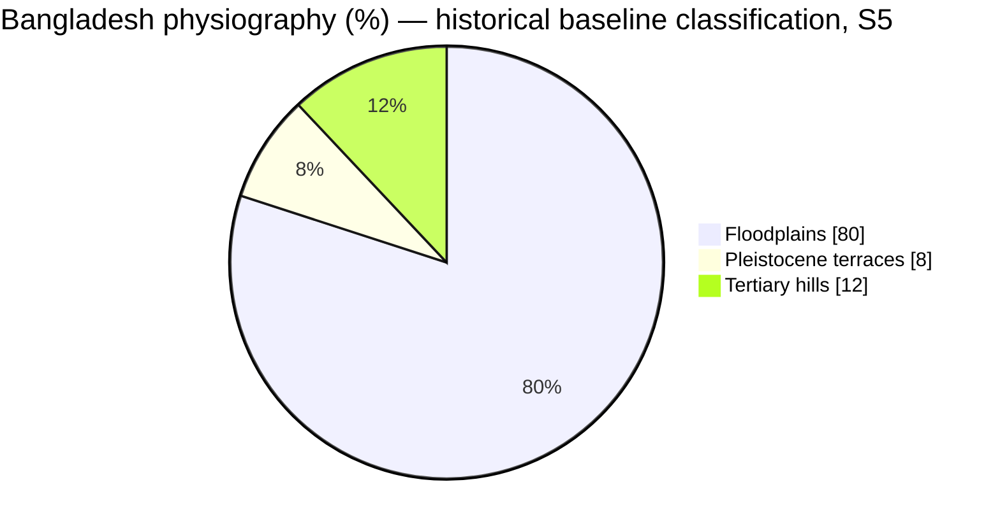
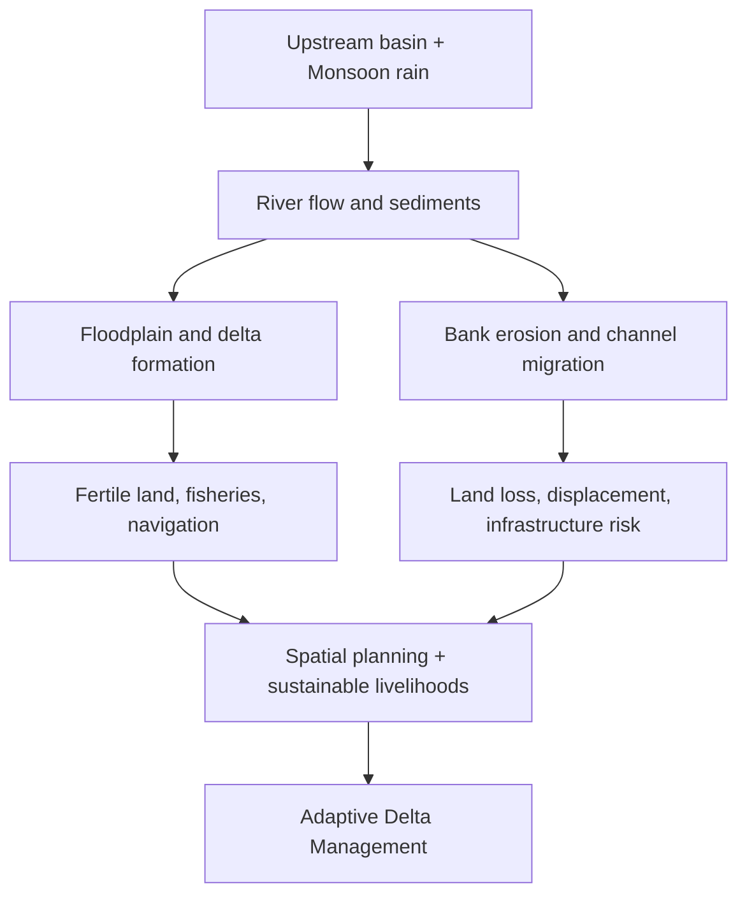
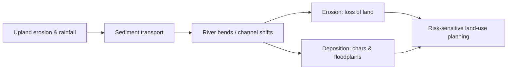
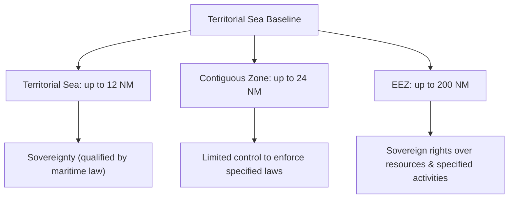
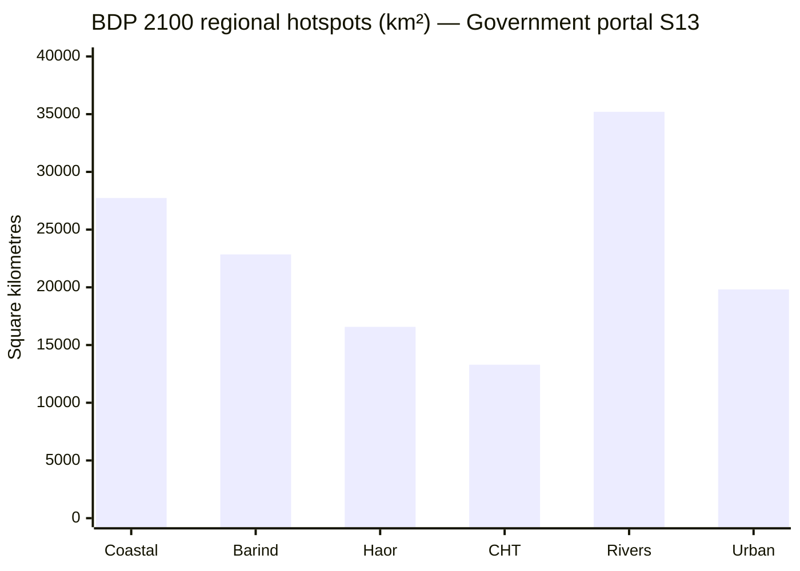
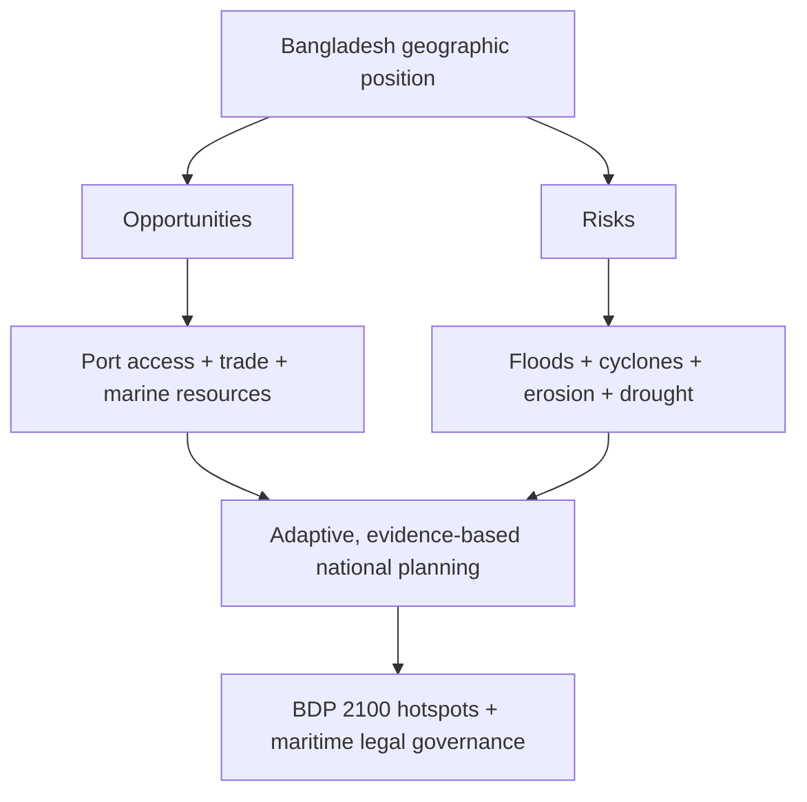

# Chapter 01 — বাংলাদেশের ভূগোল ও ভূপ্রকৃতি | Geography & Landforms

> **BCS Written · Bangladesh Affairs · Official Unit 1**  
> **মূল ভাষা:** বাংলা; প্রশ্ন ও টেকনিক্যাল টার্ম: English  
> **Source review:** ২১ অক্টোবর ২০২৬ · **পাঠের ধরন:** গল্পধর্মী ব্যাখ্যা → বিশ্লেষণ → বাস্তব মানচিত্র ও chart → PYQ evidence → ৩০টি model answer।

[← মূল ১৬ অধ্যায়ের সূচি](../README.md)

> [!NOTE]
> 🔵 **পড়ার পথ:** **গল্প → অর্থ → চিত্র → কারণ–ফল → পরীক্ষার উত্তর → নিজে মনে করা।** প্রতিটি গুরুত্বপূর্ণ সংখ্যার সঙ্গে তার উৎসের নাম দেখুন। খুব বড় অংশ পড়ার পর [সূচিতে](#top) ফিরে যান।

### 🟨🟩 রঙের সংকেত — Reading Colour Code

| রং | GitHub-এ কী দেখবেন | কী করবেন |
|---|---|---|
| 🟨 **Yellow · Exam Alert** | হলুদ **WARNING** তথ্যবক্স | বিশেষ সাল, সংখ্যা, পার্থক্য ও সাধারণ ভুল **প্রথমে পড়ুন** |
| 🟩 **Green · Memory Hook** | সবুজ **TIP** তথ্যবক্স | এক লাইনের সূত্র **না দেখে বলুন** |
| 🟦 **Blue · Source Evidence** | নীল **NOTE** তথ্যবক্স | প্রতিষ্ঠানের নাম + প্রকাশনার নাম শিখুন |
| 🟪 **Purple · Must Know** | **IMPORTANT** তথ্যবক্স | সংজ্ঞা ও মূল ব্যাখ্যা ভালোভাবে বুঝুন |

> [!TIP]
> 🟢 **পড়ার সহজ নিয়ম (Chunk → Recall → Repeat):** ১টি ছোট অংশ পড়ুন → ১০ সেকেন্ড চোখ বন্ধ করে ৩টি keyword বলুন → নিচের ছবি/টেবিল দেখে মিলিয়ে নিন → শেষে একটি ইংরেজি প্রশ্নের বাংলা উত্তর নিজে বলুন।

> [!WARNING]
> 🟡 **একটি সতর্কতা:** সব লাইন রঙিন করলে গুরুত্বপূর্ণ লাইন আর আলাদা করে চোখে পড়ে না। তাই **শুধু পরীক্ষায় প্রয়োজনীয় সংখ্যা/ভুল হলুদ**, **মুখস্থের সূত্র সবুজ**, এবং **উৎস নীল** রাখা হয়েছে। GitHub README-তে ইচ্ছেমতো text highlighter নয়, native alert colour ব্যবহৃত হয়।

### 🧭 Quick Navigation — Click to Jump

| শুরু ও শেখার ধাপ | বিষয়ভিত্তিক অধ্যায় | প্রশ্ন ও উৎস |
|---|---|---|
| [🎯 কী জানতে হবে](#start) | [১. Location ও Delta Story](#location) | [📚 Previous BCS Question Audit](#pyq) |
| [🔑 Key Terms বাংলা–English](#keywords) | [২. Physiography: তিন ভূমিরূপ](#physiography) | [✍️ Answer Writing Strategy](#strategy) |
| [🧠 ৭টি Story Scene](#story) | [৩. Region-by-Region Journey](#regions) | [❓ ৩০টি English Q&A](#questions) |
| [📌 Syllabus Coverage](#syllabus-map) | [৪. Rivers & Changes Over Time](#rivers) | [📝 ৫/১০/২০ নম্বর Sample Answer](#worked) |
| [🖼️ Visual Atlas](#visual-atlas) | [৫. Bay of Bengal & Maritime Law](#maritime) | [⚡ One-page Revision](#revision) |
| [🗺️ Maps at a Glance](#maps) | [৬. BDP 2100: Policy](#delta-plan) | [🔗 Full Source Register](#sources) |
| [📋 Memory Check](#memory-check) | [৭. People, Culture & Geography](#people) | [✅ Accuracy & Limitations](#accuracy) |

> [!TIP]
> **Quick Tip:** যে টপিকের নাম ক্লিক করবেন, সরাসরি সেখানে চলে যাবেন। বড় সেকশন শেষ হলে থাকা **[⬆️ Go to Contents](#top)**-এ ক্লিক করুন। আর ছবিতে ক্লিক করলে পূর্ণ আকারে দেখবেন।

---

## 📑 Syllabus & Learning Goals — পাঠের উদ্দেশ্য ও পরীক্ষার লক্ষ্য

**সরকারি সিলেবাসের বিষয়:** বাংলাদেশের ভৌগোলিক পরিচিতি, বিভিন্ন অঞ্চল ও সময়ের সঙ্গে পরিবর্তিত ভূপ্রকৃতি—BPSC-এর *Syllabus for BCS (Written) Examination*, Bangladesh Affairs, Subject 005, Unit 1, p.6 **[S1 — Bangladesh Public Service Commission (BPSC)]**।

**এ অধ্যায় শেষে আপনি পারবেন:** অবস্থান–সীমারেখা ব্যাখ্যা; ৩ প্রধান ভূপ্রাকৃতিক শ্রেণি ও উপঅঞ্চল পার্থক্য; নদীর গতিপথ–বদ্বীপ সৃষ্টি–ভাঙন ব্যাখ্যা; ভূপ্রকৃতি থেকে কৃষি ও বসতির সম্পর্ক নির্মাণ; বঙ্গোপসাগর ও সমুদ্র আইনের মৌলিক পার্থক্য লেখা; অতীত প্রশ্নের ৫/১০/২০ নম্বরের উত্তর সাজানো।

**Citation policy:** [S2]-এর মানে শুধু ওয়েবসাইটের link নয়—নিচের পূর্ণ source register-এ প্রতিষ্ঠান, নিবন্ধ ও URL আছে। খাতায় যেমন লিখবেন: *“Source: Banglapedia, Asiatic Society of Bangladesh, ‘Bangladesh Geography’.”* সরকারী আইনের ক্ষেত্রে: *“Source: Territorial Waters and Maritime Zones Act, 1974 (amended 2021), Government of Bangladesh.”* সমসাময়িক পরিসংখ্যানের পাশে observation year ও সংজ্ঞা ছাড়া সংখ্যা লিখবেন না।

## 🎯 Start Here — ৮ মিনিটে Chapter Roadmap

**এক লাইনের গল্প:** উত্তরের নদী পলি নিয়ে আসে → পলি বদ্বীপ গড়ে → ভূমিরূপ তিনভাবে আলাদা হয় → নদী ও মানুষ সেই ভূমিকে বদলায় → অঞ্চলভেদে কৃষি, বসতি ও ঝুঁকি আলাদা হয় → বঙ্গোপসাগর সুযোগ ও বিপদ তৈরি করে → রাষ্ট্র পরিকল্পনা করে।

> [!IMPORTANT]
> **এই অধ্যায় পড়ে যা বলতে পারবেন:** বাংলাদেশ কোথায়, ভূপ্রকৃতি কেমন, কেন এক অঞ্চলের ভূমি আরেকটির থেকে আলাদা, শতাব্দী ধরে নদী ও ভূমি কীভাবে বদলেছে, এবং এসব পরিবর্তন অর্থনীতি–জীবন–সংস্কৃতি ও নীতিকে কীভাবে প্রভাবিত করে।

**What You Must Know (Exam Checklist)**

- **Location:** অক্ষাংশ, দ্রাঘিমাংশ, প্রতিবেশী দেশ, বঙ্গোপসাগরের আপেক্ষিক অবস্থান।
- **Origin:** গঙ্গা–ব্রহ্মপুত্র–মেঘনা নদীপ্রণালি, পলি, ক্ষয়, সঞ্চয় ও বদ্বীপ।
- **Three Landforms:** নদীর নবীন প্লাবনভূমি, অপেক্ষাকৃত প্রাচীন সোপানভূমি ও পাহাড়ি অঞ্চল।
- **Regional Contrast:** বরেন্দ্র–মধুপুর–হাওর–পার্বত্য চট্টগ্রাম–চর–সুন্দরবন।
- **Time Dimension:** নদীর গতিপথ পরিবর্তন, চর গঠন, মোহনার ক্ষয় ও সঞ্চয়।
- **Application:** কৃষি, সেচ, নৌপথ, বসতি, সাংস্কৃতিক বৈচিত্র্য, উপকূলীয় নিরাপত্তা।
- **Important Numbers:** ১২–২৪–২০০ nautical miles; ২০১২ ও ২০১৪ সালের সামুদ্রিক সীমানা-সংক্রান্ত সিদ্ধান্ত।
- **Policy:** বাংলাদেশ ব-দ্বীপ পরিকল্পনা ২১০০ ও ছয়টি Hotspot।
- **Evidence:** তথ্যের উৎসের প্রতিষ্ঠান, প্রকাশনা ও সাল—অনুমান ও পর্যবেক্ষিত তথ্য আলাদা।

### 📌 BPSC Official Syllabus — কোন অংশ কোথায় আছে?

Bangladesh Affairs (Subject Code 005)-এর প্রথম ইউনিটে **বাংলাদেশের ভূগোল, বিভিন্ন অঞ্চলের ভূপ্রকৃতি এবং সময়ের সঙ্গে সেগুলোর বিকাশ/পরিবর্তন** আলোচনার নির্দেশনা রয়েছে।

| Official syllabus requirement | এই অধ্যায়ের নির্দিষ্ট অংশ | পরীক্ষার উত্তর দেওয়ার লক্ষ্য |
|---|---|---|
| Geography of Bangladesh | §১ ও §৫ | অবস্থান, সীমানা, নদী–সাগর, কৌশলগত গুরুত্ব |
| Topographical features | §২ | Floodplain, Terrace ও Hills-এর বৈশিষ্ট্য |
| Different areas / regions | §৩ | বরেন্দ্র, মধুপুর, হাওর, পাহাড়, চর ও উপকূল |
| Developments over time | §৪ + Timeline | নদীপথ, ক্ষয়–সঞ্চয় ও বদ্বীপের পরিবর্তন |
| Applied explanation | §৫–§৭ | ভূমিরূপ থেকে অর্থনীতি, ঝুঁকি ও নীতি |
| Past-paper themes | §৮–§১০ | ব্যাখ্যা, তুলনা, মূল্যায়ন ও source-backed answer |

> [!NOTE]
> **Source — পরীক্ষায় উল্লেখযোগ্য:** **Bangladesh Public Service Commission (BPSC)**, *Syllabus for BCS (Written) Examination*, Bangladesh Affairs, Subject Code 005, Unit 1। [সরকারি সিলেবাস](https://bpsc.portal.gov.bd/sites/default/files/files/bpsc.portal.gov.bd/page/732e9da5_9514_4252_9a33_119f8c000cc5/SYLLABUS%20FOR%20BCS%20%28WRITTEN%29%20EXAMINATION.pdf)।

### 🧠 High-Yield Snapshot — ছবির মতো মনে রাখার ৬টি তথ্য

| চিহ্ন | **এক নজরে গুরুত্বপূর্ণ তথ্য** | পরীক্ষায় কী লিখবেন |
|---|---|---|
| 🟨 **20°34′–26°38′ N** | উত্তর অক্ষাংশ | **Banglapedia — “Bangladesh”** [S4] |
| 🟨 **88°01′–92°41′ E** | পূর্ব দ্রাঘিমাংশ | **Banglapedia — “Bangladesh”** [S4] |
| 🟩 **F–T–H** | **Floodplain → Terrace → Hill** | Banglapedia — *Bangladesh Geography* [S2] |
| 🟨 **80–8–12** | পুরোনো একটি প্রকাশিত শ্রেণিবিন্যাসের **আনুমানিক** ভূপ্রাকৃতিক অনুপাত (%) | সরকার-হোস্টকৃত baseline report [S5]; **২০২৬ সালের নতুন জরিপ নয়** |
| 🟨 **12–24–200 NM** | Territorial Sea → Contiguous Zone → EEZ | *Territorial Waters and Maritime Zones Act, 1974 (amended 2021)* [S8] |
| 🟩 **6 hotspots** | উপকূল → বরেন্দ্র → হাওর → পাহাড় → নদী–মোহনা → নগর | **GED, Bangladesh Delta Plan 2100** [S6] |

> [!WARNING]
> 🟡 **Exam Trap:** **80–8–12** একটি উৎসনির্ভর **approximate classification**। এ অনুপাত দিয়ে জমির বর্তমান পরিমাণ বা সাম্প্রতিক বছরভিত্তিক বৃদ্ধি–হ্রাস হিসাব করবেন না। **12–24–200** হলো সমুদ্র অঞ্চলের সর্বোচ্চ আইনি দূরত্ব; সব অঞ্চলে একই ধরনের সার্বভৌমত্ব বোঝায় না।

> [!NOTE]
> 🔵 **Named sources:** **Banglapedia, Asiatic Society of Bangladesh — “Bangladesh Geography”** [S2]; **Government-hosted Environmental and Social Baseline** [S5]; **General Economics Division (GED), Bangladesh Planning Commission — “Bangladesh Delta Plan 2100”** [S6]; **Ministry of Law, Justice and Parliamentary Affairs — “Territorial Waters and Maritime Zones Act”** [S8]। বিস্তারিত লিংক [Sources](#sources)-এ।

### 🔑 Core Terminology — English Term, বাংলা অর্থ ও Easy English Meaning

> [!TIP]
> 🟢 **How to memorise:** প্রথমে **English Term** দেখুন → **সহজ বাংলা অর্থ** বুঝুন → **Easy English Meaning** নিজের ভাষায় বলুন → বাংলাদেশের উদাহরণ মনে করুন। ইংরেজি সংজ্ঞাগুলো মুখস্থযোগ্য সহজ ভাষায় লেখা; এগুলো সরকারি সংজ্ঞার হুবহু উদ্ধৃতি নয়।

| English Term | সহজ বাংলা অর্থ | Easy English Meaning | বাংলাদেশের উদাহরণ |
|---|---|---|---|
| Geography | পৃথিবীর স্থান, পরিবেশ ও মানুষের স্থানিক সম্পর্কের অধ্যয়ন | The study of places, people, and the natural environment. | নদী ও বসতি |
| Absolute Location | অক্ষাংশ–দ্রাঘিমাংশ দিয়ে নির্দিষ্ট অবস্থান | The exact position of a place using latitude and longitude. | ২০°৩৪′–২৬°৩৮′ উত্তর |
| Relative Location | অন্য স্থান, দেশ বা সমুদ্রের তুলনায় অবস্থান | Where a place is in relation to other places. | ভারত ও মিয়ানমারের প্রতিবেশী; দক্ষিণে বঙ্গোপসাগর |
| Topography | ভূমির উচ্চতা, ঢাল ও বাহ্যিক রূপ | The shape, height, and slope of the land. | হাওর নিচু, বরেন্দ্র উঁচু |
| Physiography | ভূগঠন ও ভূমিরূপের ভিত্তিতে অঞ্চলবিভাগ | Grouping land into regions by its natural features and formation. | Floodplain–Terrace–Hill |
| Geomorphology | ভূমিরূপের সৃষ্টি ও পরিবর্তনের বিজ্ঞান | The study of how landforms are made and changed. | চর সৃষ্টি ও নদীভাঙন |
| Alluvium | নদীবাহিত পলি | Sand, silt, or clay left behind by flowing water. | যমুনার চর |
| Sediment | পানি বা বাতাসে পরিবাহিত বালি–পলি–কাদা | Small pieces of material carried by water, wind, or ice. | বদ্বীপ গঠনের উপাদান |
| Erosion | পানি, বাতাস ইত্যাদির প্রভাবে ভূমিক্ষয় | The wearing away or removal of soil and rock. | নদীতীর ভাঙন |
| Deposition / Accretion | পলি জমা / পলি সঞ্চয়ে ভূমি বৃদ্ধি | Deposition: material settles. Accretion: land builds up gradually. | নতুন চর জাগা |
| Floodplain | নদীর প্লাবনের সঙ্গে সম্পর্কিত সমতল ভূমি | Flat land beside a river that can be flooded. | পদ্মা–যমুনা প্লাবনভূমি |
| Pleistocene Terrace | প্লাইস্টোসিন যুগের অপেক্ষাকৃত প্রাচীন উঁচু সোপান | Old, raised land formed during the Pleistocene period. | বরেন্দ্রভূমি ও মধুপুর গড় |
| Tertiary Hills | প্রাচীন ভূতাত্ত্বিক স্তরের পাহাড়ি ভূমিরূপ | Hills formed from older rocks and sediments. | পার্বত্য চট্টগ্রাম |
| Delta | নদীর মোহনায় পলি সঞ্চয়ে গঠিত বিস্তৃত ভূমি | Low land built by river sediment near the sea. | গঙ্গা–ব্রহ্মপুত্র বদ্বীপ |
| Active Delta | পলি সঞ্চয় ও নদীপ্রক্রিয়ায় সক্রিয় বদ্বীপীয় অঞ্চল | A delta area where rivers still actively deposit sediment. | পরিবর্তনশীল মোহনাভূমি |
| Moribund Delta | মূল নদীর সক্রিয় পলিপ্রবাহ কমে যাওয়া পুরোনো বদ্বীপ | An older delta area where active river deposition has greatly declined. | পশ্চিমাঞ্চলের কিছু পুরোনো নদীখাত |
| Tributary / Distributary | উপনদী / মূল নদী থেকে বের হওয়া শাখানদী | Tributary: joins a larger river. Distributary: branches away from it. | নদীজালের শাখা-প্রশাখা |
| Channel Migration | নদীখাত বা মূল প্রবাহের স্থান পরিবর্তন | The movement of a river channel to a new position. | ব্রহ্মপুত্র–যমুনা |
| Char | নদী বা মোহনায় পলি জমে ওঠা ভূমি | New land or a sandbar formed by river sediment. | যমুনার চর |
| Haor / Beel / Baor | মৌসুমি অববাহিকাজলাভূমি / নিচু জলাশয় / বিচ্ছিন্ন নদীবাঁকের জলাশয় | Haor: seasonal wetland basin. Beel: low-lying lake or wetland. Baor: an old river bend cut off from the river. | সুনামগঞ্জের হাওর ও দক্ষিণ-পশ্চিমের বাঁওড় |
| Flash Flood | অল্প সময়ে দ্রুত সৃষ্ট আকস্মিক বন্যা | A flood that rises very quickly after heavy rain or sudden water flow. | হাওরে আগাম পাহাড়ি ঢল |
| Mangrove | লবণাক্ত ও জোয়ারভাটার পরিবেশে অভিযোজিত বন | Coastal trees and forests adapted to salty, tidal water. | সুন্দরবন |
| Estuary | নদীর মিঠাপানি ও সাগরের লবণপানির মিলনস্থল | A place where river water meets and mixes with seawater. | মেঘনা মোহনা |
| Geopolitics | ভূঅবস্থান ও আন্তর্জাতিক রাজনীতির সম্পর্ক | How location and geography affect relations between countries. | সমুদ্রসীমা ও আঞ্চলিক যোগাযোগ |
| Blue Economy | সমুদ্রসম্পদনির্ভর টেকসই অর্থনৈতিক কর্মকাণ্ড | Using ocean resources for economic growth while protecting the sea. | বন্দর, মৎস্য ও সামুদ্রিক গবেষণা |
| Territorial Sea | উপকূলীয় রাষ্ট্রের সার্বভৌমত্বাধীন নির্দিষ্ট সমুদ্রাঞ্চল | Sea near a country's coast where it has sovereignty, subject to international law. | সর্বোচ্চ ১২ nautical miles |
| EEZ (Exclusive Economic Zone) | সামুদ্রিক সম্পদ-সম্পর্কিত বিশেষ সার্বভৌম অধিকারের অঞ্চল | A sea zone where a country has special rights to explore and use resources. | সর্বোচ্চ ২০০ nautical miles |
| Adaptive Delta Management | তথ্য ও ঝুঁকির পরিবর্তন অনুযায়ী বদ্বীপ ব্যবস্থাপনা | Planning a delta's future and changing plans when conditions change. | Bangladesh Delta Plan 2100 |
| Hotspot | বিশেষ ঝুঁকি বা বৈশিষ্ট্যের ভিত্তিতে চিহ্নিত অঞ্চল | An area that needs special attention because of its risks. | Haor and Flash Flood Areas |

> [!NOTE]
> 🔵 **Source Basis:** **Banglapedia — Asiatic Society of Bangladesh, “Bangladesh Geography”**; **General Economics Division (GED), “Bangladesh Delta Plan 2100”**; **Ministry of Law, Justice and Parliamentary Affairs, “Territorial Waters and Maritime Zones Act, 1974” (amended 2021)**। [Banglapedia](https://en.banglapedia.org/index.php?title=Bangladesh_Geography) · [GED / BDP 2100](https://bcdp.gov.bd/) · [Maritime law](https://bdlaws.minlaw.gov.bd/act-print-467.html)।

> [!IMPORTANT]
> 🟣 **Exam Memory Tip:** **Delta = sediment builds land**; **Erosion = land is removed**; **Floodplain = flat flooded land**; **Terrace = old raised land**; **EEZ = resource rights, not complete sovereignty**।

> [!TIP]
> **Memory Trick:** **“স্থান–পলি–ভূমি–নদী–মানুষ–সমুদ্র–পরিকল্পনা”**। এই সাত শব্দ বলতে পারলেই পুরো অধ্যায়ের বিশ্লেষণের একটি মানসিক মানচিত্র তৈরি হবে।

### 🖼️ Visual Atlas — Maps, Field Photos & Satellite Evidence

**ছবি আগে দেখুন, তারপর গল্পটি পড়ুন।** প্রতিটি ছবি সংশ্লিষ্ট বিষয়ের মধ্যেও রাখা আছে। এখানে দ্রুত যাওয়ার পথ:

| Topic / Image | Click to learn |
|---|---|
| 🌍 বাংলাদেশের উচ্চতা ও Relief Map | [Map & location](#maps) |
| 🛰️ ESA Satellite: GBM Delta | [How the delta formed](#location) |
| 🌾 বরেন্দ্রভূমি, নওগাঁ — বাস্তব কৃষিভূমি | [Barind Tract](#barind-photo) |
| 🌳 মধুপুরের বন ও Locator Map | [Madhupur Tract](#madhupur-photo) |
| 🌊 টাঙ্গুয়ার হাওর | [Haor Basin](#haor-photo) |
| ⛰️ সাজেকের পাহাড় ও locator map | [Chattogram Hill Tracts](#cht-photo) |
| 🌿 NASA Landsat 9: বাংলাদেশের উপকূল ও সুন্দরবন | [Coastal ecosystem](#coastal-photo) |
| 🐂 যমুনার চরে জীবিকা | [River Char](#char-photo) |
| 🛰️ NASA MODIS: মেঘনা থেকে সাগরে পলি | [River sediment](#sediment-photo) |

> [!WARNING]
> **Photo ≠ Geological Survey:** কোনো কৃষিজমি বা বনের ছবি দিয়ে মাটির বয়স, শ্রেণি বা আয়তন প্রমাণ করা যায় না। ছবি অঞ্চলটি বুঝতে সাহায্য করে; শ্রেণিবিন্যাস ও সংখ্যা নিতে হবে **Banglapedia, FAO/সরকারি প্রতিবেদন এবং বৈজ্ঞানিক তথ্যসূত্র** থেকে।

[⬆️ Go to Contents](#top)

---
### 🧠 ৭টি দৃশ্যের Story — পড়ার সময় চোখের সামনে কল্পনা করুন

**দৃশ্য ১ — মানচিত্রে বাংলাদেশ (Location)।** মানচিত্রে দেশটিকে খুঁজুন। উত্তর ও পশ্চিমে ভারত; পূর্বে ভারত ও মিয়ানমার; দক্ষিণে বঙ্গোপসাগর। এই অবস্থানের মধ্যেই নদীর প্রবাহ, বন্দর, প্রতিবেশী রাষ্ট্র ও সমুদ্রবাণিজ্যের ধারণা লুকিয়ে আছে।

**দৃশ্য ২ — পাহাড় থেকে নেমে এল পলি (Sediment Journey)।** হিমালয় ও বিস্তৃত অববাহিকা থেকে নদীগুলো পলি বহন করে বাংলাদেশের নিম্নভূমিতে পৌঁছায়। পলি জমে নতুন ভূমি তৈরি করে। তাই নদী শুধু পানির উৎস নয়—বাংলাদেশের ভূমি তৈরির অন্যতম কারিগর।

**দৃশ্য ৩ — তিন ধরনের মাটির ওপর হাঁটা (Three Landforms)।** প্রথমে যমুনার নতুন চর, তারপর বরেন্দ্র ও মধুপুরের প্রাচীন সোপান, শেষে পার্বত্য চট্টগ্রামের ঢাল। এই তিন অভিজ্ঞতা মনে রাখলে Floodplain–Terrace–Hill-এর পার্থক্য সহজে ভুলবেন না।

**দৃশ্য ৪ — নদী পথ পাল্টাল (Changing Rivers)।** নদী এক তীরে ভাঙে, অন্য তীরে জমায়। কখনো বড় নদীর মূল গতিপথও বদলে যায়। অতীতের নদী মানচিত্র আর আজকের মানচিত্র সব সময় এক হবে না—তাই ‘developments over time’ সিলেবাসের একটি মূল দাবি।

**দৃশ্য ৫ — এক দেশ, ছয় রকম সমস্যা (Regional Risks)।** বরেন্দ্রে খরা ও পানির চাপ; হাওরে আগাম বন্যা; পাহাড়ে ভূমিধস; নদীপাড়ে ভাঙন; উপকূলে জলোচ্ছ্বাস–লবণাক্ততা; শহরে জলাবদ্ধতা। একটি সমস্যার সমাধান অন্যত্র সরাসরি প্রয়োগ করা যায় না।

**দৃশ্য ৬ — নদী পৌঁছাল বঙ্গোপসাগরে (Bay of Bengal)।** মোহনা, বন্দর, মাছ, আন্তর্জাতিক নৌবাণিজ্য এবং উপকূলীয় দুর্যোগ—সব একই ভূঅবস্থানের ফল। সমুদ্রসীমায় ১২–২৪–২০০ nautical miles-এর অধিকার এক নয়, তাই আইনের পার্থক্য শিখতে হবে।

**দৃশ্য ৭ — সমাধানের জন্য পরিকল্পনা (BDP 2100)।** এখন প্রশ্ন: অঞ্চলগুলো এত আলাদা হলে জাতীয় উন্নয়ন কীভাবে হবে? উত্তর—বিজ্ঞানসম্মত, অঞ্চলভিত্তিক ও অভিযোজনযোগ্য পরিকল্পনা। এটিই বাংলাদেশ ব-দ্বীপ পরিকল্পনা ২১০০-এর মূল যুক্তির সঙ্গে সামঞ্জস্যপূর্ণ।

> [!IMPORTANT]
> **One-minute Recall:** Location → Sediment → Floodplain/Terrace/Hill → Channel Change → Regional Risks → Maritime Rights → BDP 2100। পরীক্ষায় যেকোনো বিশ্লেষণধর্মী প্রশ্ন এলে এই ধারা থেকে প্রয়োজনীয় অংশ বেছে নিয়ে উত্তর তৈরি করুন।

**এই Story অংশটি পাঠ-সহায়ক synthesis; তথ্যের ভিত্তি:** **Banglapedia (Asiatic Society of Bangladesh), Bangladesh Geography**; **General Economics Division (GED), Bangladesh Planning Commission, Bangladesh Delta Plan 2100**; **Ministry of Law, Territorial Waters and Maritime Zones Act 1974 (amended 2021)**।

[⬆️ Go to Contents](#top)

---

## ১. Location to Delta — বাংলাদেশের ভূগোলের মূল গল্প

কল্পনা করুন, উত্তর দিক থেকে আসা বিরাট নদীগুলো পাহাড় ও সমভূমি পেরিয়ে বাংলাদেশের নিচু অববাহিকায় প্রবেশ করছে। স্রোত সঙ্গে আনছে বালি, পলি ও কাদা। মৌসুমের সঙ্গে বদলে যাচ্ছে পানির পরিমাণ; কোথাও চর জাগছে, কোথাও নদী তীর কেটে নিচ্ছে, কোথাও পুরোনো নদীখাত থেকে যাচ্ছে। দক্ষিণে এসে এই নদীগুলো সমুদ্রের জোয়ার-ভাটার সঙ্গে মিলেছে। **এটাই বাংলাদেশের ভূপ্রকৃতির সবচেয়ে বড় কেন্দ্রীয় ধারণা: ভূখণ্ডটি স্থির নয়, একটি পরিবর্তনশীল river–delta system।** [S2 — Banglapedia, ‘Bangladesh Geography’; S3 — Banglapedia, ‘ভূ-প্রকৃতি’]

এখানে তিন ধরনের বাস্তবতা পাশাপাশি: পদ্মা–যমুনা–মেঘনার সদ্য জমা পললভূমি; বরেন্দ্র–মধুপুরের অপেক্ষাকৃত পুরোনো ও উঁচু সোপান; চট্টগ্রাম ও সিলেটের পাহাড়-টিলা। একই দেশে কোথাও নদীভাঙনের চিন্তা, কোথাও খরার, কোথাও আগাম বন্যা বা ভূমিধসের। তাই ভৌগোলিক পরিচিতি শুধু অবস্থান মুখস্থ করাই নয়; উন্নয়ন, রাজনীতি, কৃষি, পরিবেশ ও জনগণের জীবনকে ব্যাখ্যা করার একটি framework। [S2; S6 — GED, Bangladesh Delta Plan 2100]

### ১.১ Location & Boundaries — ভৌগোলিক অবস্থান ও সীমানা

| পরীক্ষা-উপযোগী বিষয় | তথ্য | উৎস—খাতায় লিখবার নাম |
|---|---|---|
| অবস্থান | দক্ষিণ এশিয়া; গঙ্গা–ব্রহ্মপুত্র–মেঘনা অববাহিকার নিম্নাংশ | Banglapedia — *Bangladesh* [S4] |
| অক্ষাংশ (Latitude) | ২০°৩৪′–২৬°৩৮′ N | Banglapedia — *Bangladesh* [S4] |
| দ্রাঘিমাংশ (Longitude) | ৮৮°০১′–৯২°৪১′ E | Banglapedia — *Bangladesh* [S4] |
| প্রচলিত আয়তন | ১,৪৭,৫৭০ বর্গকিমি (Banglapedia-তে প্রকাশিত প্রচলিত স্থল-রাষ্ট্রের আয়তন; অন্যান্য dataset-এ পদ্ধতি ভিন্ন হতে পারে) | Banglapedia — *Bangladesh* [S4] |
| পশ্চিম ও উত্তর | ভারতের বিভিন্ন রাজ্য | Banglapedia — *Bangladesh* [S4] |
| পূর্ব | ভারত ও মিয়ানমার | Banglapedia — *Bangladesh* [S4] |
| দক্ষিণ | বঙ্গোপসাগর | Banglapedia — *Bangladesh* [S4] |
| মান সময় | UTC+06:00 | Banglapedia — *Bangladesh* [S4] |

**ব্যাখ্যা:** ‘Absolute Location’ হলো অক্ষাংশ–দ্রাঘিমাংশ; ‘Relative Location’ হলো প্রতিবেশী রাষ্ট্র, বঙ্গোপসাগর, আঞ্চলিক নদী ও বাণিজ্যপথের তুলনায় অবস্থান। ৫ নম্বরের প্রশ্নে অক্ষাংশ–দ্রাঘিমাংশ, চারদিকের সীমানা ও ২ বাক্যে গুরুত্ব; ১০ নম্বরে মানচিত্র, অর্থনৈতিক সম্ভাবনা ও ঝুঁকি।

### ১.২ Bangladesh Maps — Relief Map ও বাস্তব মানচিত্র

**Figure 1 — Physical Relief Map of Bangladesh.** Creator: Urutseg; Wikimedia Commons, *Bangladesh physical map.svg*, 2011; License **CC0 1.0**. [Original file, author and license](https://commons.wikimedia.org/wiki/File:Bangladesh_physical_map.svg)। মানচিত্রটি ভূপ্রকৃতি শেখার জন্য; আধুনিক প্রশাসনিক বা সমুদ্রসীমার নিশ্চয়তার জন্য নয়।

**Figure 2 — Topographic Map of Bangladesh.** Creator: **Oona Räisänen (Mysid)**, 2010; sources include SRTM relief data, archival CIA cartography and NGDC bathymetry; Wikimedia Commons, **CC BY 3.0 / GFDL**. [Original file and terms](https://commons.wikimedia.org/wiki/File:Map_of_Bangladesh-en.svg)। কিছু স্থাননাম/পরিবহন স্তর পুরোনো; সাম্প্রতিক প্রশাসনিক মানচিত্র হিসেবে ব্যবহার নয়।

*🖼️ Figure 2A — **Ganges–Brahmaputra Delta from Space**। **কী দেখবেন:** নদীর পলি, মোহনার প্রবাহ ও বদ্বীপের বিস্তার। **Credit:** European Space Agency / Copernicus Sentinel-3 (2020-03-31); **License:** Copernicus Sentinel attribution required; **Image source:** [Wikimedia Commons file page](https://commons.wikimedia.org/wiki/File:Ganges_Delta_ESA22274217.jpeg)। ছবিতে ক্লিক করলে মূল ফাইলের উচ্চ রেজল্যুশন এবং সম্পূর্ণ লাইসেন্স পাওয়া যাবে।*

> [!TIP]
> **Picture Memory:** নদীর পলি, মোহনার প্রবাহ ও বদ্বীপের বিস্তার—এই দৃশ্য থেকে একটি কারণ এবং একটি ফল ব্যাখ্যা করার চেষ্টা করুন।

> [!IMPORTANT]
> 🟣 **Exam Snapshot — বারবার কাজে লাগবে:** বাংলাদেশ একটি গতিশীল বদ্বীপীয় দেশ। ভৌগোলিক অবস্থান থেকে নদীপথ ও সাগর, নদীপথ থেকে ভূমিরূপ, ভূমিরূপ থেকে মানুষের জীবিকা এবং জীবিকা থেকে রাষ্ট্রীয় পরিকল্পনার সম্পর্ক ব্যাখ্যা করা—এটাই এই ইউনিটের মূল দক্ষতা।

> [!NOTE]
> 🔵 **Primary Reference:** **Banglapedia — Asiatic Society of Bangladesh, “Bangladesh Geography”**, [মূল নিবন্ধ](https://en.banglapedia.org/index.php?title=Bangladesh_Geography); **Food and Agriculture Organization of the United Nations (FAO)**, [“Bangladesh” country paper](https://www.fao.org/4/x6900e/x6900e06.htm)। প্রথমটি অঞ্চলের ব্যাখ্যায়, দ্বিতীয়টি 80/8/12 আনুপাতিক শ্রেণিবিন্যাসের উৎস হিসেবে ব্যবহার করুন।

## ২. Physiography — তিন প্রধান ভূ-প্রাকৃতিক অঞ্চলের গল্প

> [!TIP]
> 🟢 **Three-step mental picture:** **নতুন চর (Floodplain)** → **পুরোনো উঁচু গড় (Terrace)** → **ঢালু পাহাড় (Hill)**। পরীক্ষার খাতায় তিনটি পাশে পাশে ছোট স্কেচ আঁকুন।

Banglapedia অনুসারে দেশকে বৃহৎ তিনটি শ্রেণিতে—**Floodplains, Terraces, Hills**—ভাগ করা যায়; বিস্তারিত শ্রেণিবিন্যাসে **২৪টি sub-region ও ৫৪টি unit** বর্ণিত। [S2 — *Bangladesh Geography*; S3 — *ভূ-প্রকৃতি*]

| শ্রেণি | গঠন ও সাধারণ রূপ | উদাহরণ | মূল সুযোগ | প্রধান ঝুঁকি |
|---|---|---|---|---|
| নবীন প্লাবনভূমি (Recent Floodplain) | নদীর অপেক্ষাকৃত নতুন পলি, নিচু/মাঝারি ভূমি, সক্রিয় নদীখাত | যমুনা, মেঘনা, গঙ্গা-পদ্মা সমভূমি, চর ও বদ্বীপ | পলিমাটি, পানি, মৎস্য, নৌযোগাযোগ | বন্যা, নদীভাঙন, চ্যানেল পরিবর্তন |
| প্লাইস্টোসিন সোপান (Pleistocene Terrace) | পুরোনো অপেক্ষাকৃত উঁচু পৃষ্ঠ, অনেক স্থানে লালচে রঙের মাটি | বরেন্দ্রভূমি, মধুপুর গড়, লালমাই অঞ্চলের সোপান | বসতি, বন, কৃষি ও অবকাঠামো | অঞ্চলভেদে খরা, পানির চাপ ও ভূমি-অবক্ষয় |
| টারশিয়ারি পাহাড় (Tertiary Hills) | ভাঁজযুক্ত পাহাড়, ঢাল, উপত্যকা ও টিলা | পার্বত্য চট্টগ্রাম, সিলেটের টিলা-পাহাড় | বন, পর্যটন, জীববৈচিত্র্য | ভূমিধস, ঢালক্ষয়, প্রবাহ-ব্যবস্থাপনা |

### ২.১ Data Visual — ভূমিরূপের প্রকাশিত আনুমানিক অনুপাত

একটি **বাংলাদেশ সরকারের ওয়েবসাইটে প্রকাশিত environmental and social baseline report** দেশের ভূমিকে ভূতাত্ত্বিক গঠনভিত্তিক মোটামুটি **Floodplain 80%, Pleistocene Terrace 8%, Tertiary Hills 12%**—এই অনুপাতে শ্রেণিবদ্ধ করেছে। এটি **ঐ রিপোর্টের classification**, সর্বশেষ ভূমি-জরিপের সমার্থক নয়; Banglapedia-র ভিন্ন শ্রেণিকাঠামোর সঙ্গে সংখ্যা বিনা ব্যাখ্যায় মিশিয়ে ফেলবেন না। [S5 — Wage Earners' Welfare Board-hosted *Environmental and Social Baseline Data*, land environment]

**Exam caption:** *Figure: Approximate physiographic shares. Source: Government-hosted Environmental and Social Baseline Data, land-environment section (S5); figures are classification-dependent.*

### ২.২ Cause–Effect Flowchart — ভূমিরূপ থেকে জীবিকার সম্পর্ক

**Figure 3 — Conceptual causal diagram, editorial synthesis from Banglapedia [S2] and GED Delta Plan [S6].** এটি ব্যাখ্যামূলক, পরিমাপভিত্তিক data chart নয়।

## ৩. Region-by-Region Journey — বরেন্দ্র থেকে বঙ্গোপসাগর

### ৩.১ Barind Tract — উত্তর-পশ্চিমের বরেন্দ্রভূমি ও পানির চাপ

**একটি দৃশ্য কল্পনা করুন:** উত্তর-পশ্চিমে তুলনামূলক উঁচু, প্রাচীন ভূমি—যেখানে বর্ষা ও শুষ্ক মৌসুমে পানির ব্যবস্থাপনা এক রকম নয়। এখানেই বরেন্দ্রভূমির ধারণা স্পষ্ট হয়।

- 🧭 **কোথায় (Location):** রাজশাহী–নওগাঁ–চাঁপাইনবাবগঞ্জসহ উত্তর-পশ্চিমের বিস্তৃত অঞ্চলের সঙ্গে বরেন্দ্রভূমির সম্পর্ক রয়েছে। **ভূপ্রাকৃতিক সীমানা** ও জেলার প্রশাসনিক সীমানা এক নয়।
- 🪨 **কেমন (Landform):** অপেক্ষাকৃত প্রাচীন **Pleistocene Terrace**; নতুন চর বা সাম্প্রতিক প্লাবনভূমির তুলনায় আলাদা পৃষ্ঠভাগ।
- 💧 **সমস্যা (Challenge):** শুষ্ক মৌসুমে **drought, groundwater stress ও irrigation efficiency** গুরুত্বপূর্ণ।
- 🌱 **সমাধান (Response):** দক্ষ পানি ব্যবহার, ফসল পরিকল্পনা ও অঞ্চলভিত্তিক পানিসম্পদ ব্যবস্থাপনা।

> [!TIP]
> 🟢 **Memory Hook — BARIND = Old high land + Dry-season water pressure.**

> [!NOTE]
> 🔵 **Source:** **Banglapedia — Asiatic Society of Bangladesh, “Bangladesh Geography”** [S2]; **General Economics Division (GED), “Bangladesh Delta Plan 2100”** [S6]।

*🖼️ Figure 3 — **Barind Agricultural Landscape, Naogaon**। **কী দেখবেন:** নওগাঁর বরেন্দ্র অঞ্চলের গ্রামীণ কৃষি; এটি মাটির ভূতাত্ত্বিক প্রমাণ নয়। **Credit:** S. H. Tanim (2026-03-12); **License:** CC BY-SA 4.0; **Image source:** [Wikimedia Commons file page](https://commons.wikimedia.org/wiki/File:The_Neon_Veil_of_Barind-_A_Twilight_Study_in_Naogaon.jpg)। ছবিতে ক্লিক করলে মূল ফাইলের উচ্চ রেজল্যুশন এবং সম্পূর্ণ লাইসেন্স পাওয়া যাবে।*

> [!TIP]
> **Picture Memory:** নওগাঁর বরেন্দ্র অঞ্চলের গ্রামীণ কৃষি; এটি মাটির ভূতাত্ত্বিক প্রমাণ নয়—এই দৃশ্য থেকে একটি কারণ এবং একটি ফল ব্যাখ্যা করার চেষ্টা করুন।

 [⬆️ Go to Contents](#top)

### ৩.২ Madhupur Tract — মধ্যাঞ্চলের মধুপুর গড়

**বরেন্দ্র থেকে এবার মধ্যবাংলায় আসুন।** এখানেও একটি অপেক্ষাকৃত পুরোনো উঁচু ভূমিখণ্ড আছে—মধুপুর গড়। কিন্তু দুটির অবস্থান ও ভূমি ব্যবহারের প্রেক্ষাপট এক নয়।

- 🧭 **অবস্থান:** মধ্যবাংলার মধুপুর অঞ্চল।
- 🪨 **ভূপ্রকৃতি:** **Pleistocene Terrace**—চারপাশের নবীন নদীপললভূমি থেকে আলাদা।
- 🌳 **বৈশিষ্ট্য:** বনভূমি, মাটি ও ভূমি ব্যবহারের পরিবর্তন বোঝার জন্য গুরুত্বপূর্ণ।
- 🏙️ **চ্যালেঞ্জ:** বন রক্ষা, বসতি ও অবকাঠামো সম্প্রসারণের মধ্যে ভারসাম্য।

> [!TIP]
> 🟢 **Memory Hook:** **বরেন্দ্র = উত্তর-পশ্চিমের সোপান; মধুপুর = মধ্যাঞ্চলের সোপান।** একই বড় ভূতাত্ত্বিক শ্রেণি, ভিন্ন স্থানিক প্রেক্ষাপট।

> [!NOTE]
> 🔵 **Source:** **Banglapedia — Asiatic Society of Bangladesh, “Bangladesh Geography”** [S2] ও **“ভূ-প্রকৃতি”** [S3]।

*🗺️ **Madhupur Tract Locator Map** — বাংলাদেশের মানচিত্রে মধুপুর গড়ের অবস্থান দেখুন। **Creator:** Tanvir Anjum Adib, 2025; **License:** CC BY-SA 4.0; [Original Wikimedia Commons map](https://commons.wikimedia.org/wiki/File:Madhupur_tract_locator_map.svg)। এটি অবস্থান বুঝতে সাহায্য করে; ভূতাত্ত্বিক মাটির বয়সের সরাসরি প্রমাণ নয়।*

> [!NOTE]
> 🔵 **Official Physio Map (important source): Bangladesh Agricultural Research Council (BARC), “Physiography — Land Resources Information Map Products of Bangladesh”**। [সরকারি রঙিন Physiographic Units Map (PDF)](https://apps.barc.gov.bd/maps/LRI-Map%20Products-Bangladesh.pdf)। **BARC-এর উপ-একক (units) এবং Banglapedia-এর ২৪টি sub-region/৫৪টি unit একই শ্রেণিবিন্যাস নয়**—উৎসভেদে পদ্ধতি পৃথক। বরেন্দ্র, মধুপুর, নদীর প্লাবনভূমি ও উপকূল একসঙ্গে চিহ্নিত করতে সরকারি মানচিত্রটি ব্যবহার করুন।

*🖼️ Figure 4 — **Madhupur National Park Forest**। **কী দেখবেন:** মধুপুর অঞ্চলের বনভূমি ও ভূমি ব্যবহার। **Credit:** S. M. Tanim (2017-10-09); **License:** CC BY-SA 4.0; **Image source:** [Wikimedia Commons file page](https://commons.wikimedia.org/wiki/File:Madhupur_forest.jpg)। ছবিতে ক্লিক করলে মূল ফাইলের উচ্চ রেজল্যুশন এবং সম্পূর্ণ লাইসেন্স পাওয়া যাবে।*

> [!TIP]
> **Picture Memory:** মধুপুর অঞ্চলের বনভূমি ও ভূমি ব্যবহার—এই দৃশ্য থেকে একটি কারণ এবং একটি ফল ব্যাখ্যা করার চেষ্টা করুন।

 [⬆️ Go to Contents](#top)

### ৩.৩ Haor Basin — উত্তর-পূর্বের হাওর ও আকস্মিক বন্যা

**এবার উত্তর-পূর্বের নিচু হাওরে পৌঁছালেন।** শুষ্ক মৌসুমে বিস্তৃত জমিতে বোরো ধান হতে পারে; বর্ষাকালে একই জায়গা পানিতে ভরে যায়। ফসল কাটার আগে পাহাড়ি ঢল এলে ক্ষতি কেন হয়—এবার বিষয়টি সহজে বোঝা যায়।

- 🧭 **অবস্থান:** উত্তর-পূর্বাঞ্চলের নিচু অববাহিকাগুলো; সুনামগঞ্জের হাওর পরিচিত উদাহরণ।
- 🌊 **ভূপ্রকৃতি:** মৌসুমি জলাভূমি; শুষ্ক ও বর্ষা মৌসুমে দৃশ্য ভিন্ন।
- 🌾 **জীবিকা:** বোরো ধান, মাছ ও জলাভূমির সম্পদ।
- ⚠️ **ঝুঁকি:** **Flash Flood**—অল্প সময়ে পানির প্রবাহ ও উচ্চতা বেড়ে আগাম প্লাবন।
- ✅ **ব্যবস্থাপনা:** আগাম সতর্কতা, ফসলের সময়সূচি, উপযুক্ত পানি নিষ্কাশন ও পরিবেশসম্মত অবকাঠামো।

> [!TIP]
> 🟢 **Memory Hook — HAOR = Basin + Boro + Flash Flood.**

> [!NOTE]
> 🔵 **Source:** **Banglapedia — “Bangladesh Geography”** [S2]; **GED, “Bangladesh Delta Plan 2100”** [S6]।

*🖼️ Figure 5 — **Tanguar Haor**। **কী দেখবেন:** হাওরের মৌসুমি জলাভূমির দৃশ্য। **Credit:** Sarkershuvro (2015-03-09); **License:** CC BY-SA 4.0; **Image source:** [Wikimedia Commons file page](https://commons.wikimedia.org/wiki/File:%E0%A6%9F%E0%A6%BE%E0%A6%99%E0%A7%8D%E0%A6%97%E0%A7%81%E0%A6%AF%E0%A6%BC%E0%A6%BE%E0%A6%B0_%E0%A6%B9%E0%A6%BE%E0%A6%93%E0%A6%B0.JPG)। ছবিতে ক্লিক করলে মূল ফাইলের উচ্চ রেজল্যুশন এবং সম্পূর্ণ লাইসেন্স পাওয়া যাবে।*

> [!TIP]
> **Picture Memory:** হাওরের মৌসুমি জলাভূমির দৃশ্য—এই দৃশ্য থেকে একটি কারণ এবং একটি ফল ব্যাখ্যা করার চেষ্টা করুন।

 [⬆️ Go to Contents](#top)

### ৩.৪ Chattogram Hill Tracts — পাহাড়ি ভূপ্রকৃতি ও ঢালের ঝুঁকি

**সমতল ছেড়ে পাহাড়ে উঠুন।** একই বৃষ্টিপাত সমতলে জমে থাকতে পারে, কিন্তু ঢালু পাহাড়ে দ্রুত নেমে যায়; অপরিকল্পিত পাহাড় কাটায় সেই ঢাল আরও ঝুঁকিপূর্ণ হতে পারে।

- ⛰️ **ভূপ্রকৃতি:** পাহাড়, শৈলশিরা, উপত্যকা, ঢাল ও দ্রুত প্রবাহ।
- 🗺️ **অবস্থান:** পার্বত্য চট্টগ্রাম; সিলেটের টিলা-পাহাড়কে একই ভূঅঞ্চল ধরে নেওয়া ঠিক নয়।
- ⚠️ **ঝুঁকি:** ভূমিধস, মাটিক্ষয়, বনহানি ও অনিয়ন্ত্রিত নির্মাণ।
- 🌳 **ব্যবস্থাপনা:** পরিবেশসম্মত ভূমি ব্যবহার, বন সংরক্ষণ ও সঠিক drainage।

> [!TIP]
> 🟢 **Memory Hook — HILL = Slope + Forest + Landslide Risk.**

> [!NOTE]
> 🔵 **Source:** **Banglapedia — “Bangladesh Geography”** [S2], **“ভূ-প্রকৃতি”** [S3]; **GED, “Bangladesh Delta Plan 2100”** [S6]।

*🖼️ Figure 6 — **Sajek Valley — Chattogram Hill Tracts**। **কী দেখবেন:** পাহাড়ের ঢাল ও শৈলশিরা। **Credit:** Ahnaf010 (2022-07-03); **License:** CC BY-SA 4.0; **Image source:** [Wikimedia Commons file page](https://commons.wikimedia.org/wiki/File:Sajek_Valley_00.jpg)। ছবিতে ক্লিক করলে মূল ফাইলের উচ্চ রেজল্যুশন এবং সম্পূর্ণ লাইসেন্স পাওয়া যাবে।*

> [!TIP]
> **Picture Memory:** পাহাড়ের ঢাল ও শৈলশিরা—এই দৃশ্য থেকে একটি কারণ এবং একটি ফল ব্যাখ্যা করার চেষ্টা করুন।

*🖼️ Figure 6B — **Chittagong Hill Tracts locator map**। **কী দেখবেন:** পার্বত্য অঞ্চলের অবস্থান; পুরোনো জেলা সীমানা। **Credit:** Armanaziz / AnonyLog (2009); **License:** GFDL / CC license on file page; **Image source:** [Wikimedia Commons file page](https://commons.wikimedia.org/wiki/File:Chittagong_Hill_Tracts.PNG)। ছবিতে ক্লিক করলে মূল ফাইলের উচ্চ রেজল্যুশন এবং সম্পূর্ণ লাইসেন্স পাওয়া যাবে।*

> [!TIP]
> **Picture Memory:** পার্বত্য অঞ্চলের অবস্থান; পুরোনো জেলা সীমানা—এই দৃশ্য থেকে একটি কারণ এবং একটি ফল ব্যাখ্যা করার চেষ্টা করুন।

[⬆️ Go to Contents](#top)

### ৩.৫ Tidal Delta & Sundarbans — দক্ষিণ-পশ্চিমের জোয়ারভাটার বনভূমি

**এবার নদীর মিঠাপানি ও সাগরের লবণাক্ত পানির মিলনস্থলে আসুন।** জোয়ার-ভাটার সঙ্গে মানিয়ে নেওয়া ম্যানগ্রোভ বন—সুন্দরবন—এই ভূপ্রাকৃতিক প্রক্রিয়ার পরিচিত উদাহরণ।

- 🌊 **পরিবেশ:** Tidal Floodplain—জোয়ারভাটা, লবণাক্ততা ও নদীর পলির সম্মিলিত প্রভাব।
- 🌿 **জীববৈচিত্র্য:** Mangrove Ecosystem ও উপকূলীয় জীবনযাত্রা।
- 🟨 **ঐতিহাসিক তথ্য:** বাংলাদেশের **The Sundarbans** UNESCO World Heritage List-এ **১৯৯৭ সালে** অন্তর্ভুক্ত।
- ⚠️ **পার্থক্য:** সমগ্র বনাঞ্চল এবং UNESCO-inscribed World Heritage property-এর সীমানা/আয়তন এক নয়।

> [!TIP]
> 🟢 **Memory Hook — SUNDARBANS = Tide + Mangrove + 1997 UNESCO.**

> [!NOTE]
> 🔵 **Source:** **UNESCO World Heritage Centre — “The Sundarbans”, World Heritage List No. 798** [S11]; **Banglapedia — “Bangladesh Geography”** [S2]।

*🖼️ Figure 7 — **Bangladesh Coast: Landsat-9 Natural Colour**। **কী দেখবেন:** সুন্দরবনের বনভূমি, কৃষিজমি ও উপকূলের পার্থক্য। **Credit:** NASA / USGS Landsat program (2022-02-08); **License:** Public domain (NASA); **Image source:** [Wikimedia Commons file page](https://commons.wikimedia.org/wiki/File:Landset_9_image_of_Bangladesh_coast.jpg)। ছবিতে ক্লিক করলে মূল ফাইলের উচ্চ রেজল্যুশন এবং সম্পূর্ণ লাইসেন্স পাওয়া যাবে।*

> [!TIP]
> **Picture Memory:** সুন্দরবনের বনভূমি, কৃষিজমি ও উপকূলের পার্থক্য—এই দৃশ্য থেকে একটি কারণ এবং একটি ফল ব্যাখ্যা করার চেষ্টা করুন।

 [⬆️ Go to Contents](#top)

### ৩.৬ Coastal Plain — মোহনা, চর, দ্বীপ ও উপকূল

**শেষে বঙ্গোপসাগরের দিকে তাকান।** নদী পলি নিয়ে আসে; সাগরের তরঙ্গ, জোয়ার ও স্রোত সেই পলি কোথায় জমবে বা কোথায় ক্ষয় হবে, তা প্রভাবিত করে। তাই উপকূল একটানা একই রকম থাকে না।

- 🏝️ **ভূপ্রক্রিয়া:** **Accretion** (পলি জমে ভূমি বৃদ্ধি) এবং **Erosion** (ভূমিক্ষয়) পাশাপাশি ঘটে।
- 🧭 **আঞ্চলিক ভিন্নতা:** মেঘনা মোহনা, কক্সবাজার ও অন্য উপকূলীয় অংশের ভূমিরূপ এক নয়।
- 🛰️ **মানচিত্র-সতর্কতা:** সরকারি প্রশাসনিক আয়তন, একটি নির্দিষ্ট দিনের satellite shoreline এবং দীর্ঘমেয়াদি ভূপ্রাকৃতিক সীমারেখা আলাদা ধারণা।
- ⚓ **প্রয়োগ:** বন্দর, নৌপথ, মৎস্য, উপকূলীয় কৃষি ও দুর্যোগ পরিকল্পনা।

> [!TIP]
> 🟢 **Memory Hook — COAST = River Sediment + Sea Waves + Changing Shoreline.**

> [!NOTE]
> 🔵 **Source:** **Banglapedia — “Bangladesh Geography”** [S2] এবং **“ভূ-প্রকৃতি”** [S3]।

*🖼️ Figure 8 — **Livelihoods on a Jamuna River Char**। **কী দেখবেন:** চরে গবাদিপশু পালন ও মানুষের জীবিকা; চর কীভাবে তৈরি তা দেখায় না। **Credit:** David Stanley (2016-02-10); **License:** CC BY 2.0; **Image source:** [Wikimedia Commons file page](https://commons.wikimedia.org/wiki/File:Cattle_on_a_Char_(27917537222).jpg)। ছবিতে ক্লিক করলে মূল ফাইলের উচ্চ রেজল্যুশন এবং সম্পূর্ণ লাইসেন্স পাওয়া যাবে।*

> [!TIP]
> **Picture Memory:** চরে গবাদিপশু পালন ও মানুষের জীবিকা; চর কীভাবে তৈরি তা দেখায় না—এই দৃশ্য থেকে একটি কারণ এবং একটি ফল ব্যাখ্যা করার চেষ্টা করুন।

 [⬆️ Go to Contents](#top)

## ৪. River Dynamics — নদীপথ বদল, ক্ষয়–সঞ্চয় ও সময়ের বিবর্তন

বাংলাদেশের ভূগোল বোঝার তিনটি কেন্দ্রীয় river system হলো **Ganges–Padma, Brahmaputra–Jamuna, Surma–Meghna**। এগুলো কেবল জলপরিবহন নয়, পলি-বণ্টন, প্লাবন, চর সৃষ্টি ও ভূমিরূপ পরিবর্তনের চালক। উপনদী (Tributary) প্রধান নদীতে এসে মেশে; শাখানদী (Distributary) প্রধান প্রবাহ থেকে পৃথক হয়ে অন্য পথে যায়। [S2; S12]

**ঐতিহাসিক case study:** Banglapedia-তে আঠারো শতকের শেষভাগে, বিশেষ করে **১৭৮৭** সালের বন্যার সময়, ব্রহ্মপুত্রের প্রধান গতিপথ পরিবর্তন ও যমুনা চ্যানেলের বিস্তারের বিবরণ রয়েছে। নদীর প্রবাহপথ স্থায়ী ধরে প্রকল্প করলে দীর্ঘমেয়াদে ঝুঁকি তৈরি হয়। [S2 — *Bangladesh Geography*; S12 — *Brahmaputra-Jamuna River System*]

**Figure 4 — River morphology process (conceptual, adapted from [S2]/[S12]).**

*🖼️ Figure 9 — **Sediment from Meghna into the Bay of Bengal**। **কী দেখবেন:** মোহনায় নদীবাহিত পলির রঙ ও প্রবাহের satellite evidence। **Credit:** NASA GSFC / MODIS Land Rapid Response Team (2019-11-21); **License:** Public domain (NASA); **Image source:** [Wikimedia Commons file page](https://commons.wikimedia.org/wiki/File:Meghna_River_sediment_in_the_Bay_of_Bengal_(MODIS_2019-11-24).jpg)। ছবিতে ক্লিক করলে মূল ফাইলের উচ্চ রেজল্যুশন এবং সম্পূর্ণ লাইসেন্স পাওয়া যাবে।*

> [!TIP]
> **Picture Memory:** মোহনায় নদীবাহিত পলির রঙ ও প্রবাহের satellite evidence—এই দৃশ্য থেকে একটি কারণ এবং একটি ফল ব্যাখ্যা করার চেষ্টা করুন।

 [⬆️ Go to Contents](#top)

### প্রয়োজনীয় সংজ্ঞা

| Term (English) | বাংলা ও পরীক্ষার সংজ্ঞা | কী আঁকবেন |
|---|---|---|
| Alluvium | নদীবাহিত পলি | নদী থেকে পলি জমা হওয়ার তীর |
| Floodplain | নিয়মিত/ঐতিহাসিক প্লাবনের সমতল | নদীর দুই পাড়ে নিচু ভূমি |
| Terrace | তুলনামূলক উঁচু পুরোনো পৃষ্ঠ | সোপানের কাটাছবি |
| Delta | মোহনাসংলগ্ন পলি-গঠিত বদ্বীপীয় ভূমি | নদী শাখায় বিভক্ত হয়ে সাগরে প্রবেশ |
| Estuary | নদী ও সাগরের সংযোগে জোয়ার-প্রভাবিত মোহনা | প্রবাহ ও জোয়ারের তীর চিহ্ন |
| Char | নদী/মোহনায় সঞ্চিত পরিবর্তনশীল চর | accretion বনাম erosion |
| Haor | মৌসুমি জলভূমি-অববাহিকা | শুষ্ক ও বর্ষা মৌসুমে দুই দৃশ্য |
| Oxbow lake / Baor | নদীর পুরোনো বাঁক বিচ্ছিন্ন হয়ে গঠিত জলাধার | meander cut-off |
| Remote sensing | দূর থেকে সেন্সরের সাহায্যে ভূ-পৃষ্ঠ পর্যবেক্ষণ | satellite → change detection |

## ৫. Bay of Bengal — সুনীল অর্থনীতি ও Maritime Jurisdiction

> [!WARNING]
> 🟨 **Exam Must Remember:** **১২ nautical miles = Territorial Sea**, **২৪ nautical miles = Contiguous Zone**, **২০০ nautical miles = EEZ**—এগুলো baseline থেকে সর্বোচ্চ আইনগত পরিসর। EEZ-তে **resource-related sovereign rights** আছে; দেশের সম্পূর্ণ স্থলসার্বভৌমত্বের মতো নয়। **উৎস:** *Territorial Waters and Maritime Zones Act, 1974 (amended 2021), Ministry of Law* [S8]।

**মনে রাখবেন: সমুদ্রের দূরত্ব মানেই সব সমুদ্রসীমায় এক ধরনের সার্বভৌমত্ব নয়।** বাংলাদেশের *Territorial Waters and Maritime Zones Act, 1974*, সংশোধিত **২০২১**, অনুসারে territorial sea সর্বোচ্চ **১২ nautical miles**, contiguous zone **২৪ nautical miles**, EEZ **২০০ nautical miles** পর্যন্ত আইননির্ধারিত পরিসর (territorial sea baseline থেকে)। সামুদ্রিক প্রতিবেশীর overlapping claims থাকলে কার্যকর দ্বিপক্ষীয় সমুদ্রসীমা বিচারিক রায় বা চুক্তির সঙ্গে মিলিয়ে বুঝতে হবে। [S8 — Ministry of Law, *Laws of Bangladesh*]

| Zone | দূরত্ব (baseline থেকে) | মৌলিক আইনগত অবস্থা |
|---|---:|---|
| Territorial Sea | ≤ 12 NM | নির্দিষ্ট শর্তসাপেক্ষে উপকূলীয় রাষ্ট্রের সার্বভৌমত্ব |
| Contiguous Zone | ≤ 24 NM | নির্দিষ্ট আইন প্রয়োগ/প্রতিরোধমূলক নিয়ন্ত্রণ |
| Exclusive Economic Zone (EEZ) | ≤ 200 NM | জীবন্ত–অজীবন্ত সম্পদ ও নির্দিষ্ট অর্থনৈতিক কাজে sovereign rights; পূর্ণ territorial sovereignty নয় |

**Figure 5 — Maritime zones, not to scale. Source: Laws of Bangladesh, 1974 Act as amended 2021 [S8].**

**গুরুত্বপূর্ণ রায়:** বাংলাদেশ–মিয়ানমার সমুদ্রসীমা মামলা: **ITLOS Judgment, ১৪ মার্চ ২০১২** [S9]; বাংলাদেশ–ভারত সমুদ্রসীমা মামলা: **PCA-administered arbitration Award, ৭ জুলাই ২০১৪** [S10]। Blue Economy-র উৎস হলো মৎস্য, বন্দর, নৌবাণিজ্য, সমুদ্র-গবেষণা ও সম্ভাব্য সামুদ্রিক শক্তি—কিন্তু সম্ভাবনাকে প্রমাণিত আয় বা মজুত হিসেবে লিখবেন না।

## ৬. Geography to Development — বাংলাদেশ ব-দ্বীপ পরিকল্পনা ২১০০

> [!TIP]
> 🟢 **BDP 2100 Recall:** **উপকূল–বরেন্দ্র–হাওর–পাহাড়–নদী–নগর** = ছয়টি hotspot। এক অঞ্চলের ঝুঁকি অন্য অঞ্চলে একইভাবে মোকাবিলা করা যায় না।

GED, Planning Commission-এর *Bangladesh Delta Plan 2100* অঞ্চলগত সমস্যার পার্থক্যকে নীতি পরিকল্পনায় নেয়। **৬টি hotspot**: Coastal Zone; Barind and Drought-prone Areas; Haor and Flash-flood Areas; Chattogram Hill Tracts; River Systems and Estuaries; Urban Areas। [S6 — GED, *Bangladesh Delta Plan 2100*; S7 — BWDB, *BDP implementation*]

| Hotspot | ভূমিরূপ-প্রধান সমস্যা | লিখিত উত্তরে পরীক্ষাযোগ্য যুক্তি |
|---|---|---|
| Coastal Zone | জলোচ্ছ্বাস, লবণাক্ততা, ক্ষয় | coastal resilience + ecosystem protection |
| Barind & Drought | পানির চাপ ও খরা | climate-smart agriculture + demand management |
| Haor & Flash Flood | আকস্মিক প্লাবন, বোরো ফসল | forecasting + adaptive cropping + safe drainage |
| Chattogram Hill Tracts | ঢাল, ভূমিধস, বনহানি | slope management + forest protection |
| Rivers & Estuaries | নদীভাঙন, চ্যানেল পরিবর্তন | basin-scale sediment management |
| Urban Areas | জলাবদ্ধতা, drainage, flood exposure | stormwater planning + land-use zoning |

**যাচাইকৃত ছয় hotspot এলাকার তথ্য (BDP government portal, S13):** Coastal 27,738; Barind and drought-prone 22,848; Haor and flash-flood 16,574; CHT 13,295; river systems/estuaries 35,204; urban 19,823 — সব **বর্গকিমি**। এদের অঞ্চলগত overlap থাকতে পারে; **এই সংখ্যাগুলো যোগ করে জাতীয় আয়তন বা pie-chart-এর শতকরা ভাগ বানানো যাবে না**। [S13 — Bangladesh Climate Development Partnership, BDP 2100 regional hotspots]

> [!NOTE]
> 🔵 **সরকারি পরিসংখ্যানের উৎস:** **Bangladesh Climate Development Partnership (BCDP), Government of Bangladesh — “BDP Regional Hotspots”**; [মূল সরকারি পাতা](https://bcdp.gov.bd/)। একই ছয় hotspot ও আয়তন বাংলাদেশ দূতাবাসের নথিতেও আছে: **Embassy of Bangladesh, The Hague — “Bangladesh Delta Plan (BDP), 2100”**, [সরকারি প্রকাশনা](https://hague.mofa.gov.bd/pages/static-pages/6952667b35ce18e1c05a9706)। বিভিন্ন hotspot-এর আয়তন যোগ করে জাতীয় আয়তন নির্ণয় করবেন না।

### Hotspot areas: source-labelled comparison chart (km²)

**Figure 6 — Reported hotspot areas; source [S13].** এগুলো সমগ্র বাংলাদেশের mutually exclusive area shares নয়। যদি GitHub-এর কোনো renderer xychart-beta না দেখায়, উপরের টেবিলই মূল verified dataset।

## ৭. Human Geography — ভূপ্রকৃতি, মানুষ, জীবন ও সংস্কৃতি

একটি নদী হয়তো একটি গ্রামের জমি কেটে নেয়, আবার দূরে নতুন পলি জমিয়ে চরের জন্ম দেয়। যে পরিবার নদীতীর থেকে সরে যায় তার জন্য প্রশ্নটি **Human Geography**—বাসস্থান, জীবিকা, শিক্ষায় প্রবেশ এবং ঝুঁকি। অন্যদিকে যে জিওমরফোলজিস্ট নদীর গতিপথ বদল ব্যাখ্যা করেন, তিনি **Physical Geography** নিয়ে কাজ করছেন। উন্নয়নের ভালো নীতি দুই দৃষ্টিকোণকেই ব্যবহার করে। একইভাবে পাহাড় কাটা বা floodplain ভরাট কেবল একক প্রকৌশল নয়; এটি পানির পথ বদলাতে পারে। [S2; S6]

**ভূপ্রকৃতির শিক্ষণীয় সূত্র:**

**Figure 7 — Geography–human feedback loop, editorial teaching diagram based on [S2] and [S6].**

## ৮. Previous BCS Questions — বিগত প্রশ্নের উৎসভিত্তিক বিশ্লেষণ

নিচের সারণিতে BCS EXAM নামের **তৃতীয় পক্ষের পুনর্গঠিত প্রশ্নসংকলন**-এ পাওয়া বিষয়গুলোর **English rendering** দেওয়া হলো। প্রশ্নসংকলন নিজেই জানিয়েছে এগুলো BPSC মূল কাগজ থেকে সরাসরি টাইপ করা নয়; কয়েকটি পত্র অসম্পূর্ণও থাকতে পারে। **Status: secondary-source match; NOT independently authenticated official paper.** আপনার দেওয়া বইয়ের ছবিগুলো এই অধ্যায়ের বিষয়বস্তুর সঙ্গে ব্যবহার করা হয়েছে, কিন্তু ফটোর সাল-লেবেলকেও মূল BPSC প্রমাণ ধরা হয়নি।

| BCS | Question in English (translated/paraphrased) | Marks indicated in archive | Archive | Source status |
|---|---|---:|---|---|
| 35th | Explain Bangladesh's geographical position in South Asia. | 5 | [Q1] | Secondary archive |
| 35th | What is the economic importance of the Bay of Bengal? | 5 | [Q1] | Secondary archive |
| 36th | What is meant by inactive or moribund delta regions? | 5 | [Q2] | Secondary archive |
| 36th | Explain the importance of the Barind region (question grouped with other subtopics). | 5 | [Q2] | Secondary archive |
| 40th | Describe Bangladesh's geographical location and physiography. | 10 | [Q3] | Secondary archive |
| 40th | Discuss Bangladesh's geopolitical importance and risks. | 10 | [Q3] | Secondary archive |
| 40th | Short note: Blue Economy. | note, question set | [Q3] | Secondary archive |
| 43rd | Define Bangladesh's geographical location. | 5 | [Q4] | Secondary archive |
| 43rd | Identify the districts associated with the Barind region. | 5 | [Q4] | Secondary archive |
| 43rd | Describe regional topographical features. | 10 | [Q4] | Secondary archive |
| 47th | Define geographical determinism and assess geographical factors in Bangladeshi culture. | 20 | [Q5] | Secondary archive; recent collection, verify official copy |

**Trend interpretation (not statistical forecast):** অবস্থান + ভূপ্রকৃতি; বরেন্দ্র ও বদ্বীপ; ভূরাজনীতি ও বঙ্গোপসাগর; এবং ভূগোলের সমাজ-সংস্কৃতির প্রভাব—এসব recurring question *themes*। প্রশ্নের wording, marks ও সাল BPSC মূল PDF স্ক্যান পাওয়া গেলে পুনরায় মিলিয়ে দেখতে হবে। এই ছোট online corpus থেকে কোনো ‘উত্তর আসবেই’ probability গণনা করা হয়নি।

### 🔎 Expanded PYQ Evidence — ৩৫তম থেকে ৪৭তমের প্রাসঙ্গিক প্রশ্নধারা

> [!WARNING]
> **প্রমাণের স্তর:** **B = named third-party archived question paper**, **C = পাশের ইউনিট বা অন্য পত্র থেকে সংশ্লিষ্ট বিষয়**, **P = editorial predicted question**। মূল BPSC question-paper PDF দিয়ে হুবহু যাচাই না হওয়ায় এখানে কোনো প্রশ্নকে **A = official-original verified** বলা হয়নি। English wording হলো শিক্ষার সুবিধার্থে অনুবাদ বা ভাবানুবাদ।

| BCS | প্রশ্নের English rendering | Marks / paper | Evidence & named archive |
|---|---|---|---|
| 35th | Describe Bangladesh's geographical position in South Asia; explain the economic importance of the Bay of Bengal. | ৫+৫; Bangladesh Affairs | **B — [BCS EXAM, 35th archive](https://bcsexam.org/written-questions/35th-bcs-written)** |
| 36th | Explain the importance of the coral island; inactive delta; Barind region and Varendra Museum. | ৫+৫+৫; Bangladesh Affairs | **B — [BCS EXAM, 36th archive](https://bcsexam.org/written-questions/36th-bcs-written)** |
| 37th | Describe Bangladesh's geographical position and its advantages. | ৩+৭; Bangladesh Affairs | **B — [BCS EXAM, 37th archive](https://bcsexam.org/written-questions/37th-bcs-written)** |
| 38th | Strategic position of Bangladesh — a neighbouring paper's related theme. | International Affairs; **Bangladesh Affairs নয়** | **C — [BCS EXAM, 38th archive](https://bcsexam.org/written-questions/38th-bcs-written)** |
| 40th | Describe geographical location and topography; discuss strategic position and geopolitical risks. | ১০+১০; Bangladesh Affairs | **B — [BCS EXAM, 40th archive](https://bcsexam.org/written-questions/40th-bcs-written)** |
| 41st | Short note: Bangladesh's maritime-boundary settlement. | Short note; Bangladesh Affairs | **B — [BCS EXAM, 41st archive](https://bcsexam.org/written-questions/41st-bcs-written)** |
| 43rd | Locate Bangladesh; identify the Barind districts; describe regional topography. | ৫+৫+১০; Bangladesh Affairs | **B — [BCS EXAM, 43rd archive](https://bcsexam.org/written-questions/43rd-bcs-written)** |
| 44th | Environmental and river-process descriptions in other papers, without evidence of a direct Unit-1 Bangladesh Affairs geography question. | Cross-paper context, not claimed as Unit-1 PYQ | **C — [BCS EXAM, 44th archive](https://bcsexam.org/written-questions/44th-bcs-written)** |
| 45th | Why is a Teesta water-sharing agreement necessary? | ২০; Bangladesh Affairs (cross-unit) | **C — [BCS EXAM, 45th archive](https://bcsexam.org/written-questions/45th-bcs-written)** |
| 46th | Evaluate the problems and prospects of marine-resource extraction in Bangladesh. | ২০; Bangladesh Affairs (mainly natural resources unit) | **C — [BCS EXAM, 46th archive](https://bcsexam.org/written-questions/46th-bcs-written)** |
| 47th | Define geographical determinism and evaluate geographical influence on Bangladeshi culture. | ২০; Bangladesh Affairs (geography–culture link) | **B — [BCS EXAM, 47th archive](https://bcsexam.org/written-questions/47th-bcs-written)** |

**৪০তমের প্রশ্নদুটি সবচেয়ে গুরুত্বপূর্ণ শিক্ষণীয় জুটি:** আগে *location + topography* বর্ণনা, পরে *geopolitical importance + risk* মূল্যায়ন। একই মূল ধারণা থেকে দুটি ভিন্ন cognitive task এসেছে। তাই তথ্যের পাশে কারণ, প্রভাব, উদাহরণ ও নীতি লিখে পড়া আবশ্যক।

**৩৬তমের প্রশ্নে বিশেষ সতর্কতা:** *Barind region* এবং *Varendra Museum* একই উপপ্রশ্নে এলেও জাদুঘরটির আলোচনা ঐতিহ্য ও প্রত্নতত্ত্বের সঙ্গে জড়িত; বরেন্দ্রভূমির ভূতত্ত্বের সমার্থক নয়। Coral island-এর জন্য সেন্ট মার্টিন এবং inactive delta-এর জন্য নদীপ্রবাহ ও sediment supply আলাদাভাবে পড়ুন।

**৪৭তমের বিশ্লেষণ:** ভৌগোলিক নিয়ন্ত্রণবাদ (Geographical Determinism) বলতে পরিবেশের প্রভাবকে অতিরিক্ত একমুখীভাবে ব্যাখ্যার ধারণা বোঝায়। ভালো উত্তরে বাংলাদেশের নদী, বৃষ্টি, উপকূল, পাহাড়ের সাংস্কৃতিক প্রভাব স্বীকার করে শিক্ষা, প্রযুক্তি, সামাজিক সিদ্ধান্ত ও ইতিহাসের স্বাধীন ভূমিকা দেখাতে হবে।

> [!TIP]
> **Trend Memory: Fact → Comparison → Cause → Evaluation → Policy.** প্রথমে স্থানাঙ্ক ও শ্রেণি জানুন; তারপর বরেন্দ্র বনাম হাওর তুলনা করুন; পরে নদী ও পলির কারণ ব্যাখ্যা করুন; সর্বশেষ ভূরাজনীতি, সংস্কৃতি ও টেকসই উন্নয়নে যুক্তি প্রয়োগ করুন। এই ধারা **qualitative thematic interpretation**, ভবিষ্যৎ প্রশ্নের নির্দিষ্ট সম্ভাবনা নয়।

| Question verb | কোন তথ্য স্মরণ করবেন | পরীক্ষার visual |
|---|---|---|
| Define / Identify | সহজ সংজ্ঞা + উদাহরণ | ১ লাইনের সূত্র |
| Classify / Compare | তিন ভূমিরূপ, অঞ্চলের পার্থক্য | comparative table |
| Explain / Describe | নদী–পলি–ভূমিরূপের কারণ | cause–effect flowchart |
| Analyse | সুযোগ, সীমাবদ্ধতা, stakeholders | opportunity–risk matrix |
| Evaluate | শক্তি, দুর্বলতা, পাল্টা যুক্তি | ২-পক্ষীয় তুলনা |
| Recommend | অঞ্চলভিত্তিক evidence ও সিদ্ধান্ত | BDP hotspot policy chart |

[⬆️ Go to Contents](#top)

---

## ৯. Answer Writing Framework — ৫, ১০ ও ২০ নম্বরের কৌশল

| নম্বর | Suggested time/structure (exam technique, not BPSC rule) | কী দেখাবেন |
|---|---|---|
| ৫ | ১ বাক্য সংজ্ঞা + ৩টি মূল পয়েন্ট + ১ উদাহরণ/উৎস | চিত্র ছোট হলে ভালো; তথ্যসমৃদ্ধ, সংক্ষিপ্ত |
| ১০ | ২–৩ বাক্য ভূমিকা + labelled map/table + ৪–৫ বিশ্লেষণ + উপসংহার | অঞ্চলভিত্তিক comparative reasoning |
| ২০ | সংজ্ঞা ও প্রেক্ষাপট + ৫–৭ উপশিরোনাম + diagram/chart + opportunities/risks + ৩–৪ সুপারিশ + evidence-led conclusion | তথ্য ও পাল্টা-যুক্তির ভারসাম্য |

**Exam-friendly source citation উদাহরণ:** “Banglapedia (Asiatic Society of Bangladesh) অনুযায়ী বাংলাদেশের ভূপ্রকৃতি তিন শ্রেণির”; “GED, *Bangladesh Delta Plan 2100*-এ ছয়টি hotspot”; “ITLOS, *Bangladesh/Myanmar Judgment* (2012)”; “PCA, *Bay of Bengal Maritime Boundary Arbitration* (2014)”. প্রশ্নে প্রয়োজন ছাড়া বড় URL লিখতে হবে না।

## ১০. Important English Questions — ৩০টি বাংলা Model Answer

> Past-paper-derived *themes* and original predictions are labelled individually. These are concise **answer frameworks**, not guaranteed full-length 20-mark scripts; scale diagrams, cases and argument depth with the mark allocation.

### ⚡ Quick Question Finder — ৩০টি প্রশ্নে সরাসরি যান

**পদ্ধতি:** English question নির্বাচন করুন → ছোট ধাপে সাজানো বাংলা উত্তর পড়ুন → নীল Source Box থেকে উদ্ধৃতিযোগ্য প্রতিষ্ঠানের নাম শিখুন।

#### A. Location & Strategy

- [Q01 — Explain the geographical location of Bangladesh and its significance in South Asia.](#q01)
- [Q02 — Describe the major topographical features of Bangladesh with regional examples.](#q02)
- [Q03 — Assess the strategic geopolitical position and risks of Bangladesh.](#q03)
- [Q04 — What is the economic importance of the Bay of Bengal for Bangladesh?](#q04)

#### B. Delta & Landforms

- [Q05 — Differentiate between an active delta and an inactive or moribund delta.](#q05)
- [Q06 — Explain the origin of the Ganges–Brahmaputra–Meghna delta.](#q06)
- [Q07 — Explain the differences between the Barind Tract and Madhupur Tract.](#q07)
- [Q08 — Why is the Barind region prone to drought-related stress?](#q08)
- [Q09 — How did the Brahmaputra–Jamuna change its course historically?](#q09)

#### C. Regional Geography & Livelihoods

- [Q10 — Compare char, haor, beel and baor in the context of Bangladesh.](#q10)
- [Q11 — Why is the Haor Basin vulnerable to flash floods?](#q11)
- [Q12 — Explain how river erosion and sedimentation shape human settlement.](#q12)
- [Q13 — Discuss the importance of the Sundarbans as a deltaic ecosystem.](#q13)
- [Q14 — What are the opportunities and limitations of Bangladesh’s coastal geography?](#q14)

#### D. Marine Law & Coastal Economy

- [Q15 — Distinguish territorial sea, contiguous zone and exclusive economic zone.](#q15)
- [Q16 — Describe the significance of the 2012 and 2014 Bay of Bengal maritime judgments.](#q16)

#### E. Human Geography & Risks

- [Q17 — How does geography influence agricultural patterns in Bangladesh?](#q17)
- [Q18 — Explain the geographical basis of Bangladesh's transport network.](#q18)
- [Q19 — Evaluate the impact of geographical features on Bangladesh’s culture.](#q19)
- [Q20 — Define geographical determinism and critically examine its relevance to Bangladesh.](#q20)
- [Q21 — Why does the position of Bangladesh make it disaster-prone?](#q21)

#### F. Adaptation, Planning & Mapping

- [Q22 — Explain the concept of adaptive delta management in the context of BDP 2100.](#q22)
- [Q23 — Compare physical geography and human geography with Bangladeshi examples.](#q23)
- [Q24 — Why is the Pleistocene terrace geologically distinct from recent floodplains?](#q24)
- [Q25 — Discuss the environmental services provided by floodplains.](#q25)
- [Q26 — Explain the importance of the six hotspots under the Bangladesh Delta Plan 2100.](#q26)
- [Q27 — What is the difference between delta formation and coastal erosion?](#q27)
- [Q28 — What is meant by a physiographic region? Illustrate with examples.](#q28)
- [Q29 — Explain why geomorphological maps are useful for public planning.](#q29)
- [Q30 — How does the Bay of Bengal influence Bangladesh’s economic and environmental security?](#q30)

[⬆️ Go to Contents](#top)

---

### 01. Explain the geographical location of Bangladesh and its significance in South Asia.

**Type:** Past-paper theme — 35th (secondary archive); English rendering, not verbatim original · **Suggested marks:** 10–20

**✅ Model Answer (বাংলা) — Definition → Explanation → Analysis**

**মূল কথা:** বাংলাদেশ দক্ষিণ এশিয়ায় গঙ্গা–ব্রহ্মপুত্র–মেঘনা অববাহিকার নিম্নাংশে অবস্থিত।

- **পয়েন্ট 1 —** Banglapedia-র বর্ণনা অনুযায়ী দেশটির অবস্থান ২০°৩৪′–২৬°৩৮′ উত্তর অক্ষাংশ ও ৮৮°০১′–৯২°৪১′ পূর্ব দ্রাঘিমাংশ; দক্ষিণে বঙ্গোপসাগর; অন্যান্য স্থলসীমায় ভারত ও মিয়ানমার।
- **পয়েন্ট 2 —** এর তাৎপর্য তিন স্তরে: (১) নদী ও পলি কৃষিভিত্তি গড়ে তুলেছে; (২) বঙ্গোপসাগর বন্দর, বাণিজ্য ও সামুদ্রিক সম্পদের সুযোগ দিয়েছে; (৩) মৌসুমি বন্যা, ঘূর্ণিঝড় ও সমুদ্রপৃষ্ঠের পরিবর্তন ঝুঁকি বাড়িয়েছে।
- **পয়েন্ট 3 —** সুতরাং অবস্থান বাংলাদেশের economic opportunity এবং ecological vulnerability—দুটিই নির্ধারণ করে।

> [!NOTE]
> 🔵 **Source you can cite in the exam:** Banglapedia — Asiatic Society of Bangladesh — *Bangladesh (অবস্থান, আয়তন ও সীমান্ত)* [S4]; Banglapedia — Asiatic Society of Bangladesh — *Bangladesh Geography (ভূপ্রকৃতি, বদ্বীপ, নদী ও অঞ্চল)* [S2]।

> [!TIP]
> 🟢 **Q01 · Recall in 10 Seconds:** **South Asia → GBM Rivers → Bay of Bengal**। অবস্থান বোঝাতে মানচিত্র+সুযোগ+ঝুঁকি লিখুন।

### 02. Describe the major topographical features of Bangladesh with regional examples.

**Type:** Past-paper theme — 40th/43rd (secondary archive); English rendering, not verbatim original · **Suggested marks:** 10–20

**✅ Model Answer (বাংলা) — Definition → Explanation → Analysis**

**মূল কথা:** বাংলাদেশের ভূপ্রকৃতি তিনটি প্রধান অঞ্চলে ভাগ করা যায়: নবীন পলল প্লাবনভূমি (Recent Floodplains), প্লাইস্টোসিন সোপান (Pleistocene Terraces) এবং টারশিয়ারি পাহাড় (Tertiary Hills)।

- **পয়েন্ট 1 —** যমুনা–মেঘনা–পদ্মার চর, হাওর ও মোহনাভূমি প্রথম শ্রেণির; বরেন্দ্র ও মধুপুর গড় দ্বিতীয় শ্রেণির; পার্বত্য চট্টগ্রাম ও সিলেটের পাহাড় তৃতীয় শ্রেণির উদাহরণ।
- **পয়েন্ট 2 —** প্রত্যেক অঞ্চলে ভূমির উচ্চতা, মাটি, নদীর গতি, বৃষ্টিপাত ও মানববসতি ভিন্ন।
- **পয়েন্ট 3 —** নম্বর বাড়াতে তিন শ্রেণির জন্য আলাদা মাটি–ভূমিরূপ–অর্থনৈতিক ব্যবহার–ঝুঁকির চার কলামের তুলনা যুক্ত করুন।

> [!NOTE]
> 🔵 **Source you can cite in the exam:** Banglapedia — Asiatic Society of Bangladesh — *Bangladesh Geography (ভূপ্রকৃতি, বদ্বীপ, নদী ও অঞ্চল)* [S2]; Banglapedia — Asiatic Society of Bangladesh — *ভূ-প্রকৃতি (বাংলা)* [S3]।

> [!TIP]
> 🟢 **Q02 · Recall in 10 Seconds:** **Floodplain → Terrace → Hills**। প্রতিটির একটি উদাহরণ ও একটি ঝুঁকি লিখুন।

### 03. Assess the strategic geopolitical position and risks of Bangladesh.

**Type:** Past-paper theme — 40th (secondary archive); English rendering, not verbatim original · **Suggested marks:** 10–20

**✅ Model Answer (বাংলা) — Definition → Explanation → Analysis**

**মূল কথা:** বাংলাদেশ স্থলপথে দক্ষিণ এশিয়ার সঙ্গে যুক্ত এবং বঙ্গোপসাগরের মাধ্যমে আন্তর্জাতিক সামুদ্রিক পথে প্রবেশ করতে পারে।

- **পয়েন্ট 1 —** কৌশলগত গুরুত্ব আসে বন্দর, উপকূলীয় বাণিজ্য, সমুদ্রসীমা, আন্তঃসীমান্ত নদী ও আঞ্চলিক সংযোগ থেকে।
- **পয়েন্ট 2 —** ঝুঁকি হলো নদী-পানি নিয়ে সহযোগিতার প্রয়োজন, উপকূলীয় দুর্যোগ, সীমান্ত ব্যবস্থাপনা, সমুদ্রদূষণ এবং যোগাযোগ অবকাঠামোর স্থিতিস্থাপকতা।
- **পয়েন্ট 3 —** প্রতিকার: rules-based maritime management, দুর্যোগ-সহনশীল বন্দর, আন্তঃসীমান্ত আলোচনার প্রাতিষ্ঠানিক ব্যবস্থা এবং Delta Plan-ভিত্তিক দীর্ঘমেয়াদি বিনিয়োগ।
- **পয়েন্ট 4 —** ভূরাজনৈতিক গুরুত্ব কোনো নির্দিষ্ট শক্তির পক্ষ নেওয়ার সমার্থক নয়।

> [!NOTE]
> 🔵 **Source you can cite in the exam:** General Economics Division (GED), Bangladesh Planning Commission — *Bangladesh Delta Plan 2100, investment plan / six hotspot descriptions* [S6]; Ministry of Law, Justice and Parliamentary Affairs — Laws of Bangladesh — *The Territorial Waters and Maritime Zones Act, 1974 (as amended in 2021)* [S8]; International Tribunal for the Law of the Sea (ITLOS) — *Case No.16, Bangladesh/Myanmar, Judgment, 14 March 2012* [S9]; Permanent Court of Arbitration (PCA) — *Bay of Bengal Maritime Boundary Arbitration (Bangladesh v India), Award, 7 July 2014* [S10]।

> [!TIP]
> 🟢 **Q03 · Recall in 10 Seconds:** **Trade → River Cooperation → Coastal Risks**। সুযোগ ও ঝুঁকি দুটিই দেখান।

### 04. What is the economic importance of the Bay of Bengal for Bangladesh?

**Type:** Past-paper theme — 35th (secondary archive); English rendering, not verbatim original · **Suggested marks:** 10–20

**✅ Model Answer (বাংলা) — Definition → Explanation → Analysis**

**মূল কথা:** বঙ্গোপসাগর সামুদ্রিক বাণিজ্য ও বন্দর-সংযোগের প্রবেশদ্বার; মৎস্যসম্পদ, সামুদ্রিক শক্তি ও গবেষণার ক্ষেত্রও।

- **পয়েন্ট 1 —** ১৯৭৪ সালের আইন (২০২১ সংশোধিত) বাংলাদেশের Territorial Sea-তে সার্বভৌমত্ব এবং EEZ-তে সম্পদ অনুসন্ধান ও ব্যবস্থাপনার নির্দিষ্ট অধিকার বর্ণনা করে।
- **পয়েন্ট 2 —** ২০১২ সালের ITLOS এবং ২০১৪ সালের PCA সিদ্ধান্ত সীমারেখা নির্ধারণে গুরুত্বপূর্ণ।
- **পয়েন্ট 3 —** কিন্তু সম্পদ সম্ভাবনা এবং প্রমাণিত উত্তোলনযোগ্য মজুত এক নয়।
- **পয়েন্ট 4 —** তাই সামুদ্রিক গবেষণা, ecosystem safeguards, নিরাপদ নৌপরিবহন ও blue-economy governance পাশাপাশি উল্লেখ করুন।

> [!NOTE]
> 🔵 **Source you can cite in the exam:** Ministry of Law, Justice and Parliamentary Affairs — Laws of Bangladesh — *The Territorial Waters and Maritime Zones Act, 1974 (as amended in 2021)* [S8]; International Tribunal for the Law of the Sea (ITLOS) — *Case No.16, Bangladesh/Myanmar, Judgment, 14 March 2012* [S9]; Permanent Court of Arbitration (PCA) — *Bay of Bengal Maritime Boundary Arbitration (Bangladesh v India), Award, 7 July 2014* [S10]।

> [!TIP]
> 🟢 **Q04 · Recall in 10 Seconds:** **Port → Fish → Maritime Law → Conservation**। শুধু সম্পদ নয়, সুশাসনও লিখুন।

### 05. Differentiate between an active delta and an inactive or moribund delta.

**Type:** Past-paper theme — 36th (secondary archive); English rendering, not verbatim original · **Suggested marks:** 10–20

**✅ Model Answer (বাংলা) — Definition → Explanation → Analysis**

**মূল কথা:** সক্রিয় বদ্বীপ (Active Delta) এমন অঞ্চল যেখানে নদীবাহিত পলি, নতুন চর ও নদীখাতের স্থানান্তর ও মোহনা-অবক্ষেপণের কাজ তুলনামূলক বেশি সক্রিয়।

- **পয়েন্ট 1 —** নিষ্ক্রিয়/মরিবান্ড বদ্বীপ (Moribund Delta) এলাকায় মূল নদীর সক্রিয় পলি সরবরাহ হ্রাস পাওয়ায় পুরোনো নদীখাত ও অপেক্ষাকৃত স্থিত ভূমিরূপ দেখা যায়।
- **পয়েন্ট 2 —** এই নামগুলো সম্পূর্ণ নিরাপদ বনাম অনিরাপদ অঞ্চলের পরিচয় নয়; জোয়ার, ক্ষয় ও নদী পরিবর্তন উভয় ধরনের অঞ্চলে ঘটতে পারে।
- **পয়েন্ট 3 —** খাতায় ‘sediment supply → channel activity → landform’ চিত্র এঁকে গঙ্গা–ব্রহ্মপুত্র–মেঘনা ব্যবস্থার উদাহরণ দিন।

> [!NOTE]
> 🔵 **Source you can cite in the exam:** Banglapedia — Asiatic Society of Bangladesh — *Bangladesh Geography (ভূপ্রকৃতি, বদ্বীপ, নদী ও অঞ্চল)* [S2]।

> [!TIP]
> 🟢 **Q05 · Recall in 10 Seconds:** **Active = new sediment; Moribund = reduced active deposition**।

[⬆️ Back to Question Finder](#question-index) · [🏠 Table of Contents](#top)

---

### 06. Explain the origin of the Ganges–Brahmaputra–Meghna delta.

**Type:** Editorial high-priority practice (not a previous exam question) · **Suggested marks:** 5–10

**✅ Model Answer (বাংলা) — Definition → Explanation → Analysis**

**মূল কথা:** হিমালয় ও অববাহিকার উজান থেকে নদীগুলো পলি বহন করে বঙ্গীয় অববাহিকার নিম্নাংশে জমা করে।

- **পয়েন্ট 1 —** সমুদ্রের জোয়ার, নদীর স্রোত, অবনমন ও সময়ের সঙ্গে নদীর গতিপথ পরিবর্তনে এই পলিভূমি ক্রমাগত নতুন আকার পায়।
- **পয়েন্ট 2 —** এটি একদিনে গঠিত ‘স্থির’ ভূমি নয়, বরং নদী–সমুদ্রের যৌথ sedimentary system।
- **পয়েন্ট 3 —** ফলে কৃষি উপযোগী পলল মাটি ও জলজ বাস্তুতন্ত্র তৈরি হলেও চরের অনিশ্চয়তা, ভাঙন, প্লাবন ও লবণাক্ততার মতো চ্যালেঞ্জ একই প্রক্রিয়ার অংশ।

> [!NOTE]
> 🔵 **Source you can cite in the exam:** Banglapedia — Asiatic Society of Bangladesh — *Bangladesh Geography (ভূপ্রকৃতি, বদ্বীপ, নদী ও অঞ্চল)* [S2]; Banglapedia — Asiatic Society of Bangladesh — *ভূ-প্রকৃতি (বাংলা)* [S3]; UNESCO World Heritage Centre — *The Sundarbans (Bangladesh), World Heritage List no.798; inscribed 1997* [S11]।

> [!TIP]
> 🟢 **Q06 · Recall in 10 Seconds:** **Upstream sediments → river transport → delta deposition**।

### 07. Explain the differences between the Barind Tract and Madhupur Tract.

**Type:** Past-paper theme — 43rd-related (secondary archive); English rendering, not verbatim original · **Suggested marks:** 5–10

**✅ Model Answer (বাংলা) — Definition → Explanation → Analysis**

**মূল কথা:** বরেন্দ্রভূমি উত্তর-পশ্চিম বাংলাদেশের অপেক্ষাকৃত উঁচু পুরোনো সোপানভূমি; মধুপুর গড় মধ্যবাংলাদেশের প্লাইস্টোসিন সোপান অঞ্চল।

- **পয়েন্ট 1 —** উভয়ই চারপাশের নতুন প্লাবনভূমি থেকে আলাদা পুরোনো পৃষ্ঠভাগ।
- **পয়েন্ট 2 —** বরেন্দ্র অঞ্চলে পানি-স্বল্পতা, ভূগর্ভস্থ পানির ওপর চাপ ও খরা ব্যবস্থাপনা গুরুত্বপূর্ণ; মধুপুরে বন, ভূমি ব্যবহার পরিবর্তন ও নগরায়ণের চাপ আলোচ্য।
- **পয়েন্ট 3 —** ‘উৎপত্তি একই ভূতাত্ত্বিক যুগের—অবস্থান, ভূমিরূপ ও ব্যবস্থাপনা সমস্যা ভিন্ন’ এই বাক্যে তুলনা শেষ করুন।

> [!NOTE]
> 🔵 **Source you can cite in the exam:** Banglapedia — Asiatic Society of Bangladesh — *Bangladesh Geography (ভূপ্রকৃতি, বদ্বীপ, নদী ও অঞ্চল)* [S2]; Banglapedia — Asiatic Society of Bangladesh — *ভূ-প্রকৃতি (বাংলা)* [S3]; General Economics Division (GED), Bangladesh Planning Commission — *Bangladesh Delta Plan 2100, investment plan / six hotspot descriptions* [S6]।

> [!TIP]
> 🟢 **Q07 · Recall in 10 Seconds:** **Barind = NW; Madhupur = central; both = old terraces**।

### 08. Why is the Barind region prone to drought-related stress?

**Type:** Editorial high-priority practice (not a previous exam question) · **Suggested marks:** 5–10

**✅ Model Answer (বাংলা) — Definition → Explanation → Analysis**

**মূল কথা:** বরেন্দ্র অঞ্চলে অনেক এলাকা উচ্চতর সোপানভূমি ও তুলনামূলক কম পানি ধারণক্ষমতার মৌসুমি ব্যবস্থার মধ্যে পড়ে।

- **পয়েন্ট 1 —** সেচের চাপ, ভূগর্ভস্থ পানি উত্তোলন, অনিয়মিত বৃষ্টিপাত ও শুষ্ক মৌসুমের পানির চাহিদা জলনিরাপত্তাকে কঠিন করে।
- **পয়েন্ট 2 —** Delta Plan 2100-এ ‘Barind and Drought-Prone Areas’ আলাদা hotspot—এটি নীতিগত স্বীকৃতি।
- **পয়েন্ট 3 —** সমাধান হিসেবে পানির দক্ষ ব্যবহার, ফসল বৈচিত্র্য, recharge, পৃষ্ঠজল-ভূগর্ভস্থ জলের যৌথ ব্যবস্থাপনা এবং স্থানীয় কৃষকভিত্তিক পরিকল্পনা যুক্তিযুক্ত।
- **পয়েন্ট 4 —** নির্দিষ্ট ভূগর্ভস্থ পানি পতনের সংখ্যা দিলে পৃথক সর্বশেষ গবেষণা প্রয়োজন।

> [!NOTE]
> 🔵 **Source you can cite in the exam:** General Economics Division (GED), Bangladesh Planning Commission — *Bangladesh Delta Plan 2100, investment plan / six hotspot descriptions* [S6]; Bangladesh Water Development Board (BWDB) — *ব-দ্বীপ পরিকল্পনা বাস্তবায়নে বাংলাদেশ পানি উন্নয়ন বোর্ড, updated 2023* [S7]।

> [!TIP]
> 🟢 **Q08 · Recall in 10 Seconds:** **Drought pressure → irrigation planning → efficient water use**।

### 09. How did the Brahmaputra–Jamuna change its course historically?

**Type:** Editorial high-priority practice (not a previous exam question) · **Suggested marks:** 5–10

**✅ Model Answer (বাংলা) — Definition → Explanation → Analysis**

**মূল কথা:** Banglapedia-র তথ্য অনুযায়ী আঠারো শতকের শেষ দিকে, বিশেষত ১৭৮৭ সালের বড় বন্যার সময়, ব্রহ্মপুত্রের মূল গতিপথ পূর্বের পুরাতন ব্রহ্মপুত্র থেকে পশ্চিমের যমুনা চ্যানেলে উল্লেখযোগ্যভাবে সরে যায়; পরিবর্তন পরবর্তী কয়েক দশকে প্রতিষ্ঠিত হয়।

- **পয়েন্ট 1 —** বড় নদী স্রোত ও পলি নতুন পথে সরিয়ে নিতে পারে—তাই নদীভাঙন, চর সৃষ্টি ও নদীতীরের জনপদ পরিবর্তন বাংলাদেশের ভূগোল বোঝার মূল বিষয়।
- **পয়েন্ট 2 —** একটি সময়রেখা: ১৭৮৭ বড় পরিবর্তন → যমুনা চ্যানেলের বিস্তার → পরবর্তী বদ্বীপীয় পরিবর্তন।

> [!NOTE]
> 🔵 **Source you can cite in the exam:** Banglapedia — Asiatic Society of Bangladesh — *Bangladesh Geography (ভূপ্রকৃতি, বদ্বীপ, নদী ও অঞ্চল)* [S2]; Banglapedia — Asiatic Society of Bangladesh — *Brahmaputra-Jamuna River System; history of the Tista and Brahmaputra course shifts* [S12]।

> [!TIP]
> 🟢 **Q09 · Recall in 10 Seconds:** **Historic river course change → bank erosion → shifting settlements**।

### 10. Compare char, haor, beel and baor in the context of Bangladesh.

**Type:** Editorial high-priority practice (not a previous exam question) · **Suggested marks:** 5–10

**✅ Model Answer (বাংলা) — Definition → Explanation → Analysis**

**মূল কথা:** চর (Char) নদী বা মোহনায় পলি জমে গঠিত পরিবর্তনশীল ভূমি; হাওর (Haor) উত্তর-পূর্বের বড় মৌসুমি অববাহিকাগত জলাভূমি; বিল (Beel) নিচু স্বাভাবিক জলাধার/ডিপ্রেশন; বাঁওড় (Baor) সাধারণত পরিত্যক্ত বাঁক বা oxbow lake।

- **পয়েন্ট 1 —** এরা এক ধরনের জলভূমি নয়।
- **পয়েন্ট 2 —** চর অঞ্চলে erosion–accretion ও ভূমির নিরাপত্তা; হাওরে আকস্মিক বন্যা ও বোরো ফসল; বিলে মাছ ও জীববৈচিত্র্য; বাঁওড়ে মৎস্য ও জলধারণ গুরুত্বপূর্ণ।
- **পয়েন্ট 3 —** সংজ্ঞার পর একটি ‘formation + seasonality + livelihood + hazard’ ছক দিন।

> [!NOTE]
> 🔵 **Source you can cite in the exam:** Banglapedia — Asiatic Society of Bangladesh — *Bangladesh Geography (ভূপ্রকৃতি, বদ্বীপ, নদী ও অঞ্চল)* [S2]; Banglapedia — Asiatic Society of Bangladesh — *ভূ-প্রকৃতি (বাংলা)* [S3]।

> [!TIP]
> 🟢 **Q10 · Recall in 10 Seconds:** **Char = new river land; Haor = seasonal basin; Beel = wetland; Baor = cut-off bend**।

[⬆️ Back to Question Finder](#question-index) · [🏠 Table of Contents](#top)

---

### 11. Why is the Haor Basin vulnerable to flash floods?

**Type:** Editorial high-priority practice (not a previous exam question) · **Suggested marks:** 5–10

**✅ Model Answer (বাংলা) — Definition → Explanation → Analysis**

**মূল কথা:** হাওর অববাহিকা পিরিচাকৃতির নিম্নভূমি; উজানের পাহাড়ি অববাহিকা থেকে দ্রুত নেমে আসা প্রবাহ এবং মৌসুমি বৃষ্টিতে অল্প সময়ে পানির স্তর বাড়তে পারে।

- **পয়েন্ট 1 —** বোরো ধানের কাটার আগে আগাম প্লাবন হলে ক্ষতি বেশি হয়।
- **পয়েন্ট 2 —** তাই early-warning system, স্থানীয় হাইড্রোলজিক্যাল ডেটা, ফসল কাটার সময়-নির্ধারণ, উপযুক্ত বাঁধ-ব্যবস্থাপনা ও প্রকৃত জলপ্রবাহ অক্ষুণ্ণ রাখা গুরুত্বপূর্ণ।
- **পয়েন্ট 3 —** Delta Plan-এ ‘Haor and Flash Flood Areas’ hotspot-টি এই সমস্যা নীতিগতভাবে প্রতিফলিত করে।

> [!NOTE]
> 🔵 **Source you can cite in the exam:** Banglapedia — Asiatic Society of Bangladesh — *Bangladesh Geography (ভূপ্রকৃতি, বদ্বীপ, নদী ও অঞ্চল)* [S2]; General Economics Division (GED), Bangladesh Planning Commission — *Bangladesh Delta Plan 2100, investment plan / six hotspot descriptions* [S6]; Bangladesh Water Development Board (BWDB) — *ব-দ্বীপ পরিকল্পনা বাস্তবায়নে বাংলাদেশ পানি উন্নয়ন বোর্ড, updated 2023* [S7]।

> [!TIP]
> 🟢 **Q11 · Recall in 10 Seconds:** **Upland rain → rapid runoff → early flash flood → crop risk**।

### 12. Explain how river erosion and sedimentation shape human settlement.

**Type:** Editorial high-priority practice (not a previous exam question) · **Suggested marks:** 5–10

**✅ Model Answer (বাংলা) — Definition → Explanation → Analysis**

**মূল কথা:** নদীর এক তীরে ক্ষয় ও অন্যত্র অবক্ষেপণ একই গতিশীল নদীব্যবস্থার অংশ।

- **পয়েন্ট 1 —** ক্ষয়ের ফলে বাড়িঘর, কৃষিজমি, রাস্তা ও প্রতিষ্ঠান হারিয়ে মানুষকে স্থানান্তর হতে পারে; নতুন চর জমলে বসতি বা চাষের নতুন সম্ভাবনা তৈরি হয়, যদিও ভূমি অস্থিতিশীল।
- **পয়েন্ট 2 —** নদীশাসনকে শুধু পাড় বাঁধাই হিসেবে না দেখে floodplain zoning, bankline monitoring, নিরাপদ পুনর্বাসন, চরাঞ্চলের শিক্ষা–স্বাস্থ্য এবং জলাভূমির প্রাকৃতিক ভূমিকার সঙ্গে যুক্ত করা উচিত।
- **পয়েন্ট 3 —** কঠিন প্রকৌশলকে প্রকৃতির দীর্ঘমেয়াদি পরিবর্তনের সঙ্গে সমন্বয় করতে হবে।

> [!NOTE]
> 🔵 **Source you can cite in the exam:** Banglapedia — Asiatic Society of Bangladesh — *Bangladesh Geography (ভূপ্রকৃতি, বদ্বীপ, নদী ও অঞ্চল)* [S2]; General Economics Division (GED), Bangladesh Planning Commission — *Bangladesh Delta Plan 2100, investment plan / six hotspot descriptions* [S6]।

> [!TIP]
> 🟢 **Q12 · Recall in 10 Seconds:** **Erosion → displacement; deposition → char; both → land-use planning**।

### 13. Discuss the importance of the Sundarbans as a deltaic ecosystem.

**Type:** Editorial high-priority practice (not a previous exam question) · **Suggested marks:** 5–10

**✅ Model Answer (বাংলা) — Definition → Explanation → Analysis**

**মূল কথা:** সুন্দরবন গঙ্গা–ব্রহ্মপুত্র–মেঘনা বদ্বীপের উপকূলীয় ম্যানগ্রোভ বাস্তুতন্ত্র, যেখানে জোয়ার–ভাটা, কাদা-পলি, লবণাক্ততা ও জীববৈচিত্র্য পরস্পর সংযুক্ত।

- **পয়েন্ট 1 —** UNESCO বাংলাদেশের সুন্দরবন বিশ্ব ঐতিহ্য এলাকা ১৯৯৭ সালে তালিকাভুক্ত করে।
- **পয়েন্ট 2 —** এর গুরুত্ব—বন্যপ্রাণীর আবাস, উপকূলীয় ঝড়ের প্রভাব শোষণে সহায়ক প্রকৃতিবেষ্টনী, মৎস্যের প্রজননস্থল এবং স্থানীয় জীবিকার উৎস।
- **পয়েন্ট 3 —** সতর্কতা: UNESCO World Heritage property-এর আয়তন পুরো বাংলাদেশ অংশের সুন্দরবনের সমান নয়।

> [!NOTE]
> 🔵 **Source you can cite in the exam:** UNESCO World Heritage Centre — *The Sundarbans (Bangladesh), World Heritage List no.798; inscribed 1997* [S11]।

> [!TIP]
> 🟢 **Q13 · Recall in 10 Seconds:** **Sundarbans = tidal mangrove + habitat + 1997 UNESCO**।

### 14. What are the opportunities and limitations of Bangladesh’s coastal geography?

**Type:** Editorial high-priority practice (not a previous exam question) · **Suggested marks:** 5–10

**✅ Model Answer (বাংলা) — Definition → Explanation → Analysis**

**মূল কথা:** সুযোগ: বঙ্গোপসাগরের বাণিজ্যপথে প্রবেশ, মৎস্য ও সামুদ্রিক শক্তি, পর্যটন, উপকূলীয় কৃষি ও নৌযোগাযোগ।

- **পয়েন্ট 1 —** সীমাবদ্ধতা: ঘূর্ণিঝড় ও জলোচ্ছ্বাস, উপকূলের ক্ষয়, লবণাক্ত পানি অনুপ্রবেশ, বসতির ঘনত্ব এবং প্রতিবেশগত ক্ষয়।
- **পয়েন্ট 2 —** উপকূল উন্নয়ন শুধু অবকাঠামো নির্মাণ নয়; resilient ports, nature-based solutions, পরিকল্পিত ভূমি ব্যবহার, নিরাপদ পানীয় জল ও অন্তর্ভুক্তিমূলক স্থানীয় পরিকল্পনা দরকার।
- **পয়েন্ট 3 —** Delta Plan-এর Coastal Zone Hotspot এই সমন্বিত পদ্ধতির একটি কাঠামো।

> [!NOTE]
> 🔵 **Source you can cite in the exam:** General Economics Division (GED), Bangladesh Planning Commission — *Bangladesh Delta Plan 2100, investment plan / six hotspot descriptions* [S6]; Bangladesh Water Development Board (BWDB) — *ব-দ্বীপ পরিকল্পনা বাস্তবায়নে বাংলাদেশ পানি উন্নয়ন বোর্ড, updated 2023* [S7]; UNESCO World Heritage Centre — *The Sundarbans (Bangladesh), World Heritage List no.798; inscribed 1997* [S11]।

> [!TIP]
> 🟢 **Q14 · Recall in 10 Seconds:** **Coastal opportunity + cyclone/salinity risk → integrated management**।

### 15. Distinguish territorial sea, contiguous zone and exclusive economic zone.

**Type:** Editorial high-priority practice (not a previous exam question) · **Suggested marks:** 5–10

**✅ Model Answer (বাংলা) — Definition → Explanation → Analysis**

**মূল কথা:** বাংলাদেশের সংশোধিত Territorial Waters and Maritime Zones Act অনুসারে Territorial Sea সর্বোচ্চ ১২ nautical miles—এখানে উপকূলীয় রাষ্ট্রের সার্বভৌমত্বের বিশেষ পরিসর।

- **পয়েন্ট 1 —** Contiguous Zone baseline থেকে সর্বোচ্চ ২৪ nautical miles—কাস্টমস, অভিবাসন, স্যানিটারি ইত্যাদি আইন প্রয়োগে নির্দিষ্ট নিয়ন্ত্রণ।
- **পয়েন্ট 2 —** EEZ baseline থেকে সর্বোচ্চ ২০০ nautical miles—সম্পদ অনুসন্ধান, সংরক্ষণ ও ব্যবস্থাপনায় sovereign rights; এটি স্থলভূখণ্ডের মতো পূর্ণ সার্বভৌমত্ব নয়।
- **পয়েন্ট 3 —** আদালত-নির্ধারিত প্রতিবেশী সমুদ্রসীমা এবং আইনগত সর্বোচ্চ দূরত্ব এক জিনিস নয়।

> [!NOTE]
> 🔵 **Source you can cite in the exam:** Ministry of Law, Justice and Parliamentary Affairs — Laws of Bangladesh — *The Territorial Waters and Maritime Zones Act, 1974 (as amended in 2021)* [S8]।

> [!TIP]
> 🟢 **Q15 · Recall in 10 Seconds:** **12/24/200 NM ≠ equal sovereignty**।

[⬆️ Back to Question Finder](#question-index) · [🏠 Table of Contents](#top)

---

### 16. Describe the significance of the 2012 and 2014 Bay of Bengal maritime judgments.

**Type:** Editorial high-priority practice (not a previous exam question) · **Suggested marks:** 10–20

**✅ Model Answer (বাংলা) — Definition → Explanation → Analysis**

**মূল কথা:** ITLOS ১৪ মার্চ ২০১২ বাংলাদেশ–মিয়ানমার বিরোধে রায় দেয়; PCA-এর অধীনে গঠিত ট্রাইব্যুনাল ৭ জুলাই ২০১৪ বাংলাদেশ–ভারত বিরোধে award দেয়।

- **পয়েন্ট 1 —** এর ফলে বিরোধপূর্ণ সামুদ্রিক সীমারেখার আইনগত নির্ধারণে গুরুত্বপূর্ণ অগ্রগতি হয়।
- **পয়েন্ট 2 —** ফলাফল হলো মাছ, সামুদ্রিক গবেষণা, সম্পদ অনুসন্ধান, পরিবেশ সংরক্ষণ ও নৌনিরাপত্তার জন্য অধিক নিশ্চিত আইনি পরিসর।
- **পয়েন্ট 3 —** মনে রাখবেন, আদালতের রায়ে সীমানা নির্ধারণ মানেই সব সম্ভাব্য সম্পদ আবিষ্কৃত বা উত্তোলিত হয়েছে—এমন নয়।

> [!NOTE]
> 🔵 **Source you can cite in the exam:** International Tribunal for the Law of the Sea (ITLOS) — *Case No.16, Bangladesh/Myanmar, Judgment, 14 March 2012* [S9]; Permanent Court of Arbitration (PCA) — *Bay of Bengal Maritime Boundary Arbitration (Bangladesh v India), Award, 7 July 2014* [S10]।

> [!TIP]
> 🟢 **Q16 · Recall in 10 Seconds:** **ITLOS 2012 → Myanmar; PCA 2014 → India**।

### 17. How does geography influence agricultural patterns in Bangladesh?

**Type:** Editorial high-priority practice (not a previous exam question) · **Suggested marks:** 5–10

**✅ Model Answer (বাংলা) — Definition → Explanation → Analysis**

**মূল কথা:** বন্যাপ্রবণ পললভূমিতে নদীবাহিত পলি ও মৌসুমি জলপ্রবাহ কৃষির ভিত্তি তৈরি করে; হাওর অঞ্চলে শুষ্ক মৌসুমের বোরো চাষ ও আগাম বন্যার ঝুঁকি উল্লেখযোগ্য; বরেন্দ্রে জলসেচ ও খরা ব্যবস্থাপনা বড় বিষয়; উপকূলে লবণাক্ততার চাপ ফসল নির্বাচন বদলায়; পার্বত্য অঞ্চলে ঢালু জমি ও মাটিক্ষয়ের ঝুঁকি গুরুত্বপূর্ণ।

- **পয়েন্ট 1 —** এক ধরনের সেচ বা ফসলনীতি সারা দেশে সমান কার্যকর নয়।
- **পয়েন্ট 2 —** উপসংহারে অঞ্চলভিত্তিক climate-smart agriculture-এর প্রয়োজন ব্যাখ্যা করুন।

> [!NOTE]
> 🔵 **Source you can cite in the exam:** Banglapedia — Asiatic Society of Bangladesh — *Bangladesh Geography (ভূপ্রকৃতি, বদ্বীপ, নদী ও অঞ্চল)* [S2]; General Economics Division (GED), Bangladesh Planning Commission — *Bangladesh Delta Plan 2100, investment plan / six hotspot descriptions* [S6]।

> [!TIP]
> 🟢 **Q17 · Recall in 10 Seconds:** **Landform → water → crop pattern → livelihood**।

### 18. Explain the geographical basis of Bangladesh's transport network.

**Type:** Editorial high-priority practice (not a previous exam question) · **Suggested marks:** 5–10

**✅ Model Answer (বাংলা) — Definition → Explanation → Analysis**

**মূল কথা:** প্লাবনভূমি, নদীখাত ও বদ্বীপীয় মোহনা বাংলাদেশের সড়ক, সেতু, রেল ও অভ্যন্তরীণ নৌপরিবহনের অবস্থান নির্ধারণ করে।

- **পয়েন্ট 1 —** নদী অর্থনৈতিক যোগাযোগের সুযোগ দেয়, তবে চ্যানেল স্থানান্তর, নাব্যতা ও বন্যা চলাচল ব্যাহত করতে পারে।
- **পয়েন্ট 2 —** পার্বত্য অঞ্চলে উচ্চতা ও ঢাল নতুন অবকাঠামোর জটিলতা বাড়ায়; উপকূলে ঘূর্ণিঝড়-সহনশীল বন্দর ও সড়ক জরুরি।
- **পয়েন্ট 3 —** তাই connectivity-এর সঠিক নীতি হলো multimodal integration + river morphology monitoring + disaster-resilient engineering।

> [!NOTE]
> 🔵 **Source you can cite in the exam:** Banglapedia — Asiatic Society of Bangladesh — *Bangladesh Geography (ভূপ্রকৃতি, বদ্বীপ, নদী ও অঞ্চল)* [S2]; General Economics Division (GED), Bangladesh Planning Commission — *Bangladesh Delta Plan 2100, investment plan / six hotspot descriptions* [S6]।

> [!TIP]
> 🟢 **Q18 · Recall in 10 Seconds:** **River networks → transport opportunity + channel hazards**।

### 19. Evaluate the impact of geographical features on Bangladesh’s culture.

**Type:** Past-paper theme — 47th-related (secondary archive); English rendering, not verbatim original · **Suggested marks:** 10–20

**✅ Model Answer (বাংলা) — Definition → Explanation → Analysis**

**মূল কথা:** নদীনির্ভর জীবনযাত্রা নৌকা, হাট, মৎস্য, লোককথা ও ঋতুভিত্তিক উৎসবে প্রভাব রাখে; হাওরের জীবনযাত্রা, উপকূলের লবণাক্ত পরিবেশ, পার্বত্য অঞ্চলের ভূপ্রকৃতি ও বরেন্দ্র অঞ্চলের শুষ্কতা আঞ্চলিক পেশা ও বসতির ভিন্নতা তৈরি করে।

- **পয়েন্ট 1 —** তবে সংস্কৃতি শুধু ভূপ্রকৃতি দ্বারা নির্ধারিত নয়: ইতিহাস, ভাষা, বাণিজ্য, ধর্ম, রাষ্ট্রনীতি ও মানুষের সৃজনশীল সিদ্ধান্তও গুরুত্বপূর্ণ।
- **পয়েন্ট 2 —** ‘Geographical influence ≠ geographical determinism’ পার্থক্যটি বিশ্লেষণধর্মী উত্তরে উল্লেখ করুন।

> [!NOTE]
> 🔵 **Source you can cite in the exam:** Banglapedia — Asiatic Society of Bangladesh — *Bangladesh Geography (ভূপ্রকৃতি, বদ্বীপ, নদী ও অঞ্চল)* [S2]; Banglapedia — Asiatic Society of Bangladesh — *ভূ-প্রকৃতি (বাংলা)* [S3]।

> [!TIP]
> 🟢 **Q19 · Recall in 10 Seconds:** **Geographical influence does not mean cultural determinism**।

### 20. Define geographical determinism and critically examine its relevance to Bangladesh.

**Type:** Past-paper theme — 47th-related (secondary archive); English rendering, not verbatim original · **Suggested marks:** 10–20

**✅ Model Answer (বাংলা) — Definition → Explanation → Analysis**

**মূল কথা:** Geographical Determinism হলো এমন মত, যেখানে ভৌগোলিক পরিবেশকে মানুষের সমাজ ও সংস্কৃতির নির্ণায়ক শক্তি হিসেবে ধরা হয়।

- **পয়েন্ট 1 —** বাংলাদেশে নদী, মৌসুমি বন্যা, পলি ও সমুদ্রতট অর্থনীতি ও জীবনধারাকে প্রভাবিত করে—এই পর্যবেক্ষণ সত্য; কিন্তু একই ভৌগোলিক শর্তে প্রযুক্তি, সেচ, শিক্ষা, নীতি ও সামাজিক সিদ্ধান্ত ভিন্ন ফল তৈরি করে।
- **পয়েন্ট 2 —** তাই পরীক্ষায় পরিবেশের প্রভাব স্বীকার করে প্রযুক্তি-নির্ভর অভিযোজন ও মানুষের agency-র কথা বলে determinism-এর সীমা ব্যাখ্যা করুন।

> [!NOTE]
> 🔵 **Source you can cite in the exam:** Banglapedia — Asiatic Society of Bangladesh — *Bangladesh Geography (ভূপ্রকৃতি, বদ্বীপ, নদী ও অঞ্চল)* [S2]; General Economics Division (GED), Bangladesh Planning Commission — *Bangladesh Delta Plan 2100, investment plan / six hotspot descriptions* [S6]।

> [!TIP]
> 🟢 **Q20 · Recall in 10 Seconds:** **Environment shapes choices; history, policy and technology also matter**।

[⬆️ Back to Question Finder](#question-index) · [🏠 Table of Contents](#top)

---

### 21. Why does the position of Bangladesh make it disaster-prone?

**Type:** Editorial high-priority practice (not a previous exam question) · **Suggested marks:** 10–20

**✅ Model Answer (বাংলা) — Definition → Explanation → Analysis**

**মূল কথা:** উজান থেকে বৃহৎ নদীর প্রবাহ, নিম্ন উচ্চতার বিস্তৃত পললভূমি এবং বঙ্গোপসাগরের উপকূলীয় অবস্থান একত্রে বন্যা, নদীভাঙন, ঘূর্ণিঝড় ও জলোচ্ছ্বাসের ঝুঁকি তৈরি করে।

- **পয়েন্ট 1 —** উত্তর-পূর্বের পাহাড়ঘেঁষা নিম্ন অববাহিকা আকস্মিক বন্যায় ঝুঁকিপূর্ণ; উত্তর-পশ্চিমের উচ্চতর সোপানভূমিতে খরার চাপ বেশি।
- **পয়েন্ট 2 —** ফলে দুর্যোগ একরকম নয়; স্থানভিত্তিক warning, ভূমি ব্যবহার, সামাজিক সুরক্ষা এবং resilience investment প্রয়োজন।

> [!NOTE]
> 🔵 **Source you can cite in the exam:** Banglapedia — Asiatic Society of Bangladesh — *Bangladesh Geography (ভূপ্রকৃতি, বদ্বীপ, নদী ও অঞ্চল)* [S2]; General Economics Division (GED), Bangladesh Planning Commission — *Bangladesh Delta Plan 2100, investment plan / six hotspot descriptions* [S6]; Bangladesh Water Development Board (BWDB) — *ব-দ্বীপ পরিকল্পনা বাস্তবায়নে বাংলাদেশ পানি উন্নয়ন বোর্ড, updated 2023* [S7]।

> [!TIP]
> 🟢 **Q21 · Recall in 10 Seconds:** **Delta + monsoon + Bay → region-specific disaster risks**।

### 22. Explain the concept of adaptive delta management in the context of BDP 2100.

**Type:** Editorial high-priority practice (not a previous exam question) · **Suggested marks:** 5–10

**✅ Model Answer (বাংলা) — Definition → Explanation → Analysis**

**মূল কথা:** Adaptive Delta Management মানে অনিশ্চিত জলবায়ু, নদীপ্রবাহ, ভূমি-ব্যবহার ও অর্থনৈতিক পরিবর্তন পর্যবেক্ষণ করে ধাপে ধাপে পরিকল্পনা সংশোধন করা।

- **পয়েন্ট 1 —** বাংলাদেশ ডেলটা প্ল্যান ২১০০-এ উপকূল, বরেন্দ্র, হাওর, পার্বত্য চট্টগ্রাম, নদী–মোহনা ও নগর—ছয় hotspot ধরা হয়েছে।
- **পয়েন্ট 2 —** স্থির এককালীন প্রকল্পের বদলে hydrological monitoring, scenario planning, trigger-based investment এবং প্রতিষ্ঠানের সমন্বয়কে গুরুত্ব দিতে হয়।
- **পয়েন্ট 3 —** পরীক্ষার উপসংহারে ‘protection + adaptation + ecology + livelihoods’ চার নীতি ব্যবহার করুন।

> [!NOTE]
> 🔵 **Source you can cite in the exam:** General Economics Division (GED), Bangladesh Planning Commission — *Bangladesh Delta Plan 2100, investment plan / six hotspot descriptions* [S6]; Bangladesh Water Development Board (BWDB) — *ব-দ্বীপ পরিকল্পনা বাস্তবায়নে বাংলাদেশ পানি উন্নয়ন বোর্ড, updated 2023* [S7]।

> [!TIP]
> 🟢 **Q22 · Recall in 10 Seconds:** **Monitor → adapt → invest → review (BDP 2100)**।

### 23. Compare physical geography and human geography with Bangladeshi examples.

**Type:** Editorial high-priority practice (not a previous exam question) · **Suggested marks:** 5–10

**✅ Model Answer (বাংলা) — Definition → Explanation → Analysis**

**মূল কথা:** Physical Geography পৃথিবীর প্রাকৃতিক রূপ—পাহাড়, নদী, পলি, জলবায়ু ও উপকূল—বিশ্লেষণ করে।

- **পয়েন্ট 1 —** Human Geography বসতি, কৃষি, পরিবহন, অর্থনৈতিক কার্যক্রম ও মানুষের স্থানিক আচরণ ব্যাখ্যা করে।
- **পয়েন্ট 2 —** বাংলাদেশের যমুনার চর গঠন Physical Geography-এর বিষয়; সেই চরে মানুষের পুনর্বাসন, কৃষি ও শিক্ষা-প্রবেশ Human Geography-এর বিষয়।
- **পয়েন্ট 3 —** ভালো উত্তর দেখাবে: physical processes → human responses → feedback effects।

> [!NOTE]
> 🔵 **Source you can cite in the exam:** Banglapedia — Asiatic Society of Bangladesh — *Bangladesh Geography (ভূপ্রকৃতি, বদ্বীপ, নদী ও অঞ্চল)* [S2]; Banglapedia — Asiatic Society of Bangladesh — *Bangladesh (অবস্থান, আয়তন ও সীমান্ত)* [S4]।

> [!TIP]
> 🟢 **Q23 · Recall in 10 Seconds:** **Physical = land/water; Human = settlement/livelihood**।

### 24. Why is the Pleistocene terrace geologically distinct from recent floodplains?

**Type:** Editorial high-priority practice (not a previous exam question) · **Suggested marks:** 5–10

**✅ Model Answer (বাংলা) — Definition → Explanation → Analysis**

**মূল কথা:** প্লাইস্টোসিন সোপান হলো তুলনামূলক পুরোনো ও উঁচু ভূ-পৃষ্ঠ, যা বরেন্দ্র ও মধুপুর অঞ্চলে দেখা যায়।

- **পয়েন্ট 1 —** Recent Floodplains বরং অপেক্ষাকৃত নবীন নদীবাহিত পলি ও বারবার প্লাবনের দ্বারা গঠিত; সেখানে সক্রিয় চ্যানেল পরিবর্তন ও নতুন অবক্ষেপণ বেশি।
- **পয়েন্ট 2 —** ভূতাত্ত্বিক বয়স, মাটির বৈশিষ্ট্য, উচ্চতা, জলধারণ এবং কৃষি-ব্যবস্থাপনায় পার্থক্য আসে।
- **পয়েন্ট 3 —** এক লাইনের তুলনা: পুরোনো ও অপেক্ষাকৃত স্থিত সোপান বনাম নবীন ও গতিশীল নদীপলল।

> [!NOTE]
> 🔵 **Source you can cite in the exam:** Banglapedia — Asiatic Society of Bangladesh — *Bangladesh Geography (ভূপ্রকৃতি, বদ্বীপ, নদী ও অঞ্চল)* [S2]; Banglapedia — Asiatic Society of Bangladesh — *ভূ-প্রকৃতি (বাংলা)* [S3]।

> [!TIP]
> 🟢 **Q24 · Recall in 10 Seconds:** **Terrace = older raised land; Floodplain = younger river alluvium**।

### 25. Discuss the environmental services provided by floodplains.

**Type:** Editorial high-priority practice (not a previous exam question) · **Suggested marks:** 5–10

**✅ Model Answer (বাংলা) — Definition → Explanation → Analysis**

**মূল কথা:** প্লাবনভূমি বন্যার অতিরিক্ত পানি বিস্তার ও সাময়িক সঞ্চয়ের জায়গা, পলি ও পুষ্টি বণ্টনের ক্ষেত্র এবং মাছ ও জলজ প্রাণীর আবাস।

- **পয়েন্ট 1 —** কিন্তু অপরিকল্পিত স্থাপনা, নদীখাত সংকোচন ও প্রবাহে বাধা দিলে জলাবদ্ধতা ও বিপদের মাত্রা বাড়তে পারে।
- **পয়েন্ট 2 —** সমাধান হিসেবে floodplain connectivity, জলাভূমি রক্ষা, seasonal land-use planning এবং নদী অববাহিকা-ভিত্তিক সমন্বিত ব্যবস্থাপনা উল্লেখযোগ্য।
- **পয়েন্ট 3 —** কেবল বাঁধ নির্মাণ নয়—ecosystem service-কে উন্নয়ন-পরিকল্পনার অংশ করতে হবে।

> [!NOTE]
> 🔵 **Source you can cite in the exam:** Banglapedia — Asiatic Society of Bangladesh — *Bangladesh Geography (ভূপ্রকৃতি, বদ্বীপ, নদী ও অঞ্চল)* [S2]; General Economics Division (GED), Bangladesh Planning Commission — *Bangladesh Delta Plan 2100, investment plan / six hotspot descriptions* [S6]।

> [!TIP]
> 🟢 **Q25 · Recall in 10 Seconds:** **Floodplain = flood storage + nutrients + fisheries**।

[⬆️ Back to Question Finder](#question-index) · [🏠 Table of Contents](#top)

---

### 26. Explain the importance of the six hotspots under the Bangladesh Delta Plan 2100.

**Type:** Editorial high-priority practice (not a previous exam question) · **Suggested marks:** 5–10

**✅ Model Answer (বাংলা) — Definition → Explanation → Analysis**

**মূল কথা:** Delta Plan-এর ছয় hotspot হলো উপকূলীয় অঞ্চল; বরেন্দ্র ও খরাপ্রবণ অঞ্চল; হাওর ও আকস্মিক বন্যাপ্রবণ অঞ্চল; পার্বত্য চট্টগ্রাম; নদী ব্যবস্থা ও মোহনা; এবং নগরাঞ্চল।

- **পয়েন্ট 1 —** এগুলোর সমস্যা ভিন্ন বলে একক প্রকল্প নয়, hotspot-based risk assessment দরকার।
- **পয়েন্ট 2 —** উপকূলে জলোচ্ছ্বাস–লবণাক্ততা, বরেন্দ্রে খরা, হাওরে flash flood, পাহাড়ে ভূমিধস, নদীতে ভাঙন ও নগরে ড্রেনেজ গুরুত্ব পায়।
- **পয়েন্ট 3 —** সংযোগকারী নীতি: পানি–ভূমি–প্রতিষ্ঠান–জীবিকা সমন্বয়।

> [!NOTE]
> 🔵 **Source you can cite in the exam:** General Economics Division (GED), Bangladesh Planning Commission — *Bangladesh Delta Plan 2100, investment plan / six hotspot descriptions* [S6]; Bangladesh Water Development Board (BWDB) — *ব-দ্বীপ পরিকল্পনা বাস্তবায়নে বাংলাদেশ পানি উন্নয়ন বোর্ড, updated 2023* [S7]।

> [!TIP]
> 🟢 **Q26 · Recall in 10 Seconds:** **Coast–Barind–Haor–CHT–Rivers–Urban**।

### 27. What is the difference between delta formation and coastal erosion?

**Type:** Editorial high-priority practice (not a previous exam question) · **Suggested marks:** 5–10

**✅ Model Answer (বাংলা) — Definition → Explanation → Analysis**

**মূল কথা:** বদ্বীপ গঠন মানে নদীর পলি ও উপকূলীয় প্রক্রিয়ায় ভূমির সঞ্চয়ন ও নতুন ভূমিরূপের বিকাশ; উপকূলীয় ক্ষয় মানে তরঙ্গ, স্রোত, জোয়ার ও অন্যান্য প্রক্রিয়ায় ভূমির অপসারণ।

- **পয়েন্ট 1 —** একই উপকূলের এক স্থানে accretion ও অন্যত্র erosion হতে পারে।
- **পয়েন্ট 2 —** অতএব ‘বাংলাদেশের উপকূল শুধু বাড়ছে’ বা ‘শুধু কমছে’—এ দুই সরলীকরণই ভুল।
- **পয়েন্ট 3 —** দীর্ঘমেয়াদি উপকূল-পর্যবেক্ষণ ও পরিবেশগত প্রভাব বিশ্লেষণ ছাড়া নির্দিষ্ট ক্ষয়ের হার উল্লেখ করবেন না।

> [!NOTE]
> 🔵 **Source you can cite in the exam:** Banglapedia — Asiatic Society of Bangladesh — *Bangladesh Geography (ভূপ্রকৃতি, বদ্বীপ, নদী ও অঞ্চল)* [S2]; UNESCO World Heritage Centre — *The Sundarbans (Bangladesh), World Heritage List no.798; inscribed 1997* [S11]।

> [!TIP]
> 🟢 **Q27 · Recall in 10 Seconds:** **Accretion builds; erosion removes. Both can occur on one coast**।

### 28. What is meant by a physiographic region? Illustrate with examples.

**Type:** Editorial high-priority practice (not a previous exam question) · **Suggested marks:** 5–10

**✅ Model Answer (বাংলা) — Definition → Explanation → Analysis**

**মূল কথা:** Physiographic region হলো ভূমিরূপ, ভূতাত্ত্বিক বৈশিষ্ট্য, উচ্চতা, নিষ্কাশন ব্যবস্থা ও গঠন-প্রক্রিয়ায় সামঞ্জস্যপূর্ণ ভৌগোলিক অঞ্চল।

- **পয়েন্ট 1 —** বাংলাদেশে প্লাবনভূমি, প্লাইস্টোসিন সোপান এবং পাহাড়ি অঞ্চল প্রধান উদাহরণ।
- **পয়েন্ট 2 —** আরও সূক্ষ্ম বিশ্লেষণে Banglapedia ২৪টি উপ-অঞ্চল ও ৫৪টি এককের শ্রেণিবিন্যাস উল্লেখ করে।
- **পয়েন্ট 3 —** প্রতিটি অঞ্চল আলাদা করার লক্ষ্য হলো কৃষি, অবকাঠামো, পানি ব্যবস্থাপনা ও দুর্যোগ নীতি যথাযথভাবে স্থানভিত্তিক করা।

> [!NOTE]
> 🔵 **Source you can cite in the exam:** Banglapedia — Asiatic Society of Bangladesh — *Bangladesh Geography (ভূপ্রকৃতি, বদ্বীপ, নদী ও অঞ্চল)* [S2]; Banglapedia — Asiatic Society of Bangladesh — *ভূ-প্রকৃতি (বাংলা)* [S3]।

> [!TIP]
> 🟢 **Q28 · Recall in 10 Seconds:** **Physiographic Region = formation + landform + drainage + relief**।

### 29. Explain why geomorphological maps are useful for public planning.

**Type:** Editorial high-priority practice (not a previous exam question) · **Suggested marks:** 5–10

**✅ Model Answer (বাংলা) — Definition → Explanation → Analysis**

**মূল কথা:** Geomorphological Map বিভিন্ন ভূমিরূপ, নদীখাত, সোপান, চর ও পাহাড়ের স্থানিক অবস্থান দেখায়।

- **পয়েন্ট 1 —** কৃষি-জমি মূল্যায়ন, সেতু বা সড়ক বসানো, বন্যা ঝুঁকি মানচিত্র, নদীভাঙন পর্যবেক্ষণ এবং শহরের উপযুক্ত ভূমি ব্যবহারের জন্য এগুলো দরকার।
- **পয়েন্ট 2 —** তবে একটি মানচিত্রের প্রকাশসাল ও স্কেল না জেনে সাম্প্রতিক নদী/জেলা সীমানা নির্ধারণ করা যাবে না।
- **পয়েন্ট 3 —** পরীক্ষার উত্তরে GIS (Geographic Information System) ও Remote Sensing-এর ব্যবহার যুক্ত করলে প্রয়োগভিত্তিক বিশ্লেষণ শক্তিশালী হয়।

> [!NOTE]
> 🔵 **Source you can cite in the exam:** Banglapedia — Asiatic Society of Bangladesh — *Bangladesh Geography (ভূপ্রকৃতি, বদ্বীপ, নদী ও অঞ্চল)* [S2]; General Economics Division (GED), Bangladesh Planning Commission — *Bangladesh Delta Plan 2100, investment plan / six hotspot descriptions* [S6]।

> [!TIP]
> 🟢 **Q29 · Recall in 10 Seconds:** **Map → flood risk → land-use decisions → resilient investment**।

### 30. How does the Bay of Bengal influence Bangladesh’s economic and environmental security?

**Type:** Editorial high-priority practice (not a previous exam question) · **Suggested marks:** 5–10

**✅ Model Answer (বাংলা) — Definition → Explanation → Analysis**

**মূল কথা:** বঙ্গোপসাগর বন্দর ও বাণিজ্য, সামুদ্রিক পরিবহন, মাছ এবং উপকূলীয় কর্মসংস্থানের সুযোগ দেয়।

- **পয়েন্ট 1 —** অন্যদিকে ঘূর্ণিঝড়, জলোচ্ছ্বাস, লবণাক্ততা ও জীববৈচিত্র্য ক্ষয়ের চাপ তৈরি হয়।
- **পয়েন্ট 2 —** অর্থনৈতিক নিরাপত্তার জন্য নৌযোগাযোগ, আইনগত maritime rights ও টেকসই মৎস্য-ব্যবস্থাপনা; পরিবেশগত নিরাপত্তার জন্য coastal early warning, mangrove protection ও জলবায়ু অভিযোজন একসঙ্গে প্রয়োজন।
- **পয়েন্ট 3 —** রায় ও আইন উল্লেখ করলে বিশ্লেষণ গ্রহণযোগ্য হয়—ITLOS 2012, PCA 2014, Territorial Waters and Maritime Zones Act 1974/2021।

> [!NOTE]
> 🔵 **Source you can cite in the exam:** Ministry of Law, Justice and Parliamentary Affairs — Laws of Bangladesh — *The Territorial Waters and Maritime Zones Act, 1974 (as amended in 2021)* [S8]; International Tribunal for the Law of the Sea (ITLOS) — *Case No.16, Bangladesh/Myanmar, Judgment, 14 March 2012* [S9]; Permanent Court of Arbitration (PCA) — *Bay of Bengal Maritime Boundary Arbitration (Bangladesh v India), Award, 7 July 2014* [S10]; UNESCO World Heritage Centre — *The Sundarbans (Bangladesh), World Heritage List no.798; inscribed 1997* [S11]।

> [!TIP]
> 🟢 **Q30 · Recall in 10 Seconds:** **Bay = trade + resources + maritime rights + environmental security**।

[⬆️ Back to Question Finder](#question-index) · [🏠 Table of Contents](#top)

---

## ১০A. Worked Answers — ৫/১০/২০ নম্বরের পূর্ণ উদাহরণ

> এখানে বড় প্রশ্নের উত্তরে **কী লিখবেন** তা শুধু outline হিসেবে নয়, পূর্ণ অনুচ্ছেদে দেখানো হয়েছে। অন্য model answer-এর মতোই প্রত্যেক পরিসংখ্যান ও গুরুত্বপূর্ণ claim-এর উৎসের নাম দেওয়া আছে। নিচের উত্তরগুলো পরীক্ষামুখী শিক্ষণীয় রচনা; BPSC-এর অনুমোদিত নমুনা নয়।

### Worked Answer A (5 marks) — What is the geographical location of Bangladesh?

**ভূমিকা।** বাংলাদেশ দক্ষিণ এশিয়ার একটি নদীবিধৌত বদ্বীপীয় রাষ্ট্র। ভৌগোলিক অবস্থান বলতে অক্ষাংশ–দ্রাঘিমাংশের পাশাপাশি চারদিকের প্রতিবেশী ও প্রাকৃতিক অবস্থানকেও বোঝায়।

**অবস্থান।** Banglapedia, *Bangladesh* নিবন্ধ অনুযায়ী বাংলাদেশ ২০°৩৪′ থেকে ২৬°৩৮′ উত্তর অক্ষাংশ এবং ৮৮°০১′ থেকে ৯২°৪১′ পূর্ব দ্রাঘিমাংশের মধ্যে অবস্থিত। দেশের উত্তর ও পশ্চিমে ভারত, পূর্বে ভারত ও মিয়ানমার এবং দক্ষিণে বঙ্গোপসাগর রয়েছে। দেশটি গঙ্গা–ব্রহ্মপুত্র–মেঘনা নদীব্যবস্থার নিম্নাংশে অবস্থিত। **[S4 — Banglapedia, Asiatic Society of Bangladesh]**

**তাৎপর্য।** একদিকে উজান থেকে আসা পলি বাংলাদেশে কৃষি ও জনবসতির ভিত্তি তৈরি করেছে; অন্যদিকে মোহনা ও সমুদ্রসীমা সামুদ্রিক যোগাযোগ, মাছ ও নৌবাণিজ্যের সুযোগ দিয়েছে। এ অবস্থানের কারণেই নদীভাঙন, বন্যা ও ঘূর্ণিঝড়-সংশ্লিষ্ট ঝুঁকিও নীতিনির্ধারণের মূল বিষয়। **[S2 — Banglapedia, Bangladesh Geography; S6 — GED, Bangladesh Delta Plan 2100]**

**উপসংহার।** বাংলাদেশের অবস্থান একটি ভূগোলগত পরিচয়ই নয়; এটি জাতীয় অর্থনীতি, যোগাযোগ ও দুর্যোগ ব্যবস্থাপনার মৌলিক প্রেক্ষাপট।

**Exam citation line:** *Source: Banglapedia (Asiatic Society of Bangladesh), “Bangladesh” and “Bangladesh Geography”.*

---

### Worked Answer B (10 marks) — Describe the topographical features of different regions of Bangladesh.

**ভূমিকা।** বাংলাদেশের ভূমিরূপকে একটি অখণ্ড সমতল বলা ভুল। তিনটি প্রধান অঞ্চলের গঠন, বয়স, উচ্চতা ও জলপ্রবাহে মৌলিক পার্থক্য রয়েছে। Banglapedia, *Bangladesh Geography* ও *ভূ-প্রকৃতি* এই অঞ্চলগুলোকে **Floodplain, Pleistocene Terrace ও Tertiary Hills** হিসেবে শ্রেণিবদ্ধ করে। **[S2; S3]**

**প্রথমত—নবীন প্লাবনভূমি।** গঙ্গা–পদ্মা, ব্রহ্মপুত্র–যমুনা ও মেঘনা নদীব্যবস্থার পলল এই অঞ্চলের ভূমি গঠনে প্রধান ভূমিকা রাখে। চর, বন্যা-প্লাবিত সমভূমি, হাওর ও মোহনার নানা ভূমিরূপ এখানে পাওয়া যায়। নতুন পলি জমার কারণে কৃষির সুযোগ তৈরি হয়; কিন্তু flood risk, erosion ও নদীখাত পরিবর্তন জমি ও বসতিকে অনিশ্চিত করে। উত্তর-পূর্বের হাওর অঞ্চলে আকস্মিক বন্যা বিশেষ গুরুত্বপূর্ণ। **[S2 — Banglapedia, Bangladesh Geography]**

**দ্বিতীয়ত—প্লাইস্টোসিন সোপান।** বরেন্দ্রভূমি, মধুপুর গড় এবং লালমাই এলাকার পুরোনো অপেক্ষাকৃত উঁচু ভূমিরূপ সাধারণ নদী-প্লাবনভূমি থেকে স্বতন্ত্র। বরেন্দ্রে শুষ্ক মৌসুমের পানি ব্যবস্থাপনা এবং মধুপুরে বন–ভূমি ব্যবহার গুরুত্বপূর্ণ উদাহরণ। **[S2; S3]**

**তৃতীয়ত—টারশিয়ারি পাহাড়।** পূর্ব ও দক্ষিণ-পূর্বের পার্বত্য চট্টগ্রাম এবং উত্তর-পূর্বের সিলেটের কিছু টিলা-পাহাড় এই শ্রেণিতে অন্তর্ভুক্ত। উচ্চতা ও ঢালের পার্থক্য বন, বসতি ও যোগাযোগ পরিকল্পনাকে প্রভাবিত করে; অপরিকল্পিত পাহাড় কাটায় ভূমিধসের ঝুঁকি বাড়তে পারে। **[S2; S6]**

**তুলনামূলক সারণি।**

| বৈশিষ্ট্য | Floodplain | Pleistocene terrace | Tertiary hills |
|---|---|---|---|
| সাধারণ রূপ | নবীন পলল সমতল | পুরোনো উঁচু সোপান | ঢাল, পাহাড় ও উপত্যকা |
| উদাহরণ | যমুনা–মেঘনা প্লাবনভূমি | বরেন্দ্র–মধুপুর | পার্বত্য চট্টগ্রাম |
| মূল ব্যবহারের সম্ভাবনা | কৃষি ও নৌপথ | কৃষি, বন, বসতি | বন, পাহাড়ি অর্থনীতি |
| ব্যবস্থাপনা চ্যালেঞ্জ | বন্যা–ভাঙন | পানির চাপ–ভূমি ব্যবহার | ঢালক্ষয়–ভূমিধস |

**পরিবর্তনশীলতার বিশ্লেষণ।** বাংলাদেশের ভূপ্রকৃতি সময়ের সঙ্গে বদলায়—উদাহরণস্বরূপ, আঠারো শতকের শেষভাগে ব্রহ্মপুত্রের প্রবাহ যমুনা চ্যানেলে সরে আসার দীর্ঘস্থায়ী প্রভাব। ফলে ‘topographical development over time’ বোঝাতে নদীর গতিপথ ও পলি-পরিবহন বাধ্যতামূলক আলোচ্য। **[S12 — Banglapedia, Brahmaputra-Jamuna River System]**

**উপসংহার।** এই ভৌগোলিক পার্থক্যের কারণেই উন্নয়ন-পরিকল্পনায় একটিমাত্র সমাধান যথেষ্ট নয়; GED-এর *Bangladesh Delta Plan 2100* অঞ্চলভিত্তিক hotspot চিহ্নিত করেছে। **[S6 — GED, Planning Commission]**

**Exam citation line:** *Source: Banglapedia (Asiatic Society of Bangladesh), “Bangladesh Geography”; GED, Bangladesh Delta Plan 2100.*

---

### Worked Answer C (20 marks) — Evaluate the geopolitical importance and geographical risks of Bangladesh and suggest a sustainable development strategy.

**ভূমিকা ও thesis।** বাংলাদেশের কৌশলগত গুরুত্বকে কেবল দুটি প্রতিবেশী রাষ্ট্রের মাঝামাঝি অবস্থান দিয়ে ব্যাখ্যা করা যথেষ্ট নয়। দক্ষিণ এশিয়ার নদী অববাহিকার নিম্নাংশ, বঙ্গোপসাগরঘেঁষা উপকূল, আন্তর্জাতিক বাণিজ্যের সম্ভাবনা ও দুর্যোগসংবেদনশীল বদ্বীপ—এই চারটির সম্মিলনে দেশটির geopolitical geography গঠিত। এ অবস্থান একই সঙ্গে **connectivity dividend** ও **climate-security challenge**। **[S2 — Banglapedia; S6 — GED]**

**১. আঞ্চলিক সংযোগের সুযোগ।** বাংলাদেশ ভারতের বিভিন্ন রাজ্য ও মিয়ানমার-সংলগ্ন দক্ষিণ এশিয়ার একটি গুরুত্বপূর্ণ স্থানিক অবস্থানে রয়েছে। স্থল, নদী, রেল ও সমুদ্রভিত্তিক যোগাযোগ ব্যবস্থার সমন্বয় আমদানি-রপ্তানি ও আঞ্চলিক বাণিজ্যকে সহায়তা করতে পারে। তবে বাস্তব সংযোগের ফল নির্ভর করে অবকাঠামো, বাণিজ্যনীতি, সীমান্ত ব্যবস্থাপনা ও পারস্পরিক সমঝোতার ওপর; অবস্থান একাই স্বয়ংক্রিয় লাভ নিশ্চিত করে না। **[S4 — Banglapedia, Bangladesh; S6 — GED, Delta Plan]**

**২. বঙ্গোপসাগর ও maritime economy।** বন্দর, নৌবাণিজ্য, মৎস্য, পর্যবেক্ষণ, গবেষণা ও সম্ভাব্য সামুদ্রিক শক্তি বঙ্গোপসাগরকে উন্নয়নের একটি ক্ষেত্র করে। বাংলাদেশের Territorial Waters and Maritime Zones Act 1974, সংশোধিত ২০২১ অনুযায়ী territorial sea, contiguous zone ও EEZ-র অধিকার ভিন্ন। সুতরাং পরীক্ষায় **12 NM–24 NM–200 NM** লিখলেও সংশ্লিষ্ট *sovereignty* বনাম *sovereign rights* পার্থক্যটি অবশ্যই লিখতে হবে। **[S8 — Ministry of Law, Laws of Bangladesh]**

**৩. বিরোধ নিষ্পত্তিতে আন্তর্জাতিক আইনের ভূমিকা।** ITLOS, *Bangladesh/Myanmar*, ১৪ মার্চ ২০১২ এবং PCA, *Bangladesh v. India*, ৭ জুলাই ২০১৪—এই দুটি বিচারিক সিদ্ধান্ত বাংলাদেশের সামুদ্রিক সীমানা নির্ধারণে গুরুত্বপূর্ণ। যুক্তিসংগত বক্তব্য: আইনগত নির্ধারণ বিনিয়োগ ও সামুদ্রিক ব্যবস্থাপনায় নিশ্চয়তা দিতে সহায়ক; তবে রায় পাওয়া এবং তেল–গ্যাসের প্রমাণিত মজুত পাওয়া সমার্থক নয়। **[S9 — ITLOS; S10 — PCA]**

**৪. আন্তঃসীমান্ত নদীর ভূরাজনীতি।** বাংলাদেশ একটি প্রধান downstream delta state। উজানের নদীর পানি, বৃষ্টিপাত ও পলি-পরিবহনের পরিবর্তন কৃষি, নাব্যতা, জলজ পরিবেশ ও বন্যা ব্যবস্থাপনাকে প্রভাবিত করে। তাই hydrological data sharing, basin cooperation, forecast systems ও নদীর স্বাভাবিক প্রবাহ নিয়ে নিয়মিত সহযোগিতা রাষ্ট্রীয় স্বার্থের অংশ। **[S2 — Banglapedia; S6 — GED]**

**৫. জলবায়ু ও ভূপ্রাকৃতিক ঝুঁকি।** নিম্নভূমি ও মোহনাকে বন্যা–জলোচ্ছ্বাস, উত্তর-পূর্বের হাওরকে আকস্মিক বন্যা, বরেন্দ্রকে খরা-পানির চাপ এবং পার্বত্য অঞ্চলকে ঢাল-সম্পর্কিত ঝুঁকি মোকাবিলা করতে হয়। এই অমিলের কারণে একই প্রকল্প বা একক জাতীয় ‘disaster solution’ অসম্পূর্ণ। **[S6 — GED, BDP 2100; S7 — BWDB]**

**৬. পরিবেশ ও জীবিকা।** সুন্দরবন কেবল একটি প্রাকৃতিক সম্পদ নয়; নদী–জোয়ার–লবণাক্ততার সংযোগস্থলে দাঁড়িয়ে থাকা ম্যানগ্রোভ বাস্তুতন্ত্র। UNESCO-এর World Heritage Centre ১৯৯৭ সালে বাংলাদেশের বিশ্ব ঐতিহ্য সম্পত্তি হিসেবে সুন্দরবন তালিকাভুক্ত করে। ecosystem protection-কে অর্থনীতি থেকে বিচ্ছিন্ন করলে উপকূলের দীর্ঘমেয়াদি স্থিতিস্থাপকতা কমে। **[S11 — UNESCO, The Sundarbans]**

**৭. নীতি সুপারিশ (Policy Matrix)।**

| উন্নয়ন লক্ষ্য | বাস্তবায়নযোগ্য কৌশল | প্রাতিষ্ঠানিক যুক্তি |
|---|---|---|
| জল ও খাদ্যনিরাপত্তা | basin data sharing, irrigation efficiency, crop adaptation | পানি ও ভূমি পরিকল্পনায় সমন্বয় |
| বন্দর ও বাণিজ্য | climate-resilient ports, multimodal connectivity | দুর্যোগকালে supply chain সচল |
| উপকূল রক্ষা | mangrove conservation, coastal zoning, early warning | পরিবেশ ও নিরাপত্তা একসঙ্গে |
| চর ও নদীভাঙন | remote-sensing monitoring, rehabilitation, flexible land use | স্থায়ী নয় এমন নদীসীমার স্বীকৃতি |
| পাহাড় ও হাওর | স্থানভিত্তিক slope planning, flood forecasting | hotspot-specific governance |
| সামুদ্রিক সম্পদ | scientific stock assessment, ecosystem safeguards | blue economy-র sustainability |

**৮. Visual summary।**

*Figure 8 — Geopolitical opportunity–risk synthesis. Editorial diagram from Banglapedia, GED, ITLOS/PCA and Bangladesh maritime law [S2, S6, S8–S10].*

**সমালোচনামূলক মূল্যায়ন।** ‘বঙ্গোপসাগর আছে, তাই স্বয়ংক্রিয়ভাবে উন্নয়ন হবে’ বা ‘নদীবহুল হওয়ায় বাংলাদেশ সর্বদা পিছিয়ে থাকবে’—কোনোটিই সম্পূর্ণ সত্য নয়। মানুষের প্রযুক্তি, প্রতিষ্ঠান, কূটনীতি, স্থানীয় অংশগ্রহণ ও বৈজ্ঞানিক তথ্য একই ভৌগোলিক অবস্থানকে উন্নয়নের সম্পদ বা ঝুঁকিতে রূপান্তর করতে পারে।

**উপসংহার।** বাংলাদেশের কৌশলগত শ্রেষ্ঠ সম্পদ শুধু অবস্থান নয়; **সেই অবস্থানকে টেকসইভাবে পরিচালনার সক্ষমতা**। নদী–ভূমি–সমুদ্র–জীবিকার সমন্বিত কৌশলই একটি নিরাপদ ও কার্যকর বদ্বীপ রাষ্ট্র নির্মাণের ভিত্তি।

**Exam citations:** *Banglapedia, “Bangladesh Geography”; General Economics Division, Bangladesh Delta Plan 2100; ITLOS, Bangladesh/Myanmar Judgment (2012); PCA, Bangladesh/India Award (2014); Territorial Waters and Maritime Zones Act, 1974 (amended 2021); UNESCO World Heritage Centre, “The Sundarbans”.*

## ১১. Smart Revision — একটি পাতায় পুরো অধ্যায়

| Subtopic | Must-write keywords | Best visual | Source |
|---|---|---|---|
| অবস্থান | Latitude, Longitude, Bay of Bengal, South Asia | annotated map | [S4] |
| ৩ ভূপ্রকৃতি | Floodplain, Terrace, Tertiary hills | 80/8/12 pie with caveat | [S2], [S5] |
| বদ্বীপ | Sedimentation, erosion, accretion, active/moribund | causal flowchart | [S2] |
| বরেন্দ্র | Pleistocene terrace, drought, groundwater | comparative table | [S2], [S6] |
| হাওর | Basin, flash flood, boro cropping | seasonal cross-section | [S2], [S6] |
| পার্বত্য অঞ্চল | Slope, forest, landslide | regional map | [S2], [S6] |
| সুন্দরবন | Mangrove, estuary, 1997 UNESCO inscription | tidal-process diagram | [S11] |
| সমুদ্র | 12/24/200 NM, ITLOS 2012, PCA 2014 | jurisdiction flowchart | [S8]–[S10] |
| উন্নয়ন | Six hotspots, adaptive delta management | hotspot bar chart | [S6], [S7], [S13] |

### Self-check (without looking up)

1. বাংলাদেশকে বদ্বীপীয় রাষ্ট্র বলা হলেও তিন ধরনের ভূপ্রকৃতি কেন?
2. 80/8/12 pie chart ঠিক কোন উৎস ও classification-এর জন্য বৈধ?
3. বরেন্দ্র বনাম মধুপুর গড়ের তিনটি মিল/পার্থক্য কী?
4. ব্রহ্মপুত্রের গতিপথের পরিবর্তন চর ও বসতিকে কীভাবে প্রভাবিত করেছে?
5. Territorial Sea এবং EEZ-তে রাষ্ট্রের ক্ষমতা কেন এক নয়?
6. উপকূলীয় পরিকল্পনায় শুধু hard engineering কেন যথেষ্ট নয়?
7. Banglapedia এবং Delta Plan-এর তথ্য একসঙ্গে ব্যবহার করলে কোন source note প্রয়োজন?

### 🧠 Memory Check — ১০ মিনিটে পরীক্ষা

**Step 1 — ১ মিনিট:** Location → Sediment → Delta → Three Landforms → Changes → People → Policy গল্পটি না দেখে বলুন।

**Step 2 — ৩ মিনিট:** খাতায় বাংলাদেশ আঁকুন। পশ্চিমে বরেন্দ্র, মধ্যাঞ্চলে মধুপুর, উত্তর-পূর্বে হাওর, দক্ষিণ-পূর্বে পাহাড় এবং দক্ষিণে বঙ্গোপসাগর চিহ্নিত করুন।

**Step 3 — ৩ মিনিট:** দুটি ৫ নম্বরের সংক্ষিপ্ত উত্তর লিখুন—(a) Define a moribund delta; (b) Distinguish territorial sea and EEZ।

**Step 4 — ৩ মিনিট:** একটি ১০ নম্বরের প্রশ্নের outline তৈরি করুন—“Explain the topographical variations in Bangladesh and their effects on livelihoods.”

**Source reminder:** **Banglapedia (Asiatic Society of Bangladesh)**, **FAO**, **GED / Bangladesh Planning Commission**, **Ministry of Law**, **ITLOS**, **PCA**—শুধু প্রতিষ্ঠান নয়, সম্ভব হলে সংশ্লিষ্ট প্রকাশনার নাম ও বছর উল্লেখ করুন।

[⬆️ Go to Contents](#top)

---

## ১২. Sources & Evidence — প্রতিষ্ঠান, শিরোনাম, সাল ও উৎস-লিংক

| ID | Source institution (exam-এ উল্লেখযোগ্য) | Exact document/article | Online reference |
|---|---|---|---|
| [S1] | Bangladesh Public Service Commission (BPSC) | Syllabus for BCS (Written) Examination, Bangladesh Affairs, p.6 | [Read primary/archival source](https://bpsc.portal.gov.bd/sites/default/files/files/bpsc.portal.gov.bd/page/732e9da5_9514_4252_9a33_119f8c000cc5/SYLLABUS%20FOR%20BCS%20%28WRITTEN%29%20EXAMINATION.pdf) |
| [S2] | Banglapedia — Asiatic Society of Bangladesh | Bangladesh Geography (ভূপ্রকৃতি, বদ্বীপ, নদী ও অঞ্চল) | [Read primary/archival source](https://en.banglapedia.org/index.php?title=Bangladesh_Geography) |
| [S3] | Banglapedia — Asiatic Society of Bangladesh | ভূ-প্রকৃতি (বাংলা) | [Read primary/archival source](https://bn.banglapedia.org/index.php/ভূ-প্রকৃতি) |
| [S4] | Banglapedia — Asiatic Society of Bangladesh | Bangladesh (অবস্থান, আয়তন ও সীমান্ত) | [Read primary/archival source](https://en.banglapedia.org/index.php?title=Bangladesh) |
| [S5] | Wage Earners' Welfare Board, Government of Bangladesh | Environmental and Social Baseline Data, land-environment classification (government-hosted report, c.2020) | [Read primary/archival source](https://wewb.gov.bd/sites/default/files/files/wewb.portal.gov.bd/project/ecc951af_1207_4abf_a53f_4f576aa548c8/2020-11-04-16-31-661b524bea711895536778c4c711f279.pdf) |
| [S6] | General Economics Division (GED), Bangladesh Planning Commission | Bangladesh Delta Plan 2100, investment plan / six hotspot descriptions | [Read primary/archival source](https://plancomm.gov.bd/sites/default/files/files/plancomm.portal.gov.bd/files/dc5b06a1_3a45_4ec7_951e_a9feac1ef783/BDP%202100%20Volume%202%20Investment%20Plan%20Cover%20Page%2C%20Message%2C%20Executive%20Summary%2C%20Table%20of%20Contents.pdf) |
| [S7] | Bangladesh Water Development Board (BWDB) | ব-দ্বীপ পরিকল্পনা বাস্তবায়নে বাংলাদেশ পানি উন্নয়ন বোর্ড, updated 2023 | [Read primary/archival source](https://bwdb.portal.gov.bd/pages/static-pages/6922e0d4933eb65569e28c0f) |
| [S8] | Ministry of Law, Justice and Parliamentary Affairs — Laws of Bangladesh | The Territorial Waters and Maritime Zones Act, 1974 (as amended in 2021) | [Read primary/archival source](https://bdlaws.minlaw.gov.bd/act-print-467.html) |
| [S9] | International Tribunal for the Law of the Sea (ITLOS) | Case No.16, Bangladesh/Myanmar, Judgment, 14 March 2012 | [Read primary/archival source](https://itlos.org/en/main/cases/list-of-cases/case-no-16/) |
| [S10] | Permanent Court of Arbitration (PCA) | Bay of Bengal Maritime Boundary Arbitration (Bangladesh v India), Award, 7 July 2014 | [Read primary/archival source](https://pca-cpa.org/en/news/bay-of-bengal-maritime-boundary-arbitration-between-bangladesh-and-india-bangladesh-v-india/) |
| [S11] | UNESCO World Heritage Centre | The Sundarbans (Bangladesh), World Heritage List no.798; inscribed 1997 | [Read primary/archival source](https://whc.unesco.org/en/list/798/) |
| [S12] | Banglapedia — Asiatic Society of Bangladesh | Brahmaputra-Jamuna River System; history of the Tista and Brahmaputra course shifts | [Read primary/archival source](https://en.banglapedia.org/index.php/Brahmaputra-Jamuna_River_System) |
| [S13] | Bangladesh Climate Development Partnership (government portal) | BDP 2100, six hotspot area figures (site metadata accessed 2026) | [Read primary/archival source](https://bcdp.gov.bd/) |
| [Q1] | BCS EXAM (unofficial reconstructed question archive) | 35th BCS Written Bangladesh Affairs | [Read primary/archival source](https://bcsexam.org/written-questions/35th-bcs-written) |
| [Q2] | BCS EXAM (unofficial reconstructed question archive) | 36th BCS Written Bangladesh Affairs | [Read primary/archival source](https://bcsexam.org/written-questions/36th-bcs-written) |
| [Q3] | BCS EXAM (unofficial reconstructed question archive) | 40th BCS Written Bangladesh Affairs | [Read primary/archival source](https://bcsexam.org/written-questions/40th-bcs-written) |
| [Q4] | BCS EXAM (unofficial reconstructed question archive) | 43rd BCS Written Bangladesh Affairs | [Read primary/archival source](https://bcsexam.org/written-questions/43rd-bcs-written) |
| [Q5] | BCS EXAM (unofficial reconstructed question archive) | 47th BCS Written Bangladesh Affairs | [Read primary/archival source](https://bcsexam.org/written-questions/47th-bcs-written) |

### Map image attribution & copyright
- **Figure 1:** Urutseg, *Bangladesh physical map.svg*, 2011, Wikimedia Commons, CC0 1.0, [file page](https://commons.wikimedia.org/wiki/File:Bangladesh_physical_map.svg). Source/creator/licence on the file page; independent educational illustration, not sovereign-border legal evidence.
- **Figure 2:** Oona Räisänen (Mysid), *Map of Bangladesh-en.svg*, 2010, Wikimedia Commons, CC BY 3.0 / GFDL; [file page](https://commons.wikimedia.org/wiki/File:Map_of_Bangladesh-en.svg). Attribution required; original old map layers may be outdated.
- **Figures 3–7:** Original editorial schematic Mermaid diagrams in this chapter, derived from the explicitly named source concepts. The **pie and bar chart values are sourced**; directional arrows are conceptual, not statistical observations.

### Accuracy & Verification Log — কী নিশ্চিত, কী এখনো যাচাই করা বাকি
- Fixed geographic facts such as broad latitude/longitude are cited to Banglapedia; institutional boundaries and area estimates can differ across modern datasets.
- Percentage of physiographic classes: published estimate from [S5]; **not independently verified as a current 2026 land survey**.
- Hotspot areas: [S13] government portal; overlap means their sum is **not** the national total.
- PYQs: source archives [Q1]–[Q5] are **secondary**, with possible transcription/completeness problems. Each is attributed, rather than deceptively labelled officially verified. Full official paper audit remains open.
- Current affairs, new scientific measurements and flood-risk numbers must be refreshed with the observation year and primary sources before a future high-stakes exam; no unverified percentages, world rankings or fabricated quotes have been added.

[⬆ ফিরে যান: ১৬ অধ্যায়ের সূচি](../README.md)
