# Chapter 01 — বাংলাদেশের ভূগোল ও ভূপ্রকৃতি | Geography & Landforms

> **BCS Written · Bangladesh Affairs · Official Unit 1**  
> **মূল ভাষা:** বাংলা; প্রশ্ন ও টেকনিক্যাল টার্ম: English  
> **Source review:** ২১ অক্টোবর ২০২৬ · **পাঠের ধরন:** গল্পধর্মী ব্যাখ্যা → বিশ্লেষণ → বাস্তব মানচিত্র ও chart → PYQ evidence → ৩০টি model answer।

[← মূল ১৬ অধ্যায়ের সূচি](../README.md)


<a id="top"></a>

> [!NOTE]
> 🔵 **পড়ার পথ:** **গল্প → অর্থ → চিত্র → কারণ–ফল → পরীক্ষার উত্তর → নিজে মনে করা।** প্রতিটি গুরুত্বপূর্ণ সংখ্যার সঙ্গে তার উৎসের নাম দেখুন। খুব বড় অংশ পড়ার পর [সূচিতে](#top) ফিরে যান।

### 🟨🟩 রঙের সংকেত — Reading Colour Code

| রং | GitHub-এ কী দেখবেন | কী করবেন |
|---|---|---|
| 🟨 **Exact Yellow · `#FFF200`** | ৩০টি উত্তরে গুরুত্বপূর্ণ তথ্যের পেছনে নির্দিষ্ট হলুদ রঙের হাইলাইট ছবি | হলুদ অংশ পড়ুন, তারপর নিচের টেক্সট বুঝুন |
| 🟩 **Green · Memory TIP** | সবুজ-চিহ্নিত TIP বক্সে স্মরণসূত্র | ১০ সেকেন্ডে না দেখে বলুন |
| 🟦 **Blue · Source Evidence** | নীল **NOTE** তথ্যবক্স | প্রতিষ্ঠানের নাম + প্রকাশনার নাম শিখুন |
| 🟪 **Purple · Must Know** | **IMPORTANT** তথ্যবক্স | সংজ্ঞা ও মূল ব্যাখ্যা ভালোভাবে বুঝুন |

> [!TIP]
> 🟢 **পড়ার সহজ নিয়ম (Chunk → Recall → Repeat):** ১টি ছোট অংশ পড়ুন → ১০ সেকেন্ড চোখ বন্ধ করে ৩টি keyword বলুন → নিচের ছবি/টেবিল দেখে মিলিয়ে নিন → শেষে একটি ইংরেজি প্রশ্নের বাংলা উত্তর নিজে বলুন।

> [!WARNING]
> 🟡 **একটি সতর্কতা:** সব লাইন রঙিন করলে গুরুত্বপূর্ণ লাইন আর আলাদা করে চোখে পড়ে না। তাই **শুধু পরীক্ষায় প্রয়োজনীয় সংখ্যা/ভুল হলুদ**, **মুখস্থের সূত্র সবুজ**, এবং **উৎস নীল** রাখা হয়েছে। GitHub README-তে নির্দিষ্ট inline CSS রং সমর্থিত নয়; তাই ৩০টি প্রশ্নের গুরুত্বপূর্ণ অংশে #FFF200 হলুদ ব্যাকগ্রাউন্ডসহ SVG highlight যোগ করা হয়েছে। মূল উত্তরও কপি-যোগ্য টেক্সট হিসাবে নিচে রয়েছে।

### 🧭 Quick Navigation — Click to Jump

| শুরু ও শেখার ধাপ | বিষয়ভিত্তিক অধ্যায় | প্রশ্ন ও উৎস |
|---|---|---|
| [🎯 কী জানতে হবে](#start) | [১. Location ও Delta Story](#location) | [📚 Previous BCS Question Audit](#pyq) |
| [🔑 Key Terms বাংলা–English](#keywords) | [২. Physiography: তিন ভূমিরূপ](#physiography) | [✍️ Answer Writing Strategy](#strategy) |
| [🧠 ৭টি Story Scene](#story) | [৩. Region-by-Region Journey](#regions) | [❓ ৩০টি English Q&A](#questions) |
| [📌 Syllabus Coverage](#syllabus-map) | [৪. Rivers & Changes Over Time](#rivers) | [📝 ৫/১০/২০ নম্বর Sample Answer](#worked) |
| [🖼️ Visual Atlas](#visual-atlas) | [৫. Bay of Bengal & Maritime Law](#maritime) | [⚡ One-page Revision](#revision) |
| [🗺️ Maps at a Glance](#maps) | [৬. BDP 2100: Policy](#delta-plan) | [🔗 Full Source Register](#sources) |
| [📋 Memory Check](#memory-check) | [৭. People, Culture & Geography](#people) | [✅ Accuracy & Limitations](#accuracy) |

> [!TIP]
> **Quick Tip:** যে টপিকের নাম ক্লিক করবেন, সরাসরি সেখানে চলে যাবেন। বড় সেকশন শেষ হলে থাকা **[⬆️ Go to Contents](#top)**-এ ক্লিক করুন। আর ছবিতে ক্লিক করলে পূর্ণ আকারে দেখবেন।

---

## 📑 Syllabus & Learning Goals — পাঠের উদ্দেশ্য ও পরীক্ষার লক্ষ্য

**সরকারি সিলেবাসের বিষয়:** বাংলাদেশের ভৌগোলিক পরিচিতি, বিভিন্ন অঞ্চল ও সময়ের সঙ্গে পরিবর্তিত ভূপ্রকৃতি—BPSC-এর *Syllabus for BCS (Written) Examination*, Bangladesh Affairs, Subject 005, Unit 1, p.6 **[S1 — Bangladesh Public Service Commission (BPSC)]**।

**এ অধ্যায় শেষে আপনি পারবেন:** অবস্থান–সীমারেখা ব্যাখ্যা; ৩ প্রধান ভূপ্রাকৃতিক শ্রেণি ও উপঅঞ্চল পার্থক্য; নদীর গতিপথ–বদ্বীপ সৃষ্টি–ভাঙন ব্যাখ্যা; ভূপ্রকৃতি থেকে কৃষি ও বসতির সম্পর্ক নির্মাণ; বঙ্গোপসাগর ও সমুদ্র আইনের মৌলিক পার্থক্য লেখা; অতীত প্রশ্নের ৫/১০/২০ নম্বরের উত্তর সাজানো।

**Citation policy:** [S2]-এর মানে শুধু ওয়েবসাইটের link নয়—নিচের পূর্ণ source register-এ প্রতিষ্ঠান, নিবন্ধ ও URL আছে। খাতায় যেমন লিখবেন: *“Source: Banglapedia, Asiatic Society of Bangladesh, ‘Bangladesh Geography’.”* সরকারী আইনের ক্ষেত্রে: *“Source: Territorial Waters and Maritime Zones Act, 1974 (amended 2021), Government of Bangladesh.”* সমসাময়িক পরিসংখ্যানের পাশে observation year ও সংজ্ঞা ছাড়া সংখ্যা লিখবেন না।


<a id="start"></a>

## 🎯 Start Here — ৮ মিনিটে Chapter Roadmap

**এক লাইনের গল্প:** উত্তরের নদী পলি নিয়ে আসে → পলি বদ্বীপ গড়ে → ভূমিরূপ তিনভাবে আলাদা হয় → নদী ও মানুষ সেই ভূমিকে বদলায় → অঞ্চলভেদে কৃষি, বসতি ও ঝুঁকি আলাদা হয় → বঙ্গোপসাগর সুযোগ ও বিপদ তৈরি করে → রাষ্ট্র পরিকল্পনা করে।

> [!IMPORTANT]
> **এই অধ্যায় পড়ে যা বলতে পারবেন:** বাংলাদেশ কোথায়, ভূপ্রকৃতি কেমন, কেন এক অঞ্চলের ভূমি আরেকটির থেকে আলাদা, শতাব্দী ধরে নদী ও ভূমি কীভাবে বদলেছে, এবং এসব পরিবর্তন অর্থনীতি–জীবন–সংস্কৃতি ও নীতিকে কীভাবে প্রভাবিত করে।

**What You Must Know (Exam Checklist)**

- **Location:** অক্ষাংশ, দ্রাঘিমাংশ, প্রতিবেশী দেশ, বঙ্গোপসাগরের আপেক্ষিক অবস্থান।
- **Origin:** গঙ্গা–ব্রহ্মপুত্র–মেঘনা নদীপ্রণালি, পলি, ক্ষয়, সঞ্চয় ও বদ্বীপ।
- **Three Landforms:** নদীর নবীন প্লাবনভূমি, অপেক্ষাকৃত প্রাচীন সোপানভূমি ও পাহাড়ি অঞ্চল।
- **Regional Contrast:** বরেন্দ্র–মধুপুর–হাওর–পার্বত্য চট্টগ্রাম–চর–সুন্দরবন।
- **Time Dimension:** নদীর গতিপথ পরিবর্তন, চর গঠন, মোহনার ক্ষয় ও সঞ্চয়।
- **Application:** কৃষি, সেচ, নৌপথ, বসতি, সাংস্কৃতিক বৈচিত্র্য, উপকূলীয় নিরাপত্তা।
- **Important Numbers:** ১২–২৪–২০০ nautical miles; ২০১২ ও ২০১৪ সালের সামুদ্রিক সীমানা-সংক্রান্ত সিদ্ধান্ত।
- **Policy:** বাংলাদেশ ব-দ্বীপ পরিকল্পনা ২১০০ ও ছয়টি Hotspot।
- **Evidence:** তথ্যের উৎসের প্রতিষ্ঠান, প্রকাশনা ও সাল—অনুমান ও পর্যবেক্ষিত তথ্য আলাদা।

<a id="syllabus-map"></a>

### 📌 BPSC Official Syllabus — কোন অংশ কোথায় আছে?

Bangladesh Affairs (Subject Code 005)-এর প্রথম ইউনিটে **বাংলাদেশের ভূগোল, বিভিন্ন অঞ্চলের ভূপ্রকৃতি এবং সময়ের সঙ্গে সেগুলোর বিকাশ/পরিবর্তন** আলোচনার নির্দেশনা রয়েছে।

| Official syllabus requirement | এই অধ্যায়ের নির্দিষ্ট অংশ | পরীক্ষার উত্তর দেওয়ার লক্ষ্য |
|---|---|---|
| Geography of Bangladesh | §১ ও §৫ | অবস্থান, সীমানা, নদী–সাগর, কৌশলগত গুরুত্ব |
| Topographical features | §২ | Floodplain, Terrace ও Hills-এর বৈশিষ্ট্য |
| Different areas / regions | §৩ | বরেন্দ্র, মধুপুর, হাওর, পাহাড়, চর ও উপকূল |
| Developments over time | §৪ + Timeline | নদীপথ, ক্ষয়–সঞ্চয় ও বদ্বীপের পরিবর্তন |
| Applied explanation | §৫–§৭ | ভূমিরূপ থেকে অর্থনীতি, ঝুঁকি ও নীতি |
| Past-paper themes | §৮–§১০ | ব্যাখ্যা, তুলনা, মূল্যায়ন ও source-backed answer |

> [!NOTE]
> **Source — পরীক্ষায় উল্লেখযোগ্য:** **Bangladesh Public Service Commission (BPSC)**, *Syllabus for BCS (Written) Examination*, Bangladesh Affairs, Subject Code 005, Unit 1। [সরকারি সিলেবাস](https://bpsc.portal.gov.bd/sites/default/files/files/bpsc.portal.gov.bd/page/732e9da5_9514_4252_9a33_119f8c000cc5/SYLLABUS%20FOR%20BCS%20%28WRITTEN%29%20EXAMINATION.pdf)।

### 🧠 High-Yield Snapshot — ছবির মতো মনে রাখার ৬টি তথ্য

| চিহ্ন | **এক নজরে গুরুত্বপূর্ণ তথ্য** | পরীক্ষায় কী লিখবেন |
|---|---|---|
| 🟨 **20°34′–26°38′ N** | উত্তর অক্ষাংশ | **Banglapedia — “Bangladesh”** [S4] |
| 🟨 **88°01′–92°41′ E** | পূর্ব দ্রাঘিমাংশ | **Banglapedia — “Bangladesh”** [S4] |
| 🟩 **F–T–H** | **Floodplain → Terrace → Hill** | Banglapedia — *Bangladesh Geography* [S2] |
| 🟨 **<mark>80–8–12</mark>** | পুরোনো একটি প্রকাশিত শ্রেণিবিন্যাসের **আনুমানিক** ভূপ্রাকৃতিক অনুপাত (%) | সরকার-হোস্টকৃত baseline report [S5]; **২০২৬ সালের নতুন জরিপ নয়** |
| 🟨 **<mark>12–24–200</mark> NM** | Territorial Sea → Contiguous Zone → EEZ | *Territorial Waters and Maritime Zones Act, 1974 (amended 2021)* [S8] |
| 🟩 **<mark>6 hotspots</mark>** | উপকূল → বরেন্দ্র → হাওর → পাহাড় → নদী–মোহনা → নগর | **GED, Bangladesh Delta Plan 2100** [S6] |

> [!WARNING]
> 🟡 **Exam Trap:** **80–8–12** একটি উৎসনির্ভর **approximate classification**। এ অনুপাত দিয়ে জমির বর্তমান পরিমাণ বা সাম্প্রতিক বছরভিত্তিক বৃদ্ধি–হ্রাস হিসাব করবেন না। **12–24–200** হলো সমুদ্র অঞ্চলের সর্বোচ্চ আইনি দূরত্ব; সব অঞ্চলে একই ধরনের সার্বভৌমত্ব বোঝায় না।

> [!NOTE]
> 🔵 **Named sources:** **Banglapedia, Asiatic Society of Bangladesh — “Bangladesh Geography”** [S2]; **Government-hosted Environmental and Social Baseline** [S5]; **General Economics Division (GED), Bangladesh Planning Commission — “Bangladesh Delta Plan 2100”** [S6]; **Ministry of Law, Justice and Parliamentary Affairs — “Territorial Waters and Maritime Zones Act”** [S8]। বিস্তারিত লিংক [Sources](#sources)-এ।

<a id="keywords"></a>

### 🔑 Core Terminology — English Term, বাংলা অর্থ ও Easy English Meaning

> [!TIP]
> 🟢 **How to memorise:** প্রথমে **English Term** দেখুন → **সহজ বাংলা অর্থ** বুঝুন → **Easy English Meaning** নিজের ভাষায় বলুন → বাংলাদেশের উদাহরণ মনে করুন। ইংরেজি সংজ্ঞাগুলো মুখস্থযোগ্য সহজ ভাষায় লেখা; এগুলো সরকারি সংজ্ঞার হুবহু উদ্ধৃতি নয়।

| English Term | সহজ বাংলা অর্থ | Easy English Meaning | বাংলাদেশের উদাহরণ |
|---|---|---|---|
| Geography | পৃথিবীর স্থান, পরিবেশ ও মানুষের স্থানিক সম্পর্কের অধ্যয়ন | The study of places, people, and the natural environment. | নদী ও বসতি |
| Absolute Location | অক্ষাংশ–দ্রাঘিমাংশ দিয়ে নির্দিষ্ট অবস্থান | The exact position of a place using latitude and longitude. | ২০°৩৪′–২৬°৩৮′ উত্তর |
| Relative Location | অন্য স্থান, দেশ বা সমুদ্রের তুলনায় অবস্থান | Where a place is in relation to other places. | ভারত ও মিয়ানমারের প্রতিবেশী; দক্ষিণে বঙ্গোপসাগর |
| Topography | ভূমির উচ্চতা, ঢাল ও বাহ্যিক রূপ | The shape, height, and slope of the land. | হাওর নিচু, বরেন্দ্র উঁচু |
| Physiography | ভূগঠন ও ভূমিরূপের ভিত্তিতে অঞ্চলবিভাগ | Grouping land into regions by its natural features and formation. | Floodplain–Terrace–Hill |
| Geomorphology | ভূমিরূপের সৃষ্টি ও পরিবর্তনের বিজ্ঞান | The study of how landforms are made and changed. | চর সৃষ্টি ও নদীভাঙন |
| Alluvium | নদীবাহিত পলি | Sand, silt, or clay left behind by flowing water. | যমুনার চর |
| Sediment | পানি বা বাতাসে পরিবাহিত বালি–পলি–কাদা | Small pieces of material carried by water, wind, or ice. | বদ্বীপ গঠনের উপাদান |
| Erosion | পানি, বাতাস ইত্যাদির প্রভাবে ভূমিক্ষয় | The wearing away or removal of soil and rock. | নদীতীর ভাঙন |
| Deposition / Accretion | পলি জমা / পলি সঞ্চয়ে ভূমি বৃদ্ধি | Deposition: material settles. Accretion: land builds up gradually. | নতুন চর জাগা |
| Floodplain | নদীর প্লাবনের সঙ্গে সম্পর্কিত সমতল ভূমি | Flat land beside a river that can be flooded. | পদ্মা–যমুনা প্লাবনভূমি |
| Pleistocene Terrace | প্লাইস্টোসিন যুগের অপেক্ষাকৃত প্রাচীন উঁচু সোপান | Old, raised land formed during the Pleistocene period. | বরেন্দ্রভূমি ও মধুপুর গড় |
| Tertiary Hills | প্রাচীন ভূতাত্ত্বিক স্তরের পাহাড়ি ভূমিরূপ | Hills formed from older rocks and sediments. | পার্বত্য চট্টগ্রাম |
| Delta | নদীর মোহনায় পলি সঞ্চয়ে গঠিত বিস্তৃত ভূমি | Low land built by river sediment near the sea. | গঙ্গা–ব্রহ্মপুত্র বদ্বীপ |
| Active Delta | পলি সঞ্চয় ও নদীপ্রক্রিয়ায় সক্রিয় বদ্বীপীয় অঞ্চল | A delta area where rivers still actively deposit sediment. | পরিবর্তনশীল মোহনাভূমি |
| Moribund Delta | মূল নদীর সক্রিয় পলিপ্রবাহ কমে যাওয়া পুরোনো বদ্বীপ | An older delta area where active river deposition has greatly declined. | পশ্চিমাঞ্চলের কিছু পুরোনো নদীখাত |
| Tributary / Distributary | উপনদী / মূল নদী থেকে বের হওয়া শাখানদী | Tributary: joins a larger river. Distributary: branches away from it. | নদীজালের শাখা-প্রশাখা |
| Channel Migration | নদীখাত বা মূল প্রবাহের স্থান পরিবর্তন | The movement of a river channel to a new position. | ব্রহ্মপুত্র–যমুনা |
| Char | নদী বা মোহনায় পলি জমে ওঠা ভূমি | New land or a sandbar formed by river sediment. | যমুনার চর |
| Haor / Beel / Baor | মৌসুমি অববাহিকাজলাভূমি / নিচু জলাশয় / বিচ্ছিন্ন নদীবাঁকের জলাশয় | Haor: seasonal wetland basin. Beel: low-lying lake or wetland. Baor: an old river bend cut off from the river. | সুনামগঞ্জের হাওর ও দক্ষিণ-পশ্চিমের বাঁওড় |
| Flash Flood | অল্প সময়ে দ্রুত সৃষ্ট আকস্মিক বন্যা | A flood that rises very quickly after heavy rain or sudden water flow. | হাওরে আগাম পাহাড়ি ঢল |
| Mangrove | লবণাক্ত ও জোয়ারভাটার পরিবেশে অভিযোজিত বন | Coastal trees and forests adapted to salty, tidal water. | সুন্দরবন |
| Estuary | নদীর মিঠাপানি ও সাগরের লবণপানির মিলনস্থল | A place where river water meets and mixes with seawater. | মেঘনা মোহনা |
| Geopolitics | ভূঅবস্থান ও আন্তর্জাতিক রাজনীতির সম্পর্ক | How location and geography affect relations between countries. | সমুদ্রসীমা ও আঞ্চলিক যোগাযোগ |
| Blue Economy | সমুদ্রসম্পদনির্ভর টেকসই অর্থনৈতিক কর্মকাণ্ড | Using ocean resources for economic growth while protecting the sea. | বন্দর, মৎস্য ও সামুদ্রিক গবেষণা |
| Territorial Sea | উপকূলীয় রাষ্ট্রের সার্বভৌমত্বাধীন নির্দিষ্ট সমুদ্রাঞ্চল | Sea near a country's coast where it has sovereignty, subject to international law. | সর্বোচ্চ ১২ nautical miles |
| EEZ (Exclusive Economic Zone) | সামুদ্রিক সম্পদ-সম্পর্কিত বিশেষ সার্বভৌম অধিকারের অঞ্চল | A sea zone where a country has special rights to explore and use resources. | সর্বোচ্চ ২০০ nautical miles |
| Adaptive Delta Management | তথ্য ও ঝুঁকির পরিবর্তন অনুযায়ী বদ্বীপ ব্যবস্থাপনা | Planning a delta's future and changing plans when conditions change. | Bangladesh Delta Plan 2100 |
| Hotspot | বিশেষ ঝুঁকি বা বৈশিষ্ট্যের ভিত্তিতে চিহ্নিত অঞ্চল | An area that needs special attention because of its risks. | Haor and Flash Flood Areas |

> [!NOTE]
> 🔵 **Source Basis:** **Banglapedia — Asiatic Society of Bangladesh, “Bangladesh Geography”**; **General Economics Division (GED), “Bangladesh Delta Plan 2100”**; **Ministry of Law, Justice and Parliamentary Affairs, “Territorial Waters and Maritime Zones Act, 1974” (amended 2021)**। [Banglapedia](https://en.banglapedia.org/index.php?title=Bangladesh_Geography) · [GED / BDP 2100](https://bcdp.gov.bd/) · [Maritime law](https://bdlaws.minlaw.gov.bd/act-print-467.html)।

> [!IMPORTANT]
> 🟣 **Exam Memory Tip:** **Delta = sediment builds land**; **Erosion = land is removed**; **Floodplain = flat flooded land**; **Terrace = old raised land**; **EEZ = resource rights, not complete sovereignty**।

> [!TIP]
> **Memory Trick:** **“স্থান–পলি–ভূমি–নদী–মানুষ–সমুদ্র–পরিকল্পনা”**। এই সাত শব্দ বলতে পারলেই পুরো অধ্যায়ের বিশ্লেষণের একটি মানসিক মানচিত্র তৈরি হবে।

<a id="story"></a>


<a id="visual-atlas"></a>

### 🖼️ Visual Atlas — Maps, Field Photos & Satellite Evidence

**ছবি আগে দেখুন, তারপর গল্পটি পড়ুন।** প্রতিটি ছবি সংশ্লিষ্ট বিষয়ের মধ্যেও রাখা আছে। এখানে দ্রুত যাওয়ার পথ:

| Topic / Image | Click to learn |
|---|---|
| 🌍 বাংলাদেশের উচ্চতা ও Relief Map | [Map & location](#maps) |
| 🛰️ ESA Satellite: GBM Delta | [How the delta formed](#location) |
| 🌾 বরেন্দ্রভূমি, নওগাঁ — বাস্তব কৃষিভূমি | [Barind Tract](#barind-photo) |
| 🌳 মধুপুরের বন ও Locator Map | [Madhupur Tract](#madhupur-photo) |
| 🌊 টাঙ্গুয়ার হাওর | [Haor Basin](#haor-photo) |
| ⛰️ সাজেকের পাহাড় ও locator map | [Chattogram Hill Tracts](#cht-photo) |
| 🌿 NASA Landsat 9: বাংলাদেশের উপকূল ও সুন্দরবন | [Coastal ecosystem](#coastal-photo) |
| 🐂 যমুনার চরে জীবিকা | [River Char](#char-photo) |
| 🛰️ NASA MODIS: মেঘনা থেকে সাগরে পলি | [River sediment](#sediment-photo) |

> [!WARNING]
> **Photo ≠ Geological Survey:** কোনো কৃষিজমি বা বনের ছবি দিয়ে মাটির বয়স, শ্রেণি বা আয়তন প্রমাণ করা যায় না। ছবি অঞ্চলটি বুঝতে সাহায্য করে; শ্রেণিবিন্যাস ও সংখ্যা নিতে হবে **Banglapedia, FAO/সরকারি প্রতিবেদন এবং বৈজ্ঞানিক তথ্যসূত্র** থেকে।

[⬆️ Go to Contents](#top)

---
### 🧠 ৭টি দৃশ্যের Story — পড়ার সময় চোখের সামনে কল্পনা করুন

**দৃশ্য ১ — মানচিত্রে বাংলাদেশ (Location)।** মানচিত্রে দেশটিকে খুঁজুন। উত্তর ও পশ্চিমে ভারত; পূর্বে ভারত ও মিয়ানমার; দক্ষিণে বঙ্গোপসাগর। এই অবস্থানের মধ্যেই নদীর প্রবাহ, বন্দর, প্রতিবেশী রাষ্ট্র ও সমুদ্রবাণিজ্যের ধারণা লুকিয়ে আছে।

**দৃশ্য ২ — পাহাড় থেকে নেমে এল পলি (Sediment Journey)।** হিমালয় ও বিস্তৃত অববাহিকা থেকে নদীগুলো পলি বহন করে বাংলাদেশের নিম্নভূমিতে পৌঁছায়। পলি জমে নতুন ভূমি তৈরি করে। তাই <mark>নদী শুধু পানির উৎস নয়</mark>—বাংলাদেশের ভূমি তৈরির অন্যতম কারিগর।

**দৃশ্য ৩ — তিন ধরনের মাটির ওপর হাঁটা (Three Landforms)।** প্রথমে যমুনার নতুন চর, তারপর বরেন্দ্র ও মধুপুরের প্রাচীন সোপান, শেষে পার্বত্য চট্টগ্রামের ঢাল। এই তিন অভিজ্ঞতা মনে রাখলে <mark>Floodplain–Terrace–Hill</mark>-এর পার্থক্য সহজে ভুলবেন না।

**দৃশ্য ৪ — নদী পথ পাল্টাল (Changing Rivers)।** নদী এক তীরে ভাঙে, অন্য তীরে জমায়। কখনো বড় নদীর মূল গতিপথও বদলে যায়। অতীতের নদী মানচিত্র আর আজকের মানচিত্র সব সময় এক হবে না—তাই ‘developments over time’ সিলেবাসের একটি মূল দাবি।

**দৃশ্য ৫ — এক দেশ, ছয় রকম সমস্যা (Regional Risks)।** বরেন্দ্রে খরা ও পানির চাপ; হাওরে আগাম বন্যা; পাহাড়ে ভূমিধস; নদীপাড়ে ভাঙন; উপকূলে জলোচ্ছ্বাস–লবণাক্ততা; শহরে জলাবদ্ধতা। একটি সমস্যার সমাধান অন্যত্র সরাসরি প্রয়োগ করা যায় না।

**দৃশ্য ৬ — নদী পৌঁছাল বঙ্গোপসাগরে (Bay of Bengal)।** মোহনা, বন্দর, মাছ, আন্তর্জাতিক নৌবাণিজ্য এবং উপকূলীয় দুর্যোগ—সব একই ভূঅবস্থানের ফল। সমুদ্রসীমায় ১২–২৪–২০০ nautical miles-এর অধিকার এক নয়, তাই আইনের পার্থক্য শিখতে হবে।

**দৃশ্য ৭ — সমাধানের জন্য পরিকল্পনা (BDP 2100)।** এখন প্রশ্ন: অঞ্চলগুলো এত আলাদা হলে জাতীয় উন্নয়ন কীভাবে হবে? উত্তর—বিজ্ঞানসম্মত, অঞ্চলভিত্তিক ও অভিযোজনযোগ্য পরিকল্পনা। এটিই বাংলাদেশ ব-দ্বীপ পরিকল্পনা ২১০০-এর মূল যুক্তির সঙ্গে সামঞ্জস্যপূর্ণ।

> [!IMPORTANT]
> **One-minute Recall:** Location → Sediment → Floodplain/Terrace/Hill → Channel Change → Regional Risks → Maritime Rights → BDP 2100। পরীক্ষায় যেকোনো বিশ্লেষণধর্মী প্রশ্ন এলে এই ধারা থেকে প্রয়োজনীয় অংশ বেছে নিয়ে উত্তর তৈরি করুন।

**এই Story অংশটি পাঠ-সহায়ক synthesis; তথ্যের ভিত্তি:** **Banglapedia (Asiatic Society of Bangladesh), Bangladesh Geography**; **General Economics Division (GED), Bangladesh Planning Commission, Bangladesh Delta Plan 2100**; **Ministry of Law, Territorial Waters and Maritime Zones Act 1974 (amended 2021)**।

[⬆️ Go to Contents](#top)

---

<a id="location"></a>

## ১. Location to Delta — বাংলাদেশের ভূগোলের মূল গল্প

কল্পনা করুন, উত্তর দিক থেকে আসা বিরাট নদীগুলো পাহাড় ও সমভূমি পেরিয়ে বাংলাদেশের নিচু অববাহিকায় প্রবেশ করছে। স্রোত সঙ্গে আনছে বালি, পলি ও কাদা। মৌসুমের সঙ্গে বদলে যাচ্ছে পানির পরিমাণ; কোথাও চর জাগছে, কোথাও নদী তীর কেটে নিচ্ছে, কোথাও পুরোনো নদীখাত থেকে যাচ্ছে। দক্ষিণে এসে এই নদীগুলো সমুদ্রের জোয়ার-ভাটার সঙ্গে মিলেছে। **এটাই বাংলাদেশের ভূপ্রকৃতির সবচেয়ে বড় কেন্দ্রীয় ধারণা: ভূখণ্ডটি স্থির নয়, একটি পরিবর্তনশীল river–delta system।** [S2 — Banglapedia, ‘Bangladesh Geography’; S3 — Banglapedia, ‘ভূ-প্রকৃতি’]

এখানে তিন ধরনের বাস্তবতা পাশাপাশি: পদ্মা–যমুনা–মেঘনার সদ্য জমা পললভূমি; বরেন্দ্র–মধুপুরের অপেক্ষাকৃত পুরোনো ও উঁচু সোপান; চট্টগ্রাম ও সিলেটের পাহাড়-টিলা। একই দেশে কোথাও নদীভাঙনের চিন্তা, কোথাও খরার, কোথাও আগাম বন্যা বা ভূমিধসের। তাই ভৌগোলিক পরিচিতি শুধু অবস্থান মুখস্থ করাই নয়; উন্নয়ন, রাজনীতি, কৃষি, পরিবেশ ও জনগণের জীবনকে ব্যাখ্যা করার একটি framework। [S2; S6 — GED, Bangladesh Delta Plan 2100]

### ১.১ Location & Boundaries — ভৌগোলিক অবস্থান ও সীমানা

| পরীক্ষা-উপযোগী বিষয় | তথ্য | উৎস—খাতায় লিখবার নাম |
|---|---|---|
| অবস্থান | দক্ষিণ এশিয়া; গঙ্গা–ব্রহ্মপুত্র–মেঘনা অববাহিকার নিম্নাংশ | Banglapedia — *Bangladesh* [S4] |
| অক্ষাংশ (Latitude) | <mark>২০°৩৪′–২৬°৩৮′</mark> N | Banglapedia — *Bangladesh* [S4] |
| দ্রাঘিমাংশ (Longitude) | <mark>৮৮°০১′–৯২°৪১′</mark> E | Banglapedia — *Bangladesh* [S4] |
| প্রচলিত আয়তন | ১,৪৭,৫৭০ বর্গকিমি (Banglapedia-তে প্রকাশিত প্রচলিত স্থল-রাষ্ট্রের আয়তন; অন্যান্য dataset-এ পদ্ধতি ভিন্ন হতে পারে) | Banglapedia — *Bangladesh* [S4] |
| পশ্চিম ও উত্তর | ভারতের বিভিন্ন রাজ্য | Banglapedia — *Bangladesh* [S4] |
| পূর্ব | ভারত ও মিয়ানমার | Banglapedia — *Bangladesh* [S4] |
| দক্ষিণ | বঙ্গোপসাগর | Banglapedia — *Bangladesh* [S4] |
| মান সময় | UTC+06:00 | Banglapedia — *Bangladesh* [S4] |

**ব্যাখ্যা:** ‘Absolute Location’ হলো অক্ষাংশ–দ্রাঘিমাংশ; ‘Relative Location’ হলো প্রতিবেশী রাষ্ট্র, বঙ্গোপসাগর, আঞ্চলিক নদী ও বাণিজ্যপথের তুলনায় অবস্থান। ৫ নম্বরের প্রশ্নে অক্ষাংশ–দ্রাঘিমাংশ, চারদিকের সীমানা ও ২ বাক্যে গুরুত্ব; ১০ নম্বরে মানচিত্র, অর্থনৈতিক সম্ভাবনা ও ঝুঁকি।

<a id="maps"></a>

### ১.২ Bangladesh Maps — Relief Map ও বাস্তব মানচিত্র

<p align="center"><a href="https://commons.wikimedia.org/wiki/File:Bangladesh_physical_map.svg"></a></p>

**Figure 1 — Physical Relief Map of Bangladesh.** Creator: Urutseg; Wikimedia Commons, *Bangladesh physical map.svg*, 2011; License **CC0 1.0**. [Original file, author and license](https://commons.wikimedia.org/wiki/File:Bangladesh_physical_map.svg)। মানচিত্রটি ভূপ্রকৃতি শেখার জন্য; আধুনিক প্রশাসনিক বা সমুদ্রসীমার নিশ্চয়তার জন্য নয়।

<p align="center"><a href="https://commons.wikimedia.org/wiki/File:Map_of_Bangladesh-en.svg"></a></p>

**Figure 2 — Topographic Map of Bangladesh.** Creator: **Oona Räisänen (Mysid)**, 2010; sources include SRTM relief data, archival CIA cartography and NGDC bathymetry; Wikimedia Commons, **CC BY 3.0 / GFDL**. [Original file and terms](https://commons.wikimedia.org/wiki/File:Map_of_Bangladesh-en.svg)। কিছু স্থাননাম/পরিবহন স্তর পুরোনো; সাম্প্রতিক প্রশাসনিক মানচিত্র হিসেবে ব্যবহার নয়।

<a id="physiography"></a>

<p align="center"><a href="https://commons.wikimedia.org/wiki/File:Ganges_Delta_ESA22274217.jpeg"></a></p>

*🖼️ Figure 2A — **Ganges–Brahmaputra Delta from Space**। **কী দেখবেন:** নদীর পলি, মোহনার প্রবাহ ও বদ্বীপের বিস্তার। **Credit:** European Space Agency / Copernicus Sentinel-3 (2020-03-31); **License:** Copernicus Sentinel attribution required; **Image source:** [Wikimedia Commons file page](https://commons.wikimedia.org/wiki/File:Ganges_Delta_ESA22274217.jpeg)। ছবিতে ক্লিক করলে মূল ফাইলের উচ্চ রেজল্যুশন এবং সম্পূর্ণ লাইসেন্স পাওয়া যাবে।*

> [!TIP]
> **Picture Memory:** নদীর পলি, মোহনার প্রবাহ ও বদ্বীপের বিস্তার—এই দৃশ্য থেকে একটি কারণ এবং একটি ফল ব্যাখ্যা করার চেষ্টা করুন।


> [!IMPORTANT]
> 🟣 **Exam Snapshot — বারবার কাজে লাগবে:** বাংলাদেশ একটি গতিশীল বদ্বীপীয় দেশ। ভৌগোলিক অবস্থান থেকে নদীপথ ও সাগর, নদীপথ থেকে ভূমিরূপ, ভূমিরূপ থেকে মানুষের জীবিকা এবং জীবিকা থেকে রাষ্ট্রীয় পরিকল্পনার সম্পর্ক ব্যাখ্যা করা—এটাই এই ইউনিটের মূল দক্ষতা।

> [!NOTE]
> 🔵 **Primary Reference:** **Banglapedia — Asiatic Society of Bangladesh, “Bangladesh Geography”**, [মূল নিবন্ধ](https://en.banglapedia.org/index.php?title=Bangladesh_Geography); **Food and Agriculture Organization of the United Nations (FAO)**, [“Bangladesh” country paper](https://www.fao.org/4/x6900e/x6900e06.htm)। প্রথমটি অঞ্চলের ব্যাখ্যায়, দ্বিতীয়টি 80/8/12 আনুপাতিক শ্রেণিবিন্যাসের উৎস হিসেবে ব্যবহার করুন।


## ২. Physiography — তিন প্রধান ভূ-প্রাকৃতিক অঞ্চলের গল্প

> [!TIP]
> 🟢 **Three-step mental picture:** **নতুন চর (Floodplain)** → **পুরোনো উঁচু গড় (Terrace)** → **ঢালু পাহাড় (Hill)**। পরীক্ষার খাতায় তিনটি পাশে পাশে ছোট স্কেচ আঁকুন।

Banglapedia অনুসারে দেশকে বৃহৎ তিনটি শ্রেণিতে—**<mark>Floodplains, Terraces, Hills</mark>**—ভাগ করা যায়; বিস্তারিত শ্রেণিবিন্যাসে **২৪টি sub-region ও ৫৪টি unit** বর্ণিত। [S2 — *Bangladesh Geography*; S3 — *ভূ-প্রকৃতি*]

| শ্রেণি | গঠন ও সাধারণ রূপ | উদাহরণ | মূল সুযোগ | প্রধান ঝুঁকি |
|---|---|---|---|---|
| নবীন প্লাবনভূমি (Recent Floodplain) | নদীর অপেক্ষাকৃত নতুন পলি, নিচু/মাঝারি ভূমি, সক্রিয় নদীখাত | যমুনা, মেঘনা, গঙ্গা-পদ্মা সমভূমি, চর ও বদ্বীপ | পলিমাটি, পানি, মৎস্য, নৌযোগাযোগ | বন্যা, নদীভাঙন, চ্যানেল পরিবর্তন |
| প্লাইস্টোসিন সোপান (Pleistocene Terrace) | পুরোনো অপেক্ষাকৃত উঁচু পৃষ্ঠ, অনেক স্থানে লালচে রঙের মাটি | বরেন্দ্রভূমি, মধুপুর গড়, লালমাই অঞ্চলের সোপান | বসতি, বন, কৃষি ও অবকাঠামো | অঞ্চলভেদে খরা, পানির চাপ ও ভূমি-অবক্ষয় |
| টারশিয়ারি পাহাড় (Tertiary Hills) | ভাঁজযুক্ত পাহাড়, ঢাল, উপত্যকা ও টিলা | পার্বত্য চট্টগ্রাম, সিলেটের টিলা-পাহাড় | বন, পর্যটন, জীববৈচিত্র্য | ভূমিধস, ঢালক্ষয়, প্রবাহ-ব্যবস্থাপনা |

### ২.১ Data Visual — ভূমিরূপের প্রকাশিত আনুমানিক অনুপাত

একটি **বাংলাদেশ সরকারের ওয়েবসাইটে প্রকাশিত environmental and social baseline report** দেশের ভূমিকে ভূতাত্ত্বিক গঠনভিত্তিক মোটামুটি **<mark>Floodplain 80%, Pleistocene Terrace 8%, Tertiary Hills 12%</mark>**—এই অনুপাতে শ্রেণিবদ্ধ করেছে। এটি **ঐ রিপোর্টের classification**, সর্বশেষ ভূমি-জরিপের সমার্থক নয়; Banglapedia-র ভিন্ন শ্রেণিকাঠামোর সঙ্গে সংখ্যা বিনা ব্যাখ্যায় মিশিয়ে ফেলবেন না। [S5 — Wage Earners' Welfare Board-hosted *Environmental and Social Baseline Data*, land environment]

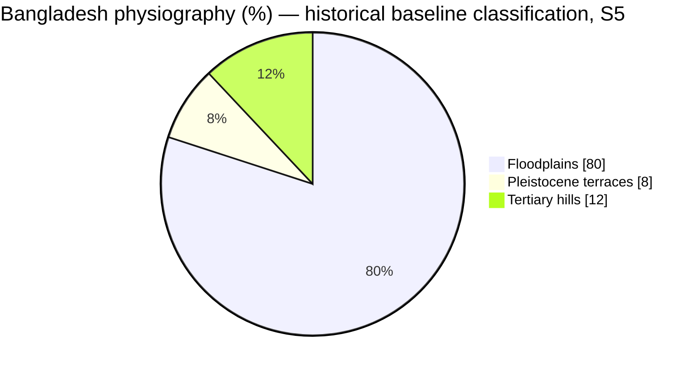

**Exam caption:** *Figure: Approximate physiographic shares. Source: Government-hosted Environmental and Social Baseline Data, land-environment section (S5); figures are classification-dependent.*

### ২.২ Cause–Effect Flowchart — ভূমিরূপ থেকে জীবিকার সম্পর্ক

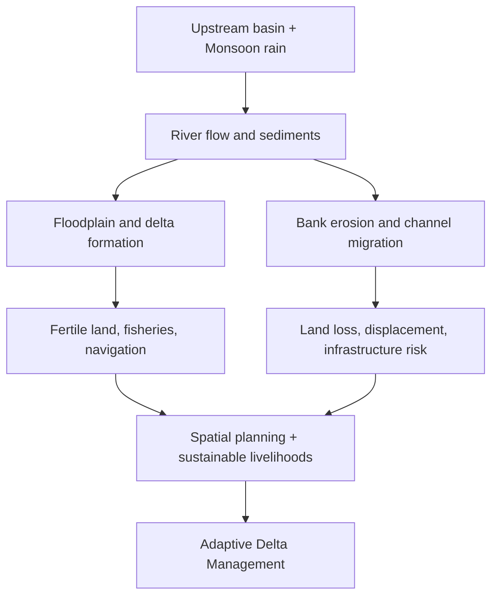

**Figure 3 — Conceptual causal diagram, editorial synthesis from Banglapedia [S2] and GED Delta Plan [S6].** এটি ব্যাখ্যামূলক, পরিমাপভিত্তিক data chart নয়।

<a id="regions"></a>

## ৩. Region-by-Region Journey — বরেন্দ্র থেকে বঙ্গোপসাগর

### ৩.১ Barind Tract — উত্তর-পশ্চিমের বরেন্দ্রভূমি ও পানির চাপ

#### 📖 Deep Explanation — বরেন্দ্রভূমি: কী, কোথায়, কেন, কীভাবে ও প্রভাব

**গল্প দিয়ে বুঝুন:** উত্তর-পশ্চিমাঞ্চলের প্রাচীন সোপানভূমি; সাম্প্রতিক নদীপলিতে গঠিত চর নয়। রাজশাহী, নওগাঁ ও আশপাশের উত্তর-পশ্চিমাঞ্চল; সুনির্দিষ্ট ভূপ্রাকৃতিক সীমা জেলা-সীমানার সঙ্গে পুরোপুরি মেলে না। প্লাইস্টোসিন যুগের অপেক্ষাকৃত পুরোনো ভূমিপৃষ্ঠ ও পরবর্তী ভূপ্রক্রিয়া একে আশপাশের নবীন প্লাবনভূমি থেকে আলাদা করেছে। এ কারণেই অঞ্চলটির বৈশিষ্ট্য বুঝতে কেবল নাম মুখস্থ করলে হবে না; ভূমির উৎপত্তি থেকে বর্তমান জীবিকা ও ঝুঁকি পর্যন্ত সম্পর্কটি ধরতে হবে।

1. **🟪 কী (What):** উত্তর-পশ্চিমাঞ্চলের প্রাচীন সোপানভূমি; সাম্প্রতিক নদীপলিতে গঠিত চর নয়।
2. **🧭 কোথায় (Where):** রাজশাহী, নওগাঁ ও আশপাশের উত্তর-পশ্চিমাঞ্চল; সুনির্দিষ্ট ভূপ্রাকৃতিক সীমা জেলা-সীমানার সঙ্গে পুরোপুরি মেলে না।
3. **🟨 কেন এমন (Why):** প্লাইস্টোসিন যুগের অপেক্ষাকৃত পুরোনো ভূমিপৃষ্ঠ ও পরবর্তী ভূপ্রক্রিয়া একে আশপাশের নবীন প্লাবনভূমি থেকে আলাদা করেছে।
4. **⚙️ কীভাবে কাজ করে (How / Mechanism):** বর্ষায় বৃষ্টি হলেও শুষ্ক মৌসুমে পানির চাহিদা বাড়ে। মাটির বৈশিষ্ট্য, বৃষ্টিপাতের সময়গত বৈষম্য, সেচনির্ভর কৃষি ও ভূগর্ভস্থ পানি উত্তোলন একত্রে পানির চাপ সৃষ্টি করতে পারে।
5. **🌾 প্রভাব (Impact):** ধানসহ কৃষি উৎপাদনে সেচের ভূমিকা বাড়ে; অতিরিক্ত ভূগর্ভস্থ পানি নির্ভরতা দীর্ঘমেয়াদি ঝুঁকি সৃষ্টি করতে পারে।
6. **🟩 করণীয় (Solutions / Policy):** দক্ষ সেচ, উপযোগী ফসল নির্বাচন, পানি সংরক্ষণ ও ভূগর্ভস্থ পানি পর্যবেক্ষণ।

**Cause → Effect → Response (কারণ–ফল–করণীয়)**

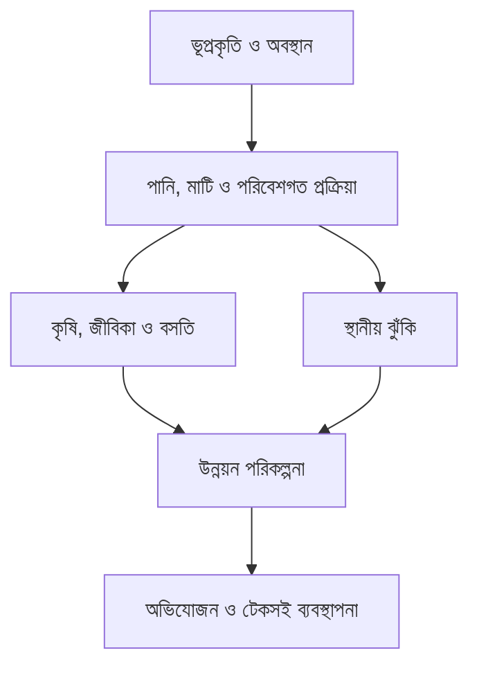

> [!WARNING]
> 🟨 **Exam Focus — যেকোনো প্রশ্নে প্রয়োগ:** কেন বরেন্দ্রভূমিকে প্লাবনভূমি বলা যায় না? খরা মোকাবিলায় অঞ্চলভিত্তিক কী পরিকল্পনা প্রয়োজন?

> [!TIP]
> 🟩 **Active Recall:** বই বন্ধ করে ৩০ সেকেন্ডে বলুন: **কী → কোথায় → কেন → কীভাবে → প্রভাব → সমাধান**। তারপর একটি বাংলাদেশের উদাহরণ যোগ করুন।

> [!NOTE]
> 🟦 **Named sources (মূল আলোচনা যাচাইয়ের জন্য):** Banglapedia — Asiatic Society of Bangladesh, Bangladesh Geography; GED — Bangladesh Delta Plan 2100। মূল নথির লিংক [Sources & Evidence](#sources) অংশে রয়েছে।


#### গভীর পাঠ — বরেন্দ্রভূমি: কী, কোথায়, কেন, কীভাবে ও প্রভাব

**গল্প দিয়ে শুরু:** যমুনার চরে সদ্য জমা পলির ওপর দাঁড়িয়ে আছেন। এবার উত্তর-পশ্চিমে এগিয়ে অপেক্ষাকৃত উঁচু, পুরোনো ভূমিতে পৌঁছালেন। দুই জায়গায় কৃষি হয়, কিন্তু মাটির বয়স, পানির চলাচল ও সেচের সমস্যায় পার্থক্য আছে। এ তুলনা থেকেই বরেন্দ্রভূমি বোঝা যায়।

**১. কী? (What is the Barind Tract?)** <mark>বরেন্দ্রভূমি একটি প্রাচীন প্লাইস্টোসিন সোপানভূমি (Pleistocene Terrace)</mark>। এটি সদ্য সৃষ্ট নদীচর নয়। এখানকার পুরোনো পলিতে দীর্ঘ সময়ের আবহবিকারের (Weathering) প্রভাব পড়েছে। এ জন্য অনেক স্থানে লালচে-বাদামি মাটি দেখা যায়। সব জায়গায় একই রঙ, উচ্চতা বা ভূগঠন থাকে না।

**২. কোথায়? (Where?)** বাংলাদেশের উত্তর-পশ্চিমে, বিশেষত রাজশাহী, নওগাঁ ও আশপাশের বিস্তৃত এলাকার সঙ্গে এর সম্পর্ক রয়েছে। **ভূপ্রাকৃতিক সীমানা (Physiographic Boundary)** এবং জেলার সীমানা অভিন্ন নয়। মানচিত্রে বরেন্দ্রকে একটি অঞ্চলের রূপে দেখান, একটিমাত্র জেলার নাম হিসেবে নয়।

**৩. কেন এই ভূমিরূপ? (Why?)** পুরোনো অবক্ষেপ নতুন প্লাবনভূমির পলির মতো প্রতি বর্ষায় নতুন স্তরে ঢাকা পড়ে না। ভূ-গঠন, পলি সঞ্চয়, পরবর্তী আবহবিকার ও ভূমির ধীর পরিবর্তন মিলিয়ে পুরোনো সোপান তৈরি হয়েছে। Banglapedia-এর *Alluvium* নিবন্ধ পুরোনো পলি ও নবীন পলির পার্থক্য এবং মধুপুর–বরেন্দ্র–লালমাই অঞ্চলের বৈশিষ্ট্য ব্যাখ্যা করে। নির্দিষ্ট একটি ভূতাত্ত্বিক কারণকে একমাত্র কারণ হিসেবে লিখবেন না।

**৪. কীভাবে পানির সমস্যা হয়? (Mechanism)**

- শুষ্ক মৌসুমে বৃষ্টির সরবরাহ কমে → কৃষিতে সেচের প্রয়োজন বাড়ে।
- ভূমির উচ্চতা, মাটির স্তর ও স্থানীয় নিষ্কাশনের বৈশিষ্ট্য → জমিতে পানি ধরে রাখা বা নিচে সরে যাওয়ার মাত্রা বদলায়।
- সেচের জন্য ভূগর্ভস্থ পানি উত্তোলন বেশি হলে → পানিসম্পদের ওপর বাড়তি চাপ পড়তে পারে।
- পানি ব্যবহারের দক্ষতা, ভূগর্ভস্থ পানি পুনর্ভরণ (Recharge) ও ফসলের ধরন → দীর্ঘমেয়াদি কৃষির স্থায়িত্বকে প্রভাবিত করে।

**৫. প্রভাব (Impact):** কৃষককে সেচের খরচ বিবেচনা করতে হয়; উপযুক্ত ফসল নির্বাচন জরুরি হয়; পানির ওপর কৃষি ও পরিবারের বিভিন্ন চাহিদার চাপ তৈরি হতে পারে। তবে 'পুরো বরেন্দ্র এলাকায় সবসময় খরা'—এমন সাধারণীকরণ ভুল।

**৬. করণীয় (Policy Response):** পানি সাশ্রয়ী সেচ, বৃষ্টির পানি সংরক্ষণ, ফসল বৈচিত্র্য, বৈজ্ঞানিক পানি-পর্যবেক্ষণ ও স্থানীয় অংশগ্রহণ। বাংলাদেশের ব-দ্বীপ পরিকল্পনা ২১০০-তে **Barind and Drought-prone Areas** পৃথক হটস্পট।

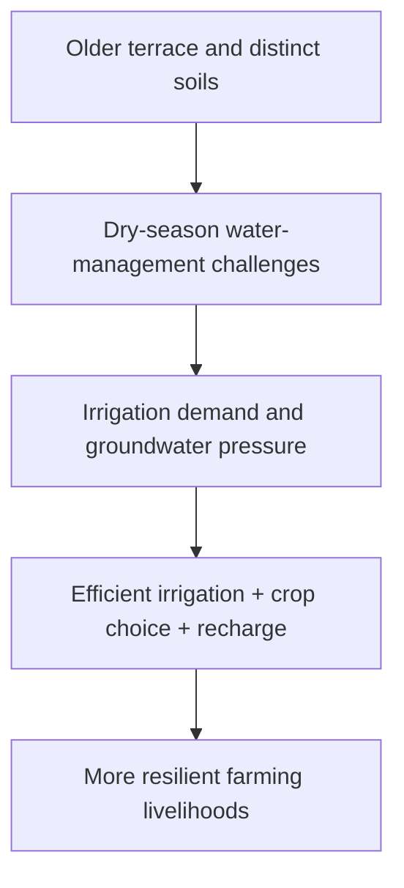

> [!TIP]
> 🟩 **Memory Formula:** <mark>পুরোনো সোপান → ভিন্ন মাটি → শুষ্ক মৌসুমে পানির চাপ → দক্ষ সেচ → কৃষির স্থায়িত্ব</mark>।

> [!NOTE]
> 🔵 **Sources:** **Banglapedia, Asiatic Society of Bangladesh — [“Bangladesh Geography”](https://en.banglapedia.org/index.php?title=Bangladesh_Geography)** ও **[“Alluvium”](https://en.banglapedia.org/index.php/Alluvium)**; **General Economics Division (GED), Bangladesh Planning Commission — [BDP 2100 Regional Hotspots](https://bcdp.gov.bd/)**।

**প্রশ্ন যেভাবেই আসুক:** *Describe* হলে সংজ্ঞা+অবস্থান+ভূপ্রকৃতি; *Why drought-prone?* হলে মাটি–ঋতু–পানি–সেচের কারণ; *Compare Barind and Madhupur* হলে পুরোনো সোপানের মিল ও পরিবেশগত পার্থক্য; *Recommend* হলে সেচ ও পানি ব্যবস্থাপনার সুপারিশ।

---


**🟩 Remember:** 


**একটি দৃশ্য কল্পনা করুন:** উত্তর-পশ্চিমে তুলনামূলক উঁচু, প্রাচীন ভূমি—যেখানে বর্ষা ও শুষ্ক মৌসুমে পানির ব্যবস্থাপনা এক রকম নয়। এখানেই বরেন্দ্রভূমির ধারণা স্পষ্ট হয়।

- 🧭 **কোথায় (Location):** রাজশাহী–নওগাঁ–চাঁপাইনবাবগঞ্জসহ উত্তর-পশ্চিমের বিস্তৃত অঞ্চলের সঙ্গে বরেন্দ্রভূমির সম্পর্ক রয়েছে। **ভূপ্রাকৃতিক সীমানা** ও জেলার প্রশাসনিক সীমানা এক নয়।
- 🪨 **কেমন (Landform):** অপেক্ষাকৃত প্রাচীন **<mark>Pleistocene Terrace</mark>**; নতুন চর বা সাম্প্রতিক প্লাবনভূমির তুলনায় আলাদা পৃষ্ঠভাগ।
- 💧 **সমস্যা (Challenge):** শুষ্ক মৌসুমে **<mark>drought, groundwater stress</mark> ও irrigation efficiency** গুরুত্বপূর্ণ।
- 🌱 **সমাধান (Response):** দক্ষ পানি ব্যবহার, ফসল পরিকল্পনা ও অঞ্চলভিত্তিক পানিসম্পদ ব্যবস্থাপনা।

> [!TIP]
> 🟢 **Memory Hook — BARIND = Old high land + Dry-season water pressure.**

> [!NOTE]
> 🔵 **Source:** **Banglapedia — Asiatic Society of Bangladesh, “Bangladesh Geography”** [S2]; **General Economics Division (GED), “Bangladesh Delta Plan 2100”** [S6]।

<a id="barind-photo"></a>

<p align="center"><a href="https://commons.wikimedia.org/wiki/File:The_Neon_Veil_of_Barind-_A_Twilight_Study_in_Naogaon.jpg"></a></p>

*🖼️ Figure 3 — **Barind Agricultural Landscape, Naogaon**। **কী দেখবেন:** নওগাঁর বরেন্দ্র অঞ্চলের গ্রামীণ কৃষি; এটি মাটির ভূতাত্ত্বিক প্রমাণ নয়। **Credit:** S. H. Tanim (2026-03-12); **License:** CC BY-SA 4.0; **Image source:** [Wikimedia Commons file page](https://commons.wikimedia.org/wiki/File:The_Neon_Veil_of_Barind-_A_Twilight_Study_in_Naogaon.jpg)। ছবিতে ক্লিক করলে মূল ফাইলের উচ্চ রেজল্যুশন এবং সম্পূর্ণ লাইসেন্স পাওয়া যাবে।*

> [!TIP]
> **Picture Memory:** নওগাঁর বরেন্দ্র অঞ্চলের গ্রামীণ কৃষি; এটি মাটির ভূতাত্ত্বিক প্রমাণ নয়—এই দৃশ্য থেকে একটি কারণ এবং একটি ফল ব্যাখ্যা করার চেষ্টা করুন।

 [⬆️ Go to Contents](#top)

### ৩.২ Madhupur Tract — মধ্যাঞ্চলের মধুপুর গড়

#### 📖 Deep Explanation — মধুপুর গড়: কী, কোথায়, কেন, কীভাবে ও প্রভাব

**গল্প দিয়ে বুঝুন:** মধ্যবাংলার অপেক্ষাকৃত উঁচু ও পুরোনো সোপানভূমি। টাঙ্গাইল–গাজীপুর–ময়মনসিংহ অঞ্চলের মধ্যবর্তী মধুপুরভূমি। প্লাইস্টোসিন সোপানের পুরোনো পৃষ্ঠ ও মাটির বৈশিষ্ট্য পার্শ্ববর্তী নদীবাহিত নবীন সমভূমির থেকে পৃথক। এ কারণেই অঞ্চলটির বৈশিষ্ট্য বুঝতে কেবল নাম মুখস্থ করলে হবে না; ভূমির উৎপত্তি থেকে বর্তমান জীবিকা ও ঝুঁকি পর্যন্ত সম্পর্কটি ধরতে হবে।

1. **🟪 কী (What):** মধ্যবাংলার অপেক্ষাকৃত উঁচু ও পুরোনো সোপানভূমি।
2. **🧭 কোথায় (Where):** টাঙ্গাইল–গাজীপুর–ময়মনসিংহ অঞ্চলের মধ্যবর্তী মধুপুরভূমি।
3. **🟨 কেন এমন (Why):** প্লাইস্টোসিন সোপানের পুরোনো পৃষ্ঠ ও মাটির বৈশিষ্ট্য পার্শ্ববর্তী নদীবাহিত নবীন সমভূমির থেকে পৃথক।
4. **⚙️ কীভাবে কাজ করে (How / Mechanism):** একই এলাকায় বন, কৃষি, বসতি ও যোগাযোগ অবকাঠামোর ব্যবহার প্রতিযোগিতায় আসে; উঁচু-নিচু ভূমিরূপ পানি নিষ্কাশন ও মাটির ব্যবহারকে প্রভাবিত করে।
5. **🌾 প্রভাব (Impact):** বনাঞ্চল সংকোচন ও জীববৈচিত্র্যের চাপ, অন্যদিকে কৃষি ও যোগাযোগের সুযোগ।
6. **🟩 করণীয় (Solutions / Policy):** বন সংরক্ষণ, ভূমি ব্যবহারের পরিকল্পনা, মাটি ও জলাধার রক্ষা।

**Cause → Effect → Response (কারণ–ফল–করণীয়)**


> [!WARNING]
> 🟨 **Exam Focus — যেকোনো প্রশ্নে প্রয়োগ:** মধুপুর ও বরেন্দ্রের মিল-অমিল কী? ভূমিরূপ কীভাবে ভূমি ব্যবহার নিয়ন্ত্রণ করে?

> [!TIP]
> 🟩 **Active Recall:** বই বন্ধ করে ৩০ সেকেন্ডে বলুন: **কী → কোথায় → কেন → কীভাবে → প্রভাব → সমাধান**। তারপর একটি বাংলাদেশের উদাহরণ যোগ করুন।

> [!NOTE]
> 🟦 **Named sources (মূল আলোচনা যাচাইয়ের জন্য):** Banglapedia — Asiatic Society of Bangladesh, Bangladesh Geography। মূল নথির লিংক [Sources & Evidence](#sources) অংশে রয়েছে।


#### গভীর পাঠ — মধুপুর গড়: একই যুগের সোপান, ভিন্ন পরিবেশ

**গল্প:** বরেন্দ্রের পর মধ্যবাংলায় আসুন। এখানে অনেক জায়গায় নবীন নদীপললভূমির মধ্যে তুলনামূলক উঁচু, বিচ্ছিন্ন পুরোনো ভূমিখণ্ড দেখা যায়। এই ভূখণ্ডের নাম **মধুপুর গড় (Madhupur Tract)**।

**১. কী (Definition):** মধুপুর গড়ও একটি **Pleistocene Terrace**। অর্থাৎ এর পুরোনো মাটির উৎপত্তি এবং অপেক্ষাকৃত উঁচু ভূমিরূপ নতুন নদীচরের পলির চেয়ে ভিন্ন। কিছু জায়গায় খাঁজকাটা উপত্যকা, বন ও লালচে-বাদামি মাটির বৈশিষ্ট্য দেখা যায়।

**২. কোথায় (Location):** বৃহত্তর টাঙ্গাইল–গাজীপুর–ময়মনসিংহসহ মধ্যাঞ্চলে এর বিস্তার। সঠিক সীমানা বুঝতে বাংলাদেশের সরকারি **Physiographic Map** বা মানচিত্র ব্যবহার করুন; 'পুরো জেলা = পুরোটাই মধুপুর গড়' এমন নয়।

**৩. কেন গঠিত (Origin):** পুরোনো পলি সঞ্চয় ও পরবর্তী দীর্ঘ আবহবিকার, ভূগাঠনিক প্রক্রিয়া এবং নদীর ক্ষয়ে এর ভূমিরূপে বৈচিত্র্য দেখা যায়। পুরোনো পলি অনেক সময় লালচে-বাদামি—এই তথ্য Banglapedia-র *Alluvium* নিবন্ধে রয়েছে। এটি শুধুই 'লাল মাটির নাম' নয়; একটি ভূপ্রাকৃতিক অঞ্চল।

**৪. কীভাবে প্রকৃতি ও মানুষকে প্রভাবিত করে:**

- তুলনামূলক উঁচু পৃষ্ঠ ও বিচ্ছিন্ন নিচু উপত্যকা → নিষ্কাশন ও ভূমির ব্যবহারে পার্থক্য।
- বনের উপস্থিতি ও মাটির বৈশিষ্ট্য → স্থানীয় জীববৈচিত্র্য, আর্দ্রতা ও কৃষির ধরনকে প্রভাবিত করে।
- সড়ক, বসতি ও নগর সম্প্রসারণ → বনভূমি ও কৃষিজমির ওপর চাপ বাড়াতে পারে।
- অপরিকল্পিত ভূমি পরিবর্তন → বাস্তুতন্ত্রের ক্ষতি ও মাটিক্ষয়ের ঝুঁকি বাড়াতে পারে।

**৫. প্রভাব (Impact):** মধুপুর গড় ভূতত্ত্বের পাশাপাশি বনসংরক্ষণ, স্থানীয় জনগোষ্ঠীর জীবিকা, ভূমি ব্যবহার ও অবকাঠামো পরিকল্পনার ক্ষেত্রেও গুরুত্বপূর্ণ।

**৬. Comparison—বরেন্দ্র বনাম মধুপুর**

| বিষয় | বরেন্দ্রভূমি (Barind) | মধুপুর গড় (Madhupur) |
|---|---|---|
| অবস্থান | উত্তর-পশ্চিম | মধ্যবাংলা |
| সাধারণ শ্রেণি | পুরোনো সোপানভূমি | পুরোনো সোপানভূমি |
| পরীক্ষার গুরুত্বপূর্ণ সমস্যা | শুষ্ক মৌসুমের পানি ও সেচ | বন, মাটি ও ভূমি ব্যবহার |
| মূলনীতি | দক্ষ পানি ব্যবস্থাপনা | বন রক্ষা ও উপযুক্ত ভূমি পরিকল্পনা |

> [!WARNING]
> 🟨 **Common mistake:** <mark>বরেন্দ্র ও মধুপুর একই ভূতাত্ত্বিক শ্রেণিতে পড়লেও একই অঞ্চল নয়</mark>।

> [!NOTE]
> 🔵 **Sources:** **Banglapedia, Asiatic Society of Bangladesh — [“Alluvium”](https://en.banglapedia.org/index.php/Alluvium)**; **Bangladesh Bank, [project baseline “Physiography / Madhupur Tract”, §4.1.2](https://www.bb.org.bd/aboutus/dept/ipff/ipffproject/rtl_executive_summary.pdf)**; **Bangladesh Climate Development Partnership, [BDP 2100 Hotspots](https://bcdp.gov.bd/)**।

**Exam Transfer:** *What?*—সোপানভূমি; *Where?*—মধ্যবাংলা; *Why?*—পুরোনো পলি ও ভূমিগঠন; *How?*—মাটি ও ভূমি ব্যবহার; *Impact?*—কৃষি–বন–বসতি; *Solution?*—অঞ্চলভিত্তিক ভূমি পরিকল্পনা।

---


**🟩 Remember:** 


**বরেন্দ্র থেকে এবার মধ্যবাংলায় আসুন।** এখানেও একটি অপেক্ষাকৃত পুরোনো উঁচু ভূমিখণ্ড আছে—মধুপুর গড়। কিন্তু দুটির অবস্থান ও ভূমি ব্যবহারের প্রেক্ষাপট এক নয়।

- 🧭 **অবস্থান:** মধ্যবাংলার মধুপুর অঞ্চল।
- 🪨 **ভূপ্রকৃতি:** <mark>**Pleistocene Terrace**</mark>—চারপাশের নবীন নদীপললভূমি থেকে আলাদা।
- 🌳 **বৈশিষ্ট্য:** বনভূমি, মাটি ও ভূমি ব্যবহারের পরিবর্তন বোঝার জন্য গুরুত্বপূর্ণ।
- 🏙️ **চ্যালেঞ্জ:** বন রক্ষা, বসতি ও অবকাঠামো সম্প্রসারণের মধ্যে ভারসাম্য।

> [!TIP]
> 🟢 **Memory Hook:** **বরেন্দ্র = উত্তর-পশ্চিমের সোপান; মধুপুর = মধ্যাঞ্চলের সোপান।** একই বড় ভূতাত্ত্বিক শ্রেণি, ভিন্ন স্থানিক প্রেক্ষাপট।

> [!NOTE]
> 🔵 **Source:** **Banglapedia — Asiatic Society of Bangladesh, “Bangladesh Geography”** [S2] ও **“ভূ-প্রকৃতি”** [S3]।

<p align="center"><a href="https://commons.wikimedia.org/wiki/File:Madhupur_tract_locator_map.svg"></a></p>

*🗺️ **Madhupur Tract Locator Map** — বাংলাদেশের মানচিত্রে মধুপুর গড়ের অবস্থান দেখুন। **Creator:** Tanvir Anjum Adib, 2025; **License:** CC BY-SA 4.0; [Original Wikimedia Commons map](https://commons.wikimedia.org/wiki/File:Madhupur_tract_locator_map.svg)। এটি অবস্থান বুঝতে সাহায্য করে; ভূতাত্ত্বিক মাটির বয়সের সরাসরি প্রমাণ নয়।*

> [!NOTE]
> 🔵 **Official Physio Map (important source): Bangladesh Agricultural Research Council (BARC), “Physiography — Land Resources Information Map Products of Bangladesh”**। [সরকারি রঙিন Physiographic Units Map (PDF)](https://apps.barc.gov.bd/maps/LRI-Map%20Products-Bangladesh.pdf)। **BARC-এর উপ-একক (units) এবং Banglapedia-এর ২৪টি sub-region/৫৪টি unit একই শ্রেণিবিন্যাস নয়**—উৎসভেদে পদ্ধতি পৃথক। বরেন্দ্র, মধুপুর, নদীর প্লাবনভূমি ও উপকূল একসঙ্গে চিহ্নিত করতে সরকারি মানচিত্রটি ব্যবহার করুন।

<a id="madhupur-photo"></a>

<p align="center"><a href="https://commons.wikimedia.org/wiki/File:Madhupur_forest.jpg"></a></p>

*🖼️ Figure 4 — **Madhupur National Park Forest**। **কী দেখবেন:** মধুপুর অঞ্চলের বনভূমি ও ভূমি ব্যবহার। **Credit:** S. M. Tanim (2017-10-09); **License:** CC BY-SA 4.0; **Image source:** [Wikimedia Commons file page](https://commons.wikimedia.org/wiki/File:Madhupur_forest.jpg)। ছবিতে ক্লিক করলে মূল ফাইলের উচ্চ রেজল্যুশন এবং সম্পূর্ণ লাইসেন্স পাওয়া যাবে।*

> [!TIP]
> **Picture Memory:** মধুপুর অঞ্চলের বনভূমি ও ভূমি ব্যবহার—এই দৃশ্য থেকে একটি কারণ এবং একটি ফল ব্যাখ্যা করার চেষ্টা করুন।

 [⬆️ Go to Contents](#top)

### ৩.৩ Haor Basin — উত্তর-পূর্বের হাওর ও আকস্মিক বন্যা

#### 📖 Deep Explanation — হাওর অববাহিকা: কী, কোথায়, কেন, কীভাবে ও প্রভাব

**গল্প দিয়ে বুঝুন:** মৌসুমি জলাভূমিসমৃদ্ধ নিচু অববাহিকা; বর্ষায় বিস্তৃত জলরাশি, শুষ্ক মৌসুমে কৃষিজমি দেখা যায়। উত্তর-পূর্ব বাংলাদেশ, বিশেষত সুনামগঞ্জ ও পার্শ্ববর্তী হাওরাঞ্চল। নিচু অববাহিকায় বৃষ্টির পানি ও উজান থেকে নেমে আসা প্রবাহ জমে; মৌসুমি পানির ওঠানামা ভূমি ব্যবহারকে নির্ধারণ করে। এ কারণেই অঞ্চলটির বৈশিষ্ট্য বুঝতে কেবল নাম মুখস্থ করলে হবে না; ভূমির উৎপত্তি থেকে বর্তমান জীবিকা ও ঝুঁকি পর্যন্ত সম্পর্কটি ধরতে হবে।

1. **🟪 কী (What):** মৌসুমি জলাভূমিসমৃদ্ধ নিচু অববাহিকা; বর্ষায় বিস্তৃত জলরাশি, শুষ্ক মৌসুমে কৃষিজমি দেখা যায়।
2. **🧭 কোথায় (Where):** উত্তর-পূর্ব বাংলাদেশ, বিশেষত সুনামগঞ্জ ও পার্শ্ববর্তী হাওরাঞ্চল।
3. **🟨 কেন এমন (Why):** নিচু অববাহিকায় বৃষ্টির পানি ও উজান থেকে নেমে আসা প্রবাহ জমে; মৌসুমি পানির ওঠানামা ভূমি ব্যবহারকে নির্ধারণ করে।
4. **⚙️ কীভাবে কাজ করে (How / Mechanism):** উজানের ভারী বৃষ্টি থেকে দ্রুত ঢল নামলে বোরো ধান কাটার আগেই পানি বাড়তে পারে। তাই নদীপ্রবাহ, আবহাওয়া ও ফসল কাটার সময় একে অন্যের সঙ্গে যুক্ত।
5. **🌾 প্রভাব (Impact):** ধান উৎপাদন, মাছ ও জলাভূমির জীববৈচিত্র্য লাভবান হতে পারে; আগাম বন্যায় ফসল, ঘরবাড়ি ও যোগাযোগ ক্ষতিগ্রস্ত হয়।
6. **🟩 করণীয় (Solutions / Policy):** আগাম বন্যা সতর্কতা, ফসলের সময়সূচি, জলাভূমির স্বাভাবিক প্রবাহ রক্ষা এবং স্থানীয়ভাবে উপযুক্ত অবকাঠামো।

**Cause → Effect → Response (কারণ–ফল–করণীয়)**


> [!WARNING]
> 🟨 **Exam Focus — যেকোনো প্রশ্নে প্রয়োগ:** Flash flood কেন হয়? হাওরের অর্থনীতি ও পরিবেশের মধ্যে কী ভারসাম্য প্রয়োজন?

> [!TIP]
> 🟩 **Active Recall:** বই বন্ধ করে ৩০ সেকেন্ডে বলুন: **কী → কোথায় → কেন → কীভাবে → প্রভাব → সমাধান**। তারপর একটি বাংলাদেশের উদাহরণ যোগ করুন।

> [!NOTE]
> 🟦 **Named sources (মূল আলোচনা যাচাইয়ের জন্য):** Banglapedia — Asiatic Society of Bangladesh, Bangladesh Geography; GED — Bangladesh Delta Plan 2100। মূল নথির লিংক [Sources & Evidence](#sources) অংশে রয়েছে।


#### গভীর পাঠ — হাওর অববাহিকা: এক জমি, দুই মৌসুমের দুই ছবি

**গল্প:** উত্তর-পূর্বের এক কৃষক শুষ্ক মৌসুমে বোরো ধান ফলান। কিন্তু পাশের পাহাড়ি অববাহিকায় টানা ভারী বৃষ্টি হলে কয়েক দিনের মধ্যে পানি দ্রুত বেড়ে ধান কাটার আগেই মাঠ তলিয়ে যেতে পারে। এই দ্বৈত বাস্তবতা—**কৃষির সুযোগ ও আকস্মিক বন্যার ঝুঁকি**—হাওর বুঝবার মূল চাবিকাঠি।

**১. কী (What):** হাওর উত্তর-পূর্ব বাংলাদেশের নিচু, বিস্তৃত **মৌসুমি জলাভূমি–অববাহিকা**। শুষ্ক মৌসুমে বিভিন্ন জমিতে কৃষি হয়; বর্ষায় বিস্তীর্ণ অঞ্চল জলমগ্ন হয়। **হাওর, বিল, বাঁওড় ও চর একই জিনিস নয়**।

**২. কোথায় (Where):** সিলেট–সুনামগঞ্জ–কিশোরগঞ্জ–নেত্রকোনা অঞ্চলের বিস্তৃত অংশ হাওর ব্যবস্থার সঙ্গে যুক্ত। Banglapedia *Bangladesh Geography* অনুযায়ী অববাহিকাটি উত্তর দিকে মেঘালয় মালভূমির পাদদেশ এবং পশ্চিমে পুরোনো ব্রহ্মপুত্র প্লাবনভূমির সঙ্গে সম্পর্কিত।

**৩. কেন নিচু (Why):** ভূতাত্ত্বিক অবনমন, প্রাচীন নদীপললভূমি ও পার্শ্ববর্তী উচ্চভূমির গঠন একটি বাটির মতো নিচু অঞ্চল তৈরি করেছে। Banglapedia একে **saucer-shaped depression** বলে বর্ণনা করে। ফলে মৌসুমি পানি এখানে বিস্তৃতভাবে জমে।

**৪. কীভাবে আকস্মিক বন্যা (Flash Flood Mechanism):**

1. উজানের পাহাড়ে প্রবল বৃষ্টি হয়।
2. পাহাড়ি ঢাল বেয়ে পানি দ্রুত নেমে আসে (**Rapid Runoff**)।
3. নদী ও খালে পানির উচ্চতা অল্প সময়ে বাড়ে।
4. নিম্নাঞ্চলে দ্রুত প্লাবন ঘটে।
5. বোরো ধান কাটার আগে প্লাবিত হলে বড় কৃষিক্ষতি হতে পারে।

**৫. ইতিবাচক প্রভাব:** বোরো চাষ, মাছ, জলজ জীববৈচিত্র্য, পানির মৌসুমি ধারণক্ষমতা ও স্থানীয় নৌ-সংস্কৃতির বিকাশ।

**৬. নেতিবাচক প্রভাব:** ফসল নষ্ট, যোগাযোগ বিচ্ছিন্ন, স্কুল ও স্বাস্থ্যসেবা পৌঁছানো কঠিন এবং জেলেদের/কৃষকের আয় অনিশ্চিত হওয়ার ঝুঁকি।

**৭. সমাধান:** আগাম বন্যার পূর্বাভাস, তথ্যভিত্তিক ফসল কাটার সময়সূচি, যথাযথ বাঁধ ও পানি চলাচলের পথ, দুর্যোগ-প্রস্তুতি এবং হাওরের পরিবেশগত ভারসাম্য রক্ষা। সব জায়গায় শুধু উঁচু বাঁধ তৈরি করলে স্থানীয় পানি নিষ্কাশনে ক্ষতি হতে পারে।

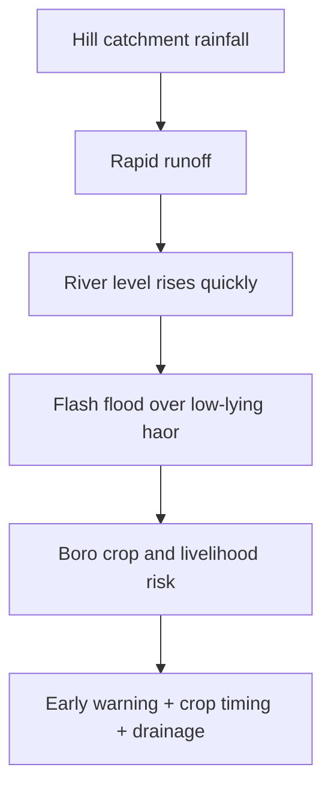

> [!TIP]
> 🟩 **Memory Formula:** <mark>নিচু অববাহিকা + উজানের ভারী বৃষ্টি → দ্রুত ঢল → আগাম বন্যা → বোরো ঝুঁকি</mark>।

> [!NOTE]
> 🔵 **Sources:** **Banglapedia, Asiatic Society of Bangladesh — [“Bangladesh Geography”, section “Haor Basin”](https://en.banglapedia.org/index.php?title=Bangladesh_Geography)**; **GED / Planning Commission — [BDP 2100 Regional Hotspots](https://bcdp.gov.bd/)**।

**যে প্রশ্নই আসুক:** *Define Haor*—অববাহিকা ও মৌসুমি প্রকৃতি; *Why vulnerable?*—উজান থেকে rapid runoff; *Importance*—কৃষি–মৎস্য–প্রতিবেশ; *Policy*—early warning + adaptive cropping + wetland drainage।

---


**🟩 Remember:** 


**এবার উত্তর-পূর্বের নিচু হাওরে পৌঁছালেন।** শুষ্ক মৌসুমে বিস্তৃত জমিতে <mark>বোরো ধান</mark> হতে পারে; বর্ষাকালে একই জায়গা পানিতে ভরে যায়। ফসল কাটার আগে পাহাড়ি ঢল এলে ক্ষতি কেন হয়—এবার বিষয়টি সহজে বোঝা যায়।

- 🧭 **অবস্থান:** উত্তর-পূর্বাঞ্চলের নিচু অববাহিকাগুলো; সুনামগঞ্জের হাওর পরিচিত উদাহরণ।
- 🌊 **ভূপ্রকৃতি:** মৌসুমি জলাভূমি; শুষ্ক ও বর্ষা মৌসুমে দৃশ্য ভিন্ন।
- 🌾 **জীবিকা:** বোরো ধান, মাছ ও জলাভূমির সম্পদ।
- ⚠️ **ঝুঁকি:** **<mark>Flash Flood</mark>**—অল্প সময়ে পানির প্রবাহ ও উচ্চতা বেড়ে আগাম প্লাবন।
- ✅ **ব্যবস্থাপনা:** আগাম সতর্কতা, ফসলের সময়সূচি, উপযুক্ত পানি নিষ্কাশন ও পরিবেশসম্মত অবকাঠামো।

> [!TIP]
> 🟢 **Memory Hook — HAOR = Basin + Boro + Flash Flood.**

> [!NOTE]
> 🔵 **Source:** **Banglapedia — “Bangladesh Geography”** [S2]; **GED, “Bangladesh Delta Plan 2100”** [S6]।

<a id="haor-photo"></a>

<p align="center"><a href="https://commons.wikimedia.org/wiki/File:%E0%A6%9F%E0%A6%BE%E0%A6%99%E0%A7%8D%E0%A6%97%E0%A7%81%E0%A6%AF%E0%A6%BC%E0%A6%BE%E0%A6%B0_%E0%A6%B9%E0%A6%BE%E0%A6%93%E0%A6%B0.JPG"></a></p>

*🖼️ Figure 5 — **Tanguar Haor**। **কী দেখবেন:** হাওরের মৌসুমি জলাভূমির দৃশ্য। **Credit:** Sarkershuvro (2015-03-09); **License:** CC BY-SA 4.0; **Image source:** [Wikimedia Commons file page](https://commons.wikimedia.org/wiki/File:%E0%A6%9F%E0%A6%BE%E0%A6%99%E0%A7%8D%E0%A6%97%E0%A7%81%E0%A6%AF%E0%A6%BC%E0%A6%BE%E0%A6%B0_%E0%A6%B9%E0%A6%BE%E0%A6%93%E0%A6%B0.JPG)। ছবিতে ক্লিক করলে মূল ফাইলের উচ্চ রেজল্যুশন এবং সম্পূর্ণ লাইসেন্স পাওয়া যাবে।*

> [!TIP]
> **Picture Memory:** হাওরের মৌসুমি জলাভূমির দৃশ্য—এই দৃশ্য থেকে একটি কারণ এবং একটি ফল ব্যাখ্যা করার চেষ্টা করুন।

 [⬆️ Go to Contents](#top)

### ৩.৪ Chattogram Hill Tracts — পাহাড়ি ভূপ্রকৃতি ও ঢালের ঝুঁকি

#### 📖 Deep Explanation — পার্বত্য চট্টগ্রাম: কী, কোথায়, কেন, কীভাবে ও প্রভাব

**গল্প দিয়ে বুঝুন:** ঢাল, শৈলশিরা ও উপত্যকাবিশিষ্ট পাহাড়ি অঞ্চল। রাঙামাটি, বান্দরবান ও খাগড়াছড়ি জেলার পার্বত্য অঞ্চল। ভূতাত্ত্বিক গঠন, ভাঁজ ও দীর্ঘমেয়াদি ক্ষয়প্রক্রিয়া পাহাড়ি ভূমিরূপ সৃষ্টি করেছে; এটি নবীন বদ্বীপীয় সমতল থেকে আলাদা। এ কারণেই অঞ্চলটির বৈশিষ্ট্য বুঝতে কেবল নাম মুখস্থ করলে হবে না; ভূমির উৎপত্তি থেকে বর্তমান জীবিকা ও ঝুঁকি পর্যন্ত সম্পর্কটি ধরতে হবে।

1. **🟪 কী (What):** ঢাল, শৈলশিরা ও উপত্যকাবিশিষ্ট পাহাড়ি অঞ্চল।
2. **🧭 কোথায় (Where):** রাঙামাটি, বান্দরবান ও খাগড়াছড়ি জেলার পার্বত্য অঞ্চল।
3. **🟨 কেন এমন (Why):** ভূতাত্ত্বিক গঠন, ভাঁজ ও দীর্ঘমেয়াদি ক্ষয়প্রক্রিয়া পাহাড়ি ভূমিরূপ সৃষ্টি করেছে; এটি নবীন বদ্বীপীয় সমতল থেকে আলাদা।
4. **⚙️ কীভাবে কাজ করে (How / Mechanism):** প্রবল বৃষ্টিতে ঢালু ভূমিতে দ্রুত পানি নেমে যায়; পাহাড় কাটা, বনহানি ও অনিরাপদ নির্মাণ ঢালের স্থিতিশীলতা কমাতে পারে।
5. **🌾 প্রভাব (Impact):** ভূমিধস ও মাটিক্ষয়ের ঝুঁকি; বন, পর্যটন, স্থানীয় সংস্কৃতি ও জীববৈচিত্র্যের গুরুত্বপূর্ণ ভূমিকা।
6. **🟩 করণীয় (Solutions / Policy):** ঝুঁকিভিত্তিক ভূমি ব্যবহার, পাহাড় না কেটে অবকাঠামো, ঢালের পানি নিষ্কাশন এবং স্থানীয় জনগোষ্ঠীর অংশগ্রহণ।

**Cause → Effect → Response (কারণ–ফল–করণীয়)**


> [!WARNING]
> 🟨 **Exam Focus — যেকোনো প্রশ্নে প্রয়োগ:** পার্বত্য অঞ্চল ও প্লাবনভূমির পার্থক্য কী? ভূমিধসের প্রাকৃতিক ও মানবসৃষ্ট কারণ কী?

> [!TIP]
> 🟩 **Active Recall:** বই বন্ধ করে ৩০ সেকেন্ডে বলুন: **কী → কোথায় → কেন → কীভাবে → প্রভাব → সমাধান**। তারপর একটি বাংলাদেশের উদাহরণ যোগ করুন।

> [!NOTE]
> 🟦 **Named sources (মূল আলোচনা যাচাইয়ের জন্য):** Banglapedia — Asiatic Society of Bangladesh, Bangladesh Geography; GED — Bangladesh Delta Plan 2100। মূল নথির লিংক [Sources & Evidence](#sources) অংশে রয়েছে।


**🟩 Remember:** 


**সমতল ছেড়ে পাহাড়ে উঠুন।** একই বৃষ্টিপাত সমতলে জমে থাকতে পারে, কিন্তু ঢালু পাহাড়ে দ্রুত নেমে যায়; অপরিকল্পিত পাহাড় কাটায় সেই ঢাল আরও ঝুঁকিপূর্ণ হতে পারে।

- ⛰️ **ভূপ্রকৃতি:** পাহাড়, শৈলশিরা, উপত্যকা, ঢাল ও দ্রুত প্রবাহ।
- 🗺️ **অবস্থান:** পার্বত্য চট্টগ্রাম; সিলেটের টিলা-পাহাড়কে একই ভূঅঞ্চল ধরে নেওয়া ঠিক নয়।
- ⚠️ **ঝুঁকি:** <mark>ভূমিধস, মাটিক্ষয়</mark>, বনহানি ও অনিয়ন্ত্রিত নির্মাণ।
- 🌳 **ব্যবস্থাপনা:** পরিবেশসম্মত ভূমি ব্যবহার, বন সংরক্ষণ ও সঠিক drainage।

> [!TIP]
> 🟢 **Memory Hook — HILL = Slope + Forest + Landslide Risk.**

> [!NOTE]
> 🔵 **Source:** **Banglapedia — “Bangladesh Geography”** [S2], **“ভূ-প্রকৃতি”** [S3]; **GED, “Bangladesh Delta Plan 2100”** [S6]।

<a id="cht-photo"></a>

<p align="center"><a href="https://commons.wikimedia.org/wiki/File:Sajek_Valley_00.jpg"></a></p>

*🖼️ Figure 6 — **Sajek Valley — Chattogram Hill Tracts**। **কী দেখবেন:** পাহাড়ের ঢাল ও শৈলশিরা। **Credit:** Ahnaf010 (2022-07-03); **License:** CC BY-SA 4.0; **Image source:** [Wikimedia Commons file page](https://commons.wikimedia.org/wiki/File:Sajek_Valley_00.jpg)। ছবিতে ক্লিক করলে মূল ফাইলের উচ্চ রেজল্যুশন এবং সম্পূর্ণ লাইসেন্স পাওয়া যাবে।*

> [!TIP]
> **Picture Memory:** পাহাড়ের ঢাল ও শৈলশিরা—এই দৃশ্য থেকে একটি কারণ এবং একটি ফল ব্যাখ্যা করার চেষ্টা করুন।

<p align="center"><a href="https://commons.wikimedia.org/wiki/File:Chittagong_Hill_Tracts.PNG"></a></p>

*🖼️ Figure 6B — **Chittagong Hill Tracts locator map**। **কী দেখবেন:** পার্বত্য অঞ্চলের অবস্থান; পুরোনো জেলা সীমানা। **Credit:** Armanaziz / AnonyLog (2009); **License:** GFDL / CC license on file page; **Image source:** [Wikimedia Commons file page](https://commons.wikimedia.org/wiki/File:Chittagong_Hill_Tracts.PNG)। ছবিতে ক্লিক করলে মূল ফাইলের উচ্চ রেজল্যুশন এবং সম্পূর্ণ লাইসেন্স পাওয়া যাবে।*

> [!TIP]
> **Picture Memory:** পার্বত্য অঞ্চলের অবস্থান; পুরোনো জেলা সীমানা—এই দৃশ্য থেকে একটি কারণ এবং একটি ফল ব্যাখ্যা করার চেষ্টা করুন।

[⬆️ Go to Contents](#top)

### ৩.৫ Tidal Delta & Sundarbans — দক্ষিণ-পশ্চিমের জোয়ারভাটার বনভূমি

#### 📖 Deep Explanation — সুন্দরবন ও জোয়ারভাটার বদ্বীপ: কী, কোথায়, কেন, কীভাবে ও প্রভাব

**গল্প দিয়ে বুঝুন:** জোয়ারভাটা, নদীপলি ও লবণাক্ততার প্রভাবে গড়ে ওঠা উপকূলীয় ম্যানগ্রোভ পরিবেশ। বাংলাদেশের দক্ষিণ-পশ্চিম উপকূল, বিশেষত খুলনা–সাতক্ষীরা–বাগেরহাটের উপকূলীয় অংশ। মিঠাপানি ও লবণপানির মিশ্রণ, জোয়ারভাটা, পলি এবং উদ্ভিদের অভিযোজন একত্রে এই প্রতিবেশব্যবস্থার বৈশিষ্ট্য গড়ে তোলে। এ কারণেই অঞ্চলটির বৈশিষ্ট্য বুঝতে কেবল নাম মুখস্থ করলে হবে না; ভূমির উৎপত্তি থেকে বর্তমান জীবিকা ও ঝুঁকি পর্যন্ত সম্পর্কটি ধরতে হবে।

1. **🟪 কী (What):** জোয়ারভাটা, নদীপলি ও লবণাক্ততার প্রভাবে গড়ে ওঠা উপকূলীয় ম্যানগ্রোভ পরিবেশ।
2. **🧭 কোথায় (Where):** বাংলাদেশের দক্ষিণ-পশ্চিম উপকূল, বিশেষত খুলনা–সাতক্ষীরা–বাগেরহাটের উপকূলীয় অংশ।
3. **🟨 কেন এমন (Why):** মিঠাপানি ও লবণপানির মিশ্রণ, জোয়ারভাটা, পলি এবং উদ্ভিদের অভিযোজন একত্রে এই প্রতিবেশব্যবস্থার বৈশিষ্ট্য গড়ে তোলে।
4. **⚙️ কীভাবে কাজ করে (How / Mechanism):** উজানের মিঠাপানির প্রবাহ, লবণাক্ততা, ঘূর্ণিঝড় ও পলি পরিবহনের পরিবর্তন বন ও মানুষের জীবিকার ওপর প্রভাব ফেলে।
5. **🌾 প্রভাব (Impact):** জীববৈচিত্র্য, মৎস্যসম্পদ ও ঝড়ের প্রভাব কমাতে উপকূলীয় বন গুরুত্বপূর্ণ; লবণাক্ততা ও পরিবেশগত চাপ জীবিকা ঝুঁকিতে ফেলে।
6. **🟩 করণীয় (Solutions / Policy):** ম্যানগ্রোভ সংরক্ষণ, নদীর প্রবাহের সুশাসন, স্থানীয় জীবিকার বিকল্প ও পরিবেশগত পর্যবেক্ষণ।

**Cause → Effect → Response (কারণ–ফল–করণীয়)**


> [!WARNING]
> 🟨 **Exam Focus — যেকোনো প্রশ্নে প্রয়োগ:** ম্যানগ্রোভ বন কেন গড়ে ওঠে? সুন্দরবন সংরক্ষণ কেন জাতীয় উন্নয়নের বিষয়?

> [!TIP]
> 🟩 **Active Recall:** বই বন্ধ করে ৩০ সেকেন্ডে বলুন: **কী → কোথায় → কেন → কীভাবে → প্রভাব → সমাধান**। তারপর একটি বাংলাদেশের উদাহরণ যোগ করুন।

> [!NOTE]
> 🟦 **Named sources (মূল আলোচনা যাচাইয়ের জন্য):** UNESCO World Heritage Centre — The Sundarbans; Banglapedia — Bangladesh Geography। মূল নথির লিংক [Sources & Evidence](#sources) অংশে রয়েছে।


**🟩 Remember:** 


**এবার নদীর মিঠাপানি ও সাগরের লবণাক্ত পানির মিলনস্থলে আসুন।** জোয়ার-ভাটার সঙ্গে মানিয়ে নেওয়া ম্যানগ্রোভ বন—সুন্দরবন—এই ভূপ্রাকৃতিক প্রক্রিয়ার পরিচিত উদাহরণ।

- 🌊 **পরিবেশ:** <mark>Tidal Floodplain</mark>—জোয়ারভাটা, লবণাক্ততা ও নদীর পলির সম্মিলিত প্রভাব।
- 🌿 **জীববৈচিত্র্য:** Mangrove Ecosystem ও উপকূলীয় জীবনযাত্রা।
- 🟨 **ঐতিহাসিক তথ্য:** বাংলাদেশের **The Sundarbans** UNESCO World Heritage List-এ **<mark>১৯৯৭ সালে</mark>** অন্তর্ভুক্ত।
- ⚠️ **পার্থক্য:** সমগ্র বনাঞ্চল এবং UNESCO-inscribed World Heritage property-এর সীমানা/আয়তন এক নয়।

> [!TIP]
> 🟢 **Memory Hook — SUNDARBANS = Tide + Mangrove + 1997 UNESCO.**

> [!NOTE]
> 🔵 **Source:** **UNESCO World Heritage Centre — “The Sundarbans”, World Heritage List No. 798** [S11]; **Banglapedia — “Bangladesh Geography”** [S2]।

<a id="coastal-photo"></a>

<p align="center"><a href="https://commons.wikimedia.org/wiki/File:Landset_9_image_of_Bangladesh_coast.jpg"></a></p>

*🖼️ Figure 7 — **Bangladesh Coast: Landsat-9 Natural Colour**। **কী দেখবেন:** সুন্দরবনের বনভূমি, কৃষিজমি ও উপকূলের পার্থক্য। **Credit:** NASA / USGS Landsat program (2022-02-08); **License:** Public domain (NASA); **Image source:** [Wikimedia Commons file page](https://commons.wikimedia.org/wiki/File:Landset_9_image_of_Bangladesh_coast.jpg)। ছবিতে ক্লিক করলে মূল ফাইলের উচ্চ রেজল্যুশন এবং সম্পূর্ণ লাইসেন্স পাওয়া যাবে।*

> [!TIP]
> **Picture Memory:** সুন্দরবনের বনভূমি, কৃষিজমি ও উপকূলের পার্থক্য—এই দৃশ্য থেকে একটি কারণ এবং একটি ফল ব্যাখ্যা করার চেষ্টা করুন।

 [⬆️ Go to Contents](#top)

### ৩.৬ Coastal Plain — মোহনা, চর, দ্বীপ ও উপকূল

#### 📖 Deep Explanation — উপকূল, মোহনা ও চর: কী, কোথায়, কেন, কীভাবে ও প্রভাব

**গল্প দিয়ে বুঝুন:** নদীর পলি ও সামুদ্রিক প্রক্রিয়ায় পরিবর্তিত সমতল, মোহনা, চর ও দ্বীপসমূহ। মেঘনা মোহনা, বঙ্গোপসাগর উপকূল এবং দক্ষিণ ও দক্ষিণ-পূর্বের বিভিন্ন উপকূলীয় অঞ্চল। নদী পলি বহন করে; ঢেউ, জোয়ারভাটা ও স্রোত কোথায় পলি জমবে এবং কোথায় ক্ষয় হবে তা প্রভাবিত করে। এ কারণেই অঞ্চলটির বৈশিষ্ট্য বুঝতে কেবল নাম মুখস্থ করলে হবে না; ভূমির উৎপত্তি থেকে বর্তমান জীবিকা ও ঝুঁকি পর্যন্ত সম্পর্কটি ধরতে হবে।

1. **🟪 কী (What):** নদীর পলি ও সামুদ্রিক প্রক্রিয়ায় পরিবর্তিত সমতল, মোহনা, চর ও দ্বীপসমূহ।
2. **🧭 কোথায় (Where):** মেঘনা মোহনা, বঙ্গোপসাগর উপকূল এবং দক্ষিণ ও দক্ষিণ-পূর্বের বিভিন্ন উপকূলীয় অঞ্চল।
3. **🟨 কেন এমন (Why):** নদী পলি বহন করে; ঢেউ, জোয়ারভাটা ও স্রোত কোথায় পলি জমবে এবং কোথায় ক্ষয় হবে তা প্রভাবিত করে।
4. **⚙️ কীভাবে কাজ করে (How / Mechanism):** নদীর গতিপথ ও পলি সরবরাহ বদলালে চর জাগতে বা ভাঙতে পারে। এক উপকূলের পরিবর্তনের হার অন্য উপকূলের মতো হবে এমন নয়।
5. **🌾 প্রভাব (Impact):** মৎস্য, বন্দর, নৌপরিবহন ও নতুন ভূমির সুযোগ; ভাঙন, ঘূর্ণিঝড়, জলোচ্ছ্বাস ও লবণাক্ততার ঝুঁকি।
6. **🟩 করণীয় (Solutions / Policy):** স্থানভিত্তিক shoreline monitoring, দুর্যোগ সতর্কতা, উপকূলীয় বাঁধের রক্ষণাবেক্ষণ ও ecosystem-based adaptation।

**Cause → Effect → Response (কারণ–ফল–করণীয়)**


> [!WARNING]
> 🟨 **Exam Focus — যেকোনো প্রশ্নে প্রয়োগ:** চর কেন সৃষ্টি হয়? একই উপকূলে ভূমি বৃদ্ধি ও ক্ষয় একসঙ্গে কীভাবে ঘটে?

> [!TIP]
> 🟩 **Active Recall:** বই বন্ধ করে ৩০ সেকেন্ডে বলুন: **কী → কোথায় → কেন → কীভাবে → প্রভাব → সমাধান**। তারপর একটি বাংলাদেশের উদাহরণ যোগ করুন।

> [!NOTE]
> 🟦 **Named sources (মূল আলোচনা যাচাইয়ের জন্য):** Banglapedia — Asiatic Society of Bangladesh, Bangladesh Geography; GED — Bangladesh Delta Plan 2100। মূল নথির লিংক [Sources & Evidence](#sources) অংশে রয়েছে।


**🟩 Remember:** 


**শেষে বঙ্গোপসাগরের দিকে তাকান।** নদী পলি নিয়ে আসে; সাগরের তরঙ্গ, জোয়ার ও স্রোত সেই পলি কোথায় জমবে বা কোথায় ক্ষয় হবে, তা প্রভাবিত করে। তাই উপকূল একটানা একই রকম থাকে না।

- 🏝️ **ভূপ্রক্রিয়া:** **<mark>Accretion</mark>** (পলি জমে ভূমি বৃদ্ধি) এবং **<mark>Erosion</mark>** (ভূমিক্ষয়) পাশাপাশি ঘটে।
- 🧭 **আঞ্চলিক ভিন্নতা:** মেঘনা মোহনা, কক্সবাজার ও অন্য উপকূলীয় অংশের ভূমিরূপ এক নয়।
- 🛰️ **মানচিত্র-সতর্কতা:** সরকারি প্রশাসনিক আয়তন, একটি নির্দিষ্ট দিনের satellite shoreline এবং দীর্ঘমেয়াদি ভূপ্রাকৃতিক সীমারেখা আলাদা ধারণা।
- ⚓ **প্রয়োগ:** বন্দর, নৌপথ, মৎস্য, উপকূলীয় কৃষি ও দুর্যোগ পরিকল্পনা।

> [!TIP]
> 🟢 **Memory Hook — COAST = River Sediment + Sea Waves + Changing Shoreline.**

> [!NOTE]
> 🔵 **Source:** **Banglapedia — “Bangladesh Geography”** [S2] এবং **“ভূ-প্রকৃতি”** [S3]।

<a id="rivers"></a>

<a id="char-photo"></a>

<p align="center"><a href="https://commons.wikimedia.org/wiki/File:Cattle_on_a_Char_(27917537222).jpg"></a></p>

*🖼️ Figure 8 — **Livelihoods on a Jamuna River Char**। **কী দেখবেন:** চরে গবাদিপশু পালন ও মানুষের জীবিকা; চর কীভাবে তৈরি তা দেখায় না। **Credit:** David Stanley (2016-02-10); **License:** CC BY 2.0; **Image source:** [Wikimedia Commons file page](https://commons.wikimedia.org/wiki/File:Cattle_on_a_Char_(27917537222).jpg)। ছবিতে ক্লিক করলে মূল ফাইলের উচ্চ রেজল্যুশন এবং সম্পূর্ণ লাইসেন্স পাওয়া যাবে।*

> [!TIP]
> **Picture Memory:** চরে গবাদিপশু পালন ও মানুষের জীবিকা; চর কীভাবে তৈরি তা দেখায় না—এই দৃশ্য থেকে একটি কারণ এবং একটি ফল ব্যাখ্যা করার চেষ্টা করুন।

 [⬆️ Go to Contents](#top)

## ৪. River Dynamics — নদী: বাংলাদেশের ভূগোলের জীবন্ত অধ্যায়

### ৪.১ The Big River Story — একটি নদী একই সঙ্গে সম্পদ ও ঝুঁকি কেন?

কল্পনা করুন, যমুনার তীরে একটি পরিবার কৃষিকাজ করে। বর্ষায় নদীর পানি ও পলি তাদের জমি উর্বর করতে পারে। আবার স্রোত তীর ভাঙলে একই পরিবার জমি-ঘর হারাতে পারে। কিছু দূরে পলি জমে নতুন চর জাগলে সেখানে আরেকটি পরিবারের চাষাবাদ শুরু হয়। **একটি নদীকে শুধু ‘বন্যার কারণ’ বা ‘উর্বরতার উৎস’ বললে পূর্ণ সত্য বলা হয় না।** নদীর পানি, পলি, গতিপথ, ভূখণ্ড ও মানুষের সিদ্ধান্ত—সব মিলেই ফল নির্ধারিত হয়।

> [!IMPORTANT]
> **Exam thesis:** <mark>বাংলাদেশের নদীপ্রণালি একটি পরিবর্তনশীল জল–পলি–ভূমি ব্যবস্থা (dynamic water–sediment–land system)।</mark> তাই নদী ব্যবস্থাপনা মানে শুধু বাঁধ দেওয়া নয়; স্রোত, পলি, নৌপথ, নদীর অধিকারভূমি, ক্ষয়–সঞ্চয়, পরিবেশ ও মানুষের জীবিকা একসঙ্গে বোঝা।

### ৪.২ What & Where — তিন প্রধান নদীপ্রণালি

| River System | কোথায়/কীভাবে প্রবাহের সঙ্গে যুক্ত | নদীর ভূপ্রাকৃতিক ভূমিকা | পরীক্ষায় জিজ্ঞেস হতে পারে |
|---|---|---|---|
| **Ganges–Padma** | পশ্চিম দিক থেকে প্রবাহিত গঙ্গা বাংলাদেশের পদ্মা ব্যবস্থার অংশ; পরে যমুনার সঙ্গে মিলিত হয় | পলি, প্লাবনভূমি, দক্ষিণ-পশ্চিমের নদীজাল | গঙ্গা-পদ্মার শাখানদী, floodplain ও delta |
| **Brahmaputra–Jamuna** | উত্তরে প্রবেশ করে যমুনা নামে প্রধান দক্ষিণমুখী প্রবাহ; পুরোনো ব্রহ্মপুত্র পৃথক ঐতিহাসিক খাত | braided channel, চর সৃষ্টি, নদীভাঙন ও পরিবর্তিত প্রবাহপথ | Avulsion, Channel Migration, Jamuna chars |
| **Surma–Kushiyara–Meghna** | উত্তর-পূর্বের পাহাড়ি অববাহিকা ও হাওরের পানি গ্রহণ করে মেঘনা ব্যবস্থার দিকে প্রবাহ | হাওর, আকস্মিক বন্যা, মোহনায় মিঠাপানি–লবণপানির সংযোগ | Haor flood, estuary, coastal sediment |

**কেন তিনটি একসঙ্গে শিখবেন?** দেশের মধ্যে নদীর পানি দেখা গেলেও অনেক পানির উৎস ও অববাহিকা দেশের বাইরে। তাই উজানের বৃষ্টি, প্রবাহ, আন্তঃসীমান্ত সহযোগিতা ও মোহনার পরিবর্তন আলাদা করা যায় না। বিস্তারিত: [Banglapedia — *Bangladesh Geography*](https://en.banglapedia.org/index.php?title=Bangladesh_Geography), [Banglapedia — *Ganges-Padma River System*](https://en.banglapedia.org/index.php?title=Ganges-Padma_River_System)।

### ৪.৩ How It Works — নদী কীভাবে ভাঙে ও গড়ে?

**প্রক্রিয়া A — পলি পরিবহন (Sediment Transport)**

1. উজানের পাহাড় ও ভূমি থেকে ক্ষয়ে আসা বালি–সিল্ট–কাদা নদীতে মেশে।
2. প্রবাহের বেগ ও বহনক্ষমতা বেশি হলে নদী পলি বহন করে; কোথাও বেগ কমলে কিছু কণা জমতে থাকে।
3. চর, তীরবর্তী পলি ও প্লাবনভূমি গড়ে উঠতে পারে। তবে <mark>পলি জমলেই সব জায়গায় চিরস্থায়ী নতুন জমি হয় না</mark>—পরের বর্ষায় সেই চর আবার ক্ষয়ে যেতে পারে।
4. মোহনায় নদীর প্রবাহের সঙ্গে সাগরের জোয়ার, ঢেউ ও স্রোতের মিথস্ক্রিয়া হয়।

**প্রক্রিয়া B — নদীভাঙন (Riverbank Erosion)**

- বাঁক, শক্তিশালী স্রোত ও স্থানীয় তীরের মাটির বৈশিষ্ট্য তীর ক্ষয়ের ওপর প্রভাব ফেলে।
- নদীতীর ভাঙলে বসতি, রাস্তা, বিদ্যালয়, বাজার ও কৃষিজমি ক্ষতিগ্রস্ত হতে পারে।
- নদীভাঙন **প্রাকৃতিক ভূপ্রক্রিয়া**; মানুষের অবকাঠামো ও ভূমি ব্যবহারের কারণে ক্ষতির মাত্রা বাড়তে বা কমতে পারে।

**প্রক্রিয়া C — নদীখাত বদল (Channel Migration ও Avulsion)**

- **Migration:** নদীর চ্যানেল ধীরে ধীরে পাশে সরে যেতে পারে।
- **Avulsion:** প্রধান প্রবাহ তুলনামূলক দ্রুত অন্য খাত গ্রহণ করতে পারে; কিন্তু নতুন খাতের বিস্তার ও পুরোনো খাতের পরিত্যাগ বহু বছর ধরে ঘটতে পারে।
- নতুন নদীখাতের সঙ্গে পলি সঞ্চয়, নৌপথ, জনবসতি ও কৃষিজমির অবস্থানও পাল্টায়।

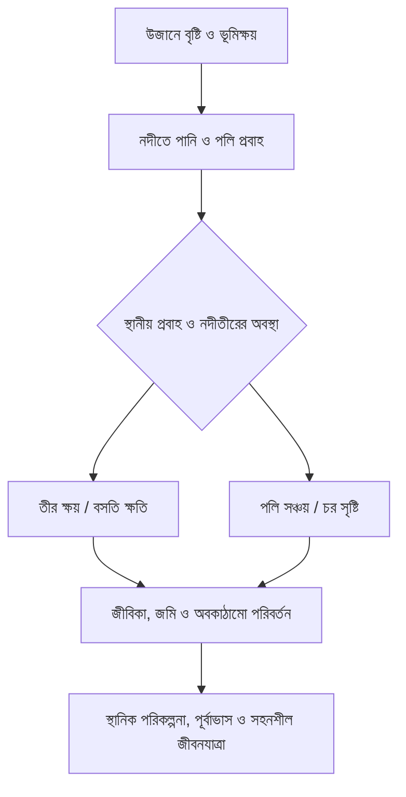

*Conceptual teaching figure; based on [Banglapedia — Bangladesh Geography](https://en.banglapedia.org/index.php?title=Bangladesh_Geography) ও [GED — Bangladesh Delta Plan 2100](https://bdp2100kp.gov.bd/BDP2100/Overview)। এটি প্রকৃত নদীর গতিপথের বৈজ্ঞানিক simulation নয়।*

### ৪.৪ History Matters — ১৭৮৭ সালের তিস্তা ও ব্রহ্মপুত্র–যমুনা কি একই ঘটনা?

**না। ইতিহাস ও বৈজ্ঞানিক ব্যাখ্যা আলাদা করে পড়ুন।**

| Timeline | কী ঘটেছে | প্রমাণের প্রকৃতি |
|---|---|---|
| **১৭৮৭** | বড় বন্যার পর **তিস্তা** পুরোনো গঙ্গামুখী প্রবাহপথ ছেড়ে ব্রহ্মপুত্রের সঙ্গে সংযোগ গড়ে তোলে—এই ইতিহাস Banglapedia-তে বর্ণিত | [Banglapedia — *Brahmaputra–Jamuna River System*](https://en.banglapedia.org/index.php/Brahmaputra-Jamuna_River_System) |
| ১৮শ শতকের শেষভাগ–১৯শ শতক | ব্রহ্মপুত্রের প্রধান প্রবাহ পুরোনো ব্রহ্মপুত্র খাত থেকে যমুনার পথে সরে যাওয়ার প্রক্রিয়া ধাপে ধাপে সম্পন্ন হয় | [2021 peer-reviewed geomorphology review](https://www.sciencedirect.com/science/article/pii/S0169555X21001045) |
| আনুমানিক ১৮৫৫–৬০ | গবেষণাটির cartographic analysis অনুসারে নতুন যমুনা চ্যানেল প্রধান প্রবাহের ভূমিকা প্রায় পুরোপুরি গ্রহণ করে | একই **2021 research** |

> [!WARNING]
> 🟨 **Common Mistake:** <mark>“১৭৮৭ সালেই ব্রহ্মপুত্রের সম্পূর্ণ নতুন গতিপথ চূড়ান্ত হয়েছিল”</mark>—এমন সরল দাবি করবেন না। ১৭৮৭-এর বন্যা ও তিস্তার পরিবর্তন একটি ঐতিহাসিক ঘটনা; ব্রহ্মপুত্রের প্রধান প্রবাহের পশ্চিমমুখী স্থানান্তর **দীর্ঘমেয়াদি প্রক্রিয়া**। ব্যাখ্যায় ঐতিহাসিক মানচিত্র, নদীর স্রোত ও ভূপ্রাকৃতিক প্রক্রিয়ার ভূমিকা উল্লেখ করুন।

### ৪.৫ People & Development — নদী বদলালে কার জীবনে কী প্রভাব?

| ক্ষেত্র | Positive Mechanism | Negative Mechanism | Balanced response |
|---|---|---|---|
| **Agriculture** | নতুন পলি, সেচ ও কৃষিজমি | জমি ভাঙন, অসময়ে প্লাবন | ফসলের ধরন, সতর্কতা, জমি ব্যবহার |
| **Settlement** | নদীতীরবর্তী যোগাযোগ ও বাজার | বাস্তুচ্যুতি ও অবকাঠামো ক্ষতি | ঝুঁকিমানচিত্র, পরিকল্পিত পুনর্বাসন |
| **Transport** | অভ্যন্তরীণ নৌযোগাযোগ | নাব্যতার পরিবর্তন, চর ও প্রবাহের সমস্যা | নিয়মিত হাইড্রোগ্রাফিক পর্যবেক্ষণ |
| **Ecosystem** | মাছ, জলাভূমি ও পলি চক্র | আবাসস্থল পরিবর্তন, দূষণ | প্রবাহ-সংযোগ ও পরিবেশগত ব্যবস্থাপনা |
| **Governance** | আন্তঃঅঞ্চল যোগাযোগ | উজান-ভাটির স্বার্থের টানাপোড়েন | অববাহিকাভিত্তিক সহযোগিতা |

### ৪.৬ Critical Thinking — শুধু নদীশাসন/বাঁধ কি যথেষ্ট?

**পক্ষ:** ঝুঁকিপূর্ণ স্থানে তীররক্ষা, পূর্বাভাস, সেচ ও অবকাঠামো রক্ষায় প্রকৌশল কাজে লাগে। **সীমাবদ্ধতা:** নদী তার খাত ও পলি বহন পরিবর্তন করতে পারে; কঠিন স্থাপনা এক স্থানের ঝুঁকি অন্যত্র সরিয়ে দিতে পারে—তাই পরিবেশ, পলি, ব্যয় ও মানুষের ওপর প্রভাব বিচার জরুরি। **সুষম উপসংহার:** নির্দিষ্ট স্থানে উপযুক্ত প্রকৌশল + নদী অববাহিকার তথ্য + প্রাকৃতিক প্রবাহ সংরক্ষণ + ক্ষতিগ্রস্ত মানুষের সহায়তা।

> [!TIP]
> 🟩 **Memory Chain: WATER → SEDIMENT → CHANNEL → LAND → PEOPLE → POLICY.** যেকোনো ৫/১০/২০ নম্বরের উত্তরে প্রয়োজন অনুযায়ী এই ছয়টি ধাপ ব্যবহার করুন।

<a id="sediment-photo"></a>

<p align="center"><a href="https://commons.wikimedia.org/wiki/File:Meghna_River_sediment_in_the_Bay_of_Bengal_(MODIS_2019-11-24).jpg"></a></p>

*🛰️ **Satellite reading:** মেঘনা মোহনায় বিভিন্ন রঙের পানি ও পলির বিস্তার দেখুন। দৃশ্যমান রং থেকে **নির্দিষ্ট পরিমাণ পলি বা ক্ষয়ের হার গণনা করা যায় না**। Creator: NASA GSFC/MODIS; Wikimedia Commons [original & license](https://commons.wikimedia.org/wiki/File:Meghna_River_sediment_in_the_Bay_of_Bengal_(MODIS_2019-11-24).jpg)।*

[⬆️ Contents](#top)


<a id="maritime"></a>

## ৫. Bay of Bengal & Maritime Geography — সমুদ্রসীমা থেকে সুনীল অর্থনীতি

### ৫.১ Why the Bay Matters — বঙ্গোপসাগর কীভাবে বাংলাদেশের অবস্থান বদলায়?

বাংলাদেশের দক্ষিণ সীমায় বঙ্গোপসাগর আছে—এ তথ্যটি শুধু মানচিত্রের নয়। নদী ও সাগরের মিলন দেশের **নৌবাণিজ্য, বন্দর, মৎস্য, উপকূলীয় কৃষি, পরিবেশ ও নিরাপত্তা**কে একই সঙ্গে প্রভাবিত করে। উদাহরণ হিসেবে চিন্তা করুন, চট্টগ্রাম বন্দরের সঙ্গে অভ্যন্তরীণ সড়ক–রেলযোগাযোগের প্রয়োজন কেন: সমুদ্র দিয়ে আসা পণ্য স্থলভাগে পৌঁছাতে হবে। আবার মাছ ধরার নৌকা ও সামুদ্রিক জীববৈচিত্র্যের প্রয়োজন বাণিজ্যিক জাহাজের প্রয়োজনের সমান নয়। তাই সমুদ্রকে শুধু সম্পদের ভাণ্ডার হিসেবে দেখলে governance-এর দিকটি বাদ পড়ে।

**কী → কোথায় → কেন:** বঙ্গোপসাগর হলো ভারত মহাসাগরের উত্তর-পূর্বাংশে একটি বৃহৎ সাগরীয় উপসাগর। দক্ষিণমুখী নদীপ্রবাহ ও মোহনা বাংলাদেশের উপকূলের সাথে সরাসরি যুক্ত; এখানে জোয়ারভাটা, পলি, ঘূর্ণিঝড় ও লবণাক্ততা গুরুত্বপূর্ণ প্রক্রিয়া। এসব প্রক্রিয়ার কারণে একদিকে খাদ্য ও বাণিজ্যের সুযোগ, অন্যদিকে উপকূলীয় ঝুঁকি তৈরি হয়।

### ৫.২ Maritime Legal Zones — ১২/২৪/২০০ কোথা থেকে মাপা হয়, অধিকার কী?

<mark>**12 / 24 / 200 nautical miles**</mark> তিনটি পৃথক সামুদ্রিক আইনগত অঞ্চল বোঝায়। সব দূরত্ব সমুদ্রসীমা নির্ধারণে প্রযোজ্য **baseline** থেকে বিবেচিত হয়; প্রতিবেশী দেশের সঙ্গে overlap থাকলে ঘোষিত সর্বোচ্চ দূরত্ব স্বয়ংক্রিয়ভাবে কার্যকর দ্বিপক্ষীয় সীমানা নয়।

| Zone | Maximum distance from baseline | রাষ্ট্রের অধিকার ও সীমা | False claim to avoid |
|---|---|---|---|
| Territorial Sea | **১২ NM** | সার্বভৌমত্ব—তবে আন্তর্জাতিক সমুদ্র আইনে অন্য রাষ্ট্রের নির্দিষ্ট নৌচলাচলের অধিকার আছে | অন্য দেশের জাহাজ কখনো যেতে পারে না |
| Contiguous Zone | **২৪ NM** | মূলত শুল্ক, রাজস্ব, অভিবাসন ও স্বাস্থ্যসংক্রান্ত নির্দিষ্ট আইন প্রয়োগে নিয়ন্ত্রণ | সমগ্র অঞ্চলই territorial sea |
| Exclusive Economic Zone (EEZ) | **২০০ NM** | সম্পদ অনুসন্ধান, আহরণ ও সংশ্লিষ্ট অর্থনৈতিক কার্যক্রমে বিশেষ সার্বভৌম অধিকার; আন্তর্জাতিক নৌচলাচলের স্বাধীনতা অব্যাহত | পূর্ণ স্থলসার্বভৌমত্ব |
| Continental Shelf | সমুদ্রতলের ভূতাত্ত্বিক/আইনি ভিত্তিতে নির্ধারিত; কিছু ক্ষেত্রে ২০০ NM ছাড়িয়ে যেতে পারে | সমুদ্রতল ও তার নিচের সম্পদের অধিকার; উপরের জলরাশির অধিকার থেকে আলাদা | EEZ ও continental shelf একই ধারণা |

> [!NOTE]
> 🔵 **Primary Law:** [Ministry of Law, Justice and Parliamentary Affairs — *Territorial Waters and Maritime Zones Act, 1974*, amended 2021](https://bdlaws.minlaw.gov.bd/act-print-467.html)। সমুদ্রের আইনি শব্দের ক্ষেত্রে এই আইন এবং **UNCLOS**-এর ভাষাই মূল; এখানে পরীক্ষার সুবিধার্থে সরলীকরণ করা হয়েছে।

### ৫.৩ Which Judgment Did What? — ২০১২ ও ২০১৪

**বাংলাদেশ–মিয়ানমার (ITLOS, ১৪ মার্চ ২০১২):** সমুদ্রসীমার বিরোধ নিষ্পত্তিতে **International Tribunal for the Law of the Sea**, Case No. 16 রায় দেয়। সমুদ্রসীমা ও মহীসোপানের ধারণা বোঝাতে এই রায় জরুরি। [ITLOS official case & judgment](https://itlos.org/en/main/cases/list-of-cases/case-no-16/)।

**বাংলাদেশ–ভারত (PCA-administered arbitration, ৭ জুলাই ২০১৪):** UNCLOS Annex VII অনুসারে গঠিত সালিসি ট্রাইব্যুনাল সমুদ্রসীমার বিষয়ে **Award** দেয়। *PCA* সালিসি কার্যক্রমের প্রশাসনিক সহায়তা দিয়েছে—এটিকে সরলভাবে “PCA আদালতের রায়” না বলে **PCA-administered arbitral award** বলা অধিক নির্ভুল। [PCA official release](https://pca-cpa.org/en/news/bay-of-bengal-maritime-boundary-arbitration-between-bangladesh-and-india-bangladesh-v-india/)।

> [!WARNING]
> 🟨 **Exam Difference:** <mark>২০১২—মিয়ানমার—ITLOS Judgment</mark> | <mark>২০১৪—ভারত—Arbitral Award</mark>। আইনি সিদ্ধান্ত মানেই সব প্রাকৃতিক সম্পদ আবিষ্কৃত বা বাণিজ্যিকভাবে উত্তোলিত—এটি দাবি করবেন না।

### ৫.৪ Blue Economy — প্রকৃত সুযোগ ও প্রয়োজনীয় শর্ত

| সম্ভাবনার খাত | কীভাবে উপকার হতে পারে | কিসে আটকে যেতে পারে | করণীয় |
|---|---|---|---|
| Maritime Trade | বন্দর ও জাহাজ চলাচলে বাণিজ্য | সংযোগ, নিরাপত্তা, দূষণ | নির্ভরযোগ্য logistics, নিরাপত্তা ও পরিবেশরক্ষা |
| Fisheries | খাদ্য, কর্মসংস্থান ও মূল্য সংযোজন | অতিআহরণ, দূষণ ও তথ্যের ঘাটতি | মজুত নিরূপণ, সংরক্ষণ ও নিয়মতান্ত্রিক আহরণ |
| Marine Research | সাগরের তথ্যভিত্তিক সম্পদ ব্যবস্থাপনা | গবেষণা, জাহাজ ও দক্ষতার অভাব | oceanography, GIS, মৎস্য গবেষণা |
| Coastal Tourism | স্থানীয় আয় ও সেবা | বর্জ্য, habitat loss, seasonal pressure | স্থানীয় অংশগ্রহণ ও carrying capacity |
| Offshore Energy | সম্ভাব্য শক্তি ও বিনিয়োগ | খরচ, পরিবেশ ও অনিশ্চয়তা | exploration evidence ও পূর্ণ environmental assessment |

**Blue Economy বনাম Coastal Exploitation:** যেকোনো সামুদ্রিক সম্পদ আহরণই সুনীল অর্থনীতি নয়। একটি ভালো উত্তরে **অর্থনৈতিক উন্নয়ন + ecosystem health + সামাজিক ন্যায় + দীর্ঘমেয়াদি sustainability** দেখাতে হবে।

### ৫.৫ Why Cyclones & Salinity Matter — উপকূলের ভৌগোলিক যুক্তি

- **ঘূর্ণিঝড়:** বঙ্গোপসাগরে সৃষ্ট ঝড়, উপকূলের ভূমির উচ্চতা, জোয়ার এবং স্থানীয় তটরেখার আকৃতি—সব মিলিয়ে বিপদ বাড়তে পারে।
- **জলোচ্ছ্বাস (Storm Surge):** ঝড়ের কারণে সমুদ্রের পানির স্তর সাময়িকভাবে স্বাভাবিকের ওপরে ওঠে; এটিকে শুধু স্বাভাবিক জোয়ার বলবেন না।
- **লবণাক্ততা (Salinity):** নদীর মিঠাপানি ও সমুদ্রের লবণাক্ত পানির মিথস্ক্রিয়া; শুষ্ক মৌসুমের প্রবাহ, জোয়ার, ভূমি ব্যবহার ও অন্যান্য স্থানীয় বিষয় ভূমিকা রাখে।
- **ঝুঁকির মাত্রা:** প্রাকৃতিক hazard এবং মানুষের **exposure** ও **vulnerability** একসঙ্গে বিচার করলে ক্ষতির প্রকৃত ধারণা মেলে।

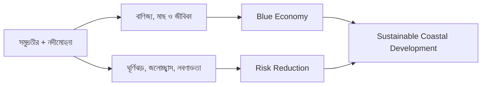

### ৫.৬ ২০ নম্বরের প্রশ্নে কীভাবে মূল্যায়ন করবেন?

**Proposition:** “The Bay of Bengal is an economic opportunity as well as a security challenge for Bangladesh.”

উত্তর সাজান: (i) অবস্থান ও আইনগত অঞ্চল; (ii) বাণিজ্য, মৎস্য ও বিজ্ঞান; (iii) ITLOS/PCA-র রায় ও কূটনৈতিক তাৎপর্য; (iv) ঘূর্ণিঝড়–সুনামি–লবণাক্ততা–পরিবেশ ঝুঁকির প্রাসঙ্গিকতা (সুনামি বিষয়ে বাংলাদেশের নির্দিষ্ট ঝুঁকি আলাদাভাবে যাচাইযোগ্য); (v) সীমা ও counterargument—নির্ধারিত সীমানা মানেই আয় নয়; (vi) গবেষণা ও সক্ষমতা; (vii) সুষম উপসংহার।

> [!TIP]
> 🟩 **Recall in one breath:** **LAW → LIVELIHOOD → LOGISTICS → LIMITS → LONG-TERM GOVERNANCE.**

[⬆️ Contents](#top)


<a id="delta-plan"></a>

## ৬. Bangladesh Delta Plan 2100 — ভূপ্রকৃতি থেকে বাস্তব নীতি

### ৬.১ Why a Delta Plan? — একই নীতি দিয়ে সারা দেশের সমস্যা সমাধান করা যায় না কেন?

বাংলাদেশের ছয়টি অঞ্চল মনে করুন—**উপকূল, বরেন্দ্র, হাওর, পার্বত্য চট্টগ্রাম, নদী–মোহনা এবং শহর**। উপকূলে লবণাক্ততার সমস্যা; বরেন্দ্রে শুষ্ক মৌসুমের পানি; হাওরে ফসল কাটার আগে পাহাড়ি ঢল; পাহাড়ে ভূমিধস; নদীতীরে ভাঙন; শহরে জলাবদ্ধতা। একই প্রকৌশলগত সমাধান সব অঞ্চলে চাপিয়ে দিলে কোথাও কার্যকর হবে, কোথাও নতুন সমস্যা তৈরি হতে পারে।

এই কারণেই [GED Knowledge Portal — *BDP 2100 Overview*](https://bdp2100kp.gov.bd/BDP2100/Overview) পানি, ভূমি, জলবায়ু, জীবিকা, বাস্তুসংস্থান ও অর্থনীতিকে **integrated and adaptive planning**-এর মাধ্যমে বিচার করে। এটি কোনো একক বাঁধ, খাল বা নির্মাণ প্রকল্প নয়; বহু দশকব্যাপী পরিকল্পনা কাঠামো।

### ৬.২ What & When — ইতিহাস, দর্শন এবং লক্ষ্য

- **নাম:** Bangladesh Delta Plan 2100 (BDP 2100)।
- **অনুমোদন:** <mark>৪ সেপ্টেম্বর ২০১৮</mark>—বাংলাদেশ পানি উন্নয়ন বোর্ডের সরকারি বিবরণ অনুযায়ী জাতীয় অর্থনৈতিক পরিষদের অনুমোদন।
- **দীর্ঘমেয়াদি দর্শন:** *Safe, climate-resilient and prosperous delta*—নিরাপদ, জলবায়ু-সহনশীল ও সমৃদ্ধ বদ্বীপ।
- **নীতি:** শুধুই বন্যা নিয়ন্ত্রণ নয়; পানি নিরাপত্তা, নদী–মোহনা ব্যবস্থাপনা, জলাভূমি সংরক্ষণ, সুশাসন এবং ভূমির কার্যকর ব্যবহার।
- **পরিকল্পনার উদাহরণ:** Investment Plan-এর প্রথম ধাপ (২০৩০ পর্যন্ত) **৮০টি প্রকল্প: ৬৫টি ভৌত ও ১৫টি প্রাতিষ্ঠানিক/জ্ঞানভিত্তিক**। এগুলো ঐ পরিকল্পনার **প্রাথমিক কর্মসূচির সংখ্যা**; সব সম্পন্ন হওয়ার দাবি নয়।

> [!NOTE]
> 🔵 **Government sources:** [BWDB — ব-দ্বীপ পরিকল্পনা বাস্তবায়ন](https://bwdb.portal.gov.bd/pages/static-pages/6922e0d4933eb65569e28c0f); [GED — BDP 2100 Overview](https://bdp2100kp.gov.bd/BDP2100/Overview); [GED — *Investment Plan*, vol. 2, part 1](https://gedkp.gov.bd/wp-content/uploads/2021/02/BDP-2100-Volume-2-Investment-Plan-Part-1-The-Plan.pdf)।

### ৬.৩ BDP's Six Goals — শুধু ‘৬টি Hotspot’ নয়, ৬টি লক্ষ্যও আছে

**Six Delta-Specific Goals:**

1. বন্যা ও জলবায়ুসংশ্লিষ্ট দুর্যোগ থেকে নিরাপত্তা।
2. পানিনিরাপত্তা ও পানি ব্যবহারের দক্ষতা বৃদ্ধি।
3. নদী ও মোহনার সমন্বিত টেকসই ব্যবস্থাপনা।
4. জলাভূমি ও বাস্তুসংস্থান সংরক্ষণ এবং বিচক্ষণ ব্যবহার।
5. দেশীয় ও আন্তঃসীমান্ত পানি ব্যবস্থাপনায় কার্যকর প্রতিষ্ঠান ও ন্যায়সংগত সুশাসন।
6. ভূমি ও পানিসম্পদের সর্বোত্তম ব্যবহার।

<mark>“৬টি Goal” এবং “৬টি Hotspot” এক জিনিস নয়।</mark> একটি **কী অর্জন করতে চাই**, অন্যটি **কোন অঞ্চলে অগ্রাধিকার প্রয়োগ করব**। [Source: GED, *BDP 2100 Overview*](https://bdp2100kp.gov.bd/BDP2100/Overview)।

### ৬.৪ Six Hotspots — কোথায়, কেন, কীভাবে নীতি আলাদা?

| Hotspot | Area in BDP Investment Plan (km²) | প্রক্রিয়া ও ঝুঁকি | উপযোগী নীতির ধরন |
|---|---:|---|---|
| **Coastal Zone** | **27,738** | জোয়ারভাটা, লবণাক্ততা, ঘূর্ণিঝড় | উপকূলরক্ষা, লবণাক্ততা-সহনশীল কৃষি, পরিবেশ |
| **Barind & Drought-prone** | **22,848** | মৌসুমি পানির অভাব, পানি উত্তোলন | দক্ষ সেচ, জলাধার, crop planning |
| **Haor & Flash Flood** | **16,574** | আগাম বন্যা, মৌসুমি জলাভূমি | আগাম সতর্কতা, ফসলের সময়, জলপ্রবাহ |
| **Chattogram Hill Tracts** | **13,295** | ভূমিধস ও ঢালের প্রবাহ | ভূমি ব্যবহার ও বন ব্যবস্থাপনা |
| **Rivers & Estuaries** | **35,204** | নদীভাঙন, পলি সঞ্চয়, নাব্যতা | নদী–অববাহিকার তথ্য, navigation |
| **Urban Areas** | **19,823** | জলাবদ্ধতা, অপরিকল্পিত ভূমি ব্যবহার | stormwater drainage, zoning |

> [!WARNING]
> 🟨 **Data note:** এখানে area হলো **BDP Investment Plan-এর পরিকল্পনাগত hotspot area**, সাধারণ জেলা বা বাংলাদেশের মোট ভূমির নতুন জরিপ নয়। একই জেলার বিভিন্ন পরিকল্পনাগত অংশ overlap করতে পারে। <mark>ছয়টি আয়তন যোগ করে বাংলাদেশের আয়তন বা land share হিসাব করা যাবে না।</mark> [GED Investment Plan, pp. 6–7](https://gedkp.gov.bd/wp-content/uploads/2021/02/BDP-2100-Volume-2-Investment-Plan-Part-1-The-Plan.pdf)।

### ৬.৫ How Adaptive Planning Works — ‘Adaptive’ শব্দটির আসল অর্থ

**ধাপ ১: পর্যবেক্ষণ (Observe)** — নদীর গভীরতা, খরা, বন্যা, লবণাক্ততা, বৃষ্টির ধরন ও জীবন-জীবিকা নিয়ে তথ্য সংগ্রহ।

**ধাপ ২: ভবিষ্যৎ নিয়ে একাধিক সম্ভাবনা (Scenarios)** — জলবায়ু, জনসংখ্যা ও অবকাঠামোর পরিবর্তন এক রকম হবে ধরে না নিয়ে একাধিক পরিস্থিতি দেখা।

**ধাপ ৩: এখন যে কাজ দরকার (No-regret/Early Measures)** — আগাম সতর্কতা, পানি ব্যবস্থাপনা, তথ্যভিত্তিক মানচিত্র ও সক্ষমতা উন্নয়ন।

**ধাপ ৪: পর্যালোচনা (Monitor & Review)** — প্রকল্প বাস্তবে ঝুঁকি কমাল কি না দেখা; প্রয়োজনে নীতি বদলানো।

**ধাপ ৫: সমন্বয় (Coordinate)** — কৃষি, পানি, বন, দুর্যোগ, নগর ও স্থানীয় জনগণের অংশগ্রহণ একসঙ্গে রাখা।

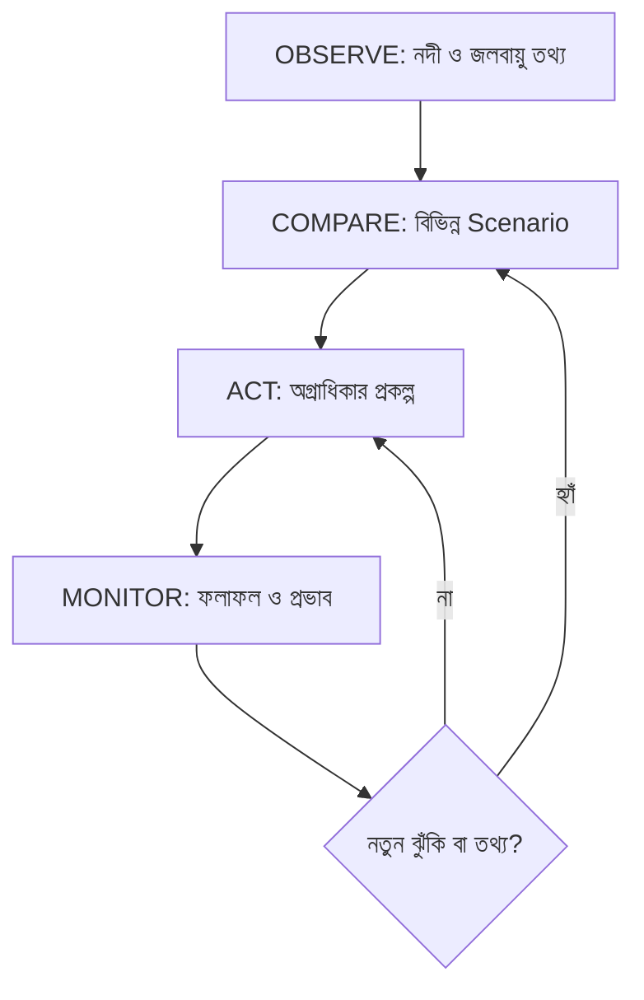

**এটি conceptual illustration**, GED-এর কোনও নির্দিষ্ট প্রকল্পের প্রত্যক্ষ output নয়।

### ৬.৬ Critical Evaluation — কেন শুধু পরিকল্পনা থাকলেই সফলতা আসে না?

**শক্তি:** আঞ্চলিক বৈচিত্র্য বোঝা, ঝুঁকি ও বিনিয়োগকে দীর্ঘমেয়াদে যুক্ত করা এবং পরিবেশকে অর্থনীতির সঙ্গে বিবেচনা। **প্রয়োগগত সমস্যা:** তহবিল, প্রতিষ্ঠানগুলোর সমন্বয়, মানসম্মত তথ্য, দীর্ঘমেয়াদি রক্ষণাবেক্ষণ, স্থানীয় অংশগ্রহণ ও ফলাফল পরিমাপ। **মূল কথা:** প্রকল্পের সংখ্যা বা ঘোষিত অর্থ বরাদ্দকে প্রকল্প-সম্পন্ন বা ঝুঁকি-হ্রাসের প্রমাণ ধরা যাবে না। সফলতা যাচাই করতে হবে বাস্তব সূচক দিয়ে—যেমন ফসল ক্ষতি কমা, নিরাপদ পানি পাওয়া, জলাবদ্ধতা বা নদীভাঙন ঝুঁকি কমা, বাস্তুসংস্থানের অবস্থা।

> [!TIP]
> 🟩 **Two Sixes:** **৬টি Goal = What we want**; **৬টি Hotspot = Where we act**। **Adaptive = Observe → Decide → Monitor → Adjust**।

[⬆️ Contents](#top)


<a id="people"></a>

## ৭. Human Geography, Culture & Geographical Determinism — মানুষ কীভাবে ভূগোল বদলায়?

### ৭.১ Physical vs Human Geography — একই নদী, দুটি প্রশ্ন

পদ্মা নদীর তীরে দুজন গবেষক কাজ করছেন। একজন দেখছেন **নদীটি কেন বাঁক বদলায়, কোথায় পলি জমে**—এটি *Physical Geography*। অন্যজন দেখছেন **নদীভাঙনে পরিবার কোথায় যায়, কীভাবে কর্মসংস্থান বদলায়, স্কুলে যাতায়াত কঠিন হয় কি না**—এটি *Human Geography*। দুটি গবেষণা মিললে নদীর তীররক্ষার সিদ্ধান্ত মানুষের জন্য কার্যকর হয়।

| দৃষ্টিকোণ | মূল প্রশ্ন | তথ্য | উদাহরণ |
|---|---|---|---|
| Physical Geography | ভূমিরূপ ও প্রাকৃতিক প্রক্রিয়া কীভাবে কাজ করে? | নদীর গতি, মাটি, ঢাল, বৃষ্টি | যমুনায় চর গঠন |
| Human Geography | মানুষ কোথায় বাস করে ও কেন? | বসতি, জীবিকা, যোগাযোগ, ঝুঁকি | চরবাসীর স্থানান্তর |
| Human–Environment Interaction | মানুষ ও প্রকৃতি পরস্পরকে কীভাবে বদলায়? | বাঁধ, খাল, সেচ, ভূমি ব্যবহার | জলাবদ্ধতা বা কৃষিজমি |

### ৭.২ Geography & Livelihood — অঞ্চলের সঙ্গে পেশার যোগসূত্র

- **নদী অববাহিকা:** কৃষি, মাছ, নৌবাণিজ্য; একই সঙ্গে নদীভাঙনে জীবিকার অনিশ্চয়তা।
- **হাওর:** মৌসুমি জলচক্রের সঙ্গে কৃষিক্যালেন্ডার, নৌপথ ও মাছের সম্পর্ক।
- **পাহাড়:** ঢাল ও বনভূমি ভূমি ব্যবহার, যোগাযোগের খরচ এবং বসতিস্থান নির্বাচনে প্রভাব ফেলে।
- **উপকূল:** জোয়ারভাটা, লবণাক্ততা ও সাগরের সম্পদ কৃষি ও মাছ-ভিত্তিক জীবিকাকে প্রভাবিত করে।
- **বরেন্দ্র:** পানির মৌসুমি প্রাপ্যতা ও সেচ কৌশল চাষাবাদের সিদ্ধান্তে প্রভাব ফেলে।

এগুলো **ভূগোলগত প্রভাব**, কোনো অঞ্চলের মানুষের একমাত্র নির্ধারিত পেশা নয়; শিক্ষা, সম্পদ, বাজার, প্রযুক্তি ও রাষ্ট্রীয় নীতিও সমান গুরুত্বপূর্ণ হতে পারে।

### ৭.৩ Geographic Determinism — পরিবেশ কি মানুষের সংস্কৃতি ‘নির্ধারণ’ করে?

**Definition:** *Geographical/Environmental Determinism* হলো এমন দৃষ্টিভঙ্গি, যেখানে মানুষের সমাজ ও সংস্কৃতি গঠনে প্রাকৃতিক পরিবেশকে প্রধান বা প্রায় নির্ধারক শক্তি ধরা হয়।

**ভৌগোলিক প্রভাবের বাস্তব যুক্তি:**

1. নদীমাতৃক জীবন কৃষি, মাছ, নৌপরিবহন ও লোকজ অভিজ্ঞতার সঙ্গে যুক্ত।
2. মৌসুমি বৃষ্টিপাত কৃষির সময়, ঘরবাড়ির নকশা ও যাতায়াতকে প্রভাবিত করতে পারে।
3. পাহাড় ও জলাভূমি বসতি ও যোগাযোগে ভিন্ন ভিন্ন সীমা ও সুযোগ তৈরি করে।
4. উপকূলের ঝড় বা লবণাক্ততা জীবিকার অভিযোজনকে প্রভাবিত করতে পারে।

**কিন্তু Determinism-এর সীমা কোথায়?**

- একই ভৌগোলিক অঞ্চলে নানা ভাষা, সামাজিক প্রতিষ্ঠান, ধর্ম ও সংস্কৃতি থাকতে পারে।
- প্রযুক্তি, সড়ক, বাঁধ, বাজার, শিক্ষা ও রাজনৈতিক সিদ্ধান্ত প্রাকৃতিক সীমাবদ্ধতা বদলাতে পারে।
- মানুষের সংস্কৃতিকে একমাত্র ভূগোলের ‘অবধারিত ফল’ বলা ঐতিহাসিক ও সামাজিক বাস্তবতাকে উপেক্ষা করে।
- **Possibilism** পরিবেশ সুযোগ ও সীমা তৈরি করে, কিন্তু মানুষের সিদ্ধান্তও পরিবর্তনের পথ খুলে দেয়—এই যুক্তি দিতে সাহায্য করে।

> [!IMPORTANT]
> **Critical thesis:** <mark>ভূগোল মানুষের জীবন ও সংস্কৃতিকে প্রভাবিত করে; কিন্তু একাই সম্পূর্ণ নির্ধারণ করে না।</mark> পরীক্ষায় **influence** ও **determine** শব্দদুটির পার্থক্য দেখালে উত্তর গভীর হয়।

### ৭.৪ Geography & Settlement — বসতি কোথায় হয়, কেন বদলায়?

একটি বসতি গড়ে ওঠার প্রশ্নে অন্তত পাঁচটি বিষয় বিচার করুন: **(১) পানির প্রাপ্যতা, (২) ভূমির উচ্চতা/বন্যার ঝুঁকি, (৩) সড়ক–নৌযোগাযোগ, (৪) জীবিকার সুযোগ, (৫) সামাজিক ও প্রাতিষ্ঠানিক নিরাপত্তা।** নদীতীরের কাছে বাজার সুবিধাজনক হলেও তীরভাঙনের ঝুঁকি থাকতে পারে; উঁচু সোপানে বন্যার চাপ অপেক্ষাকৃত কম হলেও শুষ্ক মৌসুমে পানির সমস্যা বেশি হতে পারে। একটি মাত্র ভৌগোলিক কারণ দিয়ে সিদ্ধান্ত ব্যাখ্যা করা তাই অসম্পূর্ণ।

### ৭.৫ Evaluation Matrix — ‘ভূগোল সংস্কৃতিকে কতটা প্রভাবিত করেছে?’

| Claim | Supporting example | Counterpoint | Balanced conclusion |
|---|---|---|---|
| নদী জীবনধারা প্রভাবিত করে | নদীপথ, মৎস্য ও কৃষি | প্রযুক্তি ও বাণিজ্য জীবন বদলায় | প্রভাব আছে, নির্ধারণবাদ নয় |
| ভূমিরূপ বসতিকে প্রভাবিত করে | হাওর, পাহাড়, চর | পরিকল্পনা ও অবকাঠামো অভিযোজন সম্ভব | সীমাবদ্ধতা + মানবিক agency |
| পরিবেশ ঝুঁকি তৈরি করে | বন্যা, ভূমিধস, ঘূর্ণিঝড় | প্রস্তুতি ও সুশাসন ক্ষতি কমায় | Hazard ≠ inevitable disaster |
| সম্পদ অর্থনীতির সুযোগ দেয় | নদী ও সমুদ্র | গবেষণা/বিনিয়োগ/সুশাসন ছাড়া আয় নিশ্চয় নয় | Geography + Institution = Outcome |

**প্রশ্ন: “Evaluate the influence of geography on Bangladeshi culture.”**

**উত্তর:** ভূমিকা → দেশের নদী–মৌসুম–পাহাড়–সমুদ্রের বৈশিষ্ট্য → কৃষি ও মৎস্যের জীবনধারা → পরিবহন, বসতি ও স্থানীয় অভিযোজন → সমালোচনা: সংস্কৃতির গঠন ইতিহাস, সামাজিক রীতি, শিক্ষা ও রাজনৈতিক প্রক্রিয়ায়ও নির্ভরশীল → উপসংহার: geography is influential but not all-determining।

> [!NOTE]
> 🔵 **Evidence basis:** [Banglapedia — *Bangladesh Geography*](https://en.banglapedia.org/index.php?title=Bangladesh_Geography); [GED — *BDP 2100* (livelihoods, equitable water governance)](https://bdp2100kp.gov.bd/BDP2100/Overview)। Determinism বনাম Possibilism অংশটি ভূগোলচর্চার ধারণাগত পাঠ-ব্যাখ্যা; সরাসরি Banglapedia-র উদ্ধৃতি নয়।

[⬆️ Contents](#top)


<a id="pyq"></a>

## ৮. Previous BCS Questions — বিগত প্রশ্নের উৎসভিত্তিক বিশ্লেষণ

নিচের সারণিতে BCS EXAM নামের **তৃতীয় পক্ষের পুনর্গঠিত প্রশ্নসংকলন**-এ পাওয়া বিষয়গুলোর **English rendering** দেওয়া হলো। প্রশ্নসংকলন নিজেই জানিয়েছে এগুলো BPSC মূল কাগজ থেকে সরাসরি টাইপ করা নয়; কয়েকটি পত্র অসম্পূর্ণও থাকতে পারে। **Status: secondary-source match; NOT independently authenticated official paper.** আপনার দেওয়া বইয়ের ছবিগুলো এই অধ্যায়ের বিষয়বস্তুর সঙ্গে ব্যবহার করা হয়েছে, কিন্তু ফটোর সাল-লেবেলকেও মূল BPSC প্রমাণ ধরা হয়নি।

| BCS | English + বাংলা প্রশ্ন (ভাবানুবাদ) | Marks indicated in archive | Archive | Source status |
|---|---|---:|---|---|
| 35th | **English:** Explain Bangladesh's geographical position in South Asia. **বাংলা:** দক্ষিণ এশিয়ায় বাংলাদেশের ভৌগোলিক অবস্থান ব্যাখ্যা করুন। | 5 | [S14] | FAO — Food and Agriculture Organization of the UN | *Country Papers: Bangladesh*, physiographic landform 80/8/12 and river basin | [FAO reference](https://www.fao.org/4/ac623e/ac623e0b.htm) |
| [S15] | Peer-reviewed geomorphology (2021) | *Avulsion of the Brahmaputra in Bangladesh during the 18th–19th century: A review based on cartographic and literary evidence* | [Scientific article](https://www.sciencedirect.com/science/article/pii/S0169555X21001045) |
| [S16] | GED Knowledge Portal — Government of Bangladesh | *Bangladesh Delta Plan 2100: Overview, Goals, Strategies, Hotspots* (approved 4 September 2018) | [GED official portal](https://bdp2100kp.gov.bd/BDP2100/Overview) |
| [S17] | GED, Planning Commission — Bangladesh Government | *Bangladesh Delta Plan 2100, Volume 2, Investment Plan, Part 1: The Plan* | [Official investment plan PDF](https://gedkp.gov.bd/wp-content/uploads/2021/02/BDP-2100-Volume-2-Investment-Plan-Part-1-The-Plan.pdf) |
| [S18] | FAO — Food and Agriculture Organization of the UN | *Study on Livelihood Systems Assessment in Drought-prone Areas of NW Bangladesh*; Barind, Nachole, Porsha and Sapahar | [FAO Barind study](https://www.fao.org/4/ag257e/AG257E06.htm) |
| [Q1] | Secondary archive |
| 35th | **English:** What is the economic importance of the Bay of Bengal? **বাংলা:** বঙ্গোপসাগরের অর্থনৈতিক গুরুত্ব কী? | 5 | [Q1] | Secondary archive |
| 36th | **English:** What is meant by inactive or moribund delta regions? **বাংলা:** নিষ্ক্রিয় বা মরিবান্ড বদ্বীপ বলতে কী বোঝায়? | 5 | [Q2] | Secondary archive |
| 36th | **English:** Explain the importance of the Barind region (question grouped with other subtopics). **বাংলা:** বরেন্দ্র অঞ্চলের গুরুত্ব ব্যাখ্যা করুন (একই প্রশ্নে অন্যান্য উপবিষয়ও ছিল)। | 5 | [Q2] | Secondary archive |
| 40th | **English:** Describe Bangladesh's geographical location and physiography. **বাংলা:** বাংলাদেশের ভৌগোলিক অবস্থান ও ভূপ্রকৃতি বর্ণনা করুন। | 10 | [Q3] | Secondary archive |
| 40th | **English:** Discuss Bangladesh's geopolitical importance and risks. **বাংলা:** বাংলাদেশের ভূ-কৌশলগত গুরুত্ব ও ঝুঁকি আলোচনা করুন। | 10 | [Q3] | Secondary archive |
| 40th | **English:** Short note: Blue Economy. **বাংলা:** সংক্ষিপ্ত টীকা: সুনীল অর্থনীতি (Blue Economy)। | note, question set | [Q3] | Secondary archive |
| 43rd | **English:** Define Bangladesh's geographical location. **বাংলা:** বাংলাদেশের ভৌগোলিক অবস্থান নির্ণয় করুন। | 5 | [Q4] | Secondary archive |
| 43rd | **English:** Identify the districts associated with the Barind region. **বাংলা:** বরেন্দ্র অঞ্চলের সংশ্লিষ্ট জেলাগুলো চিহ্নিত করুন। | 5 | [Q4] | Secondary archive |
| 43rd | **English:** Describe regional topographical features. **বাংলা:** বাংলাদেশের অঞ্চলভিত্তিক ভূপ্রকৃতি বর্ণনা করুন। | 10 | [Q4] | Secondary archive |
| 47th | **English:** Define geographical determinism and assess geographical factors in Bangladeshi culture. **বাংলা:** ভৌগোলিক নিয়ন্ত্রণবাদের সংজ্ঞা দিন এবং বাংলাদেশের সংস্কৃতিতে ভূগোলের প্রভাব মূল্যায়ন করুন। | 20 | [Q5] | Secondary archive; recent collection, verify official copy |

**Trend interpretation (not statistical forecast):** অবস্থান + ভূপ্রকৃতি; বরেন্দ্র ও বদ্বীপ; ভূরাজনীতি ও বঙ্গোপসাগর; এবং ভূগোলের সমাজ-সংস্কৃতির প্রভাব—এসব recurring question *themes*। প্রশ্নের wording, marks ও সাল BPSC মূল PDF স্ক্যান পাওয়া গেলে পুনরায় মিলিয়ে দেখতে হবে। এই ছোট online corpus থেকে কোনো ‘উত্তর আসবেই’ probability গণনা করা হয়নি।

<a id="strategy"></a>


### 🔎 Expanded PYQ Evidence — ৩৫তম থেকে ৪৭তমের প্রাসঙ্গিক প্রশ্নধারা

> [!WARNING]
> **প্রমাণের স্তর:** **B = named third-party archived question paper**, **C = পাশের ইউনিট বা অন্য পত্র থেকে সংশ্লিষ্ট বিষয়**, **P = editorial predicted question**। মূল BPSC question-paper PDF দিয়ে হুবহু যাচাই না হওয়ায় এখানে কোনো প্রশ্নকে **A = official-original verified** বলা হয়নি। English wording হলো শিক্ষার সুবিধার্থে অনুবাদ বা ভাবানুবাদ।

| BCS | English + বাংলা প্রশ্ন | Marks / paper | Evidence & named archive |
|---|---|---|---|
| 35th | **English:** Describe Bangladesh's geographical position in South Asia; explain the economic importance of the Bay of Bengal. **বাংলা:** দক্ষিণ এশিয়ায় বাংলাদেশের অবস্থান ও বঙ্গোপসাগরের অর্থনৈতিক গুরুত্ব ব্যাখ্যা করুন। | ৫+৫; Bangladesh Affairs | **B — [BCS EXAM, 35th archive](https://bcsexam.org/written-questions/35th-bcs-written)** |
| 36th | **English:** Explain the importance of the coral island; inactive delta; Barind region and Varendra Museum. **বাংলা:** প্রবাল দ্বীপ, নিষ্ক্রিয় বদ্বীপ, বরেন্দ্র অঞ্চল ও বরেন্দ্র গবেষণা জাদুঘরের গুরুত্ব ব্যাখ্যা করুন। | ৫+৫+৫; Bangladesh Affairs | **B — [BCS EXAM, 36th archive](https://bcsexam.org/written-questions/36th-bcs-written)** |
| 37th | **English:** Describe Bangladesh's geographical position and its advantages. **বাংলা:** বাংলাদেশের ভৌগোলিক অবস্থান ও এর সুবিধাগুলো বর্ণনা করুন। | ৩+৭; Bangladesh Affairs | **B — [BCS EXAM, 37th archive](https://bcsexam.org/written-questions/37th-bcs-written)** |
| 38th | **English:** Strategic position of Bangladesh — a neighbouring paper's related theme. **বাংলা:** বাংলাদেশের ভূ-কৌশলগত অবস্থান—ভিন্ন পত্রের সংশ্লিষ্ট বিষয়। | International Affairs; **Bangladesh Affairs নয়** | **C — [BCS EXAM, 38th archive](https://bcsexam.org/written-questions/38th-bcs-written)** |
| 40th | **English:** Describe geographical location and topography; discuss strategic position and geopolitical risks. **বাংলা:** বাংলাদেশের অবস্থান ও ভূপ্রকৃতি বর্ণনা করুন; ভূ-কৌশলগত গুরুত্ব ও ঝুঁকি আলোচনা করুন। | ১০+১০; Bangladesh Affairs | **B — [BCS EXAM, 40th archive](https://bcsexam.org/written-questions/40th-bcs-written)** |
| 41st | **English:** Short note: Bangladesh's maritime-boundary settlement. **বাংলা:** সংক্ষিপ্ত টীকা: বাংলাদেশের সমুদ্রসীমা নির্ধারণে অর্জন। | Short note; Bangladesh Affairs | **B — [BCS EXAM, 41st archive](https://bcsexam.org/written-questions/41st-bcs-written)** |
| 43rd | **English:** Locate Bangladesh; identify the Barind districts; describe regional topography. **বাংলা:** বাংলাদেশের অবস্থান, বরেন্দ্র অঞ্চলের জেলা এবং অঞ্চলভিত্তিক ভূপ্রকৃতি বর্ণনা করুন। | ৫+৫+১০; Bangladesh Affairs | **B — [BCS EXAM, 43rd archive](https://bcsexam.org/written-questions/43rd-bcs-written)** |
| 44th | **English:** Environmental and river-process descriptions in other papers, without evidence of a direct Unit-1 Bangladesh Affairs geography question. **বাংলা:** অন্য পত্রে পরিবেশ ও নদীপ্রক্রিয়া-সংক্রান্ত আলোচনা; সরাসরি এ ইউনিটের প্রশ্ন হিসেবে যাচাইকৃত নয়। | Cross-paper context, not claimed as Unit-1 PYQ | **C — [BCS EXAM, 44th archive](https://bcsexam.org/written-questions/44th-bcs-written)** |
| 45th | **English:** Why is a Teesta water-sharing agreement necessary? **বাংলা:** তিস্তার পানি বণ্টন চুক্তি কেন প্রয়োজন? | ২০; Bangladesh Affairs (cross-unit) | **C — [BCS EXAM, 45th archive](https://bcsexam.org/written-questions/45th-bcs-written)** |
| 46th | **English:** Evaluate the problems and prospects of marine-resource extraction in Bangladesh. **বাংলা:** বাংলাদেশে সামুদ্রিক সম্পদ আহরণের সমস্যা ও সম্ভাবনা মূল্যায়ন করুন। | ২০; Bangladesh Affairs (mainly natural resources unit) | **C — [BCS EXAM, 46th archive](https://bcsexam.org/written-questions/46th-bcs-written)** |
| 47th | **English:** Define geographical determinism and evaluate geographical influence on Bangladeshi culture. **বাংলা:** ভৌগোলিক নিয়ন্ত্রণবাদের সংজ্ঞা দিন এবং বাংলাদেশের সংস্কৃতিতে ভৌগোলিক পরিবেশের প্রভাব মূল্যায়ন করুন। | ২০; Bangladesh Affairs (geography–culture link) | **B — [BCS EXAM, 47th archive](https://bcsexam.org/written-questions/47th-bcs-written)** |

**৪০তমের প্রশ্নদুটি সবচেয়ে গুরুত্বপূর্ণ শিক্ষণীয় জুটি:** আগে *location + topography* বর্ণনা, পরে *geopolitical importance + risk* মূল্যায়ন। একই মূল ধারণা থেকে দুটি ভিন্ন cognitive task এসেছে। তাই তথ্যের পাশে কারণ, প্রভাব, উদাহরণ ও নীতি লিখে পড়া আবশ্যক।

**৩৬তমের প্রশ্নে বিশেষ সতর্কতা:** *Barind region* এবং *Varendra Museum* একই উপপ্রশ্নে এলেও জাদুঘরটির আলোচনা ঐতিহ্য ও প্রত্নতত্ত্বের সঙ্গে জড়িত; বরেন্দ্রভূমির ভূতত্ত্বের সমার্থক নয়। Coral island-এর জন্য সেন্ট মার্টিন এবং inactive delta-এর জন্য নদীপ্রবাহ ও sediment supply আলাদাভাবে পড়ুন।

**৪৭তমের বিশ্লেষণ:** ভৌগোলিক নিয়ন্ত্রণবাদ (Geographical Determinism) বলতে পরিবেশের প্রভাবকে অতিরিক্ত একমুখীভাবে ব্যাখ্যার ধারণা বোঝায়। ভালো উত্তরে বাংলাদেশের নদী, বৃষ্টি, উপকূল, পাহাড়ের সাংস্কৃতিক প্রভাব স্বীকার করে শিক্ষা, প্রযুক্তি, সামাজিক সিদ্ধান্ত ও ইতিহাসের স্বাধীন ভূমিকা দেখাতে হবে।

> [!TIP]
> **Trend Memory: Fact → Comparison → Cause → Evaluation → Policy.** প্রথমে স্থানাঙ্ক ও শ্রেণি জানুন; তারপর বরেন্দ্র বনাম হাওর তুলনা করুন; পরে নদী ও পলির কারণ ব্যাখ্যা করুন; সর্বশেষ ভূরাজনীতি, সংস্কৃতি ও টেকসই উন্নয়নে যুক্তি প্রয়োগ করুন। এই ধারা **qualitative thematic interpretation**, ভবিষ্যৎ প্রশ্নের নির্দিষ্ট সম্ভাবনা নয়।

| Question verb | কোন তথ্য স্মরণ করবেন | পরীক্ষার visual |
|---|---|---|
| Define / Identify | সহজ সংজ্ঞা + উদাহরণ | ১ লাইনের সূত্র |
| Classify / Compare | তিন ভূমিরূপ, অঞ্চলের পার্থক্য | comparative table |
| Explain / Describe | নদী–পলি–ভূমিরূপের কারণ | cause–effect flowchart |
| Analyse | সুযোগ, সীমাবদ্ধতা, stakeholders | opportunity–risk matrix |
| Evaluate | শক্তি, দুর্বলতা, পাল্টা যুক্তি | ২-পক্ষীয় তুলনা |
| Recommend | অঞ্চলভিত্তিক evidence ও সিদ্ধান্ত | BDP hotspot policy chart |

[⬆️ Go to Contents](#top)

---

## ৯. Exam Answer Engineering — অচেনা প্রশ্নেও উত্তর তৈরির পদ্ধতি

### ৯.১ প্রশ্নের Verb দেখেই উত্তর পরিকল্পনা করুন

| Question verb | পরীক্ষক কী দেখতে চান | লিখবেন কীভাবে |
|---|---|---|
| **Define / What is** | সঠিক অর্থ ও সীমানা | ১–২ বাক্যে সংজ্ঞা + উদাহরণ |
| **Describe** | উপাদান ও বৈশিষ্ট্যের সংগঠিত বর্ণনা | location → features → example |
| **Explain Why/How** | cause → mechanism → effect | ৩–৫ ধাপের causal chain |
| **Compare / Distinguish** | মিল ও পার্থক্য | ৩–৪ মানদণ্ডের comparative table |
| **Analyse** | কয়েকটি কারণ ও তাদের সম্পর্ক | cause + stakeholder + impact |
| **Evaluate / Assess** | শক্তি, সীমাবদ্ধতা ও বিচার | pros → cons → evidence → reasoned judgment |
| **Recommend / Suggest** | সমস্যা অনুযায়ী বাস্তবসম্মত প্রস্তাব | problem → intervention → feasibility → expected effect |

### ৯.২ Marks-Based Structure — উত্তর ছোট–বড় করবেন কীভাবে?

**৫ নম্বর:** ১ বাক্যে সংজ্ঞা; ৩টি নির্ভুল পয়েন্ট; ১টি উদাহরণ; প্রয়োজন হলে ১টি source name। উদাহরণ: **Floodplain vs Terrace**—উৎপত্তি, উচ্চতা, ব্যবহার।

**১০ নম্বর:** ভূমিকা → ৪টি বিশ্লেষণী শিরোনাম → labelled map বা ছোট comparative table → সীমাবদ্ধতা → ২ বাক্যের উপসংহার। উদাহরণ: **Bangladesh’s regional topography**—প্লাবনভূমি, সোপান, পাহাড়, কৃষি ও ঝুঁকি।

**২০ নম্বর:** বক্তব্য (thesis) → ভৌগোলিক প্রেক্ষাপট → **why/how** → অঞ্চলভিত্তিক উদাহরণ → positive/negative impacts → counterargument → নীতিগত সুপারিশ → প্রমাণভিত্তিক উপসংহার। ২০ নম্বরের উত্তরে শুধু তালিকা দিলে বিশ্লেষণ প্রমাণ হয় না।

### ৯.৩ The W-H-I-P-C Method — সব প্রশ্নের জন্য ৫টি প্রশ্ন

> [!TIP]
> 🟩 **W-H-I-P-C:** **What** (সংজ্ঞা) → **How/Why** (প্রক্রিয়া ও কারণ) → **Impact** (ফলাফল) → **Policy** (করণীয়) → **Critical view** (সীমাবদ্ধতা)। অবস্থানভিত্তিক প্রশ্নে **Where** আলাদাভাবে যুক্ত করুন।

**নিজের উত্তর পরীক্ষা করার rubric:**

| Criteria | ১০-এর মধ্যে self-check |
|---|---:|
| প্রশ্নের সঙ্গে উত্তর সরাসরি মেলে | ২ |
| সংজ্ঞা ও প্রক্রিয়ার সঠিকতা | ২ |
| বাংলাদেশের নির্দিষ্ট উদাহরণ | ২ |
| কারণ–ফল ও পাল্টা যুক্তি | ২ |
| পরিষ্কার উপসংহার, মূল উৎস ও উপস্থাপনা | ২ |

*এটি একটি self-study rubric; BPSC-এর সরকারি নম্বর বণ্টন নয়।*

### ৯.৪ Source Citing in the Exam

“**According to Banglapedia (Asiatic Society of Bangladesh), Bangladesh Geography**, physiographic regions can be grouped as floodplains, terraces and hills.” অথবা “**GED, Bangladesh Delta Plan 2100 (approved 2018)** identifies six regional hotspots.” আইনি প্রশ্নে “**ITLOS (2012)**” অথবা “**Arbitral Award in Bangladesh–India maritime delimitation (2014)**”—নাম ও সাল উল্লেখ করা যায়। প্রশ্নে প্রয়োজন ছাড়া URL লিখতে হয় না।

[⬆️ Contents](#top)


<a id="questions"></a>

## ১০. Important English Questions — ৩০টি বাংলা Model Answer

> Past-paper-derived *themes* and original predictions are labelled individually. **Expanded model answers:** every answer includes structured Bengali explanation, examples, and a conceptual Mermaid diagram; comparison tables are used where appropriate. 5/10/20-mark depth should still be adjusted to the question's exact command and available exam time.

<a id="question-index"></a>

### ⚡ Quick Question Finder — ৩০টি প্রশ্নে সরাসরি যান

**পদ্ধতি:** English question নির্বাচন করুন → ছোট ধাপে সাজানো বাংলা উত্তর পড়ুন → নীল Source Box থেকে উদ্ধৃতিযোগ্য প্রতিষ্ঠানের নাম শিখুন।

#### A. Location & Strategy

- [Q01 — Explain the geographical location of Bangladesh and its significance in South Asia.](#q01) — *বাংলাদেশের ভৌগোলিক অবস্থান ব্যাখ্যা করুন এবং দক্ষিণ এশিয়ায় এর গুরুত্ব মূল্যায়ন করুন।*
- [Q02 — Describe the major topographical features of Bangladesh with regional examples.](#q02) — *বাংলাদেশের প্রধান ভূপ্রাকৃতিক বৈশিষ্ট্যগুলো আঞ্চলিক উদাহরণসহ বর্ণনা করুন।*
- [Q03 — Assess the strategic geopolitical position and risks of Bangladesh.](#q03) — *বাংলাদেশের ভূ-কৌশলগত অবস্থান ও সংশ্লিষ্ট ঝুঁকি মূল্যায়ন করুন।*
- [Q04 — What is the economic importance of the Bay of Bengal for Bangladesh?](#q04) — *বাংলাদেশের জন্য বঙ্গোপসাগরের অর্থনৈতিক গুরুত্ব কী?*

#### B. Delta & Landforms

- [Q05 — Differentiate between an active delta and an inactive or moribund delta.](#q05) — *সক্রিয় ও নিষ্ক্রিয় (Moribund) বদ্বীপের পার্থক্য দেখান।*
- [Q06 — Explain the origin of the Ganges–Brahmaputra–Meghna delta.](#q06) — *গঙ্গা–ব্রহ্মপুত্র–মেঘনা বদ্বীপের উৎপত্তি ব্যাখ্যা করুন।*
- [Q07 — Explain the differences between the Barind Tract and Madhupur Tract.](#q07) — *বরেন্দ্রভূমি ও মধুপুর গড়ের মধ্যে পার্থক্য ব্যাখ্যা করুন।*
- [Q08 — Why is the Barind region prone to drought-related stress?](#q08) — *বরেন্দ্র অঞ্চলে খরাজনিত পানিসংকট কেন দেখা দেয়?*
- [Q09 — How did the Brahmaputra–Jamuna change its course historically?](#q09) — *ঐতিহাসিকভাবে ব্রহ্মপুত্র–যমুনা নদীর গতিপথ কীভাবে পরিবর্তিত হয়েছে?*

#### C. Regional Geography & Livelihoods

- [Q10 — Compare char, haor, beel and baor in the context of Bangladesh.](#q10) — *বাংলাদেশের চর, হাওর, বিল ও বাঁওড়ের তুলনা করুন।*
- [Q11 — Why is the Haor Basin vulnerable to flash floods?](#q11) — *হাওর অববাহিকা আকস্মিক বন্যার ঝুঁকিতে থাকে কেন?*
- [Q12 — Explain how river erosion and sedimentation shape human settlement.](#q12) — *নদীভাঙন ও পলি সঞ্চয় কীভাবে মানুষের বসতি ও জীবনযাত্রাকে প্রভাবিত করে?*
- [Q13 — Discuss the importance of the Sundarbans as a deltaic ecosystem.](#q13) — *বদ্বীপীয় প্রতিবেশব্যবস্থা হিসেবে সুন্দরবনের গুরুত্ব আলোচনা করুন।*
- [Q14 — What are the opportunities and limitations of Bangladesh’s coastal geography?](#q14) — *বাংলাদেশের উপকূলীয় ভূগোলের সুযোগ ও সীমাবদ্ধতা কী?*

#### D. Marine Law & Coastal Economy

- [Q15 — Distinguish territorial sea, contiguous zone and exclusive economic zone.](#q15) — *Territorial Sea, Contiguous Zone ও Exclusive Economic Zone (EEZ)-এর পার্থক্য দেখান।*
- [Q16 — Describe the significance of the 2012 and 2014 Bay of Bengal maritime judgments.](#q16) — *২০১২ ও ২০১৪ সালের বঙ্গোপসাগরের সমুদ্রসীমা-সংক্রান্ত সিদ্ধান্তগুলোর গুরুত্ব বর্ণনা করুন।*

#### E. Human Geography & Risks

- [Q17 — How does geography influence agricultural patterns in Bangladesh?](#q17) — *বাংলাদেশের ভৌগোলিক বৈশিষ্ট্য কৃষির ধরনকে কীভাবে প্রভাবিত করে?*
- [Q18 — Explain the geographical basis of Bangladesh's transport network.](#q18) — *বাংলাদেশের পরিবহন নেটওয়ার্কের ভৌগোলিক ভিত্তি ব্যাখ্যা করুন।*
- [Q19 — Evaluate the impact of geographical features on Bangladesh’s culture.](#q19) — *বাংলাদেশের সংস্কৃতিতে ভূপ্রাকৃতিক বৈশিষ্ট্যের প্রভাব মূল্যায়ন করুন।*
- [Q20 — Define geographical determinism and critically examine its relevance to Bangladesh.](#q20) — *Geographical Determinism কী? বাংলাদেশের ক্ষেত্রে এর প্রাসঙ্গিকতা সমালোচনামূলকভাবে পরীক্ষা করুন।*
- [Q21 — Why does the position of Bangladesh make it disaster-prone?](#q21) — *বাংলাদেশের ভৌগোলিক অবস্থান দেশটিকে দুর্যোগপ্রবণ করে তোলে কেন?*

#### F. Adaptation, Planning & Mapping

- [Q22 — Explain the concept of adaptive delta management in the context of BDP 2100.](#q22) — *বাংলাদেশ ব-দ্বীপ পরিকল্পনা ২১০০-এর প্রেক্ষাপটে Adaptive Delta Management-এর ধারণা ব্যাখ্যা করুন।*
- [Q23 — Compare physical geography and human geography with Bangladeshi examples.](#q23) — *বাংলাদেশের উদাহরণ দিয়ে Physical Geography ও Human Geography-এর তুলনা করুন।*
- [Q24 — Why is the Pleistocene terrace geologically distinct from recent floodplains?](#q24) — *প্লাইস্টোসিন সোপানভূমি ভূতাত্ত্বিকভাবে নবীন প্লাবনভূমি থেকে কীভাবে পৃথক?*
- [Q25 — Discuss the environmental services provided by floodplains.](#q25) — *প্লাবনভূমির পরিবেশগত সেবাগুলো আলোচনা করুন।*
- [Q26 — Explain the importance of the six hotspots under the Bangladesh Delta Plan 2100.](#q26) — *বাংলাদেশ ব-দ্বীপ পরিকল্পনা ২১০০-এর ছয়টি হটস্পটের গুরুত্ব ব্যাখ্যা করুন।*
- [Q27 — What is the difference between delta formation and coastal erosion?](#q27) — *বদ্বীপ গঠন ও উপকূলীয় ক্ষয়ের মধ্যে পার্থক্য কী?*
- [Q28 — What is meant by a physiographic region? Illustrate with examples.](#q28) — *ভূপ্রাকৃতিক অঞ্চল বলতে কী বোঝায়? উদাহরণসহ ব্যাখ্যা করুন।*
- [Q29 — Explain why geomorphological maps are useful for public planning.](#q29) — *সরকারি পরিকল্পনায় ভূ-আকৃতিগত মানচিত্র কেন গুরুত্বপূর্ণ?*
- [Q30 — How does the Bay of Bengal influence Bangladesh’s economic and environmental security?](#q30) — *বঙ্গোপসাগর বাংলাদেশের অর্থনৈতিক ও পরিবেশগত নিরাপত্তাকে কীভাবে প্রভাবিত করে?*

[⬆️ Go to Contents](#top)

---

<a id="q01"></a>

### 01. Explain the geographical location of Bangladesh and its significance in South Asia.

**বাংলা প্রশ্ন:** বাংলাদেশের ভৌগোলিক অবস্থান ব্যাখ্যা করুন এবং দক্ষিণ এশিয়ায় এর গুরুত্ব মূল্যায়ন করুন।

**Type:** Past-paper theme — 35th (secondary archive); English rendering, not verbatim original · **Suggested marks:** 10–20

**✅ Model Answer (বাংলা) — Definition → Explanation → Analysis**

**🟨 Exact Yellow Exam Highlight (`#FFF200`) — Q01**


**ভূমিকা:** বাংলাদেশ দক্ষিণ এশিয়ার উত্তর-পূর্বাংশে, গঙ্গা–ব্রহ্মপুত্র–মেঘনা নদীব্যবস্থার নিম্ন অববাহিকায় অবস্থিত একটি ব-দ্বীপীয় রাষ্ট্র। অবস্থান বোঝাতে **Absolute Location** (অক্ষাংশ–দ্রাঘিমাংশ) এবং **Relative Location** (প্রতিবেশী ও সমুদ্রের তুলনায় অবস্থান)—দুটিই বলতে হবে।

**অবস্থান ও সীমানা:**
1. **জ্যোতির্বৈজ্ঞানিক অবস্থান:** প্রায় **২০°৩৪′–২৬°৩৮′ উত্তর অক্ষাংশ** ও **৮৮°০১′–৯২°৪১′ পূর্ব দ্রাঘিমাংশ** [S4]।
2. **আপেক্ষিক অবস্থান:** পশ্চিম, উত্তর ও পূর্বের বড় অংশে ভারত; দক্ষিণ-পূর্বে মিয়ানমার; দক্ষিণে বঙ্গোপসাগর। বাংলাদেশের প্রধান নদীগুলো বৃহত্তর আন্তঃসীমান্ত অববাহিকার অংশ।
3. **ভূপ্রকৃতি:** অধিকাংশ অঞ্চল অপেক্ষাকৃত নিচু পললভূমি; বরেন্দ্র–মধুপুর সোপান এবং পূর্ব–দক্ষিণ-পূর্বের পাহাড় ব্যতিক্রম [S2]।

**দক্ষিণ এশিয়ায় গুরুত্ব:** বঙ্গোপসাগর আন্তর্জাতিক নৌবাণিজ্যে প্রবেশের সুযোগ দেয়; চট্টগ্রাম ও মোংলা বন্দর এবং আঞ্চলিক স্থল–নদী সংযোগ অর্থনৈতিক সম্ভাবনা বাড়ায়। নদীবাহিত পলি কৃষি ও মৎস্যজীবিকার ভিত্তি গড়ে। একই অবস্থান মৌসুমি বন্যা, ঘূর্ণিঝড়, লবণাক্ততা এবং আন্তঃসীমান্ত পানি ব্যবস্থাপনার চ্যালেঞ্জও তৈরি করে।

**চিত্র — অবস্থান কীভাবে সুযোগ ও ঝুঁকি তৈরি করে:**

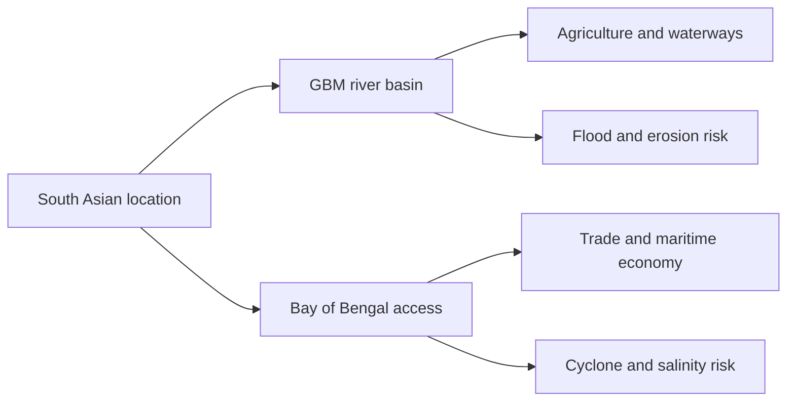

**উপসংহার:** বাংলাদেশের ভৌগোলিক অবস্থান একই সঙ্গে **অর্থনৈতিক সংযোগের সম্পদ** এবং **জলবায়ু–দুর্যোগ ব্যবস্থাপনার দায়িত্ব**। তাই খাতায় একটি ছোট মানচিত্র এঁকে দক্ষিণে বঙ্গোপসাগর, তিন নদী ও প্রতিবেশী রাষ্ট্র চিহ্নিত করলে উত্তর স্পষ্ট হয়।

> [!NOTE]
> 🔵 **Source you can cite in the exam:** Banglapedia — Asiatic Society of Bangladesh — *Bangladesh (অবস্থান, আয়তন ও সীমান্ত)* [S4]; Banglapedia — Asiatic Society of Bangladesh — *Bangladesh Geography (ভূপ্রকৃতি, বদ্বীপ, নদী ও অঞ্চল)* [S2]।

> [!TIP]
> 🟢 **Q01 · Recall in 10 Seconds:** **South Asia → GBM Rivers → Bay of Bengal**। অবস্থান বোঝাতে মানচিত্র+সুযোগ+ঝুঁকি লিখুন।

<a id="q02"></a>

### 02. Describe the major topographical features of Bangladesh with regional examples.

**বাংলা প্রশ্ন:** বাংলাদেশের প্রধান ভূপ্রাকৃতিক বৈশিষ্ট্যগুলো আঞ্চলিক উদাহরণসহ বর্ণনা করুন।

**Type:** Past-paper theme — 40th/43rd (secondary archive); English rendering, not verbatim original · **Suggested marks:** 10–20

**✅ Model Answer (বাংলা) — Definition → Explanation → Analysis**

**🟨 Exact Yellow Exam Highlight (`#FFF200`) — Q02**


**ভূমিকা:** ভূমির উচ্চতা, গঠন, বয়স, ঢাল ও মাটির বৈশিষ্ট্য অনুযায়ী বাংলাদেশের ভূপ্রকৃতিকে তিনটি প্রধান ভাগে বিশ্লেষণ করা যায়—**নবীন প্লাবনভূমি**, **প্লাইস্টোসিন সোপান** এবং **পাহাড়ি অঞ্চল** [S2][S3]।

| প্রধান ভূমিরূপ | কোথায় দেখা যায় | বৈশিষ্ট্য | জীবিকা ও ঝুঁকি |
|---|---|---|---|
| **Recent Floodplain** | পদ্মা–যমুনা–মেঘনা, হাওর, মোহনা | নবীন পলি, নিচু ভূমি, নিয়মিত নদীপ্রভাব | ধান, মাছ, নৌযান; বন্যা ও ভাঙন |
| **Pleistocene Terrace** | বরেন্দ্র, মধুপুর গড়, লালমাই-সংলগ্ন উঁচু পৃষ্ঠ | অপেক্ষাকৃত প্রাচীন, উঁচু ও শক্ত মাটির স্তর | কৃষি, বন; পানি-স্বল্পতা বা ভূমি ব্যবহারের চাপ |
| **Hilly Region** | পার্বত্য চট্টগ্রাম, সিলেটের পাহাড় | ঢাল, উপত্যকা ও তুলনামূলক পুরোনো শিলাস্তর | পাহাড়ি কৃষি, বন; ভূমিধস ও ক্ষয় |

**ব্যাখ্যা:** প্লাবনভূমি নদীর বয়ে আনা পলি দিয়ে তৈরি ও পরিবর্তিত হয়। সোপানভূমির মাটি পুরোনো এবং অনেক জায়গায় লালচে–বাদামি; বরেন্দ্রে শুষ্ক মৌসুমের সেচচাপ গুরুত্বপূর্ণ। পাহাড়ে ভূমির ঢাল পানি ও মাটির গতি দ্রুত করে; নির্বিচারে পাহাড় কাটা ক্ষয় বাড়াতে পারে।

**ভিজ্যুয়াল — তিন ভূপ্রাকৃতিক স্তর:**

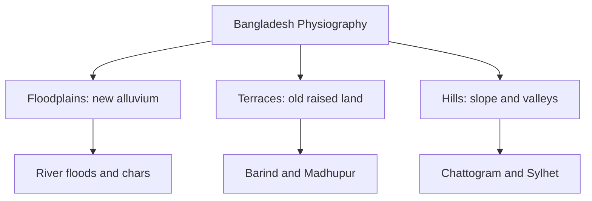

**বিশ্লেষণ:** একই ধরনের উন্নয়ননীতি তিন অঞ্চলে সমান ফল দেয় না। প্লাবনভূমিতে বন্যা-সহনশীল বসতি, সোপানে পানি ব্যবস্থাপনা এবং পাহাড়ে ঢাল সংরক্ষণ জরুরি।

**উপসংহার:** **Floodplain–Terrace–Hill**—প্রতিটির *অবস্থান + গঠন + ব্যবহার + ঝুঁকি* উল্লেখ করলেই উত্তর পূর্ণাঙ্গ হয়। [S2]-এর ২৪টি উপঅঞ্চল ও ৫৪টি একক আরও সূক্ষ্ম শ্রেণিবিন্যাস; এই তিনটি প্রধান ভাগের বিকল্প নয়।

> [!NOTE]
> 🔵 **Source you can cite in the exam:** Banglapedia — Asiatic Society of Bangladesh — *Bangladesh Geography (ভূপ্রকৃতি, বদ্বীপ, নদী ও অঞ্চল)* [S2]; Banglapedia — Asiatic Society of Bangladesh — *ভূ-প্রকৃতি (বাংলা)* [S3]।

> [!TIP]
> 🟢 **Q02 · Recall in 10 Seconds:** **Floodplain → Terrace → Hills**। প্রতিটির একটি উদাহরণ ও একটি ঝুঁকি লিখুন।

<a id="q03"></a>

### 03. Assess the strategic geopolitical position and risks of Bangladesh.

**বাংলা প্রশ্ন:** বাংলাদেশের ভূ-কৌশলগত অবস্থান ও সংশ্লিষ্ট ঝুঁকি মূল্যায়ন করুন।

**Type:** Past-paper theme — 40th (secondary archive); English rendering, not verbatim original · **Suggested marks:** 10–20

**✅ Model Answer (বাংলা) — Definition → Explanation → Analysis**

**🟨 Exact Yellow Exam Highlight (`#FFF200`) — Q03**

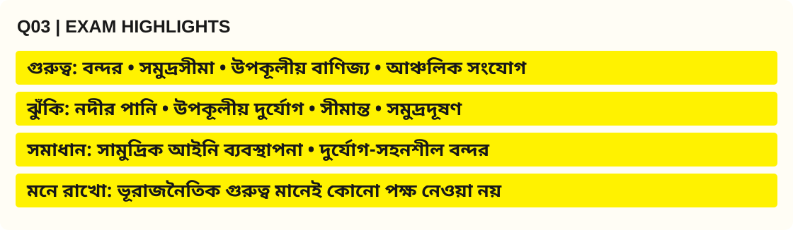

**ভূমিকা:** কোনো দেশের **ভূরাজনৈতিক অবস্থান** বলতে তার ভূগোল কীভাবে নিরাপত্তা, বাণিজ্য, প্রতিবেশী সম্পর্ক ও রাষ্ট্রীয় নীতিকে প্রভাবিত করে তা বোঝায়। বাংলাদেশ দক্ষিণ এশিয়ার স্থলভাগ ও বঙ্গোপসাগরের সামুদ্রিক পথের সংযোগস্থলে গুরুত্বপূর্ণ অবস্থানে রয়েছে।

**কৌশলগত সুযোগ:**
1. **সমুদ্রবন্দর ও বাণিজ্য:** চট্টগ্রাম, মোংলা ও পায়রা-সংলগ্ন বন্দর অবকাঠামো আন্তর্জাতিক বাণিজ্যের সম্ভাবনা তৈরি করে; বাস্তব সুবিধা নির্ভর করে সক্ষমতা ও সংযোগের ওপর।
2. **আঞ্চলিক সংযোগ:** সড়ক–রেল–নদীপথে প্রতিবেশী অঞ্চলের সঙ্গে যোগাযোগ বাড়লে পরিবহন ও সরবরাহব্যবস্থার সুযোগ বাড়ে।
3. **সমুদ্রসম্পদ ও আইনগত অধিকার:** ২০১২ সালের ITLOS এবং ২০১৪ সালের PCA সিদ্ধান্ত বাংলাদেশ–মিয়ানমার ও বাংলাদেশ–ভারতের সমুদ্রসীমা নির্ধারণে গুরুত্বপূর্ণ [S9][S10]।
4. **নদী ও পরিবেশগত সহযোগিতা:** অভিন্ন নদী, বন্যাপূর্বাভাস ও জলবায়ু অভিযোজন নিয়ে সীমান্তপারের সমন্বয়ের প্রয়োজন রয়েছে।

**প্রধান ঝুঁকি ও ব্যবস্থাপনা:**

| ঝুঁকি | কেন গুরুত্বপূর্ণ | যুক্তিযুক্ত করণীয় |
|---|---|---|
| অভিন্ন নদীর পানি–পলি | কৃষি, নাব্যতা, বন্যা | তথ্য বিনিময় ও অববাহিকাভিত্তিক আলোচনা |
| উপকূলীয় ঘূর্ণিঝড় | বন্দর, বসতি, জীবিকা | সহনশীল বন্দর, আশ্রয় ও সতর্কতা |
| সীমান্ত ও অবৈধ কার্যক্রম | নিরাপত্তা ও বাণিজ্য | সহযোগিতা, আইন প্রয়োগ, বৈধ বাণিজ্য |
| সামুদ্রিক দূষণ | মৎস্য ও বাস্তুতন্ত্র | নজরদারি, পরিবেশ আইন ও আঞ্চলিক সমন্বয় |

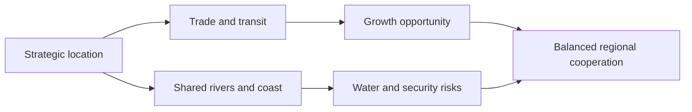

**মূল্যায়ন:** ভূরাজনৈতিক গুরুত্ব শুধু সামরিক অবস্থান নয়; **অর্থনৈতিক সুযোগ + মানবিক নিরাপত্তা + কূটনৈতিক ভারসাম্য** একসঙ্গে বিবেচনা করতে হয়। উন্নত নৌযোগাযোগ, বহুপক্ষীয় সংলাপ ও বাংলাদেশ ব-দ্বীপ পরিকল্পনা ২১০০-ভিত্তিক অভিযোজন এতে সহায়ক।

**উপসংহার:** বাংলাদেশের অবস্থান একটি সম্ভাবনাময় সংযোগকেন্দ্র, কিন্তু সুযোগ পেতে হলে পরিবেশগত ঝুঁকি ও প্রতিবেশী সহযোগিতার প্রশ্নও কার্যকরভাবে সামলাতে হবে।

> [!NOTE]
> 🔵 **Source you can cite in the exam:** General Economics Division (GED), Bangladesh Planning Commission — *Bangladesh Delta Plan 2100, investment plan / six hotspot descriptions* [S6]; Ministry of Law, Justice and Parliamentary Affairs — Laws of Bangladesh — *The Territorial Waters and Maritime Zones Act, 1974 (as amended in 2021)* [S8]; International Tribunal for the Law of the Sea (ITLOS) — *Case No.16, Bangladesh/Myanmar, Judgment, 14 March 2012* [S9]; Permanent Court of Arbitration (PCA) — *Bay of Bengal Maritime Boundary Arbitration (Bangladesh v India), Award, 7 July 2014* [S10]।

> [!TIP]
> 🟢 **Q03 · Recall in 10 Seconds:** **Trade → River Cooperation → Coastal Risks**। সুযোগ ও ঝুঁকি দুটিই দেখান।

<a id="q04"></a>

### 04. What is the economic importance of the Bay of Bengal for Bangladesh?

**বাংলা প্রশ্ন:** বাংলাদেশের জন্য বঙ্গোপসাগরের অর্থনৈতিক গুরুত্ব কী?

**Type:** Past-paper theme — 35th (secondary archive); English rendering, not verbatim original · **Suggested marks:** 10–20

**✅ Model Answer (বাংলা) — Definition → Explanation → Analysis**

**🟨 Exact Yellow Exam Highlight (`#FFF200`) — Q04**


**ভূমিকা:** বঙ্গোপসাগর বাংলাদেশের দক্ষিণের সমুদ্রসীমা এবং আন্তর্জাতিক নৌপথ, উপকূলীয় জীবন ও সামুদ্রিক সম্পদের সঙ্গে দেশের অর্থনীতিকে যুক্ত করে। **Blue Economy** বলতে সামুদ্রিক সম্পদ ব্যবহারের সঙ্গে দীর্ঘমেয়াদি পরিবেশ সংরক্ষণের সমন্বয় বোঝায়।

**অর্থনৈতিক গুরুত্ব:**
1. **বৈদেশিক বাণিজ্য:** সমুদ্রপথে পণ্য পরিবহন, বন্দর-লজিস্টিকস ও কনটেইনার সেবা আমদানি–রপ্তানির গুরুত্বপূর্ণ অবকাঠামো।
2. **মৎস্য ও খাদ্য:** সামুদ্রিক মাছ ও সংশ্লিষ্ট সংগ্রহ, প্রক্রিয়াকরণ ও সরবরাহব্যবস্থা উপকূলীয় জীবিকা ও পুষ্টিতে ভূমিকা রাখে।
3. **সমুদ্রসম্পদ:** অনুমোদিত আইনি পরিসরে সামুদ্রিক গবেষণা ও সম্পদ অন্বেষণের সুযোগ রয়েছে; সম্ভাব্য সম্পদকে ইতিমধ্যে উত্তোলিত বা প্রমাণিত মজুত ধরে নেওয়া ঠিক নয়।
4. **পর্যটন ও সেবা:** সমুদ্রসৈকত, দ্বীপ ও উপকূলীয় পর্যটন স্থানীয় কর্মসংস্থান তৈরি করতে পারে; বর্জ্য ও জীববৈচিত্র্যের চাপ ব্যবস্থাপনা জরুরি।
5. **কৌশলগত সুবিধা:** সমুদ্রসীমা-সংক্রান্ত বিচারিক সিদ্ধান্তগুলো আইনি নিশ্চয়তা বৃদ্ধি করেছে [S9][S10]।

| সুযোগ | কীভাবে আয় বা উপকার হয় | সুরক্ষার শর্ত |
|---|---|---|
| বন্দর | পরিবহন, গুদাম, সরবরাহ | দক্ষতা ও নৌনিরাপত্তা |
| মৎস্য | খাদ্য, কর্মসংস্থান | টেকসই আহরণ |
| পর্যটন | স্থানীয় ব্যবসা | উপকূল ও বর্জ্য ব্যবস্থাপনা |
| গবেষণা | সম্পদের তথ্য | পরিবেশগত প্রভাব মূল্যায়ন |

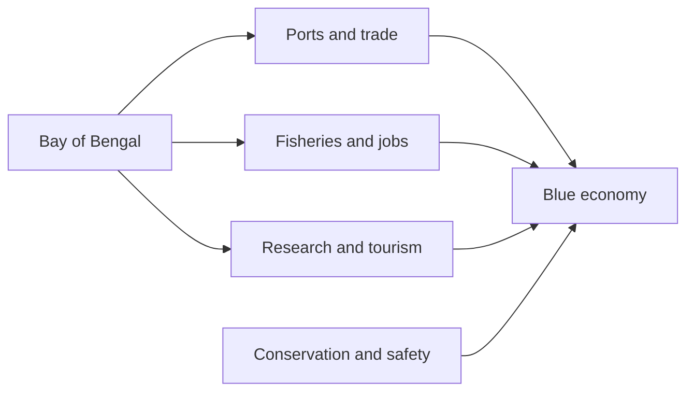

**উপসংহার:** বঙ্গোপসাগরের প্রকৃত অর্থনৈতিক মূল্য শুধু সম্পদ আহরণে নয়; **টেকসই ব্যবস্থাপনা, নিরাপদ বন্দর ও সুনীল অর্থনীতির সুশাসনে** নিহিত।

> [!NOTE]
> 🔵 **Source you can cite in the exam:** Ministry of Law, Justice and Parliamentary Affairs — Laws of Bangladesh — *The Territorial Waters and Maritime Zones Act, 1974 (as amended in 2021)* [S8]; International Tribunal for the Law of the Sea (ITLOS) — *Case No.16, Bangladesh/Myanmar, Judgment, 14 March 2012* [S9]; Permanent Court of Arbitration (PCA) — *Bay of Bengal Maritime Boundary Arbitration (Bangladesh v India), Award, 7 July 2014* [S10]।

> [!TIP]
> 🟢 **Q04 · Recall in 10 Seconds:** **Port → Fish → Maritime Law → Conservation**। শুধু সম্পদ নয়, সুশাসনও লিখুন।

<a id="q05"></a>

### 05. Differentiate between an active delta and an inactive or moribund delta.

**বাংলা প্রশ্ন:** সক্রিয় ও নিষ্ক্রিয় (Moribund) বদ্বীপের পার্থক্য দেখান।

**Type:** Past-paper theme — 36th (secondary archive); English rendering, not verbatim original · **Suggested marks:** 10–20

**✅ Model Answer (বাংলা) — Definition → Explanation → Analysis**

**🟨 Exact Yellow Exam Highlight (`#FFF200`) — Q05**


**ভূমিকা:** বদ্বীপের সব অংশে নদীর পলি সঞ্চয়ের মাত্রা এক নয়। এ পার্থক্য বোঝাতে **Active Delta** এবং **Moribund/Inactive Delta** পরিভাষা ব্যবহৃত হয় [S2]।

| বিচার্য বিষয় | সক্রিয় বদ্বীপ | অপেক্ষাকৃত নিষ্ক্রিয়/মরিবান্ড বদ্বীপ |
|---|---|---|
| পলির প্রবাহ | নতুন পলি সরবরাহ ও জমার প্রক্রিয়া বেশি সক্রিয় | মূল নদী থেকে নতুন পলির সরবরাহ তুলনামূলক কম |
| ভূমিরূপ | নতুন চর, খাত পরিবর্তন, মোহনা গঠন | পুরোনো নদীখাত ও অপেক্ষাকৃত স্থিত পৃষ্ঠ |
| পরিবর্তন | ক্ষয়–সঞ্চয়ে দ্রুত পরিবর্তন দেখা যেতে পারে | পরিবর্তন ধীর হতে পারে; পুরোপুরি বন্ধ নয় |
| উদাহরণ | সক্রিয় নদী–মোহনা ও চরাঞ্চল | দক্ষিণ-পশ্চিমের কিছু পুরোনো বদ্বীপীয় অংশ |

**কারণ:** নদীর গতিপথ বদলে গেলে পলি নতুন শাখায় বেশি পৌঁছায়; আগের শাখায় পলি কমলে সে অংশ তুলনামূলকভাবে মরিবান্ড হয়ে উঠতে পারে। তবে সাগরের জোয়ার, ভাঙন, জলাবদ্ধতা বা লবণাক্ততার প্রভাব দুই অবস্থাতেই থাকতে পারে।

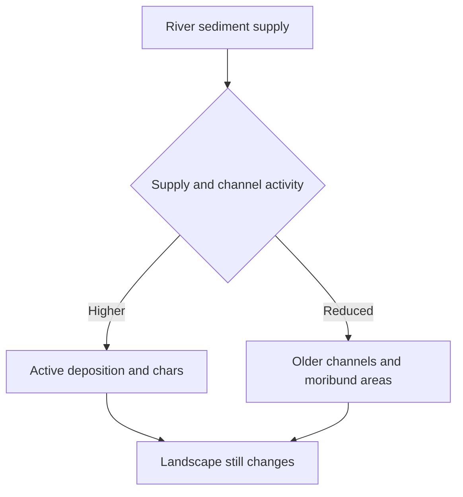

**ভুল এড়ান:** 'Active = সব জায়গায় ভূমি বাড়ে' কিংবা 'Moribund = কোনো ঝুঁকি নেই'—এ দুটো বক্তব্যই ভুল।

**উপসংহার:** বদ্বীপের শ্রেণি বুঝতে **পলি সরবরাহ, নদীপথ ও ভূমিরূপের পরিবর্তন**—এই তিনটি সূচক তুলনা করতে হয়।

> [!NOTE]
> 🔵 **Source you can cite in the exam:** Banglapedia — Asiatic Society of Bangladesh — *Bangladesh Geography (ভূপ্রকৃতি, বদ্বীপ, নদী ও অঞ্চল)* [S2]।

> [!TIP]
> 🟢 **Q05 · Recall in 10 Seconds:** **Active = new sediment; Moribund = reduced active deposition**।

[⬆️ Back to Question Finder](#question-index) · [🏠 Table of Contents](#top)

---

<a id="q06"></a>

### 06. Explain the origin of the Ganges–Brahmaputra–Meghna delta.

**বাংলা প্রশ্ন:** গঙ্গা–ব্রহ্মপুত্র–মেঘনা বদ্বীপের উৎপত্তি ব্যাখ্যা করুন।

**Type:** Editorial high-priority practice (not a previous exam question) · **Suggested marks:** 5–10

**✅ Model Answer (বাংলা) — Definition → Explanation → Analysis**

**🟨 Exact Yellow Exam Highlight (`#FFF200`) — Q06**


**ভূমিকা:** গঙ্গা–ব্রহ্মপুত্র–মেঘনা (GBM) বদ্বীপ নদী, পলি, সমুদ্রের জোয়ার এবং ভূ-অবনমনের দীর্ঘমেয়াদি যৌথ প্রক্রিয়ায় গড়ে উঠেছে। এটি একবার তৈরি হয়ে স্থির থাকা ভূমি নয়।

**গঠনের ধাপ:**
1. **পলি উৎপাদন:** হিমালয় ও বৃহত্তর অববাহিকার শিলা–মাটির ক্ষয় থেকে বালি, পলি ও কাদা তৈরি হয়।
2. **পলি পরিবহন:** গঙ্গা, ব্রহ্মপুত্র ও মেঘনা এবং শাখানদী বিপুল পলি নিম্ন অববাহিকায় আনে।
3. **পলি সঞ্চয়:** নদীর গতি কমা, মোহনা ও প্লাবনের প্রভাবে পলি জমে প্লাবনভূমি, চর ও বদ্বীপীয় জমি গঠিত হয়।
4. **সমুদ্রের প্রভাব:** জোয়ার–ভাটা, তরঙ্গ, উপকূলীয় স্রোত ও লবণাক্ততা নতুন পলিভূমিকে পুনর্গঠন করে।
5. **পরিবর্তন:** নদীর খাত স্থানান্তর, ক্ষয়, ভূমির অবনমন ও সমুদ্রস্তর পরিবর্তনে বদ্বীপের আকৃতি বদলায়।

**প্রক্রিয়া-চিত্র:**

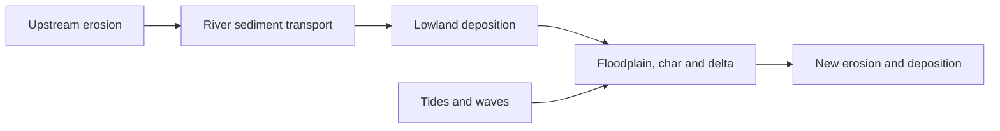

**কারণ–ফল:** পলল মাটি কৃষিকাজে সহায়ক এবং নদী–জলাভূমি মাছ ও জলজ বাস্তুতন্ত্রে অবদান রাখে। বিপরীতে, নদীভাঙন, বন্যা, চর হারানো ও উপকূলীয় লবণাক্ততা বসতি ও অবকাঠামোর ঝুঁকি তৈরি করে।

**উপসংহার:** পরীক্ষায় **ক্ষয় → পরিবহন → সঞ্চয় → জোয়ারের পুনর্গঠন** ধারাটি একটি সরল চিত্রে দেখালে উৎপত্তি ও চলমান পরিবর্তন—দুই দিকই ব্যাখ্যা করা যায়। [S2][S3]

> [!NOTE]
> 🔵 **Source you can cite in the exam:** Banglapedia — Asiatic Society of Bangladesh — *Bangladesh Geography (ভূপ্রকৃতি, বদ্বীপ, নদী ও অঞ্চল)* [S2]; Banglapedia — Asiatic Society of Bangladesh — *ভূ-প্রকৃতি (বাংলা)* [S3]; UNESCO World Heritage Centre — *The Sundarbans (Bangladesh), World Heritage List no.798; inscribed 1997* [S11]।

> [!TIP]
> 🟢 **Q06 · Recall in 10 Seconds:** **Upstream sediments → river transport → delta deposition**।

<a id="q07"></a>

### 07. Explain the differences between the Barind Tract and Madhupur Tract.

**বাংলা প্রশ্ন:** বরেন্দ্রভূমি ও মধুপুর গড়ের মধ্যে পার্থক্য ব্যাখ্যা করুন।

**Type:** Past-paper theme — 43rd-related (secondary archive); English rendering, not verbatim original · **Suggested marks:** 5–10

**✅ Model Answer (বাংলা) — Definition → Explanation → Analysis**

**🟨 Exact Yellow Exam Highlight (`#FFF200`) — Q07**


**ভূমিকা:** বরেন্দ্রভূমি ও মধুপুর গড়—উভয়ই বাংলাদেশের **প্লাইস্টোসিন সোপানভূমি**। তবে অবস্থান, প্রাকৃতিক পরিবেশ ও ভূমি ব্যবহারে পার্থক্য রয়েছে [S2][S3]।

| তুলনার বিষয় | বরেন্দ্রভূমি (Barind) | মধুপুর গড় (Madhupur) |
|---|---|---|
| অবস্থান | উত্তর-পশ্চিম; রাজশাহী–নওগাঁ–দিনাজপুর অঞ্চলের অংশ | মধ্য বাংলাদেশ; টাঙ্গাইল–ময়মনসিংহ–গাজীপুর-সংলগ্ন অঞ্চল |
| ভূপ্রকৃতি | উঁচু পুরোনো সোপান ও খণ্ডিত পৃষ্ঠ | উঁচু গড়, ছোট ঢাল ও উপত্যকা |
| মাটি | প্রাচীন লালচে–বাদামি সোপান-মাটি | অনুরূপ পুরোনো লালচে–বাদামি মাটি |
| প্রধান পরিবেশগত সমস্যা | শুষ্ক মৌসুমে সেচ ও ভূগর্ভস্থ পানির চাপ | বনভূমি, নগরায়ণ ও ভূমি ব্যবহার পরিবর্তন |
| ব্যবস্থাপনা | পানি সাশ্রয়ী সেচ ও ফসল পরিকল্পনা | বন সংরক্ষণ ও সুষম ভূমি ব্যবহার |

**ব্যাখ্যা:** প্লাবনভূমির নতুন পলির বিপরীতে দুই অঞ্চলের ভূমি তুলনামূলক প্রাচীন ও উঁচু। তবে বরেন্দ্রকে সম্পূর্ণ মরুভূমি বা মধুপুরকে সম্পূর্ণ বন—কোনোটিই বলা যায় না; উভয় এলাকায় কৃষি ও বসতি আছে।

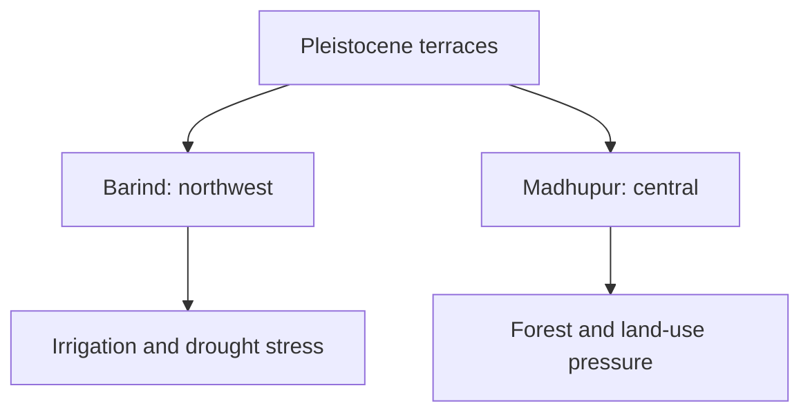

**উপসংহার:** **উৎপত্তি একই ধরনের পুরোনো সোপান; অবস্থান ও ব্যবস্থাপনা-অগ্রাধিকার ভিন্ন**—এই তুলনাই উত্তরের মূল বক্তব্য।

> [!NOTE]
> 🔵 **Source you can cite in the exam:** Banglapedia — Asiatic Society of Bangladesh — *Bangladesh Geography (ভূপ্রকৃতি, বদ্বীপ, নদী ও অঞ্চল)* [S2]; Banglapedia — Asiatic Society of Bangladesh — *ভূ-প্রকৃতি (বাংলা)* [S3]; General Economics Division (GED), Bangladesh Planning Commission — *Bangladesh Delta Plan 2100, investment plan / six hotspot descriptions* [S6]।

> [!TIP]
> 🟢 **Q07 · Recall in 10 Seconds:** **Barind = NW; Madhupur = central; both = old terraces**।

<a id="q08"></a>

### 08. Why is the Barind region prone to drought-related stress?

**বাংলা প্রশ্ন:** বরেন্দ্র অঞ্চলে খরাজনিত পানিসংকট কেন দেখা দেয়?

**Type:** Editorial high-priority practice (not a previous exam question) · **Suggested marks:** 5–10

**✅ Model Answer (বাংলা) — Definition → Explanation → Analysis**

**🟨 Exact Yellow Exam Highlight (`#FFF200`) — Q08**

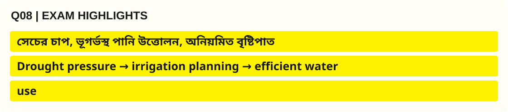

**ভূমিকা:** বরেন্দ্র অঞ্চলের পানিসংকটকে শুধু কম বৃষ্টিপাত দিয়ে বোঝানো যায় না। ভূমিরূপ, মৌসুমি বৃষ্টির বণ্টন, ভূগর্ভস্থ পানি উত্তোলন এবং কৃষির পানিচাহিদা একসঙ্গে খরাজনিত চাপ বাড়ায়।

**প্রধান কারণ:**
1. **উঁচু সোপান ও মাটি:** কিছু পুরোনো সোপানভূমিতে পানি দ্রুত নেমে যায় বা মাটির স্তরের কারণে বৃষ্টির পানি ধারণ–প্রবেশ সীমিত হয়; অবস্থাভেদে ভিন্নতা আছে।
2. **মৌসুমি বৃষ্টি:** বর্ষার বাইরে দীর্ঘ শুষ্ক মৌসুমে পানির প্রাপ্যতা ও ফসলের চাহিদার মধ্যে অসামঞ্জস্য দেখা দেয়।
3. **সেচের ওপর নির্ভরতা:** ভূগর্ভস্থ পানি-নির্ভর সেচের চাপ স্থানীয় পুনর্ভরণের তুলনায় বেশি হলে স্তর নামতে পারে।
4. **তাপ ও খরা:** শুষ্ক আবহাওয়া ও উচ্চ তাপমাত্রায় বাষ্পীভবন ও ফসলের পানি চাহিদা বাড়ে।
5. **ব্যবস্থাপনার সীমাবদ্ধতা:** স্থানীয় জলাধার, পৃষ্ঠজল ব্যবহার ও দক্ষ সেচের ঘাটতি ঝুঁকি বাড়াতে পারে।

```mermaid
flowchart TD
    A["Dry-season water demand"] --> C["Drought stress"]
    B["Limited usable water"] --> C
    D["Groundwater pumping"] --> C
    C --> E["Crop and livelihood risk"]
    E --> F["Efficient irrigation and storage"]
```

**সমাধান:** ড্রিপ/স্প্রিংকলার যেখানে উপযোগী, সেচের সময় ঠিক করা, কম পানি-নির্ভর ফসল, পুকুর–জলাধার সংরক্ষণ, বৃষ্টির পানি ধরে রাখা এবং পৃষ্ঠজল–ভূগর্ভস্থ পানির যৌথ ব্যবস্থাপনা।

**নীতির সঙ্গে সম্পর্ক:** বাংলাদেশ ব-দ্বীপ পরিকল্পনা ২১০০-এ **Barind and Drought-Prone Areas** একটি বিশেষ হটস্পট [S6]।

**উপসংহার:** বরেন্দ্রের খরা মূলত **প্রাকৃতিক পানির সীমাবদ্ধতা ও ব্যবহারের চাপের যৌথ ফল**; সমাধানও সমন্বিত হতে হবে।

> [!NOTE]
> 🔵 **Source you can cite in the exam:** General Economics Division (GED), Bangladesh Planning Commission — *Bangladesh Delta Plan 2100, investment plan / six hotspot descriptions* [S6]; Bangladesh Water Development Board (BWDB) — *ব-দ্বীপ পরিকল্পনা বাস্তবায়নে বাংলাদেশ পানি উন্নয়ন বোর্ড, updated 2023* [S7]।

> [!TIP]
> 🟢 **Q08 · Recall in 10 Seconds:** **Drought pressure → irrigation planning → efficient water use**।

<a id="q09"></a>

### 09. How did the Brahmaputra–Jamuna change its course historically?

**বাংলা প্রশ্ন:** ঐতিহাসিকভাবে ব্রহ্মপুত্র–যমুনা নদীর গতিপথ কীভাবে পরিবর্তিত হয়েছে?

**Type:** Editorial high-priority practice (not a previous exam question) · **Suggested marks:** 5–10

**✅ Model Answer (বাংলা) — Definition → Explanation → Analysis**

**🟨 Exact Yellow Exam Highlight (`#FFF200`) — Q09**


**ভূমিকা:** বাংলাদেশের নদীখাত স্থির নয়। ব্রহ্মপুত্র নদীর প্রধান প্রবাহ একসময় বর্তমান **পুরাতন ব্রহ্মপুত্র** পথে প্রবাহিত হলেও সময়ের সঙ্গে পশ্চিমদিকে যমুনা পথ গুরুত্বপূর্ণ হয়ে ওঠে [S12]।

**ঐতিহাসিক বিবর্তন:**
1. **পুরোনো প্রবাহপথ:** ব্রহ্মপুত্র ময়মনসিংহ অঞ্চলের দিকে দক্ষিণে বয়ে ভৈরববাজার-সংলগ্ন দিকে মেঘনা ব্যবস্থার সঙ্গে যুক্ত হতো।
2. **১৮শ শতকের শেষ ভাগ:** বিশেষত **১৭৮৭ সালের বড় বন্যা** প্রবাহপথ পরিবর্তনের একটি গুরুত্বপূর্ণ ঐতিহাসিক পর্ব হিসেবে উল্লেখিত; একটি দিনের ঘটনাকে একমাত্র কারণ বলা ঠিক নয়।
3. **পরবর্তী কয়েক দশক:** পশ্চিমের যমুনা চ্যানেলে প্রবাহ ও পলি বহনের গুরুত্ব বাড়ে এবং পুরাতন ব্রহ্মপুত্রের প্রধান প্রবাহের ভূমিকা কমে।
4. **প্রভাব:** যমুনায় ভাঙন–চর সঞ্চয়, নতুন যোগাযোগপথ, বসতির স্থানান্তর ও কৃষিজমির পুনর্বিন্যাস ঘটে।

**টাইমলাইন (ধারণাগত):**

```mermaid
flowchart LR
    A["Old Brahmaputra route"] --> B["Late 1700s flood changes"]
    B --> C["Jamuna channel grows"]
    C --> D["Bank erosion and new chars"]
    D --> E["Settlement and land-use change"]
```

**ভূ-আকৃতিগত কারণ:** বৃহৎ নদীতে প্রবাহের চাপ, পলি জমে খাত অগভীর হওয়া, বন্যা ও নতুন খাতের সুবিধাজনক ঢাল মিলে channel migration বা avulsion ঘটাতে পারে।

**উপসংহার:** ব্রহ্মপুত্র–যমুনার ইতিহাস প্রমাণ করে, **নদী শুধু প্রাকৃতিক সীমানা নয়—ভূমি, অর্থনীতি ও বসতির গতিশীল নির্মাতা**। উত্তর লিখতে পুরাতন ব্রহ্মপুত্র ও বর্তমান যমুনার অবস্থান একটি সরল মানচিত্রে দেখানো ভালো।

> [!NOTE]
> 🔵 **Source you can cite in the exam:** Banglapedia — Asiatic Society of Bangladesh — *Bangladesh Geography (ভূপ্রকৃতি, বদ্বীপ, নদী ও অঞ্চল)* [S2]; Banglapedia — Asiatic Society of Bangladesh — *Brahmaputra-Jamuna River System; history of the Tista and Brahmaputra course shifts* [S12]।

> [!TIP]
> 🟢 **Q09 · Recall in 10 Seconds:** **Historic river course change → bank erosion → shifting settlements**।

<a id="q10"></a>

### 10. Compare char, haor, beel and baor in the context of Bangladesh.

**বাংলা প্রশ্ন:** বাংলাদেশের চর, হাওর, বিল ও বাঁওড়ের তুলনা করুন।

**Type:** Editorial high-priority practice (not a previous exam question) · **Suggested marks:** 5–10

**✅ Model Answer (বাংলা) — Definition → Explanation → Analysis**

**🟨 Exact Yellow Exam Highlight (`#FFF200`) — Q10**

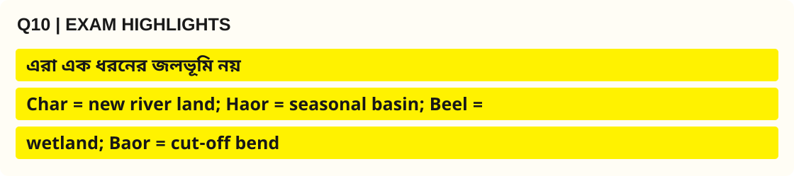

**ভূমিকা:** চর, হাওর, বিল ও বাঁওড়—চারটি শব্দই বাংলাদেশের জল–ভূমির সঙ্গে সম্পর্কিত, কিন্তু **উৎপত্তি, আকৃতি, মৌসুম ও ব্যবহার** এক নয়।

| ধরন | সহজ সংজ্ঞা ও গঠন | প্রধান উদাহরণ/অঞ্চল | জীবিকা ও ঝুঁকি |
|---|---|---|---|
| **চর (Char)** | নদী বা মোহনায় পলি জমে জেগে ওঠা ভূমি | যমুনা–পদ্মা–মেঘনার চর | মৌসুমি চাষ, বসতি; ভাঙন |
| **হাওর (Haor)** | বড় নিচু অববাহিকা, বর্ষায় বিস্তৃত জলরাশি | সুনামগঞ্জ–কিশোরগঞ্জ অঞ্চল | বোরো ধান ও মাছ; আগাম বন্যা |
| **বিল (Beel)** | স্বাভাবিক নিচু জলাশয়/ডিপ্রেশন | চলনবিল | মাছ, জলজ উদ্ভিদ; জলাবদ্ধতা |
| **বাঁওড় (Baor)** | নদীর বিচ্ছিন্ন পুরোনো বাঁক বা oxbow lake | যশোর অঞ্চলের বাঁওড় | মৎস্য ও জলাধার সংরক্ষণ |

**পার্থক্যের ব্যাখ্যা:** চর মূলত **পলি সঞ্চয়**, হাওর **অববাহিকাগত মৌসুমি প্লাবন**, বিল **স্থানীয় নিম্নভূমির জলধারণ**, আর বাঁওড় **নদীবাঁক বিচ্ছিন্ন হওয়ার** ফল। তাই একই 'জলাভূমি' নামে সবগুলোকে এক করলে গঠনগত পার্থক্য হারিয়ে যায়।

```mermaid
flowchart TD
    A["River and water landscapes"] --> B["Sediment builds land: Char"]
    A --> C["Seasonal basin: Haor"]
    A --> D["Depression: Beel"]
    A --> E["Cut-off river bend: Baor"]
```

**ব্যবস্থাপনা:** চরে নিরাপদ বসতি ও ভূমি অধিকার, হাওরে আগাম বন্যার পূর্বাভাস, বিলে জলপ্রবাহ সংরক্ষণ এবং বাঁওড়ে টেকসই মৎস্য চাষ বেশি প্রাসঙ্গিক।

**উপসংহার:** পরীক্ষায় **গঠন + অবস্থান + জীবিকা + ঝুঁকি**—এই চারটি কলামে তুলনা করলে চার পরিভাষার বিভ্রান্তি দূর হয়। [S2][S3]

> [!NOTE]
> 🔵 **Source you can cite in the exam:** Banglapedia — Asiatic Society of Bangladesh — *Bangladesh Geography (ভূপ্রকৃতি, বদ্বীপ, নদী ও অঞ্চল)* [S2]; Banglapedia — Asiatic Society of Bangladesh — *ভূ-প্রকৃতি (বাংলা)* [S3]।

> [!TIP]
> 🟢 **Q10 · Recall in 10 Seconds:** **Char = new river land; Haor = seasonal basin; Beel = wetland; Baor = cut-off bend**।

[⬆️ Back to Question Finder](#question-index) · [🏠 Table of Contents](#top)

---

<a id="q11"></a>

### 11. Why is the Haor Basin vulnerable to flash floods?

**বাংলা প্রশ্ন:** হাওর অববাহিকা আকস্মিক বন্যার ঝুঁকিতে থাকে কেন?

**Type:** Editorial high-priority practice (not a previous exam question) · **Suggested marks:** 5–10

**✅ Model Answer (বাংলা) — Definition → Explanation → Analysis**

**🟨 Exact Yellow Exam Highlight (`#FFF200`) — Q11**


**ভূমিকা:** হাওর হলো বাংলাদেশের উত্তর-পূর্বাঞ্চলের বিস্তৃত নিচু অববাহিকা, যেখানে বর্ষায় বড় জলরাশি সৃষ্টি হয় এবং শুষ্ক মৌসুমে জমিতে বোরো ধান চাষ হয়। তাই **আগাম আকস্মিক বন্যা (Flash Flood)** কৃষি ও জীবিকার বড় ঝুঁকি।

**কেন ঝুঁকি বেশি?**
1. **অববাহিকার আকৃতি:** চারপাশের তুলনায় নিচু হাওরে বন্যার পানি দ্রুত জমা হতে পারে।
2. **উজানের পাহাড়ি বৃষ্টি:** সংলগ্ন পাহাড় ও উজানের অববাহিকায় প্রবল বৃষ্টির পানি নদী–ছড়া দিয়ে দ্রুত নিচে নেমে আসে।
3. **কম প্রতিক্রিয়া-সময়:** আকস্মিক প্রবাহ বেড়ে গেলে ফসল বা সম্পদ সরানোর জন্য হাতে সময় কম থাকে।
4. **ফসলের সংবেদনশীল সময়:** মার্চ–এপ্রিলের আগাম বন্যা বোরো ধান পাকতে বা কাটতে না কাটতেই হলে ক্ষতি বেশি হতে পারে; নির্দিষ্ট মৌসুমের সময় বছরভেদে ভিন্ন।
5. **পানি নিষ্কাশনের সীমা:** নদীর পলি, স্থানীয় জলপ্রবাহে বাধা এবং অপরিকল্পিত স্থাপনা কিছু স্থানে জলাবদ্ধতা বাড়াতে পারে।

**কারণ–ফল চিত্র:**

```mermaid
flowchart TD
    A["Intense upstream rainfall"] --> B["Rapid hill runoff"]
    B --> C["Low Haor basin fills"]
    C --> D["Flash flood"]
    D --> E["Boro crop and livelihood loss"]
    F["Early warning and timely harvest"] --> G["Risk reduction"]
```

| প্রতিরোধের স্তর | করণীয় |
|---|---|
| পূর্বাভাস | উজানের বৃষ্টিপাত ও নদীর স্তর পর্যবেক্ষণ |
| কৃষি | স্থানীয় উপযোগী স্বল্পমেয়াদি জাত ও সময়মতো ফসল কাটা |
| অবকাঠামো | ঝুঁকিভিত্তিক বাঁধ রক্ষণাবেক্ষণ, প্রাকৃতিক প্রবাহ বজায় রাখা |
| সমাজ | স্থানীয় সতর্কতা, নৌযান প্রস্তুতি ও নিরাপদ আশ্রয় |

**উপসংহার:** হাওরের বন্যা কেবল অতিবৃষ্টি নয়; **উজানের দ্রুত প্রবাহ + নিচু অববাহিকা + কৃষির মৌসুমি সময়**—এই সমন্বিত প্রক্রিয়া। BDP 2100-এ এ অঞ্চল আলাদা hotspot [S6]।

> [!NOTE]
> 🔵 **Source you can cite in the exam:** Banglapedia — Asiatic Society of Bangladesh — *Bangladesh Geography (ভূপ্রকৃতি, বদ্বীপ, নদী ও অঞ্চল)* [S2]; General Economics Division (GED), Bangladesh Planning Commission — *Bangladesh Delta Plan 2100, investment plan / six hotspot descriptions* [S6]; Bangladesh Water Development Board (BWDB) — *ব-দ্বীপ পরিকল্পনা বাস্তবায়নে বাংলাদেশ পানি উন্নয়ন বোর্ড, updated 2023* [S7]।

> [!TIP]
> 🟢 **Q11 · Recall in 10 Seconds:** **Upland rain → rapid runoff → early flash flood → crop risk**।

<a id="q12"></a>

### 12. Explain how river erosion and sedimentation shape human settlement.

**বাংলা প্রশ্ন:** নদীভাঙন ও পলি সঞ্চয় কীভাবে মানুষের বসতি ও জীবনযাত্রাকে প্রভাবিত করে?

**Type:** Editorial high-priority practice (not a previous exam question) · **Suggested marks:** 5–10

**✅ Model Answer (বাংলা) — Definition → Explanation → Analysis**

**🟨 Exact Yellow Exam Highlight (`#FFF200`) — Q12**

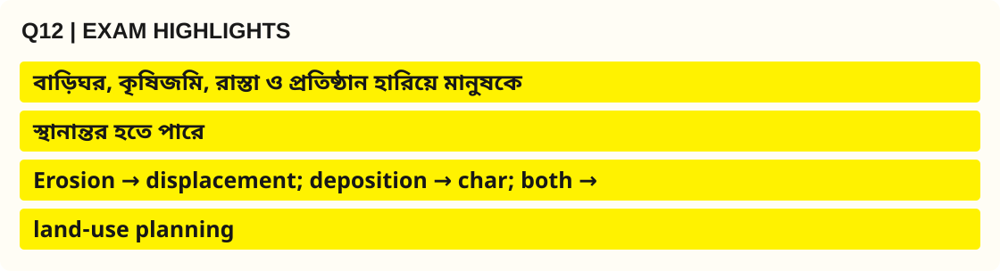

**ভূমিকা:** নদীভাঙন (Erosion) নদীতীর থেকে মাটি সরিয়ে নেয়; পলি সঞ্চয় (Deposition/Accretion) অন্য জায়গায় নতুন ভূমি বা চর গড়ে। বাংলাদেশের বসতি ও জীবিকা এই দুই বিপরীত অথচ সম্পর্কযুক্ত প্রক্রিয়ায় বদলায় [S2]।

**বসতিতে প্রভাব:**
1. **ভিটা ও জমি হারানো:** ভাঙনে বাড়িঘর, কৃষিজমি ও স্থানীয় রাস্তা বিলীন হলে পরিবার স্থানান্তরে বাধ্য হতে পারে।
2. **জীবিকার পরিবর্তন:** জমির মালিকানা বা চাষের সুযোগ হারিয়ে মানুষ অন্য পেশা, দিনমজুরি অথবা শহরমুখী কাজ খুঁজতে পারে।
3. **নতুন চরের সম্ভাবনা:** পলি জমে চর তৈরি হলে চাষাবাদ ও বসতির সুযোগ বাড়ে; তবে চর টেকসই হবে কি না নিশ্চিত নয়।
4. **সেবা ও অবকাঠামো:** বিদ্যালয়, স্বাস্থ্যকেন্দ্র, বাজার, সেতু ও নৌঘাটের অবস্থান পরিবর্তন প্রয়োজন হতে পারে।
5. **সামাজিক সমস্যা:** পুনর্বাসন, জমির অধিকার, নিরাপদ পানি ও নারীদের সেবাপ্রাপ্তি বড় প্রশ্ন হয়ে ওঠে।

**দুই প্রক্রিয়া একসঙ্গে:**

```mermaid
flowchart LR
    A["Changing river channel"] --> B["Bank erosion"]
    A --> C["Sediment deposition"]
    B --> D["Land and home loss"]
    C --> E["New char and cultivation"]
    D --> F["Settlement relocation"]
    E --> F
```

**অভিযোজনের পথ:** ভাঙনপ্রবণ তীরের নিয়মিত মানচিত্রায়ণ, বন্যাপ্রবাহের স্থান অক্ষত রাখা, স্থানভিত্তিক নদীশাসন, উপযুক্ত পুনর্বাসন, নিরাপদ আবাসন ও চরের শিক্ষা–স্বাস্থ্যসেবা জরুরি। সব নদীতে একই প্রকৌশল পদ্ধতি কার্যকর হবে না।

**উপসংহার:** নদীর পলি **নতুন ভূমি তৈরি** করে, আর ভাঙন **পুরোনো বসতি বিলীন** করে; তাই উন্নয়ন পরিকল্পনায় দুটোকেই ধরতে হয়।

> [!NOTE]
> 🔵 **Source you can cite in the exam:** Banglapedia — Asiatic Society of Bangladesh — *Bangladesh Geography (ভূপ্রকৃতি, বদ্বীপ, নদী ও অঞ্চল)* [S2]; General Economics Division (GED), Bangladesh Planning Commission — *Bangladesh Delta Plan 2100, investment plan / six hotspot descriptions* [S6]।

> [!TIP]
> 🟢 **Q12 · Recall in 10 Seconds:** **Erosion → displacement; deposition → char; both → land-use planning**।

<a id="q13"></a>

### 13. Discuss the importance of the Sundarbans as a deltaic ecosystem.

**বাংলা প্রশ্ন:** বদ্বীপীয় প্রতিবেশব্যবস্থা হিসেবে সুন্দরবনের গুরুত্ব আলোচনা করুন।

**Type:** Editorial high-priority practice (not a previous exam question) · **Suggested marks:** 5–10

**✅ Model Answer (বাংলা) — Definition → Explanation → Analysis**

**🟨 Exact Yellow Exam Highlight (`#FFF200`) — Q13**


**ভূমিকা:** সুন্দরবন বাংলাদেশের দক্ষিণ-পশ্চিমে গঙ্গা–ব্রহ্মপুত্র–মেঘনা বদ্বীপের মোহনা-সংলগ্ন একটি জোয়ারভাটা-প্রভাবিত **ম্যানগ্রোভ প্রতিবেশব্যবস্থা**। এটি জীববৈচিত্র্য, উপকূলীয় সুরক্ষা ও মানুষের জীবিকার সঙ্গে যুক্ত [S11]।

**প্রধান গুরুত্ব:**
1. **জীববৈচিত্র্যের আবাস:** বাঘ, কুমির, হরিণ, পাখি, মাছ ও নানা ম্যানগ্রোভ উদ্ভিদের জন্য বিশেষ পরিবেশ।
2. **প্রাকৃতিক সুরক্ষা:** বৃক্ষ ও জলাভূমির কাঠামো ঝড়ের ঢেউয়ের শক্তি কিছুটা কমাতে সহায়তা করতে পারে; এটি ঘূর্ণিঝড়ের সম্পূর্ণ বিকল্প প্রতিরক্ষা নয়।
3. **মৎস্যের সহায়ক বাস্তুতন্ত্র:** মোহনা ও খাঁড়ি মাছ ও জলজ প্রাণীর খাদ্য, আবাস ও প্রজননের সঙ্গে সম্পর্কিত।
4. **কার্বন ও পুষ্টিচক্র:** মাটি–উদ্ভিদে কার্বন ধারণ, পলি আটকানো এবং পুষ্টির পুনঃচক্রায়ণ হয়।
5. **জীবিকা ও সংস্কৃতি:** স্থানীয় মানুষের মাছ ধরা, মধু সংগ্রহ এবং বননির্ভর জীবনযাত্রার সঙ্গে সম্পর্ক আছে; ব্যবহার অবশ্যই সংরক্ষণ আইনসম্মত হতে হবে।

| পরিবেশগত সেবা | উপকার |
|---|---|
| Habitat | বন্যপ্রাণ ও জলজ বৈচিত্র্য |
| Coastal buffering | কিছু ঢেউ/ঝড়প্রভাব প্রশমনে সহায়তা |
| Nursery habitat | মৎস্য সম্পদের বাসস্থান |
| Livelihoods | স্থানীয় আয়ের সুযোগ |
| Conservation value | গবেষণা ও বিশ্ব ঐতিহ্য রক্ষা |

```mermaid
flowchart TD
    A["Tidal mangrove ecosystem"] --> B["Wildlife habitat"]
    A --> C["Coastal protection"]
    A --> D["Fishery and livelihoods"]
    A --> E["Sediment and carbon processes"]
```

**ঐতিহাসিক তথ্য:** UNESCO বাংলাদেশের **The Sundarbans** বিশ্ব ঐতিহ্য সম্পত্তি **১৯৯৭ সালে** তালিকাভুক্ত করে। গুরুত্বপূর্ণ পার্থক্য হলো, UNESCO-র নিবন্ধিত অংশটি পুরো বাংলাদেশ অংশের সুন্দরবনের সমার্থক নয় [S11]।

**উপসংহার:** সুন্দরবনকে শুধু বনজ সম্পদের উৎস না ভেবে **প্রাকৃতিক প্রতিরক্ষা + জীববৈচিত্র্য + জীবিকা**—এই তিনটির সমন্বিত ব্যবস্থা হিসেবে রক্ষা করতে হবে।

> [!NOTE]
> 🔵 **Source you can cite in the exam:** UNESCO World Heritage Centre — *The Sundarbans (Bangladesh), World Heritage List no.798; inscribed 1997* [S11]।

> [!TIP]
> 🟢 **Q13 · Recall in 10 Seconds:** **Sundarbans = tidal mangrove + habitat + 1997 UNESCO**।

<a id="q14"></a>

### 14. What are the opportunities and limitations of Bangladesh’s coastal geography?

**বাংলা প্রশ্ন:** বাংলাদেশের উপকূলীয় ভূগোলের সুযোগ ও সীমাবদ্ধতা কী?

**Type:** Editorial high-priority practice (not a previous exam question) · **Suggested marks:** 5–10

**✅ Model Answer (বাংলা) — Definition → Explanation → Analysis**

**🟨 Exact Yellow Exam Highlight (`#FFF200`) — Q14**

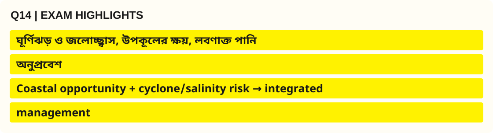

**ভূমিকা:** বাংলাদেশের উপকূলীয় ভূগোল বঙ্গোপসাগর, মোহনা, জোয়ারভাটা, পলি সঞ্চয়, ঘূর্ণিঝড় ও লবণাক্ততার দ্বারা গঠিত। ফলে একদিকে অর্থনৈতিক সুযোগ, অন্যদিকে ঝুঁকি ও পরিবেশগত সীমা আছে।

| ক্ষেত্র | সুযোগ | সীমাবদ্ধতা |
|---|---|---|
| বন্দর ও পরিবহন | আন্তর্জাতিক বাণিজ্য ও কর্মসংস্থান | ঘূর্ণিঝড়, পলি জমা, নৌনিরাপত্তা |
| মৎস্য ও জলজ সম্পদ | খাদ্য, রপ্তানি ও জীবিকা | অতিরিক্ত আহরণ, দূষণ |
| কৃষি | উপযুক্ত এলাকায় ধান–শাকসবজি–অন্যান্য চাষ | লবণাক্ততা, জলোচ্ছ্বাস, পানির সংকট |
| পর্যটন | সৈকত ও দ্বীপভিত্তিক আয় | বর্জ্য, ক্ষয়, বাস্তুতন্ত্রের চাপ |
| উপকূলীয় বসতি | নৌযোগাযোগ ও বাজার | ঝড়, ক্ষয়, বাস্তুচ্যুতির ঝুঁকি |

**ভূ-প্রক্রিয়া:** নদীর পলি কোনো স্থানে নতুন চর তৈরি করে, আবার সাগরের তরঙ্গ ও স্রোত অন্য স্থানের তীর ক্ষয় করতে পারে। সব উপকূল একই হারে বাড়ছে বা কমছে—এ ধারণা সঠিক নয়।

**কারণ–ফল ভিজ্যুয়াল:**

```mermaid
flowchart LR
    A["Coastal geography"] --> B["Ports and fisheries"]
    A --> C["Cyclone and salinity"]
    B --> D["Economic opportunity"]
    C --> E["Damage and livelihood risk"]
    D --> F["Integrated coastal planning"]
    E --> F
```

**করণীয়:** উপকূলীয় আগাম সতর্কতা, আশ্রয়কেন্দ্র, দুর্যোগ-সহনশীল সড়ক–বন্দর, ম্যানগ্রোভ সংরক্ষণ, নিরাপদ পানীয় জল, ভূমি ব্যবহার পরিকল্পনা ও স্থানীয় জনগোষ্ঠীর অংশগ্রহণ। BDP 2100-এর Coastal Zone Hotspot এ ধরনের সমন্বিত পরিকল্পনাকে গুরুত্ব দেয় [S6]।

**উপসংহার:** উপকূল উন্নয়নের সঠিক পথ হলো **অর্থনৈতিক ব্যবহার ও প্রকৃতির সহনক্ষমতার ভারসাম্য**।

> [!NOTE]
> 🔵 **Source you can cite in the exam:** General Economics Division (GED), Bangladesh Planning Commission — *Bangladesh Delta Plan 2100, investment plan / six hotspot descriptions* [S6]; Bangladesh Water Development Board (BWDB) — *ব-দ্বীপ পরিকল্পনা বাস্তবায়নে বাংলাদেশ পানি উন্নয়ন বোর্ড, updated 2023* [S7]; UNESCO World Heritage Centre — *The Sundarbans (Bangladesh), World Heritage List no.798; inscribed 1997* [S11]।

> [!TIP]
> 🟢 **Q14 · Recall in 10 Seconds:** **Coastal opportunity + cyclone/salinity risk → integrated management**।

<a id="q15"></a>

### 15. Distinguish territorial sea, contiguous zone and exclusive economic zone.

**বাংলা প্রশ্ন:** Territorial Sea, Contiguous Zone ও Exclusive Economic Zone (EEZ)-এর পার্থক্য দেখান।

**Type:** Editorial high-priority practice (not a previous exam question) · **Suggested marks:** 5–10

**✅ Model Answer (বাংলা) — Definition → Explanation → Analysis**

**🟨 Exact Yellow Exam Highlight (`#FFF200`) — Q15**


**ভূমিকা:** একটি রাষ্ট্রের সমুদ্র-অধিকার সব জলরাশিতে সমান নয়। **Territorial Sea**, **Contiguous Zone** এবং **Exclusive Economic Zone (EEZ)** ভিন্ন আইনি অঞ্চল। নিচের দূরত্বগুলো সাধারণভাবে **Territorial Sea Baseline** থেকে মাপা হয় [S8]।

| বৈশিষ্ট্য | Territorial Sea | Contiguous Zone | EEZ |
|---|---|---|---|
| সর্বোচ্চ বিস্তার | **১২ NM** | **২৪ NM** | **২০০ NM** |
| মূল আইনি চরিত্র | সার্বভৌমত্ব; আইনি ব্যতিক্রম ও নিরীহ অতিক্রমের অধিকারসহ | নির্দিষ্ট আইন প্রয়োগে প্রতিরোধ/শাস্তিমূলক নিয়ন্ত্রণ | সম্পদ অনুসন্ধান, আহরণ ও ব্যবস্থাপনায় **sovereign rights** |
| উদ্দেশ্য | উপকূলীয় রাষ্ট্রের সামুদ্রিক সার্বভৌম পরিসর | কাস্টমস, অভিবাসন, স্বাস্থ্যসহ আইনে নির্ধারিত নিয়ন্ত্রণ | মৎস্য, সম্পদ ও সংশ্লিষ্ট অর্থনৈতিক কর্মকাণ্ড |

**যা মনে রাখবেন:** Contiguous Zone ও EEZ এমন জলাঞ্চল নয় যেখানে স্থলভাগের মতো সার্বভৌমত্ব চলে। আন্তর্জাতিক আইনসঙ্গত অন্য রাষ্ট্রের নৌচলাচলের অধিকারসহ নানা বিধান থাকে। পাশের রাষ্ট্রের সীমানা একে অন্যকে ছেদ করলে **delimitation** প্রয়োজন; ২০০ NM আইনগত দূরত্ব মানেই সবদিকে অবিচ্ছিন্ন বাস্তব সীমানা নয়।

**দূরত্বের স্কিম্যাটিক (মাপ অনুপাতে আঁকা নয়):**

```mermaid
flowchart LR
    A["Baseline: 0 NM"] --> B["Territorial Sea: up to 12 NM"]
    B --> C["Contiguous Zone: up to 24 NM"]
    C --> D["EEZ: up to 200 NM"]
```

**উদাহরণ:** কোনো উপকূলীয় রাষ্ট্র EEZ-তে মাছ ও অন্যান্য সামুদ্রিক সম্পদের ব্যবস্থাপনায় বিশেষ অধিকার পায়, কিন্তু তাই বলে বিদেশি জাহাজের সকল বৈধ চলাচল নির্বিচারে নিষিদ্ধ করতে পারে না।

**উপসংহার:** **১২ = সার্বভৌমত্ব, ২৪ = নির্দিষ্ট আইন প্রয়োগ, ২০০ = সম্পদ-সংক্রান্ত অধিকার**—এই স্মরণসূত্রের সঙ্গে আইনি পার্থক্য ব্যাখ্যা করুন।

> [!NOTE]
> 🔵 **Source you can cite in the exam:** Ministry of Law, Justice and Parliamentary Affairs — Laws of Bangladesh — *The Territorial Waters and Maritime Zones Act, 1974 (as amended in 2021)* [S8]।

> [!TIP]
> 🟢 **Q15 · Recall in 10 Seconds:** **12/24/200 NM ≠ equal sovereignty**।

[⬆️ Back to Question Finder](#question-index) · [🏠 Table of Contents](#top)

---

<a id="q16"></a>

### 16. Describe the significance of the 2012 and 2014 Bay of Bengal maritime judgments.

**বাংলা প্রশ্ন:** ২০১২ ও ২০১৪ সালের বঙ্গোপসাগরের সমুদ্রসীমা-সংক্রান্ত সিদ্ধান্তগুলোর গুরুত্ব বর্ণনা করুন।

**Type:** Editorial high-priority practice (not a previous exam question) · **Suggested marks:** 10–20

**✅ Model Answer (বাংলা) — Definition → Explanation → Analysis**

**🟨 Exact Yellow Exam Highlight (`#FFF200`) — Q16**


**ভূমিকা:** বঙ্গোপসাগরে প্রতিবেশী রাষ্ট্রের সঙ্গে ওভারল্যাপিং সমুদ্রসীমা নির্ধারণ বাংলাদেশের জন্য গুরুত্বপূর্ণ আইনগত ও কৌশলগত বিষয়। **২০১২** ও **২০১৪** সালের দুটি বিচারিক সিদ্ধান্ত এই প্রশ্নে বড় অগ্রগতি আনে।

| সাল ও সংস্থা | কোন বিরোধ | মূল তাৎপর্য |
|---|---|---|
| **১৪ মার্চ ২০১২, ITLOS** | বাংলাদেশ বনাম মিয়ানমার | সমুদ্রসীমা নির্ধারণ-সংক্রান্ত রায়; Territorial Sea, EEZ ও continental shelf সম্পর্কিত বিরোধের নিষ্পত্তিতে ভূমিকা |
| **৭ জুলাই ২০১৪, PCA-এর অধীনে ট্রাইব্যুনাল** | বাংলাদেশ বনাম ভারত | Territorial Sea, EEZ ও continental shelf-এ সীমারেখার গতিপথ নির্ধারণে Award [S10] |

**সিদ্ধান্তগুলোর গুরুত্ব:**
1. **আইনি স্পষ্টতা:** কোন অঞ্চলে রাষ্ট্রের কোন সামুদ্রিক অধিকার প্রযোজ্য তা নির্ধারণে অনিশ্চয়তা কমেছে।
2. **সম্পদ ব্যবস্থাপনা:** মৎস্য, গবেষণা ও বৈধ অনুসন্ধান পরিকল্পনার জন্য সুস্পষ্ট সীমানার ভিত্তি তৈরি হয়েছে।
3. **নৌনিরাপত্তা ও কূটনীতি:** বিরোধের আইনভিত্তিক নিষ্পত্তি শান্তিপূর্ণ সমাধানের একটি উদাহরণ।
4. **পরিকল্পনা:** দীর্ঘমেয়াদি সামুদ্রিক পরিবেশ ও বন্দরকেন্দ্রিক নীতিতে আইনগত ভিত্তি পাওয়া যায়।

```mermaid
flowchart LR
    A["2012: ITLOS / Myanmar"] --> C["Clearer maritime boundary"]
    B["2014: PCA / India"] --> C
    C --> D["Resource planning"]
    C --> E["Legal and diplomatic certainty"]
```

**বিশ্লেষণ:** এই সিদ্ধান্তগুলোকে 'সমুদ্রে নতুন সার্বভৌম ভূখণ্ড লাভ' হিসেবে সহজীকরণ করা উচিত নয়। Territorial Sea, EEZ এবং Continental Shelf-এর অধিকার আলাদা; বিচারিক সীমা নির্ধারণও সে ভিন্নতা বজায় রাখে [S8][S9][S10]।

**উপসংহার:** ২০১২ ও ২০১৪ বাংলাদেশের **সমুদ্রসীমার আইনভিত্তিক নিশ্চয়তা** বৃদ্ধির মাইলফলক।

> [!NOTE]
> 🔵 **Source you can cite in the exam:** International Tribunal for the Law of the Sea (ITLOS) — *Case No.16, Bangladesh/Myanmar, Judgment, 14 March 2012* [S9]; Permanent Court of Arbitration (PCA) — *Bay of Bengal Maritime Boundary Arbitration (Bangladesh v India), Award, 7 July 2014* [S10]।

> [!TIP]
> 🟢 **Q16 · Recall in 10 Seconds:** **ITLOS 2012 → Myanmar; PCA 2014 → India**।

<a id="q17"></a>

### 17. How does geography influence agricultural patterns in Bangladesh?

**বাংলা প্রশ্ন:** বাংলাদেশের ভৌগোলিক বৈশিষ্ট্য কৃষির ধরনকে কীভাবে প্রভাবিত করে?

**Type:** Editorial high-priority practice (not a previous exam question) · **Suggested marks:** 5–10

**✅ Model Answer (বাংলা) — Definition → Explanation → Analysis**

**🟨 Exact Yellow Exam Highlight (`#FFF200`) — Q17**


**ভূমিকা:** বাংলাদেশের কৃষির ধরন নির্ভর করে ভূমির উচ্চতা, মাটির প্রকৃতি, পানির প্রাপ্যতা, বন্যার মৌসুম ও লবণাক্ততার ওপর। তাই দেশের সব স্থানে একই ফসল বা সেচব্যবস্থা উপযুক্ত নয়।

| অঞ্চল | ভৌগোলিক প্রভাব | কৃষিতে তার প্রতিফলন |
|---|---|---|
| নদীর পললভূমি | নবীন পলি ও মৌসুমি প্লাবন | ধান, শাকসবজি ও অঞ্চলভেদে বিভিন্ন ফসল |
| হাওর | বর্ষায় বিস্তৃত প্লাবন, শুষ্ক মৌসুমে জমি উন্মুক্ত | শুষ্ক মৌসুমের বোরো ধান; আগাম বন্যা ঝুঁকি |
| বরেন্দ্র | অপেক্ষাকৃত উঁচু সোপান ও শুষ্ক মৌসুমে পানিচাপ | পানি-সাশ্রয়ী সেচ ও ফসল নির্বাচন জরুরি |
| উপকূল | জোয়ারভাটা ও কিছু স্থানে লবণাক্ততা | সহনশীল জাত ও মিঠাপানি ব্যবস্থাপনা |
| পাহাড় | ঢাল ও মাটিক্ষয়ের সম্ভাবনা | ঢাল-উপযোগী কৃষি ও মাটির সুরক্ষা |

**কারণ–ফল চিত্র:**

```mermaid
flowchart TD
    A["Soil and landform"] --> D["Crop choice"]
    B["Rainfall and river water"] --> D
    C["Flood and salinity"] --> D
    D --> E["Agricultural calendar and yield risk"]
```

**বিশ্লেষণ:** ভৌগোলিক অবস্থা ফসল নির্বাচন সীমিত বা সহায়ক করলেও সেচপ্রযুক্তি, উন্নত জাত, বাজার ও কৃষকের সিদ্ধান্ত ফল পাল্টাতে পারে। তাই 'ভূগোলই সব নির্ধারণ করে' বলা অযৌক্তিক।

**করণীয়:** অঞ্চলভিত্তিক ফসল ক্যালেন্ডার, বন্যা–খরা–লবণাক্ততা সহনশীল কৃষি, পানি ব্যবস্থাপনা, মাটির স্বাস্থ্য রক্ষা ও স্থানীয় কৃষক-জ্ঞান ব্যবহার করা উচিত।

**উপসংহার:** **Landform + Water + Climate → Cropping Pattern**—এই সূত্র কৃষির আঞ্চলিক বৈচিত্র্য ব্যাখ্যা করে [S2][S6]।

> [!NOTE]
> 🔵 **Source you can cite in the exam:** Banglapedia — Asiatic Society of Bangladesh — *Bangladesh Geography (ভূপ্রকৃতি, বদ্বীপ, নদী ও অঞ্চল)* [S2]; General Economics Division (GED), Bangladesh Planning Commission — *Bangladesh Delta Plan 2100, investment plan / six hotspot descriptions* [S6]।

> [!TIP]
> 🟢 **Q17 · Recall in 10 Seconds:** **Landform → water → crop pattern → livelihood**।

<a id="q18"></a>

### 18. Explain the geographical basis of Bangladesh's transport network.

**বাংলা প্রশ্ন:** বাংলাদেশের পরিবহন নেটওয়ার্কের ভৌগোলিক ভিত্তি ব্যাখ্যা করুন।

**Type:** Editorial high-priority practice (not a previous exam question) · **Suggested marks:** 5–10

**✅ Model Answer (বাংলা) — Definition → Explanation → Analysis**

**🟨 Exact Yellow Exam Highlight (`#FFF200`) — Q18**


**ভূমিকা:** বাংলাদেশের পরিবহনব্যবস্থা নদীজাল, নিম্ন প্লাবনভূমি, সোপানভূমি, পাহাড় ও উপকূলের উপর দাঁড়িয়ে গড়ে উঠেছে। ভূপ্রকৃতি কোনো স্থানে যোগাযোগ সহজ করে, অন্য স্থানে ব্যয় ও ঝুঁকি বাড়ায়।

**ভৌগোলিক প্রভাব:**
1. **নদীপথ:** পদ্মা–যমুনা–মেঘনাসহ নৌপথ পণ্য ও যাত্রী পরিবহনের ঐতিহ্যবাহী ভিত্তি; কিন্তু নাব্যতা ও খাত পরিবর্তন চলাচলে প্রভাব ফেলে।
2. **সড়ক ও সেতু:** বহু নদী, খাল ও প্লাবনভূমির কারণে সেতু, কালভার্ট ও উঁচু রাস্তা দরকার হয়; বাঁধসদৃশ সড়ক পরিকল্পনা ছাড়া করলে জলপ্রবাহ বাধাগ্রস্ত হতে পারে।
3. **রেল যোগাযোগ:** তুলনামূলক সমতল ভূমি রেলপথের সুযোগ দেয়; নদী পারাপার ও জলাবদ্ধ এলাকায় বিশেষ নকশা লাগে।
4. **পাহাড়ি অঞ্চল:** খাড়া ঢাল, ভূমিধস ও ক্ষয় সড়ক স্থাপন ও রক্ষণাবেক্ষণ জটিল করে।
5. **উপকূলীয় বন্দর:** বঙ্গোপসাগরের অবস্থান নৌবাণিজ্যের সুযোগ দিলেও ঘূর্ণিঝড়, জলোচ্ছ্বাস ও মোহনার পলি পরিকল্পনায় ধরতে হয়।

| ভূপ্রকৃতি | সম্ভাবনা | প্রকৌশল সমস্যা |
|---|---|---|
| প্লাবনভূমি | স্থল–নৌ বহুমুখী যোগাযোগ | বন্যা, সেতু, পানি নিষ্কাশন |
| পাহাড় | আঞ্চলিক সড়ক সংযোগ | ঢাল স্থিতিশীলতা |
| উপকূল | সমুদ্রবন্দর ও নৌপথ | জলোচ্ছ্বাস ও নাব্যতা |

```mermaid
flowchart LR
    A["Rivers and plains"] --> B["Bridges, roads and waterways"]
    C["Hills"] --> D["Slope-safe roads"]
    E["Coast"] --> F["Ports and cyclone resilience"]
    B --> G["Integrated transport network"]
    D --> G
    F --> G
```

**উপসংহার:** বাংলাদেশের পরিবহন পরিকল্পনায় **মাল্টিমোডাল সংযোগের পাশাপাশি নদীর স্বাভাবিক প্রবাহ ও দুর্যোগঝুঁকি** বিবেচনা অপরিহার্য।

> [!NOTE]
> 🔵 **Source you can cite in the exam:** Banglapedia — Asiatic Society of Bangladesh — *Bangladesh Geography (ভূপ্রকৃতি, বদ্বীপ, নদী ও অঞ্চল)* [S2]; General Economics Division (GED), Bangladesh Planning Commission — *Bangladesh Delta Plan 2100, investment plan / six hotspot descriptions* [S6]।

> [!TIP]
> 🟢 **Q18 · Recall in 10 Seconds:** **River networks → transport opportunity + channel hazards**।

<a id="q19"></a>

### 19. Evaluate the impact of geographical features on Bangladesh’s culture.

**বাংলা প্রশ্ন:** বাংলাদেশের সংস্কৃতিতে ভূপ্রাকৃতিক বৈশিষ্ট্যের প্রভাব মূল্যায়ন করুন।

**Type:** Past-paper theme — 47th-related (secondary archive); English rendering, not verbatim original · **Suggested marks:** 10–20

**✅ Model Answer (বাংলা) — Definition → Explanation → Analysis**

**🟨 Exact Yellow Exam Highlight (`#FFF200`) — Q19**


**ভূমিকা:** ভৌগোলিক বৈশিষ্ট্য মানুষের খাদ্য, পেশা, চলাচল, উৎসব ও দৈনন্দিন জীবনের পরিবেশ তৈরি করে। বাংলাদেশের সংস্কৃতি নদী, হাওর, পাহাড়, বরেন্দ্র ও উপকূলের সঙ্গে গভীরভাবে সম্পর্কযুক্ত, তবে ভূগোল একমাত্র নির্ধারক নয়।

**উদাহরণসহ প্রভাব:**
1. **নদীমাতৃক জীবন:** নৌকা, নৌকার গান, নদীঘাট ও জলপথকেন্দ্রিক বাজার ঐতিহাসিকভাবে নদীপাড়ের জীবনের অংশ।
2. **হাওরের মৌসুমি জীবন:** বর্ষার জলরাশি ও শুষ্ক মৌসুমের বোরো কৃষি বাসস্থান, যাতায়াত ও কাজের সময়সূচিতে প্রভাব ফেলে।
3. **উপকূলীয় সংস্কৃতি:** মৎস্যজীবিকা, জোয়ার–ভাটার অভিজ্ঞতা, ঝড় মোকাবিলা ও লবণাক্ত পরিবেশ স্থানীয় চর্চাকে প্রভাবিত করে।
4. **পাহাড়ি সংস্কৃতি:** ভৌগোলিক বিচ্ছিন্নতা, বন–ঢাল–উপত্যকা ঐতিহ্যগত জীবিকায় ভূমিকা রাখে; তবে বিভিন্ন জাতিগোষ্ঠীর সংস্কৃতি বোঝার জন্য তাঁদের ইতিহাস, ভাষা ও নিজস্ব সিদ্ধান্তকেও সমান গুরুত্ব দিতে হবে।
5. **বরেন্দ্র ও সমভূমি:** পানি প্রাপ্যতা ও মৌসুমি কৃষি কাজের ছন্দ নির্ধারণে ভূমিকা রাখে।

```mermaid
flowchart TD
    A["Geographical setting"] --> B["Livelihood and transport"]
    B --> C["Food, housing and seasonal practices"]
    D["History, language and social choice"] --> C
    C --> E["Diverse local cultures"]
```

**সমালোচনামূলক মূল্যায়ন:** একই নদীতীরের মানুষের ভাষা, পেশা, ধর্মীয় চর্চা বা উৎসব ভিন্ন হতে পারে। তাই **geographical influence ≠ geographical determinism**; সমাজ, প্রযুক্তি, ইতিহাস ও রাজনৈতিক–অর্থনৈতিক সিদ্ধান্ত সংস্কৃতি গড়ে।

**উপসংহার:** বাংলাদেশের সংস্কৃতি বুঝতে **প্রাকৃতিক পরিবেশ + মানুষের ইতিহাস + সামাজিক সৃজনশীলতা**—সবই প্রয়োজন।

> [!NOTE]
> 🔵 **Source you can cite in the exam:** Banglapedia — Asiatic Society of Bangladesh — *Bangladesh Geography (ভূপ্রকৃতি, বদ্বীপ, নদী ও অঞ্চল)* [S2]; Banglapedia — Asiatic Society of Bangladesh — *ভূ-প্রকৃতি (বাংলা)* [S3]।

> [!TIP]
> 🟢 **Q19 · Recall in 10 Seconds:** **Geographical influence does not mean cultural determinism**।

<a id="q20"></a>

### 20. Define geographical determinism and critically examine its relevance to Bangladesh.

**বাংলা প্রশ্ন:** Geographical Determinism কী? বাংলাদেশের ক্ষেত্রে এর প্রাসঙ্গিকতা সমালোচনামূলকভাবে পরীক্ষা করুন।

**Type:** Past-paper theme — 47th-related (secondary archive); English rendering, not verbatim original · **Suggested marks:** 10–20

**✅ Model Answer (বাংলা) — Definition → Explanation → Analysis**

**🟨 Exact Yellow Exam Highlight (`#FFF200`) — Q20**


**সংজ্ঞা:** **Geographical Determinism** হলো সেই মতবাদ, যেখানে মানুষের সমাজ, সংস্কৃতি ও অর্থনৈতিক বিকাশকে প্রধানত প্রাকৃতিক পরিবেশের দ্বারা নির্ধারিত বলে বিবেচনা করা হয়। আধুনিক মানবভূগোল এই কঠোর মতকে সীমিত মনে করে।

**বাংলাদেশে ভৌগোলিক প্রভাবের উদাহরণ:**
1. নদী, পললমাটি ও মৌসুমি প্লাবন কৃষি, বসতি ও নৌযোগাযোগের সুযোগ তৈরি করেছে।
2. উপকূলীয় অবস্থান মৎস্য, বন্দর, ঘূর্ণিঝড় ও লবণাক্ততার সঙ্গে জীবনযাত্রাকে যুক্ত করেছে।
3. হাওর–পাহাড়–বরেন্দ্র অঞ্চলের ভূমিরূপ ও পানি প্রাপ্যতা পেশা ও পরিবহনকে প্রভাবিত করে।

**কেন কঠোর Determinism যথেষ্ট নয়?**
1. **প্রযুক্তি:** বাঁধ, পূর্বাভাস, সেচ, বীজের উন্নয়ন ও সেতু মানুষের অভিযোজনক্ষমতা বাড়ায়।
2. **নীতি ও প্রতিষ্ঠান:** শিক্ষা, ভূমি অধিকার, দুর্যোগ প্রস্তুতি, অবকাঠামো ও স্বাস্থ্যসেবার মান ভিন্ন হলে একই ঝুঁকির ফলও ভিন্ন হয়।
3. **মানুষের সিদ্ধান্ত:** সংস্কৃতি, বাজার, অভিবাসন ও সৃজনশীলতা পরিবেশগত সীমা বদলাতে বা মোকাবিলা করতে পারে।

| ধারণা | বক্তব্য | মূল্যায়ন |
|---|---|---|
| কঠোর Determinism | প্রকৃতি প্রায় সব ফল নির্ধারণ করে | অতিরিক্ত সরলীকরণ |
| পরিবেশগত প্রভাব | প্রকৃতি সুযোগ ও সীমা দেয় | বাস্তবসম্মত |
| অভিযোজন/Agency | মানুষ প্রযুক্তি ও নীতিতে প্রতিক্রিয়া দেয় | পূর্ণাঙ্গ ব্যাখ্যার অংশ |

```mermaid
flowchart LR
    A["Natural environment"] --> C["Opportunities and constraints"]
    B["Technology, policy and culture"] --> D["Human choices"]
    C --> E["Actual social outcomes"]
    D --> E
```

**উপসংহার:** বাংলাদেশের উদাহরণ প্রমাণ করে, ভূগোল গুরুত্বপূর্ণ **প্রভাবক**, কিন্তু মানুষের সমাজের **অপরিবর্তনীয় নিয়ন্তা নয়**। সমালোচনামূলক উত্তরে প্রভাব স্বীকার করার সঙ্গে মানবিক agency-ও দেখাতে হবে।

> [!NOTE]
> 🔵 **Source you can cite in the exam:** Banglapedia — Asiatic Society of Bangladesh — *Bangladesh Geography (ভূপ্রকৃতি, বদ্বীপ, নদী ও অঞ্চল)* [S2]; General Economics Division (GED), Bangladesh Planning Commission — *Bangladesh Delta Plan 2100, investment plan / six hotspot descriptions* [S6]।

> [!TIP]
> 🟢 **Q20 · Recall in 10 Seconds:** **Environment shapes choices; history, policy and technology also matter**।

[⬆️ Back to Question Finder](#question-index) · [🏠 Table of Contents](#top)

---

<a id="q21"></a>

### 21. Why does the position of Bangladesh make it disaster-prone?

**বাংলা প্রশ্ন:** বাংলাদেশের ভৌগোলিক অবস্থান দেশটিকে দুর্যোগপ্রবণ করে তোলে কেন?

**Type:** Editorial high-priority practice (not a previous exam question) · **Suggested marks:** 10–20

**✅ Model Answer (বাংলা) — Definition → Explanation → Analysis**

**🟨 Exact Yellow Exam Highlight (`#FFF200`) — Q21**


**মূল কথা:** <mark>উজান থেকে বৃহৎ নদীর প্রবাহ, নিম্ন উচ্চতার বিস্তৃত পললভূমি এবং বঙ্গোপসাগরের উপকূলীয় অবস্থান একত্রে বন্যা, নদীভাঙন,</mark> ঘূর্ণিঝড় ও জলোচ্ছ্বাসের ঝুঁকি তৈরি করে।

- **পয়েন্ট 1 —** <mark>উত্তর-পূর্বের পাহাড়ঘেঁষা নিম্ন অববাহিকা আকস্মিক বন্যায় ঝুঁকিপূর্ণ</mark>; উত্তর-পশ্চিমের উচ্চতর সোপানভূমিতে খরার চাপ বেশি।
- **পয়েন্ট 2 —** ফলে দুর্যোগ একরকম নয়; স্থানভিত্তিক warning, ভূমি ব্যবহার, সামাজিক সুরক্ষা এবং resilience investment প্রয়োজন।

> [!NOTE]
> 🔵 **Source you can cite in the exam:** Banglapedia — Asiatic Society of Bangladesh — *Bangladesh Geography (ভূপ্রকৃতি, বদ্বীপ, নদী ও অঞ্চল)* [S2]; General Economics Division (GED), Bangladesh Planning Commission — *Bangladesh Delta Plan 2100, investment plan / six hotspot descriptions* [S6]; Bangladesh Water Development Board (BWDB) — *ব-দ্বীপ পরিকল্পনা বাস্তবায়নে বাংলাদেশ পানি উন্নয়ন বোর্ড, updated 2023* [S7]।

> [!TIP]
> 🟢 **Q21 · Recall in 10 Seconds:** **Delta + monsoon + Bay → region-specific disaster risks**।

<a id="q22"></a>

### 22. Explain the concept of adaptive delta management in the context of BDP 2100.

**বাংলা প্রশ্ন:** বাংলাদেশ ব-দ্বীপ পরিকল্পনা ২১০০-এর প্রেক্ষাপটে Adaptive Delta Management-এর ধারণা ব্যাখ্যা করুন।

**Type:** Editorial high-priority practice (not a previous exam question) · **Suggested marks:** 5–10

**✅ Model Answer (বাংলা) — Definition → Explanation → Analysis**

**🟨 Exact Yellow Exam Highlight (`#FFF200`) — Q22**


**মূল কথা:** <mark>Adaptive Delta Management মানে অনিশ্চিত জলবায়ু, নদীপ্রবাহ, ভূমি-ব্যবহার ও অর্থনৈতিক পরিবর্তন পর্যবেক্ষণ করে ধাপে</mark> ধাপে পরিকল্পনা সংশোধন করা।

- **পয়েন্ট 1 —** বাংলাদেশ ডেলটা প্ল্যান ২১০০-এ <mark>উপকূল, বরেন্দ্র, হাওর, পার্বত্য চট্টগ্রাম, নদী–মোহনা ও নগর—ছয় hotspot</mark> ধরা হয়েছে।
- **পয়েন্ট 2 —** স্থির এককালীন প্রকল্পের বদলে hydrological monitoring, scenario planning, trigger-based investment এবং প্রতিষ্ঠানের সমন্বয়কে গুরুত্ব দিতে হয়।
- **পয়েন্ট 3 —** পরীক্ষার উপসংহারে ‘protection + adaptation + ecology + livelihoods’ চার নীতি ব্যবহার করুন।

> [!NOTE]
> 🔵 **Source you can cite in the exam:** General Economics Division (GED), Bangladesh Planning Commission — *Bangladesh Delta Plan 2100, investment plan / six hotspot descriptions* [S6]; Bangladesh Water Development Board (BWDB) — *ব-দ্বীপ পরিকল্পনা বাস্তবায়নে বাংলাদেশ পানি উন্নয়ন বোর্ড, updated 2023* [S7]।

> [!TIP]
> 🟢 **Q22 · Recall in 10 Seconds:** **Monitor → adapt → invest → review (BDP 2100)**।

<a id="q23"></a>

### 23. Compare physical geography and human geography with Bangladeshi examples.

**বাংলা প্রশ্ন:** বাংলাদেশের উদাহরণ দিয়ে Physical Geography ও Human Geography-এর তুলনা করুন।

**Type:** Editorial high-priority practice (not a previous exam question) · **Suggested marks:** 5–10

**✅ Model Answer (বাংলা) — Definition → Explanation → Analysis**

**🟨 Exact Yellow Exam Highlight (`#FFF200`) — Q23**


**মূল কথা:** <mark>Physical Geography পৃথিবীর প্রাকৃতিক রূপ—পাহাড়, নদী, পলি, জলবায়ু ও উপকূল—বিশ্লেষণ করে</mark>।

- **পয়েন্ট 1 —** <mark>Human Geography বসতি, কৃষি, পরিবহন, অর্থনৈতিক কার্যক্রম</mark> ও মানুষের স্থানিক আচরণ ব্যাখ্যা করে।
- **পয়েন্ট 2 —** বাংলাদেশের যমুনার চর গঠন Physical Geography-এর বিষয়; সেই চরে মানুষের পুনর্বাসন, কৃষি ও শিক্ষা-প্রবেশ Human Geography-এর বিষয়।
- **পয়েন্ট 3 —** ভালো উত্তর দেখাবে: physical processes → human responses → feedback effects।

> [!NOTE]
> 🔵 **Source you can cite in the exam:** Banglapedia — Asiatic Society of Bangladesh — *Bangladesh Geography (ভূপ্রকৃতি, বদ্বীপ, নদী ও অঞ্চল)* [S2]; Banglapedia — Asiatic Society of Bangladesh — *Bangladesh (অবস্থান, আয়তন ও সীমান্ত)* [S4]।

> [!TIP]
> 🟢 **Q23 · Recall in 10 Seconds:** **Physical = land/water; Human = settlement/livelihood**।

<a id="q24"></a>

### 24. Why is the Pleistocene terrace geologically distinct from recent floodplains?

**বাংলা প্রশ্ন:** প্লাইস্টোসিন সোপানভূমি ভূতাত্ত্বিকভাবে নবীন প্লাবনভূমি থেকে কীভাবে পৃথক?

**Type:** Editorial high-priority practice (not a previous exam question) · **Suggested marks:** 5–10

**✅ Model Answer (বাংলা) — Definition → Explanation → Analysis**

**🟨 Exact Yellow Exam Highlight (`#FFF200`) — Q24**


**মূল কথা:** <mark>প্লাইস্টোসিন সোপান হলো তুলনামূলক পুরোনো ও উঁচু ভূ-পৃষ্ঠ, যা বরেন্দ্র ও মধুপুর অঞ্চলে দেখা যায়</mark>।

- **পয়েন্ট 1 —** <mark>Recent Floodplains বরং অপেক্ষাকৃত নবীন নদীবাহিত পলি</mark> ও বারবার প্লাবনের দ্বারা গঠিত; সেখানে সক্রিয় চ্যানেল পরিবর্তন ও নতুন অবক্ষেপণ বেশি।
- **পয়েন্ট 2 —** ভূতাত্ত্বিক বয়স, মাটির বৈশিষ্ট্য, উচ্চতা, জলধারণ এবং কৃষি-ব্যবস্থাপনায় পার্থক্য আসে।
- **পয়েন্ট 3 —** এক লাইনের তুলনা: পুরোনো ও অপেক্ষাকৃত স্থিত সোপান বনাম নবীন ও গতিশীল নদীপলল।

> [!NOTE]
> 🔵 **Source you can cite in the exam:** Banglapedia — Asiatic Society of Bangladesh — *Bangladesh Geography (ভূপ্রকৃতি, বদ্বীপ, নদী ও অঞ্চল)* [S2]; Banglapedia — Asiatic Society of Bangladesh — *ভূ-প্রকৃতি (বাংলা)* [S3]।

> [!TIP]
> 🟢 **Q24 · Recall in 10 Seconds:** **Terrace = older raised land; Floodplain = younger river alluvium**।

<a id="q25"></a>

### 25. Discuss the environmental services provided by floodplains.

**বাংলা প্রশ্ন:** প্লাবনভূমির পরিবেশগত সেবাগুলো আলোচনা করুন।

**Type:** Editorial high-priority practice (not a previous exam question) · **Suggested marks:** 5–10

**✅ Model Answer (বাংলা) — Definition → Explanation → Analysis**

**🟨 Exact Yellow Exam Highlight (`#FFF200`) — Q25**


**মূল কথা:** <mark>প্লাবনভূমি বন্যার অতিরিক্ত পানি বিস্তার ও সাময়িক সঞ্চয়ের জায়গা, পলি ও পুষ্টি বণ্টনের ক্ষেত্র এবং মাছ ও জলজ প্রাণীর</mark> আবাস।

- **পয়েন্ট 1 —** কিন্তু অপরিকল্পিত স্থাপনা, <mark>নদীখাত সংকোচন ও প্রবাহে বাধা</mark> দিলে জলাবদ্ধতা ও বিপদের মাত্রা বাড়তে পারে।
- **পয়েন্ট 2 —** সমাধান হিসেবে floodplain connectivity, জলাভূমি রক্ষা, seasonal land-use planning এবং নদী অববাহিকা-ভিত্তিক সমন্বিত ব্যবস্থাপনা উল্লেখযোগ্য।
- **পয়েন্ট 3 —** কেবল বাঁধ নির্মাণ নয়—ecosystem service-কে উন্নয়ন-পরিকল্পনার অংশ করতে হবে।

> [!NOTE]
> 🔵 **Source you can cite in the exam:** Banglapedia — Asiatic Society of Bangladesh — *Bangladesh Geography (ভূপ্রকৃতি, বদ্বীপ, নদী ও অঞ্চল)* [S2]; General Economics Division (GED), Bangladesh Planning Commission — *Bangladesh Delta Plan 2100, investment plan / six hotspot descriptions* [S6]।

> [!TIP]
> 🟢 **Q25 · Recall in 10 Seconds:** **Floodplain = flood storage + nutrients + fisheries**।

[⬆️ Back to Question Finder](#question-index) · [🏠 Table of Contents](#top)

---

<a id="q26"></a>

### 26. Explain the importance of the six hotspots under the Bangladesh Delta Plan 2100.

**বাংলা প্রশ্ন:** বাংলাদেশ ব-দ্বীপ পরিকল্পনা ২১০০-এর ছয়টি হটস্পটের গুরুত্ব ব্যাখ্যা করুন।

**Type:** Editorial high-priority practice (not a previous exam question) · **Suggested marks:** 5–10

**✅ Model Answer (বাংলা) — Definition → Explanation → Analysis**

**🟨 Exact Yellow Exam Highlight (`#FFF200`) — Q26**


**মূল কথা:** <mark>Delta Plan-এর ছয় hotspot হলো উপকূলীয় অঞ্চল; বরেন্দ্র ও খরাপ্রবণ অঞ্চল; হাওর ও আকস্মিক বন্যাপ্রবণ অঞ্চল; পার্বত্য</mark> চট্টগ্রাম; নদী ব্যবস্থা ও মোহনা; এবং নগরাঞ্চল।

- **পয়েন্ট 1 —** এগুলোর সমস্যা ভিন্ন বলে একক প্রকল্প নয়, <mark>hotspot-based risk assessment</mark> দরকার।
- **পয়েন্ট 2 —** <mark>উপকূলে জলোচ্ছ্বাস–লবণাক্ততা, বরেন্দ্রে খরা, হাওরে flash flood</mark>, পাহাড়ে ভূমিধস, নদীতে ভাঙন ও নগরে ড্রেনেজ গুরুত্ব পায়।
- **পয়েন্ট 3 —** সংযোগকারী নীতি: পানি–ভূমি–প্রতিষ্ঠান–জীবিকা সমন্বয়।

> [!NOTE]
> 🔵 **Source you can cite in the exam:** General Economics Division (GED), Bangladesh Planning Commission — *Bangladesh Delta Plan 2100, investment plan / six hotspot descriptions* [S6]; Bangladesh Water Development Board (BWDB) — *ব-দ্বীপ পরিকল্পনা বাস্তবায়নে বাংলাদেশ পানি উন্নয়ন বোর্ড, updated 2023* [S7]।

> [!TIP]
> 🟢 **Q26 · Recall in 10 Seconds:** **Coast–Barind–Haor–CHT–Rivers–Urban**।

<a id="q27"></a>

### 27. What is the difference between delta formation and coastal erosion?

**বাংলা প্রশ্ন:** বদ্বীপ গঠন ও উপকূলীয় ক্ষয়ের মধ্যে পার্থক্য কী?

**Type:** Editorial high-priority practice (not a previous exam question) · **Suggested marks:** 5–10

**✅ Model Answer (বাংলা) — Definition → Explanation → Analysis**

**🟨 Exact Yellow Exam Highlight (`#FFF200`) — Q27**

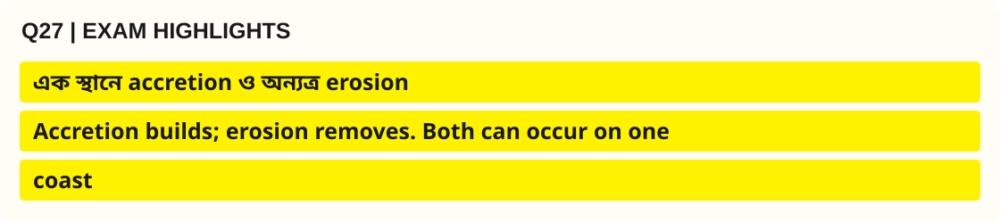

**মূল কথা:** <mark>বদ্বীপ গঠন মানে নদীর পলি ও উপকূলীয় প্রক্রিয়ায় ভূমির সঞ্চয়ন ও নতুন ভূমিরূপের বিকাশ; উপকূলীয় ক্ষয় মানে তরঙ্গ, স্রোত,</mark> জোয়ার ও অন্যান্য প্রক্রিয়ায় ভূমির অপসারণ।

- **পয়েন্ট 1 —** একই উপকূলের <mark>এক স্থানে accretion ও অন্যত্র erosion</mark> হতে পারে।
- **পয়েন্ট 2 —** অতএব ‘বাংলাদেশের উপকূল শুধু বাড়ছে’ বা ‘শুধু কমছে’—এ দুই সরলীকরণই ভুল।
- **পয়েন্ট 3 —** দীর্ঘমেয়াদি উপকূল-পর্যবেক্ষণ ও পরিবেশগত প্রভাব বিশ্লেষণ ছাড়া নির্দিষ্ট ক্ষয়ের হার উল্লেখ করবেন না।

> [!NOTE]
> 🔵 **Source you can cite in the exam:** Banglapedia — Asiatic Society of Bangladesh — *Bangladesh Geography (ভূপ্রকৃতি, বদ্বীপ, নদী ও অঞ্চল)* [S2]; UNESCO World Heritage Centre — *The Sundarbans (Bangladesh), World Heritage List no.798; inscribed 1997* [S11]।

> [!TIP]
> 🟢 **Q27 · Recall in 10 Seconds:** **Accretion builds; erosion removes. Both can occur on one coast**।

<a id="q28"></a>

### 28. What is meant by a physiographic region? Illustrate with examples.

**বাংলা প্রশ্ন:** ভূপ্রাকৃতিক অঞ্চল বলতে কী বোঝায়? উদাহরণসহ ব্যাখ্যা করুন।

**Type:** Editorial high-priority practice (not a previous exam question) · **Suggested marks:** 5–10

**✅ Model Answer (বাংলা) — Definition → Explanation → Analysis**

**🟨 Exact Yellow Exam Highlight (`#FFF200`) — Q28**


**মূল কথা:** <mark>Physiographic region হলো ভূমিরূপ, ভূতাত্ত্বিক বৈশিষ্ট্য, উচ্চতা, নিষ্কাশন ব্যবস্থা ও গঠন-প্রক্রিয়ায় সামঞ্জস্যপূর্ণ</mark> ভৌগোলিক অঞ্চল।

- **পয়েন্ট 1 —** বাংলাদেশে <mark>প্লাবনভূমি, প্লাইস্টোসিন সোপান এবং পাহাড়ি অঞ্চল</mark> প্রধান উদাহরণ।
- **পয়েন্ট 2 —** আরও সূক্ষ্ম বিশ্লেষণে Banglapedia ২৪টি উপ-অঞ্চল ও ৫৪টি এককের শ্রেণিবিন্যাস উল্লেখ করে।
- **পয়েন্ট 3 —** প্রতিটি অঞ্চল আলাদা করার লক্ষ্য হলো কৃষি, অবকাঠামো, পানি ব্যবস্থাপনা ও দুর্যোগ নীতি যথাযথভাবে স্থানভিত্তিক করা।

> [!NOTE]
> 🔵 **Source you can cite in the exam:** Banglapedia — Asiatic Society of Bangladesh — *Bangladesh Geography (ভূপ্রকৃতি, বদ্বীপ, নদী ও অঞ্চল)* [S2]; Banglapedia — Asiatic Society of Bangladesh — *ভূ-প্রকৃতি (বাংলা)* [S3]।

> [!TIP]
> 🟢 **Q28 · Recall in 10 Seconds:** **Physiographic Region = formation + landform + drainage + relief**।

<a id="q29"></a>

### 29. Explain why geomorphological maps are useful for public planning.

**বাংলা প্রশ্ন:** সরকারি পরিকল্পনায় ভূ-আকৃতিগত মানচিত্র কেন গুরুত্বপূর্ণ?

**Type:** Editorial high-priority practice (not a previous exam question) · **Suggested marks:** 5–10

**✅ Model Answer (বাংলা) — Definition → Explanation → Analysis**

**🟨 Exact Yellow Exam Highlight (`#FFF200`) — Q29**


**মূল কথা:** <mark>Geomorphological Map বিভিন্ন ভূমিরূপ, নদীখাত, সোপান, চর ও পাহাড়ের স্থানিক অবস্থান দেখায়</mark>।

- **পয়েন্ট 1 —** কৃষি-জমি মূল্যায়ন, সেতু বা সড়ক বসানো, <mark>বন্যা ঝুঁকি মানচিত্র, নদীভাঙন পর্যবেক্ষণ</mark> এবং শহরের উপযুক্ত ভূমি ব্যবহারের জন্য এগুলো দরকার।
- **পয়েন্ট 2 —** তবে একটি মানচিত্রের প্রকাশসাল ও স্কেল না জেনে সাম্প্রতিক নদী/জেলা সীমানা নির্ধারণ করা যাবে না।
- **পয়েন্ট 3 —** পরীক্ষার উত্তরে GIS (Geographic Information System) ও Remote Sensing-এর ব্যবহার যুক্ত করলে প্রয়োগভিত্তিক বিশ্লেষণ শক্তিশালী হয়।

> [!NOTE]
> 🔵 **Source you can cite in the exam:** Banglapedia — Asiatic Society of Bangladesh — *Bangladesh Geography (ভূপ্রকৃতি, বদ্বীপ, নদী ও অঞ্চল)* [S2]; General Economics Division (GED), Bangladesh Planning Commission — *Bangladesh Delta Plan 2100, investment plan / six hotspot descriptions* [S6]।

> [!TIP]
> 🟢 **Q29 · Recall in 10 Seconds:** **Map → flood risk → land-use decisions → resilient investment**।

<a id="q30"></a>

### 30. How does the Bay of Bengal influence Bangladesh’s economic and environmental security?

**বাংলা প্রশ্ন:** বঙ্গোপসাগর বাংলাদেশের অর্থনৈতিক ও পরিবেশগত নিরাপত্তাকে কীভাবে প্রভাবিত করে?

**Type:** Editorial high-priority practice (not a previous exam question) · **Suggested marks:** 5–10

**✅ Model Answer (বাংলা) — Definition → Explanation → Analysis**

**🟨 Exact Yellow Exam Highlight (`#FFF200`) — Q30**

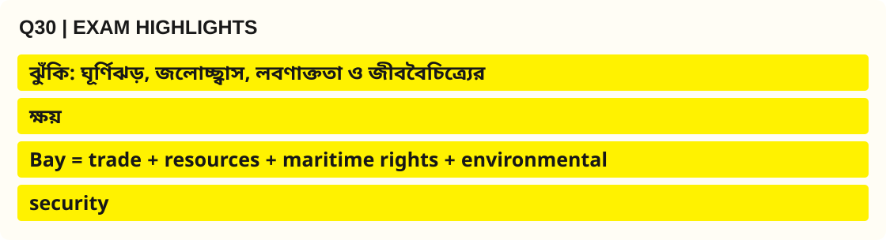

**মূল কথা:** <mark>বঙ্গোপসাগর বন্দর ও বাণিজ্য, সামুদ্রিক পরিবহন, মাছ এবং উপকূলীয় কর্মসংস্থানের সুযোগ দেয়</mark>।

- **পয়েন্ট 1 —** অন্যদিকে <mark>ঘূর্ণিঝড়, জলোচ্ছ্বাস, লবণাক্ততা ও জীববৈচিত্র্য ক্ষয়ের</mark> চাপ তৈরি হয়।
- **পয়েন্ট 2 —** অর্থনৈতিক নিরাপত্তার জন্য নৌযোগাযোগ, আইনগত maritime rights ও টেকসই মৎস্য-ব্যবস্থাপনা; পরিবেশগত নিরাপত্তার জন্য coastal early warning, mangrove protection ও জলবায়ু অভিযোজন একসঙ্গে প্রয়োজন।
- **পয়েন্ট 3 —** রায় ও আইন উল্লেখ করলে বিশ্লেষণ গ্রহণযোগ্য হয়—ITLOS 2012, PCA 2014, Territorial Waters and Maritime Zones Act 1974/2021।

> [!NOTE]
> 🔵 **Source you can cite in the exam:** Ministry of Law, Justice and Parliamentary Affairs — Laws of Bangladesh — *The Territorial Waters and Maritime Zones Act, 1974 (as amended in 2021)* [S8]; International Tribunal for the Law of the Sea (ITLOS) — *Case No.16, Bangladesh/Myanmar, Judgment, 14 March 2012* [S9]; Permanent Court of Arbitration (PCA) — *Bay of Bengal Maritime Boundary Arbitration (Bangladesh v India), Award, 7 July 2014* [S10]; UNESCO World Heritage Centre — *The Sundarbans (Bangladesh), World Heritage List no.798; inscribed 1997* [S11]।

> [!TIP]
> 🟢 **Q30 · Recall in 10 Seconds:** **Bay = trade + resources + maritime rights + environmental security**।


<a id="worked"></a>

[⬆️ Back to Question Finder](#question-index) · [🏠 Table of Contents](#top)

---

## ১০A. Worked Answers — ৫/১০/২০ নম্বরের পূর্ণ উদাহরণ

> এখানে বড় প্রশ্নের উত্তরে **কী লিখবেন** তা শুধু outline হিসেবে নয়, পূর্ণ অনুচ্ছেদে দেখানো হয়েছে। অন্য model answer-এর মতোই প্রত্যেক পরিসংখ্যান ও গুরুত্বপূর্ণ claim-এর উৎসের নাম দেওয়া আছে। নিচের উত্তরগুলো পরীক্ষামুখী শিক্ষণীয় রচনা; BPSC-এর অনুমোদিত নমুনা নয়।

### Worked Answer A (5 marks) — What is the geographical location of Bangladesh?

**বাংলা প্রশ্ন:** বাংলাদেশের ভৌগোলিক অবস্থান কী?

**ভূমিকা।** বাংলাদেশ দক্ষিণ এশিয়ার একটি নদীবিধৌত বদ্বীপীয় রাষ্ট্র। ভৌগোলিক অবস্থান বলতে অক্ষাংশ–দ্রাঘিমাংশের পাশাপাশি চারদিকের প্রতিবেশী ও প্রাকৃতিক অবস্থানকেও বোঝায়।

**অবস্থান।** Banglapedia, *Bangladesh* নিবন্ধ অনুযায়ী বাংলাদেশ ২০°৩৪′ থেকে ২৬°৩৮′ উত্তর অক্ষাংশ এবং ৮৮°০১′ থেকে ৯২°৪১′ পূর্ব দ্রাঘিমাংশের মধ্যে অবস্থিত। দেশের উত্তর ও পশ্চিমে ভারত, পূর্বে ভারত ও মিয়ানমার এবং দক্ষিণে বঙ্গোপসাগর রয়েছে। দেশটি গঙ্গা–ব্রহ্মপুত্র–মেঘনা নদীব্যবস্থার নিম্নাংশে অবস্থিত। **[S4 — Banglapedia, Asiatic Society of Bangladesh]**

**তাৎপর্য।** একদিকে উজান থেকে আসা পলি বাংলাদেশে কৃষি ও জনবসতির ভিত্তি তৈরি করেছে; অন্যদিকে মোহনা ও সমুদ্রসীমা সামুদ্রিক যোগাযোগ, মাছ ও নৌবাণিজ্যের সুযোগ দিয়েছে। এ অবস্থানের কারণেই নদীভাঙন, বন্যা ও ঘূর্ণিঝড়-সংশ্লিষ্ট ঝুঁকিও নীতিনির্ধারণের মূল বিষয়। **[S2 — Banglapedia, Bangladesh Geography; S6 — GED, Bangladesh Delta Plan 2100]**

**উপসংহার।** বাংলাদেশের অবস্থান একটি ভূগোলগত পরিচয়ই নয়; এটি জাতীয় অর্থনীতি, যোগাযোগ ও দুর্যোগ ব্যবস্থাপনার মৌলিক প্রেক্ষাপট।

**Exam citation line:** *Source: Banglapedia (Asiatic Society of Bangladesh), “Bangladesh” and “Bangladesh Geography”.*

---

### Worked Answer B (10 marks) — Describe the topographical features of different regions of Bangladesh.

**বাংলা প্রশ্ন:** বাংলাদেশের বিভিন্ন অঞ্চলের ভূপ্রাকৃতিক বৈশিষ্ট্য বর্ণনা করুন।

**ভূমিকা।** বাংলাদেশের ভূমিরূপকে একটি অখণ্ড সমতল বলা ভুল। তিনটি প্রধান অঞ্চলের গঠন, বয়স, উচ্চতা ও জলপ্রবাহে মৌলিক পার্থক্য রয়েছে। Banglapedia, *Bangladesh Geography* ও *ভূ-প্রকৃতি* এই অঞ্চলগুলোকে **Floodplain, Pleistocene Terrace ও Tertiary Hills** হিসেবে শ্রেণিবদ্ধ করে। **[S2; S3]**

**প্রথমত—নবীন প্লাবনভূমি।** গঙ্গা–পদ্মা, ব্রহ্মপুত্র–যমুনা ও মেঘনা নদীব্যবস্থার পলল এই অঞ্চলের ভূমি গঠনে প্রধান ভূমিকা রাখে। চর, বন্যা-প্লাবিত সমভূমি, হাওর ও মোহনার নানা ভূমিরূপ এখানে পাওয়া যায়। নতুন পলি জমার কারণে কৃষির সুযোগ তৈরি হয়; কিন্তু flood risk, erosion ও নদীখাত পরিবর্তন জমি ও বসতিকে অনিশ্চিত করে। উত্তর-পূর্বের হাওর অঞ্চলে আকস্মিক বন্যা বিশেষ গুরুত্বপূর্ণ। **[S2 — Banglapedia, Bangladesh Geography]**

**দ্বিতীয়ত—প্লাইস্টোসিন সোপান।** বরেন্দ্রভূমি, মধুপুর গড় এবং লালমাই এলাকার পুরোনো অপেক্ষাকৃত উঁচু ভূমিরূপ সাধারণ নদী-প্লাবনভূমি থেকে স্বতন্ত্র। বরেন্দ্রে শুষ্ক মৌসুমের পানি ব্যবস্থাপনা এবং মধুপুরে বন–ভূমি ব্যবহার গুরুত্বপূর্ণ উদাহরণ। **[S2; S3]**

**তৃতীয়ত—টারশিয়ারি পাহাড়।** পূর্ব ও দক্ষিণ-পূর্বের পার্বত্য চট্টগ্রাম এবং উত্তর-পূর্বের সিলেটের কিছু টিলা-পাহাড় এই শ্রেণিতে অন্তর্ভুক্ত। উচ্চতা ও ঢালের পার্থক্য বন, বসতি ও যোগাযোগ পরিকল্পনাকে প্রভাবিত করে; অপরিকল্পিত পাহাড় কাটায় ভূমিধসের ঝুঁকি বাড়তে পারে। **[S2; S6]**

**তুলনামূলক সারণি।**

| বৈশিষ্ট্য | Floodplain | Pleistocene terrace | Tertiary hills |
|---|---|---|---|
| সাধারণ রূপ | নবীন পলল সমতল | পুরোনো উঁচু সোপান | ঢাল, পাহাড় ও উপত্যকা |
| উদাহরণ | যমুনা–মেঘনা প্লাবনভূমি | বরেন্দ্র–মধুপুর | পার্বত্য চট্টগ্রাম |
| মূল ব্যবহারের সম্ভাবনা | কৃষি ও নৌপথ | কৃষি, বন, বসতি | বন, পাহাড়ি অর্থনীতি |
| ব্যবস্থাপনা চ্যালেঞ্জ | বন্যা–ভাঙন | পানির চাপ–ভূমি ব্যবহার | ঢালক্ষয়–ভূমিধস |

**পরিবর্তনশীলতার বিশ্লেষণ।** বাংলাদেশের ভূপ্রকৃতি সময়ের সঙ্গে বদলায়—উদাহরণস্বরূপ, আঠারো শতকের শেষভাগে ব্রহ্মপুত্রের প্রবাহ যমুনা চ্যানেলে সরে আসার দীর্ঘস্থায়ী প্রভাব। ফলে ‘topographical development over time’ বোঝাতে নদীর গতিপথ ও পলি-পরিবহন বাধ্যতামূলক আলোচ্য। **[S12 — Banglapedia, Brahmaputra-Jamuna River System]**

**উপসংহার।** এই ভৌগোলিক পার্থক্যের কারণেই উন্নয়ন-পরিকল্পনায় একটিমাত্র সমাধান যথেষ্ট নয়; GED-এর *Bangladesh Delta Plan 2100* অঞ্চলভিত্তিক hotspot চিহ্নিত করেছে। **[S6 — GED, Planning Commission]**

**Exam citation line:** *Source: Banglapedia (Asiatic Society of Bangladesh), “Bangladesh Geography”; GED, Bangladesh Delta Plan 2100.*

---

### Worked Answer C (20 marks) — Evaluate the geopolitical importance and geographical risks of Bangladesh and suggest a sustainable development strategy.

**বাংলা প্রশ্ন:** বাংলাদেশের ভূ-কৌশলগত গুরুত্ব ও ভৌগোলিক ঝুঁকি মূল্যায়ন করে টেকসই উন্নয়ন কৌশল প্রস্তাব করুন।

**ভূমিকা ও thesis।** বাংলাদেশের কৌশলগত গুরুত্বকে কেবল দুটি প্রতিবেশী রাষ্ট্রের মাঝামাঝি অবস্থান দিয়ে ব্যাখ্যা করা যথেষ্ট নয়। দক্ষিণ এশিয়ার নদী অববাহিকার নিম্নাংশ, বঙ্গোপসাগরঘেঁষা উপকূল, আন্তর্জাতিক বাণিজ্যের সম্ভাবনা ও দুর্যোগসংবেদনশীল বদ্বীপ—এই চারটির সম্মিলনে দেশটির geopolitical geography গঠিত। এ অবস্থান একই সঙ্গে **connectivity dividend** ও **climate-security challenge**। **[S2 — Banglapedia; S6 — GED]**

**১. আঞ্চলিক সংযোগের সুযোগ।** বাংলাদেশ ভারতের বিভিন্ন রাজ্য ও মিয়ানমার-সংলগ্ন দক্ষিণ এশিয়ার একটি গুরুত্বপূর্ণ স্থানিক অবস্থানে রয়েছে। স্থল, নদী, রেল ও সমুদ্রভিত্তিক যোগাযোগ ব্যবস্থার সমন্বয় আমদানি-রপ্তানি ও আঞ্চলিক বাণিজ্যকে সহায়তা করতে পারে। তবে বাস্তব সংযোগের ফল নির্ভর করে অবকাঠামো, বাণিজ্যনীতি, সীমান্ত ব্যবস্থাপনা ও পারস্পরিক সমঝোতার ওপর; অবস্থান একাই স্বয়ংক্রিয় লাভ নিশ্চিত করে না। **[S4 — Banglapedia, Bangladesh; S6 — GED, Delta Plan]**

**২. বঙ্গোপসাগর ও maritime economy।** বন্দর, নৌবাণিজ্য, মৎস্য, পর্যবেক্ষণ, গবেষণা ও সম্ভাব্য সামুদ্রিক শক্তি বঙ্গোপসাগরকে উন্নয়নের একটি ক্ষেত্র করে। বাংলাদেশের Territorial Waters and Maritime Zones Act 1974, সংশোধিত ২০২১ অনুযায়ী territorial sea, contiguous zone ও EEZ-র অধিকার ভিন্ন। সুতরাং পরীক্ষায় **12 NM–24 NM–200 NM** লিখলেও সংশ্লিষ্ট *sovereignty* বনাম *sovereign rights* পার্থক্যটি অবশ্যই লিখতে হবে। **[S8 — Ministry of Law, Laws of Bangladesh]**

**৩. বিরোধ নিষ্পত্তিতে আন্তর্জাতিক আইনের ভূমিকা।** ITLOS, *Bangladesh/Myanmar*, ১৪ মার্চ ২০১২ এবং PCA, *Bangladesh v. India*, ৭ জুলাই ২০১৪—এই দুটি বিচারিক সিদ্ধান্ত বাংলাদেশের সামুদ্রিক সীমানা নির্ধারণে গুরুত্বপূর্ণ। যুক্তিসংগত বক্তব্য: আইনগত নির্ধারণ বিনিয়োগ ও সামুদ্রিক ব্যবস্থাপনায় নিশ্চয়তা দিতে সহায়ক; তবে রায় পাওয়া এবং তেল–গ্যাসের প্রমাণিত মজুত পাওয়া সমার্থক নয়। **[S9 — ITLOS; S10 — PCA]**

**৪. আন্তঃসীমান্ত নদীর ভূরাজনীতি।** বাংলাদেশ একটি প্রধান downstream delta state। উজানের নদীর পানি, বৃষ্টিপাত ও পলি-পরিবহনের পরিবর্তন কৃষি, নাব্যতা, জলজ পরিবেশ ও বন্যা ব্যবস্থাপনাকে প্রভাবিত করে। তাই hydrological data sharing, basin cooperation, forecast systems ও নদীর স্বাভাবিক প্রবাহ নিয়ে নিয়মিত সহযোগিতা রাষ্ট্রীয় স্বার্থের অংশ। **[S2 — Banglapedia; S6 — GED]**

**৫. জলবায়ু ও ভূপ্রাকৃতিক ঝুঁকি।** নিম্নভূমি ও মোহনাকে বন্যা–জলোচ্ছ্বাস, উত্তর-পূর্বের হাওরকে আকস্মিক বন্যা, বরেন্দ্রকে খরা-পানির চাপ এবং পার্বত্য অঞ্চলকে ঢাল-সম্পর্কিত ঝুঁকি মোকাবিলা করতে হয়। এই অমিলের কারণে একই প্রকল্প বা একক জাতীয় ‘disaster solution’ অসম্পূর্ণ। **[S6 — GED, BDP 2100; S7 — BWDB]**

**৬. পরিবেশ ও জীবিকা।** সুন্দরবন কেবল একটি প্রাকৃতিক সম্পদ নয়; নদী–জোয়ার–লবণাক্ততার সংযোগস্থলে দাঁড়িয়ে থাকা ম্যানগ্রোভ বাস্তুতন্ত্র। UNESCO-এর World Heritage Centre ১৯৯৭ সালে বাংলাদেশের বিশ্ব ঐতিহ্য সম্পত্তি হিসেবে সুন্দরবন তালিকাভুক্ত করে। ecosystem protection-কে অর্থনীতি থেকে বিচ্ছিন্ন করলে উপকূলের দীর্ঘমেয়াদি স্থিতিস্থাপকতা কমে। **[S11 — UNESCO, The Sundarbans]**

**৭. নীতি সুপারিশ (Policy Matrix)।**

| উন্নয়ন লক্ষ্য | বাস্তবায়নযোগ্য কৌশল | প্রাতিষ্ঠানিক যুক্তি |
|---|---|---|
| জল ও খাদ্যনিরাপত্তা | basin data sharing, irrigation efficiency, crop adaptation | পানি ও ভূমি পরিকল্পনায় সমন্বয় |
| বন্দর ও বাণিজ্য | climate-resilient ports, multimodal connectivity | দুর্যোগকালে supply chain সচল |
| উপকূল রক্ষা | mangrove conservation, coastal zoning, early warning | পরিবেশ ও নিরাপত্তা একসঙ্গে |
| চর ও নদীভাঙন | remote-sensing monitoring, rehabilitation, flexible land use | স্থায়ী নয় এমন নদীসীমার স্বীকৃতি |
| পাহাড় ও হাওর | স্থানভিত্তিক slope planning, flood forecasting | hotspot-specific governance |
| সামুদ্রিক সম্পদ | scientific stock assessment, ecosystem safeguards | blue economy-র sustainability |

**৮. Visual summary।**

```mermaid
flowchart TD
A["Bangladesh geographic position"] --> B["Opportunities"]
A --> C["Risks"]
B --> D["Port access + trade + marine resources"]
C --> E["Floods + cyclones + erosion + drought"]
D --> F["Adaptive, evidence-based national planning"]
E --> F
F --> G["BDP 2100 hotspots + maritime legal governance"]
```

*Figure 8 — Geopolitical opportunity–risk synthesis. Editorial diagram from Banglapedia, GED, ITLOS/PCA and Bangladesh maritime law [S2, S6, S8–S10].*

**সমালোচনামূলক মূল্যায়ন।** ‘বঙ্গোপসাগর আছে, তাই স্বয়ংক্রিয়ভাবে উন্নয়ন হবে’ বা ‘নদীবহুল হওয়ায় বাংলাদেশ সর্বদা পিছিয়ে থাকবে’—কোনোটিই সম্পূর্ণ সত্য নয়। মানুষের প্রযুক্তি, প্রতিষ্ঠান, কূটনীতি, স্থানীয় অংশগ্রহণ ও বৈজ্ঞানিক তথ্য একই ভৌগোলিক অবস্থানকে উন্নয়নের সম্পদ বা ঝুঁকিতে রূপান্তর করতে পারে।

**উপসংহার।** বাংলাদেশের কৌশলগত শ্রেষ্ঠ সম্পদ শুধু অবস্থান নয়; **সেই অবস্থানকে টেকসইভাবে পরিচালনার সক্ষমতা**। নদী–ভূমি–সমুদ্র–জীবিকার সমন্বিত কৌশলই একটি নিরাপদ ও কার্যকর বদ্বীপ রাষ্ট্র নির্মাণের ভিত্তি।

**Exam citations:** *Banglapedia, “Bangladesh Geography”; General Economics Division, Bangladesh Delta Plan 2100; ITLOS, Bangladesh/Myanmar Judgment (2012); PCA, Bangladesh/India Award (2014); Territorial Waters and Maritime Zones Act, 1974 (amended 2021); UNESCO World Heritage Centre, “The Sundarbans”.*


<a id="revision"></a>

## ১১. Smart Revision — একটি পাতায় পুরো অধ্যায়

| Subtopic | Must-write keywords | Best visual | Source |
|---|---|---|---|
| অবস্থান | Latitude, Longitude, Bay of Bengal, South Asia | annotated map | [S4] |
| ৩ ভূপ্রকৃতি | Floodplain, Terrace, Tertiary hills | 80/8/12 pie with caveat | [S2], [S5] |
| বদ্বীপ | Sedimentation, erosion, accretion, active/moribund | causal flowchart | [S2] |
| বরেন্দ্র | Pleistocene terrace, drought, groundwater | comparative table | [S2], [S6] |
| হাওর | Basin, flash flood, boro cropping | seasonal cross-section | [S2], [S6] |
| পার্বত্য অঞ্চল | Slope, forest, landslide | regional map | [S2], [S6] |
| সুন্দরবন | Mangrove, estuary, 1997 UNESCO inscription | tidal-process diagram | [S11] |
| সমুদ্র | 12/24/200 NM, ITLOS 2012, PCA 2014 | jurisdiction flowchart | [S8]–[S10] |
| উন্নয়ন | Six hotspots, adaptive delta management | hotspot bar chart | [S6], [S7], [S13] |

### Self-check (without looking up)

1. বাংলাদেশকে বদ্বীপীয় রাষ্ট্র বলা হলেও তিন ধরনের ভূপ্রকৃতি কেন?
2. 80/8/12 pie chart ঠিক কোন উৎস ও classification-এর জন্য বৈধ?
3. বরেন্দ্র বনাম মধুপুর গড়ের তিনটি মিল/পার্থক্য কী?
4. ব্রহ্মপুত্রের গতিপথের পরিবর্তন চর ও বসতিকে কীভাবে প্রভাবিত করেছে?
5. Territorial Sea এবং EEZ-তে রাষ্ট্রের ক্ষমতা কেন এক নয়?
6. উপকূলীয় পরিকল্পনায় শুধু hard engineering কেন যথেষ্ট নয়?
7. Banglapedia এবং Delta Plan-এর তথ্য একসঙ্গে ব্যবহার করলে কোন source note প্রয়োজন?

<a id="sources"></a>


<a id="memory-check"></a>

### 🧠 Memory Check — ১০ মিনিটে পরীক্ষা

**Step 1 — ১ মিনিট:** Location → Sediment → Delta → Three Landforms → Changes → People → Policy গল্পটি না দেখে বলুন।

**Step 2 — ৩ মিনিট:** খাতায় বাংলাদেশ আঁকুন। পশ্চিমে বরেন্দ্র, মধ্যাঞ্চলে মধুপুর, উত্তর-পূর্বে হাওর, দক্ষিণ-পূর্বে পাহাড় এবং দক্ষিণে বঙ্গোপসাগর চিহ্নিত করুন।

**Step 3 — ৩ মিনিট:** দুটি ৫ নম্বরের সংক্ষিপ্ত উত্তর লিখুন—(a) Define a moribund delta; (b) Distinguish territorial sea and EEZ।

**Step 4 — ৩ মিনিট:** একটি ১০ নম্বরের প্রশ্নের outline তৈরি করুন—“Explain the topographical variations in Bangladesh and their effects on livelihoods.”

**Source reminder:** **Banglapedia (Asiatic Society of Bangladesh)**, **FAO**, **GED / Bangladesh Planning Commission**, **Ministry of Law**, **ITLOS**, **PCA**—শুধু প্রতিষ্ঠান নয়, সম্ভব হলে সংশ্লিষ্ট প্রকাশনার নাম ও বছর উল্লেখ করুন।

[⬆️ Go to Contents](#top)

---

## ১২. Sources & Evidence — প্রতিষ্ঠান, শিরোনাম, সাল ও উৎস-লিংক

| ID | Source institution (exam-এ উল্লেখযোগ্য) | Exact document/article | Online reference |
|---|---|---|---|
| [S1] | Bangladesh Public Service Commission (BPSC) | Syllabus for BCS (Written) Examination, Bangladesh Affairs, p.6 | [Read primary/archival source](https://bpsc.portal.gov.bd/sites/default/files/files/bpsc.portal.gov.bd/page/732e9da5_9514_4252_9a33_119f8c000cc5/SYLLABUS%20FOR%20BCS%20%28WRITTEN%29%20EXAMINATION.pdf) |
| [S2] | Banglapedia — Asiatic Society of Bangladesh | Bangladesh Geography (ভূপ্রকৃতি, বদ্বীপ, নদী ও অঞ্চল) | [Read primary/archival source](https://en.banglapedia.org/index.php?title=Bangladesh_Geography) |
| [S3] | Banglapedia — Asiatic Society of Bangladesh | ভূ-প্রকৃতি (বাংলা) | [Read primary/archival source](https://bn.banglapedia.org/index.php/ভূ-প্রকৃতি) |
| [S4] | Banglapedia — Asiatic Society of Bangladesh | Bangladesh (অবস্থান, আয়তন ও সীমান্ত) | [Read primary/archival source](https://en.banglapedia.org/index.php?title=Bangladesh) |
| [S5] | Wage Earners' Welfare Board, Government of Bangladesh | Environmental and Social Baseline Data, land-environment classification (government-hosted report, c.2020) | [Read primary/archival source](https://wewb.gov.bd/sites/default/files/files/wewb.portal.gov.bd/project/ecc951af_1207_4abf_a53f_4f576aa548c8/2020-11-04-16-31-661b524bea711895536778c4c711f279.pdf) |
| [S6] | General Economics Division (GED), Bangladesh Planning Commission | Bangladesh Delta Plan 2100, investment plan / six hotspot descriptions | [Read primary/archival source](https://plancomm.gov.bd/sites/default/files/files/plancomm.portal.gov.bd/files/dc5b06a1_3a45_4ec7_951e_a9feac1ef783/BDP%202100%20Volume%202%20Investment%20Plan%20Cover%20Page%2C%20Message%2C%20Executive%20Summary%2C%20Table%20of%20Contents.pdf) |
| [S7] | Bangladesh Water Development Board (BWDB) | ব-দ্বীপ পরিকল্পনা বাস্তবায়নে বাংলাদেশ পানি উন্নয়ন বোর্ড, updated 2023 | [Read primary/archival source](https://bwdb.portal.gov.bd/pages/static-pages/6922e0d4933eb65569e28c0f) |
| [S8] | Ministry of Law, Justice and Parliamentary Affairs — Laws of Bangladesh | The Territorial Waters and Maritime Zones Act, 1974 (as amended in 2021) | [Read primary/archival source](https://bdlaws.minlaw.gov.bd/act-print-467.html) |
| [S9] | International Tribunal for the Law of the Sea (ITLOS) | Case No.16, Bangladesh/Myanmar, Judgment, 14 March 2012 | [Read primary/archival source](https://itlos.org/en/main/cases/list-of-cases/case-no-16/) |
| [S10] | Permanent Court of Arbitration (PCA) | Bay of Bengal Maritime Boundary Arbitration (Bangladesh v India), Award, 7 July 2014 | [Read primary/archival source](https://pca-cpa.org/en/news/bay-of-bengal-maritime-boundary-arbitration-between-bangladesh-and-india-bangladesh-v-india/) |
| [S11] | UNESCO World Heritage Centre | The Sundarbans (Bangladesh), World Heritage List no.798; inscribed 1997 | [Read primary/archival source](https://whc.unesco.org/en/list/798/) |
| [S12] | Banglapedia — Asiatic Society of Bangladesh | Brahmaputra-Jamuna River System; history of the Tista and Brahmaputra course shifts | [Read primary/archival source](https://en.banglapedia.org/index.php/Brahmaputra-Jamuna_River_System) |
| [S13] | Bangladesh Climate Development Partnership (government portal) | BDP 2100, six hotspot area figures (site metadata accessed 2026) | [Read primary/archival source](https://bcdp.gov.bd/) |
| [Q1] | BCS EXAM (unofficial reconstructed question archive) | 35th BCS Written Bangladesh Affairs | [Read primary/archival source](https://bcsexam.org/written-questions/35th-bcs-written) |
| [Q2] | BCS EXAM (unofficial reconstructed question archive) | 36th BCS Written Bangladesh Affairs | [Read primary/archival source](https://bcsexam.org/written-questions/36th-bcs-written) |
| [Q3] | BCS EXAM (unofficial reconstructed question archive) | 40th BCS Written Bangladesh Affairs | [Read primary/archival source](https://bcsexam.org/written-questions/40th-bcs-written) |
| [Q4] | BCS EXAM (unofficial reconstructed question archive) | 43rd BCS Written Bangladesh Affairs | [Read primary/archival source](https://bcsexam.org/written-questions/43rd-bcs-written) |
| [Q5] | BCS EXAM (unofficial reconstructed question archive) | 47th BCS Written Bangladesh Affairs | [Read primary/archival source](https://bcsexam.org/written-questions/47th-bcs-written) |

### Map image attribution & copyright
- **Figure 1:** Urutseg, *Bangladesh physical map.svg*, 2011, Wikimedia Commons, CC0 1.0, [file page](https://commons.wikimedia.org/wiki/File:Bangladesh_physical_map.svg). Source/creator/licence on the file page; independent educational illustration, not sovereign-border legal evidence.
- **Figure 2:** Oona Räisänen (Mysid), *Map of Bangladesh-en.svg*, 2010, Wikimedia Commons, CC BY 3.0 / GFDL; [file page](https://commons.wikimedia.org/wiki/File:Map_of_Bangladesh-en.svg). Attribution required; original old map layers may be outdated.
- **Figures 3–7:** Original editorial schematic Mermaid diagrams in this chapter, derived from the explicitly named source concepts. The **pie and bar chart values are sourced**; directional arrows are conceptual, not statistical observations.

<a id="accuracy"></a>

### Accuracy & Verification Log — কী নিশ্চিত, কী এখনো যাচাই করা বাকি
- Fixed geographic facts such as broad latitude/longitude are cited to Banglapedia; institutional boundaries and area estimates can differ across modern datasets.
- Percentage of physiographic classes: published estimate from [S5]; **not independently verified as a current 2026 land survey**.
- Hotspot areas: [S13] government portal; overlap means their sum is **not** the national total.
- PYQs: source archives [Q1]–[Q5] are **secondary**, with possible transcription/completeness problems. Each is attributed, rather than deceptively labelled officially verified. Full official paper audit remains open.
- Current affairs, new scientific measurements and flood-risk numbers must be refreshed with the observation year and primary sources before a future high-stakes exam; no unverified percentages, world rankings or fabricated quotes have been added.

[⬆ ফিরে যান: ১৬ অধ্যায়ের সূচি](../README.md)
