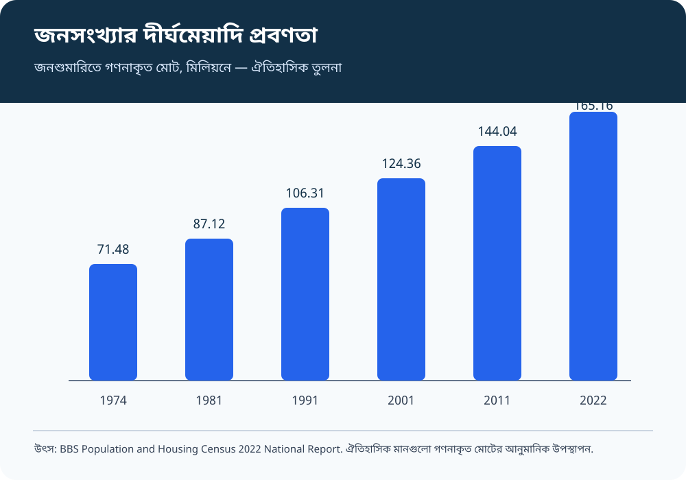
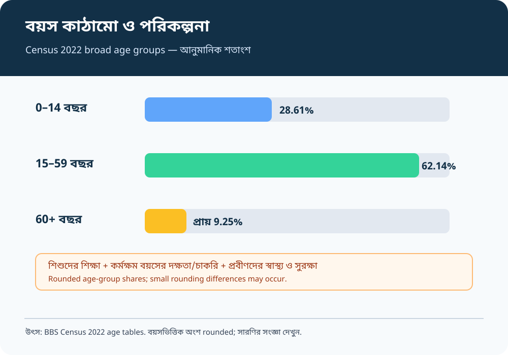
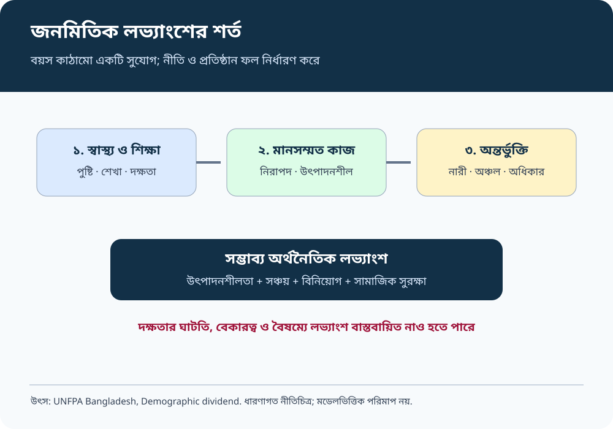
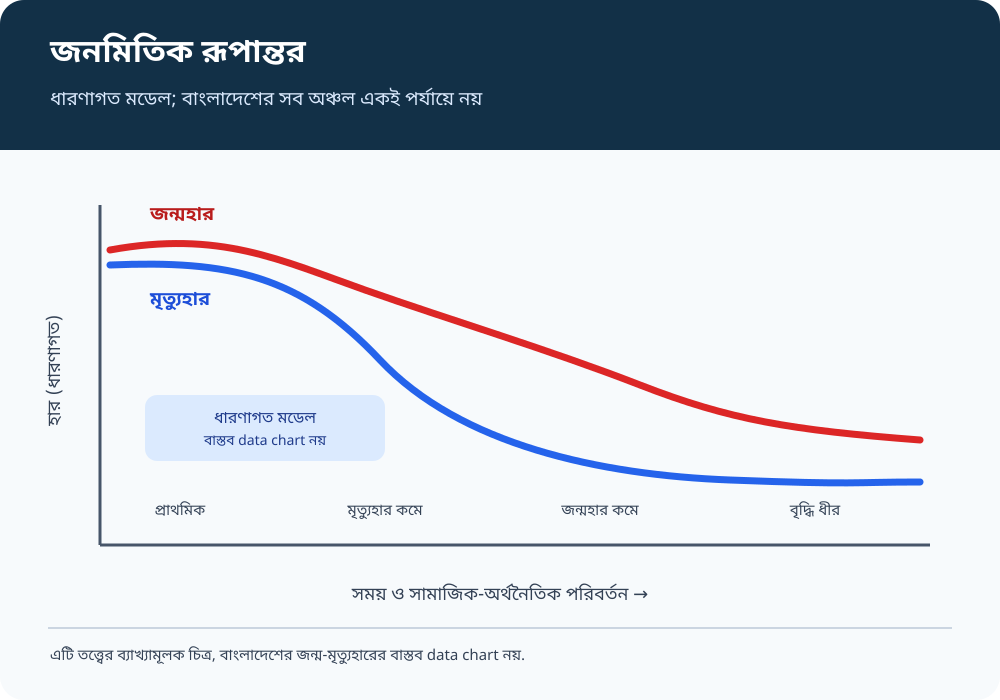
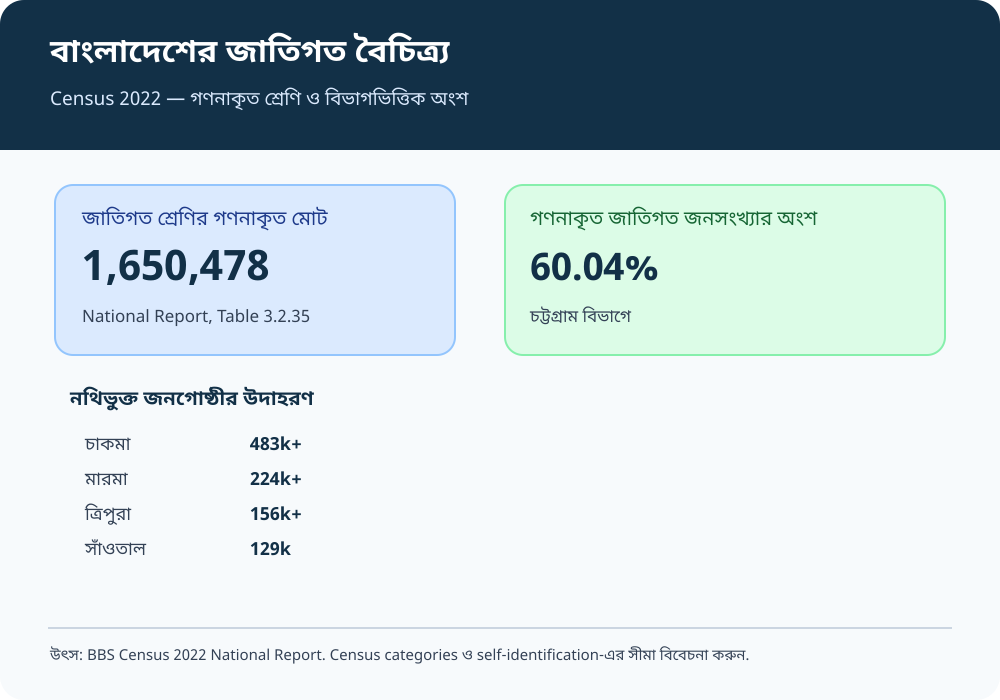
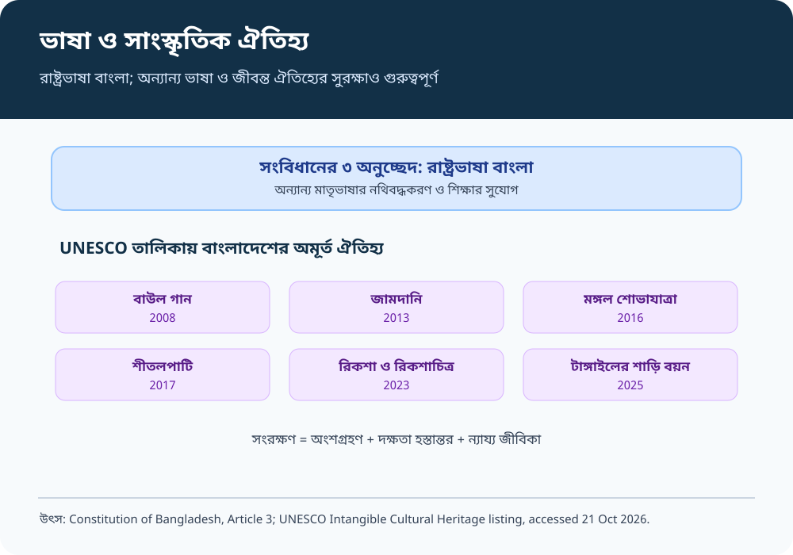
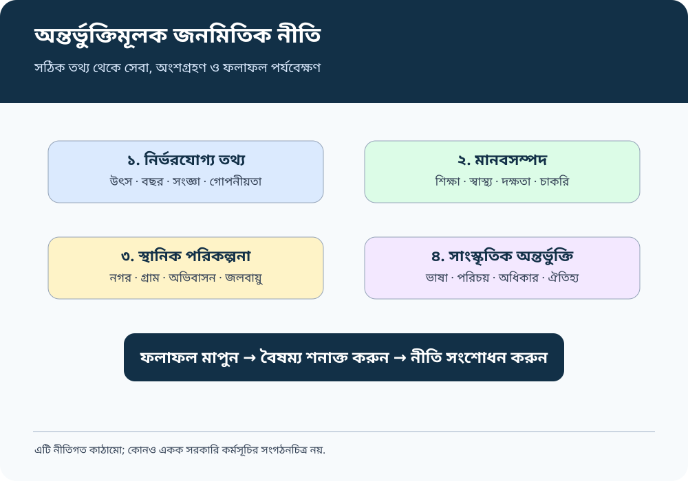

# Chapter 02 — জনতত্ত্ব, জনমিতি ও সাংস্কৃতিক বৈচিত্র্য
## Demographic Features, Ethnic and Cultural Diversity

> **BCS Written · Bangladesh Affairs · Subject Code 005 · 200 marks**  
> **ভাষা:** প্রমিত বাংলা; প্রয়োজনীয় English terminology প্রথমবার বাংলা অর্থসহ।  
> **Source review:** ২১ অক্টোবর ২০২৬ · **বিন্যাস:** সিলেবাস → ধারণা → সরকারি তথ্য → বিশ্লেষণ → নীতি → Visual Revision → archive-reported PYQ → ৩টি worked answer → ৩৩টি অনুশীলনী → Fact-check।

[← মূল সূচি](../README.md) · [Chapter 01](../Chapter-01/README.md) · [35th–47th PYQ Audit](./PYQ-ANALYSIS-35TH-47TH.md) · [২৫টি Model Q&A](./BCS-WRITTEN-QUESTION-BANK.md) · [১৮টি English Quotations + Sources](./QUOTATIONS.md) · [🗺️ Visual Atlas (8 SVG + official maps)](./VISUAL-ATLAS.md) · [সরকারি Map/Infographics](#official-maps)

> 📱 **Mobile-friendly visuals:** সব ৮টি revision diagram responsive SVG image হিসেবে পুরো content width-এ দেখানো হয়। কোনো diagram না খুললে ছবিতে ক্লিক করে full-size version খুলুন। চওড়া সারণি ফোনে আড়াআড়ি scroll করা যাবে.

> [!NOTE]
> **পড়ার পদ্ধতি:** ধারণা → তথ্যের উৎস ও বছর → কারণ–ফল → বাংলাদেশের উদাহরণ → নীতি/সমাধান → উত্তর অনুশীলন। প্রতিটি সংখ্যার সঙ্গে তার reference period ও definition খেয়াল করুন।

## বিষয়সূচি

| শুরু ও শেখার ধাপ | বিষয়ভিত্তিক আলোচনা | অনুশীলন ও যাচাই |
|---|---|---|
| [১. পরিচিতি ও সিলেবাস](#start) | [৪. জনমিতিক সূচক](#indicators) | [Previous BCS Questions](#previous-bcs) |
| [২. ধারণা ও পরিমাপ](#concepts) | [৫. জনমিতিক তত্ত্ব](#theories) | [Worked Answers](#worked-answers) |
| [৩. জনসংখ্যার প্রবণতা](#trend) | [৬. বণ্টন, নগরায়ণ ও অভিবাসন](#migration) | [৩৩টি অনুশীলনী প্রশ্ন](#questions) |
| [৭. জাতিগত বৈচিত্র্য](#ethnicity) | [৮. ভাষা, ধর্ম ও সংস্কৃতি](#culture) | [উত্তর লেখার কৌশল](#strategy) |
| [৯. নীতি ও সুপারিশ](#policy) | [১০. Visual Revision](#visuals) | [Source List](#sources) |
| [Fact-check](#factcheck) | [Coverage Checklist](#coverage) | [Source-backed Lines](./QUOTATIONS.md) |

### রঙের সংকেত

| সংকেত | অর্থ |
|---|---|
| 🟨 **Key Fact** | সংজ্ঞা, সংখ্যা বা আইনগত তথ্য |
| 🟩 **Recall Cue** | পুনরালোচনার সূত্র |
| 🟦 **Source Evidence** | সরকারি/প্রাথমিক উৎস |
| 🟪 **Critical Note** | সংজ্ঞা, পদ্ধতি বা সীমাবদ্ধতা |

---

## ১. অধ্যায় পরিচিতি ও BPSC Written Syllabus Mapping

BPSC-এর *Syllabus for BCS (Written) Examination*, Bangladesh Affairs (Compulsory), Subject Code 005, পৃষ্ঠা ৬-এ দ্বিতীয় বিষয়টি হলো **“Demographic features including ethnic and cultural diversity.”** এই অধ্যায় সেই বিষয়টিকে কেন্দ্র করে তৈরি। [S1](#s1)

এটি BCS Written-এর সাধারণ Bangladesh Affairs পত্রের অধ্যায়; Sociology optional-এর পূর্ণাঙ্গ সিলেবাস নয়। জনমিতি ও সাংস্কৃতিক বৈচিত্র্য বোঝার জন্য প্রাসঙ্গিক তত্ত্ব ও ধারণা রাখা হয়েছে, তবে অপ্রাসঙ্গিক সমাজতাত্ত্বিক বিষয়কে আলাদা পাঠ্যসূচি হিসেবে বিস্তৃত করা হয়নি।

### শিখনফল

এই অধ্যায় শেষে শিক্ষার্থী যেন—

1. Demography, fertility, mortality, migration, population density ও urbanisation ব্যাখ্যা করতে পারে।
2. Census-এর গণনাকৃত মোট, PEC-adjusted total, sample survey ও international estimates-এর পার্থক্য বুঝতে পারে।
3. বাংলাদেশের জনসংখ্যার আকার, বৃদ্ধির গতি, বয়স কাঠামো ও স্থানিক বণ্টন বিশ্লেষণ করতে পারে।
4. জনমিতিক পরিবর্তনের সুযোগ ও ঝুঁকিকে শিক্ষা, স্বাস্থ্য, কর্মসংস্থান ও সামাজিক সুরক্ষার সঙ্গে যুক্ত করতে পারে।
5. জাতিগত, ভাষাগত, ধর্মীয় ও সাংস্কৃতিক বৈচিত্র্যকে তথ্যনির্ভর ও সম্মানজনক ভাষায় ব্যাখ্যা করতে পারে।
6. সংবিধান ও আন্তর্জাতিক সাংস্কৃতিক-ঐতিহ্য কাঠামোর প্রাসঙ্গিকতা দেখাতে পারে।
7. উৎস ও তথ্যের সীমাবদ্ধতা উল্লেখ করে বাস্তবসম্মত সুপারিশ দিতে পারে।

### এক নজরে গুরুত্বপূর্ণ তথ্য

| সূচক | তথ্য | ভিত্তি |
|---|---:|---|
| জনশুমারিতে গণনাকৃত মোট | <mark>১৬৫,১৫৮,৬১৬</mark> | Census 2022 |
| PEC-সমন্বিত মোট | <mark>১৬৯,৮২৮,৯১১</mark> | Census 2022, adjusted |
| গ্রামীণ জনসংখ্যার অংশ | <mark>৬৮.৩৪%</mark> | adjusted total |
| শহুরে জনসংখ্যার অংশ | <mark>৩১.৬৬%</mark> | adjusted total |
| জনসংখ্যার ঘনত্ব | প্রতি বর্গকিমিতে প্রায় ১,১১৯ | গণনাকৃত census total-এর ভিত্তিতে |
| গড় বার্ষিক বৃদ্ধির হার | ১.১২% adjusted; ১.২২% enumerated series | Census 2022 National Report |
| মোট প্রজনন হার (TFR) | <mark>২.১৭</mark> | BBS SVRS 2023 |
| জন্মকালীন প্রত্যাশিত আয়ু | <mark>৭২.৩ বছর</mark> | BBS SVRS 2023 |
| তালিকাভুক্ত জাতিগত জনগোষ্ঠীর গণনাকৃত মোট | <mark>১,৬৫০,৪৭৮</mark> | National Report, Table 3.2.35 |
| ১৫–২৪ বছর বয়সী NEET জনগোষ্ঠী | <mark>১০,৮১১,৪০৪</mark>; বয়সগোষ্ঠীর <mark>৩৪.২৬%</mark> | Census 2022, Table 3.2.30 |

**উৎস:** BBS, *Population and Housing Census 2022, National Report (Volume I)*; BBS, *Bangladesh Sample Vital Statistics 2023*. [S2](#s2) [S4](#s4)

> [!WARNING]
> ১৬৫.১৬ মিলিয়ন হলো গণনাকৃত মোট; ১৬৯.৮৩ মিলিয়ন হলো PEC-সমন্বিত মোট। একই গণনায় এ দুটিকে মিশিয়ে বৃদ্ধির হার বা ঘনত্ব বের করবেন না।

### অধ্যায়ের মূল যুক্তি

~~~mermaid
flowchart TD
A["জন্ম, মৃত্যু ও অভিবাসন"] --> B["জনসংখ্যার আকার ও পরিবর্তন"]
B --> C["বয়স, লিঙ্গ ও স্থানিক বণ্টন"]
C --> D["শিক্ষা, স্বাস্থ্য, কাজ ও আবাসনের চাহিদা"]
D --> E["উৎপাদনশীলতা, বৈষম্য ও জীবনমান"]
E --> F["অন্তর্ভুক্তিমূলক নীতি ও সেবা"]
G["জাতিগত, ভাষাগত, ধর্মীয় ও সাংস্কৃতিক বৈচিত্র্য"] --> F
~~~

জনসংখ্যা বেশি হলেই উন্নয়ন অসম্ভব—এমন নয়। আবার কর্মক্ষম বয়সের বড় জনগোষ্ঠী থাকলেই স্বয়ংক্রিয়ভাবে অর্থনৈতিক সুফল আসে না। শিক্ষা, স্বাস্থ্য, দক্ষতা, মানসম্মত কাজ, নারীর অংশগ্রহণ, অবকাঠামো ও বৈষম্য হ্রাসের ওপর ফল নির্ভর করে। [S6](#s6)

---

## ২. মৌলিক ধারণা ও পরিমাপ

### ২.১ প্রয়োজনীয় পরিভাষা

| English term | সহজ বাংলা অর্থ | ব্যাখ্যা |
|---|---|---|
| **Demography** | জনমিতি/জনতত্ত্ব | জনসংখ্যার আকার, গঠন, বণ্টন ও পরিবর্তনের অধ্যয়ন |
| **Population** | জনসংখ্যা | নির্দিষ্ট স্থান ও সময়ে নির্ধারিত নিয়মে গণনা করা মানুষের সমষ্টি |
| **Census** | জনশুমারি | নির্দিষ্ট সময়ে দেশের জনসংখ্যা ও পরিবারের বিস্তৃত গণনা |
| **Fertility** | প্রজনন | বাস্তবে সন্তান জন্মদানের পরিমাপ |
| **Total Fertility Rate (TFR)** | মোট প্রজনন হার | বর্তমান বয়সভিত্তিক হার বজায় থাকলে একজন নারীর সম্ভাব্য গড় সন্তানসংখ্যার সূচক |
| **Mortality** | মৃত্যুহার | জনসংখ্যায় মৃত্যুর মাত্রা ও ধরন |
| **Life expectancy at birth** | জন্মকালীন প্রত্যাশিত আয়ু | নির্দিষ্ট সময়ের বয়সভিত্তিক মৃত্যুহার অপরিবর্তিত থাকলে প্রত্যাশিত গড় আয়ু |
| **Migration** | অভিবাসন/স্থানান্তর | বসবাসের স্থান পরিবর্তন; অভ্যন্তরীণ বা আন্তর্জাতিক |
| **Urbanisation** | নগরায়ণ | জনসংখ্যা ও কার্যক্রমের শহরকেন্দ্রিক বিস্তার |
| **Population density** | জনঘনত্ব | প্রতি একক আয়তনে জনসংখ্যা |
| **Age structure** | বয়স কাঠামো | শিশু, কর্মক্ষম বয়স ও প্রবীণ জনগোষ্ঠীর অনুপাত |
| **Dependency ratio** | নির্ভরশীলতার অনুপাত | নির্দিষ্ট সংজ্ঞায় নির্ভরশীল বয়সের জনসংখ্যা ও কর্মক্ষম বয়সের অনুপাত |
| **Demographic dividend** | জনমিতিক লভ্যাংশ | কর্মক্ষম বয়সের তুলনামূলক বড় অংশকে উৎপাদনশীল কাজে যুক্ত করতে পারলে সম্ভাব্য সুফল |
| **Ethnicity** | জাতিগত পরিচয় | ইতিহাস, আত্মপরিচয়, ভাষা ও সংস্কৃতির সঙ্গে যুক্ত সামাজিক পরিচয় |
| **Cultural diversity** | সাংস্কৃতিক বৈচিত্র্য | ভাষা, ধর্ম, শিল্প, উৎসব, রীতি, জ্ঞান ও জীবনচর্চার বৈচিত্র্য |
| **Intangible cultural heritage** | অমূর্ত সাংস্কৃতিক ঐতিহ্য | গান, আচার, উৎসব, কারুশিল্পের দক্ষতা ও প্রজন্মান্তরে বহন করা জ্ঞান |

### ২.২ চার ধরনের তথ্য-উৎস

| উৎস | কী মাপে | শক্তি | সীমাবদ্ধতা |
|---|---|---|---|
| **Census** | জনসংখ্যা, পরিবার, বয়স, লিঙ্গ, বসবাস ও নির্বাচিত সামাজিক বৈশিষ্ট্য | বিস্তৃত ভৌগোলিক কভারেজ | coverage error, সংজ্ঞা ও শ্রেণিবিন্যাসের প্রভাব |
| **Sample survey** | প্রজনন, মৃত্যু, স্বাস্থ্য ও জীবনযাত্রার সূচক | তুলনামূলক ঘন ঘন তথ্য | sampling error ও confidence interval বিবেচনা করতে হয় |
| **Administrative data** | জন্মনিবন্ধন, স্বাস্থ্যসেবা, শিক্ষা ও সেবা গ্রহণ | ধারাবাহিক তথ্য | সব মানুষ সমানভাবে নথিভুক্ত নাও হতে পারেন |
| **Estimate/projection** | মডেল ও অনুমানে নির্দিষ্ট বছরের জনসংখ্যা | পরিকল্পনা ও আন্তর্জাতিক তুলনা | মডেল, ভিত্তিবছর ও অনুমান পরিবর্তনে সংখ্যা বদলায় |

### ২.৩ একই সূচকের একাধিক সংখ্যা কেন?

- **Enumerated population:** সরাসরি গণনাকৃত মোট।
- **PEC-adjusted population:** Post Enumeration Check-এর ফল বিবেচনায় সমন্বিত মোট।
- **SVRS estimate:** নমুনাভিত্তিক vital statistics বা নির্দিষ্ট তারিখের অনুমান।
- **International estimate:** World Bank/UN-এর harmonised বা modelled series; জাতীয় census total-এর সঙ্গে এক হওয়া বাধ্যতামূলক নয়।

Census 2022-এর গণনাকৃত মোট <mark>১৬৫,১৫৮,৬১৬</mark>; PEC-সমন্বিত মোট <mark>১৬৯,৮২৮,৯১১</mark>। [S2](#s2) [S3](#s3)

### ২.৪ তথ্য ব্যবহারের নিয়ম

1. **সময়কাল লিখুন:** “Census 2022 অনুযায়ী” বা “SVRS 2023 অনুযায়ী”।
2. **ভিত্তি লিখুন:** enumerated, adjusted, survey estimate, নাকি projection।
3. **বয়সসীমা লিখুন:** ৭+ বছরের সাক্ষরতা এবং ১৫+ বছরের সাক্ষরতা এক নয়।
4. **সংজ্ঞা যাচাই করুন:** urban-এর সংজ্ঞা আন্তর্জাতিক তুলনায় ভিন্ন হতে পারে।
5. **সংখ্যার তাৎপর্য ব্যাখ্যা করুন:** পরিসংখ্যান নিজে বিশ্লেষণ নয়।

---

## ৩. বাংলাদেশের জনসংখ্যার প্রবণতা

**দৃশ্যমান ব্যাখ্যা — জনসংখ্যার পরিবর্তন**

[পূর্ণ আকারে খুলুন](./assets/visual-revision/02-population-trend.svg) · গণনাকৃত ও সমন্বিত জনসংখ্যার series গুলিয়ে ফেলবেন না।

### ৩.১ দীর্ঘমেয়াদি পরিবর্তন

BBS National Report-এ ১৯৭৪ থেকে ২০২২ পর্যন্ত জনশুমারিতে গণনাকৃত জনসংখ্যার দীর্ঘমেয়াদি বৃদ্ধি দেখা যায়। নিচের সংখ্যা গণনাকৃত মোটের আনুমানিক উপস্থাপন; PEC-adjusted ২০২২ মোটের সঙ্গে এই সিরিজ মেশানো যাবে না। [S2](#s2)

| জনশুমারির বছর | গণনাকৃত জনসংখ্যা (প্রায়, মিলিয়ন) |
|---|---:|
| ১৯৭৪ | ৭১.৪৮ |
| ১৯৮১ | ৮৭.১২ |
| ১৯৯১ | ১০৬.৩১ |
| ২০০১ | ১২৪.৩৬ |
| ২০১১ | ১৪৪.০৪ |
| ২০২২ | ১৬৫.১৬ |

### ৩.২ বৃদ্ধির হার কমলেও মোট সংখ্যা কেন বাড়ে?

জনসংখ্যার বার্ষিক বৃদ্ধির হার কমলেও মোট জনসংখ্যা বাড়তে পারে, কারণ বর্তমান জনসংখ্যার ভিত্তি বড়। জন্মহার মৃত্যুহারের চেয়ে বেশি থাকলে, অথবা অভিবাসনের নিট প্রভাব ধনাত্মক হলে, মোট সংখ্যা বাড়ে।

~~~mermaid
flowchart LR
A["বড় জনসংখ্যার ভিত্তি"] --> D["মোট সংখ্যা বাড়তে পারে"]
B["প্রজনন হার কমছে"] --> E["বৃদ্ধির গতি ধীর হতে পারে"]
C["মৃত্যুহার ও আয়ুর পরিবর্তন"] --> D
E --> D
~~~

**তিনটি বিষয় আলাদা করুন:** জনসংখ্যার আকার, বৃদ্ধির হার এবং বয়স কাঠামো। বৃদ্ধির হার কমলেও শিশু, কর্মক্ষম বয়সী ও প্রবীণদের সংখ্যায় প্রভাব বিভিন্ন সময়ে দেখা যায়।

### ৩.৩ বৃদ্ধি: সুযোগ ও চাপ

**সম্ভাব্য সুযোগ**
- বড় শ্রমশক্তি ও অভ্যন্তরীণ বাজার;
- শিল্প, কৃষি, সেবা ও প্রযুক্তিতে কর্মী/ভোক্তার বিস্তার;
- দক্ষতা উন্নয়ন ও নারী-পুরুষের সমান অংশগ্রহণে উৎপাদনশীলতা;
- সাংস্কৃতিক সৃজনশীলতা ও সামাজিক নেটওয়ার্ক।

**সম্ভাব্য চাপ**
- মানসম্মত কাজ না বাড়লে বেকারত্ব ও অনিরাপদ কাজ;
- শিক্ষা, স্বাস্থ্য, আবাসন, পরিবহন, পানি ও স্যানিটেশনের চাহিদা;
- যানজট, দূষণ ও দুর্যোগঝুঁকি;
- ভূমি ও সম্পদের ওপর চাপ, যা বণ্টন, প্রযুক্তি ও ব্যবস্থাপনার ওপরও নির্ভর করে।

**মূল্যায়ন:** জনসংখ্যাকে কেবল সম্পদ বা কেবল বোঝা হিসেবে দেখা যথেষ্ট নয়। মানবসম্পদ, কর্মসংস্থান, সেবা ও প্রতিষ্ঠানগত সক্ষমতা নির্ধারণ করে সম্ভাবনা কতটা কাজে লাগবে। [S6](#s6)

### ৩.৪ Census 2022: গণনাকৃত বনাম সমন্বিত

| সূচক | গণনাকৃত মোট | PEC-সমন্বিত মোট |
|---|---:|---:|
| জনসংখ্যা | <mark>১৬৫,১৫৮,৬১৬</mark> | <mark>১৬৯,৮২৮,৯১১</mark> |
| গ্রামীণ অংশ | ৬৮.৪৯% | <mark>৬৮.৩৪%</mark> |
| শহুরে অংশ | ৩১.৫১% | <mark>৩১.৬৬%</mark> |

**পরীক্ষা-উপযোগী বাক্য:** “BBS Census 2022-এ গণনাকৃত জনসংখ্যা ছিল ১৬৫.১৬ মিলিয়ন; PEC-সমন্বয়ের পর মোট দাঁড়ায় ১৬৯.৮৩ মিলিয়ন।” [S2](#s2) [S3](#s3)

---

## ৪. বয়স, প্রজনন, মৃত্যু, আয়ু ও মানবসম্পদ

### ৪.১ বয়স কাঠামো

**দৃশ্যমান ব্যাখ্যা — বয়স কাঠামো**

[পূর্ণ আকারে খুলুন](./assets/visual-revision/03-age-structure.svg) · বয়সভিত্তিক গঠন শিক্ষা, কর্মসংস্থান, স্বাস্থ্য ও প্রবীণ-সেবার পরিকল্পনায় সহায়তা করে।

Census 2022-এর প্রাথমিক গণনাকৃত বয়সভিত্তিক সারণিতে ০–১৪ বছর বয়সী জনগোষ্ঠী প্রায় ২৮.৬১%; ১৫–২৪ বছর বয়সী প্রায় ১৯.১১%। ৬০ বছর ও তদূর্ধ্ব জনগোষ্ঠীর অংশ প্রায় ৯% এর কিছু বেশি; বয়সগোষ্ঠীর rounding-এর কারণে যোগফলে সামান্য পার্থক্য হতে পারে। [S2](#s2) [S3](#s3)

| বয়স-গোষ্ঠী | প্রধান চাহিদা |
|---|---|
| ০–১৪ | পুষ্টি, টিকাদান, প্রাক্‌-প্রাথমিক ও স্কুলশিক্ষা |
| ১৫–২৪ | মাধ্যমিক/উচ্চশিক্ষা, দক্ষতা, প্রথম চাকরি, স্বাস্থ্য |
| ২৫–৫৯ | উৎপাদনশীল কাজ, পরিবার, সঞ্চয় ও কর-অবদান |
| ৬০+ | স্বাস্থ্য, আয়-নিরাপত্তা, পরিচর্যা ও সামাজিক সুরক্ষা |

**বিশ্লেষণ:** শিশুদের অংশ কমলে শিক্ষা-পরিকল্পনা বদলায়; কর্মক্ষম বয়সের অংশ বাড়লে দক্ষতা ও চাকরির চাহিদা বাড়ে; প্রবীণদের অংশ বাড়লে স্বাস্থ্য ও পরিচর্যার প্রয়োজন বাড়ে। জাতীয় গড়ের পাশাপাশি অঞ্চল, লিঙ্গ ও আয়ের ভিত্তিতে বিভাজিত তথ্য প্রয়োজন।

### ৪.২ প্রজনন হার

**Total Fertility Rate (TFR)** বর্তমান বয়সভিত্তিক প্রজনন হার বজায় থাকলে একজন নারীর সম্ভাব্য গড় সন্তানসংখ্যার সূচক; এটি কোনও নির্দিষ্ট নারীর বাস্তব সন্তানসংখ্যা নয়। BBS *Bangladesh Sample Vital Statistics 2023* অনুযায়ী TFR ছিল **<mark>২.১৭</mark>**; crude birth rate ছিল প্রতি হাজার জনসংখ্যায় **১৯.৪**। [S4](#s4)

প্রজনন হারের পরিবর্তনের কারণের মধ্যে নারীশিক্ষা, পরিবার পরিকল্পনা, শিশু বেঁচে থাকা, বিয়ের বয়স, নগরায়ণ, আবাসন ব্যয়, কর্মসংস্থান, সামাজিক নিরাপত্তা ও স্বাস্থ্যসেবায় প্রবেশাধিকার রয়েছে।

**নীতি-তাৎপর্য:** স্বেচ্ছামূলক পরিবার পরিকল্পনা, প্রজননস্বাস্থ্য, নিরাপদ প্রসব, কিশোর-কিশোরীর স্বাস্থ্যশিক্ষা এবং অধিকারভিত্তিক সেবা জরুরি; কেবল জন্মহার কমানোই নীতির লক্ষ্য হওয়া উচিত নয়।

### ৪.৩ মৃত্যুহার ও প্রত্যাশিত আয়ু

BBS SVRS 2023 অনুযায়ী জন্মকালীন প্রত্যাশিত আয়ু **<mark>৭২.৩ বছর</mark>**; পুরুষের ৭০.৯ এবং নারীর ৭৩.৮ বছর। একই উৎসে crude death rate প্রতি হাজারে ৬.১ এবং infant mortality rate প্রতি হাজার জীবিত জন্মে ৩৩ দেখানো হয়েছে। এগুলো নমুনাভিত্তিক estimate; uncertainty বিবেচনা করতে হবে। [S4](#s4)

প্রত্যাশিত আয়ু স্বাস্থ্য, পুষ্টি, স্যানিটেশন ও চিকিৎসার সামগ্রিক অবস্থা বোঝাতে সাহায্য করে। তবে জাতীয় গড় সব অঞ্চল ও সামাজিক গোষ্ঠীর বাস্তবতা দেখায় না।

### ৪.৪ Dependency ratio

Dependency ratio সাধারণত শিশু ও প্রবীণ জনগোষ্ঠীর সঙ্গে কর্মক্ষম বয়সের জনসংখ্যার অনুপাত। কোন বয়সসীমা ব্যবহার করা হয়েছে তা না জেনে ভিন্ন উৎসের ratio তুলনা করবেন না। কর্মক্ষম বয়সে থাকা সবাই চাকরিতে আছেন—এমন নয়; শিক্ষা, বেকারত্ব, unpaid care work ও শ্রমশক্তির বাইরে থাকা মানুষ বিবেচনা করতে হবে।

### ৪.৫ Demographic dividend

**দৃশ্যমান ব্যাখ্যা — জনমিতিক লভ্যাংশ**

[পূর্ণ আকারে খুলুন](./assets/visual-revision/05-demographic-dividend.svg) · কর্মক্ষম বয়সের অংশ বেশি হলেই dividend নিশ্চিত হয় না।

UNFPA Bangladesh-এর বিশ্লেষণ অনুযায়ী, প্রথম demographic dividend-এর শীর্ষ পর্যায় ২০২০-এর দশকের শুরুতে পৌঁছেছে; ভবিষ্যৎ সুফল নির্ভর করবে দক্ষতা, উৎপাদনশীল কাজ, নারী-অংশগ্রহণ ও মানবসম্পদে বিনিয়োগের ওপর। এটি বিশ্লেষণাত্মক মূল্যায়ন, নিশ্চিত অর্থনৈতিক ফল নয়। [S6](#s6)

~~~mermaid
flowchart TD
A["কর্মক্ষম বয়সের বড় অংশ"] --> B["শিক্ষা, স্বাস্থ্য ও দক্ষতা"]
B --> C["উৎপাদনশীল কর্মসংস্থান"]
C --> D["আয়, সঞ্চয় ও বিনিয়োগ"]
D --> E["সম্ভাব্য অর্থনৈতিক লভ্যাংশ"]
F["দক্ষতার ঘাটতি / বেকারত্ব"] --> G["লভ্যাংশ বাস্তবায়িত না হওয়া"]
H["নারীর কম অংশগ্রহণ / বৈষম্য"] --> G
~~~

**শর্ত:** মানসম্মত শিক্ষা, বাজারসংশ্লিষ্ট দক্ষতা, নিরাপদ চাকরি, নারীর অংশগ্রহণ, স্বাস্থ্যসেবা ও সামাজিক সুরক্ষা।

### ৪.৬ যুব জনগোষ্ঠী ও NEET

NEET = Not in Education, Employment or Training। এটি “অলস” মানুষের শ্রেণি নয়; শিক্ষা, কাজ বা প্রশিক্ষণে না থাকার অবস্থা বোঝায়। এর পেছনে চাকরির অভাব, unpaid care work, নিরাপত্তা, প্রতিবন্ধিতা, পারিবারিক দায়িত্ব ও শিক্ষায় বাধা থাকতে পারে।

BBS Census 2022 National Report Table 3.2.30 অনুযায়ী ১৫–২৪ বছর বয়সী NEET জনগোষ্ঠী ছিল **<mark>১০,৮১১,৪০৪</mark>**, এই বয়সগোষ্ঠীর **<mark>৩৪.২৬%</mark>**। প্রতিবেদনে পুরুষের হার ১৩.২৮% এবং নারীর ৫২.৭৬%। এ ব্যবধানের ব্যাখ্যায় যত্নের কাজ, সামাজিক বিধিনিষেধ, প্রশিক্ষণ ও চাকরির সুযোগ পরীক্ষা করা প্রয়োজন। [S2](#s2)

### ৪.৭ সাক্ষরতার সূচক

Census 2022-এর প্রাথমিক প্রতিবেদনে ৭ বছর ও তদূর্ধ্ব জনগোষ্ঠীর সাক্ষরতার হার **৭৪.৬৬%**। SVRS 2022-এ একই বয়সসীমার জন্য **৭৬.৮%** রিপোর্ট করা হয়েছিল। পদ্ধতি, সংজ্ঞা, নমুনা ও সময়ের পার্থক্য থাকায় সরাসরি গড় করা উচিত নয়। [S3](#s3) [S4](#s4)

**পরীক্ষা-উপযোগী বাক্য:** “জনশুমারি ও নমুনা জরিপে সাক্ষরতার হারে পার্থক্য থাকতে পারে; তুলনায় উৎস, সংজ্ঞা, বয়সসীমা ও জরিপের বছর উল্লেখ করা প্রয়োজন।”

### ৪.৮ লিঙ্গ, প্রতিবন্ধিতা ও অন্তর্ভুক্তিমূলক জনমিতি

নারী-পুরুষের সংখ্যা দিয়ে লিঙ্গসমতা বোঝা যায় না। শিক্ষা, কর্মসংস্থান, নিরাপত্তা, স্বাস্থ্য, unpaid care work, সম্পত্তি ও সিদ্ধান্তগ্রহণে অংশগ্রহণও গুরুত্বপূর্ণ। একইভাবে census-এ প্রতিবন্ধিতা বা লিঙ্গ-বৈচিত্র্য সম্পর্কিত শ্রেণির সংখ্যা প্রশ্নের ভাষা, সংজ্ঞা ও উত্তরদানের নিরাপত্তার ওপর নির্ভর করতে পারে। একটি census count-কে সংশ্লিষ্ট সব মানুষের পূর্ণ সংখ্যা ধরে নেওয়া উচিত নয়।

---

## ৫. জনমিতিক তত্ত্ব: প্রয়োগ ও সীমাবদ্ধতা

### ৫.১ Demographic Transition Theory

**দৃশ্যমান ব্যাখ্যা — জনমিতিক রূপান্তর মডেল**

[পূর্ণ আকারে খুলুন](./assets/visual-revision/04-demographic-transition.svg) · এটি conceptual model, বাংলাদেশের পর্যবেক্ষিত বার্ষিক data series নয়।

জনমিতিক রূপান্তর তত্ত্ব সামাজিক-অর্থনৈতিক পরিবর্তনের সঙ্গে জন্মহার ও মৃত্যুহারের দীর্ঘমেয়াদি পরিবর্তন ব্যাখ্যা করে। সাধারণ মডেলে প্রথমে জন্ম ও মৃত্যু দুটোই বেশি; পরে মৃত্যুহার আগে কমে এবং জনসংখ্যা দ্রুত বাড়ে; পরবর্তী পর্যায়ে জন্মহারও কমে বৃদ্ধির গতি ধীর হয়।

বাংলাদেশে প্রজনন হার কমা, প্রত্যাশিত আয়ু বৃদ্ধি ও বৃদ্ধির গতি ধীর হওয়ার প্রবণতা এই রূপান্তরের সঙ্গে সামঞ্জস্যপূর্ণ। তবে অঞ্চল, আয় ও শিক্ষাগত স্তরে পরিবর্তনের গতি ভিন্ন। এটি ব্যাখ্যামূলক মডেল; একক পর্যায় দিয়ে সব বাস্তবতা বোঝা যায় না। [S4](#s4)

### ৫.২ Malthusian Theory

Malthus-এর তত্ত্বে জনসংখ্যা বৃদ্ধির সম্ভাবনা খাদ্য উৎপাদনের বৃদ্ধির তুলনায় দ্রুত হতে পারে—এমন আশঙ্কা রয়েছে। উচ্চ জনঘনত্ব, ভূমির সীমাবদ্ধতা ও সেবার ওপর চাপ বোঝাতে এই ধারণা প্রাসঙ্গিক; তবে আধুনিক বাংলাদেশের জন্য সরল নিয়ম হিসেবে যথেষ্ট নয়।

**সীমাবদ্ধতা:** প্রযুক্তি, কৃষি উৎপাদনশীলতা, বাণিজ্য, সম্পদ বণ্টন, আয় ও নীতির মান বদলায়। খাদ্য সংকট শুধু মোট সরবরাহ নয়; ক্রয়ক্ষমতা ও প্রবেশাধিকারের প্রশ্নও। জনসংখ্যা শ্রমশক্তি, উদ্ভাবন ও বাজারও বাড়াতে পারে।

### ৫.৩ Optimum Population Theory

Optimum population হলো এমন জনসংখ্যার ধারণা, যেখানে বিদ্যমান প্রযুক্তি, পুঁজি, সম্পদ ও প্রতিষ্ঠান ব্যবহার করে মাথাপিছু উৎপাদন/কল্যাণ সর্বোত্তম হতে পারে। এই মাত্রা স্থির নয়; প্রযুক্তি, দক্ষতা, অবকাঠামো ও পরিবেশগত সীমা বদলালে তা বদলায়।

### ৫.৪ তত্ত্বের ব্যবহার

| তত্ত্ব | কোন প্রশ্নে সহায়ক | সতর্কতা |
|---|---|---|
| Demographic Transition | জন্ম-মৃত্যুহারের দীর্ঘমেয়াদি পরিবর্তন | সব অঞ্চল একই গতিতে বদলায় না |
| Malthusian | জনসংখ্যা ও সম্পদের চাপ | প্রযুক্তি ও বণ্টন বাদ দেবেন না |
| Optimum Population | জনসংখ্যা ও উৎপাদনশীলতার সম্পর্ক | “সর্বোত্তম” মাত্রা স্থির নয় |
| Demographic Dividend | বয়স কাঠামো থেকে অর্থনৈতিক সুযোগ | দক্ষতা ও চাকরি ছাড়া লভ্যাংশ নিশ্চিত নয় |

---

## ৬. বণ্টন, নগরায়ণ ও অভিবাসন

### ৬.১ স্থানিক বণ্টন

জাতীয় জনসংখ্যার গড় ঘনত্ব সব অঞ্চলের বাস্তবতা দেখায় না। ঢাকা, চট্টগ্রাম, নদীতীর, উপকূল, চর, পাহাড়, হাওর ও সীমান্তাঞ্চলে বসতি, জীবিকা ও সেবার ধরন ভিন্ন। Census 2022 National Report অনুযায়ী সমন্বিত মোটের ২৬.৮৮% ঢাকা বিভাগে এবং ৫.৪৯% বরিশাল বিভাগে ছিল। এটি বিভাগভিত্তিক বণ্টন; সেবার মান বা আঞ্চলিক সমতার সরাসরি সূচক নয়। [S2](#s2)

### ৬.২ নগরায়ণ

**দৃশ্যমান মানচিত্র ও স্থানিক তথ্য**

- [বাংলাদেশ ডেল্টা প্ল্যান ২১০০ — Interactive Atlas](https://www.bdp2100kp.gov.bd/atlas/) — নদী, বন্যা, ভূমি ব্যবহার, জনসংখ্যা ও ঝুঁকির layer।
- [BBS Census 2022 infographic gallery](https://bbs.portal.gov.bd/site/page/d551779e-1bee-42b2-9c31-08dc8db4c301) — city corporation, slum statistics, floating population এবং migration-এর official visual sheets।
- [Survey of Bangladesh — official map services](https://sob.gov.bd/pages/static-pages/6922dc29933eb65569e0eb5a) — প্রশাসনিক ও topographic map।

Census 2022-এর PEC-সমন্বিত হিসাবে <mark>৩১.৬৬%</mark> জনসংখ্যা শহুরে ও <mark>৬৮.৩৪%</mark> গ্রামীণ এলাকায় ছিল। “Urban” সংজ্ঞা দেশভেদে ভিন্ন হতে পারে—প্রশাসনিক সীমানা, built-up area ও metropolitan area এক নয়। তাই BBS census এবং World Bank/UN-এর urbanisation series সরাসরি একই মাপ ধরে তুলনা করবেন না। [S2](#s2) [S7](#s7)

**সুযোগ:** কাজ, শিক্ষা, স্বাস্থ্য ও বাজারে প্রবেশ; শিল্প ও সেবার উৎপাদনশীলতা; প্রযুক্তি ও জ্ঞান বিনিময়।  
**চ্যালেঞ্জ:** আবাসন, যানজট, দূষণ, পানি, বর্জ্য, নগর দরিদ্রের স্বাস্থ্য ও সেবা, ঢাকা-কেন্দ্রিক সুযোগের চাপ।

### ৬.৩ অভ্যন্তরীণ অভিবাসন

মানুষ কাজ, শিক্ষা, স্বাস্থ্যসেবা, বিবাহ, পরিবার, নদীভাঙন, বন্যা, খরা ও অন্যান্য কারণে স্থানান্তরিত হতে পারে। সাধারণত একাধিক কারণ একসঙ্গে কাজ করে।

~~~mermaid
flowchart LR
A["কাজ/শিক্ষা/সেবার পার্থক্য"] --> C["স্থানান্তরের সিদ্ধান্ত"]
B["দুর্যোগ/জীবিকা/নিরাপত্তার চাপ"] --> C
C --> D["ঢাকা ও অন্যান্য শহর"]
D --> E["আয় ও সুযোগ"]
D --> F["আবাসন ও সেবার চাপ"]
E --> G["পরিকল্পিত নগরায়ণ দরকার"]
F --> G
~~~

**Push factors:** কাজ বা সেবার অভাব, দারিদ্র্য, জমি হারানো, দুর্যোগ।  
**Pull factors:** চাকরি, শিক্ষা, স্বাস্থ্যসেবা, বাজার ও সামাজিক নেটওয়ার্ক।

### ৬.৪ আন্তর্জাতিক অভিবাসন

আন্তর্জাতিক অভিবাসনের মধ্যে শ্রম, শিক্ষা, পরিবার ও অন্যান্য কারণে স্থানান্তর অন্তর্ভুক্ত। প্রবাসী শ্রমিক ও রেমিট্যান্স পরিবারে আয়, শিক্ষা ও আবাসনের সুযোগ বাড়াতে পারে; তবে নিয়োগ-ব্যয়, ঋণ, প্রতারণা, অনিরাপদ কাজ ও অধিকারহানির ঝুঁকিও রয়েছে।

**নীতি-অগ্রাধিকার:** নিরাপদ নিয়োগ, স্বচ্ছ চুক্তি, প্রশিক্ষণ, শ্রমিকের অধিকার, অভিযোগ প্রতিকার, প্রত্যাগত অভিবাসীর দক্ষতা স্বীকৃতি এবং অভিবাসী পরিবারের সামাজিক সহায়তা।

### ৬.৫ জলবায়ু-সম্পর্কিত স্থানান্তর

নদীভাঙন, বন্যা, ঘূর্ণিঝড়, লবণাক্ততা ও জীবিকা-চাপ স্থানান্তরের সিদ্ধান্তে ভূমিকা রাখতে পারে। তবে জলবায়ু-সম্পর্কিত স্থানান্তর সবসময় আলাদা, সহজে গণনাযোগ্য শ্রেণি নয়; অর্থনৈতিক ও পারিবারিক কারণও একসঙ্গে কাজ করে।

World Bank-এর ২০২২ Country Climate and Development Report-এ ২০৫০ সালের মধ্যে জলবায়ু প্রভাবের কারণে ১৩.৩ মিলিয়ন পর্যন্ত অভ্যন্তরীণ অভিবাসনের একটি scenario রয়েছে। এটি মডেলভিত্তিক সম্ভাবনা, নিশ্চিত ভবিষ্যৎ সংখ্যা নয়। [S17](#s17) [S18](#s18)

### ৬.৬ জনসংখ্যা ও পরিবেশ

জনসংখ্যা বৃদ্ধি পানি, খাদ্য, আবাসন ও পরিবহনের চাহিদা বাড়াতে পারে; কিন্তু পরিবেশগত ক্ষতি শুধু মানুষের সংখ্যার ফল নয়। মাথাপিছু ভোগ, প্রযুক্তি, অবকাঠামো, শিল্পের ধরন ও শাসনব্যবস্থাও গুরুত্বপূর্ণ।

| ক্ষেত্র | সম্ভাব্য চাপ | পরিকল্পনার দিক |
|---|---|---|
| নগর বিস্তার | জলাভূমি ভরাট, যানজট, বর্জ্য | ভূমি-ব্যবহার পরিকল্পনা, গণপরিবহন |
| কৃষি | জমির খণ্ডীকরণ, পানি ও মাটির চাপ | পানি দক্ষতা, উৎপাদনশীলতা |
| দুর্যোগ ও স্থানান্তর | ঘর ও জীবিকা হারানো | অভিযোজন, নিরাপদ আবাসন, সামাজিক সুরক্ষা |
| প্রবীণ জনগোষ্ঠী | স্বাস্থ্য ও পরিচর্যার চাহিদা | প্রাথমিক স্বাস্থ্য ও দীর্ঘমেয়াদি যত্ন |
| তরুণ জনগোষ্ঠী | শিক্ষা ও চাকরির চাহিদা | দক্ষতা, মানসম্মত কাজ, উদ্যোক্তা সহায়তা |

---

## ৭. বাংলাদেশের জাতিগত ও নৃতাত্ত্বিক বৈচিত্র্য

### ৭.১ ধারণা ও পরিভাষা

Ethnicity বা জাতিগত পরিচয় ভাগ করা ইতিহাস, ভাষা, সাংস্কৃতিক অনুশীলন, আত্মপরিচয় ও সামাজিক সম্পর্কের সঙ্গে যুক্ত। একে শুধু শারীরিক বৈশিষ্ট্য দিয়ে ব্যাখ্যা করা যথাযথ নয়; পুরোনো racial-type শ্রেণিবিন্যাস জটিল পরিচয়কে অতিরিক্ত সরল করে।

বাংলাদেশে “ক্ষুদ্র নৃগোষ্ঠী”, “জাতিগত সংখ্যালঘু”, “আদিবাসী”, “Indigenous Peoples” ও “tribal communities” শব্দ ব্যবহৃত হয়। এগুলোর আইনগত, রাজনৈতিক ও আত্মপরিচয়গত প্রেক্ষাপট এক নয়। সংবিধানের ২৩ক অনুচ্ছেদের ভাষা ও আন্তর্জাতিক সংস্থার পরিভাষা আলাদা হতে পারে; উত্তরে একটি শব্দকে সব গোষ্ঠীর স্বীকৃত আত্মপরিচয় ধরে নেবেন না। [S8](#s8) [S9](#s9)

### ৭.২ Census 2022-এর জাতিগত তথ্য

**দৃশ্যমান ব্যাখ্যা — জাতিগত বৈচিত্র্য**

[পূর্ণ আকারে খুলুন](./assets/visual-revision/06-ethnic-diversity.svg) · এটি কোনো জনগোষ্ঠীর বসতি-মানচিত্র নয়।

BBS National Report Volume I, Table 3.2.35 অনুযায়ী তালিকাভুক্ত জাতিগত জনগোষ্ঠীর গণনাকৃত মোট **<mark>১,৬৫০,৪৭৮</mark>**। এর <mark>৬০.০৪%</mark> চট্টগ্রাম বিভাগে এবং ১৪.৮২% রাজশাহী বিভাগে ছিল। [S2](#s2)

| বিভাগ | গণনাকৃত জাতিগত জনগোষ্ঠীর মোটের অংশ |
|---|---:|
| চট্টগ্রাম | <mark>৬০.০৪%</mark> |
| রাজশাহী | ১৪.৮২% |
| সিলেট | ৮.২৮% |
| রংপুর | ৫.৫২% |
| ঢাকা | ৪.৯৯% |
| ময়মনসিংহ | ৩.৭৩% |
| খুলনা | ২.৩৬% |
| বরিশাল | ০.২৫% |

**সতর্কতা:** এই শতাংশগুলো জাতিগত জনগোষ্ঠীর গণনাকৃত মোটের মধ্যে বিভাগের অংশ; দেশের মোট জনসংখ্যার অংশ নয়।

### ৭.৩ জনগোষ্ঠীর উদাহরণ

BBS Census 2022-এ চাকমা, মারমা, ত্রিপুরা, সাঁওতাল, ওরাঁও, গারো, মুন্ডা, ম্রো, তঞ্চঙ্গ্যা, মণিপুরি, খাসি, হাজং, রাখাইনসহ বহু পরিচয় নথিভুক্ত হয়েছে। নিচের সংখ্যা আনুমানিক rounded figure; সুনির্দিষ্ট প্রয়োজনে National Report Table 3.2.35 বা Table P29 দেখুন। [S2](#s2) [S11](#s11)

| জনগোষ্ঠী | গণনাকৃত সংখ্যা (প্রায়) | আঞ্চলিক উপস্থিতির উদাহরণ* |
|---|---:|---|
| চাকমা | ৪৮৩,০০০-এর বেশি | পার্বত্য চট্টগ্রাম |
| মারমা | ২২৪,০০০-এর বেশি | পার্বত্য চট্টগ্রাম |
| ত্রিপুরা | ১৫৬,০০০-এর বেশি | পার্বত্য চট্টগ্রাম ও পার্শ্ববর্তী এলাকা |
| সাঁওতাল | ১২৯,০০০-এর কাছাকাছি | উত্তর-পশ্চিমের বিভিন্ন জেলা |
| ওরাঁও | ৮৫,০০০-এর বেশি | উত্তর-পশ্চিমসহ বিভিন্ন এলাকা |
| গারো | ৭৬,০০০-এর বেশি | ময়মনসিংহ-নেত্রকোনা ও উত্তর-মধ্যাঞ্চল |
| মুন্ডা | ৬০,০০০-এর কাছাকাছি | উত্তর-পশ্চিম ও দক্ষিণ-পশ্চিমের কিছু এলাকা |
| ম্রো | ৫২,০০০-এর বেশি | পার্বত্য চট্টগ্রাম |
| তঞ্চঙ্গ্যা | ৪৫,০০০-এর বেশি | পার্বত্য চট্টগ্রাম ও পার্শ্ববর্তী এলাকা |
| মণিপুরি | ২২,০০০-এর বেশি | সিলেট অঞ্চলে উল্লেখযোগ্য উপস্থিতি |

\*কোনও গোষ্ঠীর সদস্য শুধু উল্লিখিত অঞ্চলেই থাকেন—এমন নয়। সরকারি census label ও community-preferred self-identification-এর মধ্যে পার্থক্য থাকতে পারে।

### ৭.৪ ভৌগোলিক বৈচিত্র্য

- **পার্বত্য চট্টগ্রাম:** চাকমা, মারমা, ত্রিপুরা, ম্রো, তঞ্চঙ্গ্যা, বম, খুমি, খিয়াং, পাংখোয়া, লুসাইসহ বিভিন্ন জনগোষ্ঠী।
- **উত্তর ও উত্তর-পশ্চিম:** সাঁওতাল, ওরাঁও, মুন্ডা, মাহাতো/কুর্মি, রাজোয়ার, কোচসহ বিভিন্ন গোষ্ঠী।
- **সিলেট ও উত্তর-মধ্যাঞ্চল:** গারো, খাসি, মণিপুরি, হাজং, পাত্রসহ বিভিন্ন সম্প্রদায়।
- **উপকূল ও অন্যান্য অঞ্চল:** রাখাইনসহ বিভিন্ন জনগোষ্ঠীর ঐতিহাসিক উপস্থিতি; অভিবাসন ও নগরায়ণে বসতির ধরন পরিবর্তিত হয়।

### ৭.৫ জাতিগত পরিচয় ও ভাষা এক নয়

একটি গোষ্ঠীর ভাষা পরিচয়ের গুরুত্বপূর্ণ অংশ হতে পারে, কিন্তু ভাষা ও জাতিগত পরিচয় সবসময় এক-এক সম্পর্ক নয়। একই ভাষা একাধিক গোষ্ঠীর মানুষ ব্যবহার করতে পারেন; একই গোষ্ঠীর সদস্যরা একাধিক ভাষায় কথা বলতে পারেন। শিক্ষা, নগরায়ণ, বিবাহ ও কাজের কারণে ভাষার ব্যবহার বদলাতে পারে।

### ৭.৬ তথ্যের সীমাবদ্ধতা

1. Census classification ও আত্মপরিচয়ের পার্থক্য গণনায় প্রভাব ফেলতে পারে।
2. ছোট জনগোষ্ঠীর স্থানিক তথ্যের গুণমান সমান নাও হতে পারে।
3. এক জনগোষ্ঠীর ভেতর ভাষা, ধর্ম, অঞ্চল ও জীবিকার বৈচিত্র্য থাকে।
4. Census count-কে সংস্কৃতি বা অধিকার সম্পর্কে একমাত্র প্রমাণ হিসেবে ব্যবহার করা যায় না।
5. পরিচয়কে একরূপ ধরে না নিয়ে ব্যক্তিগত ও সম্প্রদায়গত পার্থক্য স্বীকার করতে হবে।

---

## ৮. ভাষা, ধর্ম ও সাংস্কৃতিক বৈচিত্র্য

**দৃশ্যমান ব্যাখ্যা — ভাষা ও সাংস্কৃতিক ঐতিহ্য**

[পূর্ণ আকারে খুলুন](./assets/visual-revision/07-language-heritage.svg) · ভাষা, জাতিগত পরিচয়, ধর্ম ও সংস্কৃতি সম্পর্কিত হলেও একে অপরের বিকল্প নয়।

### ৮.১ ভাষাগত বৈচিত্র্য

সংবিধানের ৩ অনুচ্ছেদে রাষ্ট্রভাষা বাংলা বলা হয়েছে। [S9](#s9) বাংলার পাশাপাশি চাকমা, মারমা, ককবরক/ত্রিপুরা, গারো, সাঁওতালি, মণিপুরি ভাষার বিভিন্ন রূপ, খাসি, ম্রো, তঞ্চঙ্গ্যা ও অন্যান্য ভাষা ব্যবহৃত হয়।

UNESCO-র ২০২৪ সালের নিবন্ধে International Mother Language Institute-এর ethnolinguistic survey উদ্ধৃত করে বাংলার পাশাপাশি ৪১টি ভাষার উল্লেখ ও প্রায় ১৫টি ভাষার ঝুঁকিপূর্ণ অবস্থার কথা বলা হয়েছে। সরকারি Multiling Cloud archive-এ ৪২টি ভাষার নথিভুক্তি দেখানো হয়। এই সংখ্যা একই ধরনের জাতীয় ভাষা-গণনা নয়; জরিপের সংজ্ঞা, catalog coverage ও ভাষা/উপভাষার শ্রেণিবিন্যাস অনুযায়ী সংখ্যা বদলাতে পারে। [S12](#s12) [S13](#s13)

**ভাষা সংরক্ষণে প্রয়োজন:** মাতৃভাষাভিত্তিক প্রাথমিক শিক্ষাসামগ্রী, প্রশিক্ষিত শিক্ষক, অভিধান ও মৌখিক ইতিহাস, ডিজিটাল ফন্ট/কিবোর্ড, অডিও আর্কাইভ এবং সম্প্রদায়ের সম্মতি ও নেতৃত্ব।

### ৮.২ ধর্মীয় বৈচিত্র্য

বাংলাদেশে ইসলাম, হিন্দুধর্ম, বৌদ্ধধর্ম, খ্রিষ্টধর্ম এবং অন্যান্য ধর্মীয় পরিচয়ের মানুষ বসবাস করেন। Census 2022 National Report-এর Table 3.2.16-এর গণনাকৃত সংখ্যার ভিত্তিতে আনুমানিক ভাগ: মুসলিম প্রায় ৯১.১%, হিন্দু প্রায় ৮.০%, বৌদ্ধ প্রায় ০.৬১%, খ্রিষ্টান প্রায় ০.৩০% এবং অন্যান্য প্রায় ০.০৬%। এগুলো ওই সারণির গণনাকৃত ধর্মভিত্তিক সংখ্যার rounded share; PEC-adjusted মোট দিয়ে ভাগ করে তৈরি নয়। [S2](#s2)

**সাংবিধানিক প্রেক্ষাপট**
- **২ক অনুচ্ছেদ:** রাষ্ট্রধর্ম ইসলাম উল্লেখের পাশাপাশি হিন্দু, বৌদ্ধ, খ্রিষ্টান ও অন্যান্য ধর্ম পালনে সমান মর্যাদা/অধিকার।
- **১২ অনুচ্ছেদ:** ধর্মনিরপেক্ষতার নীতি বাস্তবায়ন, সাম্প্রদায়িকতা ও ধর্মীয় বৈষম্য/নিপীড়ন দূর করা।
- **২৭ ও ২৮ অনুচ্ছেদ:** আইনের দৃষ্টিতে সমতা ও নির্দিষ্ট ভিত্তিতে বৈষম্য না করার নীতি।
- **৪১ অনুচ্ছেদ:** ধর্মীয় স্বাধীনতা-সংক্রান্ত বিধান। সুনির্দিষ্ট আইনি প্রয়োগের জন্য সংবিধানের পূর্ণ পাঠ দেখতে হবে। [S8](#s8) [S9](#s9) [S10](#s10)

ধর্মীয় বৈচিত্র্যকে শুধু শতাংশ দিয়ে বোঝা যায় না; উপাসনা, উৎসব, সামাজিক নিরাপত্তা, বৈষম্যের অভিজ্ঞতা ও জনসেবায় সমান প্রবেশাধিকারও গুরুত্বপূর্ণ।

### ৮.৩ সাংস্কৃতিক বৈচিত্র্যের মাত্রা

| মাত্রা | উদাহরণ | বিশ্লেষণের দিক |
|---|---|---|
| ভাষা ও সাহিত্য | বাংলা সাহিত্য, মৌখিক কাহিনি, বিভিন্ন মাতৃভাষার গান | পরিচয় ও জ্ঞান প্রজন্মান্তরে পৌঁছানো |
| সঙ্গীত ও পরিবেশনা | বাউল, ভাটিয়ালি, ভাওয়াইয়া, জারি-সারি | জীবিকা, আধ্যাত্মিকতা ও সামাজিক স্মৃতি |
| কারুশিল্প | জামদানি, শীতলপাটি, তাঁত, মৃৎশিল্প, নকশিকাঁথা | দক্ষতা, স্থানীয় অর্থনীতি ও ঐতিহ্য |
| উৎসব | পহেলা বৈশাখ, মঙ্গল শোভাযাত্রা, ধর্মীয়/আঞ্চলিক উৎসব | সামাজিক সংহতি ও অংশগ্রহণ |
| খাদ্য ও পোশাক | আঞ্চলিক খাদ্যাভ্যাস, তাঁত ও পোশাক | পরিবেশ, ইতিহাস ও পরিচয় |
| লোকজ জ্ঞান | কৃষি, নৌকা, আবহাওয়া ও পরিবেশজ্ঞান | জীবিকা ও অভিযোজন |
| স্থাপত্য | মসজিদ, মন্দির, বৌদ্ধ স্থাপনা, স্থানীয় স্থাপত্য | ইতিহাস ও সংরক্ষণ |

### ৮.৪ UNESCO-স্বীকৃত অমূর্ত সাংস্কৃতিক ঐতিহ্য

UNESCO-র Bangladesh listing-এ ২০২৫ সাল পর্যন্ত ছয়টি উপাদান Representative List of the Intangible Cultural Heritage of Humanity-তে অন্তর্ভুক্ত: [S14](#s14)

| উপাদান | অন্তর্ভুক্তির বছর |
|---|---:|
| বাউল গান | ২০০৮ |
| জামদানি বয়নশিল্প | ২০১৩ |
| পহেলা বৈশাখের মঙ্গল শোভাযাত্রা | ২০১৬ |
| সিলেটের শীতলপাটি বয়নশিল্প | ২০১৭ |
| ঢাকার রিকশা ও রিকশাচিত্র | ২০২৩ |
| টাঙ্গাইলের ঐতিহ্যবাহী শাড়ি বয়নশিল্প | ২০২৫ |

বাংলাদেশ ১১ জুন ২০০৯-এ UNESCO-র ২০০৩ সালের Intangible Cultural Heritage Convention-এ ratification জমা দেয়। [S15](#s15) UNESCO-র স্বীকৃতি আন্তর্জাতিক পরিচিতি বাড়ায়, কিন্তু ঐতিহ্যটি নিরাপদ—এমন নিশ্চয়তা দেয় না; কারিগরের আয়, শিক্ষানবিশ, কাঁচামাল, বাজার ও সম্প্রদায়ের অংশগ্রহণ গুরুত্বপূর্ণ।

### ৮.৫ বৈচিত্র্য ও জাতীয় সংহতি

জাতীয় সংহতি মানে সাংস্কৃতিক পার্থক্য মুছে ফেলা নয়। সমান নাগরিকত্ব, আইনগত সুরক্ষা, পারস্পরিক সম্মান, ভাষা ও সংস্কৃতির চর্চার সুযোগ এবং জনসেবায় সমান প্রবেশাধিকার গুরুত্বপূর্ণ। ঐতিহ্য সংরক্ষণকে শুধু উৎসব বা পর্যটনে সীমাবদ্ধ না রেখে সম্প্রদায়ের অধিকার, জীবিকা ও অংশগ্রহণের সঙ্গে যুক্ত করতে হবে।

### ৮.৬ জাতিগত পরিচয়, ভাষা ও ধর্ম—তিনটি পৃথক মাত্রা

একজন ব্যক্তির জাতিগত পরিচয়, মাতৃভাষা ও ধর্মীয় পরিচয় সম্পর্কিত হতে পারে, কিন্তু এগুলো এক জিনিস নয়। এক জনগোষ্ঠীর সদস্যদের ধর্মীয় অনুশীলন একরকম নাও হতে পারে; একই ভাষা বিভিন্ন পরিচয়ের মানুষ ব্যবহার করতে পারেন। তাই এক সূচক দিয়ে অন্য পরিচয়ের পূর্ণ বিবরণ অনুমান করা যাবে না।

---

## ৯. চ্যালেঞ্জ, আইন ও নীতিগত সুপারিশ

**দৃশ্যমান ব্যাখ্যা — অন্তর্ভুক্তিমূলক জননীতি**

[পূর্ণ আকারে খুলুন](./assets/visual-revision/08-inclusive-policy.svg) · বয়স, লিঙ্গ, প্রতিবন্ধিতা, অঞ্চল ও আর্থসামাজিক অবস্থাভিত্তিক তথ্য নীতিনির্ধারণে কাজে লাগান।

### ৯.১ প্রধান চ্যালেঞ্জ ও প্রতিক্রিয়া

| চ্যালেঞ্জ | কীভাবে প্রকাশ পায় | নীতিগত প্রতিক্রিয়া |
|---|---|---|
| ঘনত্ব ও অসম বণ্টন | কিছু এলাকায় ভূমি, পরিবহন ও সেবার চাপ | স্থানিক পরিকল্পনা ও বিকেন্দ্রীকৃত কাজ |
| যুব কর্মসংস্থান | NEET, দক্ষতার অমিল, অনিরাপদ কাজ | শিক্ষা, কারিগরি প্রশিক্ষণ, চাকরির মান |
| বয়স কাঠামোর পরিবর্তন | প্রবীণদের স্বাস্থ্য ও পরিচর্যার চাহিদা | জীবনচক্রভিত্তিক স্বাস্থ্য ও সামাজিক সুরক্ষা |
| নগরায়ণ | আবাসন, বর্জ্য, যানজট, পানি-চাপ | সমন্বিত নগর ব্যবস্থাপনা |
| অভিবাসন | অনিরাপদ শ্রম অভিবাসন, শহরে সেবা-চাপ | নিরাপদ অভিবাসন ও সামাজিক সুরক্ষা |
| ভাষা-ক্ষয় | শিশুদের মাতৃভাষা ব্যবহার কমে যাওয়া | মাতৃভাষাভিত্তিক শিক্ষা ও ডিজিটাল নথি |
| বৈষম্য | শিক্ষা, স্বাস্থ্য বা প্রতিনিধিত্বে বাধা | সমতা, অংশগ্রহণ ও অভিযোগ প্রতিকার |
| ঐতিহ্যের ঝুঁকি | দক্ষতা হস্তান্তর ও জীবিকার সংকট | সম্প্রদায়-নেতৃত্বাধীন সংরক্ষণ |

### ৯.২ সংবিধান ও প্রাতিষ্ঠানিক কাঠামো

- **২ক অনুচ্ছেদ:** রাষ্ট্রধর্ম ও অন্যান্য ধর্ম পালনে সমান মর্যাদা/অধিকার।
- **৩ অনুচ্ছেদ:** রাষ্ট্রভাষা বাংলা।
- **৯ অনুচ্ছেদ:** বাঙালি জাতীয়তাবাদ সম্পর্কিত সাংবিধানিক ভাষা।
- **১২ অনুচ্ছেদ:** ধর্মনিরপেক্ষতার নীতির বাস্তবায়ন।
- **২৩ অনুচ্ছেদ:** জাতীয় সংস্কৃতি, ঐতিহ্য, ভাষা, সাহিত্য ও শিল্প সংরক্ষণ।
- **২৩ক অনুচ্ছেদ:** জাতিগত সম্প্রদায়ের অনন্য স্থানীয় সংস্কৃতি ও ঐতিহ্য রক্ষায় রাষ্ট্রের ভূমিকা।
- **২৭–২৮ অনুচ্ছেদ:** আইনের দৃষ্টিতে সমতা ও বৈষম্যহীনতা।
- **৪১ অনুচ্ছেদ:** ধর্মীয় স্বাধীনতা-সংক্রান্ত বিধান।

সুনির্দিষ্ট শব্দচয়ন ও আইনি ব্যাখ্যার জন্য সংবিধানের সরকারি পাঠ দেখুন; এই তালিকা পূর্ণাঙ্গ আইনি মতামত নয়। [S8](#s8) [S9](#s9) [S10](#s10)

**প্রাতিষ্ঠানিক ভূমিকা**
- **BBS:** Census, SVRS ও সামাজিক-জনমিতিক তথ্য।
- **DGFP ও স্বাস্থ্যব্যবস্থা:** পরিবার পরিকল্পনা ও প্রজননস্বাস্থ্যসেবা।
- **শিক্ষা মন্ত্রণালয় ও প্রাথমিক শিক্ষা অধিদপ্তর:** শিক্ষা, অন্তর্ভুক্তি ও মাতৃভাষাভিত্তিক উপকরণ।
- **Ministry of Cultural Affairs, Bangla Academy, Shilpakala Academy ও সংশ্লিষ্ট প্রতিষ্ঠান:** সাংস্কৃতিক নথিবদ্ধকরণ ও সংরক্ষণ।
- **International Mother Language Institute ও ভাষা-গবেষণা উদ্যোগ:** ভাষাগত বৈচিত্র্য নিয়ে কাজ।
- **ILO ও UNESCO:** প্রাসঙ্গিক আন্তর্জাতিক মানদণ্ড ও সাংস্কৃতিক সংরক্ষণ কাঠামো।

ILO NORMLEX-এ Indigenous and Tribal Populations Convention, 1957 (No. 107)-এ বাংলাদেশের ratification date ২২ জুন ১৯৭২ নথিভুক্ত। Convention No. 107-কে Convention No. 169-এর সমতুল্য বলা যাবে না। [S16](#s16)

### ৯.৩ নীতিগত সুপারিশ

**১. তথ্যের গুণমান:** Census, SVRS, birth registration, education ও health data-এর সংজ্ঞা/সময়কাল প্রকাশ; enumerated ও adjusted total পাশাপাশি দেখানো; সংশোধিত তথ্যের version history।

**২. মানবসম্পদ:** মানসম্মত শিক্ষা, কারিগরি প্রশিক্ষণ, apprenticeship, career guidance, নিরাপদ চাকরি এবং নারীর অংশগ্রহণে বাধা কমানো।

**৩. স্বাস্থ্য:** কিশোর-কিশোরীর স্বাস্থ্য, পুষ্টি, মাতৃ ও শিশুসেবা, স্বেচ্ছামূলক পরিবার পরিকল্পনা এবং প্রবীণদের দীর্ঘমেয়াদি পরিচর্যা।

**৪. পরিকল্পিত নগরায়ণ:** আঞ্চলিক শহরে কাজ, শিক্ষা ও স্বাস্থ্যসেবা; সাশ্রয়ী আবাসন, গণপরিবহন, পানি ও বর্জ্য ব্যবস্থাপনা।

**৫. নিরাপদ অভিবাসন:** স্বচ্ছ নিয়োগ, শ্রমিকের অধিকার, অভিযোগ প্রতিকার ও প্রত্যাগত শ্রমিকের দক্ষতা স্বীকৃতি।

**৬. সাংস্কৃতিক অন্তর্ভুক্তি:** সম্প্রদায়ের নিজস্ব নামের প্রতি সম্মান; মাতৃভাষাভিত্তিক শিক্ষা; ভাষা/মৌখিক ইতিহাস নথিবদ্ধকরণ; কারিগরদের ন্যায্য আয় ও দক্ষতা হস্তান্তর।

~~~mermaid
flowchart TD
A["বিশ্বস্ত তথ্য"] --> B["অঞ্চল ও গোষ্ঠীভিত্তিক চাহিদা"]
B --> C["শিক্ষা, স্বাস্থ্য, কাজ ও আবাসন"]
C --> D["অংশগ্রহণমূলক বাস্তবায়ন"]
D --> E["ফলাফল ও বৈষম্য পর্যবেক্ষণ"]
E --> F["তথ্য ও নীতির সংশোধন"]
F --> A
~~~

**সাফল্যের সূচক:** TFR বা মোট জনসংখ্যা একা নয়; শিশু ও মাতৃস্বাস্থ্য, শিক্ষায় অংশগ্রহণ, যুব কর্মসংস্থান, নারীর অংশগ্রহণ, আবাসন, নিরাপদ অভিবাসন, ভাষা-শিক্ষা ও বৈষম্যের সূচক একত্রে দেখতে হবে।

---

## ১০. চিত্রভিত্তিক পুনরালোচনা — ৮টি Visual Note

চিত্রগুলো সংশ্লিষ্ট বিষয় পড়ার জায়গাতেই যুক্ত করা হয়েছে, যাতে পড়া → দেখা → বিশ্লেষণ একসঙ্গে করা যায়। একই ছবি এখানে দ্বিতীয়বার embed করা হয়নি; মোট unique chapter diagram **৮টি**, ২০টির সীমার মধ্যে।

| বিষয় | সরাসরি চিত্র |
|---|---|
| জনমিতির মূল সূচক | [Sheet 01](./assets/visual-revision/01-demographic-dashboard.svg) |
| জনসংখ্যার প্রবণতা | [Sheet 02](./assets/visual-revision/02-population-trend.svg) |
| বয়স কাঠামো | [Sheet 03](./assets/visual-revision/03-age-structure.svg) |
| জনমিতিক রূপান্তর | [Sheet 04](./assets/visual-revision/04-demographic-transition.svg) |
| জনমিতিক লভ্যাংশ | [Sheet 05](./assets/visual-revision/05-demographic-dividend.svg) |
| জাতিগত বৈচিত্র্য | [Sheet 06](./assets/visual-revision/06-ethnic-diversity.svg) |
| ভাষা ও ঐতিহ্য | [Sheet 07](./assets/visual-revision/07-language-heritage.svg) |
| অন্তর্ভুক্তিমূলক নীতি | [Sheet 08](./assets/visual-revision/08-inclusive-policy.svg) |

**Official visual sources:** [BBS Census 2022 infographic gallery](https://bbs.portal.gov.bd/site/page/d551779e-1bee-42b2-9c31-08dc8db4c301) · [BBS Census reports](https://bbs.portal.gov.bd/pages/static-pages/6922e073933eb65569e27220) · [Survey of Bangladesh maps](https://sob.gov.bd/pages/static-pages/6922dc29933eb65569e0eb5a) · [Bangladesh Delta Plan interactive atlas](https://www.bdp2100kp.gov.bd/atlas/)

### Diagram-to-Answer Practice

1. জনসংখ্যার প্রবণতা দেখে ব্যাখ্যা করুন কেন মোট জনসংখ্যা ও বৃদ্ধির হার আলাদা সূচক।
2. বয়স কাঠামো থেকে শিক্ষা, কর্মসংস্থান ও প্রবীণ-সেবার চাহিদা ব্যাখ্যা করুন।
3. জনমিতিক লভ্যাংশের অন্তত তিনটি শর্ত লিখুন।
4. Census infographic কী দেখায় এবং জাতিগত আত্মপরিচয় সম্পর্কে কী নিশ্চিত করতে পারে না—ব্যাখ্যা করুন।
5. ভাষা ও ঐতিহ্য সংরক্ষণে দুটি অন্তর্ভুক্তিমূলক সুপারিশ দিন।

---

## ১১. BCS Written-এর উত্তর লেখার কৌশল

### ১১.১ Question verb

| নির্দেশক শব্দ | পরীক্ষক কী চান | কাঠামো |
|---|---|---|
| Define | সুনির্দিষ্ট সংজ্ঞা | সংজ্ঞা + উদাহরণ |
| Describe | সংগঠিত বৈশিষ্ট্য | বৈশিষ্ট্য + তথ্য |
| Explain | কারণ ও প্রক্রিয়া | কারণ → প্রক্রিয়া → ফল |
| Analyse | উপাদানের সম্পর্ক | তথ্য → ব্যাখ্যা → প্রভাব |
| Compare | মিল-পার্থক্য | একই মানদণ্ডে সারণি |
| Evaluate/Assess | শক্তি, সীমাবদ্ধতা ও বিচার | প্রমাণ → সুবিধা → সীমাবদ্ধতা → সিদ্ধান্ত |
| Discuss | একাধিক দিক | ধারণা → প্রমাণ → দৃষ্টিভঙ্গি → উপসংহার |
| Recommend | বাস্তবসম্মত নীতি | সমস্যা → প্রমাণ → সুপারিশ → সূচক |

### ১১.২ ৫/১০/২০ নম্বরের নমনীয় কাঠামো

- **৫ নম্বর:** সংক্ষিপ্ত ভূমিকা; ৩–৪টি প্রাসঙ্গিক পয়েন্ট; একটি তথ্য/উদাহরণ; উপসংহার।
- **১০ নম্বর:** সংজ্ঞা ও প্রেক্ষাপট; ৪–৬টি বিশ্লেষণী পয়েন্ট; পরিসংখ্যান/আইন/উদাহরণ; সীমাবদ্ধতা বা নীতি; উপসংহার।
- **২০ নম্বর:** ভূমিকা; ধারণাগত কাঠামো; সময়কালসহ তথ্য; কারণ–ফল; অঞ্চল/গোষ্ঠীভিত্তিক পার্থক্য; সীমাবদ্ধতা; সরকারি নীতি; বাস্তবসম্মত সুপারিশ; মূল্যায়নমূলক উপসংহার।

### ১১.৩ তথ্যকে বিশ্লেষণে রূপান্তর

**দুর্বল বাক্য:** “বাংলাদেশের জনসংখ্যা অনেক বেশি।”

**উন্নত বাক্য:** “Census 2022-এর PEC-সমন্বিত জনসংখ্যা ১৬৯.৮৩ মিলিয়ন হলেও জনসংখ্যার প্রভাব নির্ভর করে বয়স কাঠামো, কর্মসংস্থান, দক্ষতা, সেবার প্রবেশাধিকার ও স্থানিক বণ্টনের ওপর। তাই জনসংখ্যার আকারের পাশাপাশি মানবসম্পদ ও উৎপাদনশীলতা বিবেচনা করা প্রয়োজন।” [S2](#s2)

### ১১.৪ Previous BCS Question বনাম অনুশীলনী

এই অধ্যায়ের ৩৩টি প্রশ্ন **সম্ভাব্য অনুশীলনী প্রশ্ন**; যাচাইকৃত বিগত প্রশ্ন নয়। এই source review-এ BPSC মূল প্রশ্নপত্র থেকে প্রতিটি প্রশ্নের পূর্ণ পাঠ, পরীক্ষার সাল ও উৎস স্বাধীনভাবে যাচাই করা যায়নি। মূল প্রশ্নপত্রের সঙ্গে মিলিয়ে পরে আলাদা PYQ register তৈরি করা যেতে পারে। [S1](#s1)

---

---

## ১২. Previous BCS Questions — উৎসভিত্তিক বিশ্লেষণ

এই অংশে বাংলাদেশ বিষয়াবলি পত্রের সঙ্গে সরাসরি সম্পর্কিত দুটি প্রশ্ন তৃতীয়-পক্ষের প্রশ্ন-আর্কাইভে পাওয়া গেছে। প্রশ্নের বক্তব্য এখানে **ভাবানুবাদ/সংক্ষিপ্তসার**, হুবহু পুনর্মুদ্রণ নয়।

> [!WARNING]
> **প্রমাণের স্তর:** নিচের প্রশ্নগুলোকে *archive-reported Previous BCS Questions* হিসেবে দেখানো হচ্ছে। BPSC-এর মূল প্রশ্নপত্রের scan/PDF-এর সঙ্গে স্বাধীনভাবে শব্দশব্দ মিলিয়ে দেখা সম্ভব হয়নি। তাই এগুলোকে “official-original independently verified” বলা হচ্ছে না। আর্কাইভ নিজেও জানায় যে তার সংগ্রহে কিছু পত্র/প্রশ্ন অনুপস্থিত থাকতে পারে। [S23](#s23) [S24](#s24)

| পরীক্ষা ও পত্র | প্রশ্নের বিষয় (ভাবানুবাদ) | নম্বর | উৎস-অবস্থা | এই অধ্যায়ে প্রস্তুতি |
|---|---|---:|---|---|
| **৫০তম BCS Written**, Bangladesh Affairs, Q35(c) | Demographic Winter কী, কোন দেশগুলো এ সমস্যার মুখোমুখি এবং বাংলাদেশ কীভাবে এর ফলে তৈরি হওয়া শ্রমবাজারের সুযোগ কাজে লাগাতে পারে? | ১৫ | **Archive-reported; মূল BPSC scan দিয়ে স্বাধীনভাবে authenticated নয়** [S23](#s23) | [Worked Answer 01](#worked-answer-01); [Q05](#q05); [Q07](#q07); [Q26](#q26) |
| **৪৭তম BCS Written**, Bangladesh Affairs, Q27 | ১৯৭০-এর দশক ও ২০২৫ সালের বাংলাদেশের নারীর শ্রম-পরিচয়, নগরায়ণ, ভাষা ও ICT ব্যবহারের পরিবর্তন বিশ্লেষণ করুন। | ২০ | **Archive-reported; মূল BPSC scan দিয়ে স্বাধীনভাবে authenticated নয়** [S24](#s24) | [Worked Answer 02](#worked-answer-02); [Q09](#q09); [Q12](#q12); [Q17](#q17); [Q25](#q25); [Q28](#q28) |
| **৪৭তম BCS Written**, Bangladesh Affairs, Q32 | ভৌগোলিক নিয়ন্ত্রণবাদ এবং বাংলাদেশের সংস্কৃতিতে ভূগোলের প্রভাব মূল্যায়ন | ২০ | Archive-reported; Chapter 01-এর সঙ্গে cross-reference [S24](#s24) | [Chapter 01](../Chapter-01/README.md) |

### PYQ থেকে কী শেখা যায়?

1. **Demographic Winter বনাম Demographic Dividend:** প্রথমটি কম প্রজনন, জনসংখ্যার বার্ধক্য ও সম্ভাব্য কর্মক্ষম জনগোষ্ঠী সংকোচনের ঝুঁকি বোঝাতে ব্যবহৃত হয়; দ্বিতীয়টি কর্মক্ষম বয়সের জনগোষ্ঠীকে দক্ষ ও উৎপাদনশীল কাজে যুক্ত করার সম্ভাবনা। দুটি এক বিষয় নয়।
2. **প্রশ্নে “বাংলাদেশ কীভাবে সুবিধা নেবে” থাকলে:** শুধু সংজ্ঞা বা দেশগুলোর তালিকা লিখবেন না। দক্ষতা, শ্রমবাজারের চাহিদা, নিরাপদ অভিবাসন, দ্বিপক্ষীয় চুক্তি, যোগ্যতার স্বীকৃতি, শ্রমিকের অধিকার এবং রেমিট্যান্সের উৎপাদনশীল ব্যবহার বিশ্লেষণ করুন।
3. **১৯৭০-এর দশক বনাম ২০২৫ তুলনায়:** নারী শ্রম, নগরায়ণ, ভাষা ও ICT—প্রতিটি মাত্রায় “তখন → পরিবর্তনের চালক → বর্তমান চিত্র → অব্যাহত বৈষম্য/সীমাবদ্ধতা → নীতি” কাঠামো ব্যবহার করুন। Census-এর সংজ্ঞা ও নগরসীমা বদলাতে পারে, তাই ভিন্ন দশকের হার তুলনার আগে সংজ্ঞা মিলিয়ে নিতে হবে।
4. **প্রশ্নের সাল ও প্রমাণের স্তর:** তৃতীয়-পক্ষের আর্কাইভ প্রশ্ন অনুশীলনে উপকারী, কিন্তু মূল BPSC প্রশ্নপত্রের বিকল্প নয়। পরবর্তী সংস্করণে মূল scan পাওয়া গেলে wording, marks এবং question number পুনরায় যাচাই করতে হবে।

### PYQ Coverage Map

| প্রশ্নের থিম | উত্তর তৈরির মূল উপাদান | সংশ্লিষ্ট প্রস্তুতি |
|---|---|---|
| Demographic Winter | সংজ্ঞা, কম প্রজনন, ageing, শ্রমবাজার, ঝুঁকি | [Worked Answer 01](#worked-answer-01), [Q05](#q05), [Q07](#q07), [Q26](#q26) |
| ১৯৭০-এর দশক থেকে ২০২৫-এর সামাজিক-সাংস্কৃতিক পরিবর্তন | নারী শ্রম, নগরায়ণ, ভাষা, ICT, ধারাবাহিকতা ও বৈষম্য | [Worked Answer 02](#worked-answer-02), [Q09](#q09), [Q12](#q12), [Q17](#q17), [Q25](#q25), [Q28](#q28) |
| ভৌগোলিক পরিবেশ ও সংস্কৃতি | পরিবেশের প্রভাবের পাশাপাশি ইতিহাস, প্রযুক্তি ও মানব-সিদ্ধান্ত | [Chapter 01](../Chapter-01/README.md) |

---

## ১৩. Worked Answers — পূর্ণাঙ্গ উত্তর লেখার মডেল

নিচের উত্তরগুলো অনুশীলনের মডেল। পরীক্ষায় নম্বর, নির্দেশক শব্দ ও সময় অনুযায়ী সংক্ষিপ্ত বা সম্প্রসারিত করতে হবে। যেখানে প্রশ্নের উৎস তৃতীয়-পক্ষের আর্কাইভ, সেখানে সেই সীমাবদ্ধতা স্পষ্ট রাখা হয়েছে।

### Worked Answer 01 — Demographic Winter: ধারণা, বৈশ্বিক প্রেক্ষাপট ও বাংলাদেশের কৌশল

**প্রশ্ন-সংযোগ:** ৫০তম BCS Written, Bangladesh Affairs, Q35(c), ১৫ নম্বর—archive-reported; মূল BPSC scan দিয়ে স্বাধীনভাবে authenticated নয়। [S23](#s23)

**ভূমিকা:** জনসংখ্যা-সংক্রান্ত চ্যালেঞ্জ সব দেশে এক রকম নয়। কোথাও দ্রুত জনসংখ্যা বৃদ্ধি শিক্ষা, স্বাস্থ্য, আবাসন ও কর্মসংস্থানে চাপ সৃষ্টি করে; অন্য কোথাও দীর্ঘদিনের কম প্রজনন ও জনসংখ্যার বার্ধক্য কর্মক্ষম মানুষের অনুপাত কমিয়ে দিতে পারে। এই দ্বিতীয় পরিস্থিতিকে আলোচনামূলকভাবে অনেক সময় *Demographic Winter* বা জনতাত্ত্বিক শীতকাল বলা হয়।

**ধারণা ও বৈশিষ্ট্য:** Demographic Winter কোনো একক, সর্বজনীনভাবে মান্য UN statistical indicator নয়; এটি সাধারণত দীর্ঘমেয়াদি কম fertility, ageing, জন্ম-মৃত্যুর ভারসাম্যে পরিবর্তন এবং কিছু দেশে জনসংখ্যা সংকোচনের সমন্বিত ঝুঁকি বোঝাতে ব্যবহৃত হয়। তাই শুধু একটি বছরের কম জন্মহার দেখেই কোনো দেশকে নিশ্চিতভাবে “জনতাত্ত্বিক শীতকালে” আছে বলা উচিত নয়। বয়স কাঠামো, migration, life expectancy এবং দীর্ঘমেয়াদি projection একসঙ্গে দেখতে হয়। UN *World Population Prospects 2024* বিভিন্ন দেশের জনসংখ্যা ও বয়স কাঠামোর সম্ভাব্য পথ বুঝতে একটি গুরুত্বপূর্ণ তুলনামূলক উৎস। [S19](#s19)

**যেসব দেশে চাপটি বিশেষভাবে আলোচিত:** জাপান, দক্ষিণ কোরিয়া ও ইতালির মতো দেশে দীর্ঘমেয়াদি কম প্রজনন, বয়স্ক জনগোষ্ঠীর বৃদ্ধি এবং কর্মক্ষম জনসংখ্যার ভবিষ্যৎ নিয়ে নীতিগত উদ্বেগ রয়েছে। তবে দেশভেদে অভিবাসন, অবসরনীতি, কর্মজীবনে নারীর অংশগ্রহণ, উৎপাদনশীলতা ও পরিবার-সহায়ক ব্যবস্থার পার্থক্যের কারণে ফল এক নয়। কোনো দেশের সমস্যাকে কেবল “মানুষ কম জন্মায়” বলে ব্যাখ্যা করলে আবাসনব্যয়, শিশুযত্ন, কাজ–পরিবারের ভারসাম্য, অনিশ্চিত চাকরি ও সামাজিক প্রত্যাশার মতো কারণ বাদ পড়ে যায়।

**বাংলাদেশের সম্ভাব্য সুযোগ:** বাংলাদেশের জন্য সুযোগ মানে অন্য দেশের জনমিতিক সংকটকে কাজে লাগিয়ে শ্রমিক পাঠানোই নয়; বরং পারস্পরিক প্রয়োজনের ভিত্তিতে দক্ষ, নিরাপদ ও ন্যায্য শ্রম-অংশীদারত্ব গড়ে তোলা।

১. **দক্ষতা ও ভাষা:** স্বাস্থ্যসেবা, প্রবীণ-সেবা, প্রকৌশল, নির্মাণ, উৎপাদন, কৃষি-প্রযুক্তি ও ডিজিটাল সেবায় বিদেশি শ্রমবাজারের বাস্তব চাহিদা নিরূপণ করতে হবে। ভাষা, পেশাগত সনদ, কারিগরি দক্ষতা ও কাজের নিরাপত্তায় প্রশিক্ষণ দিতে হবে।

২. **শ্রমিকের অধিকার:** গন্তব্য দেশের সঙ্গে স্বচ্ছ নিয়োগব্যবস্থা, নিয়োগ-ফি নিয়ন্ত্রণ, লিখিত চুক্তি, মজুরি-সুরক্ষা, অভিযোগ নিষ্পত্তি এবং স্বাস্থ্য ও সামাজিক সুরক্ষার ব্যবস্থা নিশ্চিত করা জরুরি। শ্রমিকের অধিকারকে কূটনৈতিক ও অর্থনৈতিক কৌশলের অংশ করতে হবে।

৩. **যোগ্যতার স্বীকৃতি:** বাংলাদেশের প্রশিক্ষণ ও পেশাগত সনদ বিদেশে গ্রহণযোগ্য করতে দ্বিপক্ষীয় স্বীকৃতি, দক্ষতা যাচাই এবং প্রয়োজনীয় bridging course গড়ে তোলা যেতে পারে।

৪. **রেমিট্যান্স থেকে উৎপাদনশীল বিনিয়োগ:** প্রবাসী আয় পরিবারের কল্যাণে গুরুত্বপূর্ণ। একই সঙ্গে সঞ্চয়, ক্ষুদ্র উদ্যোগ, আর্থিক সাক্ষরতা, নিরাপদ বিনিয়োগ এবং দেশে দক্ষতা ফিরিয়ে আনার সুযোগ বাড়ালে দীর্ঘমেয়াদি সুফল বিস্তৃত হতে পারে। তবে রেমিট্যান্সকে শিক্ষা, স্বাস্থ্য ও কর্মসংস্থানে রাষ্ট্রীয় বিনিয়োগের বিকল্প ভাবা যাবে না।

৫. **নিজস্ব জনমিতিক প্রস্তুতি:** বাংলাদেশকে বিদেশে কর্মী পাঠানোর পাশাপাশি নিজের ভবিষ্যৎ ageing-এর প্রস্তুতিও নিতে হবে—প্রাথমিক স্বাস্থ্যসেবা, প্রবীণ-সহায়ক কর্মক্ষেত্র, পেনশন ও সামাজিক সুরক্ষা, আজীবন দক্ষতা উন্নয়ন এবং নারীর অর্থনৈতিক অংশগ্রহণ বাড়ানো জরুরি।

**ঝুঁকি ও সীমাবদ্ধতা:** দক্ষ জনশক্তির অতিরিক্ত বহির্গমন দেশে স্বাস্থ্য ও কারিগরি খাতে ঘাটতি তৈরি করতে পারে। নিয়োগ-প্রতারণা, মানবপাচার, শোষণ, বৈষম্য, অনিরাপদ কর্মপরিবেশ ও একাধিক দেশের ওপর অতিরিক্ত নির্ভরতাও ঝুঁকি। তাই শ্রম-অভিবাসনের সাফল্য শুধু কতজন কর্মী গেলেন বা কত রেমিট্যান্স এল—এ দিয়ে মাপা উচিত নয়; নিরাপত্তা, আয়, অধিকার, দক্ষতা-হস্তান্তর ও পরিবারের কল্যাণও মাপতে হবে।

**উপসংহার:** জনতাত্ত্বিক পরিবর্তনকে সুযোগে রূপান্তর করতে বাংলাদেশের দরকার দক্ষতা, ন্যায্য শ্রম-চুক্তি, বহুমুখী শ্রমবাজার, প্রবাসী সুরক্ষা ও উৎপাদনশীল বিনিয়োগের সমন্বিত কৌশল। একই সঙ্গে নিজস্ব জনসংখ্যার স্বাস্থ্য, শিক্ষা ও কর্মসংস্থানে বিনিয়োগ চালিয়ে যেতে হবে। এভাবেই জনতাত্ত্বিক পরিবর্তনকে স্বল্পমেয়াদি শ্রম-রপ্তানি নয়, দীর্ঘমেয়াদি মানবসম্পদ উন্নয়নের অংশ করা সম্ভব।

**উত্তর-লেখার সূত্র:** সংজ্ঞা → বৈশ্বিক উদাহরণ → বাংলাদেশের সুযোগ → ঝুঁকি → নীতিগত সুপারিশ → ভারসাম্যপূর্ণ উপসংহার।

---

### Worked Answer 02 — ১৯৭০-এর দশক থেকে ২০২৫: নারী শ্রম, নগরায়ণ, ভাষা ও ICT-তে পরিবর্তন

**প্রশ্ন-সংযোগ:** ৪৭তম BCS Written, Bangladesh Affairs, Q27, ২০ নম্বর—archive-reported; মূল BPSC scan দিয়ে স্বাধীনভাবে authenticated নয়। [S24](#s24)

**ভূমিকা:** ১৯৭০-এর দশকের বাংলাদেশ এবং ২০২৫ সালের বাংলাদেশকে তুলনা করলে অর্থনীতি, শিক্ষা, নারীর ভূমিকা, নগরজীবন, যোগাযোগ ও সাংস্কৃতিক প্রকাশে বড় পরিবর্তন দেখা যায়। তবে পরিবর্তনকে সরল “অতীত খারাপ, বর্তমান ভালো” হিসেবে দেখলে বৈষম্য, অনানুষ্ঠানিক শ্রম এবং ভাষাগত-ডিজিটাল ব্যবধান আড়ালে থেকে যায়। সময়ভিত্তিক তুলনায় তথ্যের সংজ্ঞা ও সংগ্রহপদ্ধতিও বিবেচনা করা প্রয়োজন।

**১. নারীর শ্রম-পরিচয়:** ১৯৭০-এর দশকে কৃষি, গৃহস্থালি, পারিবারিক উৎপাদন ও অনানুষ্ঠানিক কাজে নারীর অবদান গুরুত্বপূর্ণ ছিল; কিন্তু অবৈতনিক পারিবারিক শ্রম ও ঘরভিত্তিক কাজের অনেক অংশ পরিসংখ্যানে কম দৃশ্যমান হতে পারত। পরবর্তী দশকগুলোতে তৈরি পোশাকশিল্প, ক্ষুদ্রঋণ ও উন্নয়ন সংস্থা, শিক্ষা, স্বাস্থ্য, সেবা খাত, উদ্যোক্তা কার্যক্রম এবং আন্তর্জাতিক শ্রম-অভিবাসনে নারীর অংশগ্রহণের ধরন বিস্তৃত হয়েছে। নারীর আয় পরিবারে সিদ্ধান্ত, শিশুদের শিক্ষা ও স্বাস্থ্য এবং অর্থনৈতিক স্বায়ত্তশাসনে অবদান রাখতে পারে। তবু মজুরি বৈষম্য, নিরাপদ যাতায়াত, যৌন হয়রানি, অনিশ্চিত কাজ, পদোন্নতির বাধা এবং অবৈতনিক যত্নের অসম বণ্টন বড় সমস্যা। তাই শ্রমবাজারে নারীর উপস্থিতি ও কাজের মান—দুটি আলাদা সূচক।

**২. নগরায়ণ ও বসতির পরিবর্তন:** ১৯৭০-এর দশকের তুলনায় ২০২৫ নাগাদ শহরকেন্দ্রিক কর্মসংস্থান, শিক্ষা, চিকিৎসা, বাণিজ্য ও যোগাযোগের গুরুত্ব বেড়েছে। ঢাকা ও চট্টগ্রামসহ বড় শহরে গ্রাম থেকে অভিবাসন শ্রমবাজার ও সেবার চাহিদা বাড়িয়েছে; একই সঙ্গে আবাসনব্যয়, যানজট, বায়ুদূষণ, অনানুষ্ঠানিক বসতি, পানি-নিষ্কাশন এবং নগর-পরিকল্পনার চাপও বেড়েছে। Census 2022-এর PEC-সমন্বিত হিসাবে শহুরে জনসংখ্যার অংশ ৩১.৬৬% এবং গ্রামীণ অংশ ৬৮.৩৪%। [S2](#s2) এটি ২০২২ সালের সংজ্ঞা ও সমন্বিত মোটের ভিত্তিতে; ১৯৭০-এর দশকের সংখ্যা সরাসরি তুলনার আগে urban-এর সংজ্ঞা, প্রশাসনিক সীমানা ও গণনাপদ্ধতি মিলিয়ে নিতে হবে। নগরায়ণ নিজে উন্নয়নের নিশ্চয়তা নয়—বাসস্থান, কাজ, পরিবহন ও জনসেবার মান গুরুত্বপূর্ণ।

**৩. ভাষা ও সাংস্কৃতিক পরিচয়:** বাংলা রাষ্ট্রভাষা এবং জাতীয় যোগাযোগের প্রধান মাধ্যম। শিক্ষাব্যবস্থা, গণমাধ্যম, প্রকাশনা, শহরায়ণ ও ডিজিটাল যোগাযোগে বাংলার ব্যবহার বিস্তৃত হয়েছে; ইংরেজি শিক্ষা, আন্তর্জাতিক ব্যবসা ও প্রযুক্তির সঙ্গে সংযোগেও গুরুত্বপূর্ণ। একই সঙ্গে বাংলাদেশের বিভিন্ন জাতিগত জনগোষ্ঠীর মাতৃভাষা, মৌখিক ইতিহাস, গান ও সাংস্কৃতিক জ্ঞান সংরক্ষণ জরুরি। UNESCO-র ২০২৪ সালের আলোচনায় International Mother Language Institute-এর জরিপের ভিত্তিতে বাংলার পাশাপাশি বহু ভাষার উল্লেখ আছে; ভাষার সংখ্যা জরিপ, সংজ্ঞা ও ভাষা/উপভাষা শ্রেণিবিন্যাস অনুযায়ী ভিন্ন হতে পারে। [S12](#s12) অতএব, ভাষাগত বৈচিত্র্যকে শুধু ভাষার সংখ্যা দিয়ে নয়—শিশুর মাতৃভাষায় শেখার সুযোগ, শিক্ষক ও শিক্ষাসামগ্রী, ডিজিটাল ফন্ট এবং সম্প্রদায়ের অংশগ্রহণ দিয়ে মূল্যায়ন করতে হবে।

**৪. ICT ও দৈনন্দিন জীবন:** ১৯৭০-এর দশকের রেডিও, ছাপা সংবাদপত্র ও সীমিত টেলিযোগাযোগের তুলনায় ২০২৫ সালে মোবাইল ফোন, ইন্টারনেট, সামাজিক মাধ্যম, অনলাইন শিক্ষা, ডিজিটাল আর্থিক সেবা এবং দূরবর্তী যোগাযোগ অনেক বেশি গুরুত্বপূর্ণ। ICT কাজ খোঁজা, উদ্যোক্তা কার্যক্রম, প্রবাসী পরিবারের যোগাযোগ, দুর্যোগের সতর্কতা ও সরকারি সেবা গ্রহণে সহায়তা করতে পারে। তবে ডিভাইস ও ডেটার খরচ, নেটওয়ার্কের অসমতা, ডিজিটাল সাক্ষরতা, অনলাইন হয়রানি, ভুল তথ্য, ব্যক্তিগত তথ্যের নিরাপত্তা এবং নারী ও গ্রামীণ জনগোষ্ঠীর প্রবেশাধিকারের ব্যবধানও রয়েছে। তাই “সংযোগ আছে” এবং “কার্যকরভাবে ব্যবহার করতে পারে”—এ দুটি আলাদা করে দেখতে হবে।

**৫. পরিবর্তনের ধারাবাহিকতা ও সীমাবদ্ধতা:** আধুনিকতা পুরোনো সংস্কৃতিকে পুরোপুরি সরিয়ে দেয়নি; বরং লোকসংগীত, উৎসব, পোশাক, সাহিত্য ও কারুশিল্প নতুন বাজার ও ডিজিটাল মাধ্যমে নতুন শ্রোতা পেয়েছে। আবার বাণিজ্যিকীকরণ, কারিগরের অনিশ্চিত আয়, ভাষার প্রজন্মান্তর ব্যবহার কমে যাওয়া এবং সাংস্কৃতিক উপাদানকে প্রেক্ষাপট ছাড়া উপস্থাপনের ঝুঁকিও রয়েছে। UNESCO-র অমূর্ত ঐতিহ্য তালিকা বাংলাদেশের কয়েকটি ঐতিহ্যের আন্তর্জাতিক স্বীকৃতি দেখায়, কিন্তু তালিকাভুক্তি ঐতিহ্যের দীর্ঘমেয়াদি সুরক্ষার নিশ্চয়তা নয়। [S14](#s14)

**নীতিগত সুপারিশ:** (ক) নারীর নিরাপদ কর্মপরিবেশ, শিশুযত্ন ও সমমজুরির কার্যকর ব্যবস্থা; (খ) বিকেন্দ্রীভূত কর্মসংস্থান ও পরিকল্পিত নগরায়ণ; (গ) মাতৃভাষাভিত্তিক শিক্ষাসামগ্রী ও শিক্ষক প্রশিক্ষণ; (ঘ) সাশ্রয়ী ইন্টারনেট ও ডিজিটাল সাক্ষরতা; (ঙ) সাংস্কৃতিক ঐতিহ্য সংরক্ষণে সংশ্লিষ্ট সম্প্রদায়ের নেতৃত্ব, কারিগরের ন্যায্য আয় এবং প্রজন্মান্তরে দক্ষতা হস্তান্তর—এই পাঁচটি ক্ষেত্র অগ্রাধিকার পাওয়া উচিত।

**উপসংহার:** ১৯৭০-এর দশক থেকে ২০২৫ পর্যন্ত বাংলাদেশের সামাজিক-সাংস্কৃতিক পরিবর্তন নারীর কাজ, নগরজীবন, ভাষা ও ICT-তে নতুন সুযোগ সৃষ্টি করেছে; কিন্তু সুযোগের বণ্টন সমান নয়। নীতির লক্ষ্য হওয়া উচিত আধুনিকায়নকে অধিকার, ন্যায্য কাজ, মাতৃভাষা, ডিজিটাল অন্তর্ভুক্তি ও সাংস্কৃতিক মর্যাদার সঙ্গে যুক্ত করা।

**উত্তর-লেখার সূত্র:** তুলনার ভিত্তি → চারটি মাত্রায় পরিবর্তন → তথ্যের সীমা → অব্যাহত সমস্যা → সুপারিশ।

---

### Worked Answer 03 — বাংলাদেশের Demographic Dividend বাস্তবায়নের শর্ত

**প্রশ্নের ধরন:** সম্ভাব্য ১৫ নম্বরের বিশ্লেষণধর্মী অনুশীলনী; এটি কোনও যাচাইকৃত বিগত প্রশ্ন নয়।

**ভূমিকা:** Demographic Dividend বা জনমিতিক লভ্যাংশ হলো এমন সম্ভাব্য অর্থনৈতিক সুফল, যা নির্ভরশীল বয়সের তুলনায় কর্মক্ষম বয়সের জনগোষ্ঠীর অংশ বড় হলে এবং সেই জনগোষ্ঠী উৎপাদনশীল কাজে যুক্ত হলে অর্জিত হতে পারে। বয়স কাঠামো সুযোগ তৈরি করে, কিন্তু নিজে থেকে প্রবৃদ্ধি নিশ্চিত করে না। [S6](#s6)

**বাংলাদেশের সুযোগ:** তুলনামূলক বড় কর্মক্ষম জনগোষ্ঠী শিল্প, সেবা, কৃষি-প্রক্রিয়াকরণ, প্রযুক্তি ও উদ্যোক্তা কার্যক্রমে অবদান রাখতে পারে। সঠিক শিক্ষা ও দক্ষতা থাকলে শ্রমের উৎপাদনশীলতা, সঞ্চয়, বিনিয়োগ এবং করভিত্তি বাড়তে পারে। নারীর নিরাপদ শ্রমবাজারে প্রবেশ ও যুবকদের প্রথম চাকরির সুযোগ লভ্যাংশকে আরও বিস্তৃত করতে পারে।

**প্রধান শর্ত:** প্রথমত, প্রাথমিক স্বাস্থ্য, পুষ্টি ও মানসম্মত শিক্ষা নিশ্চিত করতে হবে। দ্বিতীয়ত, পাঠ্যক্রমকে শ্রমবাজারের দক্ষতার সঙ্গে যুক্ত করে কারিগরি প্রশিক্ষণ, apprenticeship ও আজীবন শিক্ষার সুযোগ বাড়াতে হবে। তৃতীয়ত, শুধু কর্মসংস্থানের সংখ্যা নয়—মজুরি, উৎপাদনশীলতা, নিরাপত্তা ও কাজের স্থায়িত্ব উন্নত করতে হবে। চতুর্থত, নারীর যত্ন-সংক্রান্ত বাধা কমাতে শিশুযত্ন, নিরাপদ যাতায়াত, বৈষম্য প্রতিকার ও নমনীয় কর্মব্যবস্থা দরকার। পঞ্চমত, গ্রাম–শহর, অঞ্চল, প্রতিবন্ধিতা ও জাতিগত পরিচয়ভিত্তিক বৈষম্য কমিয়ে সকলকে অর্থনৈতিক কর্মকাণ্ডে অংশ নেওয়ার সুযোগ দিতে হবে।

**ঝুঁকি:** কর্মক্ষম বয়সের মানুষ পর্যাপ্ত মানসম্মত কাজ না পেলে বেকারত্ব, অনানুষ্ঠানিক কর্মসংস্থান, হতাশা ও অভিবাসনের চাপ বাড়তে পারে। দক্ষতার ঘাটতি, দুর্বল বিনিয়োগ, প্রযুক্তিগত পরিবর্তন ও বৈষম্য সম্ভাব্য সুফল কমায়। একই সঙ্গে বাংলাদেশকে ভবিষ্যৎ জনসংখ্যা-বার্ধক্য, পেনশন, দীর্ঘমেয়াদি স্বাস্থ্যসেবা ও সামাজিক সুরক্ষার প্রস্তুতি নিতে হবে।

**সাফল্য মাপার উপায়:** শুধু GDP বা মোট কর্মক্ষম জনসংখ্যা দিয়ে লভ্যাংশ মাপা যাবে না। যুব কর্মসংস্থান, NEET হার, নারী শ্রম-অংশগ্রহণ, বাস্তব মজুরি, উৎপাদনশীলতা, শিক্ষার ফল, স্বাস্থ্য, সামাজিক সুরক্ষা ও আঞ্চলিক বৈষম্যের সূচক একত্রে দেখতে হবে। BBS Census 2022-এর NEET তথ্য যুব-অন্তর্ভুক্তির একটি গুরুত্বপূর্ণ সতর্কসংকেত; তবে তা একা শ্রমবাজারের সব কারণ ব্যাখ্যা করে না। [S2](#s2)

**উপসংহার:** বাংলাদেশের জনমিতিক লভ্যাংশ একটি সময়সীমাবদ্ধ সুযোগ। শিক্ষা, স্বাস্থ্য, দক্ষতা, মানসম্মত কাজ, নারীর অংশগ্রহণ ও অন্তর্ভুক্তিমূলক প্রতিষ্ঠানে বিনিয়োগ বাড়াতে পারলে এই সুযোগ অর্থনৈতিক ও সামাজিক উন্নয়নে অবদান রাখবে; অন্যথায় বড় কর্মক্ষম জনগোষ্ঠী নিজেই কর্মসংস্থান ও সেবার চাপ হয়ে উঠতে পারে।

**উত্তর-লেখার সূত্র:** সংজ্ঞা → বাংলাদেশের সুযোগ → প্রয়োজনীয় শর্ত → ব্যর্থতার ঝুঁকি → পরিমাপযোগ্য নীতি → উপসংহার।

---

## ১৪. ৩৩টি English–বাংলা অনুশীলনী প্রশ্ন ও নমুনা উত্তর

> এগুলো অনুশীলনী প্রশ্ন, যাচাইকৃত Previous BCS Question নয়। নমুনা উত্তরগুলো মডেল; পরীক্ষার নির্দেশনা ও নম্বর অনুযায়ী দৈর্ঘ্য বদলাতে হবে।

### Q01. Define demography and explain its importance for Bangladesh.
**বাংলা প্রশ্ন:** জনমিতি কী? বাংলাদেশের উন্নয়ন পরিকল্পনায় এর গুরুত্ব ব্যাখ্যা করুন।  
**নমুনা উত্তর:** জনমিতি হলো জনসংখ্যার আকার, গঠন, বণ্টন এবং জন্ম, মৃত্যু ও অভিবাসনের মাধ্যমে তার পরিবর্তনের অধ্যয়ন। বাংলাদেশে বয়স কাঠামো শিক্ষা, দক্ষতা, চাকরি ও প্রবীণ-সেবার চাহিদা নির্ধারণে সহায়তা করে। জন্ম-মৃত্যুর সূচক স্বাস্থ্যনীতি ও পরিবার পরিকল্পনায় কাজে লাগে; অভিবাসন ও নগরায়ণের তথ্য আবাসন, পরিবহন ও স্থানীয় সেবার পরিকল্পনায় প্রয়োজন। জাতিগত, ভাষাগত ও লিঙ্গভিত্তিক তথ্য বৈষম্য শনাক্ত করতে সাহায্য করে। তবে জাতীয় গড় যথেষ্ট নয়; উৎস, সময়কাল, সংজ্ঞা ও উপগোষ্ঠীর পার্থক্য বিবেচনা করতে হবে। অতএব, জনমিতি জনসংখ্যাকে শুধু সংখ্যা নয়, মানবসম্পদ ও সেবার চাহিদা হিসেবে বুঝতে সাহায্য করে।

### Q02. Explain the population trend of Bangladesh since 1974.
**বাংলা প্রশ্ন:** ১৯৭৪ সালের পর বাংলাদেশের জনসংখ্যার প্রবণতা ব্যাখ্যা করুন।  
**নমুনা উত্তর:** জনশুমারিতে গণনাকৃত জনসংখ্যা ১৯৭৪ সালের প্রায় ৭১.৪৮ মিলিয়ন থেকে ২০২২ সালে ১৬৫.১৬ মিলিয়নে পৌঁছেছে। তবে বৃদ্ধির হার একই ছিল না; দীর্ঘমেয়াদে গতি কমার প্রবণতা দেখা যায়। Census 2022-এর গণনাকৃত মোট <mark>১৬৫,১৫৮,৬১৬</mark>, আর PEC-সমন্বিত মোট <mark>১৬৯,৮২৮,৯১১</mark>। [S2](#s2) জনসংখ্যা বাড়লেও বৃদ্ধির হার কমতে পারে, কারণ বড় ভিত্তির ওপর সামান্য বৃদ্ধিও সংখ্যায় বড় পরিবর্তন ঘটায়। বিশ্লেষণে মোট জনসংখ্যা, বৃদ্ধির হার ও বয়স কাঠামো আলাদা করে দেখতে হবে। গণনাকৃত ও adjusted সিরিজ মিশিয়ে বৃদ্ধির হার হিসাব করা উচিত নয়।

### Q03. Discuss the major demographic features of Bangladesh.
**বাংলা প্রশ্ন:** বাংলাদেশের প্রধান জনমিতিক বৈশিষ্ট্য আলোচনা করুন।  
**নমুনা উত্তর:** বাংলাদেশের প্রধান বৈশিষ্ট্য হলো বড় জনসংখ্যার আকার, উচ্চ জনঘনত্ব, শহর-গ্রামের অসম বণ্টন, পরিবর্তনশীল বয়স কাঠামো এবং দীর্ঘমেয়াদে কমতে থাকা প্রজনন হার। Census 2022-এর PEC-adjusted মোট ১৬৯.৮৩ মিলিয়ন; এর <mark>৬৮.৩৪%</mark> গ্রামীণ ও <mark>৩১.৬৬%</mark> শহুরে এলাকায় ছিল। [S2](#s2) SVRS 2023 অনুযায়ী TFR <mark>২.১৭</mark> এবং জন্মকালীন প্রত্যাশিত আয়ু <mark>৭২.৩ বছর</mark>। তরুণ জনগোষ্ঠী শিক্ষা ও কর্মসংস্থানের সুযোগ তৈরি করে; কিন্তু মানসম্মত কাজ না থাকলে সম্ভাবনা বাস্তবায়িত হয় না। নগরায়ণও আবাসন ও জনসেবার চাপ বাড়ায়। তাই জনমিতিক চ্যালেঞ্জে দক্ষতা, চাকরি, আঞ্চলিক বৈষম্য ও অন্তর্ভুক্তি গুরুত্বপূর্ণ।

### Q04. Explain the significance of fertility, mortality and life expectancy.
**বাংলা প্রশ্ন:** প্রজনন হার, মৃত্যুহার ও প্রত্যাশিত আয়ুর গুরুত্ব ব্যাখ্যা করুন।  
**নমুনা উত্তর:** প্রজনন হার ভবিষ্যৎ জনসংখ্যা ও বয়স কাঠামোকে প্রভাবিত করে। মৃত্যুহার স্বাস্থ্যব্যবস্থা, পুষ্টি, স্যানিটেশন ও চিকিৎসাসেবার অবস্থা সম্পর্কে ধারণা দেয়। প্রত্যাশিত আয়ু নির্দিষ্ট সময়ের বয়সভিত্তিক মৃত্যুহারের ভিত্তিতে সম্ভাব্য গড় আয়ু বোঝায়; এটি ব্যক্তির নিশ্চয়তাপূর্ণ আয়ু নয়। SVRS 2023 অনুযায়ী TFR <mark>২.১৭</mark>, প্রত্যাশিত আয়ু <mark>৭২.৩ বছর</mark> এবং infant mortality rate প্রতি হাজার জীবিত জন্মে ৩৩। [S4](#s4) নীতিগতভাবে স্বেচ্ছামূলক পরিবার পরিকল্পনা, মাতৃ ও শিশুসেবা, পুষ্টি ও নিরাপদ প্রসব একসঙ্গে প্রয়োজন। শুধু জন্মহার কমানো নয়, স্বাস্থ্য ও অধিকারকেন্দ্রিক সেবা জরুরি।

### Q05. Explain demographic transition theory with reference to Bangladesh.
**বাংলা প্রশ্ন:** বাংলাদেশের প্রেক্ষাপটে জনমিতিক রূপান্তর তত্ত্ব ব্যাখ্যা করুন।  
**নমুনা উত্তর:** তত্ত্বটি সামাজিক-অর্থনৈতিক পরিবর্তনের সঙ্গে জন্মহার ও মৃত্যুহারের দীর্ঘমেয়াদি পরিবর্তন ব্যাখ্যা করে। সাধারণ মডেলে মৃত্যুহার আগে কমে, জন্মহার তুলনামূলক বেশি থাকায় জনসংখ্যা দ্রুত বাড়ে; পরে জন্মহারও কমে বৃদ্ধির গতি ধীর হয়। বাংলাদেশে প্রজনন হার কমা ও প্রত্যাশিত আয়ু বৃদ্ধির প্রবণতা এ রূপান্তরের সঙ্গে সামঞ্জস্যপূর্ণ। [S4](#s4) তবে অঞ্চল, আয় ও শিক্ষাগত স্তরে পরিবর্তনের গতি ভিন্ন। তাই তত্ত্বটি একটি ব্যাখ্যামূলক কাঠামো, নির্দিষ্ট পর্যায়ের অবিকল ভবিষ্যদ্বাণী নয়।

### Q06. Critically assess the Malthusian theory in Bangladesh.
**বাংলা প্রশ্ন:** বাংলাদেশের প্রেক্ষাপটে Malthus-এর তত্ত্বের সমালোচনামূলক মূল্যায়ন করুন।  
**নমুনা উত্তর:** Malthus জনসংখ্যা বৃদ্ধি ও খাদ্য/সম্পদের সম্ভাব্য অসামঞ্জস্য নিয়ে সতর্ক করেছিলেন। বাংলাদেশের উচ্চ জনঘনত্ব ও ভূমি-সীমাবদ্ধতার আলোচনায় ধারণাটি প্রাসঙ্গিক। তবে সরল প্রয়োগ প্রযুক্তি, কৃষি উৎপাদনশীলতা, বাণিজ্য, আয় ও সম্পদ বণ্টনের পরিবর্তন উপেক্ষা করে। খাদ্যসংকট মোট সরবরাহের পাশাপাশি ক্রয়ক্ষমতা ও প্রবেশাধিকারের প্রশ্ন। জনসংখ্যা শ্রমশক্তি, উদ্ভাবন ও বাজারও বাড়াতে পারে। অতএব, তত্ত্বটি সম্পদের চাপ বোঝার একটি দৃষ্টিভঙ্গি; বাংলাদেশের জন্য প্রযুক্তি, নীতি ও বণ্টনের বাস্তবতা যুক্ত করতে হবে।

### Q07. What is a demographic dividend? How can Bangladesh benefit?
**বাংলা প্রশ্ন:** জনমিতিক লভ্যাংশ কী? বাংলাদেশ কীভাবে তা কাজে লাগাতে পারে?  
**নমুনা উত্তর:** কর্মক্ষম বয়সের জনগোষ্ঠীর অংশ বড় হলে এবং তারা উৎপাদনশীল কাজে যুক্ত হতে পারলে সম্ভাব্য অর্থনৈতিক সুফল তৈরি হয়; একে demographic dividend বলে। এটি স্বয়ংক্রিয় ফল নয়। বাংলাদেশের জন্য মানসম্মত শিক্ষা, কারিগরি ও ডিজিটাল দক্ষতা, নিরাপদ কাজ, স্বাস্থ্যসেবা এবং নারীর শ্রমবাজারে অংশগ্রহণ প্রয়োজন। UNFPA Bangladesh-এর বিশ্লেষণে প্রথম dividend-এর শীর্ষ পর্যায় ২০২০-এর দশকের শুরুতে পৌঁছানোর কথা বলা হয়েছে; ভবিষ্যৎ সুফল নীতি ও বিনিয়োগের ওপর নির্ভরশীল। [S6](#s6)

### Q08. Why is population density not the only measure of demographic pressure?
**বাংলা প্রশ্ন:** জনঘনত্বকে জনমিতিক চাপের একমাত্র মাপকাঠি ধরা উচিত নয় কেন?  
**নমুনা উত্তর:** জনঘনত্ব প্রতি একক আয়তনে মানুষের সংখ্যা দেখায়, কিন্তু জীবনমান বা সম্পদ-সংকটের পূর্ণ ব্যাখ্যা নয়। উচ্চ ঘনত্বের এলাকায় উন্নত গণপরিবহন, পানি ও স্বাস্থ্যসেবা থাকলে সেবা কার্যকর হতে পারে; কম ঘনত্বের দুর্গম এলাকায় সেবা পৌঁছানো কঠিন হতে পারে। আয়, বয়স, ভোগ, পরিবেশগত ঝুঁকি ও সরকারি সক্ষমতাও গুরুত্বপূর্ণ। তাই জনঘনত্বের সঙ্গে দারিদ্র্য, কর্মসংস্থান, আবাসন ও সেবার তথ্য বিশ্লেষণ করা উচিত।

### Q09. Analyse rural–urban migration in Bangladesh.
**বাংলা প্রশ্ন:** বাংলাদেশের গ্রাম-শহর অভিবাসনের কারণ ও ফল বিশ্লেষণ করুন।  
**নমুনা উত্তর:** চাকরি, শিক্ষা, স্বাস্থ্যসেবা ও বাজারের সুযোগ মানুষকে শহরে আকর্ষণ করে; স্থানীয় কাজের অভাব, দারিদ্র্য, জমি হারানো ও দুর্যোগ স্থানান্তরে প্রভাব ফেলতে পারে। অভিবাসন আয় বাড়াতে পারে, তবে শহরে আবাসন, পরিবহন, পানি, পয়ঃনিষ্কাশন ও স্বাস্থ্যসেবার চাহিদা বাড়ে। অনানুষ্ঠানিক বসতি ও অনিরাপদ কাজের ঝুঁকিও থাকে। সমাধানে আঞ্চলিক শহরে মানসম্মত কাজ ও সেবা, সাশ্রয়ী আবাসন এবং পরিকল্পিত নগর ব্যবস্থাপনা দরকার। অভিবাসনকে শুধু নিয়ন্ত্রণ নয়, মানুষের সুযোগ ও নিরাপত্তার দৃষ্টিতে দেখা উচিত।

### Q10. Discuss international migration and its implications for Bangladesh.
**বাংলা প্রশ্ন:** বাংলাদেশের জন্য আন্তর্জাতিক অভিবাসনের গুরুত্ব ও চ্যালেঞ্জ আলোচনা করুন।  
**নমুনা উত্তর:** আন্তর্জাতিক অভিবাসন বহু পরিবারের আয়, রেমিট্যান্স, দক্ষতা ও সামাজিক গতিশীলতার সঙ্গে যুক্ত। তবে নিয়োগ-ব্যয়, ঋণ, প্রতারণা, অনিরাপদ কাজ ও অধিকারহানি গুরুতর সমস্যা। অভিবাসী পরিবারের সদস্যরা দীর্ঘ সময় আলাদা থাকতে পারেন এবং প্রত্যাগত শ্রমিকের দক্ষতা স্থানীয় বাজারে স্বীকৃতি না-ও পেতে পারে। নীতিতে নিরাপদ নিয়োগ, স্বচ্ছ চুক্তি, প্রশিক্ষণ, শ্রমিকের অধিকার, অভিযোগ প্রতিকার ও প্রত্যাগত শ্রমিকের পুনর্বাসন জরুরি। অভিবাসনকে শুধু অর্থপ্রবাহ নয়, মানবিক নিরাপত্তার বিষয় হিসেবেও দেখতে হবে।

### Q11. Explain the opportunities and challenges of population ageing.
**বাংলা প্রশ্ন:** জনসংখ্যার বার্ধক্য কী সুযোগ ও চ্যালেঞ্জ তৈরি করে?  
**নমুনা উত্তর:** আয়ু বৃদ্ধি ও প্রজনন হার কমার সঙ্গে প্রবীণদের অংশ বাড়তে পারে। এতে স্বাস্থ্যসেবা, পরিচর্যা, সামাজিক নিরাপত্তা ও উপযোগী বাসস্থানের চাহিদা বাড়ে। তবে প্রবীণদের কেবল নির্ভরশীল হিসেবে দেখা উচিত নয়; তাঁদের অভিজ্ঞতা ও সামাজিক অবদান গুরুত্বপূর্ণ। নীতিতে প্রাথমিক স্বাস্থ্যসেবা, দীর্ঘমেয়াদি পরিচর্যা, প্রবীণবান্ধব পরিবহন ও বাসস্থান, আর্থিক নিরাপত্তা এবং পরিচর্যাকারীদের সহায়তা প্রয়োজন। জনমিতিক পরিবর্তন আগে বিবেচনা করলে ভবিষ্যৎ সেবা পরিকল্পনা উন্নত হয়।

### Q12. Analyse gender differences in demographic outcomes.
**বাংলা প্রশ্ন:** বাংলাদেশের জনমিতিক ফলাফলে লিঙ্গভিত্তিক পার্থক্য বিশ্লেষণ করুন।  
**নমুনা উত্তর:** জাতীয় গড় নারী-পুরুষের অভিজ্ঞতার পার্থক্য আড়াল করতে পারে। SVRS 2023-এ নারীর প্রত্যাশিত আয়ু পুরুষের চেয়ে বেশি; অন্যদিকে কর্মসংস্থান, নিরাপত্তা ও unpaid care work-এ বৈষম্য নারীর সুযোগকে প্রভাবিত করে। Census 2022-এর NEET তথ্যে নারী ও পুরুষের মধ্যে বড় ব্যবধান দেখা যায়। [S2](#s2) [S4](#s4) এর ব্যাখ্যায় শিক্ষা, বিবাহ ও যত্নের দায়িত্ব, নিরাপদ পরিবহন ও চাকরির সুযোগ পরীক্ষা করতে হবে। নীতিতে শিশুযত্ন, নিরাপদ পরিবহন, সমান মজুরি, স্বাস্থ্যসেবা ও বৈষম্যহীন নিয়োগ গুরুত্বপূর্ণ।

### Q13. What does NEET tell us about youth development?
**বাংলা প্রশ্ন:** যুব উন্নয়ন বিশ্লেষণে NEET সূচক কী জানায়?  
**নমুনা উত্তর:** NEET হলো যারা শিক্ষা, কর্মসংস্থান বা প্রশিক্ষণে নেই। এটি শিক্ষা থেকে কর্মজীবনে প্রবেশের বাধা বোঝায়; তবে এই শ্রেণির সবাই কাজ করতে অনিচ্ছুক—এমন নয়। Census 2022 National Report অনুযায়ী ১৫–২৪ বছর বয়সী ১০.৮১ মিলিয়ন মানুষ NEET শ্রেণিতে ছিল, যা ওই বয়সগোষ্ঠীর <mark>৩৪.২৬%</mark>। [S2](#s2) নারী-পুরুষের ব্যবধান ব্যাখ্যায় যত্নের কাজ, নিরাপত্তা, চাকরি ও প্রশিক্ষণের সুযোগ বিবেচনা করতে হবে। নীতিতে apprenticeship, career guidance, প্রশিক্ষণ, শিশুযত্ন ও নিরাপদ কাজ প্রয়োজন।

### Q14. Discuss ethnic diversity and the importance of reliable census data.
**বাংলা প্রশ্ন:** বাংলাদেশের জাতিগত বৈচিত্র্য ও নির্ভরযোগ্য জনশুমারি তথ্যের গুরুত্ব আলোচনা করুন।  
**নমুনা উত্তর:** বাংলাদেশে বিভিন্ন জাতিগত জনগোষ্ঠীর ভাষা, ইতিহাস, সংস্কৃতি, ধর্ম ও জীবিকার ধরন ভিন্ন হতে পারে। Census 2022 National Report অনুযায়ী তালিকাভুক্ত জাতিগত জনগোষ্ঠীর গণনাকৃত মোট <mark>১,৬৫০,৪৭৮</mark>; এর <mark>৬০.০৪%</mark> চট্টগ্রাম বিভাগে ছিল। [S2](#s2) তথ্য শিক্ষা, স্বাস্থ্য, মাতৃভাষাভিত্তিক শিক্ষা ও বৈষম্য শনাক্তকরণে সহায়তা করে। তবে census classification ও আত্মপরিচয়ের মধ্যে পার্থক্য থাকতে পারে। নীতিতে সম্প্রদায়ের পরামর্শ, সম্মানজনক পরিভাষা, গোপনীয়তা ও সমান সেবা গুরুত্বপূর্ণ।

### Q15. Why are ethnicity, language and religion not identical categories?
**বাংলা প্রশ্ন:** জাতিগত পরিচয়, ভাষা ও ধর্মকে একই শ্রেণি ধরা উচিত নয় কেন?  
**নমুনা উত্তর:** জাতিগত পরিচয়, ভাষা ও ধর্ম সম্পর্কিত হলেও পৃথক সামাজিক মাত্রা। একই গোষ্ঠীর সদস্যরা একাধিক ভাষায় কথা বলতে পারেন বা ভিন্ন ধর্মীয় পরিচয় থাকতে পারে; একই ভাষা বিভিন্ন গোষ্ঠীর মানুষ ব্যবহার করতে পারেন। নগরায়ণ, শিক্ষা ও বিবাহ এসব সম্পর্ক বদলাতে পারে। তাই census, ভাষা-জরিপ ও ধর্মভিত্তিক তথ্য আলাদা করে পড়া উচিত। একটি সূচক দিয়ে অন্য পরিচয়ের পূর্ণ বিবরণ অনুমান করা যাবে না।

### Q16. Examine the constitutional framework for cultural diversity.
**বাংলা প্রশ্ন:** সাংস্কৃতিক বৈচিত্র্য রক্ষায় বাংলাদেশের সাংবিধানিক কাঠামো পরীক্ষা করুন।  
**নমুনা উত্তর:** সংবিধানের ৩ অনুচ্ছেদে রাষ্ট্রভাষা বাংলা; ২৩ অনুচ্ছেদে জাতীয় সংস্কৃতি, ঐতিহ্য, ভাষা, সাহিত্য ও শিল্প সংরক্ষণ; ২৩ক অনুচ্ছেদে জাতিগত সম্প্রদায়ের অনন্য স্থানীয় সংস্কৃতি ও ঐতিহ্য রক্ষার কথা রয়েছে। ২৭ ও ২৮ অনুচ্ছেদ সমতা ও বৈষম্যহীনতার নীতি তুলে ধরে। [S8](#s8) [S9](#s9) [S10](#s10) আইন থাকা যথেষ্ট নয়; বাস্তবে শিক্ষা, স্বাস্থ্য, ভূমি, প্রশাসন ও সাংস্কৃতিক চর্চায় প্রবেশাধিকার মূল্যায়ন করতে হবে।

### Q17. Discuss linguistic diversity and mother-tongue education.
**বাংলা প্রশ্ন:** ভাষাগত বৈচিত্র্য ও মাতৃভাষাভিত্তিক শিক্ষার গুরুত্ব আলোচনা করুন।  
**নমুনা উত্তর:** ভাষা পরিচয়, ইতিহাস, সাহিত্য ও সামাজিক স্মৃতির বাহক। UNESCO-র ২০২৪ সালের নিবন্ধে IMLI জরিপের ভিত্তিতে বাংলার পাশাপাশি ৪১টি ভাষার উল্লেখ ও কিছু ভাষার ঝুঁকিপূর্ণ অবস্থার কথা বলা হয়েছে। [S12](#s12) মাতৃভাষায় শিক্ষাসামগ্রী থাকলে শিশুর শেখা ও শ্রেণিকক্ষে অংশগ্রহণ সহজ হতে পারে। কার্যকর বাস্তবায়নে বই, শিক্ষক প্রশিক্ষণ, পরিভাষা, পরিবার ও সম্প্রদায়ের অংশগ্রহণ দরকার। বাংলা ও অন্যান্য প্রয়োজনীয় ভাষা শেখার সুযোগও বজায় রাখা উচিত।

### Q18. Explain religious diversity, secularism and equal citizenship.
**বাংলা প্রশ্ন:** ধর্মীয় বৈচিত্র্য, ধর্মনিরপেক্ষতা ও সমান নাগরিকত্বের সম্পর্ক ব্যাখ্যা করুন।  
**নমুনা উত্তর:** ধর্মীয় বৈচিত্র্য বিভিন্ন বিশ্বাস ও আচার-অনুশীলনের উপস্থিতি বোঝায়। সমান নাগরিকত্বে ধর্মীয় পরিচয়ের কারণে মৌলিক অধিকার বা জনসেবা থেকে বঞ্চিত হওয়া উচিত নয়। সংবিধানের ২ক অনুচ্ছেদে রাষ্ট্রধর্ম ইসলাম উল্লেখের পাশাপাশি অন্যান্য ধর্ম পালনে সমান মর্যাদা/অধিকারের কথা আছে; ১২ অনুচ্ছেদ ধর্মনিরপেক্ষতা ও ধর্মীয় বৈষম্য দূর করার সঙ্গে সম্পর্কিত; ২৭–২৮ অনুচ্ছেদ সমতা ও বৈষম্যহীনতার নীতি দেয়। [S8](#s8) [S9](#s9) বাস্তব প্রয়োগে আইন, নিরাপত্তা ও বৈষম্য প্রতিকার গুরুত্বপূর্ণ।

### Q19. How can Bangladesh safeguard intangible cultural heritage?
**বাংলা প্রশ্ন:** বাংলাদেশ কীভাবে অমূর্ত সাংস্কৃতিক ঐতিহ্য সংরক্ষণ করতে পারে?  
**নমুনা উত্তর:** অমূর্ত ঐতিহ্যের মধ্যে গান, উৎসব, মৌখিক ইতিহাস ও কারুশিল্পের দক্ষতা রয়েছে। UNESCO-র তালিকায় বাউল গান, জামদানি, মঙ্গল শোভাযাত্রা, শীতলপাটি, ঢাকার রিকশা ও রিকশাচিত্র এবং টাঙ্গাইলের শাড়ি বয়নশিল্প অন্তর্ভুক্ত। [S14](#s14) সংরক্ষণে সম্প্রদায়ের সম্মতিতে নথিবদ্ধকরণ, শিল্পীর ন্যায্য পারিশ্রমিক, শিক্ষানবিশ তৈরি, কাঁচামাল ও বাজারে প্রবেশাধিকার দরকার। UNESCO-র স্বীকৃতি ঐতিহ্যকে স্বয়ংক্রিয়ভাবে নিরাপদ করে না; ধারাবাহিক জীবিকা ও সম্প্রদায়ের অংশগ্রহণ অপরিহার্য।

### Q20. Why distinguish Census, survey and international estimates?
**বাংলা প্রশ্ন:** জনশুমারি, নমুনা জরিপ ও আন্তর্জাতিক প্রাক্কলন আলাদা করে দেখা প্রয়োজন কেন?  
**নমুনা উত্তর:** জনশুমারি নির্দিষ্ট সময়ে সরাসরি গণনা করে; নমুনা জরিপ নির্বাচিত অংশ থেকে estimate তৈরি করে; আন্তর্জাতিক series মডেল ও অনুমান ব্যবহার করতে পারে। Census 2022-এ গণনাকৃত মোট ১৬৫.১৬ মিলিয়ন এবং PEC-adjusted মোট ১৬৯.৮৩ মিলিয়ন। [S2](#s2) আন্তর্জাতিক অনুমানের reference year ও পদ্ধতি আলাদা হতে পারে। তাই তুলনায় উৎস, সময়কাল, সংজ্ঞা ও adjustment উল্লেখ করা উচিত। একই ধরনের পরিমাপ তুলনা করলে বিশ্লেষণ নির্ভুল হয়।

### Q21. Recommend policies for inclusive demographic development.
**বাংলা প্রশ্ন:** অন্তর্ভুক্তিমূলক জনমিতিক উন্নয়নের জন্য সুপারিশ দিন।  
**নমুনা উত্তর:** প্রথমত, মানসম্মত শিক্ষা ও কারিগরি প্রশিক্ষণকে শ্রমবাজারের সঙ্গে যুক্ত করতে হবে। দ্বিতীয়ত, তরুণদের জন্য নিরাপদ ও উৎপাদনশীল কাজ দরকার। তৃতীয়ত, শিশুযত্ন, নিরাপদ পরিবহন ও সমান সুযোগ দিয়ে নারীর অংশগ্রহণ বাড়াতে হবে। চতুর্থত, মাতৃস্বাস্থ্য, স্বেচ্ছামূলক পরিবার পরিকল্পনা ও প্রবীণদের সেবা উন্নত করতে হবে। পঞ্চমত, আঞ্চলিক শহরে কাজ, শিক্ষা ও স্বাস্থ্যসেবা গড়ে ঢাকার ওপর চাপ কমাতে হবে। সবশেষে, জাতিগত ও ভাষাগত সংখ্যালঘু এবং প্রতিবন্ধী ব্যক্তিদের সেবা-প্রবেশাধিকার নিশ্চিত করতে হবে।

### Q22. Incorporate climate-related migration into population planning.
**বাংলা প্রশ্ন:** জনসংখ্যা পরিকল্পনায় জলবায়ু-সম্পর্কিত অভিবাসন কীভাবে অন্তর্ভুক্ত করা উচিত?  
**নমুনা উত্তর:** নদীভাঙন, বন্যা, ঘূর্ণিঝড়, লবণাক্ততা ও জীবিকা-চাপ স্থানান্তরের সিদ্ধান্তে ভূমিকা রাখতে পারে; অর্থনৈতিক ও পারিবারিক কারণও একসঙ্গে কাজ করে। World Bank-এর projection নির্দিষ্ট scenario-র ওপর নির্ভরশীল, নিশ্চিত ভবিষ্যৎ সংখ্যা নয়। [S17](#s17) [S18](#s18) নীতিতে স্থানীয় অভিযোজন, নিরাপদ আবাসন, জীবিকা বৈচিত্র্য, আগাম সতর্কতা, স্থানান্তরকারীদের সেবা ও গ্রহণকারী শহরের অবকাঠামো একসঙ্গে বিবেচনা করা উচিত। অধিকার ও নিরাপত্তা রক্ষা করে বিকল্প ও সহায়তা নিশ্চিত করতে হবে।

### Q23. Discuss population growth and environmental pressure.
**বাংলা প্রশ্ন:** জনসংখ্যা বৃদ্ধি ও পরিবেশগত চাপের সম্পর্ক আলোচনা করুন।  
**নমুনা উত্তর:** জনসংখ্যা বৃদ্ধি পানি, খাদ্য, আবাসন ও পরিবহনের চাহিদা বাড়াতে পারে। অপরিকল্পিত নগরায়ণ, বর্জ্য, জলাভূমি ভরাট ও যানজট পরিবেশগত চাপ বাড়ায়। তবে পরিবেশের ক্ষতি শুধু মানুষের সংখ্যার ফল নয়; মাথাপিছু ভোগ, প্রযুক্তি, অবকাঠামো ও শাসনব্যবস্থাও গুরুত্বপূর্ণ। বাংলাদেশে ভূমি-ব্যবহার পরিকল্পনা, গণপরিবহন, পানি ও বর্জ্য ব্যবস্থাপনা, নদী-জলাভূমি সংরক্ষণ এবং দুর্যোগ-প্রস্তুতি একসঙ্গে দরকার।

### Q24. Compare Census and SVRS.
**বাংলা প্রশ্ন:** জনশুমারি ও SVRS-এর তুলনা করুন।  
**নমুনা উত্তর:** Census নির্দিষ্ট সময়ে জনসংখ্যা ও পরিবারের বিস্তৃত তথ্য সংগ্রহ করে; SVRS নমুনাভিত্তিকভাবে জন্ম, মৃত্যু, প্রজনন ও আয়ুর মতো সূচক অনুমান করে। Census-এর শক্তি ভৌগোলিক কভারেজ, কিন্তু coverage adjustment দরকার হতে পারে; SVRS সময়ের পরিবর্তন দেখায়, তবে sampling error বিবেচনা করতে হয়। Census 2022-এর মোট জনসংখ্যা ও SVRS 2023-এর TFR/আয়ু ভিন্ন ধরনের সূচক। [S2](#s2) [S4](#s4) তাই দুটি উৎস পরস্পর পরিপূরক, একে অপরের বিকল্প নয়।

### Q25. How can cultural diversity strengthen national cohesion?
**বাংলা প্রশ্ন:** সাংস্কৃতিক বৈচিত্র্য কীভাবে জাতীয় সংহতি শক্তিশালী করে?  
**নমুনা উত্তর:** ভাষা, ধর্ম, শিল্প, উৎসব ও কারুশিল্পের বৈচিত্র্যকে সম্মান করা হলে বিভিন্ন সম্প্রদায়ের মানুষ নিজেদের পরিচয় বজায় রেখে অভিন্ন নাগরিক জীবনে অংশ নিতে পারেন। মাতৃভাষাভিত্তিক শিক্ষা, ঐতিহ্য সংরক্ষণ, সমান জনসেবা ও বৈষম্য প্রতিরোধ পারস্পরিক বোঝাপড়া বাড়ায়। UNESCO-র স্বীকৃত ঐতিহ্য এর উদাহরণ। [S14](#s14) তবে বৈচিত্র্যকে শুধু পর্যটন বা উৎসবে সীমাবদ্ধ করা উচিত নয়; অধিকার, জীবিকা, অংশগ্রহণ ও মর্যাদা রক্ষা জরুরি।

### Q26. Does a large working-age population guarantee economic growth?
**বাংলা প্রশ্ন:** বড় কর্মক্ষম জনগোষ্ঠী থাকলেই প্রবৃদ্ধি নিশ্চিত—এই দাবির মূল্যায়ন করুন।  
**নমুনা উত্তর:** বড় কর্মক্ষম জনগোষ্ঠী শ্রমশক্তি ও বাজারের সম্ভাবনা বাড়ায়, কিন্তু বয়স কাঠামো নিজে প্রবৃদ্ধি নিশ্চিত করে না। শিক্ষা, দক্ষতা, স্বাস্থ্য ও চাকরির সুযোগ না থাকলে সম্ভাব্য লভ্যাংশ বাস্তবায়িত হয় না। বাংলাদেশের জন্য মানসম্মত কাজ, নারী-অংশগ্রহণ, উৎপাদনশীল বিনিয়োগ ও দক্ষতা উন্নয়ন প্রয়োজন। বেকারত্ব, NEET, অনিরাপদ কাজ ও আঞ্চলিক বৈষম্য সুফল কমাতে পারে। তাই demographic dividend শর্তাধীন সুযোগ, স্বয়ংক্রিয় ফল নয়।

### Q27. Compare demographic transition and Malthusian theory.
**বাংলা প্রশ্ন:** জনমিতিক রূপান্তর ও Malthus-এর তত্ত্বের তুলনা করুন।  
**নমুনা উত্তর:** Malthus জনসংখ্যা বৃদ্ধি ও সম্পদ/খাদ্যের সম্ভাব্য অসামঞ্জস্যে জোর দেন; demographic transition তত্ত্ব সামাজিক-অর্থনৈতিক পরিবর্তনের সঙ্গে জন্ম-মৃত্যুহারের পরিবর্তন ব্যাখ্যা করে। প্রথমটি সম্পদের চাপ নিয়ে চিন্তা করতে সহায়তা করে; দ্বিতীয়টি বৃদ্ধির গতি কেন বদলায় তা বোঝায়। তবে Malthus প্রযুক্তি ও বণ্টন উপেক্ষা করতে পারেন; transition model-ও সব দেশের একই পথ ধরে নিতে পারে। বাংলাদেশের ক্ষেত্রে উভয় ধারণাকে বর্তমান তথ্য, স্বাস্থ্য, শিক্ষা, প্রযুক্তি ও শ্রমবাজারের সঙ্গে মিলিয়ে ব্যবহার করতে হবে।

### Q28. Assess the challenges of Dhaka-centred urbanisation.
**বাংলা প্রশ্ন:** ঢাকা-কেন্দ্রিক নগরায়ণের চ্যালেঞ্জ মূল্যায়ন করুন।  
**নমুনা উত্তর:** ঢাকায় কাজ, শিক্ষা, স্বাস্থ্য ও প্রশাসনিক কার্যক্রম কেন্দ্রীভূত হওয়ায় agglomeration সুবিধা তৈরি হয়; তবে অতিরিক্ত কেন্দ্রীভবন যানজট, আবাসন ব্যয়, দূষণ, জলাবদ্ধতা ও সেবার ওপর চাপ বাড়ায়। সমাধানে অন্যান্য শহরে মানসম্মত শিক্ষা, হাসপাতাল, শিল্প, পরিবহন ও প্রযুক্তিভিত্তিক কাজ তৈরি করতে হবে। ঢাকায় গণপরিবহন, সাশ্রয়ী আবাসন, পানি-বর্জ্য ব্যবস্থাপনা ও ভূমি-ব্যবহার পরিকল্পনা জরুরি। সাফল্য জনসংখ্যা কমানো দিয়ে নয়, উৎপাদনশীলতা, জীবনমান ও সেবার প্রবেশাধিকার দিয়ে মাপতে হবে।

### Q29. Why is inclusive data collection important for gender-diverse people and persons with disabilities?
**বাংলা প্রশ্ন:** লিঙ্গ-বৈচিত্র্যসম্পন্ন ব্যক্তি ও প্রতিবন্ধী ব্যক্তিদের জন্য অন্তর্ভুক্তিমূলক তথ্য সংগ্রহ কেন জরুরি?  
**নমুনা উত্তর:** অন্তর্ভুক্তিমূলক তথ্য শিক্ষা, স্বাস্থ্য, আবাসন, পরিবহন ও কর্মসংস্থানে কারা বাধার মুখে পড়ছেন তা বুঝতে সাহায্য করে। তবে প্রশ্নের ভাষা, সংজ্ঞা, গোপনীয়তা ও উত্তরদানের নিরাপত্তা তথ্যের গুণমানকে প্রভাবিত করে। একটি census count-কে সব সংশ্লিষ্ট মানুষের পূর্ণ সংখ্যা ধরা উচিত নয়। সম্মানজনক প্রশ্ন, গোপনীয়তা, accessible survey design ও সংশ্লিষ্ট গোষ্ঠীর পরামর্শ প্রয়োজন। উদ্দেশ্য মানুষকে বিচ্ছিন্ন করা নয়, সমান সেবা ও অধিকার নিশ্চিত করা।

### Q30. Explain how demographic data should inform public-service planning.
**বাংলা প্রশ্ন:** জনমিতিক তথ্য সরকারি সেবা পরিকল্পনায় কীভাবে ব্যবহার করা উচিত?  
**নমুনা উত্তর:** বয়স কাঠামো শিক্ষা, চাকরি, স্বাস্থ্য ও প্রবীণ-সেবার চাহিদা বোঝায়; স্থানিক বণ্টন ও অভিবাসন নতুন বিদ্যালয়, হাসপাতাল, পরিবহন ও আবাসনের অবস্থান নির্ধারণে সহায়তা করে। জাতিগত ও ভাষাগত তথ্য সেবাকে সহজপ্রাপ্য করতে পারে। তবে জাতীয় গড় যথেষ্ট নয়; জেলা, বয়স, লিঙ্গ, প্রতিবন্ধিতা, আয় ও অঞ্চলভিত্তিক তথ্য দরকার। Census, SVRS ও প্রশাসনিক তথ্যের সংজ্ঞা মিলিয়ে ব্যবহার করতে হবে এবং ফলাফল নিয়মিত পর্যবেক্ষণ করে বাজেট/নীতি সংশোধন করতে হবে।

### Q31. Why should urbanisation not automatically be equated with development?
**বাংলা প্রশ্ন:** নগরায়ণকে স্বয়ংক্রিয়ভাবে উন্নয়নের সমার্থক ধরা উচিত নয় কেন?  
**নমুনা উত্তর:** নগরায়ণ কাজ, শিক্ষা, স্বাস্থ্য ও বাজারের সুযোগ তৈরি করতে পারে; কিন্তু পরিকল্পনা ও সেবা দুর্বল হলে আবাসন-সংকট, যানজট, দূষণ, অনানুষ্ঠানিক কাজ ও বৈষম্য বাড়ে। শহরে বসবাসকারী মানুষের অনুপাত বাড়লেই জীবনমান বাড়ছে—এমন সিদ্ধান্ত সঠিক নয়। সাশ্রয়ী আবাসন, নিরাপদ পরিবহন, পানি, স্যানিটেশন, স্বাস্থ্যসেবা ও কাজের মান বিশ্লেষণ করতে হবে। বাংলাদেশের জন্য উৎপাদনশীল, অন্তর্ভুক্তিমূলক ও সহনশীল শহর প্রয়োজন।

### Q32. How should official statistics be used in a BCS answer?
**বাংলা প্রশ্ন:** BCS Written উত্তরে সরকারি পরিসংখ্যান কীভাবে ব্যবহার করবেন?  
**নমুনা উত্তর:** উপযুক্ত উৎস নির্বাচন করতে হবে—জনসংখ্যার আকারের জন্য Census, বার্ষিক প্রজনন বা আয়ুর সূচকের জন্য SVRS উপযোগী। তথ্যের বছর, বয়সসীমা, গণনাকৃত/সমন্বিত ভিত্তি ও সংজ্ঞা উল্লেখ করতে হবে। যেমন Census 2022-এর গণনাকৃত ও PEC-adjusted মোট আলাদা। [S2](#s2) সংখ্যার পরে তার তাৎপর্য ব্যাখ্যা করতে হবে; উৎসে না থাকা পৃষ্ঠা, উদ্ধৃতি বা দশমিক বানিয়ে লেখা যাবে না। তথ্য, ব্যাখ্যা ও সীমাবদ্ধতা একত্রে উত্তরকে নির্ভরযোগ্য করে।

### Q33. Recommend a framework for protecting minority languages in Bangladesh.
**বাংলা প্রশ্ন:** সংখ্যালঘু ভাষা সংরক্ষণের জন্য নীতিগত কাঠামো সুপারিশ করুন।  
**নমুনা উত্তর:** ভাষা সংরক্ষণে ভাষার নামের তালিকা যথেষ্ট নয়; শিশুদের ব্যবহার, শিক্ষা, ডিজিটাল প্রবেশাধিকার ও সামাজিক মর্যাদা গুরুত্বপূর্ণ। সম্প্রদায়ের সম্মতিতে অডিও, গল্প, গান, অভিধান ও মৌখিক ইতিহাস নথিবদ্ধ করতে হবে। মাতৃভাষাভিত্তিক প্রাথমিক শিক্ষার জন্য বই, শিক্ষক প্রশিক্ষণ ও পরিভাষা উন্নয়ন প্রয়োজন। ডিজিটাল ফন্ট/কিবোর্ড ও অনলাইন কনটেন্ট তৈরি করা দরকার। UNESCO-র তথ্য ভাষাগত বৈচিত্র্যের গুরুত্ব তুলে ধরে, তবে ভাষার সংখ্যা সংজ্ঞা ও জরিপ অনুযায়ী ভিন্ন হতে পারে। [S12](#s12) তাই স্থানীয় নেতৃত্ব, নিয়মিত পর্যবেক্ষণ ও সম্মতির ভিত্তিতে নীতি বাস্তবায়ন জরুরি।

---

## ১৫. Source List & Evidence Register

ওয়েব উৎস ২১ অক্টোবর ২০২৬ তারিখে পর্যালোচনা করা হয়েছে। পৃষ্ঠা/সারণি যেখানে নির্ভরযোগ্যভাবে শনাক্ত করা গেছে, সেখানে উল্লেখ করা হয়েছে; অন্যথায় পৃষ্ঠা নম্বর বানিয়ে দেওয়া হয়নি। BBS-এর Vital Statistics ও Latest Publications তালিকায় এই পর্যালোচনায় সর্বশেষ শনাক্ত SVRS প্রতিবেদন হলো SVRS 2023 (আপলোড: ২৬ আগস্ট ২০২৪); ওই তালিকাগুলোতে SVRS 2024 পাওয়া যায়নি। এটি অনুসন্ধানকালে শনাক্ত অবস্থার বিবরণ—পরবর্তীতে নতুন প্রতিবেদন প্রকাশিত হলে তথ্য হালনাগাদ করতে হবে। [S4](#s4) [S20](#s20)

**S1. Bangladesh Public Service Commission (BPSC).** *Syllabus for BCS (Written) Examination*, Bangladesh Affairs (Compulsory), Subject Code 005, p. 6, item 2.  
URL: https://objectstorage.ap-dcc-gazipur-1.oraclecloud15.com/n/axvjbnqprylg/b/V2Ministry/o/office-bpsc/2024/12/df968f7fa918431dae3ed31b43206f6f.pdf

**S2. Bangladesh Bureau of Statistics (BBS), Statistics and Informatics Division, Ministry of Planning.** *Population and Housing Census 2022, National Report (Volume I).* 2023.  
PDF: https://phc.icms.gov.bd/Data/PHC2022/NationalReport/Report/NationalVolumeReport1.pdf  
BBS landing page: https://bbs.gov.bd/site/page/47856ad0-7e1c-4aab-bd78-892733bc06eb/Population-and-Housing-Census%3A  
সারণি: 3.2.1 growth; 3.2.5 average annual growth; 3.2.8 age and sex; 3.2.15–3.2.16 religion; 3.2.20 literacy; 3.2.30 NEET; 3.2.35–3.2.36 ethnic population.

**S3. BBS.** *Population and Housing Census 2022: Preliminary Report.* 2022.  
URL: https://nsds.bbs.gov.bd/storage/files/1/Publications/BBS_Preliminary_Census_2022.pdf

**S4. BBS.** *Bangladesh Sample Vital Statistics 2023 (SVRS 2023).* Uploaded 26 August 2024.  
BBS landing page: https://bbs.gov.bd/site/page/ef4d6756-2685-485a-b707-aa2d96bd4c6c/Vital-Statistics  
PDF: https://objectstorage.ap-dcc-gazipur-1.oraclecloud15.com/n/axvjbnqprylg/b/V2Ministry/o/office-bbs/2024/12/ec78263bde214a9ca5981c124f162e75.pdf

**S5. Directorate General of Health Services (DGHS).** *Health Bulletin 2024.*  
PDF: https://objectstorage.ap-dcc-gazipur-1.oraclecloud15.com/n/axvjbnqprylg/b/V2Ministry/o/office-dghs/2024/12/186aa25dee52477a817cb494853355d4.pdf  
ব্যবহার: SVRS 2023 fertility/pregnancy সূচকের cross-check; BBS মূল প্রতিবেদন অগ্রাধিকার পাবে।

**S6. UNFPA Bangladesh.** *Demographic dividend.*  
URL: https://bangladesh.unfpa.org/en/topics/demographic-dividend

**S7. World Bank.** *World Development Indicators — Population, total (SP.POP.TOTL), Bangladesh.*  
URL: https://data.worldbank.org/indicator/SP.POP.TOTL?locations=BD

**S8. Government of Bangladesh, Ministry of Law, Justice and Parliamentary Affairs.** *The Constitution of the People’s Republic of Bangladesh*, Part II.  
URL: https://bdlaws.minlaw.gov.bd/act-367/part-details-199.html?lang=en

**S9. Government of Bangladesh.** *The Constitution of the People’s Republic of Bangladesh*, Articles 2A and 3.  
URL: https://bdlaws.minlaw.gov.bd/act-print-367.html

**S10. Government of Bangladesh.** *The Constitution of the People’s Republic of Bangladesh*, Part III, Articles 27–28.  
URL: https://bdlaws.minlaw.gov.bd/act-367/part-details-200.html?lang=en

**S11. BBS / Government of Bangladesh.** *Table P29: Ethnic Population by Category, Sex and Division, 2022.*  
URL: https://file.portal.gov.bd/uploads/34bdd5b8-5c48-4624-a299-4a1b43862f9a/659/d2c/7e3/659d2c7e3f35e896330676.pdf

**S12. UNESCO.** *Preserving Linguistic Diversity: International Mother Language Day 2024 Celebrates Multilingualism.* 2024.  
URL: https://www.unesco.org/en/articles/preserving-linguistic-diversity-international-mother-language-day-2024-celebrates-multilingual

**S13. Multiling Cloud, Digital Archive of Ethnic Languages of Bangladesh.**  
URL: https://lob.bangla.gov.bd/  
নোট: archive coverage-কে জাতীয় ভাষার পূর্ণ census হিসেবে ব্যবহার করা যাবে না।

**S14. UNESCO Intangible Cultural Heritage.** *Bangladesh — Elements on the Lists.*  
URL: https://ich.unesco.org/en/state/bangladesh-BD?cp=BD&info=elements-on-the-lists&topic=mp

**S15. UNESCO.** *Bangladesh — Convention for the Safeguarding of the Intangible Cultural Heritage.*  
URL: https://www.unesco.org/en/countries/bd/conventions

**S16. International Labour Organization (ILO), NORMLEX.** *Ratifications of ILO conventions: Bangladesh; C107 Indigenous and Tribal Populations Convention, 1957.*  
URL: https://normlex.ilo.org/dyn/nrmlx_en/f?p=NORMLEXPUB:11200:0::NO::P11200_INSTRUMENT_SORT,P11200_COUNTRY_ID:2,103500

**S17. World Bank.** *Bangladesh Country Climate and Development Report — Key Highlights.* 31 October 2022.  
URL: https://www.worldbank.org/en/news/feature/2022/10/31/key-highlights-country-climate-and-development-report-for-bangladesh

**S18. Rigaud, K. K. et al., World Bank.** *Groundswell: Acting on Internal Climate Migration.*  
URL: https://documents1.worldbank.org/curated/en/837771631204427139/pdf/Groundswell-Part-II-Acting-on-Internal-Climate-Migration.pdf

**S19. United Nations, Department of Economic and Social Affairs, Population Division.** *World Population Prospects 2024: Summary of Results.*  
URL: https://www.un.org/development/desa/pd/world-population-prospects-2024

**S20. BBS.** *Latest Publications.*  
URL: https://bbs.gov.bd/site/page/b588b454-0f88-4679-bf20-90e06dc1d10b/Latest-Publications  
নোট: নতুন SVRS সংস্করণ প্রকাশিত হলে সূচক পুনরায় যাচাই করতে হবে।

**S21. United Nations in Bangladesh.** *United in diversity: UN country office congratulates Bangladesh on International Mother Language Day.*  
URL: https://bangladesh.un.org/en/220129-united-diversity-un-country-office-congratulates-bangladesh-international-mother-language

**S22. World Bank.** *Demographic Trends and Urbanization.*  
URL: https://www.worldbank.org/en/topic/urbandevelopment/publication/demographic-trends-and-urbanization

**S23. BCS EXAM (third-party question archive).** *50th BCS Written Examination — Bangladesh Affairs*, Q35(c), archive page consulted 21 October 2026. The archive reports the Demographic Winter question but notes that some paper material may be unavailable; the original BPSC scan was not independently authenticated for this chapter.  
URL: https://bcsexam.org/written-questions/50th-bcs-written

**S24. BCS EXAM (third-party question archive).** *47th BCS Written Examination — Bangladesh Affairs*, Q27 and Q32, archive page consulted 21 October 2026. The archive reports questions on socio-cultural change and geographical influence on culture; the original BPSC scan was not independently authenticated for this chapter.  
URL: https://bcsexam.org/written-questions/47th-bcs-written

### Source selection note

- জনসংখ্যার মূল পরিসংখ্যানের জন্য BBS Census/SVRS অগ্রাধিকার পেয়েছে।
- আইনগত বক্তব্যে সংবিধানের সরকারি পাঠ এবং ILO/UNESCO official treaty pages ব্যবহার করা হয়েছে।
- UNESCO-স্বীকৃতি সাংস্কৃতিক ঐতিহ্যের আন্তর্জাতিক তালিকা নির্দেশ করে; কোনও ঐতিহ্যের পূর্ণ সামাজিক অবস্থার প্রমাণ নয়।
- আন্তর্জাতিক estimate/projection-কে Census count থেকে আলাদা রাখা হয়েছে।
- BPSC মূল প্রশ্নপত্র থেকে পূর্ণ পাঠ ও সাল যাচাই না হওয়ায় কোনও অনুশীলনীকে verified PYQ বলা হয়নি।

---

## ১৬. Fact-Checking Report

**পর্যালোচনার তারিখ:** ২১ অক্টোবর ২০২৬

| দাবি | অবস্থা | ব্যাখ্যা |
|---|---|---|
| BPSC syllabus-এ demographic features including ethnic and cultural diversity আছে | **VERIFIED** | BPSC syllabus, Subject Code 005, p. 6, item 2. [S1](#s1) |
| Census 2022 enumerated population 165,158,616 | **VERIFIED** | BBS National Report ও Preliminary Report. [S2](#s2) [S3](#s3) |
| PEC-adjusted population 169,828,911 | **VERIFIED** | BBS National Report. [S2](#s2) |
| Adjusted urban/rural shares 31.66% / 68.34% | **VERIFIED** | Adjusted denominator. [S2](#s2) |
| SVRS 2023 TFR 2.17, life expectancy 72.3 | **VERIFIED** | BBS SVRS 2023; estimate year 2023, publication 2024. [S4](#s4) |
| Ethnic population 1,650,478 | **VERIFIED** | National Report Table 3.2.35; census-category count, not full account of all identities. [S2](#s2) |
| 60.04% of counted ethnic population in Chattogram division | **VERIFIED** | এটি জাতিগত জনগোষ্ঠীর মোটের মধ্যে বিভাগীয় অংশ, দেশের মোট জনসংখ্যার অংশ নয়. [S2](#s2) |
| NEET 34.26%; female 52.76%, male 13.28% | **VERIFIED** | Census 2022 Table 3.2.30; কারণ বিশ্লেষণে unpaid care ও access বিবেচনা প্রয়োজন. [S2](#s2) |
| 41 other languages / about 15 vulnerable languages | **PARTIALLY VERIFIED** | UNESCO article summarises an IMLI survey; counts vary by definition and method. [S12](#s12) |
| Multiling Cloud archives 42 languages | **VERIFIED AS ARCHIVE METADATA** | এটি archive coverage, definitive national language census নয়. [S13](#s13) |
| Six Bangladesh ICH elements as of 2025 | **VERIFIED** | UNESCO Bangladesh listing. [S14](#s14) |
| First demographic dividend peaked in early 2020s | **PARTIALLY VERIFIED / INTERPRETIVE** | UNFPA analysis, not a mechanically certain cut-off. [S6](#s6) |
| 13.3 million climate migrants by 2050 | **PARTIALLY VERIFIED / SCENARIO** | World Bank modelled scenario, guaranteed forecast নয়. [S17](#s17) |
| BBS-এর official listings-এ SVRS 2023 সর্বশেষ শনাক্ত প্রতিবেদন | **PARTIALLY VERIFIED** | BBS Vital Statistics ও Latest Publications তালিকা দেখা হয়েছে; তালিকা পরবর্তীতে হালনাগাদ হতে পারে। [S4](#s4) [S20](#s20) |
| ৫০তম Q35(c) ও ৪৭তম Q27/Q32 প্রশ্নের আর্কাইভ-উল্লেখ | **PARTIALLY VERIFIED** | তৃতীয়-পক্ষের প্রশ্ন-আর্কাইভে সাল, পত্র ও বিষয় পাওয়া গেছে; মূল BPSC scan দিয়ে স্বাধীনভাবে authenticated নয়। [S23](#s23) [S24](#s24) |

### Non-comparable evidence

1. **Enumerated vs adjusted population:** দুটো আলাদা ভিত্তি; growth calculation-এ মেশাবেন না।
2. **Census vs SVRS literacy:** পদ্ধতি ও সংজ্ঞার পার্থক্যে হার আলাদা হতে পারে; গড় করা হয়নি।
3. **Language counts:** survey summary ও archive coverage একই জিনিস নয়।
4. **International estimates:** World Bank/UN modelled series-এর reference date ও method আলাদা হতে পারে।
5. **Projection vs observation:** climate migration ও demographic dividend-কে scenario/analysis হিসেবে ব্যবহার করুন, census count হিসেবে নয়।

### এই review-এ স্বাধীনভাবে যাচাই করা হয়নি

- প্রতিটি অনুশীলনী প্রশ্নের জন্য BPSC মূল প্রশ্নপত্রের পূর্ণ পাঠ, সাল ও paper reference;
- ২০২৩-এর পরের নতুন BBS SVRS সংস্করণ—এই review-এ ২০২৩ প্রতিবেদনই সর্বশেষ located source;
- সব ভাষার সংখ্যা নিয়ে একটি একক, সর্বজনস্বীকৃত জাতীয় গণনা;
- Chittagong Hill Tracts Accord ও সংশ্লিষ্ট আইনের প্রতিটি ধারা ও বাস্তবায়নের বর্তমান অবস্থা। এই অধ্যায়ে clause-by-clause legal claim করা হয়নি।

---

## ১৭. Syllabus Coverage Checklist

### BPSC Bangladesh Affairs — Demographic Features including Ethnic and Cultural Diversity

- [x] Demographic concepts and measurement
- [x] Census, PEC adjustment, SVRS and international estimates
- [x] Population size and historical trend
- [x] Population growth and density
- [x] Age structure and dependency
- [x] Fertility, mortality and life expectancy
- [x] Youth, NEET and demographic dividend
- [x] Gender and inclusive data
- [x] Population distribution and urbanisation
- [x] Internal, international and climate-related migration
- [x] Ethnic diversity and regional examples
- [x] Language diversity and mother-tongue education
- [x] Religious diversity and constitutional context
- [x] Cultural diversity and intangible cultural heritage
- [x] Constitutional and international policy frameworks
- [x] Challenges and evidence-based recommendations
- [x] Archive-reported PYQ section with explicit secondary-source caveat
- [x] Three expanded worked answers (two archive-reported questions + one practice model)
- [x] 33 potential practice questions with model answers and stable question anchors
- [x] Source list and Fact-checking Report

### Cross-reference

- **Chapter 01 — Geography and Landforms:** density, settlement, regional variation and disaster exposure.
- **Chapter 03 — History and Culture:** historical origins of traditions, language movement and cultural change.
- **Chapter 04 — Post-independence economy and society:** poverty, employment, human development and social change.
- **Chapter 05 — Environment and Nature:** climate-related migration and urban environmental pressure.
- **Chapter 15 — Gender and Development:** gender inequality, unpaid care work and women's participation.

### Core terminology

| English term | বাংলা অর্থ | পরীক্ষায় ব্যবহার |
|---|---|---|
| Enumerated population | গণনাকৃত জনসংখ্যা | সরাসরি Census count |
| Adjusted population | সমন্বিত জনসংখ্যা | PEC-পরবর্তী মোট |
| Net Coverage Error | নেট কভারেজ-ত্রুটি | সমন্বিত মোটের ব্যাখ্যা |
| Total Fertility Rate | মোট প্রজনন হার | প্রজননের সামগ্রিক প্রবণতা |
| Life Expectancy at Birth | জন্মকালীন প্রত্যাশিত আয়ু | জনস্বাস্থ্য ও মৃত্যুহার |
| Age Structure | বয়স কাঠামো | শিক্ষা, কাজ ও প্রবীণ-সেবা |
| Dependency Ratio | নির্ভরশীলতার অনুপাত | বয়সভিত্তিক চাহিদা |
| Demographic Dividend | জনমিতিক লভ্যাংশ | শর্তাধীন অর্থনৈতিক সুযোগ |
| NEET | শিক্ষা, চাকরি ও প্রশিক্ষণের বাইরে | যুব-অন্তর্ভুক্তি |
| Urbanisation | নগরায়ণ | শহরকেন্দ্রিক বিস্তার |
| Internal Migration | অভ্যন্তরীণ অভিবাসন | দেশের ভেতরে স্থানান্তর |
| Ethnicity | জাতিগত পরিচয় | আত্মপরিচয় ও সাংস্কৃতিক মাত্রা |
| Linguistic Diversity | ভাষাগত বৈচিত্র্য | ভাষা ও শিক্ষার অধিকার |
| Intangible Cultural Heritage | অমূর্ত সাংস্কৃতিক ঐতিহ্য | জীবন্ত গান, উৎসব ও দক্ষতা |
| Disaggregation | উপগোষ্ঠীভিত্তিক বিভাজন | বয়স, লিঙ্গ, অঞ্চল ইত্যাদি অনুযায়ী বিশ্লেষণ |

## অধ্যায়ের সারসংক্ষেপ

বাংলাদেশের জনমিতিক বাস্তবতা বোঝার জন্য জনসংখ্যার আকারের পাশাপাশি বয়স কাঠামো, জন্ম-মৃত্যু, অভিবাসন, নগরায়ণ, শিক্ষা, কর্মসংস্থান ও সেবার প্রবেশাধিকার বিবেচনা করতে হয়। Census 2022-এর গণনাকৃত ও PEC-সমন্বিত মোটের পার্থক্য দেখায় কেন পরিসংখ্যানের ভিত্তি স্পষ্ট করা জরুরি। SVRS 2023-এর সূচক জনমিতিক পরিবর্তনের সাম্প্রতিক চিত্র দেয়, তবে সেগুলো নমুনাভিত্তিক estimate।

জাতিগত, ভাষাগত, ধর্মীয় ও সাংস্কৃতিক বৈচিত্র্য বাংলাদেশের সামাজিক বাস্তবতার গুরুত্বপূর্ণ অংশ। বৈচিত্র্য রক্ষা শুধু প্রতীকী স্বীকৃতি নয়; সমান নাগরিকত্ব, মাতৃভাষা, সাংস্কৃতিক অংশগ্রহণ, বৈষম্য প্রতিকার ও সম্প্রদায়ের মর্যাদা নিশ্চিত করার বিষয়। জনমিতিক সম্ভাবনাকে উন্নয়নে রূপান্তর করতে শিক্ষা, স্বাস্থ্য, উৎপাদনশীল কর্মসংস্থান, নারী-অংশগ্রহণ, পরিকল্পিত নগরায়ণ এবং অন্তর্ভুক্তিমূলক প্রতিষ্ঠান প্রয়োজন।

**চূড়ান্ত পরীক্ষার সূত্র:** তথ্যের বছর ও সংজ্ঞা → জনমিতিক বৈশিষ্ট্য → কারণ–ফল → সীমাবদ্ধতা → নীতি ও সুপারিশ → প্রমাণভিত্তিক উপসংহার।

**PYQ সতর্কতা:** ৫০তম ও ৪৭তম BCS-এর প্রাসঙ্গিক প্রশ্ন তৃতীয়-পক্ষের আর্কাইভে পাওয়া গেছে; মূল BPSC প্রশ্নপত্রের স্বাধীন যাচাই না হওয়ায় সেগুলোকে archive-reported হিসেবে চিহ্নিত করা হয়েছে, official-original verified হিসেবে নয়.

---

## ১১. Official Maps, Census Infographics ও visual resources

> **ব্যবহারের নিয়ম:** পরীক্ষার খাতায় map আঁকার সময় বাংলাদেশের সীমানা, বিভাগ/জেলা বা স্থান-নাম অনুমান করে বসাবেন না। এখানে সরকারি মানচিত্র/তথ্যসূত্র দেওয়া হলো। External source-এর মানচিত্রটি আসল পৃষ্ঠায় খুলে legend, scale, publication date ও copyright/attribution নির্দেশনা যাচাই করুন।

### সরকারি মানচিত্র ও interactive atlas

1. **Survey of Bangladesh — official map services:** [National base maps and geospatial information](https://sob.gov.bd/pages/static-pages/6922dce0933eb65569e1284b)  
   ব্যবহার: বাংলাদেশের প্রশাসনিক/ভৌগোলিক ভিত্তি, topographic map এবং map-reading ধারণা।

2. **Bangladesh Delta Plan 2100 — Interactive Atlas:** [Official Delta Atlas](https://www.bdp2100kp.gov.bd/atlas/)  
   ব্যবহার: নদী, বন্যা, জলাবদ্ধতা, ভূমির উচ্চতা, ভূমি ব্যবহার, erosion/accretion ও জলবায়ু-ঝুঁকি সম্পর্কিত map layer।

3. **Bangladesh Water Development Board — maps and projects:** [BWDB project map resources](https://www.bwdb.gov.bd/project)  
   ব্যবহার: পানি উন্নয়ন, নদী ও প্রকল্পভিত্তিক স্থানিক ধারণা। প্রতিটি map-এর বিষয় ও তারিখ আলাদা করে যাচাই করুন।

4. **Government environmental report — Bangladesh river systems:** [Department of Environment report PDF](https://doe.gov.bd/sites/default/files/files/doe.portal.gov.bd/publications/e8dbdadb_7504_44e6_851d_bb4ca6b108c8/2024-08-19-04-38-834329493506ab52147693d926fd2c8a.pdf)  
   এতে বাংলাদেশের প্রধান নদী ব্যবস্থা এবং river-network map-সহ surface/groundwater overview আছে।

### Census 2022: real government infographics

5. **BBS — Population and Housing Census 2022:** [Official census publications and reports](https://bbs.portal.gov.bd/pages/static-pages/6922e073933eb65569e27220)  
   ব্যবহার: National Report Volume I, district series, union statistics, urban area report ও census metadata।

6. **BBS — Census 2022 Infographics:** [Official infographic page](https://bbs.portal.gov.bd/site/page/d551779e-1bee-42b2-9c31-08dc8db4c301)  
   এখানে ১৯৭৪–২০২২ জনসংখ্যার পরিবর্তন, population composition, নারী, Chittagong Hill Tracts এবং ethnic population structure-এর infographic তালিকাভুক্ত আছে। পৃষ্ঠাটি ধীরগতিতে খুললে BBS Census publications page থেকে একই রিপোর্ট খুঁজুন।

7. **Statistics and Informatics Division — Census 2022:** [Official government census page](https://sid.gov.bd/pages/static-pages/694032bf35ce18e1c0561ae2)  
   ব্যবহার: Census 2022-এর সরকারি প্রকাশনা ও প্রাথমিক রিপোর্ট।

### এই অধ্যায়ের responsive revision diagrams

- [01 — Demographic dashboard](./assets/visual-revision/01-demographic-dashboard.svg)
- [02 — Population trend](./assets/visual-revision/02-population-trend.svg)
- [03 — Age structure](./assets/visual-revision/03-age-structure.svg)
- [04 — Demographic transition](./assets/visual-revision/04-demographic-transition.svg)
- [05 — Demographic dividend](./assets/visual-revision/05-demographic-dividend.svg)
- [06 — Ethnic diversity](./assets/visual-revision/06-ethnic-diversity.svg)
- [07 — Language and heritage](./assets/visual-revision/07-language-heritage.svg)
- [08 — Inclusive policy](./assets/visual-revision/08-inclusive-policy.svg)

**Mobile tip:** SVG visual সরাসরি খুললে তা vector হওয়ায় zoom করলেও সাধারণত ঝাপসা হয় না। Markdown table বড় হলে landscape view বা horizontal scroll ব্যবহার করুন।

## ১২. Chapter 02 — Complete exam-preparation links

- **[35th–47th BCS PYQ Theme Audit](./PYQ-ANALYSIS-35TH-47TH.md)** — archive-reported question vs model-theme আলাদা করা হয়েছে।
- **[২৫টি High-priority BCS Written Question + Model Answer](./BCS-WRITTEN-QUESTION-BANK.md)** — ১০/২০ নম্বরের বিশ্লেষণধর্মী উত্তর, তথ্য ও উৎসসহ।
- **[১৮টি English Quotations + Source-backed Exam Lines](./QUOTATIONS.md)** — সরাসরি উদ্ধৃতি ও নিজের ভাষার analytical line আলাদা করা হয়েছে.
- **[🗺️ Visual Atlas: 8 revision SVGs + official map/census infographic sources](./VISUAL-ATLAS.md)** — visual gallery, official map portals, chart-use guidance and diagram-based answer practice.
- **[Chapter 01 — Geography](../Chapter-01/README.md)** — জনমিতি ও ভৌগোলিক বণ্টনের আন্তঃসম্পর্ক।
- **[BCS Written Questions Archive, 35th–50th](https://bcsexam.org/written-questions)** — তৃতীয়-পক্ষের প্রশ্নব্যাংক; মূল BPSC scan-এর সঙ্গে wording যাচাই করুন।

### Chapter 02 পড়ার প্রস্তাবিত ক্রম
1. জনসংখ্যার মৌলিক ধারণা ও পরিমাপ।
2. Census 2022: গণনাকৃত মোট বনাম PEC-adjusted total।
3. জনমিতিক পরিবর্তন, migration ও demographic dividend।
4. জাতিগত/ভাষাগত বৈচিত্র্য এবং সংবিধানের Articles 3, 23, 23A, 27–28।
5. সরকারি infographics ও revision diagrams দেখে ১ পাতার notes তৈরি।
6. Question Bank থেকে প্রথমে ৫টি ১০ নম্বর এবং পরে ৩টি ২০ নম্বরের উত্তর সময় ধরে লিখুন।
7. শেষে Quotations থেকে প্রাসঙ্গিক ১টি উদ্ধৃতি বা source-backed line বেছে যুক্তিসহ ব্যবহার করুন।

> **PYQ evidence status:** 35th–47th BCS-এর প্রতিটি Bangladesh Affairs প্রশ্নের original BPSC scan-ভিত্তিক পূর্ণাঙ্গ coding এখনো সম্পন্ন নয়। তাই প্রশ্নব্যাংকটি syllabus-aligned model set; কোনো প্রশ্নকে হুবহু বিগত প্রশ্ন বলা হয়নি, যদি না তা আলাদাভাবে archive-reported হিসেবে চিহ্নিত থাকে।

[⬆️ Go to Contents](#top)
