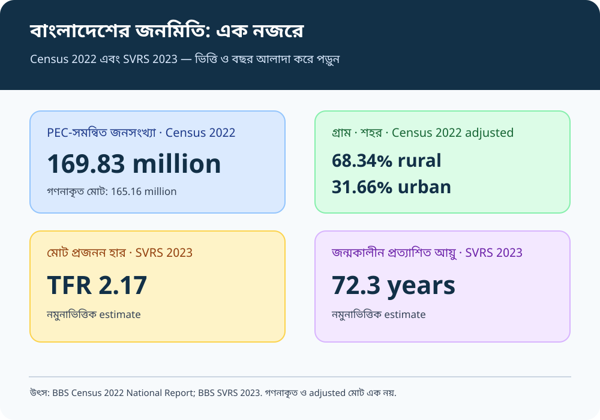

# Chapter 02 — Visual Atlas & Official Map Sources
## Demographic Features, Ethnic and Cultural Diversity | BCS Written

[← মূল অধ্যায়](./README.md#top) · [২৫টি Model Q&A](./BCS-WRITTEN-QUESTION-BANK.md) · [35th–47th PYQ Audit](./PYQ-ANALYSIS-35TH-47TH.md) · [English Quotations](./QUOTATIONS.md)

> **Map integrity rule:** নিচে প্রথমে সরকারি map/infographic source দেওয়া হয়েছে। কোনো প্রশাসনিক সীমানা বা ethnic settlement pattern অনুমান করে আঁকা হয়নি। Census-এর সংখ্যাভিত্তিক visual-এ reference year, denominator এবং data source দেখে নিতে হবে।

## A. Chapter revision visuals — 8 responsive SVG sheets

প্রতিটি SVG আলাদা vector file; ক্লিক করলে full-size image খোলা যাবে। এগুলো অধ্যায়ের ধারণা পুনরালোচনার জন্য, সরকারি মানচিত্রের বিকল্প নয়।

### 1. Demographic dashboard

**ব্যবহার:** Census count বনাম adjusted population, fertility, life expectancy এবং সূচকের reference year আলাদা করে মনে রাখা।

### 2. Population trend

**ব্যবহার:** দীর্ঘমেয়াদি জনসংখ্যার পরিবর্তন; বিভিন্ন census-এর series তুলনায় সংজ্ঞা ও coverage খেয়াল করা।

### 3. Age structure

**ব্যবহার:** শিশু, কর্মক্ষম বয়স ও প্রবীণ জনগোষ্ঠীর আলাদা সেবা-চাহিদা।

### 4. Demographic transition

**ব্যবহার:** জন্মহার ও মৃত্যুহারের পরিবর্তন বোঝা। এটি একটি **conceptual model**, বাংলাদেশের প্রত্যেক বছরের measured data-series নয়।

### 5. Demographic dividend

**ব্যবহার:** শিক্ষা, স্বাস্থ্য, দক্ষতা, উৎপাদনশীল কর্মসংস্থান ও নারীর অংশগ্রহণ ছাড়া বয়স কাঠামো একা dividend নিশ্চিত করে না।

### 6. Ethnic diversity

**ব্যবহার:** Census category-তে গণনাকৃত জনগোষ্ঠী এবং জীবন্ত আত্মপরিচয়ের পার্থক্য বুঝুন। এটি কোনো নির্দিষ্ট জনগোষ্ঠীর বসতি-মানচিত্র নয়।

### 7. Language and cultural heritage

**ব্যবহার:** মাতৃভাষা, সাংস্কৃতিক অধিকার, অমূর্ত ঐতিহ্য ও অন্তর্ভুক্তিমূলক শিক্ষা।

### 8. Inclusive policy

**ব্যবহার:** তথ্য → বৈষম্য শনাক্তকরণ → সেবার পরিকল্পনা → ফলাফল মূল্যায়ন।

## B. Official Bangladesh maps and government visual sources

### 9. Survey of Bangladesh — national base maps
[**Open official map and geospatial services**](https://sob.gov.bd/pages/static-pages/6922dce0933eb65569e1284b)

Use for official administrative/topographic map context. Confirm map scale, edition, legend and permitted reuse on the source page.

### 10. Bangladesh Bureau of Statistics — Census 2022 infographics
[**Open official BBS infographic gallery**](https://bbs.portal.gov.bd/site/page/d551779e-1bee-42b2-9c31-08dc8db4c301)

BBS lists official visual sheets on:
- population and housing change, 1974–2022;
- population composition in 2022;
- women in Bangladesh;
- Hijra population in Census 2022;
- Chittagong Hill Tracts;
- ethnic population structure in Census 2022.

**Use:** cite BBS and the specific infographic title/year; do not treat an infographic as a substitute for the National Report tables.

### 11. BBS — Census 2022 national and district reports
[**Open official Census publications**](https://bbs.portal.gov.bd/pages/static-pages/6922e073933eb65569e27220)

Use National Report Volume I, district/community series and metadata. For a district comparison, use a district-level table with the same census definition and year.

### 12. Census 2022 data portal
[**Open Population and Housing Census 2022 reports portal**](https://pcs.icms.gov.bd/PHCReportNational)

Use the portal to locate National Report, Urban Area Report, Union Statistics, District Series and metadata. If it does not load, use the BBS publication links above.

### 13. BBS — Population and Housing Census landing page
[**Open BBS census page**](https://bbs.gov.bd/site/page/47856ad0-7e1c-4aab-bd78-892733bc06eb/Population-and-Housing-Census%3A)

Use for National Report Volume I, PEC-adjusted population information and the 2011 census series.

### 14. Government Delta Plan Atlas — spatial context
[**Open Bangladesh Delta Plan 2100 Interactive Atlas**](https://www.bdp2100kp.gov.bd/atlas/)

This atlas is relevant when explaining how population distribution, urbanisation, environmental exposure and regional service planning interact. It is **not** a source for ethnic population counts.

### 15. UNFPA Bangladesh — demographic dividend
[**Open UNFPA Bangladesh demographic-dividend resources**](https://bangladesh.unfpa.org/en/topics/demographic-dividend)

Use for the policy relationship among age structure, education, health, women's empowerment, decent work and productivity.

## C. Map and chart questions for written practice

1. **Using Census 2022 evidence, explain why enumerated population and PEC-adjusted population must not be mixed.**  
   Answer plan: define both totals → cite BBS National Report → identify denominator → explain effects on density/growth comparisons.

2. **How can age structure help policymakers convert demographic opportunity into a dividend?**  
   Answer plan: age groups → education/health demand → decent work and skills → women's participation → ageing preparedness.

3. **What can a census infographic tell us about ethnic diversity, and what can it not tell us?**  
   Answer plan: census categories/counts → limits of self-identification and classification → regional context → avoid equating count with cultural identity or geographic territory.

4. **Explain how urbanisation and internal migration change public-service demand.**  
   Answer plan: origin/destination → housing, transport, water, schools and health → informal settlements and labour markets → local planning.

5. **Why is a conceptual demographic-transition diagram not a substitute for observed data?**  
   Answer plan: model versus observation → data source/year → definitions → cautious interpretation.

## D. Citation and accuracy checklist

- [ ] Figure title and source are shown.
- [ ] Data year/reference period is written beside each statistic.
- [ ] Denominator and unit are explicit.
- [ ] Census count, adjusted count, survey estimate and projection are not mixed.
- [ ] A conceptual model is labelled “conceptual”.
- [ ] Ethnic, linguistic and religious identity are not treated as interchangeable.
- [ ] A map is reproduced only from a verifiable source and with attribution/usage conditions checked.

**Primary sources:** Bangladesh Bureau of Statistics (BBS); Survey of Bangladesh; UNFPA Bangladesh; Bangladesh Delta Plan 2100. See the [main chapter source register](./README.md#sources).
