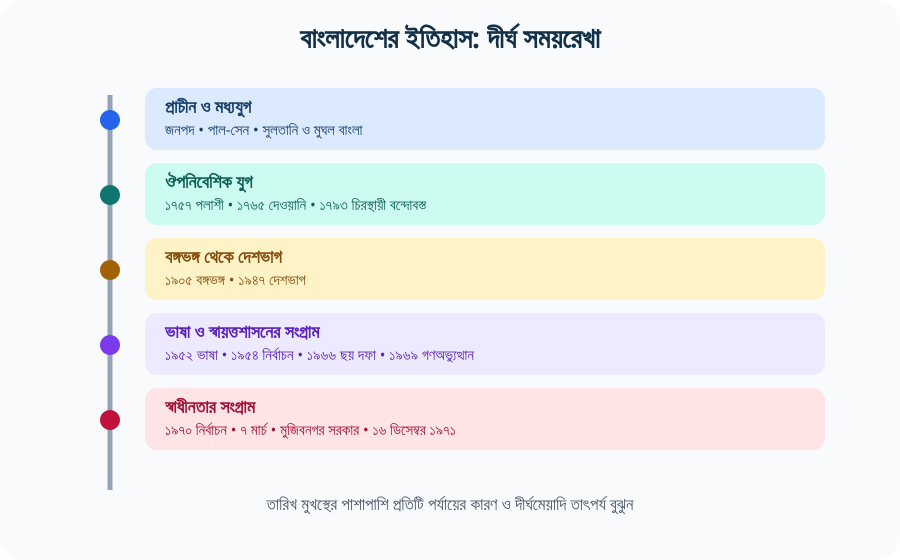
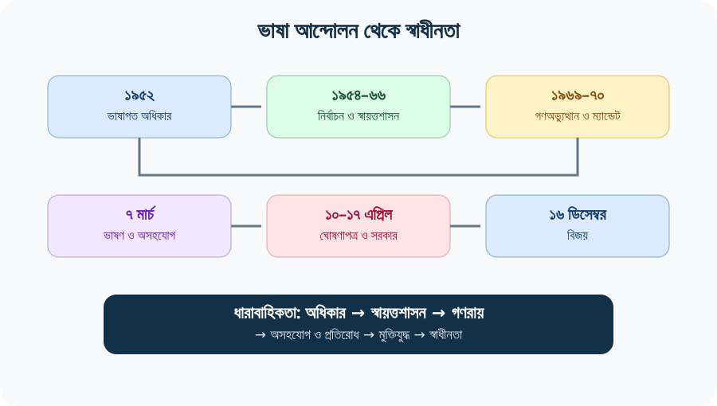
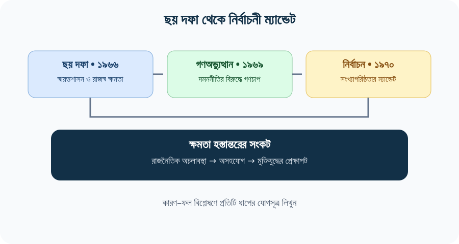
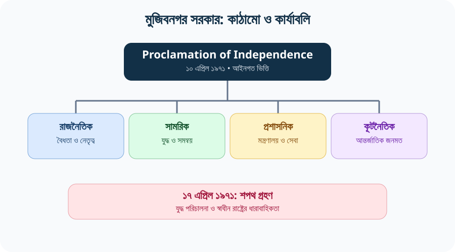
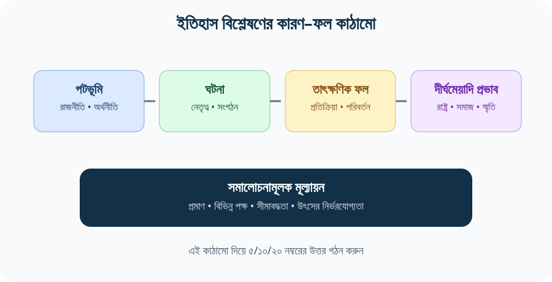
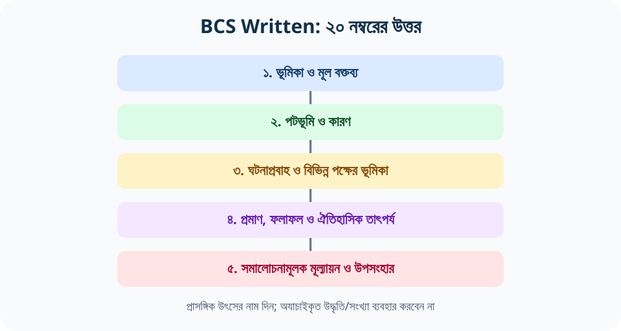
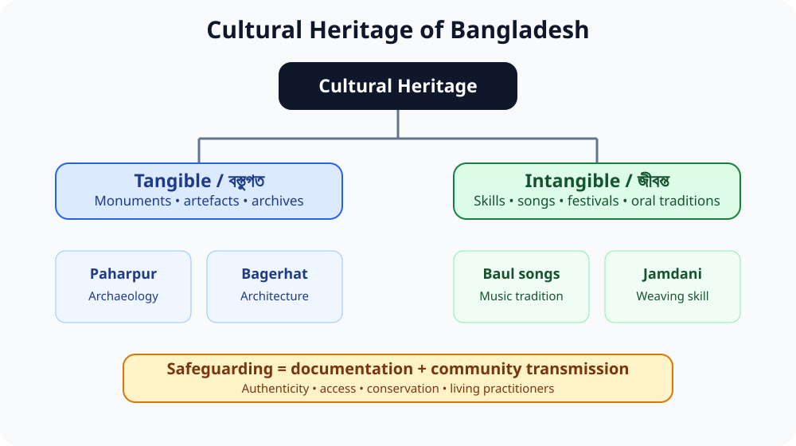
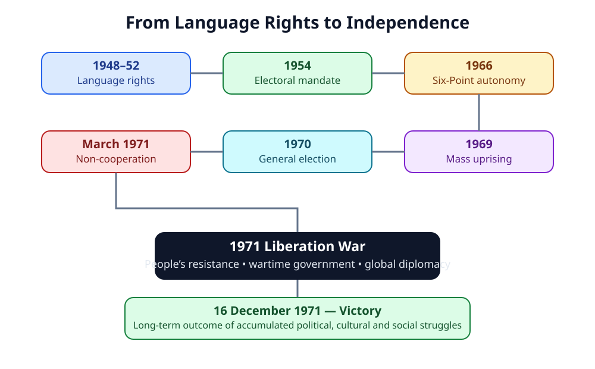
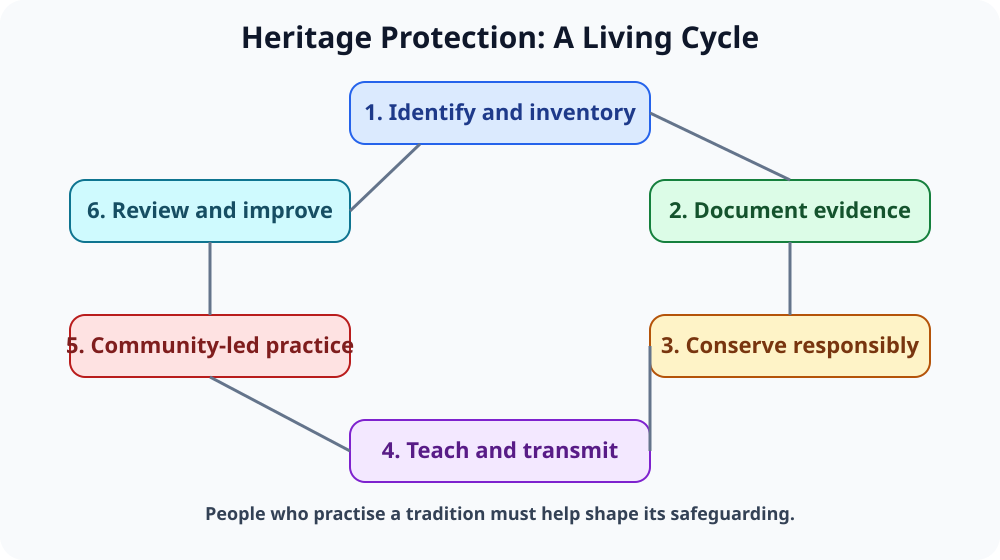
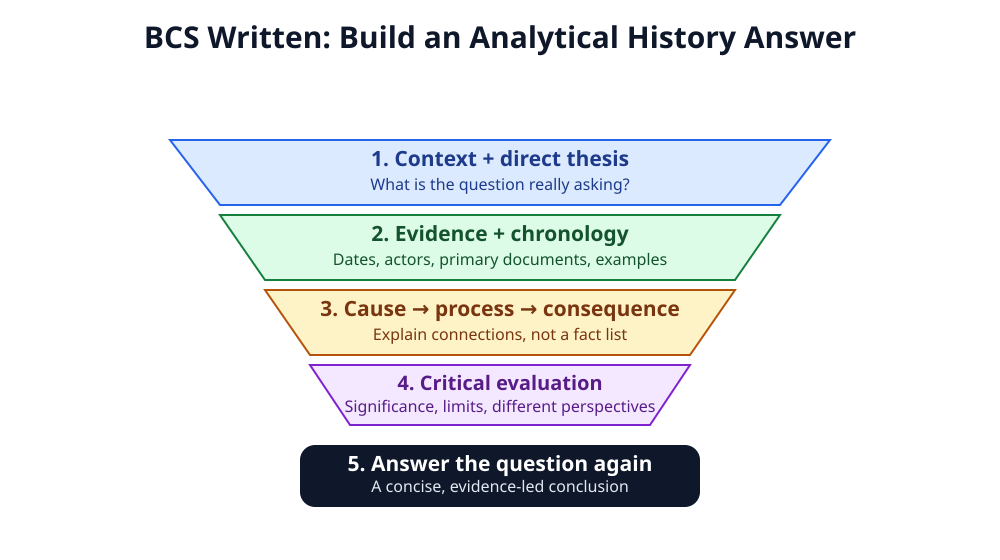

# Chapter 03 — বাংলাদেশের ইতিহাস ও সংস্কৃতি: প্রাচীনকাল থেকে সমকাল
## History and Culture of Bangladesh from Ancient to Recent Times

> **BCS Written · Bangladesh Affairs · Subject Code 005 · 200 marks**  
> **মূল ভাষা:** সহজ, প্রমিত বাংলা; গুরুত্বপূর্ণ English terms ও পরীক্ষার প্রশ্ন English-এ।  
> **পাঠের লক্ষ্য:** ইতিহাসের ধারাবাহিকতা বোঝা, কারণ–ফল বিশ্লেষণ করা, উৎসসহ প্রবন্ধ লেখা এবং PYQ theme ধরে প্রস্তুতি।  
> **Source review:** ২১ অক্টোবর ২০২৬।

[← মূল সূচি](../README.md) · [Chapter 01 — ভূগোল](../Chapter-01/README.md) · [Chapter 06 — প্রাকৃতিক সম্পদ](../Chapter-06/README.md) · [📚 English Quotations + Sources](./QUOTATIONS.md) · [পূর্ণাঙ্গ Model Essays](./PYQ-BASED-ESSAYS.md) · [২৫টি Model Q&A + 35th–47th PYQ Audit](./QUESTION-ANSWERS.md) · [🗺️ Visual Atlas: Maps & Heritage](./VISUAL-ATLAS.md)

> 📱 **Mobile-friendly:** এই অধ্যায়ে responsive SVG diagrams দেওয়া হয়েছে। ছবিতে tap/click করলে SVG আলাদা করে খোলা যাবে। কোনো external image load না হলেও মূল পাঠ ও diagrams কাজ করবে। দীর্ঘ টেবিল ফোনে প্রয়োজন হলে horizontal scroll করুন।

> [!TIP]
> **ইতিহাস পড়ার সূত্র:** সময়কাল → প্রধান ঘটনা → কারণ → জনগণের ভূমিকা → ফলাফল → দীর্ঘমেয়াদি তাৎপর্য। শুধু সাল মুখস্থ করলে বিশ্লেষণধর্মী Written উত্তর তৈরি হয় না।

## বিষয়সূচি

> **দ্রুত নেভিগেশন:** [মূল পাঠ](#syllabus) · [সময়রেখা ও ইতিহাস](#timeline) · [ভাষা আন্দোলন](#language-movement) · [মুক্তিযুদ্ধ](#liberation-war) · [সংস্কৃতি ও ঐতিহ্য](#culture) · [২৫টি প্রশ্নোত্তর](./QUESTION-ANSWERS.md) · [মডেল প্রবন্ধ](./PYQ-BASED-ESSAYS.md) · [উদ্ধৃতি](./QUOTATIONS.md) · [মানচিত্র ও ভিজ্যুয়াল](./VISUAL-ATLAS.md)

| ভিত্তি ও ধারাবাহিকতা | গুরুত্বপূর্ণ ঐতিহাসিক অধ্যায় | পরীক্ষা ও পুনরালোচনা |
|---|---|---|
| [শিখনফল ও সিলেবাস](#start) | [ভাষা আন্দোলন](#language) | [Previous BCS Question Analysis](#pyq) · [25টি worked answer](./QUESTION-ANSWERS.md) |
| [ইতিহাসের উৎস ও সময়রেখা](#sources-method) | [যুক্তফ্রন্ট ও ১৯৫৪ নির্বাচন](#election1954) | [গুরুত্বপূর্ণ প্রবন্ধ](./PYQ-BASED-ESSAYS.md) |
| [প্রাচীন বাংলার জনপদ](#ancient) | [ছয় দফা ও স্বায়ত্তশাসন](#sixpoint) | [English Quotations + Sources](./QUOTATIONS.md) |
| [পাল, সেন ও মধ্যযুগ](#medieval) | [গণঅভ্যুত্থান ও ১৯৭০ নির্বাচন](#mass1970) | [৩৩টি Written Practice Questions](#questions) |
| [সুলতানি ও মুঘল বাংলা](#sultanate-mughal) | [৭ মার্চ ও অসহযোগ](#march1971) | [Answer Writing Strategy](#strategy) |
| [ঔপনিবেশিক শাসন](#colonial) | [মুক্তিযুদ্ধ ও মুজিবনগর সরকার](#liberation) | [One-page Revision](#revision) |
| [বঙ্গভঙ্গ ও জাতীয়তাবাদ](#partition) | [স্বাধীনতার পর রাষ্ট্রগঠন](#after1971) | [Source Register](#source-register) |

---

## ১. BPSC Syllabus Mapping ও শিখনফল

BPSC-এর *Syllabus for BCS (Written) Examination*, Bangladesh Affairs (Compulsory), Subject Code 005-এর ৩ নম্বর বিষয়: **“History and culture of Bangladesh from ancient to recent times.”** একই সিলেবাসের ১৬ নম্বর বিষয় “The Liberation War and its Background”—যেখানে ভাষা আন্দোলন ১৯৫২, ১৯৫৪ নির্বাচন, ছয় দফা ১৯৬৬, ১৯৬৮–৬৯ গণঅভ্যুত্থান, ১৯৭০ নির্বাচন, ১৯৭১-এর অসহযোগ আন্দোলন, ৭ মার্চের ভাষণ, মুজিবনগর সরকারের গঠন ও কার্যাবলি, আন্তর্জাতিক শক্তির ভূমিকা, আত্মসমর্পণ, বঙ্গবন্ধুর প্রত্যাবর্তন এবং ভারতীয় বাহিনীর প্রত্যাহার অন্তর্ভুক্ত। [S1]

এই অধ্যায় শেষ করলে আপনি পারবেন:
1. প্রাচীন বাংলার জনপদ, রাজবংশ, মধ্যযুগ ও ঔপনিবেশিক পরিবর্তন ধারাবাহিকভাবে ব্যাখ্যা করতে।
2. ভাষা আন্দোলন থেকে মুক্তিযুদ্ধ পর্যন্ত রাজনৈতিক ঘটনাগুলোর কারণ–ফল ও পারস্পরিক সম্পর্ক বিশ্লেষণ করতে।
3. ১৯৪৭-এর দেশভাগ, ভাষা ও সাংস্কৃতিক অধিকার, অর্থনৈতিক বৈষম্য, গণতান্ত্রিক প্রতিনিধিত্ব ও স্বায়ত্তশাসনের দাবির সম্পর্ক বুঝতে।
4. ১৯৭১-এর মুক্তিযুদ্ধে রাজনৈতিক নেতৃত্ব, সামরিক প্রতিরোধ, সাধারণ মানুষ, নারী, শরণার্থী, আন্তর্জাতিক কূটনীতি ও মুজিবনগর সরকারের ভূমিকা আলোচনা করতে।
5. ইতিহাসের বিতর্কিত/বহুমাত্রিক বিষয়ে নির্ভরযোগ্য উৎস, সময়কাল ও পরিভাষা ব্যবহার করতে।
6. ৫, ১০ ও ২০ নম্বরের BCS Written উত্তর এবং প্রবন্ধ গঠন করতে।

### পরীক্ষার মূল নীতি

- সাল/তারিখের সঙ্গে ঘটনাটির **কারণ ও তাৎপর্য** লিখুন।
- কোনো ঐতিহাসিক ব্যক্তিত্বকে এককভাবে সব পরিবর্তনের কারণ হিসেবে উপস্থাপন করবেন না; প্রতিষ্ঠান, জনগণ, অর্থনীতি ও আন্তর্জাতিক প্রেক্ষাপটও দেখান।
- প্রাথমিক উৎস (ঘোষণাপত্র, ভাষণ, সরকারি দলিল), গবেষণাগ্রন্থ, Banglapedia ও সরকারি সংরক্ষণাগার আলাদা করে ব্যবহার করুন।
- বিতর্কিত ঘটনার ক্ষেত্রে উৎসের ধরন ও সীমাবদ্ধতা উল্লেখ করুন; অযাচাইকৃত সংখ্যা বা উক্তি ব্যবহার করবেন না।

---

## ২. ইতিহাসের উৎস, সময়রেখা ও কীভাবে পড়বেন

### ইতিহাসের প্রধান উৎস

| উৎসের ধরন | উদাহরণ | কী জানতে সাহায্য করে |
|---|---|---|
| প্রত্নতাত্ত্বিক | মহাস্থানগড়, পাহাড়পুর, ময়নামতি, মুদ্রা, শিলালিপি | বসতি, শাসন, ধর্ম, বাণিজ্য ও বস্তুগত সংস্কৃতি |
| লিখিত ঐতিহাসিক | তাম্রশাসন, শিলালিপি, সমকালীন বিবরণ, দলিল | প্রশাসন, ভূমি, রাজনীতি ও সমাজ |
| সাহিত্যিক | চর্যাপদ, মঙ্গলকাব্য, বৈষ্ণব পদাবলি, লোকসাহিত্য | ভাষা, বিশ্বাস, সমাজ ও সাংস্কৃতিক রূপ |
| ঔপনিবেশিক দলিল | Permanent Settlement, কোম্পানি/ব্রিটিশ প্রশাসনিক রেকর্ড | ভূমি-রাজস্ব, ঔপনিবেশিক অর্থনীতি ও শাসন |
| আধুনিক প্রাথমিক দলিল | ১৯৪০-এর প্রস্তাব, ১৯৪৭-এর দেশভাগ-দলিল, ১৯৫২–৭১-এর দলিল, ১০ এপ্রিলের Proclamation of Independence | রাজনৈতিক দাবি, রাষ্ট্রগঠন ও মুক্তিযুদ্ধ |
| মৌখিক ইতিহাস | মুক্তিযোদ্ধা, শরণার্থী, প্রত্যক্ষদর্শী ও স্থানীয় জনগণের সাক্ষ্য | স্থানীয় অভিজ্ঞতা; অন্যান্য উৎসের সঙ্গে যাচাই জরুরি |
| গবেষণা ও বিশ্বকোষ | Banglapedia, একাডেমিক ইতিহাস, জার্নাল | ঘটনার ব্যাখ্যা, তুলনা ও প্রেক্ষাপট |

### দ্রুত সময়রেখা

| সময়/তারিখ | ঘটনা | কেন গুরুত্বপূর্ণ |
|---|---|---|
| প্রাচীনকাল | বঙ্গ, পুণ্ড্র, সমতট, হরিকেলসহ জনপদ | বাংলার আঞ্চলিক পরিচয় ও প্রাচীন রাষ্ট্রব্যবস্থা |
| আনুমানিক ৮ম–১২শ শতক | পাল শাসন; পরে সেন প্রভাব | বৌদ্ধ পৃষ্ঠপোষকতা, শিক্ষা ও রাজনৈতিক পরিবর্তন |
| ১২০৪-এর পর | বাংলায় তুর্কি-আফগান শাসনের বিস্তার | মধ্যযুগীয় রাষ্ট্র ও সমাজের পরিবর্তন |
| ১৬শ–১৮শ শতক | মুঘল বাংলা ও আঞ্চলিক অর্থনীতি | কৃষি, বাণিজ্য, নগর ও প্রশাসনিক পরিবর্তন |
| ১৭৫৭ | পলাশীর যুদ্ধ | কোম্পানি-শাসনের রাজনৈতিক উত্থানের মোড় |
| ১৭৬৫ | কোম্পানির দেওয়ানি লাভ | রাজস্ব ও প্রশাসনিক ক্ষমতা বৃদ্ধির ভিত্তি |
| ১৭৯৩ | Permanent Settlement | জমিদারি ও কৃষক-ভূমি সম্পর্কের দীর্ঘমেয়াদি প্রভাব |
| ১৯০৫ | বঙ্গভঙ্গ | জাতীয়তাবাদ, স্বদেশি আন্দোলন ও সাম্প্রদায়িক রাজনীতির জটিলতা |
| ১৯১১ | বঙ্গভঙ্গ রদ | ঔপনিবেশিক নীতির পরিবর্তন ও রাজনৈতিক প্রতিক্রিয়া |
| ১৯৪০ | লাহোর প্রস্তাব | উপমহাদেশের ভবিষ্যৎ রাষ্ট্রব্যবস্থা নিয়ে নতুন রাজনৈতিক দাবি |
| ১৯৪৭ | ভারত বিভাজন; পূর্ব বাংলা পাকিস্তানের অংশ | রাষ্ট্রীয় পরিচয় ও পূর্ব-পশ্চিম বৈষম্যের নতুন প্রেক্ষাপট |
| ২১ ফেব্রুয়ারি ১৯৫২ | ভাষা আন্দোলনের চূড়ান্ত রক্তাক্ত পর্যায় | ভাষাগত অধিকার ও বাঙালি জাতীয়তাবাদের গুরুত্বপূর্ণ ভিত্তি |
| ১৯৫৪ | পূর্ব বাংলার প্রাদেশিক নির্বাচনে যুক্তফ্রন্টের জয় | কেন্দ্রীয় শাসনের বিরুদ্ধে গণরায়ের প্রকাশ |
| ১৯৫৮ | সামরিক শাসন | গণতান্ত্রিক রাজনীতির সংকোচন |
| ১৯৬৬ | ছয় দফা | স্বায়ত্তশাসনের সুস্পষ্ট কর্মসূচি |
| ১৯৬৮–৬৯ | আগরতলা মামলা ও গণঅভ্যুত্থান | গণআন্দোলন, ছাত্রসমাজ ও রাজনৈতিক পরিবর্তন |
| ১৯৭০ | সাধারণ নির্বাচন | সংখ্যাগরিষ্ঠতার গণতান্ত্রিক ম্যান্ডেট |
| ১–২৫ মার্চ ১৯৭১ | অসহযোগ আন্দোলন ও রাজনৈতিক সংকট | কার্যত সমান্তরাল কর্তৃত্ব ও স্বাধীনতার পথে উত্তরণ |
| ৭ মার্চ ১৯৭১ | ঐতিহাসিক ভাষণ | প্রতিরোধ, প্রস্তুতি ও রাজনৈতিক নির্দেশনার প্রতীক |
| ১০ এপ্রিল ১৯৭১ | Proclamation of Independence; সরকার গঠন | মুক্তিযুদ্ধের সাংবিধানিক-আইনগত ভিত্তি |
| ১৭ এপ্রিল ১৯৭১ | মুজিবনগর সরকারের শপথ | সংগঠিত অস্থায়ী সরকার ও যুদ্ধ পরিচালনার কাঠামো |
| ১৬ ডিসেম্বর ১৯৭১ | পাকিস্তানি বাহিনীর আত্মসমর্পণ | বিজয় ও স্বাধীন ভূখণ্ডে কর্তৃত্ব প্রতিষ্ঠা |
| ১০ জানুয়ারি ১৯৭২ | বঙ্গবন্ধুর স্বদেশ প্রত্যাবর্তন | যুদ্ধোত্তর রাষ্ট্রগঠনের রাজনৈতিক অধ্যায় |
| ৪ নভেম্বর ১৯৭২ / ১৬ ডিসেম্বর ১৯৭২ | সংবিধান গৃহীত / কার্যকর | নতুন রাষ্ট্রের সাংবিধানিক কাঠামো |

> [!WARNING]
> সময়রেখার সব ঘটনা সমানভাবে বিশদে লিখতে হবে না। Written-এ বেশি গুরুত্ব দিন: ১৯০৫–১৯৪৭-এর রাজনৈতিক পটভূমি, ১৯৪৮–১৯৫২ ভাষা আন্দোলন, ১৯৫৪ নির্বাচন, ১৯৬৬ ছয় দফা, ১৯৬৯ গণঅভ্যুত্থান, ১৯৭০ নির্বাচন, ৭ মার্চ, অসহযোগ, মুজিবনগর সরকার ও মুক্তিযুদ্ধ।

---

## ৩. প্রাচীন বাংলার জনপদ ও রাজনৈতিক পরিচয়ের বিকাশ

#### Visual source: মহাস্থানগড় ও প্রাচীন পুণ্ড্রনগর

*চিত্র-পাঠ:* প্রাচীর ও প্রত্নাবশেষ প্রাচীন নগরায়ণ, প্রতিরক্ষা এবং পুণ্ড্রনগরের বস্তুগত ইতিহাস বুঝতে সাহায্য করে। [ছবির উৎস ও লাইসেন্স: Wikimedia Commons](https://commons.wikimedia.org/wiki/File:Walls_of_Mahasthangarh.jpg) · [Banglapedia: Mahasthan](https://en.banglapedia.org/index.php?lang=en&title=Mahasthan)

বাংলার ইতিহাস একক, স্থির সীমানার ইতিহাস নয়। নদীর গতিপথ, কৃষির বিস্তার, বাণিজ্য, ধর্মীয় যোগাযোগ এবং রাজনীতির পরিবর্তনের সঙ্গে বিভিন্ন সময়ে বাংলার আঞ্চলিক সীমানা ও পরিচয় বদলেছে। প্রাচীন গ্রন্থ, শিলালিপি, মুদ্রা ও প্রত্নস্থল থেকে বঙ্গ, পুণ্ড্র, সমতট, হরিকেল, রাঢ় ও গৌড়ের মতো জনপদের উল্লেখ পাওয়া যায়। এসব নাম সব যুগে একই সীমানা বোঝায় না; তাই মানচিত্রে আধুনিক জেলার সীমানার সঙ্গে সরাসরি এক-এক করে মিলিয়ে ফেলা ঠিক নয়।

### প্রধান জনপদ

- **পুণ্ড্র/পুণ্ড্রবর্ধন:** উত্তর বাংলার সঙ্গে যুক্ত প্রাচীন জনপদ; মহাস্থানগড়কে প্রাচীন পুণ্ড্রনগরের সঙ্গে চিহ্নিত করা হয়।
- **বঙ্গ:** দক্ষিণ ও পূর্ব বাংলার বিস্তৃত অঞ্চলের সঙ্গে বিভিন্ন সময়ে যুক্ত নাম; “বাংলা” পরিচয়ের ঐতিহাসিক বিকাশে গুরুত্বপূর্ণ।
- **সমতট:** দক্ষিণ-পূর্ব বাংলার নিম্নভূমি অঞ্চলের সঙ্গে সম্পর্কিত।
- **হরিকেল:** পূর্ব ও দক্ষিণ-পূর্বাঞ্চলের সঙ্গে যুক্ত একটি ঐতিহাসিক জনপদ।
- **গৌড়:** বিভিন্ন যুগে উত্তর-পশ্চিম বাংলা ও বৃহত্তর বাংলার রাজনৈতিক-সাংস্কৃতিক পরিচয়ে ব্যবহৃত।
- **রাঢ়:** পশ্চিম বাংলার অংশবিশেষের সঙ্গে যুক্ত ঐতিহাসিক অঞ্চল।

### প্রাচীন বাংলার সমাজ ও অর্থনীতি

নদী ও পলিমাটির কারণে কৃষি, মৎস্য, নৌযোগাযোগ এবং আঞ্চলিক বাণিজ্য গুরুত্বপূর্ণ ছিল। নগর ও বাণিজ্যকেন্দ্রের বিকাশে নদীপথ এবং উপকূলীয় যোগাযোগ ভূমিকা রাখে। ধর্মীয় জীবনেও বৈচিত্র্য ছিল—বৌদ্ধ, ব্রাহ্মণ্য/হিন্দু ও স্থানীয় বিশ্বাস বিভিন্ন সময় ও অঞ্চলে পৃষ্ঠপোষকতা পেয়েছে। এই বৈচিত্র্যকে একটিমাত্র ধর্ম বা একটিমাত্র জনগোষ্ঠীর ইতিহাসে সীমাবদ্ধ করা যায় না।

### মহাস্থানগড়, পাহাড়পুর ও ময়নামতি

*চিত্র-পাঠ:* সোমপুর মহাবিহারের বিশাল পরিকল্পনা, ইটের স্থাপত্য ও টেরাকোটা পালযুগের ধর্মীয় পৃষ্ঠপোষকতা এবং জ্ঞানচর্চার প্রমাণ। [ছবির উৎস ও লাইসেন্স: Wikimedia Commons](https://commons.wikimedia.org/wiki/File:Paharpur_Maha_Vihara.jpg) · [UNESCO World Heritage Centre](https://whc.unesco.org/en/list/322/)

মহাস্থানগড় প্রাচীন নগরায়ণ ও রাজনৈতিক ইতিহাসের গুরুত্বপূর্ণ প্রত্নস্থল। পাহাড়পুরের সোমপুর মহাবিহার পাল যুগের বৌদ্ধ শিক্ষা ও স্থাপত্যের উল্লেখযোগ্য নিদর্শন; UNESCO World Heritage তালিকায় এটি অন্তর্ভুক্ত। ময়নামতির প্রত্নস্থল দক্ষিণ-পূর্ব বাংলার বৌদ্ধ বিহার ও সাংস্কৃতিক ইতিহাসের পরিচায়ক। প্রত্নস্থলগুলো থেকে শাসন, ধর্মীয় পৃষ্ঠপোষকতা, শিল্প ও আঞ্চলিক যোগাযোগ সম্পর্কে ধারণা পাওয়া যায়।

**বিশ্লেষণ:** প্রাচীন বাংলার পরিচয় নদী, কৃষি, বাণিজ্য, বহুধর্মীয় যোগাযোগ ও আঞ্চলিক রাজনৈতিক কাঠামোর মধ্য দিয়ে গড়ে ওঠে। আধুনিক বাংলাদেশ রাষ্ট্রের সঙ্গে প্রাচীন জনপদের সম্পর্ক ঐতিহাসিক ধারাবাহিকতার, সরল এক-এক সীমানার নয়।

---

## ৪. পাল ও সেন যুগ: রাজনীতি, শিক্ষা ও সংস্কৃতি

### পাল শাসন

পাল রাজবংশ আনুমানিক অষ্টম থেকে দ্বাদশ শতকের মধ্যে বাংলার বিস্তীর্ণ অংশে প্রভাব বিস্তার করে। গোপাল, ধর্মপাল ও দেবপালের নাম বিশেষভাবে উল্লেখযোগ্য। পাল শাসনের একটি গুরুত্বপূর্ণ বৈশিষ্ট্য ছিল বৌদ্ধ ধর্ম ও শিক্ষাপ্রতিষ্ঠানের পৃষ্ঠপোষকতা। সোমপুর মহাবিহারসহ বিহার ও শিক্ষাকেন্দ্রগুলো বৃহত্তর দক্ষিণ এশীয় বৌদ্ধ জ্ঞান-নেটওয়ার্কের সঙ্গে যুক্ত ছিল।

পাল যুগে বাংলার রাজনৈতিক প্রভাব সব সময় একই ভৌগোলিক সীমানায় স্থির ছিল না; সামরিক অভিযান, আঞ্চলিক ক্ষমতা ও প্রতিদ্বন্দ্বিতার ভিত্তিতে প্রভাব বদলেছে। তাই “সমস্ত ভারত পালদের অধীনে ছিল” ধরনের অতিরঞ্জিত বাক্য এড়িয়ে চলুন।

### সেন শাসন

পাল শক্তির অবক্ষয়ের পর সেন রাজবংশ বাংলার বিভিন্ন অঞ্চলে ক্ষমতা প্রতিষ্ঠা করে। বিজয়সেন ও লক্ষ্মণসেন গুরুত্বপূর্ণ শাসক হিসেবে পরিচিত। সেন যুগে ব্রাহ্মণ্য ধর্মীয় ও সামাজিক প্রতিষ্ঠান পৃষ্ঠপোষকতা পায়। তবে সমাজের পরিবর্তনকে একমাত্র রাজবংশের নীতির ফল হিসেবে ব্যাখ্যা করা ঠিক নয়; ভূমি-সম্পর্ক, স্থানীয় অভিজাত, ধর্মীয় প্রতিষ্ঠান এবং আঞ্চলিক রাজনীতিও ভূমিকা রাখে।

### ঐতিহাসিক মূল্যায়ন

পাল ও সেন যুগ বাংলার রাজনীতি, ধর্মীয় পৃষ্ঠপোষকতা, স্থাপত্য, শিক্ষা ও সামাজিক সম্পর্কের বিকাশ বোঝার জন্য গুরুত্বপূর্ণ। এই যুগের নিদর্শন থেকে বোঝা যায় যে বাংলার সাংস্কৃতিক ইতিহাসে ধারাবাহিকতার পাশাপাশি পরিবর্তনও ছিল। এক রাজবংশের অবসান মানেই আগের সব সাংস্কৃতিক বৈশিষ্ট্যের অবসান নয়।

---

## ৫. সুলতানি ও মুঘল বাংলা: রাষ্ট্র, অর্থনীতি ও সংস্কৃতির মিথস্ক্রিয়া

#### Visual source: সুলতানি বাংলার স্থাপত্য

*চিত্র-পাঠ:* ষাট গম্বুজ মসজিদ সুলতানি বাংলার ইটনির্ভর স্থাপত্য, নগর পরিকল্পনা ও ধর্মীয়-সামাজিক পৃষ্ঠপোষকতার গুরুত্বপূর্ণ নিদর্শন। [ছবির উৎস ও লাইসেন্স: Wikimedia Commons](https://commons.wikimedia.org/wiki/File:Sixty_Dome_Mosque,Bagerhat.jpg) · [UNESCO site record](https://whc.unesco.org/en/list/321/)

### সুলতানি বাংলার বিকাশ

মধ্যযুগে বাংলায় মুসলিম শাসনের বিস্তার রাজনৈতিক প্রশাসন, নগর, বাণিজ্য, ধর্মীয় প্রতিষ্ঠান ও স্থাপত্যে নতুন মাত্রা যোগ করে। স্বাধীন সুলতানি আমলে বাংলা বিভিন্ন সময়ে আঞ্চলিক রাজনৈতিক শক্তি হিসেবে বিকশিত হয়। বাংলা ভাষা ও সাহিত্যেও পৃষ্ঠপোষকতা, অনুবাদ-সাহিত্য, লোকায়ত সংস্কৃতি এবং বিভিন্ন ধর্মীয় ধারার পারস্পরিক যোগাযোগ গুরুত্বপূর্ণ ছিল।

ইসলামের বিস্তারকে একক কোনো কারণ—যেমন কেবল বলপ্রয়োগ বা কেবল সুফি প্রচার—দিয়ে ব্যাখ্যা করা যায় না। কৃষি সম্প্রসারণ, বসতি স্থাপন, স্থানীয় সমাজ, ধর্মীয় নেটওয়ার্ক, রাজনৈতিক পৃষ্ঠপোষকতা এবং দীর্ঘমেয়াদি সাংস্কৃতিক মিথস্ক্রিয়া বিভিন্ন অঞ্চলে ভিন্নভাবে কাজ করেছে।

### মুঘল বাংলা

মুঘল শাসনের অধীনে বাংলা একটি গুরুত্বপূর্ণ সুবা ও অর্থনৈতিক অঞ্চলে পরিণত হয়। কৃষি উৎপাদন, বস্ত্র, নদীবাণিজ্য ও উপকূলীয় যোগাযোগের গুরুত্ব ছিল। ঢাকাসহ বিভিন্ন নগর প্রশাসন ও বাণিজ্যের কেন্দ্র হিসেবে বিকশিত হয়। মুঘল প্রশাসনের রাজস্ব কাঠামো, স্থানীয় জমিদার ও মধ্যস্থতাকারীদের ভূমিকা, এবং আন্তর্জাতিক বাণিজ্য বাংলার অর্থনীতিকে প্রভাবিত করে।

### সংস্কৃতির সমন্বয়

বাংলার ভাষা, স্থাপত্য, সংগীত, খাদ্যসংস্কৃতি, লোকবিশ্বাস ও সাহিত্য বিভিন্ন সামাজিক ও ধর্মীয় ধারার পারস্পরিক বিনিময়ে গড়ে ওঠে। এই প্রক্রিয়া ছিল অঞ্চল ও সময়ভেদে ভিন্ন। “সমন্বয়” বলতে সংঘাতের অনুপস্থিতি বোঝায় না; বরং প্রতিযোগিতা, অভিযোজন, ধার করা উপাদান ও নতুন সাংস্কৃতিক রূপের সহাবস্থান বোঝায়।

**BCS angle:** সুলতানি ও মুঘল বাংলার উত্তরে রাজনৈতিক ইতিহাসের পাশাপাশি প্রশাসন, কৃষি-রাজস্ব, বাণিজ্য, বাংলা ভাষা ও স্থাপত্যের বিকাশকে যুক্ত করুন।

---

## ৬. ঔপনিবেশিক শাসন: পলাশী, দেওয়ানি, ভূমি-রাজস্ব ও সামাজিক পরিবর্তন

### পলাশীর যুদ্ধ ও কোম্পানির উত্থান

১৭৫৭ সালের পলাশীর যুদ্ধ বাংলার রাজনৈতিক ইতিহাসে একটি গুরুত্বপূর্ণ মোড়। নবাব সিরাজউদ্দৌলার পরাজয় এবং কোম্পানির রাজনৈতিক প্রভাব বৃদ্ধির ফলে বাণিজ্যিক কোম্পানি ধীরে ধীরে রাজস্ব ও শাসনক্ষমতার প্রধান শক্তিতে পরিণত হয়। তবে ব্রিটিশ আধিপত্য একটি দিনের ঘটনার ফল নয়; সামরিক সংঘাত, দরবারি রাজনীতি, কোম্পানির বাণিজ্যিক স্বার্থ, আর্থিক ক্ষমতা ও পরবর্তী প্রশাসনিক পরিবর্তন একত্রে কাজ করে।

১৭৬৫ সালে দেওয়ানি লাভের ফলে কোম্পানি বাংলা, বিহার ও উড়িষ্যার রাজস্ব আদায়ের অধিকার পায়। রাজস্ব-আদায়, বাণিজ্যিক একচেটিয়াকরণ ও প্রশাসনিক পরিবর্তনের মাধ্যমে কোম্পানির ক্ষমতা গভীর হয়।

### Permanent Settlement, 1793

চিরস্থায়ী বন্দোবস্তের মাধ্যমে জমিদারদের ভূমি-রাজস্বের দায় ও জমিদারি অধিকার নতুনভাবে সংজ্ঞায়িত হয়। রাজস্ব নির্ধারণের স্থায়িত্ব ঔপনিবেশিক সরকারের আয়কে পূর্বানুমানযোগ্য করার লক্ষ্য রাখলেও কৃষক, জমিদার ও মধ্যস্বত্বভোগীর সম্পর্ক জটিল করে তোলে। এর ফল অঞ্চলভেদে আলাদা ছিল; সব কৃষক বা সব জমিদারের অভিজ্ঞতা এক ছিল না। Written উত্তরে নীতি, উদ্দেশ্য, বাস্তব ফল ও সীমাবদ্ধতা আলাদা করে লিখুন।

### ঔপনিবেশিক অর্থনীতির প্রভাব

- ভূমি-রাজস্বের চাপ ও কৃষি-সম্পর্কের পরিবর্তন।
- দেশীয় শিল্প ও হস্তশিল্পের ওপর প্রতিযোগিতা, বাজার ও নীতির প্রভাব।
- রেল, বন্দর, যোগাযোগ ও নগর ব্যবস্থার সম্প্রসারণ—যা ঔপনিবেশিক বাণিজ্য ও প্রশাসনিক স্বার্থের সঙ্গেও যুক্ত ছিল।
- আধুনিক শিক্ষা, সংবাদপত্র, নতুন মধ্যবিত্ত শ্রেণি এবং রাজনৈতিক সংগঠনের বিকাশ।
- দুর্ভিক্ষ, দারিদ্র্য ও গ্রামীণ ঋণসংকটের পেছনে প্রাকৃতিক, প্রশাসনিক, বাজার ও নীতিগত একাধিক কারণ।

### প্রতিরোধ ও সংস্কার

ফকির-সন্ন্যাসী আন্দোলন, কৃষক প্রতিরোধ, নীলচাষবিরোধী আন্দোলন, ফরায়েজি আন্দোলন, তিতুমীরের প্রতিরোধ এবং পরবর্তী জাতীয়তাবাদী রাজনীতি ঔপনিবেশিক ক্ষমতার বিভিন্ন দিককে চ্যালেঞ্জ করে। এসব আন্দোলনের লক্ষ্য, সামাজিক ভিত্তি ও নেতৃত্ব এক ছিল না; তাই সবগুলোকে একই ধরনের জাতীয়তাবাদী আন্দোলন বলা উচিত নয়।

**বিশ্লেষণ:** ঔপনিবেশিক শাসন প্রশাসনিক ও অবকাঠামোগত পরিবর্তন আনলেও এর মূল কাঠামো ছিল সাম্রাজ্যিক ক্ষমতা ও সম্পদ আহরণের সঙ্গে যুক্ত। ইতিহাসের উত্তর লিখতে উন্নয়নমূলক পরিবর্তন ও শোষণমূলক সম্পর্ক—দুই দিকই মূল্যায়ন করুন।

---

## ৭. বঙ্গভঙ্গ, জাতীয়তাবাদ ও ১৯৪৭-এর দেশভাগ

### বঙ্গভঙ্গ, ১৯০৫

*মানচিত্র-পাঠ:* ১৯০৫ সালের প্রশাসনিক বিভাজনে পূর্ব বাংলা ও আসাম প্রদেশ গঠনের ভৌগোলিক পরিবর্তন বোঝায়। এটি ১৯০৫ সালের ঐতিহাসিক মানচিত্র—বর্তমান রাজনৈতিক সীমানা নয়। [মানচিত্রের উৎস, নির্মাতা ও লাইসেন্স: Wikimedia Commons](https://commons.wikimedia.org/wiki/File:BengalPartition1905_Map.png)

১৯০৫ সালে ব্রিটিশ সরকার প্রশাসনিক পুনর্বিন্যাসের যুক্তিতে বঙ্গভঙ্গ করে। এর পেছনে প্রশাসনিক কারণের পাশাপাশি ঔপনিবেশিক “divide and rule” নীতি নিয়ে বিতর্ক ছিল। বঙ্গভঙ্গের বিরোধিতায় স্বদেশি ও বয়কট আন্দোলন শক্তিশালী হয়; একই সঙ্গে পূর্ব বাংলার কিছু মুসলিম অভিজাত ও মধ্যবিত্ত নতুন প্রশাসনিক সুযোগের সম্ভাবনা দেখেছিলেন। ফলে বঙ্গভঙ্গের প্রতিক্রিয়া শ্রেণি, অঞ্চল ও সম্প্রদায়ভেদে একরকম ছিল না।

### বঙ্গভঙ্গ রদ, ১৯১১

বঙ্গভঙ্গবিরোধী আন্দোলনের পর ১৯১১ সালে বঙ্গভঙ্গ রদ করা হয়। এই সিদ্ধান্ত বিভিন্ন রাজনৈতিক গোষ্ঠীর মধ্যে অসন্তোষ ও নতুন রাজনৈতিক হিসাব তৈরি করে। ইতিহাসের বিশ্লেষণে মনে রাখতে হবে, একটি প্রশাসনিক সিদ্ধান্তের ফলাফল সব গোষ্ঠীর জন্য একই ছিল না।

### লাহোর প্রস্তাব, ১৯৪০

লাহোর প্রস্তাব উপমহাদেশের মুসলিম সংখ্যাগরিষ্ঠ অঞ্চলের রাজনৈতিক ভবিষ্যৎ নিয়ে গুরুত্বপূর্ণ দাবি তুলে ধরে। পরবর্তী সময়ে প্রস্তাবটির ব্যাখ্যা ও রাজনৈতিক ব্যবহার বদলেছে। তাই এটিকে ১৯৪৭-এর পাকিস্তান রাষ্ট্রের সঙ্গে সম্পর্কিত করে আলোচনা করতে হবে, কিন্তু পরবর্তী সব রাজনৈতিক ফলাফলকে প্রস্তাবের একমাত্রিক ও অনিবার্য পরিণতি বলা ঠিক নয়।

### ১৯৪৭-এর দেশভাগ ও পূর্ব বাংলার অবস্থান

দেশভাগের ফলে পূর্ব বাংলা পাকিস্তানের অংশ হয় এবং পরে পূর্ব পাকিস্তান নামে পরিচিত হয়। ভৌগোলিক বিচ্ছিন্নতা, ভাষা ও সাংস্কৃতিক পরিচয়, অর্থনৈতিক সম্পদের বণ্টন, প্রশাসনিক প্রতিনিধিত্ব ও রাজনৈতিক ক্ষমতার প্রশ্ন পূর্ব ও পশ্চিম পাকিস্তানের সম্পর্ককে ক্রমশ সংকটপূর্ণ করে তোলে। ভাষা আন্দোলন এই বৃহত্তর বৈষম্য ও পরিচয়-রাজনীতির একটি গুরুত্বপূর্ণ পর্যায়।

---

## ৮. ভাষা আন্দোলন, ১৯৪৮–১৯৫২: ভাষাগত অধিকার থেকে জাতীয় চেতনা

### পটভূমি

পাকিস্তান প্রতিষ্ঠার পর রাষ্ট্রভাষার প্রশ্নে উর্দুকে একমাত্র রাষ্ট্রভাষা করার উদ্যোগ পূর্ব বাংলার বাংলা-ভাষী সংখ্যাগরিষ্ঠ জনগণের মধ্যে বিরোধ সৃষ্টি করে। ভাষা কেবল যোগাযোগের মাধ্যম নয়; শিক্ষা, প্রশাসনে অংশগ্রহণ, সাংস্কৃতিক পরিচয় ও রাজনৈতিক সমতার প্রশ্নও। তাই বাংলা ভাষার স্বীকৃতির দাবি ক্রমে বৃহত্তর গণতান্ত্রিক অধিকার ও আঞ্চলিক মর্যাদার দাবির সঙ্গে যুক্ত হয়।

### আন্দোলনের ধারাবাহিকতা

#### Historical photograph: ১৯৫২ সালের ভাষা আন্দোলন

*চিত্র-পাঠ:* রাষ্ট্রভাষা বাংলার দাবিতে জনসমাবেশ ও মিছিল ভাষা আন্দোলনের গণভিত্তি বোঝায়। [ছবির উৎস, বর্ণনা ও public-domain তথ্য](https://commons.wikimedia.org/wiki/File:1952_Bengali_Language_movement.jpg) · [Banglapedia: Language Movement](https://en.banglapedia.org/index.php?title=Language_Movement)

১৯৪৮ সালে রাষ্ট্রভাষা প্রশ্নে প্রতিবাদ ও ছাত্রসমাজের সক্রিয়তা বাড়ে। ১৯৫২ সালের ফেব্রুয়ারিতে আন্দোলন তীব্র হয়। ২১ ফেব্রুয়ারি পুলিশের গুলিতে আন্দোলনকারীদের মৃত্যু ভাষা আন্দোলনকে ঐতিহাসিক মোড় দেয়; পরবর্তী দিনগুলোতে প্রতিবাদ ছড়িয়ে পড়ে। ১৯৫৬ সালের পাকিস্তান সংবিধানে বাংলা উর্দুর সঙ্গে রাষ্ট্রভাষার মর্যাদা পায়।

### তাৎপর্য

1. **ভাষাগত অধিকার:** সংখ্যাগরিষ্ঠ ভাষাভাষীর ভাষাকে রাষ্ট্রীয় স্বীকৃতির দাবি।
2. **গণতান্ত্রিক অংশগ্রহণ:** রাষ্ট্রীয় সিদ্ধান্তে জনগণের মত ও পরিচয়ের গুরুত্ব।
3. **সাংস্কৃতিক জাতীয়তাবাদ:** বাংলা ভাষা ও সাহিত্যকে রাজনৈতিক পরিচয়ের কেন্দ্রে নিয়ে আসা।
4. **ছাত্রসমাজের ভূমিকা:** ছাত্র সংগঠন ও নাগরিক প্রতিবাদ রাজনৈতিক আন্দোলনে গুরুত্বপূর্ণ হয়ে ওঠে।
5. **পরবর্তী আন্দোলনের ভিত্তি:** ১৯৫৪-এর নির্বাচন, স্বায়ত্তশাসন আন্দোলন এবং মুক্তিযুদ্ধের রাজনৈতিক চেতনায় ভাষা আন্দোলনের স্মৃতি প্রভাব ফেলে।

### সমালোচনামূলক মূল্যায়ন

ভাষা আন্দোলনকে বাংলাদেশের স্বাধীনতার একমাত্র কারণ বলা ঠিক নয়; বরং এটি ভাষাগত অধিকার, রাজনৈতিক প্রতিনিধিত্ব ও অর্থনৈতিক-প্রশাসনিক বৈষম্যের বিরুদ্ধে দীর্ঘ সংগ্রামের একটি নির্ণায়ক অধ্যায়। ভাষা আন্দোলনের ঐতিহাসিক তাৎপর্য বুঝতে ছাত্রসমাজ, সাংস্কৃতিক সংগঠন, রাজনৈতিক দল, সাধারণ মানুষ ও রাষ্ট্রীয় প্রতিক্রিয়ার পারস্পরিক সম্পর্ক বিশ্লেষণ করতে হবে।

**Exam line:** “The Language Movement transformed a dispute over state language into a broader struggle for cultural recognition, democratic participation and political equality.”

---

## ৯. যুক্তফ্রন্ট ও ১৯৫৪ সালের নির্বাচন

পূর্ব বাংলার প্রাদেশিক রাজনীতিতে মুসলিম লীগের বিরুদ্ধে বিভিন্ন বিরোধী দল ও নেতৃত্বের সমন্বয়ে যুক্তফ্রন্ট গঠিত হয়। ১৯৫৪ সালের নির্বাচনে যুক্তফ্রন্টের বিজয় কেন্দ্রীয় শাসনের প্রতি অসন্তোষ, প্রাদেশিক স্বায়ত্তশাসনের আকাঙ্ক্ষা এবং ভাষা আন্দোলন-পরবর্তী রাজনৈতিক চেতনার প্রতিফলন ছিল।

### কেন নির্বাচন গুরুত্বপূর্ণ?

- জনগণ ভোটের মাধ্যমে কেন্দ্র-সমর্থিত রাজনৈতিক শক্তির বিরুদ্ধে মত প্রকাশ করে।
- প্রাদেশিক স্বায়ত্তশাসন ও বাংলা ভাষার মর্যাদার প্রশ্ন রাজনৈতিক কর্মসূচিতে গুরুত্ব পায়।
- নির্বাচনী ম্যান্ডেট ও কেন্দ্রীয় ক্ষমতার মধ্যে দ্বন্দ্ব পাকিস্তানের শাসনব্যবস্থার সীমাবদ্ধতা তুলে ধরে।
- নির্বাচিত প্রাদেশিক সরকারের স্থায়িত্ব ও কেন্দ্রীয় হস্তক্ষেপের প্রশ্ন প্রতিনিধিত্বমূলক শাসনের সংকটকে প্রকাশ করে।

### বিশ্লেষণ

১৯৫৪ সালের নির্বাচন শুধু দলীয় পালাবদল নয়; এটি গণতান্ত্রিক প্রতিনিধিত্ব, কেন্দ্র–প্রদেশ সম্পর্ক এবং পূর্ব বাংলার রাজনৈতিক দাবির পরীক্ষা। তবে যুক্তফ্রন্টের অভ্যন্তরীণ বৈচিত্র্য, নেতৃত্বের পার্থক্য ও কেন্দ্রীয় ক্ষমতার কাঠামোও সরকারের কার্যকারিতাকে প্রভাবিত করে। পরীক্ষার উত্তরে বিজয়ের কারণ ও পরবর্তী রাজনৈতিক সীমাবদ্ধতা—দুই দিক লিখুন।

---

## ১০. ছয় দফা আন্দোলন, ১৯৬৬: স্বায়ত্তশাসনের কর্মসূচি

### ঐতিহাসিক প্রেক্ষাপট

পাকিস্তানের দুই অংশের মধ্যে অর্থনৈতিক বণ্টন, বৈদেশিক মুদ্রা আয়, প্রশাসনিক ক্ষমতা, সামরিক প্রতিনিধিত্ব ও রাজনৈতিক সিদ্ধান্ত গ্রহণে বৈষম্যের অভিযোগ দীর্ঘদিন ধরে বাড়ছিল। ১৯৬৬ সালে শেখ মুজিবুর রহমানের নেতৃত্বে ঘোষিত ছয় দফা পূর্ব পাকিস্তানের স্বায়ত্তশাসনের একটি সুসংহত রাজনৈতিক কর্মসূচি হিসেবে সামনে আসে।

### ছয় দফার মূল বিষয়—সংক্ষেপে

1. লাহোর প্রস্তাবের ভিত্তিতে প্রকৃত ফেডারেশন ও সংসদীয় সরকার; সর্বজনীন প্রাপ্তবয়স্ক ভোটে নির্বাচিত আইনসভা।
2. কেন্দ্রীয় সরকারের ক্ষমতা প্রতিরক্ষা ও পররাষ্ট্র বিষয়ে সীমিত রাখা।
3. পূর্ব ও পশ্চিম পাকিস্তানের জন্য পৃথক, অথবা কার্যকর সুরক্ষাসহ দুই ধরনের মুদ্রা/অর্থনৈতিক ব্যবস্থা।
4. কর আরোপ ও রাজস্ব সংগ্রহের ক্ষমতা প্রদেশের হাতে; কেন্দ্রের অর্থায়নের নির্দিষ্ট ব্যবস্থা।
5. বৈদেশিক মুদ্রা আয়ের পৃথক হিসাব এবং প্রদেশের অর্থনৈতিক স্বার্থের সুরক্ষা।
6. পূর্ব পাকিস্তানের নিজস্ব মিলিশিয়া বা আধাসামরিক বাহিনী গঠন।

**সতর্কতা:** ছয় দফার বিভিন্ন সংক্ষিপ্তসারে তৃতীয় ও চতুর্থ দফার বর্ণনায় শব্দচয়ন ভিন্ন হতে পারে। পরীক্ষায় পূর্ণ তালিকা লিখলে নির্ভরযোগ্য ইতিহাসগ্রন্থ বা মূল কর্মসূচির পাঠ মিলিয়ে নিন।

### রাজনৈতিক তাৎপর্য

- প্রাদেশিক স্বায়ত্তশাসনের দাবি সুস্পষ্ট ও জনপ্রিয় রাজনৈতিক কর্মসূচিতে রূপ নেয়।
- অর্থনৈতিক বৈষম্যকে সাংবিধানিক ও প্রশাসনিক ক্ষমতা বণ্টনের প্রশ্নের সঙ্গে যুক্ত করা হয়।
- কেন্দ্রীয় সরকারের দমনমূলক প্রতিক্রিয়া ও আগরতলা মামলার প্রেক্ষাপটে আন্দোলন আরও বিস্তৃত হয়।
- ছয় দফা ১৯৬৯-এর গণঅভ্যুত্থান ও ১৯৭০-এর নির্বাচনে রাজনৈতিক মেরুকরণের কেন্দ্রে আসে।

### মূল্যায়ন

ছয় দফাকে শুধু একটি দলীয় কর্মসূচি নয়, বরং পূর্ব বাংলার স্বায়ত্তশাসন, অর্থনৈতিক ন্যায় এবং রাজনৈতিক প্রতিনিধিত্বের দাবি হিসেবে ব্যাখ্যা করা যায়। এর জনপ্রিয়তা দেখায় যে রাষ্ট্রের স্থায়িত্ব শুধু প্রশাসনিক ঐক্যে নয়, ন্যায্য ক্ষমতা বণ্টন ও জনগণের সম্মতির ওপরও নির্ভরশীল।

---

## ১১. আগরতলা মামলা, ১৯৬৯-এর গণঅভ্যুত্থান ও ১৯৭০-এর নির্বাচন

### আগরতলা মামলা ও গণআন্দোলন

১৯৬৮ সালে আগরতলা ষড়যন্ত্র মামলা দায়ের করা হয়; এতে শেখ মুজিবুর রহমানসহ বহু ব্যক্তিকে অভিযুক্ত করা হয়। মামলা ও রাজনৈতিক দমন-পীড়নের বিরুদ্ধে ছাত্রসমাজ, শ্রমজীবী মানুষ ও বিরোধী রাজনৈতিক শক্তির আন্দোলন তীব্র হয়। ১৯৬৯ সালের গণঅভ্যুত্থান সামরিক শাসন ও রাজনৈতিক দমননীতির বিরুদ্ধে গণচাপ সৃষ্টি করে; মামলা প্রত্যাহার ও শেখ মুজিবুর রহমানের মুক্তির পর রাজনৈতিক পরিস্থিতি নতুন পর্যায়ে যায়।

### ছাত্রসমাজ ও ১১ দফা

ছাত্রসমাজের ১১ দফা কর্মসূচি শিক্ষা, গণতন্ত্র, অর্থনৈতিক ও রাজনৈতিক অধিকারের বিস্তৃত দাবি সামনে আনে। এর মাধ্যমে আন্দোলন শুধু নেতৃত্বকেন্দ্রিক থাকেনি; ছাত্র, শ্রমিক, পেশাজীবী ও সাধারণ মানুষের অংশগ্রহণে গণআন্দোলনের চরিত্র পায়।

### ১৯৭০ সালের সাধারণ নির্বাচন

১৯৭০ সালের নির্বাচনে আওয়ামী লীগ পূর্ব পাকিস্তানে বিপুল জনসমর্থন পায় এবং পাকিস্তানের জাতীয় পরিষদে সংখ্যাগরিষ্ঠতা অর্জন করে। এই ফল পূর্ব পাকিস্তানের জনগণের রাজনৈতিক ম্যান্ডেটকে স্পষ্ট করে। কিন্তু ক্ষমতা হস্তান্তর ও জাতীয় পরিষদের অধিবেশন নিয়ে সংকট, রাজনৈতিক আলোচনা ব্যর্থ হওয়া এবং সামরিক দমননীতির প্রস্তুতি পরিস্থিতিকে স্বাধীনতার দিকে ঠেলে দেয়।

### কেন ১৯৭০ নির্বাচন ছিল মোড় পরিবর্তনকারী?

1. ছয় দফার প্রতি গণসমর্থন নির্বাচনী ফলের মাধ্যমে প্রকাশ পায়।
2. নির্বাচিত সংখ্যাগরিষ্ঠতার হাতে ক্ষমতা না যাওয়ায় পাকিস্তানের সাংবিধানিক-রাজনৈতিক সংকট তীব্র হয়।
3. আলোচনার বৈধ পথ সংকুচিত হলে অসহযোগ ও প্রতিরোধ আন্দোলন বিস্তৃত হয়।
4. নির্বাচনের ফলাফল মুক্তিযুদ্ধের রাজনৈতিক বৈধতা ব্যাখ্যায় গুরুত্বপূর্ণ প্রেক্ষাপট।

**মূল যুক্তি:** ১৯৭১-এর যুদ্ধকে বুঝতে ১৯৭০-এর নির্বাচনী ম্যান্ডেট এবং তার বাস্তবায়নে ব্যর্থতাকে কেন্দ্রীয় রাজনৈতিক প্রেক্ষাপট হিসেবে আলোচনা করতে হবে।

---

## ১২. ৭ মার্চের ভাষণ ও অসহযোগ আন্দোলন

*চিত্র-পাঠ:* ভাষণের ঐতিহাসিক গুরুত্ব ব্যাখ্যা করতে রাজনৈতিক প্রেক্ষাপট, গণসমাবেশ, অসহযোগ এবং প্রতিরোধের প্রস্তুতি একসঙ্গে আলোচনা করুন। [ছবির উৎস ও সরকারি PID archive rights note](https://commons.wikimedia.org/wiki/File:Mujibur_Rahman_7th_March_Speech_Race_Course_Maidan_1971-03-07_(PID-h003).jpg) · [UNESCO Memory of the World](https://www.unesco.org/en/memory-world)

### ৭ মার্চের ভাষণের ঐতিহাসিক প্রেক্ষাপট

১৯৭০ সালের নির্বাচনের পর ক্ষমতা হস্তান্তর নিয়ে অচলাবস্থা, জাতীয় পরিষদের অধিবেশন স্থগিত, আলোচনা ব্যর্থতা এবং সামরিক বাহিনীর প্রস্তুতি পূর্ব বাংলায় তীব্র রাজনৈতিক সংকট তৈরি করে। ৭ মার্চ ১৯৭১-এ ঢাকার রেসকোর্স ময়দানে শেখ মুজিবুর রহমানের ভাষণ জনগণকে প্রতিরোধের প্রস্তুতি, সংগঠন ও রাজনৈতিক নির্দেশনা দেয়। UNESCO-এর Memory of the World কর্মসূচিতে ভাষণটি আন্তর্জাতিকভাবে স্বীকৃত দলিল হিসেবে অন্তর্ভুক্ত। [S4]

### ভাষণের গুরুত্ব

- নির্বাচনী ম্যান্ডেট ও জনগণের অধিকারকে রাজনৈতিক দাবির কেন্দ্রে স্থাপন।
- অসহযোগ আন্দোলনের দিকনির্দেশনা ও প্রশাসনিক প্রতিরোধের আহ্বান।
- জনগণকে সংগঠিত করা এবং সম্ভাব্য দমন-পীড়নের মুখে প্রস্তুতি গ্রহণ।
- স্বাধীনতার সংগ্রামের রাজনৈতিক ভাষা ও গণ-স্মৃতির গুরুত্বপূর্ণ দলিল।

### অসহযোগ আন্দোলন

মার্চ ১৯৭১-এ পূর্ব বাংলায় সরকারি কার্যক্রম, রাজস্ব, প্রশাসন ও দৈনন্দিন শাসনে অসহযোগ বিস্তৃত হয়। বিভিন্ন সরকারি ও বেসরকারি প্রতিষ্ঠানে নির্দেশনা, ধর্মঘট, জনসভা এবং প্রশাসনিক প্রতিরোধের মাধ্যমে কার্যত কেন্দ্রীয় কর্তৃত্ব চ্যালেঞ্জের মুখে পড়ে। এটি শুধু একটি ভাষণ-পরবর্তী আবেগ নয়; সংগঠিত রাজনৈতিক কর্মসূচি ও জনগণের অংশগ্রহণের ফল।

### ২৫ মার্চের সামরিক অভিযান ও স্বাধীনতার সংগ্রাম

২৫ মার্চ রাতে পাকিস্তানি সামরিক বাহিনীর অভিযান ব্যাপক হত্যাকাণ্ড, গ্রেপ্তার, ধ্বংস ও বাস্তুচ্যুতি ঘটায়। এরপর সশস্ত্র মুক্তিযুদ্ধ পূর্ণমাত্রায় বিস্তৃত হয়। ঘটনাবলির বিশ্লেষণে সামরিক অভিযান, স্বাধীনতার ঘোষণা, প্রতিরোধ, শরণার্থী সংকট ও আন্তর্জাতিক প্রতিক্রিয়াকে ধারাবাহিকভাবে দেখাতে হবে।

**Exam line:** “The speech of 7 March was a pivotal political text that connected the electoral mandate with mass mobilisation, non-cooperation and preparation for resistance.”

---

## ১৩. মুক্তিযুদ্ধ ও মুজিবনগর সরকার: নেতৃত্ব, সংগঠন ও আন্তর্জাতিক মাত্রা

### স্বাধীনতার ঘোষণা ও Proclamation of Independence

বাংলাপিডিয়া অনুযায়ী, ১০ এপ্রিল ১৯৭১-এ স্বাধীনতার ঘোষণাপত্র (Proclamation of Independence) গৃহীত হয়, যা ২৬ মার্চ থেকে কার্যকারিতা স্বীকার করে। এই ঘোষণাপত্র মুক্তিযুদ্ধকালীন সরকারের আইনগত ভিত্তি ও রাষ্ট্রীয় কর্তৃত্বের কাঠামো নির্ধারণে গুরুত্বপূর্ণ ছিল। [S2–S3]

### মুজিবনগর সরকার: গঠন ও শপথ

*চিত্র-পাঠ:* এটি যুদ্ধকালীন ছবি নয়; ২০১৮ সালে তোলা স্মৃতি কমপ্লেক্সের ছবি। মুজিবনগরকে অস্থায়ী সরকারের সংগঠন ও মুক্তিযুদ্ধের স্মৃতির সঙ্গে যুক্ত করে দেখুন। [ছবির উৎস, আলোকচিত্রী ও CC BY-SA লাইসেন্স](https://commons.wikimedia.org/wiki/File:1971_war_at_Mujibnagar_memorial.jpg) · [Banglapedia: Mujibnagar Government](https://en.banglapedia.org/index.php?lang=en&title=Mujibnagar_Government)

মুজিবনগর সরকার ১০ এপ্রিল ১৯৭১ গঠিত হয় এবং ১৭ এপ্রিল মেহেরপুরের বৈদ্যনাথতলায় শপথ গ্রহণ করে। শেখ মুজিবুর রহমান রাষ্ট্রপতি, সৈয়দ নজরুল ইসলাম অস্থায়ী রাষ্ট্রপতির দায়িত্ব পালন করেন এবং তাজউদ্দীন আহমদ প্রধানমন্ত্রী ছিলেন। সরকারটি বাংলাদেশের ভূখণ্ডের বাইরে থেকে কাজ করলেও মুক্তিযুদ্ধের রাজনৈতিক, প্রশাসনিক, কূটনৈতিক ও সামরিক সমন্বয়ে গুরুত্বপূর্ণ ভূমিকা রাখে। [S2–S3]

### সরকারের প্রধান কার্যাবলি

1. **রাজনৈতিক বৈধতা:** নির্বাচিত প্রতিনিধিদের নেতৃত্বে স্বাধীন রাষ্ট্রের দাবি ও সরকার প্রতিষ্ঠা।
2. **যুদ্ধ পরিচালনা:** সামরিক সেক্টর, মুক্তিযোদ্ধাদের সংগঠন ও যুদ্ধের সমন্বয়।
3. **প্রশাসন:** মন্ত্রণালয়/বিভাগের মাধ্যমে যুদ্ধকালীন প্রশাসনিক দায়িত্ব বণ্টন।
4. **কূটনীতি:** বিদেশি সরকার, সংবাদমাধ্যম ও আন্তর্জাতিক জনমতের কাছে বাংলাদেশের পক্ষে বক্তব্য তুলে ধরা।
5. **শরণার্থী ও মানবিক সংকট:** বাস্তুচ্যুত মানুষ, ত্রাণ ও আন্তর্জাতিক সহায়তার প্রশ্নে উদ্যোগ।
6. **তথ্য ও প্রচার:** যুদ্ধের খবর, আন্তর্জাতিক প্রচার ও জনমত সংগঠনের কাজ।
7. **রাষ্ট্রগঠনের ভিত্তি:** স্বাধীনতার ঘোষণাপত্রের মাধ্যমে যুদ্ধকালীন রাষ্ট্রীয় কাঠামোর আইনগত ভিত্তি।

### মুক্তিযুদ্ধের সামরিক ও সামাজিক মাত্রা

মুক্তিযুদ্ধ শুধু সামরিক সংঘর্ষ ছিল না; এতে নিয়মিত বাহিনী, গেরিলা প্রতিরোধ, স্থানীয় সংগঠন, সাধারণ মানুষের সহায়তা, নারী, ছাত্র, শ্রমিক, কৃষক, সংখ্যালঘু সম্প্রদায়, শরণার্থী এবং প্রবাসী বাংলাদেশিদের ভূমিকা ছিল। বিভিন্ন অঞ্চলে অভিজ্ঞতা এক ছিল না। তাই জাতীয় ইতিহাস লিখতে যুদ্ধের বহুমাত্রিক সামাজিক ভিত্তি তুলে ধরুন।

### আন্তর্জাতিক শক্তি ও জাতিসংঘ

আন্তর্জাতিক প্রতিক্রিয়া একরৈখিক ছিল না। ভারত শরণার্থী সংকট, রাজনৈতিক ও সামরিক সহায়তা এবং ডিসেম্বরের যুদ্ধে সরাসরি অংশগ্রহণের মাধ্যমে গুরুত্বপূর্ণ ভূমিকা রাখে। যুক্তরাষ্ট্রের নীতির বিভিন্ন স্তরে মতভেদ ও কূটনৈতিক বাস্তবতা ছিল; সোভিয়েত ইউনিয়ন কূটনৈতিকভাবে ভারতের সঙ্গে ঘনিষ্ঠ অবস্থান নেয়; চীন ও অন্যান্য রাষ্ট্রের অবস্থানও ভূরাজনৈতিক প্রেক্ষাপটে গঠিত হয়। জাতিসংঘে শরণার্থী, মানবিক সংকট, যুদ্ধবিরতি ও আন্তর্জাতিক প্রতিক্রিয়া নিয়ে আলোচনা হয়, তবে ভেটো রাজনীতি ও শীতল যুদ্ধের স্বার্থ সমাধানকে জটিল করে।

**সতর্কতা:** “সমস্ত বিশ্ব বাংলাদেশকে সমর্থন করেছিল” বা “একটি দেশই স্বাধীনতা এনে দেয়”—এমন সরলীকরণ এড়িয়ে চলুন। বাংলাদেশের জনগণের সংগ্রাম, মুক্তিযোদ্ধাদের ভূমিকা, মুজিবনগর সরকারের নেতৃত্ব এবং আন্তর্জাতিক সমর্থন/বিরোধ—সব স্তর একত্রে মূল্যায়ন করুন।

### আত্মসমর্পণ, বিজয় ও প্রত্যাবর্তন

১৬ ডিসেম্বর ১৯৭১ ঢাকায় পাকিস্তানি বাহিনীর আত্মসমর্পণের মাধ্যমে মুক্তিযুদ্ধের সামরিক বিজয় অর্জিত হয়। ১০ জানুয়ারি ১৯৭২ শেখ মুজিবুর রহমান স্বাধীন বাংলাদেশে প্রত্যাবর্তন করেন। যুদ্ধোত্তর রাষ্ট্রের সামনে ছিল ধ্বংসপ্রাপ্ত অবকাঠামো, বাস্তুচ্যুত মানুষ, পুনর্বাসন, প্রশাসনিক পুনর্গঠন, অর্থনৈতিক পুনরুদ্ধার এবং সংবিধান প্রণয়নের মতো চ্যালেঞ্জ।

---

## ১৪. স্বাধীনতার পর রাষ্ট্রগঠন, স্মৃতি ও সংস্কৃতি

#### Living heritage: জামদানি বয়ন

*চিত্র-পাঠ:* জামদানি শুধু পোশাক নয়—দক্ষতা, নকশা, প্রজন্মান্তরে জ্ঞান স্থানান্তর এবং কারুশিল্প-নির্ভর জীবিকার উদাহরণ। [ছবির উৎস, আলোকচিত্রী ও CC BY-SA লাইসেন্স](https://commons.wikimedia.org/wiki/File:Traditional_Jamdani_Weaving.jpg) · [UNESCO Intangible Cultural Heritage: Traditional art of Jamdani weaving](https://ich.unesco.org/en/RL/traditional-art-of-jamdani-weaving-00879)

### রাষ্ট্রগঠনের প্রধান কাজ

স্বাধীনতার পর বাংলাদেশকে প্রশাসন, আইনশৃঙ্খলা, অর্থনীতি, শিক্ষা, স্বাস্থ্য, যোগাযোগ, শরণার্থী প্রত্যাবর্তন ও যুদ্ধবিধ্বস্ত অবকাঠামো পুনর্গঠনের দায়িত্ব নিতে হয়। ১৯৭২ সালে সংবিধান প্রণয়ন নতুন রাষ্ট্রের সাংবিধানিক কাঠামো নির্ধারণ করে। একই সময়ে রাষ্ট্রের পরিচয়, জাতীয়তাবাদ, ধর্মনিরপেক্ষতা, গণতন্ত্র, সমাজতন্ত্র, নাগরিক অধিকার ও অর্থনৈতিক নীতি নিয়ে বিতর্ক ও রাজনৈতিক প্রতিযোগিতাও চলতে থাকে।

### সংস্কৃতি ও জাতীয় পরিচয়

বাংলাদেশের সাংস্কৃতিক পরিচয় বাংলা ভাষা ও সাহিত্য, লোকসংগীত, নদী ও গ্রামীণ জীবন, ধর্মীয় বৈচিত্র্য, আঞ্চলিক ঐতিহ্য, শহুরে সংস্কৃতি, মুক্তিযুদ্ধের স্মৃতি এবং বৈশ্বিক যোগাযোগের সম্মিলনে গড়ে ওঠে। জাতীয় পরিচয় একরকম বা অপরিবর্তনীয় নয়; এটি ইতিহাস, শিক্ষা, শিল্প, গণমাধ্যম, রাষ্ট্রীয় স্মরণ ও নাগরিক অংশগ্রহণের মাধ্যমে পুনর্গঠিত হয়।

### স্মৃতির রাজনীতি ও ইতিহাসচর্চা

মুক্তিযুদ্ধ ও রাজনৈতিক ইতিহাস নিয়ে জনস্মৃতি, পাঠ্যপুস্তক, স্মৃতিসৌধ, জাদুঘর, সাহিত্য, চলচ্চিত্র ও পারিবারিক স্মৃতির গুরুত্বপূর্ণ ভূমিকা রয়েছে। দায়িত্বশীল ইতিহাসচর্চায় প্রাথমিক দলিল, মৌখিক সাক্ষ্য, গবেষণা এবং ভিন্ন দৃষ্টিভঙ্গি তুলনা করা দরকার। কোনো ঘটনা নিয়ে মতভেদ থাকলে দলিলের ভিত্তিতে যুক্তি দিন; যাচাইহীন সামাজিক মাধ্যমের পোস্টকে প্রমাণ হিসেবে ব্যবহার করবেন না।

### সমকালীন প্রাসঙ্গিকতা

ইতিহাসের শিক্ষা বর্তমানের জন্য প্রাসঙ্গিক যখন তা নাগরিক অধিকার, ভাষাগত ও সাংস্কৃতিক বৈচিত্র্য, গণতান্ত্রিক প্রতিনিধিত্ব, আইনের শাসন, সহনশীলতা এবং রাষ্ট্রীয় জবাবদিহির গুরুত্ব ব্যাখ্যা করে। অতীতের ঘটনাকে বর্তমানের রাজনৈতিক স্লোগানে সীমাবদ্ধ না রেখে প্রেক্ষাপট ও প্রমাণের ভিত্তিতে বিশ্লেষণ করা BCS Written-এ শক্তিশালী উত্তরের লক্ষণ।

---

## ১৫. Quick Revision Visuals — ইতিহাস এক নজরে

### Visual 1 — প্রাচীন থেকে আধুনিক বাংলার সময়রেখা

### Visual 2 — ভাষা আন্দোলন থেকে স্বাধীনতা

### Visual 3 — ছয় দফা থেকে ১৯৭০ নির্বাচন

### Visual 4 — মুজিবনগর সরকারের কাঠামো ও কাজ

### Visual 5 — ইতিহাসের কারণ–ফল বিশ্লেষণ

### Visual 6 — Written উত্তর গঠনের ফ্রেমওয়ার্ক

> [!NOTE]
> এগুলো অধ্যায়ের মূল যুক্তি মনে রাখার জন্য নিজস্বভাবে তৈরি schematic diagrams। এগুলো কোনো ঐতিহাসিক ছবির বিকল্প নয়। প্রতিটি ঐতিহাসিক তথ্যের উৎস Source Register-এ দেওয়া হয়েছে।

### ঐতিহাসিক ছবি ও দলিলের জন্য অনলাইন সংগ্রহ

- **৭ মার্চের ভাষণ ও documentary heritage:** [UNESCO Memory of the World](https://www.unesco.org/en/memory-world) — ভাষণের নথি/রেজিস্টার তথ্য দেখুন।
- **মুজিবনগর সরকার ও মুক্তিযুদ্ধের দলিল:** [মুক্তিযুদ্ধ বিষয়ক মন্ত্রণালয় — সংগ্রাম থেকে স্বাধীনতা](https://molwa.gov.bd/pages/static-pages/694032b335ce18e1c0560d16)।
- **মুজিবনগর সরকারের সমকালীন দলিল ও মন্ত্রিসভার নথি:** [চিরন্তন ১৯৭১ — মুজিবনগর সরকার](https://1971.prothomalo.com/mujibnagar-government)।
- **পাহাড়পুরের প্রত্নস্থল:** [UNESCO World Heritage Centre](https://whc.unesco.org/en/list/322/)।
- **প্রাথমিক কূটনৈতিক নথি, ১৯৭১:** [U.S. Department of State, FRUS Volume XI](https://history.state.gov/historicaldocuments/frus1969-76v11)।

> বাহ্যিক ছবি অন্য কাজে ব্যবহার করলে সংশ্লিষ্ট ছবির নিজস্ব licence, creator/photographer ও attribution শর্ত যাচাই করুন। সরকারি বা UNESCO পৃষ্ঠার সব ছবি স্বয়ংক্রিয়ভাবে public domain নয়।

### Visual 7 — সাংস্কৃতিক ঐতিহ্যের ধরন

### Visual 8 — আন্দোলন থেকে স্বাধীনতা: কারণ–ফল

### Visual 9 — ঐতিহ্য সংরক্ষণের চক্র

### Visual 10 — BCS Written উত্তরের কাঠামো

## Internet-sourced historical photographs and exact map references
> **Map accuracy:** নিচের মানচিত্রগুলো সংশ্লিষ্ট ঐতিহাসিক/প্রাতিষ্ঠানিক উৎসে দেখুন। বর্তমান প্রশাসনিক মানচিত্রকে প্রাচীন জনপদ বা ১৯৭১ সালের যুদ্ধ-সেক্টরের মানচিত্র ধরে ব্যবহার করবেন না। বাইরের ছবির লাইসেন্স ও attribution আলাদা করে উল্লেখ করা হয়েছে।

### Historical map — Liberation War sectors

**Map source and licence:** [Wikimedia Commons — Sectors of Bangladesh Liberation War.svg](https://commons.wikimedia.org/wiki/File:Sectors_of_Bangladesh_Liberation_War.svg) · creator: Armanaziz · CC BY-SA/GFDL licensing shown on the file page. Use the file page for exact licence terms and attribution.

### World Heritage maps — official sources
- **Paharpur / Somapura Mahavihara:** [UNESCO heritage record](https://whc.unesco.org/en/list/322/) · [UNESCO official map page](https://whc.unesco.org/en/list/322/maps/)
- **Historic Mosque City of Bagerhat / Khalifatabad:** [UNESCO heritage record](https://whc.unesco.org/en/list/321/) · [official map and old-city layout](https://whc.unesco.org/en/list/321/maps/)
- **The Sundarbans:** [UNESCO official map page](https://whc.unesco.org/en/list/798/maps/) · [Government of Bangladesh / UNESCO report containing the “Map of Sundarbans” (PDF)](https://whc.unesco.org/document/191567)

### Photo gallery — verified subject and credit
<table>
<thead><tr><th>Image</th><th>Why it matters for BCS</th><th>Photo credit / licence</th></tr></thead>
<tbody>
<tr><td></td><td><b>Paharpur / Somapura Mahavihara</b> Pala-era Buddhist learning and architecture; UNESCO World Heritage property since 1985.</td><td>Zaheed Sarwer Khan · CC0 1.0. <a href="https://commons.wikimedia.org/wiki/File:Paharpur_Maha_Vihara.jpg">File page</a>.</td></tr>
<tr><td></td><td><b>Sixty Dome Mosque, Bagerhat</b> Bengal Sultanate architecture and historic urban planning.</td><td>Faisal Photography · CC BY-SA 4.0. <a href="https://commons.wikimedia.org/wiki/File:View_of_Sixty_Dome_Mosque_Bagerhat.jpg">File page</a>.</td></tr>
<tr><td></td><td><b>Central Shaheed Minar</b> Visual memory of the Language Movement and linguistic rights.</td><td>Subarashitours · CC BY-SA 4.0. <a href="https://commons.wikimedia.org/wiki/File:Shaheed_Minar,_Dhaka,_Bangladesh.jpg">File page</a>.</td></tr>
<tr><td></td><td><b>Mangal Shobhajatra</b> Living heritage, public participation and Bengali New Year traditions; UNESCO ICH inscription in 2016.</td><td>Mustmamun · CC BY-SA 4.0. <a href="https://commons.wikimedia.org/wiki/File:Mangal_Shobhajatra.jpg">File page</a>.</td></tr>
<tr><td></td><td><b>Jamdani weaving</b> Traditional craft knowledge, artisanal skill and intangible cultural heritage.</td><td>Joysaha.bd · CC BY-SA 4.0. <a href="https://commons.wikimedia.org/wiki/File:Traditional_Jamdani_Weaving.jpg">File page</a>.</td></tr>
<tr><td></td><td><b>Sundarbans</b> Natural heritage and the relationship between environment, livelihood and conservation.</td><td>Syed Sajidul Islam · CC BY-SA 4.0. <a href="https://commons.wikimedia.org/wiki/File:Entry_of_Sundarban_Forest_,Bangladesh.jpg">File page</a>.</td></tr>
</tbody>
</table>

**Photo-use rule:** each Commons file page is the definitive place for licence terms. The credits above reflect the listed author/licence at review time; re-check the file page before reusing or modifying a photograph. UNESCO heritage pages establish the historical designation, while Commons file pages establish the photograph’s attribution and licence.

---

---

## ১৬. Previous BCS Question Analysis — High-yield themes

### ১৬.১ প্রশ্ন বিশ্লেষণের পদ্ধতি

BPSC-এর সরকারি সিলেবাসে প্রাচীন থেকে সাম্প্রতিক ইতিহাস ও সংস্কৃতি, এবং পৃথকভাবে মুক্তিযুদ্ধের পটভূমি নির্দিষ্ট করা আছে। [S1] প্রকাশ্য প্রশ্নব্যাংকগুলো ইতিহাস-সম্পর্কিত লিখিত প্রশ্নের অনুশীলনে সহায়ক; তবে প্রতিটি প্রশ্নের মূল BPSC scan সহজে পাওয়া যায় না। তাই নিচের অগ্রাধিকার হলো **syllabus-led theme analysis**, যাচাইকৃত প্রতিটি বছরের পূর্ণ প্রশ্ন-পরিসংখ্যান নয়। কোনো প্রশ্নকে নির্দিষ্ট BCS বছরের হুবহু প্রশ্ন হিসেবে লিখতে হলে মূল প্রশ্নপত্রের সঙ্গে মিলিয়ে নিন। [S7–S8]

### ১৬.২ Priority A — অবশ্যই শেষ করবেন

| বিষয় | কেন গুরুত্বপূর্ণ | উত্তর লেখার ফোকাস |
|---|---|---|
| ভাষা আন্দোলন | ভাষা, পরিচয় ও গণতান্ত্রিক অধিকার | কারণ → ১৯৪৮–৫২ ধারাবাহিকতা → তাৎপর্য |
| ১৯৫৪ নির্বাচন ও যুক্তফ্রন্ট | গণরায় ও কেন্দ্র–প্রদেশ সম্পর্ক | নির্বাচনী ম্যান্ডেট, স্বায়ত্তশাসন, কেন্দ্রীয় প্রতিক্রিয়া |
| ছয় দফা আন্দোলন | স্বায়ত্তশাসনের রাজনৈতিক কর্মসূচি | ছয় দফার বিষয়, অর্থনৈতিক বৈষম্য, প্রভাব |
| ১৯৬৯ গণঅভ্যুত্থান | গণআন্দোলন ও সামরিক শাসনের সংকট | ছাত্র-জনতা, আগরতলা মামলা, রাজনৈতিক পরিবর্তন |
| ১৯৭০ নির্বাচন | গণতান্ত্রিক ম্যান্ডেট ও ক্ষমতা হস্তান্তর সংকট | ফলাফল, সংখ্যাগরিষ্ঠতা, অচলাবস্থা |
| ৭ মার্চের ভাষণ ও অসহযোগ | স্বাধীনতার পথে গণসংগঠন | প্রেক্ষাপট, নির্দেশনা, রাজনৈতিক তাৎপর্য |
| মুজিবনগর সরকার | যুদ্ধকালীন রাষ্ট্রীয় বৈধতা ও সংগঠন | গঠন, দায়িত্ব, কূটনীতি, যুদ্ধ পরিচালনা |
| মুক্তিযুদ্ধে আন্তর্জাতিক শক্তি | আন্তর্জাতিক সম্পর্ক ও ভূরাজনীতি | ভারত, যুক্তরাষ্ট্র, সোভিয়েত ইউনিয়ন, চীন, UN |
| ঔপনিবেশিক শাসনের প্রভাব | ভূমি, অর্থনীতি, জাতীয়তাবাদ | নীতি, লাভ-ক্ষতি, প্রতিরোধ |
| বঙ্গভঙ্গ ও দেশভাগ | জাতীয়তাবাদ ও পরিচয়ের রাজনীতি | আঞ্চলিক/সম্প্রদায়গত ভিন্ন অভিজ্ঞতা |

### ১৬.৩ Priority B — দ্বিতীয় ধাপে

- প্রাচীন বাংলার জনপদ, প্রত্নস্থল ও রাজবংশ।
- পাল ও সেন যুগে শিক্ষা, ধর্মীয় পৃষ্ঠপোষকতা ও স্থাপত্য।
- সুলতানি ও মুঘল বাংলার অর্থনীতি, প্রশাসন ও সাংস্কৃতিক মিথস্ক্রিয়া।
- পলাশীর যুদ্ধ, দেওয়ানি ও Permanent Settlement।
- ১৯৪৭-পরবর্তী পূর্ব ও পশ্চিম পাকিস্তানের বৈষম্য।
- স্বাধীনতার পর রাষ্ট্রগঠন, সংবিধান, জাতীয় পরিচয় ও সংস্কৃতি।

### ১৬.৪ প্রশ্নের verb অনুযায়ী প্রস্তুতি

- **Describe:** ঘটনা, তারিখ, প্রধান বৈশিষ্ট্য ও সংশ্লিষ্ট ব্যক্তি/প্রতিষ্ঠান।
- **Explain:** কারণ ও প্রক্রিয়া; কেন ঘটল এবং কীভাবে এগোল।
- **Analyse:** কারণ–ফল, ভিন্ন গোষ্ঠীর ভূমিকা, রাজনৈতিক-অর্থনৈতিক প্রেক্ষাপট।
- **Evaluate:** অর্জন, সীমাবদ্ধতা, ঐতিহাসিক গুরুত্ব ও বিকল্প ব্যাখ্যা।
- **Discuss significance:** তাৎক্ষণিক ফল + দীর্ঘমেয়াদি প্রভাব + বর্তমান প্রাসঙ্গিকতা।

---

## ১৭. ৩৩টি BCS Written Practice Questions

> এগুলো সিলেবাস ও গুরুত্বপূর্ণ থিমভিত্তিক **অনুশীলনী প্রশ্ন**; সবগুলোকে হুবহু বিগত BPSC প্রশ্ন বলা হচ্ছে না।

### প্রাচীন ও মধ্যযুগীয় বাংলা
1. **Discuss the major ancient janapadas of Bengal and their historical significance.** — প্রাচীন বাংলার প্রধান জনপদ ও তাদের গুরুত্ব আলোচনা করুন।
2. **Evaluate the contribution of the Pala dynasty to education, religion and architecture.** — শিক্ষা, ধর্ম ও স্থাপত্যে পাল রাজবংশের অবদান মূল্যায়ন করুন।
3. **Discuss the political and cultural changes during the Sena period.** — সেন যুগের রাজনৈতিক ও সাংস্কৃতিক পরিবর্তন আলোচনা করুন।
4. **Analyse the economic and cultural importance of Sultanate and Mughal Bengal.** — সুলতানি ও মুঘল বাংলার অর্থনৈতিক ও সাংস্কৃতিক গুরুত্ব বিশ্লেষণ করুন।
5. **How do archaeological sites help reconstruct the history of ancient Bengal?** — প্রত্নস্থল কীভাবে প্রাচীন বাংলার ইতিহাস নির্মাণে সাহায্য করে?

### ঔপনিবেশিক শাসন ও দেশভাগ
6. **Analyse the consequences of the Battle of Plassey for Bengal.** — বাংলার জন্য পলাশীর যুদ্ধের ফলাফল বিশ্লেষণ করুন।
7. **Evaluate the impact of the Permanent Settlement on agrarian relations.** — কৃষি ও ভূমি-সম্পর্কে চিরস্থায়ী বন্দোবস্তের প্রভাব মূল্যায়ন করুন।
8. **Discuss the economic and social consequences of British colonial rule in Bengal.** — বাংলায় ব্রিটিশ ঔপনিবেশিক শাসনের অর্থনৈতিক ও সামাজিক ফল আলোচনা করুন।
9. **Explain the causes and consequences of the Partition of Bengal in 1905.** — ১৯০৫ সালের বঙ্গভঙ্গের কারণ ও ফল ব্যাখ্যা করুন।
10. **Discuss the political significance of the Lahore Resolution of 1940.** — ১৯৪০ সালের লাহোর প্রস্তাবের রাজনৈতিক তাৎপর্য আলোচনা করুন।
11. **Analyse the consequences of the Partition of 1947 for East Bengal.** — ১৯৪৭-এর দেশভাগ পূর্ব বাংলাকে কীভাবে প্রভাবিত করে বিশ্লেষণ করুন।

### ভাষা আন্দোলন ও স্বায়ত্তশাসন
12. **Discuss the causes, course and significance of the Language Movement of 1952.** — ১৯৫২-এর ভাষা আন্দোলনের কারণ, ধারাবাহিকতা ও তাৎপর্য আলোচনা করুন।
13. **Why was the United Front victory in the 1954 election historically significant?** — ১৯৫৪-এর যুক্তফ্রন্ট বিজয় কেন গুরুত্বপূর্ণ?
14. **Analyse the causes of political and economic disparities between East and West Pakistan.** — পূর্ব ও পশ্চিম পাকিস্তানের বৈষম্যের কারণ বিশ্লেষণ করুন।
15. **Explain the Six-Point Movement as a programme of autonomy.** — স্বায়ত্তশাসনের কর্মসূচি হিসেবে ছয় দফা আন্দোলন ব্যাখ্যা করুন।
16. **Evaluate the role of the Mass Upsurge of 1969 in the struggle for self-determination.** — আত্মনিয়ন্ত্রণের সংগ্রামে ১৯৬৯-এর গণঅভ্যুত্থানের ভূমিকা মূল্যায়ন করুন।
17. **Discuss the political importance of the General Election of 1970.** — ১৯৭০-এর সাধারণ নির্বাচনের রাজনৈতিক গুরুত্ব আলোচনা করুন।

### মুক্তিযুদ্ধ
18. **Analyse the historical significance of the 7 March Speech.** — ৭ মার্চের ভাষণের ঐতিহাসিক তাৎপর্য বিশ্লেষণ করুন।
19. **Discuss the Non-Cooperation Movement of March 1971.** — ১৯৭১-এর মার্চের অসহযোগ আন্দোলন আলোচনা করুন।
20. **Explain the political context of the military crackdown of 25 March 1971 and the ensuing Liberation War.** — ২৫ মার্চের সামরিক অভিযান ও মুক্তিযুদ্ধের প্রেক্ষাপট ব্যাখ্যা করুন।
21. **Discuss the formation, structure and functions of the Mujibnagar Government.** — মুজিবনগর সরকারের গঠন, কাঠামো ও কার্যাবলি আলোচনা করুন।
22. **Evaluate the contribution of ordinary people, women, students and freedom fighters to the Liberation War.** — মুক্তিযুদ্ধে সাধারণ মানুষ, নারী, ছাত্র ও মুক্তিযোদ্ধাদের অবদান মূল্যায়ন করুন।
23. **Analyse the role of India and other major powers in the Liberation War of Bangladesh.** — মুক্তিযুদ্ধে ভারত ও অন্যান্য প্রধান শক্তির ভূমিকা বিশ্লেষণ করুন।
24. **Discuss the role of the United Nations during the 1971 crisis.** — ১৯৭১-এর সংকটে জাতিসংঘের ভূমিকা আলোচনা করুন।
25. **Explain the significance of the surrender on 16 December 1971 and the return of Bangabandhu on 10 January 1972.** — ১৬ ডিসেম্বরের আত্মসমর্পণ ও ১০ জানুয়ারির প্রত্যাবর্তনের তাৎপর্য ব্যাখ্যা করুন।

### স্বাধীনতার পর ইতিহাস ও সংস্কৃতি
26. **Discuss the major challenges of state-building in Bangladesh after 1971.** — ১৯৭১-এর পর রাষ্ট্রগঠনের প্রধান চ্যালেঞ্জ আলোচনা করুন।
27. **Explain the relationship between language, culture and national identity in Bangladesh.** — বাংলাদেশে ভাষা, সংস্কৃতি ও জাতীয় পরিচয়ের সম্পর্ক ব্যাখ্যা করুন।
28. **How have literature, folk culture and music contributed to Bengali identity?** — সাহিত্য, লোকসংস্কৃতি ও সংগীত বাঙালি পরিচয়ে কী ভূমিকা রেখেছে?
29. **Discuss the importance of preserving historical sites and archival documents.** — ঐতিহাসিক স্থান ও দলিল সংরক্ষণের গুরুত্ব আলোচনা করুন।
30. **Analyse the relationship between historical memory and national identity.** — ঐতিহাসিক স্মৃতি ও জাতীয় পরিচয়ের সম্পর্ক বিশ্লেষণ করুন।
31. **How should historians use oral testimony and official records together?** — মৌখিক সাক্ষ্য ও সরকারি দলিল কীভাবে একসঙ্গে ব্যবহার করা উচিত?
32. **Evaluate the role of students and civil society in major political movements in East Bengal.** — পূর্ব বাংলার প্রধান রাজনৈতিক আন্দোলনে ছাত্রসমাজ ও নাগরিক সমাজের ভূমিকা মূল্যায়ন করুন।
33. **“The history of Bangladesh is a continuing struggle for language, representation and self-determination.” Discuss.** — “বাংলাদেশের ইতিহাস ভাষা, প্রতিনিধিত্ব ও আত্মনিয়ন্ত্রণের ধারাবাহিক সংগ্রাম”—উক্তিটি আলোচনা করুন।

---

## ১৮. BCS Written Answer Strategy — ৫, ১০ ও ২০ নম্বর

### ৫ নম্বর
- ১–২ বাক্যে প্রেক্ষাপট/সংজ্ঞা।
- ৩–৪টি মূল তথ্য বা বৈশিষ্ট্য।
- একটি তারিখ/প্রাথমিক উৎস/উদাহরণ।
- এক বাক্যে তাৎপর্য।

### ১০ নম্বর
- সংক্ষিপ্ত ভূমিকা ও মূল বক্তব্য।
- কারণ ও ধারাবাহিকতা ২–৩টি উপশিরোনামে।
- তাৎক্ষণিক ফল ও দীর্ঘমেয়াদি তাৎপর্য।
- একটি প্রাথমিক বা প্রাতিষ্ঠানিক উৎস।
- সংক্ষিপ্ত মূল্যায়ন।

### ২০ নম্বর
1. **ভূমিকা:** প্রশ্নের সময়কাল ও মূল যুক্তি।
2. **পটভূমি:** রাজনৈতিক, অর্থনৈতিক, সামাজিক ও সাংস্কৃতিক কারণ।
3. **ঘটনাপ্রবাহ:** কালানুক্রমিক, কিন্তু অপ্রয়োজনীয় তারিখের তালিকা নয়।
4. **বিভিন্ন পক্ষের ভূমিকা:** নেতৃত্ব, জনগণ, প্রতিষ্ঠান, নারী/ছাত্র/শ্রমিক ও আন্তর্জাতিক প্রেক্ষাপট—প্রাসঙ্গিক হলে।
5. **ফলাফল ও তাৎপর্য:** তাৎক্ষণিক ও দীর্ঘমেয়াদি প্রভাব।
6. **সমালোচনামূলক মূল্যায়ন:** সীমাবদ্ধতা, জটিলতা ও ঐতিহাসিক ব্যাখ্যা।
7. **উপসংহার:** প্রশ্নের সরাসরি উত্তর এবং বৃহত্তর ঐতিহাসিক তাৎপর্য।

### সাধারণ ভুল এড়িয়ে চলুন
- শুধু সাল ও ব্যক্তির নাম লিখে বিশ্লেষণ বাদ দেওয়া।
- সব ঘটনাকে একক কারণ বা এক ব্যক্তির সিদ্ধান্তের ফল বলা।
- প্রাথমিক দলিলের তারিখ ও দলিল গৃহীত/প্রকাশিত হওয়ার তারিখ গুলিয়ে ফেলা।
- অনলাইন প্রশ্নব্যাংকের প্রশ্নকে মূল BPSC scan যাচাই ছাড়া certified বলা।
- “বিশ্বের সব দেশ সমর্থন করেছিল” ধরনের অযাচাইকৃত সার্বিক দাবি।
- উদ্ধৃতি/বাণী উৎস যাচাই ছাড়া quotation marks-এ লেখা।

---

## ১৯. One-page Revision — শেষ মুহূর্তে মনে রাখুন

### ধারাবাহিকতার সূত্র
**ভাষা ও পরিচয় → গণতান্ত্রিক প্রতিনিধিত্ব → স্বায়ত্তশাসন → নির্বাচনী ম্যান্ডেট → অসহযোগ ও প্রতিরোধ → মুক্তিযুদ্ধ → রাষ্ট্রগঠন।**

### সাতটি মূল সংযোগ
1. **১৯০৫ বঙ্গভঙ্গ:** ঔপনিবেশিক প্রশাসন, জাতীয়তাবাদ ও ভিন্ন আঞ্চলিক প্রতিক্রিয়া।
2. **১৯৪৭ দেশভাগ:** নতুন রাষ্ট্রীয় কাঠামো, ভাষা ও ক্ষমতা বণ্টনের সংকট।
3. **১৯৫২ ভাষা আন্দোলন:** ভাষাগত অধিকার ও সাংস্কৃতিক মর্যাদা।
4. **১৯৫৪ নির্বাচন:** গণরায় ও প্রাদেশিক স্বায়ত্তশাসনের দাবি।
5. **১৯৬৬ ছয় দফা:** রাজনৈতিক ক্ষমতা ও অর্থনৈতিক ন্যায্যতার কর্মসূচি।
6. **১৯৭০ নির্বাচন ও ১৯৭১ অসহযোগ:** গণতান্ত্রিক ম্যান্ডেট ও ক্ষমতা হস্তান্তর সংকট।
7. **মুজিবনগর সরকার ও মুক্তিযুদ্ধ:** রাজনৈতিক বৈধতা, যুদ্ধ পরিচালনা ও আন্তর্জাতিক কূটনীতি।

### ১০টি Self-test
1. প্রাচীন বাংলার জনপদগুলোর সীমানা কেন পরিবর্তনশীল ছিল?
2. পাল ও সেন যুগের সাংস্কৃতিক পৃষ্ঠপোষকতার পার্থক্য কী?
3. Permanent Settlement-এর উদ্দেশ্য ও কৃষক-সম্পর্কিত প্রভাব কী?
4. বঙ্গভঙ্গের প্রতিক্রিয়া কেন সব অঞ্চলে এক ছিল না?
5. ভাষা আন্দোলন কীভাবে সাংস্কৃতিক অধিকারকে রাজনৈতিক অধিকারের সঙ্গে যুক্ত করে?
6. ১৯৫৪ নির্বাচনের তাৎপর্য কী?
7. ছয় দফার মূল দাবিগুলো কীভাবে স্বায়ত্তশাসনের কাঠামো তৈরি করে?
8. ১৯৭০ নির্বাচনের ম্যান্ডেট বাস্তবায়িত না হওয়ায় সংকট কেন বাড়ে?
9. মুজিবনগর সরকারের আইনগত ও প্রশাসনিক গুরুত্ব কী?
10. মুক্তিযুদ্ধের ইতিহাসে আন্তর্জাতিক শক্তির ভূমিকা কীভাবে ভারসাম্যপূর্ণভাবে লিখবেন?

---

## ২০. Full Source Register — সরকারি, প্রাথমিক ও প্রাতিষ্ঠানিক উৎস

**[S1] Bangladesh Public Service Commission (BPSC).** *Syllabus for BCS (Written) Examination*, Bangladesh Affairs (Compulsory), Subject Code 005; history and Liberation War coverage.  
https://bpsc.portal.gov.bd/sites/default/files/files/bpsc.portal.gov.bd/page/732e9da5_9514_4252_9a33_119f8c000cc5/SYLLABUS%20FOR%20BCS%20%28WRITTEN%29%20EXAMINATION.pdf

**[S2] Banglapedia, Asiatic Society of Bangladesh.** “Mujibnagar Government.” Government formation, oath-taking and wartime structure.  
https://en.banglapedia.org/index.php?lang=en&title=Mujibnagar_Government

**[S3] Banglapedia, Asiatic Society of Bangladesh.** “Constitutional Development.” Proclamation of Independence and constitutional history.  
https://en.banglapedia.org/index.php?title=Constitutional_Development

**[S4] UNESCO, Memory of the World.** *The Historic 7th March Speech of Bangabandhu Sheikh Mujibur Rahman* (official Memory of the World register).  
https://www.unesco.org/en/memory-world

**[S5] Ministry of Liberation War Affairs, Government of Bangladesh.** “সংগ্রাম থেকে স্বাধীনতা” — official educational material and records related to the Liberation War.  
https://molwa.gov.bd/pages/static-pages/694032b335ce18e1c0560d16

**[S6] Bangladesh National Museum.** Collections and history-related museum resources; use exhibition/catalogue-specific citations when referring to an object.  
https://bangladeshmuseum.gov.bd/

**[S7] BCS EXAM.** *Written Question Bank, 35th–50th BCS* — secondary question compilation. Use for topic discovery; verify exact year/wording against original BPSC question papers when available.  
https://bcsexam.org/written-questions

**[S8] Satt Academy.** *BCS History Written Question Bank* — secondary question bank for practice and theme identification, not an original-paper archive.  
https://sattacademy.com/question-bank/বিসিএস-লিখিত/ইতিহাস-12478/written

**[S9] Office of the Historian, U.S. Department of State.** *Foreign Relations of the United States, 1969–1976, Volume XI: South Asia Crisis, 1971.* Declassified diplomatic documents useful for international reactions; interpret them as a U.S. government archive, not as a neutral account of every side.  
https://history.state.gov/historicaldocuments/frus1969-76v11

**[S10] Bangladesh Government / Liberation War documents.** *Bangladesh Liberation War: Mujibnagar Government Documents, 1971*, catalogue entry at Bangladesh Civil Service Administration Academy Library.  
https://library.bcsadminacademy.gov.bd/cgi-bin/koha/opac-detail.pl?biblionumber=7675

**[S11] UNESCO World Heritage Centre.** *Ruins of the Buddhist Vihara at Paharpur* — archaeological and heritage context for ancient Bengal.  
https://whc.unesco.org/en/list/322/

**[S12] Banglapedia, Asiatic Society of Bangladesh.** Historical entries on ancient janapadas, Pala dynasty, Sena dynasty, Bengal Sultanate, Mughal Bengal, Partition of Bengal, Language Movement and Six-Point Programme.  
https://en.banglapedia.org/

### উৎস ব্যবহারের নিয়ম
- ঐতিহাসিক ঘটনার তারিখ ও সরকারি কর্মসূচির ক্ষেত্রে primary/official source-কে অগ্রাধিকার দিন।
- Banglapedia একটি একাডেমিক বিশ্বকোষ; গুরুত্বপূর্ণ বিতর্কে তার bibliography-ও দেখুন।
- FRUS-এর দলিল যুক্তরাষ্ট্রের কূটনৈতিক নথি—এটি আন্তর্জাতিক প্রতিক্রিয়ার একটি গুরুত্বপূর্ণ উৎস, সম্পূর্ণ আন্তর্জাতিক দৃষ্টিভঙ্গির বিকল্প নয়।
- প্রশ্নব্যাংকের প্রশ্নকে মূল BPSC প্রশ্নপত্রের সমতুল্য দাবি করবেন না।
- এই অধ্যায়ের diagram-গুলো নিজস্বভাবে তৈরি; সেগুলো তথ্যের উৎস নয়, কেবল revision aid।

[⬆️ উপরে ফিরুন](#top) · [English Quotations](./QUOTATIONS.md) · [পূর্ণাঙ্গ প্রবন্ধ](./PYQ-BASED-ESSAYS.md)
