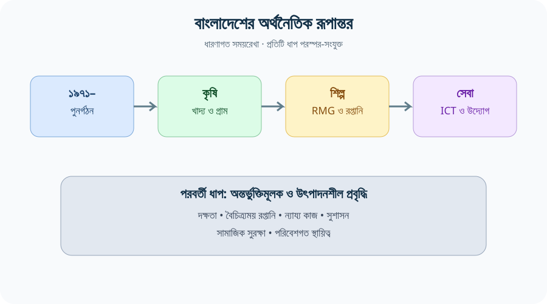
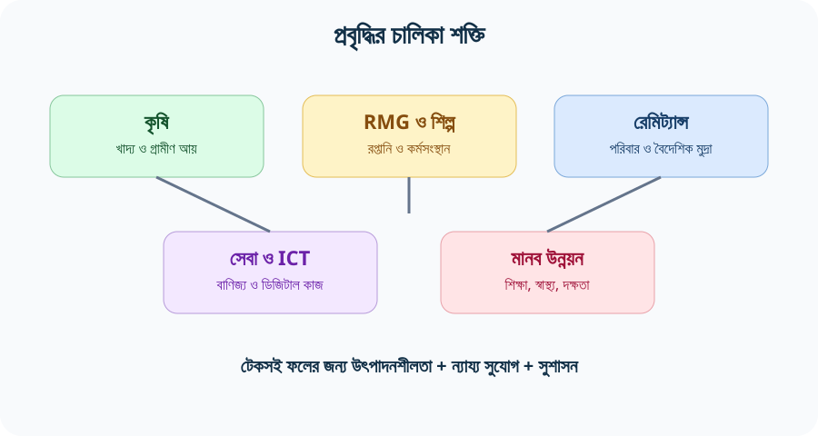
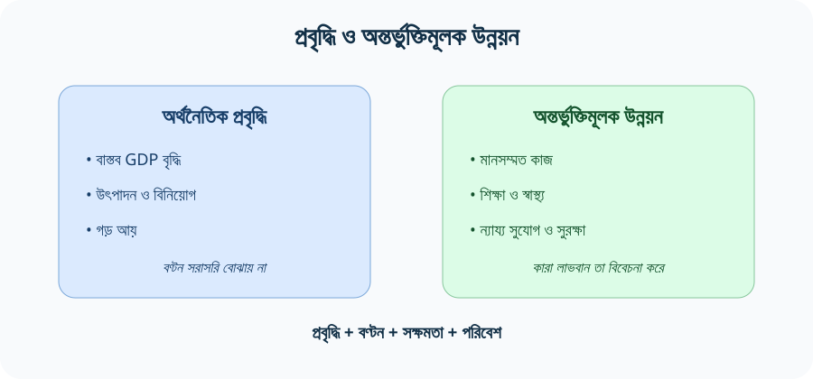
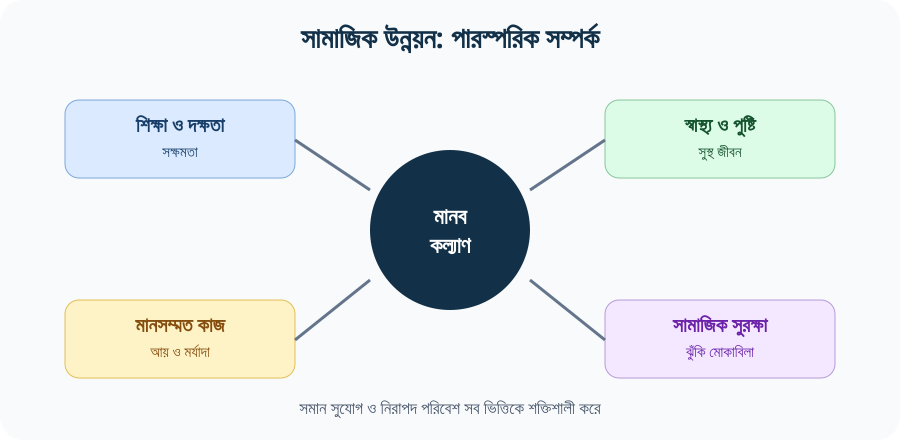
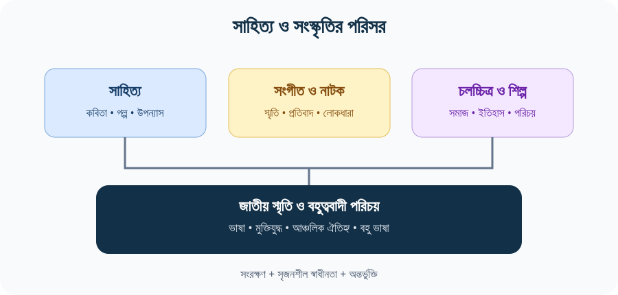
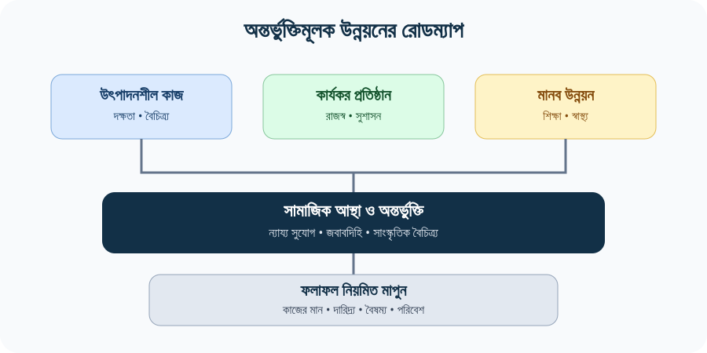

# Chapter 04 — স্বাধীনতা-পরবর্তী বাংলাদেশের অর্থনীতি, সমাজ, সাহিত্য ও সংস্কৃতি
> **BCS Written · Bangladesh Affairs · Subject Code 005 · 200 marks**  
> **মূল ভাষা:** বাংলা; প্রয়োজনীয় English terminology প্রথম ব্যবহারে ব্যাখ্যাসহ।  
> **পাঠের কাঠামো:** ঐতিহাসিক প্রেক্ষাপট → অর্থনৈতিক রূপান্তর → সমাজ ও মানব উন্নয়ন → সাহিত্য-সংস্কৃতি → বৈষম্য ও চ্যালেঞ্জ → নীতিগত বিশ্লেষণ → পরীক্ষার উত্তর।  
> **সর্বশেষ উৎস-পর্যালোচনা:** ২১ অক্টোবর ২০২৬। পরিবর্তনশীল পরিসংখ্যানের পাশে উৎস ও বছর দেওয়া হয়েছে।

[← Bangladesh Affairs-এর মূল সূচি](../README.md) · [Chapter 01 — ভূগোল](../Chapter-01/README.md) · [Chapter 02 — জনমিতি](../Chapter-02/README.md) · [📚 PYQ Analysis + গুরুত্বপূর্ণ প্রবন্ধ](./PYQ-BASED-ESSAYS.md) · [English Quotations + Sources](./QUOTATIONS.md) · [📘 25 Model Questions & Answers](./QUESTIONS-ANSWERS.md)

> [!NOTE]
> **এই অধ্যায় কীভাবে পড়বেন:** প্রতিটি বিষয়কে চার ধাপে বুঝুন—(১) কী পরিবর্তন ঘটেছে, (২) কেন ঘটেছে, (৩) কারা লাভবান বা ক্ষতিগ্রস্ত হয়েছে, (৪) কোন নীতি উন্নত ফল দিতে পারে। পরীক্ষায় শুধু অর্জনের তালিকা নয়, সীমাবদ্ধতা ও প্রমাণভিত্তিক সুপারিশও লিখবেন।

## Visual study gallery — বাস্তব ছবি ও বিষয়ভিত্তিক চিত্র

> ছবিগুলো বিষয় বোঝানোর জন্য। প্রতিটি ছবির মূল Wikimedia Commons পাতা থেকে লাইসেন্স ও attribution যাচাই করুন; এগুলো পরিসংখ্যানগত প্রমাণ নয়।

### বাংলাদেশের তৈরি পোশাকশিল্প ও শ্রম

**Source / licence:** [Wikimedia Commons — Working conditions of Garment workers in Bangladesh.jpg](https://commons.wikimedia.org/wiki/File:Working_conditions_of_Garment_workers_in_Bangladesh.jpg) · Fahad Faisal · CC BY-SA 4.0. ছবিটি শ্রমপরিবেশের একটি উদাহরণ; পুরো খাতের প্রতিনিধিত্বকারী নমুনা নয়।

### বাংলা নববর্ষ ও সাংস্কৃতিক পরিচয়

**Source / licence:** [Wikimedia Commons — Pohela boishakh rally.jpg](https://commons.wikimedia.org/wiki/File:Pohela_boishakh_rally.jpg). ছবির পাতা থেকে বর্তমান লাইসেন্স/attribution দেখে ব্যবহার করুন।

### আরও দ্রুত শেখার জন্য
- [📊 09 — BCS Answer Framework](./assets/visual-revision/09-answer-framework.svg)
- [📈 08 — Growth vs Inclusive Development](./assets/visual-revision/08-growth-vs-inclusion.svg)
- [🧭 07 — Development Model](./assets/visual-revision/07-development-model.svg)
- [📚 25 Model Questions + Answers](./QUESTIONS-ANSWERS.md)
- [💬 16 English Quotations + Sources](./QUOTATIONS.md)

## বিষয়সূচি — সরাসরি অংশে যান

| ভিত্তি ও ইতিহাস | অর্থনীতি | সমাজ, সাহিত্য ও সংস্কৃতি | পরীক্ষা ও পুনরালোচনা |
|---|---|---|---|
| [শিখনফল ও সিলেবাস](#start) | [অর্থনৈতিক রূপান্তর](#transformation) | [সমাজ ও মানব উন্নয়ন](#society) | [বিগত BCS প্রশ্ন ও বিশ্লেষণ](#pyq) |
| [১৯৭১-এর উত্তরাধিকার](#legacy) | [কৃষি ও খাদ্যনিরাপত্তা](#agriculture) | [নারী ও শ্রম](#women) | [উত্তর লেখার কৌশল](#strategy) |
| [সময়রেখা](#timeline) | [শিল্প ও RMG](#industry) | [সাহিত্য](#literature) | [৩৩টি অনুশীলনী](#questions) |
| [মূল ধারণা](#concepts) | [সেবা, ICT ও উদ্যোক্তা](#services) | [সংস্কৃতি ও গণমাধ্যম](#culture) | [নমুনা উত্তর](#worked) |
| [দ্রুত পুনরালোচনা Visuals](#visuals) | [বাণিজ্য, প্রবাসী আয় ও অর্থব্যবস্থা](#external) | [শিক্ষা, স্বাস্থ্য ও দারিদ্র্য](#human-development) | [তথ্য যাচাই ও উৎস](#sources) |
|  | [বৈষম্য ও টেকসই উন্নয়ন](#inequality) | [জাতীয় পরিচয় ও বৈচিত্র্য](#identity) | [Memory check](#memory-check) |

---

## ১. শিখনফল ও BPSC Written Syllabus Mapping

BPSC-এর *Syllabus for BCS (Written) Examination*, Bangladesh Affairs (Compulsory), Subject Code 005-এ স্বাধীনতা-পরবর্তী বাংলাদেশের অর্থনীতি, সমাজ, সাহিত্য ও সংস্কৃতির বিকাশ একটি গুরুত্বপূর্ণ বিষয়। এই অধ্যায় সেই বিষয়কে ঐতিহাসিক পটভূমি, প্রমাণভিত্তিক মূল্যায়ন এবং পরীক্ষামুখী বিশ্লেষণের মাধ্যমে সাজিয়েছে। সরকারি সিলেবাসের পূর্ণ পাঠের জন্য [BPSC-এর লিখিত পরীক্ষার সিলেবাস](https://bpsc.portal.gov.bd/) দেখুন।

এই অধ্যায় শেষে শিক্ষার্থী যেন—

1. ১৯৭১-পরবর্তী পুনর্গঠন থেকে বর্তমান অর্থনৈতিক রূপান্তরের ধারাবাহিকতা ব্যাখ্যা করতে পারে।
2. কৃষি, তৈরি পোশাক, প্রবাসী আয়, ক্ষুদ্র উদ্যোগ, সেবা ও ICT-র অবদান ও সীমাবদ্ধতা তুলনা করতে পারে।
3. GDP growth, inflation, poverty, inequality, employment, productivity এবং human development-এর পার্থক্য বুঝতে পারে।
4. প্রবৃদ্ধি ও অন্তর্ভুক্তিমূলক উন্নয়নের মধ্যে পার্থক্য ব্যাখ্যা করতে পারে।
5. শিক্ষা, স্বাস্থ্য, নগরায়ণ, নারীশ্রম, অভিবাসন, সামাজিক সুরক্ষা ও সাংস্কৃতিক পরিবর্তন বিশ্লেষণ করতে পারে।
6. স্বাধীনতা-পরবর্তী বাংলা সাহিত্য, সংগীত, চলচ্চিত্র, নাটক, চারুকলা ও গণমাধ্যমের প্রধান প্রবণতা আলোচনা করতে পারে।
7. উৎস, সাল, সংজ্ঞা ও সীমাবদ্ধতা উল্লেখ করে ৫, ১০ ও ২০ নম্বরের উত্তর লিখতে পারে।

### অধ্যায়ের মূল যুক্তি

স্বাধীনতার পর বাংলাদেশ যুদ্ধবিধ্বস্ত অবকাঠামো ও দুর্বল উৎপাদনব্যবস্থা থেকে ধাপে ধাপে কৃষি উৎপাদন, শ্রমনির্ভর শিল্প, প্রবাসী আয়, সেবা খাত এবং সামাজিক উন্নয়নের বিস্তৃত ভিত্তি গড়ে তোলে। এই পরিবর্তন একরৈখিক নয়: অর্জনের পাশাপাশি নিম্ন উৎপাদনশীল কর্মসংস্থান, বৈষম্য, মূল্যস্ফীতি, ব্যাংকিং খাতের দুর্বলতা, জলবায়ু ঝুঁকি, রপ্তানির ঘনত্ব এবং সাংস্কৃতিক সম্পদের অসম সুযোগ রয়েছে। তাই বাংলাদেশের অভিজ্ঞতাকে **resilience + structural transformation + unfinished reforms**—এই তিনটি ধারণায় ব্যাখ্যা করা যায়।

---

## ২. ১৯৭১-এর উত্তরাধিকার: পুনর্গঠনের প্রয়োজনীয়তা

স্বাধীনতার সময় বাংলাদেশের সামনে একই সঙ্গে মানবিক, রাজনৈতিক ও অর্থনৈতিক সংকট ছিল। যুদ্ধের ক্ষয়ক্ষতি, বাস্তুচ্যুতি, যোগাযোগ ও উৎপাদনব্যবস্থার বিঘ্ন, সীমিত বৈদেশিক মুদ্রা, খাদ্য সরবরাহের অনিশ্চয়তা এবং প্রশাসনিক প্রতিষ্ঠান গড়ে তোলার চ্যালেঞ্জ নতুন রাষ্ট্রকে মোকাবিলা করতে হয়। ফলে প্রথম পর্যায়ের নীতির কেন্দ্র ছিল পুনর্বাসন, খাদ্য ও জরুরি সরবরাহ, পরিবহন-যোগাযোগ পুনরুদ্ধার, শিল্প ও কৃষি উৎপাদন চালু করা এবং প্রশাসনিক সক্ষমতা নির্মাণ।

### কেন প্রাথমিক অবস্থাকে বুঝতে হবে?

- **Baseline:** পরবর্তী দশকের প্রবৃদ্ধি ও সামাজিক পরিবর্তন মূল্যায়নের জন্য স্বাধীনতার সময়কার অবস্থা জানা জরুরি।
- **Institution-building:** স্বাধীন রাষ্ট্রকে রাজস্ব, মুদ্রা, বাণিজ্য, শিক্ষা, স্বাস্থ্য ও স্থানীয় প্রশাসনের প্রতিষ্ঠান গড়ে তুলতে হয়েছে।
- **External dependence:** খাদ্য, জ্বালানি, যন্ত্রপাতি ও উন্নয়ন অর্থায়নে বৈদেশিক সহায়তা ও আমদানির ভূমিকা ছিল গুরুত্বপূর্ণ।
- **Human capital:** যুদ্ধের ক্ষতি, দারিদ্র্য ও দুর্বল সেবার কারণে স্বাস্থ্য, শিক্ষা ও দক্ষতা উন্নয়ন দীর্ঘমেয়াদি অগ্রাধিকার হয়ে ওঠে।
- **Political economy:** রাষ্ট্রীয় মালিকানা, বাজার, ব্যক্তিখাত, শ্রম অধিকার এবং উন্নয়নের সুফল বণ্টন নিয়ে নীতি-দ্বন্দ্ব সময়ের সঙ্গে বদলেছে।

### পুনর্গঠন বনাম দীর্ঘমেয়াদি উন্নয়ন

পুনর্গঠন মানে ধ্বংসপ্রাপ্ত ব্যবস্থা পুনরায় চালু করা; structural transformation মানে উৎপাদন, কর্মসংস্থান ও অর্থনৈতিক কর্মকাণ্ডের গঠন বদলে বেশি উৎপাদনশীল খাতে অগ্রসর হওয়া। প্রথমটি ছাড়া দ্বিতীয়টি কঠিন, কিন্তু পুনর্গঠন একাই টেকসই উন্নয়ন নিশ্চিত করে না। উৎপাদনশীল বিনিয়োগ, দক্ষতা, প্রতিষ্ঠান, প্রযুক্তি, ন্যায্য প্রতিযোগিতা এবং সামাজিক সুরক্ষা প্রয়োজন।

---

## ৩. স্বাধীনতা-পরবর্তী বাংলাদেশের রূপান্তর: সংক্ষিপ্ত সময়রেখা

| সময়/পর্ব | প্রধান প্রবণতা | বিশ্লেষণী তাৎপর্য |
|---|---|---|
| ১৯৭১–১৯৭৫ | পুনর্গঠন, জরুরি সরবরাহ, রাষ্ট্রীয় খাতের বিস্তার, দুর্যোগ ও খাদ্যসংকট | রাষ্ট্রীয় প্রতিষ্ঠান ও উৎপাদনব্যবস্থা পুনরুদ্ধার ছিল মুখ্য |
| ১৯৭০-এর শেষ–১৯৮০-এর দশক | নীতি পরিবর্তন, ব্যক্তিখাতের ক্রমবর্ধমান ভূমিকা, রপ্তানিমুখী পোশাক শিল্পের উত্থান | অর্থনীতিতে বাজার, বেসরকারি উদ্যোগ ও বৈদেশিক বাণিজ্যের ভূমিকা বাড়ে |
| ১৯৯০-এর দশক | গণতান্ত্রিক রূপান্তর, বাণিজ্য উদারীকরণ, RMG ও প্রবাসী আয়ের বিস্তার | রপ্তানি ও শ্রমবাজারের সংযোগ জোরদার হয় |
| ২০০০–২০১০ | কৃষি উৎপাদনশীলতা, ক্ষুদ্রঋণ/ক্ষুদ্র উদ্যোগ, শিক্ষা-স্বাস্থ্য সূচকে উন্নতি, পোশাক রপ্তানির সম্প্রসারণ | প্রবৃদ্ধির সঙ্গে সামাজিক সূচকের উন্নতির সম্পর্ক আলোচনায় আসে |
| ২০১০-এর দশক | দ্রুত প্রবৃদ্ধি, বিদ্যুৎ ও অবকাঠামো সম্প্রসারণ, ডিজিটাল সেবা, নগরায়ণ | বাজারের আকার ও সংযোগ বাড়ে; একই সঙ্গে পরিবেশ ও নগর ব্যবস্থাপনার চাপ বাড়ে |
| ২০২০–২০২২ | COVID-19, সরবরাহ শৃঙ্খল বিঘ্ন, কর্মসংস্থান ও শিক্ষায় ধাক্কা | সংকট-সহনশীলতা ও সামাজিক সুরক্ষার গুরুত্ব স্পষ্ট হয় |
| ২০২৩–২০২৬ | উচ্চ মূল্যস্ফীতি, বৈদেশিক খাত ও ব্যাংকিং খাতের চাপ, প্রবৃদ্ধি মন্থর হওয়ার ঝুঁকি; সংস্কারের প্রয়োজন | স্থিতিশীলতা, কর্মসংস্থান, রাজস্ব ও আর্থিক খাতের সংস্কার জরুরি |

**সময়রেখা ব্যবহারের নিয়ম:** সময়পর্বগুলো বিশ্লেষণী সুবিধার জন্য; এগুলো কঠোরভাবে পৃথক বা একদিনে শুরু-শেষ হওয়া পর্যায় নয়। প্রতিটি প্রবণতার মধ্যে ধারাবাহিকতা ও নীতিগত পরিবর্তন দুটোই ছিল।

---

## ৪. অর্থনৈতিক রূপান্তর: কৃষিনির্ভরতা থেকে বহুখাতভিত্তিক অর্থনীতি

### ৪.১ Structural transformation কী?

Structural transformation হলো উৎপাদন ও কর্মসংস্থানের গঠন কৃষি থেকে শিল্প ও সেবায়, অথবা নিম্ন উৎপাদনশীল কাজ থেকে তুলনামূলক উচ্চ উৎপাদনশীল কাজে পরিবর্তিত হওয়া। বাংলাদেশের ক্ষেত্রে কৃষির উৎপাদনশীলতা, তৈরি পোশাক, নির্মাণ, পরিবহন, পাইকারি-খুচরা বাণিজ্য, শিক্ষা-স্বাস্থ্য, আর্থিক সেবা, ICT এবং প্রবাসী আয়ের পারস্পরিক সম্পর্ক গুরুত্বপূর্ণ।

বিশ্বব্যাংকের বাংলাদেশবিষয়ক country overview-তে স্বাধীনতার পর দীর্ঘমেয়াদি অগ্রগতির পাশাপাশি সাম্প্রতিক প্রবৃদ্ধি, মূল্যস্ফীতি, দারিদ্র্য, বিনিয়োগ ও রাজস্বসংক্রান্ত সীমাবদ্ধতা আলোচিত হয়েছে [S1](https://www.worldbank.org/ext/en/country/bangladesh)। World Bank-এর *Bangladesh: A Fifty-year Partnership in Development Achievements* দীর্ঘমেয়াদি সামাজিক ও অবকাঠামোগত অগ্রগতির সারাংশ দেয় [S2](https://www.worldbank.org/en/results/2023/11/20/bangladesh-a-fifty-year-partnership-in-development-achievements)।

### ৪.২ প্রবৃদ্ধি ও উন্নয়ন এক নয়

| ধারণা | অর্থ | কী দিয়ে বোঝা যায় | সীমাবদ্ধতা |
|---|---|---|---|
| GDP growth | নির্দিষ্ট সময়ে অর্থনীতির উৎপাদনের বাস্তব বৃদ্ধি | বাস্তব GDP বৃদ্ধির হার | কার আয় কত বেড়েছে তা সরাসরি জানায় না |
| GDP per capita | মোট GDP-কে জনসংখ্যা দিয়ে ভাগ | গড় উৎপাদন/আয়ের আনুমানিক সূচক | আয়-বণ্টনের অসমতা আড়াল করে |
| Inflation | সাধারণ মূল্যস্তরের ধারাবাহিক বৃদ্ধি | CPI বা সংশ্লিষ্ট মূল্যসূচক | পরিবারের খরচের ধরনভেদে প্রভাব আলাদা |
| Poverty | নির্ধারিত দারিদ্র্যসীমার নিচে থাকা | জাতীয় বা আন্তর্জাতিক poverty line | সীমা, জরিপ ও সময়কাল অনুযায়ী হার বদলায় |
| Inequality | আয়/সম্পদ/সুযোগের অসম বণ্টন | Gini, আয়-দশক, সম্পদ বা সেবা-প্রবেশ | একক সূচক সব ধরনের বৈষম্য দেখায় না |
| Productivity | প্রতি শ্রমিক/ঘণ্টা/ইনপুটে উৎপাদন | শ্রম উৎপাদনশীলতা, TFP | সঠিক ও তুলনাযোগ্য ডেটা প্রয়োজন |
| Human development | মানুষের সক্ষমতা ও জীবনমানের বিস্তার | স্বাস্থ্য, শিক্ষা, আয়সহ একাধিক সূচক | গড় মান স্থানীয় বৈষম্য ঢেকে দিতে পারে |

**পরীক্ষার বিশ্লেষণ:** GDP বাড়লেও খাদ্য, বাসস্থান, পরিবহন ও স্বাস্থ্য ব্যয় দ্রুত বাড়লে দরিদ্র পরিবারের বাস্তব জীবনমান উন্নত নাও হতে পারে। তাই প্রবৃদ্ধির সঙ্গে বাস্তব মজুরি, কর্মসংস্থানের মান, সেবা-প্রাপ্তি, বৈষম্য ও পরিবেশের সূচক যুক্ত করে বিচার করা উচিত।

### ৪.৩ বাংলাদেশের উন্নয়নের চালিকা শক্তি

1. **কৃষি ও গ্রামীণ অর্থনীতি:** খাদ্য উৎপাদন, গ্রামীণ আয়, কাঁচামাল এবং অভ্যন্তরীণ বাজারের ভিত্তি।
2. **তৈরি পোশাক শিল্প:** রপ্তানি, নগর কর্মসংস্থান, নারী শ্রমবাজারে প্রবেশ এবং শিল্প-সংযুক্ত সেবা।
3. **প্রবাসী শ্রম ও রেমিট্যান্স:** পরিবারের আয়, ভোগ, বাসস্থান, শিক্ষা, স্বাস্থ্য ও বৈদেশিক মুদ্রার সরবরাহ।
4. **ক্ষুদ্র ও মাঝারি উদ্যোগ:** স্থানীয় উৎপাদন, বাণিজ্য, পরিবহন, মেরামত, খাদ্য প্রক্রিয়াকরণ ও সেবা।
5. **অবকাঠামো ও বিদ্যুৎ:** বাজার সংযোগ, উৎপাদন, সরবরাহ শৃঙ্খল ও ডিজিটাল কার্যক্রমের সহায়ক।
6. **নারীর শিক্ষা ও শ্রম অংশগ্রহণ:** পরিবারের সিদ্ধান্ত, আয়, শিশুর স্বাস্থ্য ও অর্থনৈতিক উৎপাদনে প্রভাব।
7. **সামাজিক উদ্ভাবন ও উন্নয়ন সংস্থা:** ক্ষুদ্রঋণ, কমিউনিটি স্বাস্থ্য, শিক্ষা, দুর্যোগ প্রস্তুতি ও সামাজিক সচেতনতা—যদিও ফলাফল প্রেক্ষাপট ও বাস্তবায়নভেদে ভিন্ন।
8. **জনমিতিক পরিবর্তন:** বড় কর্মক্ষম জনগোষ্ঠী সম্ভাবনা তৈরি করে, তবে দক্ষতা ও মানসম্মত চাকরি ছাড়া demographic dividend নিশ্চিত হয় না।

---

## ৫. কৃষি, খাদ্যনিরাপত্তা ও গ্রামীণ রূপান্তর

### ৫.১ কৃষির ভূমিকা

কৃষি শুধু GDP-তে সরাসরি অবদানের বিষয় নয়। এটি খাদ্যনিরাপত্তা, গ্রামীণ কর্মসংস্থান, কৃষিভিত্তিক শিল্পের কাঁচামাল, খাদ্যের দাম, ভূমি ব্যবহার এবং জলবায়ু-সহনশীলতার সঙ্গে যুক্ত। ধান উৎপাদনের পাশাপাশি মাছ, সবজি, ফল, পোলট্রি, দুগ্ধ, মৎস্যচাষ এবং কৃষিপণ্য বিপণন গ্রামীণ অর্থনীতিকে বহুমুখী করেছে।

### ৫.২ প্রধান পরিবর্তন

- উন্নত বীজ, সেচ, সার, কৃষিযন্ত্র ও সম্প্রসারণ সেবার ব্যবহারে বহু এলাকায় উৎপাদন বেড়েছে।
- কৃষির বাণিজ্যিকীকরণে বাজার, পরিবহন, সংরক্ষণ, কোল্ড-চেইন ও প্রক্রিয়াজাতকরণের গুরুত্ব বেড়েছে।
- কৃষকের আয় কেবল ফলনের ওপর নির্ভর করে না; উৎপাদন খরচ, মধ্যস্বত্বভোগী, বাজারদর, ঋণ ও প্রাকৃতিক ঝুঁকি গুরুত্বপূর্ণ।
- জমির খণ্ডীকরণ, কৃষিজমি অন্য কাজে রূপান্তর, মাটির স্বাস্থ্য, ভূগর্ভস্থ পানির চাপ ও জলবায়ু পরিবর্তন দীর্ঘমেয়াদি চ্যালেঞ্জ।
- উৎপাদন বৃদ্ধি খাদ্যনিরাপত্তার জন্য জরুরি, কিন্তু পুষ্টি, খাদ্যের ক্রয়ক্ষমতা, নিরাপদ খাদ্য ও অপচয় কমানোও সমান গুরুত্বপূর্ণ।

### ৫.৩ খাদ্যনিরাপত্তার চার মাত্রা

| মাত্রা | প্রশ্ন | নীতির উদাহরণ |
|---|---|---|
| Availability — প্রাপ্যতা | পর্যাপ্ত খাদ্য উৎপাদন/আমদানি আছে কি? | উৎপাদন, মজুত, আমদানি-ব্যবস্থাপনা |
| Access — প্রবেশাধিকার | পরিবার খাদ্য কিনতে বা পেতে পারে কি? | কর্মসংস্থান, আয়, সামাজিক সুরক্ষা |
| Utilisation — ব্যবহার | খাদ্য পুষ্টিকর ও নিরাপদ কি; স্বাস্থ্য-স্যানিটেশন আছে কি? | পুষ্টি, নিরাপদ পানি, স্বাস্থ্যসেবা |
| Stability — স্থিতিশীলতা | সারা বছর ও সংকটে খাদ্য পাওয়া যায় কি? | দুর্যোগ প্রস্তুতি, মজুত, সরবরাহ শৃঙ্খল |

### ৫.৪ নীতিগত সুপারিশ

- কৃষকের উৎপাদন খরচ ও বাজারদরের মধ্যে স্বচ্ছতা বাড়ানো।
- কৃষিপণ্যের সংরক্ষণ, প্রক্রিয়াজাতকরণ, শীতল পরিবহন এবং কৃষক-সমবায়ের সুযোগ উন্নত করা।
- অঞ্চলভিত্তিক ফসল বৈচিত্র্য, লবণাক্ততা/বন্যা/খরা-সহনশীল জাত এবং পানি-সাশ্রয়ী প্রযুক্তি সম্প্রসারণ।
- নারী কৃষক ও ক্ষুদ্র কৃষকের জমি, ঋণ, প্রশিক্ষণ এবং বাজারে প্রবেশাধিকার শক্তিশালী করা।
- পুষ্টি-সংবেদনশীল কৃষি এবং স্কুল/কমিউনিটি পুষ্টি কার্যক্রম সমন্বয় করা।

---

## ৬. শিল্পায়ন, তৈরি পোশাক (RMG) ও রপ্তানি বৈচিত্র্য

### ৬.১ তৈরি পোশাক শিল্পের গুরুত্ব

Ready-Made Garments (RMG) বাংলাদেশের রপ্তানি-নির্ভর শিল্পায়নের প্রধান উদাহরণ। এই শিল্প বৈদেশিক মুদ্রা অর্জন, বৃহৎ শ্রমশক্তির কর্মসংস্থান, নারী শ্রমিকের আয় এবং পরিবহন, প্যাকেজিং, ব্যাংকিং, বন্দর, ডিজাইন ও বাণিজ্যসেবার মতো সংযুক্ত কর্মকাণ্ডে ভূমিকা রেখেছে। বিশ্বব্যাংকের বিশ্লেষণে RMG-কে বাংলাদেশের অর্থনৈতিক কাঠামো পরিবর্তনের অন্যতম চালিকা শক্তি হিসেবে চিহ্নিত করা হয়েছে [S3](https://ieg.worldbankgroup.org/evaluations/world-bank-group-bangladesh/chapter-1-introduction-and-country-context)।

### ৬.২ শিল্পের কাঠামোগত সীমাবদ্ধতা

- রপ্তানির বড় অংশ একটি খাতে কেন্দ্রীভূত হলে আন্তর্জাতিক চাহিদা, শুল্কনীতি, ক্রেতার মানদণ্ড ও সরবরাহ-শৃঙ্খলের ধাক্কায় ঝুঁকি বাড়ে।
- কম মজুরি-ভিত্তিক প্রতিযোগিতা দীর্ঘমেয়াদে যথেষ্ট নয়; দক্ষতা, প্রযুক্তি, নকশা, মান, সময়মতো সরবরাহ ও উৎপাদনশীলতা বাড়াতে হয়।
- শ্রমিকের নিরাপত্তা, মজুরি, সংগঠিত হওয়ার অধিকার, স্বাস্থ্য, childcare এবং কর্মক্ষেত্রে মর্যাদা টেকসই শিল্পায়নের অংশ।
- জ্বালানি, গ্যাস, বিদ্যুৎ, বন্দর-জট, লজিস্টিকস ও অর্থায়নের ব্যয় শিল্পের প্রতিযোগিতা প্রভাবিত করে।
- ক্ষুদ্র সরবরাহকারী প্রতিষ্ঠানকে পরিবেশগত ও সামাজিক মানদণ্ড পূরণে অর্থায়ন ও প্রযুক্তিগত সহায়তা দরকার।

### ৬.৩ বৈচিত্র্যের সম্ভাব্য ক্ষেত্র

চামড়া ও চামড়াজাত পণ্য, পাট ও পাটজাত পণ্য, ওষুধ, কৃষি-প্রক্রিয়াজাত পণ্য, হালকা প্রকৌশল, ইলেকট্রনিক্স-সংযোজন, জাহাজ নির্মাণ/মেরামত, প্লাস্টিক, সৃজনশীল শিল্প এবং ICT-সক্ষম সেবা সম্ভাব্য ক্ষেত্র হিসেবে বিবেচিত হতে পারে। তবে “সম্ভাবনা”কে অর্জন হিসেবে লেখা যাবে না। প্রত্যেক খাতের জন্য মান-নিয়ন্ত্রণ, দক্ষ শ্রম, নির্ভরযোগ্য বিদ্যুৎ, গবেষণা, বিনিয়োগ, বাজার-সংযোগ, মানদণ্ড ও নীতির ধারাবাহিকতা দরকার।

### ৬.৪ শিল্পনীতির মূলনীতি

**কম খরচ → বেশি উৎপাদনশীলতা → উচ্চতর মূল্য সংযোজন → ভালো কাজ → বৈচিত্র্যময় বাজার।**  
এই শৃঙ্খল গড়ে তুলতে শিল্পনীতি, TVET, বিশ্ববিদ্যালয়-শিল্প সহযোগিতা, প্রযুক্তি গ্রহণ, প্রতিযোগিতা, শ্রম অধিকার ও পরিবেশ ব্যবস্থাপনাকে একই কাঠামোয় ভাবতে হবে।

---

## ৭. সেবা, ICT, উদ্যোক্তা ও ডিজিটাল অর্থনীতি

সেবা খাতে পাইকারি-খুচরা বাণিজ্য, পরিবহন, শিক্ষা, স্বাস্থ্য, আবাসন, আর্থিক সেবা, সরকারি প্রশাসন, পর্যটন, টেলিযোগাযোগ এবং ডিজিটাল সেবা অন্তর্ভুক্ত। সেবা খাতের বিস্তার অর্থনীতিকে বহুমুখী করে, কিন্তু সব সেবা একই উৎপাদনশীলতা বা চাকরির মান দেয় না।

### ডিজিটাল রূপান্তরের সুযোগ

- সরকারি সেবা অনলাইনে দেওয়া, নথি ও পেমেন্ট প্রক্রিয়া সহজ করা।
- মোবাইল আর্থিক সেবা ও ডিজিটাল পেমেন্টে লেনদেনের সুবিধা বাড়ানো।
- ক্ষুদ্র উদ্যোক্তার অনলাইন বাজার, হিসাবরক্ষণ ও গ্রাহক-সংযোগের সুযোগ।
- ফ্রিল্যান্সিং, সফটওয়্যার, BPO, ডিজিটাল কনটেন্ট ও প্রযুক্তিভিত্তিক সেবায় দক্ষতার চাহিদা।
- শিক্ষা ও স্বাস্থ্য তথ্যের বিস্তারে দূরবর্তী জনগোষ্ঠীর প্রবেশাধিকার উন্নত করার সুযোগ।

### ঝুঁকি ও নীতিগত শর্ত

ডিজিটাল বিভাজন, ইন্টারনেটের ব্যয়, ডিজিটাল সাক্ষরতার ঘাটতি, সাইবার নিরাপত্তা, ব্যক্তিগত তথ্যের সুরক্ষা, অনলাইন প্রতারণা, প্ল্যাটফর্ম-নির্ভর কাজের অনিশ্চয়তা এবং নারী/প্রতিবন্ধী/গ্রামীণ ব্যবহারকারীর প্রবেশাধিকার বিবেচনা করতে হবে। প্রযুক্তি নিজে অন্তর্ভুক্তিমূলক নয়; নকশা, নিয়ম, দক্ষতা ও জবাবদিহি ঠিক থাকলে তবেই এর সুফল বিস্তৃত হয়।

### উদ্যোক্তা উন্নয়নের করণীয়

1. ব্যবসা নিবন্ধন ও কর-অনুবর্তিতা সহজ করা, তবে নিয়মের স্বচ্ছতা বজায় রাখা।
2. ক্ষুদ্র ও মাঝারি উদ্যোগের জন্য ঋণ, হিসাবরক্ষণ, মান-সনদ ও বাজার-তথ্য সহজলভ্য করা।
3. সরকারি ক্রয় ও সরবরাহ শৃঙ্খলে ক্ষুদ্র প্রতিষ্ঠানের ন্যায্য সুযোগ বাড়ানো।
4. গবেষণা, উদ্ভাবন ও বিশ্ববিদ্যালয়-শিল্প সহযোগিতাকে বাস্তব সমস্যার সঙ্গে যুক্ত করা।
5. ব্যর্থতা-সহনশীল উদ্যোক্তা পরিবেশ তৈরি করা, কিন্তু জালিয়াতি ও অনৈতিক সুবিধা নিয়ন্ত্রণ করা।

---

## ৮. বাণিজ্য, প্রবাসী আয়, বৈদেশিক মুদ্রা ও আর্থিক খাত

### ৮.১ প্রবাসী শ্রম ও রেমিট্যান্স

বিদেশে কর্মরত বাংলাদেশিদের পাঠানো অর্থ (remittances) বহু পরিবারের ভোগ, বাড়ি নির্মাণ, শিক্ষা, চিকিৎসা, ঋণ পরিশোধ ও সঞ্চয়ে সহায়তা করে। এটি বৈদেশিক মুদ্রা সরবরাহ ও বহিঃখাতের স্থিতিশীলতাতেও ভূমিকা রাখে। তবে প্রবাসী আয়ের সুফল সর্বত্র সমান নয়; বিদেশগমনের খরচ, মধ্যস্বত্বভোগী, দক্ষতার স্বীকৃতি, শ্রম অধিকার, নিরাপত্তা এবং প্রত্যাবর্তনের পর পুনর্বাসন গুরুত্বপূর্ণ।

**নীতিগত দিক:** নিরাপদ ও কম-খরচে অভিবাসন, দক্ষতা-সনদ, দ্বিপাক্ষিক শ্রম চুক্তি, কনস্যুলার সুরক্ষা, বৈধ চ্যানেলে রেমিট্যান্স, সঞ্চয় ও উৎপাদনশীল বিনিয়োগের বিকল্প বাড়াতে হবে। পরিবারের স্বাভাবিক ভোগে ব্যবহৃত রেমিট্যান্সকে “অউৎপাদনশীল” বলে অবজ্ঞা করা উচিত নয়—পুষ্টি, শিক্ষা ও স্বাস্থ্যেও এর দীর্ঘমেয়াদি সামাজিক ফল আছে।

### ৮.২ বৈদেশিক বাণিজ্যের ভারসাম্য

বাংলাদেশ মূলধনী যন্ত্রপাতি, জ্বালানি, শিল্পের কাঁচামাল, খাদ্য ও অন্যান্য পণ্য আমদানি করে; পোশাকসহ বিভিন্ন পণ্য রপ্তানি করে। আমদানি সবসময় খারাপ নয়—উৎপাদনক্ষমতা বাড়ানো যন্ত্রপাতি ও কাঁচামাল প্রয়োজনীয় হতে পারে। সমস্যা হয় যখন রপ্তানি ও উৎপাদনশীলতা না বাড়িয়ে আমদানি-চাহিদা, জ্বালানি ব্যয় বা ঋণ পরিশোধের চাপ বৈদেশিক মুদ্রার ঘাটতি বাড়ায়।

### ৮.৩ ব্যাংকিং ও আর্থিক খাত

কার্যকর আর্থিক খাত সঞ্চয়কে বিনিয়োগে রূপান্তর করে, ঝুঁকি মূল্যায়ন করে, ব্যবসায় ঋণ দেয় এবং লেনদেন সহজ করে। দুর্বল ঋণ-অনুমোদন, related-party lending, ঋণ শ্রেণিকরণে অসঙ্গতি, দুর্বল তদারকি ও অনাদায়ী ঋণ ব্যাংকের সক্ষমতা কমায়। সমস্যার সমাধানে স্বাধীন তদারকি, ঋণ-তথ্যের স্বচ্ছতা, সুশাসন, জবাবদিহি, সম্পদ-মান যাচাই এবং আইনের ন্যায্য প্রয়োগ প্রয়োজন।

### ৮.৪ রাজস্ব ও রাষ্ট্রীয় সক্ষমতা

কম কর-রাজস্বের অর্থ হলো শিক্ষা, স্বাস্থ্য, সামাজিক সুরক্ষা, অবকাঠামো ও জলবায়ু অভিযোজনে রাষ্ট্রের ব্যয় করার সক্ষমতা সীমিত হতে পারে। করব্যবস্থাকে ন্যায্য, সহজ, পূর্বানুমানযোগ্য ও জবাবদিহিমূলক করতে হবে। করের ভিত্তি বিস্তার, কর ফাঁকি কমানো, ডিজিটাল প্রশাসন, করদাতার আস্থা এবং সরকারি ব্যয়ের গুণগত মান পরস্পর সম্পর্কিত।

---

## ৯. স্বাধীনতা-পরবর্তী সমাজ: পরিবর্তন ও ধারাবাহিকতা

বাংলাদেশের সামাজিক রূপান্তরকে শুধু আয় দিয়ে ব্যাখ্যা করা যায় না। পরিবার, গ্রাম-শহর সম্পর্ক, শিক্ষা, স্বাস্থ্য, নারীর ভূমিকা, অভিবাসন, ধর্মীয় ও সাংস্কৃতিক প্রতিষ্ঠান, প্রযুক্তি, গণমাধ্যম এবং সামাজিক সংগঠনের পরিবর্তনও গুরুত্বপূর্ণ।

### ৯.১ পরিবার ও সামাজিক সম্পর্ক

- শিক্ষা, কর্মসংস্থান, নগরায়ণ ও অভিবাসনের ফলে যৌথ পরিবার, একক পরিবার, পরিচর্যা এবং প্রজন্মের সম্পর্কের ধরনে পরিবর্তন এসেছে।
- গ্রাম থেকে শহরে অভিবাসন কর্মসংস্থান ও শিক্ষার সুযোগ বাড়াতে পারে, কিন্তু বাসস্থান, পানি, স্যানিটেশন, যাতায়াত ও পরিচর্যার চাপ তৈরি করে।
- মোবাইল ও সামাজিক মাধ্যম যোগাযোগকে দ্রুত করেছে; একই সঙ্গে ভুল তথ্য, অনলাইন হয়রানি ও ব্যক্তিগত গোপনীয়তার ঝুঁকি বাড়িয়েছে।
- সামাজিক পরিবর্তন অঞ্চল, শ্রেণি, লিঙ্গ, বয়স, ধর্ম, জাতিগত পরিচয় ও প্রতিবন্ধিতার ভিত্তিতে ভিন্ন হয়।

### ৯.২ নগরায়ণ

নগরায়ণ শিল্প, শিক্ষা, স্বাস্থ্য, বাজার ও কর্মসংস্থানের ঘনত্ব বাড়াতে পারে। কিন্তু পরিকল্পনাহীন নগরায়ণে বস্তি, যানজট, বায়ুদূষণ, জলাবদ্ধতা, অনিরাপদ বাসস্থান, বর্জ্য ব্যবস্থাপনা এবং সেবায় বৈষম্য বাড়ে। সমাধানের জন্য সাশ্রয়ী আবাসন, গণপরিবহন, ভূমি-ব্যবহার পরিকল্পনা, পৌর অর্থায়ন, বর্জ্য ও পানি ব্যবস্থাপনা এবং বিকেন্দ্রীকৃত অর্থনৈতিক সুযোগ প্রয়োজন।

### ৯.৩ সামাজিক পুঁজি ও নাগরিক অংশগ্রহণ

কমিউনিটি সংগঠন, স্থানীয় সরকার, স্বেচ্ছাসেবী উদ্যোগ, সমবায়, পেশাজীবী সংগঠন ও নাগরিক সমাজ দুর্যোগ মোকাবিলা, জনস্বাস্থ্য, শিক্ষা এবং জবাবদিহিতে ভূমিকা রাখতে পারে। তবে অংশগ্রহণ অর্থবহ হতে হলে তথ্যপ্রাপ্তি, অন্তর্ভুক্তি, স্বচ্ছতা এবং ভিন্নমত প্রকাশের নিরাপদ পরিবেশ প্রয়োজন।

---

## ১০. শিক্ষা, স্বাস্থ্য, দারিদ্র্য ও মানব উন্নয়ন

### ১০.১ শিক্ষা

স্বাধীনতার পর শিক্ষার সুযোগ ও প্রতিষ্ঠান বিস্তৃত হয়েছে; প্রাথমিক শিক্ষায় প্রবেশ, মেয়েদের অংশগ্রহণ এবং উচ্চশিক্ষার বিস্তার গুরুত্বপূর্ণ পরিবর্তন। তবু ভর্তি বা উপস্থিতি একাই শিক্ষার মান বোঝায় না। শেখার ফল, শিক্ষক প্রস্তুতি, শ্রেণিকক্ষের পরিবেশ, পুষ্টি, ডিজিটাল প্রবেশাধিকার, কারিগরি শিক্ষা, ভাষাগত অন্তর্ভুক্তি ও শ্রমবাজারের সঙ্গে দক্ষতার সামঞ্জস্য জরুরি।

**করণীয়:** প্রাথমিক সাক্ষরতা ও গণিত, শিক্ষক প্রশিক্ষণ, ধারাবাহিক মূল্যায়ন, ঝরে পড়া কমানো, TVET, apprenticeship, বিশ্ববিদ্যালয়-শিল্প সহযোগিতা এবং গ্রামীণ/প্রান্তিক শিক্ষার্থীর জন্য সহায়তা।

### ১০.২ স্বাস্থ্য

স্বাস্থ্যসেবার বিস্তার, টিকাদান, মাতৃ-শিশুস্বাস্থ্য, পরিবার পরিকল্পনা এবং কমিউনিটি পর্যায়ের উদ্যোগ বাংলাদেশের সামাজিক উন্নয়নে ভূমিকা রেখেছে। একই সঙ্গে পকেট থেকে স্বাস্থ্যব্যয়, মানসম্মত সেবার অসম প্রবেশাধিকার, জনবল বণ্টন, রোগ প্রতিরোধ, পুষ্টি, মানসিক স্বাস্থ্য এবং নগর-গ্রাম ব্যবধান বড় নীতিগত বিষয়।

স্বাস্থ্যনীতিতে **primary health care**, প্রতিরোধমূলক সেবা, পুষ্টি, নিরাপদ পানি-স্যানিটেশন, মানসিক স্বাস্থ্য, জরুরি সাড়া, ওষুধের মান এবং আর্থিক সুরক্ষা একসঙ্গে বিবেচনা করা প্রয়োজন।

### ১০.৩ দারিদ্র্য ও সামাজিক সুরক্ষা

দারিদ্র্য আয়-ঘাটতির পাশাপাশি খাদ্য, বাসস্থান, শিক্ষা, স্বাস্থ্য, নিরাপদ কাজ, সম্পদ ও সিদ্ধান্তগ্রহণের সীমাবদ্ধতার সঙ্গে সম্পর্কিত। জাতীয় দারিদ্র্যসীমা ও আন্তর্জাতিক দারিদ্র্যসীমা ভিন্ন পদ্ধতি ব্যবহার করতে পারে; তাই হার তুলনার আগে সংজ্ঞা, মূল্যভিত্তি ও জরিপবছর দেখতে হবে।

সামাজিক সুরক্ষার লক্ষ্য হওয়া উচিত—ঝুঁকিপূর্ণ পরিবারকে সময়মতো সহায়তা, ভাতা ও সুবিধার সঠিক লক্ষ্য নির্ধারণ, সুবিধাভোগী তালিকার স্বচ্ছতা, অভিযোগ নিষ্পত্তি, দুর্যোগের সময় দ্রুত সম্প্রসারণ এবং সহায়তা থেকে কর্মসংস্থান/সেবার সঙ্গে সংযোগ।

### ১০.৪ মানব উন্নয়নের মূল্যায়ন

মানব উন্নয়ন হলো মানুষের সক্ষমতা ও পছন্দের বিস্তার। আয়, শিক্ষা ও আয়ু গুরুত্বপূর্ণ, কিন্তু নিরাপত্তা, মর্যাদা, পরিবেশ, সমান সুযোগ এবং সাংস্কৃতিক অংশগ্রহণও গুরুত্বপূর্ণ। তাই উন্নয়নের মূল্যায়নে একাধিক সূচক ব্যবহার করা উচিত; গড় জাতীয় সাফল্যের আড়ালে অঞ্চল, লিঙ্গ, প্রতিবন্ধিতা ও আয়গোষ্ঠীভিত্তিক বৈষম্য পরীক্ষা করতে হবে।

---

## ১১. নারী, কর্মসংস্থান ও সামাজিক পরিবর্তন

নারীর শিক্ষা, স্বাস্থ্য, রাজনৈতিক অংশগ্রহণ ও শ্রমবাজারে প্রবেশ বাংলাদেশের সামাজিক ও অর্থনৈতিক পরিবর্তনের গুরুত্বপূর্ণ অংশ। তৈরি পোশাক শিল্প বহু নারীর মজুরিভিত্তিক কাজে প্রবেশের পথ তৈরি করেছে; শিক্ষা, ক্ষুদ্র উদ্যোগ, কৃষি, সেবা ও প্রবাসী শ্রমেও নারীর অবদান রয়েছে। বিশ্বব্যাংকের দীর্ঘমেয়াদি উন্নয়ন পর্যালোচনায় নারীর শ্রমবাজারে অংশগ্রহণ এবং শিক্ষা-স্বাস্থ্য খাতে অগ্রগতির কথা উল্লেখ করা হয়েছে [S2](https://www.worldbank.org/en/results/2023/11/20/bangladesh-a-fifty-year-partnership-in-development-achievements)।

### অগ্রগতি ও অসমাপ্ত কাজ

- মেয়েদের শিক্ষায় অংশগ্রহণ বেড়েছে, কিন্তু শিক্ষার মান, নিরাপদ যাতায়াত, বাল্যবিবাহ, পুষ্টি ও ডিজিটাল প্রবেশাধিকার অঞ্চলভেদে অসম।
- নারীর বেতনভিত্তিক কাজ অর্থনৈতিক ক্ষমতা বাড়াতে পারে; কিন্তু মজুরি ব্যবধান, অনিরাপদ কর্মক্ষেত্র, মাতৃত্ব-সহায়তা, childcare ও অনানুষ্ঠানিক কাজের অনিশ্চয়তা বাধা।
- গৃহস্থালি ও পরিচর্যার অবৈতনিক শ্রম অর্থনীতিকে সহায়তা করে, কিন্তু জাতীয় উৎপাদনের সাধারণ হিসাব তা সম্পূর্ণভাবে দেখায় না।
- সহিংসতা প্রতিরোধে আইন প্রয়োগের পাশাপাশি শিক্ষা, সেবা, নিরাপদ আশ্রয়, অভিযোগের গোপনীয়তা ও সামাজিক মানসিকতার পরিবর্তন প্রয়োজন।

### নীতি-উত্তর

নিরাপদ গণপরিবহন, কর্মক্ষেত্রে যৌন হয়রানি প্রতিরোধ, সমমজুরি-নীতি, childcare, মাতৃত্ব ও পিতৃত্ব-সহায়ক ব্যবস্থা, দক্ষতা উন্নয়ন, নারীর সম্পত্তি ও অর্থায়নে প্রবেশাধিকার এবং নির্ভরযোগ্য শ্রম-পরিসংখ্যানকে সমন্বিতভাবে এগিয়ে নিতে হবে। নারীকে শুধু “শ্রমশক্তি” নয়, অধিকারসম্পন্ন নাগরিক হিসেবে বিবেচনা করা জরুরি।

---

## ১২. স্বাধীনতা-পরবর্তী বাংলা সাহিত্য

স্বাধীনতা-পরবর্তী সাহিত্য মুক্তিযুদ্ধ, ভাষা ও জাতীয় পরিচয়, রাষ্ট্র ও সমাজের পরিবর্তন, গ্রামীণ-নগর অভিজ্ঞতা, দারিদ্র্য, শ্রেণি, নারীজীবন, রাজনৈতিক সহিংসতা, স্মৃতি, অভিবাসন এবং ব্যক্তির অস্তিত্বের প্রশ্নকে নানা রূপে প্রকাশ করেছে। সাহিত্যকে কেবল রাষ্ট্রীয় ইতিহাসের প্রতিফলন হিসেবে নয়, ইতিহাসকে প্রশ্ন করা এবং সমাজের নীরব অভিজ্ঞতা প্রকাশের মাধ্যম হিসেবেও পড়তে হয়।

### ১২.১ কবিতা

কবিতায় মুক্তিযুদ্ধের স্মৃতি, শহিদ ও বীরত্ব, শোক, স্বাধীনতার প্রত্যাশা, রাজনৈতিক হতাশা, প্রেম, নগরজীবন ও ব্যক্তিমানসের প্রকাশ দেখা যায়। শামসুর রাহমান, নির্মলেন্দু গুণ, রুদ্র মুহম্মদ শহিদুল্লাহ, মহাদেব সাহা, আসাদ চৌধুরীসহ বহু কবি ভিন্ন ভিন্ন ভাষা ও নান্দনিকতায় কাজ করেছেন। কাউকে একটিমাত্র রাজনৈতিক বা সাহিত্যিক পরিচয়ে সীমাবদ্ধ না রেখে তাঁর রচনার প্রেক্ষাপট ও বৈশিষ্ট্য উল্লেখ করা ভালো।

### ১২.২ উপন্যাস ও ছোটগল্প

মুক্তিযুদ্ধ, দেশভাগের উত্তরাধিকার, গ্রামীণ সমাজ, মধ্যবিত্তের সংকট, শ্রমজীবী মানুষের অভিজ্ঞতা, নারীর অবস্থান, শহরায়ণ ও ক্ষমতার সম্পর্ক উপন্যাস-গল্পে উঠে এসেছে। হুমায়ূন আহমেদ, সেলিনা হোসেন, আখতারুজ্জামান ইলিয়াস, হাসান আজিজুল হক, জাহানারা ইমাম, আনোয়ার পাশা ও আরও বহু লেখকের রচনায় ভিন্ন ভিন্ন বিষয় ও ন্যারেটিভ দেখা যায়। উদাহরণ লেখার সময় বইয়ের নাম, লেখক ও বিষয় নির্ভুলভাবে যাচাই করা উচিত।

### ১২.৩ মুক্তিযুদ্ধভিত্তিক সাহিত্য

মুক্তিযুদ্ধভিত্তিক সাহিত্য স্মৃতি সংরক্ষণ, সহিংসতার সাক্ষ্য, প্রতিরোধ, আত্মত্যাগ, বাস্তুচ্যুতি, নারী-অভিজ্ঞতা, সহযোগিতা ও বিশ্বাসঘাতকতা, এবং স্বাধীনতার পর প্রত্যাশা-বাস্তবতার ব্যবধানকে আলোচনায় আনে। সাহিত্যের কাজ কেবল ঘটনা পুনরাবৃত্তি নয়; ব্যক্তিগত অভিজ্ঞতা, নৈতিক দ্বন্দ্ব এবং রাষ্ট্র-সমাজের স্মৃতিকে প্রশ্ন করা।

### ১২.৪ নাটক ও প্রবন্ধ

মঞ্চনাটক ও পথনাটক সামাজিক বৈষম্য, রাজনৈতিক কর্তৃত্ব, মুক্তিযুদ্ধ, নারী অধিকার, সাম্প্রদায়িকতা ও নাগরিক সমস্যাকে জনপরিসরে আনে। প্রবন্ধ, স্মৃতিকথা, আত্মজীবনী ও গবেষণাগ্রন্থ ভাষা আন্দোলন, মুক্তিযুদ্ধ, রাষ্ট্র গঠন ও সামাজিক পরিবর্তন সম্পর্কে ঐতিহাসিক নথি ও ব্যাখ্যা দেয়। স্মৃতিকথাকে গুরুত্বপূর্ণ সাক্ষ্য হিসেবে পড়তে হবে, তবে তারিখ, ঘটনা ও ব্যাখ্যা অন্য উৎসের সঙ্গে মিলিয়ে দেখা উচিত।

### ১২.৫ সাহিত্য মূল্যায়নের কাঠামো

একটি উত্তরে চারটি দিক দেখান: (১) ঐতিহাসিক প্রেক্ষাপট, (২) বিষয়বৈচিত্র্য, (৩) ভাষা ও আঙ্গিকের পরিবর্তন, (৪) সমাজে সাহিত্যিক কাজের ভূমিকা। লেখক-নামের তালিকা দিয়ে উত্তর শেষ করবেন না; ২–৩টি নির্ভুল উদাহরণ নিয়ে ব্যাখ্যা দিন।

---

## ১৩. সংস্কৃতি, সংগীত, চলচ্চিত্র, নাটক, চারুকলা ও গণমাধ্যম

### ১৩.১ সংস্কৃতি: স্থির ঐতিহ্য নয়, চলমান প্রক্রিয়া

সংস্কৃতি হলো ভাষা, সাহিত্য, সংগীত, শিল্প, খাদ্যাভ্যাস, পোশাক, উৎসব, স্মৃতি, বিশ্বাস, দৈনন্দিন চর্চা ও সামাজিক অর্থ তৈরির চলমান প্রক্রিয়া। বাংলাদেশি সংস্কৃতি বাংলা ভাষাভিত্তিক ঐতিহ্যের পাশাপাশি ক্ষুদ্র নৃগোষ্ঠীর ভাষা ও সংস্কৃতি, আঞ্চলিক বৈচিত্র্য, ধর্মীয় উৎসব, লোকজ ঐতিহ্য এবং বৈশ্বিক প্রভাবের সমন্বয়ে গঠিত। জাতীয় পরিচয়কে একরৈখিক বা একমাত্রিক করে দেখলে দেশের বৈচিত্র্য আড়াল হয়।

### ১৩.২ সংগীত

দেশাত্মবোধক গান, মুক্তিযুদ্ধের গান, রবীন্দ্রসংগীত, নজরুলসংগীত, আধুনিক গান, লোকসংগীত, ভাটিয়ালি, ভাওয়াইয়া, বাউল, জারি-সারি এবং সমকালীন জনপ্রিয় সংগীত ভিন্ন ভিন্ন শ্রোতা ও সামাজিক প্রেক্ষাপটে বিকশিত হয়েছে। সংগীত স্মৃতি, প্রতিবাদ, ধর্মীয় অনুভূতি, প্রেম, শ্রম, অঞ্চল ও প্রজন্মের অভিজ্ঞতা বহন করতে পারে। বাণিজ্যিক মাধ্যম ও ডিজিটাল প্ল্যাটফর্ম বিতরণ বাড়ালেও শিল্পীর ন্যায্য পারিশ্রমিক, কপিরাইট ও ঐতিহ্য সংরক্ষণ জরুরি।

### ১৩.৩ চলচ্চিত্র ও টেলিভিশন

বাংলাদেশি চলচ্চিত্র মুক্তিযুদ্ধ, সামাজিক বাস্তবতা, পারিবারিক সম্পর্ক, গ্রামীণ-নগর জীবন, শ্রেণি, নারী, রাজনৈতিক ইতিহাস ও বিনোদনের নানা ধারা ধারণ করে। টেলিভিশন নাটক ও ধারাবাহিক জনপ্রিয় সংস্কৃতির গুরুত্বপূর্ণ অংশ; ডিজিটাল স্ট্রিমিং নতুন নির্মাতা ও দর্শক তৈরি করেছে। শিল্পের মানোন্নয়নে চিত্রনাট্য, প্রশিক্ষণ, অর্থায়ন, প্রেক্ষাগৃহ/বিতরণ, আর্কাইভ, চলচ্চিত্র সংরক্ষণ এবং সৃজনশীল স্বাধীনতার পরিবেশ গুরুত্বপূর্ণ।

### ১৩.৪ চারুকলা ও স্থাপত্য

চিত্রকলা, ভাস্কর্য, গ্রাফিক আর্ট, আলোকচিত্র, স্থাপত্য ও জনশিল্পে ভাষা আন্দোলন, মুক্তিযুদ্ধ, কৃষক-শ্রমিক, প্রকৃতি, শহুরে জীবন ও সমকালীন পরিচয়ের প্রতিফলন দেখা যায়। শিল্পকর্মের ব্যাখ্যায় শিল্পী, সময়, মাধ্যম, বিষয় এবং দর্শক-প্রতিক্রিয়া উল্লেখ করা যায়। ঐতিহাসিক স্থাপনা, জাদুঘর, গ্রন্থাগার, আর্কাইভ ও শিল্পসংগ্রহের সংরক্ষণ সাংস্কৃতিক নীতির অংশ।

### ১৩.৫ গণমাধ্যম ও ডিজিটাল সংস্কৃতি

প্রিন্ট, রেডিও, টেলিভিশন, অনলাইন সংবাদ, সামাজিক মাধ্যম, পডকাস্ট ও ভিডিও প্ল্যাটফর্ম তথ্যের প্রবাহ বদলে দিয়েছে। সুযোগের মধ্যে দ্রুত সংবাদ, প্রান্তিক কণ্ঠের প্রকাশ, সৃজনশীল কাজ ও নাগরিক যোগাযোগ আছে। ঝুঁকির মধ্যে ভুল তথ্য, ঘৃণামূলক বক্তব্য, অনলাইন হয়রানি, গোপনীয়তার লঙ্ঘন, সংবাদ ও বিজ্ঞাপনের সীমা অস্পষ্ট হওয়া এবং ডিজিটাল আর্কাইভের অনিশ্চয়তা রয়েছে। সমাধানে মিডিয়া ও ডিজিটাল সাক্ষরতা, স্বচ্ছ মালিকানা, তথ্য যাচাই, ব্যক্তিগত তথ্য সুরক্ষা এবং স্বাধীন ও দায়িত্বশীল সাংবাদিকতা প্রয়োজন।

### ১৩.৬ সাংস্কৃতিক ঐতিহ্য সংরক্ষণ

- লোকসংগীত, মৌখিক ইতিহাস, আঞ্চলিক ভাষা ও কারুশিল্পের নথিভুক্তকরণ।
- জাদুঘর, গ্রন্থাগার, নাট্যশালা, চলচ্চিত্র ও অডিও-আর্কাইভে পেশাদার সংরক্ষণ।
- শিল্পী ও সাংস্কৃতিক কর্মীদের ন্যায্য আয় ও সামাজিক সুরক্ষা।
- স্কুল ও স্থানীয় পর্যায়ে সাংস্কৃতিক শিক্ষার সুযোগ।
- সংখ্যালঘু ও ক্ষুদ্র নৃগোষ্ঠীর সংস্কৃতি তাদের নিজস্ব অংশগ্রহণ ও সম্মতির ভিত্তিতে সংরক্ষণ।
- ডিজিটাল কনটেন্টে কপিরাইট, উৎস উল্লেখ ও আর্কাইভের দীর্ঘমেয়াদি প্রবেশাধিকার।

---

## ১৪. জাতীয় পরিচয়, ভাষা ও সাংস্কৃতিক বৈচিত্র্য

বাংলাদেশের জাতীয় পরিচয় গঠনে বাংলা ভাষা, ভাষা আন্দোলন, মুক্তিযুদ্ধ, ভূখণ্ড, রাজনৈতিক অধিকার ও সাংস্কৃতিক স্মৃতি গভীর ভূমিকা রেখেছে। তবে জাতীয় পরিচয় মানে সবার ভাষা, ধর্ম, অঞ্চল, জাতিগত পরিচয় বা জীবনধারা এক হওয়া নয়। রাষ্ট্রীয় অন্তর্ভুক্তির লক্ষ্য হলো নাগরিকের সমান মর্যাদা ও অধিকার নিশ্চিত করা, একই সঙ্গে বৈচিত্র্যকে স্বীকৃতি দেওয়া।

### ভাষা ও পরিচয়ের সম্পর্ক

ভাষা যোগাযোগের মাধ্যম হওয়ার পাশাপাশি স্মৃতি, সাহিত্য, জ্ঞান, রাজনৈতিক অংশগ্রহণ ও সামাজিক পরিচয়ের বাহক। বাংলা ভাষার ঐতিহাসিক ভূমিকা অত্যন্ত গুরুত্বপূর্ণ; একই সঙ্গে বাংলাদেশের ক্ষুদ্র নৃগোষ্ঠী ও অন্যান্য ভাষাভাষী জনগোষ্ঠীর ভাষা সংরক্ষণ ও শিক্ষায় প্রবেশাধিকার সাংস্কৃতিক ন্যায্যতার অংশ।

### অন্তর্ভুক্তিমূলক সাংস্কৃতিক নীতির নীতি

1. **Recognition:** ভাষা ও ঐতিহ্যের অস্তিত্বকে স্বীকৃতি।
2. **Participation:** সংশ্লিষ্ট জনগোষ্ঠীকে সিদ্ধান্ত ও নথিভুক্তকরণে অংশীদার করা।
3. **Access:** সাংস্কৃতিক প্রতিষ্ঠান, শিক্ষা ও গণমাধ্যমে প্রবেশাধিকার।
4. **Protection:** বৈষম্য, বিদ্বেষ, শোষণ ও সাংস্কৃতিক সম্পদের অপব্যবহার থেকে সুরক্ষা।
5. **Intergenerational transmission:** শিশু ও তরুণদের কাছে ভাষা ও ঐতিহ্য পৌঁছানোর সুযোগ।

---

## ১৫. বৈষম্য, কর্মসংস্থান ও টেকসই উন্নয়নের চ্যালেঞ্জ

### ১৫.১ প্রবৃদ্ধি সবার কাছে সমানভাবে পৌঁছায় না কেন?

- শিক্ষা, স্বাস্থ্য, জমি, পুঁজি, ডিজিটাল সংযোগ ও নেটওয়ার্কে অসম প্রবেশাধিকার।
- অনানুষ্ঠানিক কাজের আধিক্য, অনিশ্চিত মজুরি এবং সামাজিক সুরক্ষার সীমাবদ্ধতা।
- অঞ্চলভেদে অবকাঠামো, বাজার ও মানসম্মত সেবার পার্থক্য।
- নারী, প্রতিবন্ধী ব্যক্তি, প্রান্তিক জনগোষ্ঠী ও দরিদ্র পরিবারের ওপর যত্নের কাজ ও ঝুঁকির অসম বোঝা।
- মূল্যস্ফীতি নিম্ন-আয়ের পরিবারের বাজেটে তুলনামূলক বেশি চাপ সৃষ্টি করতে পারে।
- সম্পদ ও সুযোগের কেন্দ্রীভবন; দুর্বল প্রতিযোগিতা ও প্রাতিষ্ঠানিক জবাবদিহির ঘাটতি।

### ১৫.২ ২০২৬ সালের সাম্প্রতিক অর্থনৈতিক প্রেক্ষাপট কীভাবে লিখবেন?

বিশ্বব্যাংকের ৬ অক্টোবর ২০২৬-এর *Bangladesh Development Update* অনুসারে, জ্বালানি, আর্থিক খাত ও রাজস্ব আহরণে কাঠামোগত দুর্বলতা এবং বৈশ্বিক অনিশ্চয়তা অর্থনৈতিক কর্মকাণ্ডে চাপ তৈরি করছে; রিপোর্টটি FY2026 ও FY2027-এর প্রবৃদ্ধি ৩.৪% করে প্রক্ষেপণ করেছে এবং FY2028-এ ৩.৯% বৃদ্ধির কথা বলেছে [S4](https://www.worldbank.org/en/news/press-release/2026/10/06/bangladesh-needs-urgent-financial-energy-and-revenue-reforms-to-restore-growth-cre)। **এগুলো বিশ্বব্যাংকের নির্দিষ্ট তারিখের পূর্বাভাস, চূড়ান্ত সরকারি হিসাব নয়।** পরীক্ষার আগে সর্বশেষ BBS, Bangladesh Bank, Finance Division ও World Bank প্রকাশনা মিলিয়ে নেবেন।

বিশ্বব্যাংকের ৮ এপ্রিল ২০২৬-এর পূর্ববর্তী আপডেটে FY26-এর জন্য ৩.৯% প্রবৃদ্ধির প্রক্ষেপণ ছিল [S5](https://www.worldbank.org/en/news/press-release/2026/04/08/urgent-reforms-needed-to-restore-macro-stability-sustain-growth-and-create-jobs-in-bangladesh)। ভিন্ন প্রকাশনার প্রক্ষেপণ বদলাতে পারে; তাই একই উত্তরে সময় ও উৎস ছাড়া একাধিক প্রবৃদ্ধির হার মেশাবেন না। এই উদাহরণ দেখায় যে সাম্প্রতিক তথ্যের ক্ষেত্রে **reference date + source + forecast/actual status** লেখা অত্যন্ত জরুরি।

### ১৫.৩ টেকসই ও অন্তর্ভুক্তিমূলক উন্নয়নের এজেন্ডা

- উৎপাদনশীল কর্মসংস্থান ও শ্রমিকের দক্ষতা।
- মূল্যস্ফীতি নিয়ন্ত্রণের সঙ্গে দরিদ্র পরিবারের সুরক্ষা।
- রপ্তানি ও পণ্যের বৈচিত্র্য; স্থানীয় মূল্য সংযোজন।
- ব্যাংকিং সুশাসন, আর্থিক খাতের স্বচ্ছতা এবং কার্যকর ঋণ ব্যবস্থাপনা।
- ন্যায্য ও পর্যাপ্ত রাজস্ব সংগ্রহ; সরকারি ব্যয়ের ফলাফল মূল্যায়ন।
- মানসম্মত শিক্ষা, স্বাস্থ্য, পুষ্টি এবং সামাজিক সুরক্ষা।
- নারী ও প্রান্তিক জনগোষ্ঠীর নিরাপদ কাজ এবং সম্পদে প্রবেশাধিকার।
- জলবায়ু-সহনশীল কৃষি, নগর পরিকল্পনা, পানি ও জ্বালানি ব্যবস্থাপনা।
- সাংস্কৃতিক প্রতিষ্ঠান, ভাষা ও ঐতিহ্য সংরক্ষণে দীর্ঘমেয়াদি অর্থায়ন।
- তথ্যপ্রাপ্তি, স্বাধীন গবেষণা, জবাবদিহি এবং নীতির ধারাবাহিকতা।

---

## ১৬. Quick Revision Visual Notes

নিচের চিত্রগুলো অধ্যায়ের মূল ধারণা দ্রুত মনে রাখার জন্য। পরিসংখ্যানের চার্টকে সরকারি ডেটাসেটের বিকল্প মনে করবেন না; এগুলো ধারণাগত পুনরালোচনা। চিত্রে নির্দিষ্ট সংখ্যার প্রয়োজন হলে উৎস, বছর ও সংজ্ঞা আলাদাভাবে যাচাই করুন।

### Visual 1 — স্বাধীনতার পর অর্থনৈতিক রূপান্তর

### Visual 2 — উন্নয়নের চালিকা শক্তি ও ফল

### Visual 3 — প্রবৃদ্ধি বনাম অন্তর্ভুক্তিমূলক উন্নয়ন

### Visual 4 — সামাজিক উন্নয়নের পরস্পরনির্ভরতা

### Visual 5 — স্বাধীনতা-পরবর্তী সাহিত্য ও সংস্কৃতির বিষয়

### Visual 6 — টেকসই উন্নয়নের নীতি-মানচিত্র

---

## ১৭. Previous BCS Written Questions — বিগত প্রশ্ন ও প্রস্তুতি

> **প্রমাণের সতর্কতা:** নিচের প্রশ্নগুলো BCS EXAM ও Satt Academy-র প্রকাশ্য লিখিত প্রশ্নসংকলনে রিপোর্ট করা প্রশ্নের **বিষয়ভিত্তিক সারমর্ম**। এখানে সংক্ষিপ্ত paraphrase দেওয়া হয়েছে; হুবহু মূল প্রশ্নপত্রের transcription নয়। মূল BPSC scan-এর সঙ্গে স্বাধীনভাবে মিলিয়ে দেখা যায়নি বলে এগুলোকে **archive-reported** বলা হচ্ছে, BPSC-certified original নয়। নম্বরও সংশ্লিষ্ট আর্কাইভে রিপোর্ট করা নম্বর।

### ১৭.১ সরাসরি প্রাসঙ্গিক Previous BCS Questions

| পরীক্ষা ও প্রশ্ন | প্রশ্নের সারমর্ম (বাংলা) | নম্বর | এই অধ্যায়ের সঙ্গে সম্পর্ক | উৎস |
|---|---|---:|---|---|
| **৪৭তম BCS Written, Bangladesh Affairs, Q27** | ১৯৭০-এর দশক ও ২০২৫ সালের বাংলাদেশে নারীর শ্রমজীবন, নগরায়ণ, ভাষা ও ICT ব্যবহারের পরিবর্তন থেকে আর্থ-সামাজিক ও সাংস্কৃতিক রূপান্তর বিশ্লেষণ করুন। | ২০ | সমাজ, নারী, নগরায়ণ, সংস্কৃতি ও প্রযুক্তি | [BCS EXAM — 47th Written](https://bcsexam.org/written-questions/47th-bcs-written) |
| **৪৭তম BCS Written, Bangladesh Affairs, Q33** | প্রাচীন ও মধ্যযুগের বস্ত্রশিল্পের পরিচয় দিয়ে বর্তমান বাংলাদেশের বস্ত্রখাতের প্রধান চ্যালেঞ্জ মূল্যায়ন করুন। | ২০ | অর্থনীতি, শিল্প, ঐতিহ্য ও আধুনিক চ্যালেঞ্জ | [BCS EXAM — 47th Written](https://bcsexam.org/written-questions/47th-bcs-written) · [Satt Academy — Bangladesh Affairs](https://sattacademy.com/question-bank/%E0%A6%AC%E0%A6%BF%E0%A6%B8%E0%A6%BF%E0%A6%8F%E0%A6%B8-%E0%A6%B2%E0%A6%BF%E0%A6%96%E0%A6%BF%E0%A6%A4/%E0%A6%AC%E0%A6%BE%E0%A6%82%E0%A6%B2%E0%A6%BE%E0%A6%A6%E0%A7%87%E0%A6%B6-%E0%A6%AC%E0%A6%BF%E0%A6%B7%E0%A7%9F%E0%A6%BE%E0%A6%AC%E0%A6%B2%E0%A7%80-25932/written) |
| **৪৬তম BCS Written, Bangladesh Affairs, Q10** | নারীর ক্ষমতায়নে বাংলাদেশের অর্জন ও অবশিষ্ট প্রতিবন্ধকতাগুলো বিশ্লেষণ করুন। | ২০ | শ্রমবাজার, শিক্ষা, অধিকার ও অন্তর্ভুক্তিমূলক উন্নয়ন | [Satt Academy — Bangladesh Affairs](https://sattacademy.com/question-bank/%E0%A6%AC%E0%A6%BF%E0%A6%B8%E0%A6%BF%E0%A6%8F%E0%A6%B8-%E0%A6%B2%E0%A6%BF%E0%A6%96%E0%A6%BF%E0%A6%A4/%E0%A6%AC%E0%A6%BE%E0%A6%82%E0%A6%B2%E0%A6%BE%E0%A6%A6%E0%A7%87%E0%A6%B6-%E0%A6%AC%E0%A6%BF%E0%A6%B7%E0%A7%9F%E0%A6%BE%E0%A6%AC%E0%A6%B2%E0%A7%80-25932/written) |
| **৪৬তম BCS Written, Bangladesh Affairs, Q9** | রোহিঙ্গা সংকট বাংলাদেশের আর্থ-সামাজিক জীবনে কী প্রভাব ফেলছে এবং সংকট মোকাবিলার কী উপায় থাকতে পারে? | ২০ | স্থানীয় অর্থনীতি, শ্রম, সেবা ও সামাজিক প্রভাব | [Satt Academy — Bangladesh Affairs](https://sattacademy.com/question-bank/%E0%A6%AC%E0%A6%BF%E0%A6%B8%E0%A6%BF%E0%A6%8F%E0%A6%B8-%E0%A6%B2%E0%A6%BF%E0%A6%96%E0%A6%BF%E0%A6%A4/%E0%A6%AC%E0%A6%BE%E0%A6%82%E0%A6%B2%E0%A6%BE%E0%A6%A6%E0%A7%87%E0%A6%B6-%E0%A6%AC%E0%A6%BF%E0%A6%B7%E0%A7%9F%E0%A6%BE%E0%A6%AC%E0%A6%B2%E0%A7%80-25932/written) |
| **৪৭তম BCS Written, Bangladesh Affairs, Q30** | প্রাকৃতিক ও মানবসম্পদ, ভৌগোলিক অবস্থান এবং বৈশ্বিক অর্থনৈতিক প্রবণতা বিবেচনায় টেকসই উন্নয়নের জন্য অগ্রাধিকার খাত নির্ধারণ করুন। | ২০ | উন্নয়ননীতি, কর্মসংস্থান, শিল্প ও সম্পদের ব্যবহার; Chapter 06-এর সঙ্গেও সম্পর্কিত | [BCS EXAM — 47th Written](https://bcsexam.org/written-questions/47th-bcs-written) |

### ১৭.২ বিগত প্রশ্ন থেকে যে উত্তর-কৌশল শিখবেন

- **“পরিবর্তন বিশ্লেষণ করুন”** — ১৯৭০-এর দশক বনাম ২০২৫; ধারাবাহিকতা, পরিবর্তন, প্রমাণ ও বৈষম্য একসঙ্গে লিখুন।
- **“অর্জন ও প্রতিবন্ধকতা”** — নীতির সাফল্য, পরিসংখ্যান, বাস্তব বাধা এবং বাস্তবায়নযোগ্য সুপারিশ দিন।
- **“চ্যালেঞ্জ মূল্যায়ন করুন”** — শ্রম, উৎপাদনশীলতা, বাজার, দক্ষতা, প্রযুক্তি ও পরিবেশগত trade-off দেখান।
- **“সুপারিশ দিন”** — দায়িত্বপ্রাপ্ত প্রতিষ্ঠান, বাস্তবায়নের ধাপ, অর্থায়ন ও পরিমাপযোগ্য ফল উল্লেখ করুন।

### ১৭.৩ আলাদা করে অনুশীলনের জন্য Model Questions

নিচেরগুলো **আমাদের তৈরি syllabus-based practice questions**, বিগত BCS প্রশ্ন নয়:

1. বাংলাদেশের স্বাধীনতার পর দারিদ্র্য হ্রাসে সামাজিক সুরক্ষা, শিক্ষা ও কর্মসংস্থানের ভূমিকা মূল্যায়ন করুন। *(১০ নম্বর)*
2. বাংলাদেশের তৈরি পোশাকশিল্পের অর্থনৈতিক অবদান, শ্রমিকের অধিকার ও বৈশ্বিক বাজারের চ্যালেঞ্জ বিশ্লেষণ করুন। *(২০ নম্বর)*
3. নারীর অর্থনৈতিক অংশগ্রহণ বাড়াতে শিক্ষা, নিরাপদ কর্মপরিবেশ, পরিচর্যা-সেবা ও আর্থিক অন্তর্ভুক্তির ভূমিকা আলোচনা করুন। *(১০ নম্বর)*
4. অর্থনৈতিক প্রবৃদ্ধি ও অন্তর্ভুক্তিমূলক উন্নয়নের মধ্যে পার্থক্য ব্যাখ্যা করে বাংলাদেশের উদাহরণ দিন। *(১০ নম্বর)*
5. বাংলাদেশের সাহিত্য, গণমাধ্যম ও ডিজিটাল সংস্কৃতি কীভাবে সামাজিক পরিচয় ও জনপরিসরকে বদলেছে—মূল্যায়ন করুন। *(২০ নম্বর)*

**উত্তর লেখার সূত্র:** [৩৩টি অনুশীলনী প্রশ্ন](#questions) · [Worked Answers](#worked) · [PYQ-ভিত্তিক পূর্ণ প্রবন্ধ](./PYQ-BASED-ESSAYS.md)।

---

## ১৮. BCS Written উত্তর লেখার কৌশল

### ৫ নম্বর
সংজ্ঞা/প্রেক্ষাপট ২–৩ বাক্য, ৩–৪টি বিশ্লেষণী পয়েন্ট, একটি নির্ভুল উদাহরণ এবং সংক্ষিপ্ত উপসংহার। অপ্রয়োজনীয় দীর্ঘ ভূমিকা নয়।

### ১০ নম্বর
ভূমিকা → ৪–৬টি উপশিরোনামে বিশ্লেষণ → তথ্য/উদাহরণ → সীমাবদ্ধতা → সুপারিশ → উপসংহার। প্রশ্নে “evaluate” থাকলে অর্জন ও সীমাবদ্ধতার ভারসাম্য রাখুন।

### ২০ নম্বর
ঐতিহাসিক প্রেক্ষাপট, ধারণাগত কাঠামো, উপখাতভিত্তিক বিশ্লেষণ, প্রমাণ, সামাজিক প্রভাব, নীতিগত trade-off, বাস্তবায়ন-সীমাবদ্ধতা এবং পরিমাপযোগ্য সুপারিশ দিন। টেবিল বা ছোট causal chain ব্যবহার করা যায়; তথ্যের উৎস ও সাল উল্লেখ করুন।

### কার্যকর উত্তর-ফ্রেম

**Claim → Evidence → Explanation → Limitation → Implication.**

উদাহরণ: “RMG কর্মসংস্থান ও রপ্তানি বাড়িয়েছে” (claim); সংশ্লিষ্ট সরকারি/প্রামাণ্য রপ্তানি ও শ্রম-তথ্য দিন (evidence); কীভাবে শিল্প ও সংযুক্ত সেবা গড়ে উঠেছে ব্যাখ্যা করুন (explanation); রপ্তানি ঘনত্ব, শ্রম অধিকার ও উৎপাদনশীলতার সীমাবদ্ধতা দেখান (limitation); তারপর দক্ষতা, বৈচিত্র্য ও শ্রম-সুরক্ষার সুপারিশ দিন (implication)।

---

## ১৯. তিনটি Model Answer — পরীক্ষামুখী নমুনা

### নমুনা ১ — ৫ নম্বর
**Question: Identify the major drivers of Bangladesh’s post-independence economic transformation.**

**উত্তর:** স্বাধীনতার পর বাংলাদেশের অর্থনৈতিক রূপান্তর একাধিক খাতের পারস্পরিক অবদানে ঘটেছে। কৃষি উৎপাদন ও খাদ্য সরবরাহের উন্নতি গ্রামীণ অর্থনীতির ভিত্তি তৈরি করে। তৈরি পোশাক শিল্প রপ্তানি ও বৃহৎ শ্রমশক্তির কর্মসংস্থানে ভূমিকা রাখে। বিদেশে কর্মরত শ্রমিকদের রেমিট্যান্স পরিবারের আয় ও বৈদেশিক মুদ্রা সরবরাহে সহায়তা করে। পাশাপাশি নির্মাণ, পরিবহন, বাণিজ্য, আর্থিক সেবা, ICT এবং ক্ষুদ্র উদ্যোগ অর্থনীতিকে বহুমুখী করেছে। শিক্ষা, স্বাস্থ্য ও অবকাঠামোর বিস্তারও এই পরিবর্তনকে সমর্থন করেছে। তবে রপ্তানি বৈচিত্র্যের অভাব, নিম্ন উৎপাদনশীল কাজ, আর্থিক খাতের দুর্বলতা ও বৈষম্য দূর না হলে রূপান্তর টেকসই হবে না। অতএব, দক্ষতা, উৎপাদনশীলতা, ন্যায্য কর্মপরিবেশ এবং কার্যকর প্রতিষ্ঠানকে পরবর্তী পর্যায়ের অগ্রাধিকার করতে হবে।

### নমুনা ২ — ১০ নম্বর
**Question: Explain why economic growth alone is insufficient to ensure inclusive development in Bangladesh.**

**উত্তর:** GDP growth অর্থনীতিতে উৎপাদনের বৃদ্ধি নির্দেশ করে; কিন্তু অন্তর্ভুক্তিমূলক উন্নয়ন বোঝায় উন্নয়নের সুফল বিভিন্ন আয়গোষ্ঠী, অঞ্চল, লিঙ্গ ও সামাজিক শ্রেণির মানুষের কাছে পৌঁছানো। প্রবৃদ্ধি হলেও কর্মসংস্থান যদি অনানুষ্ঠানিক, কম মজুরির বা অনিরাপদ হয়, তবে পরিবারের জীবনমান সীমিতভাবে উন্নত হতে পারে। মূল্যস্ফীতি দরিদ্র পরিবারের ক্রয়ক্ষমতা কমায়, কারণ খাদ্য ও নিত্যপ্রয়োজনীয় পণ্যে তাদের বাজেটের বড় অংশ ব্যয় হয়। শিক্ষা, স্বাস্থ্য, জমি, ডিজিটাল সেবা ও অর্থায়নে অসম প্রবেশাধিকারও উন্নয়নের সুযোগকে অসম করে। জাতীয় গড় আয় অঞ্চলভিত্তিক বৈষম্য আড়াল করতে পারে।

বাংলাদেশের উন্নয়ন মূল্যায়নে GDP-এর পাশাপাশি বাস্তব মজুরি, দারিদ্র্য, বৈষম্য, কর্মসংস্থানের মান, শিক্ষার ফল, স্বাস্থ্যসেবা, নারী শ্রম-অংশগ্রহণ ও পরিবেশগত ঝুঁকি দেখা প্রয়োজন। নীতিগতভাবে মানসম্মত শিক্ষা ও স্বাস্থ্য, দক্ষতাভিত্তিক কর্মসংস্থান, শ্রমিক সুরক্ষা, কার্যকর সামাজিক নিরাপত্তা, ন্যায্য করব্যবস্থা এবং প্রতিযোগিতামূলক শিল্পায়নকে সমন্বিত করতে হবে। শুধু প্রবৃদ্ধির হার বাড়ানো নয়, কে কীভাবে লাভবান হচ্ছে তা নিয়মিত পরিমাপ করাই অন্তর্ভুক্তিমূলক উন্নয়নের শর্ত।

### নমুনা ৩ — ২০ নম্বর
**Question: Assess the contribution of literature and culture to the construction of national identity in post-independence Bangladesh.**

**উত্তর:** স্বাধীনতা-পরবর্তী বাংলাদেশের সাহিত্য ও সংস্কৃতি জাতীয় পরিচয় নির্মাণ, মুক্তিযুদ্ধের স্মৃতি সংরক্ষণ এবং সমাজের পরিবর্তন ব্যাখ্যায় গুরুত্বপূর্ণ ভূমিকা রেখেছে। ভাষা আন্দোলনের ঐতিহাসিক উত্তরাধিকার, বাংলা ভাষার সাংস্কৃতিক শক্তি এবং মুক্তিযুদ্ধের অভিজ্ঞতা স্বাধীন বাংলাদেশের সাহিত্য, সংগীত, চলচ্চিত্র, নাটক ও চারুকলায় গভীরভাবে প্রতিফলিত হয়েছে।

প্রথমত, কবিতা, উপন্যাস, গল্প, স্মৃতিকথা ও নাটক যুদ্ধ, আত্মত্যাগ, শোক, প্রত্যাশা এবং স্বাধীনতার পর রাষ্ট্র ও সমাজের বাস্তবতাকে ভাষা দিয়েছে। সাহিত্যিক রচনা ইতিহাসের সরকারি বিবরণের বাইরে ব্যক্তির ভয়, ক্ষতি, নৈতিক দ্বন্দ্ব ও প্রান্তিক অভিজ্ঞতা প্রকাশ করতে পারে। দ্বিতীয়ত, দেশাত্মবোধক ও মুক্তিযুদ্ধভিত্তিক গান এবং গণসংস্কৃতি যৌথ স্মৃতি গঠনে ভূমিকা রেখেছে। তৃতীয়ত, চলচ্চিত্র ও নাটক গ্রামীণ-নগর জীবন, শ্রেণি, লিঙ্গ, ক্ষমতা, দারিদ্র্য এবং সামাজিক পরিবর্তন নিয়ে জনপরিসরে আলোচনা তৈরি করেছে। চতুর্থত, লোকসংগীত, আঞ্চলিক ভাষা, উৎসব, কারুশিল্প ও মৌখিক ঐতিহ্য বাংলাদেশের সাংস্কৃতিক বৈচিত্র্যকে ধারণ করে।

তবে জাতীয় পরিচয়কে কেবল এক ভাষা বা এক সাংস্কৃতিক অভিজ্ঞতায় সীমাবদ্ধ করলে ক্ষুদ্র নৃগোষ্ঠী, অন্যান্য ভাষাভাষী জনগোষ্ঠী এবং ভিন্ন ধর্মীয়-আঞ্চলিক অভিজ্ঞতা আড়ালে পড়তে পারে। বাণিজ্যিকীকরণ, আর্কাইভের দুর্বলতা, শিল্পীর আর্থিক অনিশ্চয়তা, সাংস্কৃতিক প্রতিষ্ঠানে অসম প্রবেশাধিকার এবং ডিজিটাল ভুল তথ্যও চ্যালেঞ্জ। তাই সাংস্কৃতিক নীতিতে শিল্পী ও সাংস্কৃতিক কর্মীর সুরক্ষা, গ্রন্থাগার-জাদুঘর-আর্কাইভ উন্নয়ন, ভাষা ও লোকঐতিহ্য সংরক্ষণ, স্কুলে সাংস্কৃতিক শিক্ষা এবং বহুত্ববাদী অংশগ্রহণ নিশ্চিত করতে হবে।

সুতরাং, স্বাধীনতা-পরবর্তী সাহিত্য ও সংস্কৃতি জাতীয় পরিচয়কে শুধু উদযাপন করেনি; তা পরীক্ষা করেছে, সমালোচনা করেছে এবং নতুন অভিজ্ঞতার আলোকে পুনর্গঠন করেছে। অন্তর্ভুক্তিমূলক জাতীয় পরিচয়ের জন্য ঐতিহাসিক স্মৃতি ও সাংস্কৃতিক বৈচিত্র্য—দুটোকেই মর্যাদা দিতে হবে।

---

> **Model-answer companion:** অনুশীলনী ছাড়াও ২৫টি প্রশ্নের বিস্তৃত নমুনা উত্তর পেতে [Chapter 04 — 25 High-Priority Questions with Model Answers](./QUESTIONS-ANSWERS.md) দেখুন।

## ২০. ৩৩টি English–বাংলা অনুশীলনী প্রশ্ন

### ৫ নম্বরের উপযোগী
1. Define structural transformation in the context of Bangladesh. — বাংলাদেশের প্রেক্ষাপটে কাঠামোগত রূপান্তর কী?
2. Identify four major drivers of post-independence economic growth. — স্বাধীনতা-পরবর্তী প্রবৃদ্ধির চারটি চালিকা শক্তি চিহ্নিত করুন।
3. Distinguish economic growth from human development. — অর্থনৈতিক প্রবৃদ্ধি ও মানব উন্নয়নের পার্থক্য লিখুন।
4. Explain the role of agriculture in food security. — খাদ্যনিরাপত্তায় কৃষির ভূমিকা ব্যাখ্যা করুন।
5. What is the importance of remittances to household welfare? — পারিবারিক কল্যাণে রেমিট্যান্সের গুরুত্ব কী?
6. Mention three challenges facing the RMG sector. — RMG খাতের তিনটি চ্যালেঞ্জ লিখুন।
7. What is inclusive development? — অন্তর্ভুক্তিমূলক উন্নয়ন কী?
8. Identify major themes in post-independence Bangladeshi literature. — স্বাধীনতা-পরবর্তী সাহিত্যের প্রধান বিষয়গুলো কী?
9. Explain the role of folk culture in preserving identity. — পরিচয় সংরক্ষণে লোকসংস্কৃতির ভূমিকা ব্যাখ্যা করুন।
10. Why is source-year verification important in economic answers? — অর্থনৈতিক উত্তরে উৎস ও সাল যাচাই কেন জরুরি?

### ১০ নম্বরের উপযোগী
11. Analyse the contribution of the RMG sector to Bangladesh’s transformation. — বাংলাদেশের রূপান্তরে RMG-এর অবদান বিশ্লেষণ করুন।
12. Discuss the opportunities and risks of digitalisation. — ডিজিটালাইজেশনের সুযোগ ও ঝুঁকি আলোচনা করুন।
13. Explain the relationship between education, skills and productivity. — শিক্ষা, দক্ষতা ও উৎপাদনশীলতার সম্পর্ক ব্যাখ্যা করুন।
14. Assess the role of women’s employment in social change. — সামাজিক পরিবর্তনে নারীর কর্মসংস্থানের ভূমিকা মূল্যায়ন করুন।
15. Explain the four dimensions of food security. — খাদ্যনিরাপত্তার চারটি মাত্রা ব্যাখ্যা করুন।
16. Discuss the major problems of unplanned urbanisation. — অপরিকল্পিত নগরায়ণের প্রধান সমস্যা আলোচনা করুন।
17. How can Bangladesh diversify its exports? — বাংলাদেশ কীভাবে রপ্তানি বৈচিত্র্য বাড়াতে পারে?
18. Discuss literature as a record of social change. — সামাজিক পরিবর্তনের দলিল হিসেবে সাহিত্য আলোচনা করুন।
19. Explain how media can both support and threaten social cohesion. — গণমাধ্যম কীভাবে সামাজিক সংহতি বাড়াতে ও ক্ষতিগ্রস্ত করতে পারে?
20. Why is economic growth not sufficient to reduce inequality? — বৈষম্য কমাতে অর্থনৈতিক প্রবৃদ্ধি একা যথেষ্ট নয় কেন?
21. Evaluate the importance of social protection during economic shocks. — অর্থনৈতিক ধাক্কায় সামাজিক সুরক্ষার গুরুত্ব মূল্যায়ন করুন।
22. Discuss the relationship between cultural diversity and national identity. — সাংস্কৃতিক বৈচিত্র্য ও জাতীয় পরিচয়ের সম্পর্ক আলোচনা করুন।

### ২০ নম্বরের উপযোগী
23. Assess Bangladesh’s economic transformation since independence, highlighting achievements and unfinished reforms. — অর্জন ও অসমাপ্ত সংস্কারসহ স্বাধীনতার পর অর্থনৈতিক রূপান্তর মূল্যায়ন করুন।
24. “Growth without productive employment is fragile.” Discuss in the context of Bangladesh. — “উৎপাদনশীল কর্মসংস্থান ছাড়া প্রবৃদ্ধি ভঙ্গুর”—বাংলাদেশের প্রেক্ষাপটে আলোচনা করুন।
25. Evaluate the role of agriculture, RMG and remittances in Bangladesh’s development model. — উন্নয়ন মডেলে কৃষি, RMG ও রেমিট্যান্সের ভূমিকা মূল্যায়ন করুন।
26. Propose an inclusive strategy for reducing poverty and inequality. — দারিদ্র্য ও বৈষম্য কমানোর অন্তর্ভুক্তিমূলক কৌশল প্রস্তাব করুন।
27. Examine the achievements and challenges of human development in Bangladesh. — বাংলাদেশের মানব উন্নয়নের অর্জন ও চ্যালেঞ্জ বিশ্লেষণ করুন।
28. Assess the role of literature, music and film in shaping post-independence identity. — পরিচয় নির্মাণে সাহিত্য, সংগীত ও চলচ্চিত্রের ভূমিকা মূল্যায়ন করুন।
29. Discuss how cultural policy can protect heritage while encouraging creativity. — সৃজনশীলতা বাড়িয়ে ঐতিহ্য রক্ষায় সাংস্কৃতিক নীতি আলোচনা করুন।
30. Analyse the impact of urbanisation and migration on family and community life. — পরিবার ও সমাজজীবনে নগরায়ণ ও অভিবাসনের প্রভাব বিশ্লেষণ করুন।
31. Recommend reforms to improve productivity, exports and job quality. — উৎপাদনশীলতা, রপ্তানি ও কাজের মান বাড়ানোর সংস্কার প্রস্তাব করুন।
32. Evaluate the role of institutions, governance and public revenue in sustainable development. — টেকসই উন্নয়নে প্রতিষ্ঠান, সুশাসন ও রাজস্বের ভূমিকা মূল্যায়ন করুন।
33. “National identity is strengthened by inclusion, not uniformity.” Discuss with reference to Bangladesh. — “একতা নয়, অন্তর্ভুক্তি জাতীয় পরিচয়কে শক্তিশালী করে”—বাংলাদেশের প্রেক্ষাপটে আলোচনা করুন।

---

## ২১. পরীক্ষার জন্য গুরুত্বপূর্ণ Key Terms

| Term | বাংলা অর্থ ও পরীক্ষায় ব্যবহার |
|---|---|
| Structural transformation | উৎপাদন ও কর্মসংস্থানের খাতভিত্তিক কাঠামোগত পরিবর্তন |
| Inclusive growth | প্রবৃদ্ধির সুযোগ ও সুফল বিস্তৃত জনগোষ্ঠীর কাছে পৌঁছানো |
| Productivity | প্রতি শ্রম/ইনপুটে উৎপাদনের পরিমাণ |
| Human capital | শিক্ষা, দক্ষতা, স্বাস্থ্য ও কর্মক্ষমতার সমষ্টি |
| Remittance | বিদেশে কর্মরত/বসবাসরত ব্যক্তির পাঠানো অর্থ |
| Export concentration | অল্প কয়েকটি পণ্য/বাজারে রপ্তানির অতিরিক্ত নির্ভরতা |
| Informal employment | যথাযথ আইনি/সামাজিক সুরক্ষা বা আনুষ্ঠানিক ব্যবস্থার বাইরে থাকা কাজ |
| Food security | পর্যাপ্ত, নিরাপদ ও পুষ্টিকর খাদ্যে স্থিতিশীল প্রবেশাধিকার |
| Social protection | ঝুঁকি ও দারিদ্র্য কমাতে সামাজিক সহায়তা ও সুরক্ষাব্যবস্থা |
| Cultural heritage | বস্তুগত ও অবস্তুগত ঐতিহ্য, জ্ঞান ও চর্চা |
| Cultural pluralism | ভিন্ন সাংস্কৃতিক পরিচয়ের মর্যাদা ও অংশগ্রহণ স্বীকার |
| Digital divide | ডিজিটাল প্রযুক্তি ও দক্ষতায় অসম প্রবেশাধিকার |
| Fiscal capacity | রাষ্ট্রের রাজস্ব সংগ্রহ ও কার্যকর ব্যয় করার সক্ষমতা |
| Real wage | মূল্যস্ফীতি সমন্বয়ের পর মজুরির ক্রয়ক্ষমতা |
| Resilience | ধাক্কা সামলে অভিযোজন ও পুনরুদ্ধারের সক্ষমতা |

---

## ২২. Memory Check — না দেখে উত্তর দিন

1. স্বাধীনতার পর অর্থনৈতিক পুনর্গঠন ও structural transformation-এর পার্থক্য কী?
2. প্রবৃদ্ধি, মূল্যস্ফীতি ও বাস্তব মজুরি একসঙ্গে কীভাবে পরিবারের কল্যাণকে প্রভাবিত করে?
3. বাংলাদেশের উন্নয়ন মডেলে কৃষি, RMG ও remittance-এর ভূমিকা কীভাবে আলাদা?
4. রপ্তানি বৈচিত্র্য কেন গুরুত্বপূর্ণ?
5. খাদ্যনিরাপত্তার চারটি মাত্রা কী?
6. ডিজিটাল সেবা কীভাবে সুযোগ তৈরি করে এবং কী ঝুঁকি বাড়ায়?
7. শিক্ষা ও স্বাস্থ্য উন্নয়নের ক্ষেত্রে প্রবেশাধিকার ও মানের পার্থক্য কী?
8. সাহিত্য ও সংস্কৃতি কীভাবে জাতীয় পরিচয়কে নির্মাণ এবং সমালোচনা করে?
9. সাংস্কৃতিক বৈচিত্র্যকে অন্তর্ভুক্ত করার তিনটি নীতি কী?
10. সাম্প্রতিক পরিসংখ্যান লেখার সময় source, year এবং forecast/actual status কেন উল্লেখ করতে হয়?

---

## ২৩. Source Register — নির্ভরযোগ্য উৎস ও ব্যবহার

**[S1] World Bank — Bangladesh country overview.** দীর্ঘমেয়াদি উন্নয়ন, অর্থনৈতিক কাঠামো, সাম্প্রতিক ঝুঁকি ও নীতিগত অগ্রাধিকারের সারাংশ।  
https://www.worldbank.org/ext/en/country/bangladesh

**[S2] World Bank (2023) — *Bangladesh: A Fifty-year Partnership in Development Achievements*.** স্বাধীনতার পর উন্নয়ন সহযোগিতা ও সামাজিক-অবকাঠামোগত অগ্রগতির সংক্ষিপ্ত পর্যালোচনা।  
https://www.worldbank.org/en/results/2023/11/20/bangladesh-a-fifty-year-partnership-in-development-achievements

**[S3] World Bank Independent Evaluation Group — *Bangladesh: Introduction and Country Context*.** RMG, রেমিট্যান্স, কাঠামোগত পরিবর্তন এবং প্রবৃদ্ধির ঐতিহাসিক প্রেক্ষাপট।  
https://ieg.worldbankgroup.org/evaluations/world-bank-group-bangladesh/chapter-1-introduction-and-country-context

**[S4] World Bank (6 October 2026) — *Bangladesh Needs Urgent Financial, Energy, and Revenue Reforms to Restore Growth, Create Jobs*.** FY26–FY28-এর প্রকাশিত প্রক্ষেপণ ও সাম্প্রতিক কাঠামোগত ঝুঁকি। প্রক্ষেপণ; চূড়ান্ত হিসাব নয়।  
https://www.worldbank.org/en/news/press-release/2026/10/06/bangladesh-needs-urgent-financial-energy-and-revenue-reforms-to-restore-growth-cre

**[S5] World Bank (8 April 2026) — *Urgent Reforms Needed to Restore Macro Stability, Sustain Growth, and Create Jobs in Bangladesh*.** আগের পূর্বাভাসের সঙ্গে তুলনা এবং সামষ্টিক অর্থনৈতিক চ্যালেঞ্জ।  
https://www.worldbank.org/en/news/press-release/2026/04/08/urgent-reforms-needed-to-restore-macro-stability-sustain-growth-and-create-jobs-in-bangladesh

**[S6] Bangladesh Bureau of Statistics (BBS).** জাতীয় হিসাব, Household Income and Expenditure Survey, Labour Force Survey, CPI, কৃষি ও সামাজিক পরিসংখ্যানের প্রাথমিক উৎস।  
https://bbs.gov.bd/

**[S7] Finance Division, Ministry of Finance — Bangladesh Economic Review.** সামষ্টিক অর্থনীতি, উৎপাদন, মূল্য, মজুরি, রাজস্ব, ব্যয়, ঋণ ও খাতভিত্তিক তথ্য।  
https://mof.gov.bd/

**[S8] Bangladesh Bank.** মুদ্রানীতি, ব্যাংকিং খাত, বৈদেশিক মুদ্রা, রেমিট্যান্স ও পেমেন্ট সিস্টেমের তথ্য।  
https://www.bb.org.bd/

**[S9] Export Promotion Bureau (EPB).** রপ্তানি পণ্য ও বাজারভিত্তিক পরিসংখ্যান।  
https://epb.gov.bd/

**[S10] Ministry of Expatriates’ Welfare and Overseas Employment / BMET.** বিদেশগামী কর্মী, শ্রম অভিবাসন ও প্রবাসী কর্মসংস্থান সম্পর্কিত তথ্য।  
https://probashi.gov.bd/ · https://bmet.gov.bd/

**[S11] Bangladesh Garment Manufacturers and Exporters Association (BGMEA).** তৈরি পোশাক শিল্পের খাতভিত্তিক তথ্য; সরকারি পরিসংখ্যানের সঙ্গে সংজ্ঞা ও পদ্ধতি মিলিয়ে ব্যবহার করুন।  
https://www.bgmea.com.bd/

**[S12] Banglapedia — Asiatic Society of Bangladesh.** বাংলাদেশের ইতিহাস, সাহিত্য, সংস্কৃতি, শিল্পী-লেখক, ঐতিহ্য ও প্রতিষ্ঠান সম্পর্কে প্রাসঙ্গিক নিবন্ধ।  
https://en.banglapedia.org/ · https://bn.banglapedia.org/

**[S13] UNESCO — Intangible Cultural Heritage.** অবস্তুগত ঐতিহ্য, সংরক্ষণ ও সাংস্কৃতিক বৈচিত্র্যের আন্তর্জাতিক কাঠামো।  
https://ich.unesco.org/

**[S14] Bangladesh Public Service Commission (BPSC).** BCS Written syllabus ও পরীক্ষাসংক্রান্ত সরকারি নির্দেশনা।  
https://bpsc.gov.bd/

### তথ্য ব্যবহারের সতর্কতা

- GDP, দারিদ্র্য, মূল্যস্ফীতি, রপ্তানি, রেমিট্যান্স ও কর্মসংস্থানের সংখ্যার পাশে **উৎস + reference period + সংজ্ঞা** লিখুন।
- সরকারি হিসাব, আন্তর্জাতিক সংস্থার estimate এবং forecast এক জিনিস নয়; আলাদা করে চিহ্নিত করুন।
- ভিন্ন উৎসের সংখ্যা ভিন্ন হলে প্রথমে nominal/real, fiscal/calendar year, survey methodology, revised/preliminary status এবং exchange-rate ভিত্তি পরীক্ষা করুন।
- সাহিত্য-সংস্কৃতির অংশে লেখক বা শিল্পীর নামের বানান, রচনার নাম, সাল এবং ঐতিহাসিক দাবি নির্ভরযোগ্য উৎসে মিলিয়ে নিন।
- এখানে দেওয়া অনুশীলনী প্রশ্নগুলো syllabus-based; প্রমাণিত BPSC past paper হিসেবে উপস্থাপন করা হয়নি।
- এই পাঠ্যবই স্বাধীন শিক্ষামূলক উদ্যোগ; এটি BPSC-অনুমোদিত নয় এবং পরীক্ষার নম্বরের নিশ্চয়তা দেয় না।

---

## ২৪. এক পাতার শেষ মুহূর্তের পুনরালোচনা

**অর্থনীতি:** পুনর্গঠন → কৃষির উৎপাদনশীলতা → RMG ও রপ্তানি → রেমিট্যান্স → সেবা/ICT → বৈচিত্র্য ও উৎপাদনশীলতার পরবর্তী চ্যালেঞ্জ।

**সমাজ:** শিক্ষা ও স্বাস্থ্যসেবার বিস্তার → নারী ও তরুণের সুযোগ → নগরায়ণ/অভিবাসন → অনানুষ্ঠানিক কাজ ও বৈষম্য → মানসম্মত সেবা ও সামাজিক সুরক্ষার প্রয়োজন।

**সাহিত্য-সংস্কৃতি:** ভাষা ও মুক্তিযুদ্ধের স্মৃতি → কবিতা, উপন্যাস, সংগীত, চলচ্চিত্র ও নাটক → জাতীয় পরিচয় ও সামাজিক সমালোচনা → বহুত্ববাদী ঐতিহ্য সংরক্ষণ।

**নীতি:** উৎপাদনশীল চাকরি + দক্ষতা + ন্যায্য রাজস্ব + আর্থিক সুশাসন + সামাজিক সুরক্ষা + রপ্তানি বৈচিত্র্য + সাংস্কৃতিক অংশগ্রহণ।

**উত্তরের সূত্র:** Claim → Evidence → Explanation → Limitation → Recommendation → Conclusion.

**শেষ কথা:** স্বাধীনতা-পরবর্তী বাংলাদেশের অর্জন গুরুত্বপূর্ণ, কিন্তু উন্নয়নের পরবর্তী ধাপ নির্ভর করবে প্রবৃদ্ধিকে উৎপাদনশীল কাজ, সমান সুযোগ, কার্যকর প্রতিষ্ঠান, সামাজিক মর্যাদা ও সাংস্কৃতিক বহুত্বের সঙ্গে কতটা যুক্ত করা যায় তার ওপর।
