# Chapter 05 — বাংলাদেশের পরিবেশ, প্রকৃতি, চ্যালেঞ্জ ও সম্ভাবনা
## Environment, Nature, Challenges and Prospects of Bangladesh

> **BCS Written · Bangladesh Affairs · Subject Code 005 · Unit 5**  
> **পাঠের লক্ষ্য:** পরিবেশগত সমস্যা কারণ–ফলসহ বোঝা, সরকারি নীতি ও আইনের সঙ্গে সমাধান যুক্ত করা এবং পরীক্ষায় উৎসসমৃদ্ধ বিশ্লেষণধর্মী প্রবন্ধ লেখা।  
> **Source review:** ২১ অক্টোবর ২০২৬।

[← মূল সূচি](../README.md) · [Chapter 01 — ভূগোল](../Chapter-01/README.md) · [Chapter 06 — প্রাকৃতিক সম্পদ](../Chapter-06/README.md) · [🗺️ Visual Atlas](#visuals) · [📚 English Quotations + Sources](./QUOTATIONS.md) · [৩০টি Answered Questions](./BCS-WRITTEN-QUESTION-BANK.md) · [35th–47th PYQ Audit](./PYQ-ANALYSIS-35TH-47TH.md) · [পূর্ণাঙ্গ Model Essays](./PYQ-BASED-ESSAYS.md)

> 📱 **Mobile-friendly:** এই অধ্যায়ে responsive SVG diagrams দেওয়া হয়েছে। এগুলো আলাদা SVG ফাইল; মোবাইলে Mermaid render-এর ওপর নির্ভরশীল নয়। মূল লেখার জন্য external image load হওয়া জরুরি নয়।

> [!TIP]
> **পরিবেশ বিষয় পড়ার সূত্র:** সমস্যা → কারণ → পরিবেশ/স্বাস্থ্য/অর্থনীতির প্রভাব → আইন ও নীতি → বাস্তবায়নের বাধা → সমাধান → পরিমাপযোগ্য ফল।

## বিষয়সূচি

| মূল ধারণা | বাংলাদেশে পরিবেশগত চ্যালেঞ্জ | পরীক্ষা ও পুনরালোচনা |
|---|---|---|
| [BPSC syllabus ও শিখনফল](#start) | [বায়ুদূষণ](#air) | [35th–47th PYQ Audit](./PYQ-ANALYSIS-35TH-47TH.md) |
| [পরিবেশ ও টেকসই উন্নয়ন](#concepts) | [পানি, নদী ও ভূগর্ভস্থ জল](#water) | [৮টি Model Essay](./PYQ-BASED-ESSAYS.md) |
| [বাংলাদেশের পরিবেশগত বৈশিষ্ট্য](#bangladesh) | [প্লাস্টিক ও কঠিন বর্জ্য](#waste) | [English Quotations + Sources](./QUOTATIONS.md) |
| [জলবায়ু পরিবর্তন ও দুর্যোগ](#climate) | [বন, জীববৈচিত্র্য ও জলাভূমি](#biodiversity) | [৩৩টি Practice Questions + ৩০টি Answered Q&A](#questions) |
| [উপকূল ও সমুদ্র](#coast) | [শহরায়ণ ও পরিবেশগত ন্যায়](#urban) | [Answer Writing Strategy](#strategy) |
| [আইন, নীতি ও প্রতিষ্ঠান](#laws) | [সমাধান ও সবুজ রূপান্তর](#solutions) | [One-page Revision](#revision) |
| [Official Map + 12 Visuals](#visuals) | [Source Register](#sources) | [Self-test](#selftest) |

---

## ১. BPSC Syllabus Mapping ও শিখনফল

BPSC-এর BCS Written Bangladesh Affairs (Compulsory), Subject Code 005-এর ৫ নম্বর বিষয়: **“Bangladesh’s environment and nature and challenges and prospects with particular emphasis on conservation, preservation and sustainability.”** [S1] অর্থাৎ কেবল দূষণের তালিকা মুখস্থ নয়; বাংলাদেশের প্রকৃতি, পরিবেশগত ঝুঁকি, সংরক্ষণ, নীতি ও টেকসই ব্যবস্থাপনা বিশ্লেষণ করতে হবে।

এই অধ্যায় শেষে আপনি পারবেন:
1. পরিবেশ, বাস্তুতন্ত্র, biodiversity, sustainability, climate adaptation ও mitigation-এর ধারণা ব্যাখ্যা করতে।
2. বাংলাদেশের বায়ু, পানি, বর্জ্য, জীববৈচিত্র্য, উপকূল ও জলবায়ু-ঝুঁকির কারণ ও ফলাফল আলোচনা করতে।
3. পরিবেশ সংরক্ষণ আইন ১৯৯৫, পরিবেশ আদালত আইন ২০১০, জীববৈচিত্র্য আইন ২০১৭, জাতীয় পরিবেশ নীতি ২০১৮ এবং National Adaptation Plan 2023–2050-এর ভূমিকা যুক্ত করতে। [S2–S4]
4. পরিবেশগত সমস্যাকে জনস্বাস্থ্য, দারিদ্র্য, উৎপাদনশীলতা, বৈষম্য ও অর্থনৈতিক প্রবৃদ্ধির সঙ্গে যুক্ত করতে।
5. ৫/১০/২০ নম্বরের প্রশ্নে বাস্তবসম্মত, পরিমাপযোগ্য সমাধান প্রস্তাব করতে।
6. গুরুত্বপূর্ণ তথ্যের সঙ্গে উৎসের নাম দিতে এবং অনিশ্চিত/সময়-সংবেদনশীল পরিসংখ্যানকে তারিখসহ ব্যবহার করতে।

### BCS Written-এ উত্তরের মানদণ্ড

- **Evidence:** সরকারি আইন/নীতি, World Bank, UNDP, BPSC ও প্রাসঙ্গিক গবেষণা।
- **Causal analysis:** শুধু “দূষণ বাড়ছে” নয়—কোন উৎস, কেন, কারা বেশি ক্ষতিগ্রস্ত, কী ফল হচ্ছে।
- **Policy literacy:** আইন থাকা আর আইন প্রয়োগ হওয়া এক বিষয় নয়।
- **Balanced view:** উন্নয়ন, কর্মসংস্থান, দরিদ্র মানুষের জীবিকা এবং পরিবেশগত সুরক্ষার মধ্যে বাস্তবসম্মত সমন্বয়।
- **Actionability:** দায়িত্বপ্রাপ্ত প্রতিষ্ঠান, সময়সীমা, অর্থায়ন, তথ্য প্রকাশ ও ফলাফল মাপার সূচক।

---

## ২. পরিবেশ, বাস্তুতন্ত্র ও টেকসই উন্নয়ন: মূল ধারণা

### পরিবেশ (Environment)
জীব ও মানুষের চারপাশের বায়ু, পানি, মাটি, জীবজগৎ, প্রাকৃতিক সম্পদ এবং সামাজিক-নির্মিত পরিবেশের পারস্পরিক সম্পর্ককে পরিবেশ বলা যায়। মানুষের স্বাস্থ্য, কৃষি, শিল্প, শহর, খাদ্য ও পানির নিরাপত্তা—সবই পরিবেশের গুণগত অবস্থার ওপর নির্ভর করে।

### বাস্তুতন্ত্র (Ecosystem)
জীব (উদ্ভিদ, প্রাণী, অণুজীব) ও অজীব উপাদান (পানি, মাটি, বায়ু, আলো) পরস্পরের সঙ্গে ক্রিয়া করে যে কার্যকর ব্যবস্থা তৈরি করে, সেটি বাস্তুতন্ত্র। নদী, বন, হাওর, উপকূলীয় ম্যানগ্রোভ, কৃষিজমি ও শহুরে জলাভূমি—সবই বাস্তুতন্ত্রের উদাহরণ।

### Biodiversity বা জীববৈচিত্র্য
জীববৈচিত্র্যের তিনটি গুরুত্বপূর্ণ স্তর:
- **Genetic diversity:** একই প্রজাতির ভেতরে জিনগত বৈচিত্র্য।
- **Species diversity:** বিভিন্ন প্রজাতির বৈচিত্র্য।
- **Ecosystem diversity:** বন, নদী, জলাভূমি, তৃণভূমি, উপকূলসহ বিভিন্ন বাস্তুতন্ত্রের বৈচিত্র্য।

জীববৈচিত্র্য খাদ্য, ঔষধ, পরাগায়ন, মাটি ও পানি সংরক্ষণ, জলবায়ু সহনশীলতা এবং জীবিকার জন্য গুরুত্বপূর্ণ।

### দূষণ (Pollution)
কোনো পদার্থ, শক্তি বা জীবাণু এমন মাত্রায় পরিবেশে প্রবেশ করলে যা মানুষ, জীবজগৎ বা বাস্তুতন্ত্রের ক্ষতি করে, তাকে দূষণ বলা হয়। দূষণ বায়ু, পানি, মাটি, শব্দ ও রাসায়নিকের মাধ্যমে ঘটতে পারে।

### টেকসই উন্নয়ন (Sustainable Development)
বর্তমান প্রজন্মের প্রয়োজন মেটাতে গিয়ে ভবিষ্যৎ প্রজন্মের প্রয়োজন পূরণের সামর্থ্য নষ্ট না করাই টেকসই উন্নয়নের মূল ধারণা। এটি অর্থনৈতিক অগ্রগতি, সামাজিক ন্যায় এবং পরিবেশগত সীমা—এই তিনটির সমন্বয়।

### Climate mitigation বনাম adaptation

| ধারণা | অর্থ | বাংলাদেশে উদাহরণ |
|---|---|---|
| Mitigation | গ্রিনহাউস গ্যাস নির্গমন কমানো বা কার্বন শোষণ বাড়ানো | পরিচ্ছন্ন জ্বালানি, জ্বালানি দক্ষতা, বন সংরক্ষণ |
| Adaptation | জলবায়ু প্রভাবের ক্ষতি কমাতে প্রস্তুতি ও মানিয়ে নেওয়া | ঘূর্ণিঝড় আশ্রয়কেন্দ্র, লবণসহিষ্ণু ফসল, জলবায়ু-সহনশীল অবকাঠামো |
| Loss and Damage | অভিযোজনের পরও যে ক্ষতি এড়ানো যায় না | ঘরবাড়ি, জীবিকা, সাংস্কৃতিক স্থান ও ভূমির ক্ষতি |

**Exam line:** Environmental protection is not separate from development; it protects the health, productivity, natural assets and resilience on which development depends.

---

## ৩. বাংলাদেশের পরিবেশগত বৈশিষ্ট্য ও সংবেদনশীলতা

বাংলাদেশের ভূপ্রকৃতি নদীবাহিত পললভূমি, বন্যাপ্রবণ সমভূমি, হাওর-বাঁওড়, পাহাড়ি অঞ্চল, উপকূল ও ম্যানগ্রোভ বাস্তুতন্ত্রের সমন্বয়ে গঠিত। মৌসুমি বৃষ্টিপাত, উজানের নদীপ্রবাহ, ঘন জনবসতি এবং কৃষি ও মৎস্যনির্ভর জীবিকা পরিবেশ ব্যবস্থাপনাকে বিশেষ গুরুত্বপূর্ণ করে তোলে।

### পরিবেশগত ঝুঁকি কেন জটিল?

1. **ভৌগোলিক অবস্থান:** বঙ্গোপসাগর, মৌসুমি বৃষ্টি ও আন্তঃসীমান্ত নদীপ্রবাহ জলবায়ু ও পানির ঝুঁকিকে প্রভাবিত করে।
2. **ঘন জনবসতি ও নগরায়ণ:** জমি, পরিবহন, আবাসন, বর্জ্য ও পানির ওপর চাপ বাড়ে।
3. **জীবিকার প্রকৃতি:** কৃষি, মৎস্য, গবাদিপশু ও উপকূলীয় জীবিকা আবহাওয়া, পানি ও বাস্তুতন্ত্রের ওপর নির্ভরশীল।
4. **দারিদ্র্য ও বৈষম্য:** দরিদ্র পরিবার নিরাপদ আবাসন, স্বাস্থ্যসেবা, বীমা ও বিকল্প জীবিকায় কম প্রবেশাধিকার পেতে পারে।
5. **শাসন ও সমন্বয়:** পরিবেশগত সমস্যার সমাধানে পরিবেশ অধিদপ্তর, স্থানীয় সরকার, পানি ও নগর সংস্থা, শিল্প কর্তৃপক্ষ এবং জনগণের সমন্বয় দরকার।

### Environmental risk = Hazard × Exposure × Vulnerability

- **Hazard:** ঘূর্ণিঝড়, বন্যা, তাপপ্রবাহ, দূষণ বা লবণাক্ততা।
- **Exposure:** মানুষ, ঘরবাড়ি, ফসল, রাস্তা বা শিল্প ঝুঁকির এলাকায় আছে কি না।
- **Vulnerability:** সম্পদ, স্বাস্থ্য, প্রস্তুতি, সামাজিক সুরক্ষা ও অভিযোজনের সক্ষমতা কতটা।

একই দুর্যোগে সব মানুষের ক্ষতি সমান হয় না। দরিদ্রতা, প্রতিবন্ধকতা, লিঙ্গ, বয়স, পেশা, বাসস্থান ও সেবাপ্রাপ্তির পার্থক্য ঝুঁকির মাত্রা বদলে দেয়।

---

## ৪. বায়ুদূষণ: জনস্বাস্থ্য, অর্থনীতি ও শাসনের চ্যালেঞ্জ

বাংলাদেশের বড় পরিবেশগত সমস্যাগুলোর মধ্যে বায়ুদূষণ অন্যতম। World Bank-এর *Bangladesh Country Environmental Analysis 2023* বায়ুদূষণ, নিরাপদ পানি ও স্যানিটেশন, এবং সীসার মতো রাসায়নিক দূষণকে গুরুত্বপূর্ণ পরিবেশগত স্বাস্থ্যঝুঁকি হিসেবে চিহ্নিত করেছে। প্রতিবেদনের হিসাব অনুযায়ী, ২০১৯ সালে সংশ্লিষ্ট পরিবেশগত ঝুঁকির অর্থনৈতিক ব্যয় GDP-র ১৭.৬ শতাংশের সমপরিমাণ ছিল; এটি প্রতিবেদনের নির্দিষ্ট সময় ও পদ্ধতির হিসাব—বর্তমান বছরের GDP-র সরাসরি হিসাব নয়। [S5]

### বায়ুদূষণের প্রধান উৎস

- ইটভাটা ও শিল্পের নির্গমন।
- যানবাহনের ধোঁয়া ও যানজট।
- নির্মাণকাজ, রাস্তার ধুলা এবং অপরিকল্পিত নগর উন্নয়ন।
- বর্জ্য ও জৈব পদার্থ খোলা জায়গায় পোড়ানো।
- বিদ্যুৎ উৎপাদন, শিল্প জ্বালানি এবং ঘরের ভেতরে দূষণকারী রান্নার জ্বালানি।
- দূষণ নিয়ন্ত্রণে দুর্বল প্রয়োগ, নির্গমন পর্যবেক্ষণের ঘাটতি এবং বিভিন্ন প্রতিষ্ঠানের সমন্বয়হীনতা।

উৎসের গুরুত্ব শহর, মৌসুম ও আবহাওয়াভেদে বদলায়; কোনো এক উৎসকে সব দূষণের একমাত্র কারণ বলা উচিত নয়।

### PM2.5 কেন গুরুত্বপূর্ণ?

PM2.5 হলো ব্যাস ২.৫ মাইক্রোমিটার বা তার কম সূক্ষ্ম কণা। এগুলো শ্বাসতন্ত্রের গভীরে প্রবেশ করতে পারে এবং হৃদ্‌রোগ, ফুসফুসের রোগ ও অন্যান্য স্বাস্থ্যঝুঁকির সঙ্গে সম্পর্কিত। শিশু, বয়স্ক, গর্ভবতী নারী, বাইরে কাজ করা শ্রমিক ও আগে থেকে অসুস্থ ব্যক্তিরা বেশি ঝুঁকিতে থাকতে পারেন।

### বায়ুদূষণের প্রভাব

1. **স্বাস্থ্য:** শ্বাসকষ্ট, হৃদ্‌রোগ, ফুসফুসের সমস্যা এবং অকালমৃত্যুর ঝুঁকি।
2. **অর্থনীতি:** চিকিৎসা ব্যয়, কর্মঘণ্টা নষ্ট, উৎপাদনশীলতা কমে যাওয়া।
3. **শিক্ষা:** অসুস্থতা ও দূষণ-সম্পর্কিত অস্বস্তিতে উপস্থিতি ও মনোযোগ ক্ষতিগ্রস্ত হতে পারে।
4. **বৈষম্য:** দূষণপ্রবণ এলাকায় বসবাসকারী এবং বাইরে কাজ করা মানুষের ঝুঁকি তুলনামূলক বেশি।
5. **জলবায়ু:** কিছু দূষক একই সঙ্গে জলবায়ুকে প্রভাবিত করে; তাই পরিচ্ছন্ন পরিবহন ও জ্বালানি দ্বৈত সুফল দিতে পারে।

### করণীয়

- শিল্প ও ইটভাটার নির্গমন নিয়মিত পরিমাপ, পরিবেশগত ছাড়পত্র ও মানদণ্ড বাস্তবায়ন।
- গণপরিবহন উন্নয়ন, যানবাহনের নির্গমন পরীক্ষা, হাঁটা ও সাইকেলবান্ধব শহর।
- নির্মাণস্থলে ধুলা নিয়ন্ত্রণ, রাস্তা পরিষ্কার ও উপযুক্ত পরিবহন ব্যবস্থাপনা।
- খোলা জায়গায় বর্জ্য পোড়ানো বন্ধ এবং নিরাপদ বর্জ্য সংগ্রহ।
- ঘরের ভেতরে পরিষ্কার রান্নার জ্বালানি ও উন্নত বায়ু চলাচল।
- Air Quality Index ও দূষণ-তথ্য সহজ ভাষায় প্রকাশ এবং স্বাস্থ্য সতর্কতা।
- দূষণকারী প্রতিষ্ঠান থেকে নীতিমালা অনুযায়ী দূষণ নিয়ন্ত্রণের ব্যয় আদায়, কিন্তু দরিদ্র পরিবারের ওপর অন্যায্য ব্যয় না চাপানো।

**বিশ্লেষণ:** শুধু বেশি গাছ লাগানো শহরের PM2.5 সমস্যার পূর্ণ সমাধান নয়। নির্গমনের উৎস নিয়ন্ত্রণ, পরিচ্ছন্ন প্রযুক্তি, পরিবহন পরিকল্পনা, তথ্যপ্রকাশ ও আইন প্রয়োগ একসঙ্গে প্রয়োজন।

---

## ৫. পানি, নদী, ভূগর্ভস্থ জল ও আর্সেনিক

পানি বাংলাদেশের খাদ্যনিরাপত্তা, কৃষি, শিল্প, মৎস্য, নৌপরিবহন, জনস্বাস্থ্য ও বাস্তুতন্ত্রের ভিত্তি। পানির সংকট শুধু মোট পানির পরিমাণের সমস্যা নয়; নিরাপদ পানির প্রাপ্যতা, দূষণ, মৌসুমি বণ্টন, ভূগর্ভস্থ জল উত্তোলন ও ব্যবস্থাপনাও সমান গুরুত্বপূর্ণ।

### প্রধান সমস্যা

- শিল্পবর্জ্য ও অপরিশোধিত তরল বর্জ্য নদী ও খালে ফেলা।
- পয়ঃবর্জ্য, কঠিন বর্জ্য ও প্লাস্টিকের মাধ্যমে পানি দূষণ।
- ভূগর্ভস্থ পানিতে প্রাকৃতিক আর্সেনিক এবং কিছু স্থানে লবণাক্ততা।
- শহরে ভূগর্ভস্থ জল অতিরিক্ত উত্তোলন ও জলস্তরের ওপর চাপ।
- নদীর প্রবাহ, পলি, দখল ও দূষণ নিয়ন্ত্রণে সমন্বয়হীনতা।
- বন্যা ও খরার মৌসুমি পরিবর্তনে নিরাপদ পানির সরবরাহ ব্যাহত হওয়া।

### আর্সেনিক: প্রাকৃতিক দূষক, স্বাস্থ্যঝুঁকি

আর্সেনিক দূষণ সবসময় শিল্পবর্জ্যের কারণে হয় না; বাংলাদেশের অনেক স্থানে ভূতাত্ত্বিক প্রক্রিয়ায় ভূগর্ভস্থ পানিতে আর্সেনিক থাকতে পারে। তাই শুধু পানির রং, গন্ধ বা স্বাদ দেখে নিরাপত্তা নির্ধারণ করা যায় না। পরীক্ষিত উৎস, নিরাপদ বিকল্প, নিয়মিত পরীক্ষা এবং স্বাস্থ্যসেবা গুরুত্বপূর্ণ।

### পানি ব্যবস্থাপনার করণীয়

1. শিল্পের তরল বর্জ্য শোধনাগার (ETP) কার্যকর রাখা এবং নিয়মিত নিরীক্ষা।
2. শহরের পয়ঃবর্জ্য সংগ্রহ ও শোধন; নদী ও খালে সরাসরি নিষ্কাশন কমানো।
3. পানির গুণমানের তথ্য প্রকাশ এবং ঝুঁকিপূর্ণ নলকূপ চিহ্নিত করা।
4. ভূগর্ভস্থ জল উত্তোলন, বৃষ্টির পানি সংরক্ষণ ও পুনঃব্যবহারের সমন্বিত পরিকল্পনা।
5. নদী ও জলাভূমি দখল রোধ, পরিবেশগত প্রবাহ এবং প্রাকৃতিক নিষ্কাশনপথ রক্ষা।
6. নিরাপদ পানি, স্যানিটেশন ও স্বাস্থ্যশিক্ষা একসঙ্গে বাস্তবায়ন।
7. আন্তঃসীমান্ত নদীর ক্ষেত্রে তথ্য বিনিময়, যৌথ বৈজ্ঞানিক মূল্যায়ন ও সহযোগিতা।

**Exam line:** Water security means not only having water, but ensuring that it is safe, accessible, affordable and sustainably managed.

---

## ৬. প্লাস্টিক, কঠিন বর্জ্য ও Circular Economy

শহরায়ণ, ভোগের ধরন, প্যাকেজিং, নির্মাণ, ইলেকট্রনিক যন্ত্র ও শিল্প উৎপাদনের সঙ্গে বর্জ্যের পরিমাণ ও বৈচিত্র বাড়ে। বর্জ্য সংগ্রহ, পৃথকীকরণ, পুনর্ব্যবহার ও নিরাপদ নিষ্পত্তির দুর্বলতা ড্রেন বন্ধ, জলাবদ্ধতা, মাটি ও পানি দূষণ, রোগবাহকের বিস্তার এবং নদী-সমুদ্রে প্লাস্টিক প্রবাহের ঝুঁকি তৈরি করে।

### বর্জ্যের ধরন
- **জৈব বর্জ্য:** খাবারের উচ্ছিষ্ট, সবজি-ফল, বাগানের বর্জ্য।
- **পুনর্ব্যবহারযোগ্য:** কাগজ, ধাতু, কাচ ও কিছু প্লাস্টিক।
- **বিপজ্জনক:** রাসায়নিক, ব্যাটারি, চিকিৎসাবর্জ্য ও কিছু শিল্পবর্জ্য।
- **ই-বর্জ্য:** ফেলে দেওয়া মোবাইল, কম্পিউটার, বৈদ্যুতিক যন্ত্রাংশ।
- **নির্মাণবর্জ্য:** কংক্রিট, ইট, ধাতু ও ভাঙা উপকরণ।

### Waste hierarchy
**Reduce → Reuse → Repair → Recycle → Recover → Safe disposal**

প্রথমে বর্জ্য তৈরি কমানো এবং পণ্য দীর্ঘদিন ব্যবহার করা সাধারণত বেশি কার্যকর; শুধু recycling-এর ওপর নির্ভর করলে পণ্যের নকশা, সংগ্রহব্যবস্থা ও বাজারের সমস্যাগুলো অমীমাংসিত থাকতে পারে।

### বাস্তবসম্মত সমাধান

- উৎসে ভেজা/শুকনা ও বিপজ্জনক বর্জ্য পৃথকীকরণ।
- নিয়মিত সংগ্রহ, নিরাপদ পরিবহন ও স্বাস্থ্যসম্মত বর্জ্য ব্যবস্থাপনা।
- জৈব বর্জ্য কম্পোস্ট বা উপযুক্ত জৈব প্রক্রিয়ায় ব্যবহার।
- উৎপাদকদের Extended Producer Responsibility (EPR) কাঠামো, বিশেষ করে প্যাকেজিং ও ই-বর্জ্যের ক্ষেত্রে।
- অনানুষ্ঠানিক বর্জ্য সংগ্রাহকদের স্বাস্থ্যসুরক্ষা, ন্যায্য পারিশ্রমিক ও আনুষ্ঠানিক ব্যবস্থায় অন্তর্ভুক্তি।
- খোলা জায়গায় বর্জ্য পোড়ানো ও অনিয়ন্ত্রিত ডাম্পিং প্রতিরোধ।
- পৌরসভা, ব্যবসা, বাসিন্দা ও পুনর্ব্যবহারকারী প্রতিষ্ঠানের মধ্যে দায়িত্ব বণ্টন।

**Circular Economy:** এমন উৎপাদন ও ভোগব্যবস্থা যেখানে পণ্যের আয়ু বাড়ানো, মেরামত, পুনর্ব্যবহার এবং উপকরণের পুনরুদ্ধারের মাধ্যমে সম্পদের অপচয় কমানো হয়।

---

## ৭. জলবায়ু পরিবর্তন, দুর্যোগ ও অভিযোজন

বাংলাদেশের ভৌগোলিক অবস্থান, নিম্নভূমি, ঘন জনবসতি, কৃষি ও মৎস্যনির্ভর জীবিকা এবং উপকূলীয় বসতি জলবায়ু-ঝুঁকিকে গুরুত্বপূর্ণ করে তোলে। UNDP-তে প্রকাশিত বাংলাদেশের National Adaptation Plan (NAP) 2023–2050-এ বন্যা, ঘূর্ণিঝড়, জলোচ্ছ্বাস, আকস্মিক বন্যা, খরা, সমুদ্রপৃষ্ঠের উচ্চতা বৃদ্ধি, লবণাক্ততা ও অন্যান্য ঝুঁকির কথা আলোচিত হয়েছে। [S6]

### প্রধান ঝুঁকি

- **ঘূর্ণিঝড় ও জলোচ্ছ্বাস:** উপকূলীয় বসতি, ফসল, অবকাঠামো ও জীবিকা ক্ষতিগ্রস্ত।
- **বন্যা ও নদীভাঙন:** ঘরবাড়ি, কৃষিজমি, সড়ক ও মানুষের স্থানচ্যুতি।
- **আকস্মিক বন্যা:** বিশেষত পাহাড়ি ঢল-প্রভাবিত অঞ্চলে কৃষি ও জীবিকা ক্ষতি।
- **খরা ও তাপপ্রবাহ:** কৃষি উৎপাদন, শ্রমিকের স্বাস্থ্য ও পানির চাহিদা প্রভাবিত।
- **সমুদ্রপৃষ্ঠের উচ্চতা ও লবণাক্ততা:** উপকূলীয় পানি, মাটি, কৃষি ও পানীয় জলের ওপর চাপ।
- **বৃষ্টিপাতের অনিশ্চয়তা:** কৃষি ক্যালেন্ডার, পানি সংরক্ষণ ও নগর নিষ্কাশন ব্যবস্থায় চ্যালেঞ্জ।
- **বাস্তুতন্ত্রের চাপ:** জলাভূমি, ম্যানগ্রোভ, সামুদ্রিক বাস্তুতন্ত্র ও জীববৈচিত্র্যের পরিবর্তন।

### Adaptation-এর উদাহরণ

1. ঘূর্ণিঝড়ের আগাম সতর্কতা, আশ্রয়কেন্দ্র ও নিরাপদ সরিয়ে নেওয়ার ব্যবস্থা।
2. জলবায়ু-সহনশীল ফসল, লবণসহিষ্ণু জাত ও কৃষি-পরামর্শ।
3. স্থানীয় বাস্তবতার ভিত্তিতে বাঁধ, স্লুইস, নিষ্কাশন ও উপকূলীয় অবকাঠামো রক্ষণাবেক্ষণ।
4. বৃষ্টির পানি সংরক্ষণ, নিরাপদ পানীয় জল এবং লবণাক্ততা-সহনশীল সরবরাহ।
5. শহরে তাপপ্রবাহ কর্মপরিকল্পনা, ছায়া, সবুজ স্থান ও শীতল আশ্রয়।
6. দুর্যোগ-পরবর্তী নগদ সহায়তা, সামাজিক সুরক্ষা, বীমা ও জীবিকা পুনরুদ্ধার।
7. স্থানীয় জনগোষ্ঠী, নারী, প্রতিবন্ধী ব্যক্তি ও ঝুঁকিপূর্ণ পরিবারের অংশগ্রহণে পরিকল্পনা।

### Mitigation-এর উদাহরণ

- নবায়নযোগ্য শক্তি ও জ্বালানি দক্ষতা।
- পরিচ্ছন্ন পরিবহন ও শিল্পের নির্গমন হ্রাস।
- বন ও জলাভূমি সংরক্ষণ, পুনরুদ্ধার ও উপযুক্ত ব্যবস্থাপনা।
- বর্জ্য থেকে মিথেন নির্গমন নিয়ন্ত্রণ।
- শিল্পে পরিচ্ছন্ন উৎপাদন ও কার্বন-সচেতন বিনিয়োগ।

### ন্যায্য জলবায়ু অর্থায়ন

বাংলাদেশের অভিযোজনের প্রয়োজন ও ব্যয় বড়, অথচ বৈশ্বিক নির্গমনে দেশের অবদান তুলনামূলক কম। তাই আন্তর্জাতিক climate finance, প্রযুক্তি, সক্ষমতা বৃদ্ধি ও ক্ষতি-ক্ষয়ক্ষতির অর্থায়ন নিয়ে ন্যায্যতার যুক্তি গুরুত্বপূর্ণ। তবে অর্থায়নের পাশাপাশি প্রকল্প নির্বাচন, স্বচ্ছতা, স্থানীয় জবাবদিহি ও ফলাফল পরিমাপও প্রয়োজন।

---

## ৮. উপকূল, সুন্দরবন, জলাভূমি ও জীববৈচিত্র্য

### সুন্দরবনের গুরুত্ব
সুন্দরবন বিশ্বের বৃহৎ ম্যানগ্রোভ বাস্তুতন্ত্রগুলোর একটি এবং বাংলাদেশের উপকূলীয় পরিবেশ, জীববৈচিত্র্য ও মানুষের জীবিকার জন্য গুরুত্বপূর্ণ। এটি ঝড়-জলোচ্ছ্বাসের প্রভাব কমাতে সহায়ক প্রাকৃতিক বাধা হিসেবে কাজ করতে পারে; তবে এটি সব ধরনের দুর্যোগ ঠেকানোর নিশ্চয়তা নয়। বন সংরক্ষণ, পানির প্রবাহ, দূষণ নিয়ন্ত্রণ, বন্যপ্রাণীর আবাসস্থল ও স্থানীয় জীবিকার মধ্যে ভারসাম্য প্রয়োজন।

### জলাভূমি ও হাওর
জলাভূমি মাছ, পাখি, জলজ উদ্ভিদ, বন্যার পানি ধারণ, ভূগর্ভস্থ জল পুনর্ভরণ এবং স্থানীয় জীবিকার জন্য গুরুত্বপূর্ণ। ভরাট, দখল, দূষণ, অপরিকল্পিত অবকাঠামো ও পানির প্রবাহে বাধা জলাভূমির কার্যকারিতা কমাতে পারে।

### জীববৈচিত্র্যের প্রধান হুমকি
- আবাসস্থল ধ্বংস ও খণ্ডিত হওয়া।
- দূষণ ও কীটনাশকের অনিয়ন্ত্রিত ব্যবহার।
- অতিরিক্ত আহরণ ও অবৈধ বন্যপ্রাণী বাণিজ্য।
- জলবায়ু পরিবর্তন ও লবণাক্ততার পরিবর্তন।
- আগ্রাসী বহিরাগত প্রজাতি, যেখানে প্রাসঙ্গিক।
- অবকাঠামো ও ভূমি ব্যবহারের পরিবর্তন।

### সংরক্ষণের নীতি
1. Protected areas ও Ecologically Critical Areas কার্যকরভাবে পরিচালনা।
2. বন, নদী ও জলাভূমির সংযোগ এবং প্রাকৃতিক প্রবাহ রক্ষা।
3. স্থানীয় জনগোষ্ঠীর অংশগ্রহণ ও বিকল্প জীবিকা।
4. বন্যপ্রাণী পাচার ও অবৈধ আহরণ নিয়ন্ত্রণ।
5. বৈজ্ঞানিক পর্যবেক্ষণ, species data ও habitat mapping।
6. উন্নয়ন প্রকল্পে পরিবেশগত প্রভাব মূল্যায়ন (EIA) এবং বাস্তব বিকল্প বিশ্লেষণ।
7. সংরক্ষণে স্থানীয় ও আদিবাসী/ক্ষুদ্র নৃগোষ্ঠীর ঐতিহ্যগত জ্ঞানকে সম্মান করা।

---

## ৯. শহরায়ণ, পরিবেশগত ন্যায় ও জনস্বাস্থ্য

দ্রুত নগরায়ণের ফলে আবাসন, সড়ক, পানি, পয়ঃনিষ্কাশন, বর্জ্য সংগ্রহ, সবুজ এলাকা ও গণপরিবহনের ওপর চাপ বাড়ে। শহরের পরিবেশগত সমস্যা শুধু প্রকৌশলগত নয়; ভূমি ব্যবস্থাপনা, জনস্বাস্থ্য, নগর পরিকল্পনা, অর্থনৈতিক সুযোগ ও সামাজিক বৈষম্যের সঙ্গেও যুক্ত।

### নগর পরিবেশের সমস্যা
- বায়ুদূষণ, শব্দদূষণ ও তাপদ্বীপ (urban heat island)।
- জলাভূমি ভরাট ও প্রাকৃতিক নিষ্কাশনপথ হারানো।
- বর্জ্য ও পয়ঃবর্জ্য ব্যবস্থাপনার ঘাটতি।
- নিরাপদ পানি ও স্যানিটেশনে বৈষম্য।
- নিম্নআয়ের বসতি দুর্যোগ ও দূষণের ঝুঁকিতে থাকা।
- যানজট ও অপরিকল্পিত ভূমি ব্যবহার।

### পরিবেশগত ন্যায় (Environmental Justice)
পরিবেশগত ন্যায় মানে দূষণ ও দুর্যোগের ক্ষতি, পরিবেশগত সুবিধা, সিদ্ধান্ত গ্রহণ এবং প্রতিকার পাওয়ার সুযোগ যেন অন্যায্যভাবে কোনো নির্দিষ্ট জনগোষ্ঠীর ওপর চাপানো না হয়। দরিদ্র মানুষ, শিশু, বয়স্ক, প্রতিবন্ধী ব্যক্তি ও অনানুষ্ঠানিক শ্রমিকদের প্রয়োজন পরিকল্পনায় অন্তর্ভুক্ত করা জরুরি।

### সমাধান
- সমন্বিত ভূমি ব্যবহার ও গণপরিবহন পরিকল্পনা।
- জলাভূমি, খাল ও সবুজ এলাকার মানচিত্র সংরক্ষণ এবং দখল প্রতিরোধ।
- বর্জ্য সংগ্রহ, পয়ঃশোধন ও নিরাপদ পানির সেবা সম্প্রসারণ।
- তাপপ্রবাহ, বন্যা ও দূষণ বিষয়ে জনসাধারণের সতর্কতা।
- পরিবেশগত তথ্য প্রকাশ, জনশুনানি ও অভিযোগ ব্যবস্থার উন্নয়ন।
- পৌরসভা/সিটি করপোরেশনের আর্থিক ও কারিগরি সক্ষমতা বৃদ্ধি।

---

## ১০. বাংলাদেশের পরিবেশ আইন, নীতি ও প্রতিষ্ঠান

### গুরুত্বপূর্ণ আইন ও নীতি

| আইন/নীতি | পরীক্ষার জন্য মূল কথা | উৎস |
|---|---|---|
| বাংলাদেশ পরিবেশ সংরক্ষণ আইন, ১৯৯৫ | পরিবেশ সংরক্ষণ, মানোন্নয়ন ও দূষণ নিয়ন্ত্রণের আইনি ভিত্তি | [Laws of Bangladesh](https://bdlaws.minlaw.gov.bd/act-print-791.html) |
| পরিবেশ আদালত আইন, ২০১০ | পরিবেশ-সম্পর্কিত অপরাধ ও প্রতিকারের জন্য আইনি কাঠামো | [পরিবেশ অধিদপ্তর](https://doe.gov.bd/pages/static-pages/6922e0de933eb65569e28f32) |
| বাংলাদেশ জীববৈচিত্র্য আইন, ২০১৭ | জীববৈচিত্র্য সংরক্ষণ ও ব্যবস্থাপনার আইনি কাঠামো | [পরিবেশ অধিদপ্তর](https://doe.gov.bd/pages/static-pages/6922e0de933eb65569e28f32) |
| জাতীয় পরিবেশ নীতি, ২০১৮ | বিভিন্ন খাতে পরিবেশগত বিবেচনা যুক্ত করার নীতিগত দিকনির্দেশনা | [পরিবেশ অধিদপ্তর](https://doe.gov.bd/pages/static-pages/6922e0de933eb65569e28f32) |
| Bangladesh Climate Change Strategy and Action Plan (BCCSAP), 2009 | অভিযোজন, দুর্যোগ ব্যবস্থাপনা, অবকাঠামো, গবেষণা, mitigation ও সক্ষমতা | [ADB Law and Policy Reform](https://lpr.adb.org/resource/bangladesh-climate-change-strategy-and-action-plan-2009) |
| National Adaptation Plan (NAP), 2023–2050 | দীর্ঘমেয়াদি জলবায়ু অভিযোজন পরিকল্পনা | [UNDP Bangladesh](https://www.undp.org/bangladesh/publications/national-adaptation-plan-bangladesh-2023-2050) |

**নোট:** আইন ও নীতির সংশোধিত অবস্থা, বিধিমালা এবং কার্যকর তারিখ পরীক্ষার আগে সরকারি উৎসে মিলিয়ে নেবেন। আইনটির নাম জানাই যথেষ্ট নয়; তার প্রয়োগ, প্রতিষ্ঠান, তথ্য-ব্যবস্থা ও জবাবদিহির সীমাবদ্ধতাও মূল্যায়ন করুন।

### প্রধান প্রতিষ্ঠান ও দায়িত্বের ধরন

- **পরিবেশ, বন ও জলবায়ু পরিবর্তন মন্ত্রণালয়:** নীতি ও সামগ্রিক সমন্বয়।
- **পরিবেশ অধিদপ্তর (DoE):** পরিবেশগত মান, ছাড়পত্র, পর্যবেক্ষণ ও আইন প্রয়োগের গুরুত্বপূর্ণ ভূমিকা।
- **বন অধিদপ্তর:** বন, সংরক্ষিত এলাকা ও বন্যপ্রাণী ব্যবস্থাপনার দায়িত্ব।
- **স্থানীয় সরকার প্রতিষ্ঠান:** স্থানীয় বর্জ্য, ড্রেনেজ, স্যানিটেশন ও নগর পরিবেশের গুরুত্বপূর্ণ দায়িত্ব।
- **পানি ও নগর সেবা সংস্থা:** পানি সরবরাহ, পয়ঃনিষ্কাশন ও প্রাসঙ্গিক অবকাঠামো।
- **গবেষণা প্রতিষ্ঠান, বিশ্ববিদ্যালয় ও নাগরিক সমাজ:** গবেষণা, তথ্য, জনসচেতনতা, পর্যবেক্ষণ ও জনঅংশগ্রহণ।

### আইন বাস্তবায়নে সাধারণ বাধা
- পর্যাপ্ত পরিদর্শক, ল্যাব, তথ্য ও প্রযুক্তির ঘাটতি।
- প্রতিষ্ঠানগুলোর মধ্যে দায়িত্বের ওভারল্যাপ ও সমন্বয় সমস্যা।
- রাজনৈতিক/অর্থনৈতিক চাপ এবং দূষণ নিয়ন্ত্রণের ব্যয় এড়ানোর প্রবণতা।
- তথ্য প্রকাশ ও জনঅংশগ্রহণের সীমাবদ্ধতা।
- জরিমানা/নির্দেশের পর compliance যাচাই দুর্বল হওয়া।
- পৌরসভা ও স্থানীয় সংস্থার আর্থিক-কারিগরি সক্ষমতার ঘাটতি।

**বিশ্লেষণ:** নতুন আইন প্রণয়ন গুরুত্বপূর্ণ, কিন্তু একা যথেষ্ট নয়। পরিমাপযোগ্য মান, নির্ভরযোগ্য পর্যবেক্ষণ, নিয়মিত পরিদর্শন, স্বচ্ছতা, ন্যায্য প্রয়োগ ও প্রতিকার—এসব ছাড়া আইন কার্যকর ফল দেয় না।

---

## ১১. বাংলাদেশের পরিবেশগত সমস্যা সমাধান: একটি সমন্বিত কর্মপরিকল্পনা

### ১. উৎসে দূষণ নিয়ন্ত্রণ
- শিল্প, যানবাহন, নির্মাণ, বিদ্যুৎ উৎপাদন ও বর্জ্যের জন্য উৎসভিত্তিক নির্গমন মান।
- অনলাইন/নিয়মিত পর্যবেক্ষণ এবং স্বাধীন compliance audit।
- দূষণকারীকে দায়বদ্ধ করা; ছোট ব্যবসা ও দরিদ্র পরিবারকে পরিচ্ছন্ন প্রযুক্তিতে রূপান্তরের সহায়তা।

### ২. পরিবেশগত তথ্য ও স্বচ্ছতা
- বায়ু, পানি, নদী, বর্জ্য ও জীববৈচিত্র্যের নিয়মিত তথ্য প্রকাশ।
- তথ্যের পদ্ধতি, সময়কাল ও সীমাবদ্ধতা স্পষ্ট করা।
- উন্মুক্ত ডেটা, গবেষণা ও নাগরিক পর্যবেক্ষণের সুযোগ বাড়ানো।

### ৩. প্রকৃতিভিত্তিক সমাধান (Nature-based Solutions)
- নদী, খাল, জলাভূমি ও ম্যানগ্রোভের প্রাকৃতিক কার্যকারিতা রক্ষা।
- স্থানীয় প্রজাতি ও উপযুক্ত বাস্তুতন্ত্রভিত্তিক পুনরুদ্ধার।
- বন্যা-ব্যবস্থাপনায় শুধু কংক্রিট অবকাঠামো নয়, প্রাকৃতিক পানি ধারণ ও নিষ্কাশনের পথ বিবেচনা।

### ৪. জলবায়ু-সহনশীল অবকাঠামো
- ঝুঁকি-মানচিত্র ও ভবিষ্যৎ জলবায়ু পরিস্থিতি বিবেচনায় সড়ক, বাঁধ, হাসপাতাল, স্কুল ও আশ্রয়কেন্দ্র নকশা।
- রক্ষণাবেক্ষণ, স্থানীয় প্রস্তুতি এবং আগাম সতর্কতা।
- প্রকল্পের পরিবেশগত ও সামাজিক প্রভাবের মূল্যায়ন।

### ৫. বৃত্তাকার অর্থনীতি ও সবুজ কর্মসংস্থান
- বর্জ্য হ্রাস, মেরামত, পুনর্ব্যবহার ও নিরাপদ উপকরণ ব্যবস্থাপনা।
- পরিচ্ছন্ন উৎপাদন, শক্তি দক্ষতা ও নবায়নযোগ্য শক্তিতে বিনিয়োগ।
- সবুজ দক্ষতা উন্নয়ন এবং ক্ষতিগ্রস্ত শ্রমিকদের ন্যায্য রূপান্তর (Just Transition)।

### ৬. পরিবেশগত ন্যায় ও স্থানীয় অংশগ্রহণ
- নারী, শিশু, প্রতিবন্ধী ব্যক্তি, নিম্নআয়ের পরিবার ও ঝুঁকিপূর্ণ জীবিকার মানুষের অংশগ্রহণ।
- স্থানীয় ভাষায় সতর্কতা ও স্বাস্থ্য-তথ্য।
- অভিযোগ, ক্ষতিপূরণ, জনশুনানি এবং সিদ্ধান্তে জনমত অন্তর্ভুক্ত করা।

### ৭. অর্থায়ন ও জবাবদিহি
- প্রকল্পে পরিবেশগত ব্যয় ও দীর্ঘমেয়াদি রক্ষণাবেক্ষণ খরচ হিসাব করা।
- দূষণকারী-পরিশোধ নীতি, সবুজ অর্থায়ন ও আন্তর্জাতিক climate finance-এর স্বচ্ছ ব্যবহার।
- ফলাফল মাপার সূচক: দূষকের মাত্রা, নিরাপদ পানির প্রবেশাধিকার, বর্জ্য সংগ্রহের হার, জলাভূমির আয়তন/অবস্থা, দুর্যোগে প্রাণহানি ও জীবিকা পুনরুদ্ধার।

### বাস্তবায়নের অগ্রাধিকার: ৩ স্তর

| সময় | অগ্রাধিকার | ফলাফল কীভাবে মাপবেন |
|---|---|---|
| তাৎক্ষণিক | দূষণের হটস্পট চিহ্নিত, জরুরি স্বাস্থ্য সতর্কতা, অবৈধ বর্জ্য ফেলা বন্ধে নজরদারি | পরিদর্শন, নমুনা পরীক্ষা, অভিযোগ নিষ্পত্তি |
| মধ্যমেয়াদি | বর্জ্য ও পয়ঃশোধন, গণপরিবহন, শিল্প compliance, জলাভূমি সংরক্ষণ | নির্গমন/পানির গুণমান, সেবা কভারেজ, আইন প্রয়োগের তথ্য |
| দীর্ঘমেয়াদি | NAP বাস্তবায়ন, সবুজ অর্থনীতি, জলবায়ু-সহনশীল নগর ও উপকূল | ঝুঁকি হ্রাস, জীবিকা ও বাস্তুতন্ত্রের পুনরুদ্ধার |

---

## ১২. Visual Atlas — official map, diagrams and revision charts

এই অংশে সরকারি মানচিত্র, উৎস-সংযুক্ত resource এবং অধ্যায়ের জন্য তৈরি revision diagram রাখা হয়েছে। **Official map** এবং **নিজস্ব schematic diagram** আলাদা করে চিহ্নিত করা হয়েছে; conceptual diagram-কে সরকারি boundary map বা measured statistical chart হিসেবে ব্যবহার করবেন না।

### Quick Jump — সরাসরি প্রয়োজনীয় চিত্রে যান

- [Official protected-area map of Bangladesh](#map-protected)
- [Official climate-risk maps (BAMIS)](#official-risk-maps)
- [ECA legal framework](./assets/visuals/06-eca-framework.svg)
- [Environmental risk model](./assets/visuals/07-risk-matrix.svg)
- [Climate adaptation and mitigation](./assets/visuals/08-climate-pathway.svg)
- [River pollution: source to solution](./assets/visuals/09-river-pollution.svg)
- [Circular economy](./assets/visuals/10-circular-economy.svg)
- [Ecosystem services](./assets/visuals/11-ecosystem-services.svg)
- [Five-year governance roadmap](./assets/visuals/12-governance-roadmap.svg)
- [Official-data chart: terrestrial protected-area coverage](#visual-13-protected-area-chart)
- [35th–47th BCS PYQ audit](./PYQ-ANALYSIS-35TH-47TH.md)
- [৩০টি fully answered questions](./BCS-WRITTEN-QUESTION-BANK.md)

### Official map — Protected Areas of Bangladesh

**Source:** Bangladesh Forest Department, Government of Bangladesh. [Official protected-area page and current list](https://bforest.gov.bd/pages/static-pages/6922e13b933eb65569e2b006). The image file is a government-hosted map dated December 2024. Do not use the map image alone as proof of the current protected-area count or as a cadastral boundary map.

**ECA source:** [Ministry of Environment, Forest and Climate Change — ECA documents and rules](https://moef.gov.bd/pages/static-pages/694032cb35ce18e1c0562861). For legal boundaries, names and designation dates, use the applicable Gazette and current official documents rather than estimating boundaries from this protected-area map.

### Visual 1 — Environment cause → effect → solution

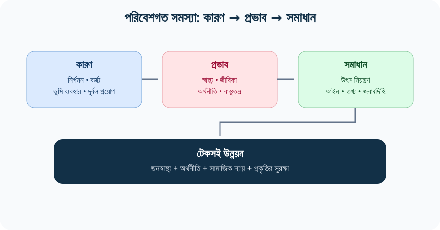

### Visual 2 — Air pollution management

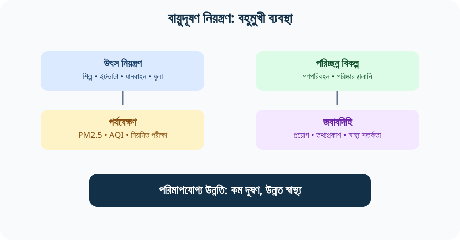

### Visual 3 — Climate adaptation and mitigation

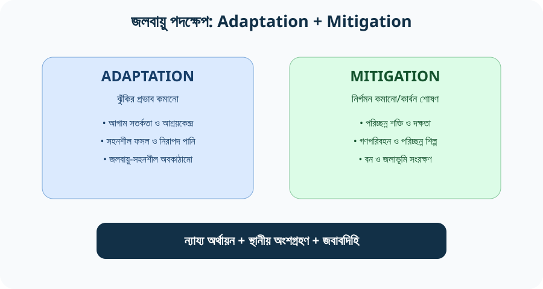

### Visual 4 — Waste hierarchy

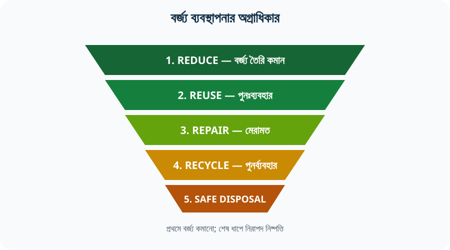

### Visual 5 — Environmental governance

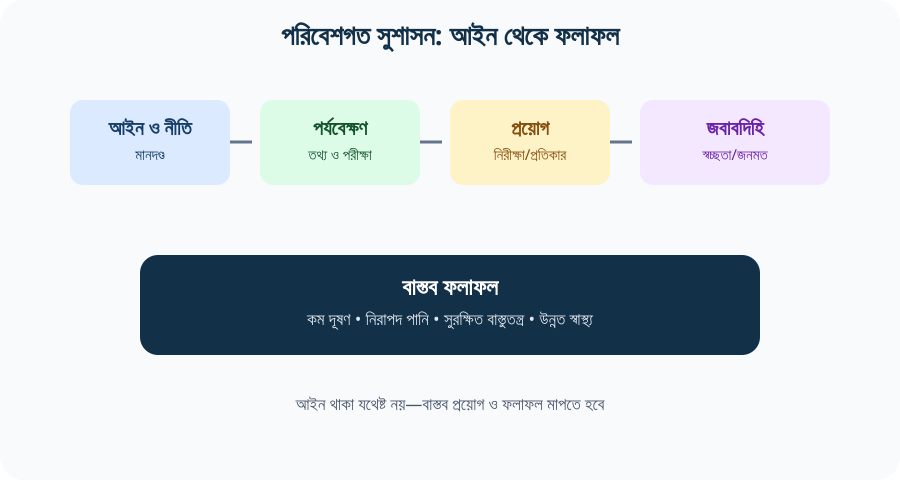

### Visual 6 — ECA framework

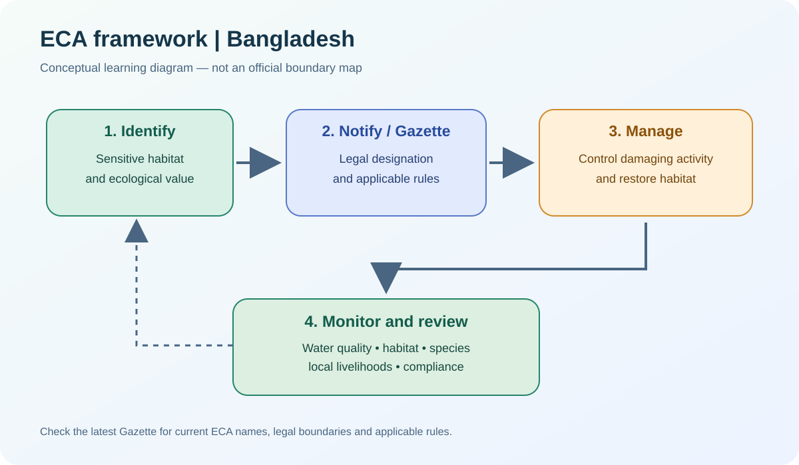

### Visual 7 — Environmental risk model

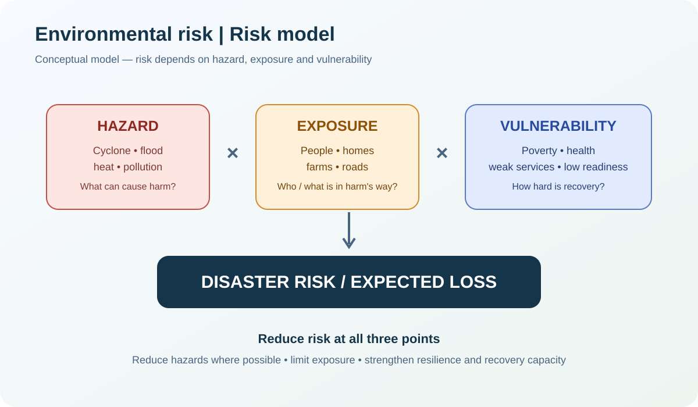

### Visual 8 — Climate action pathway

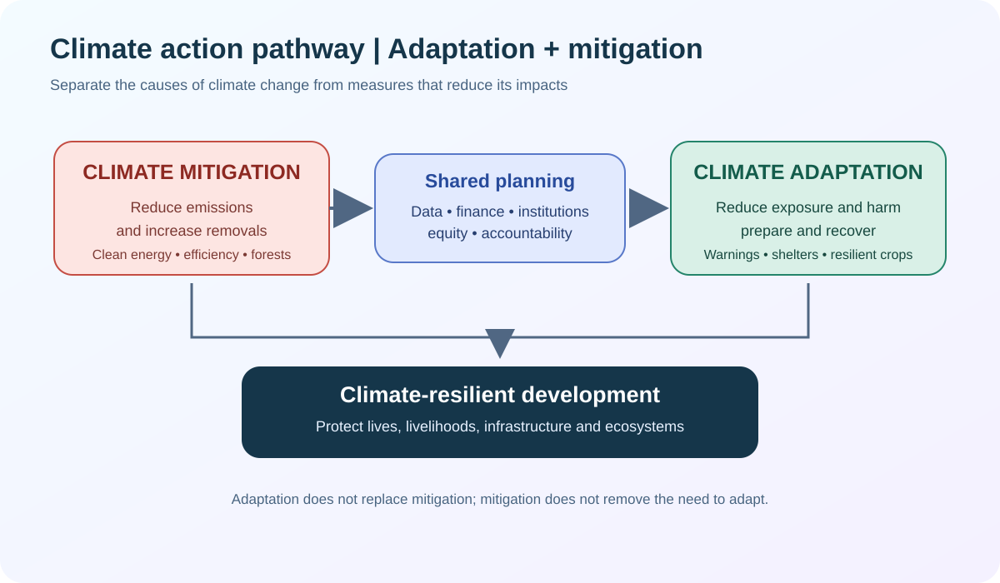

### Visual 9 — River pollution

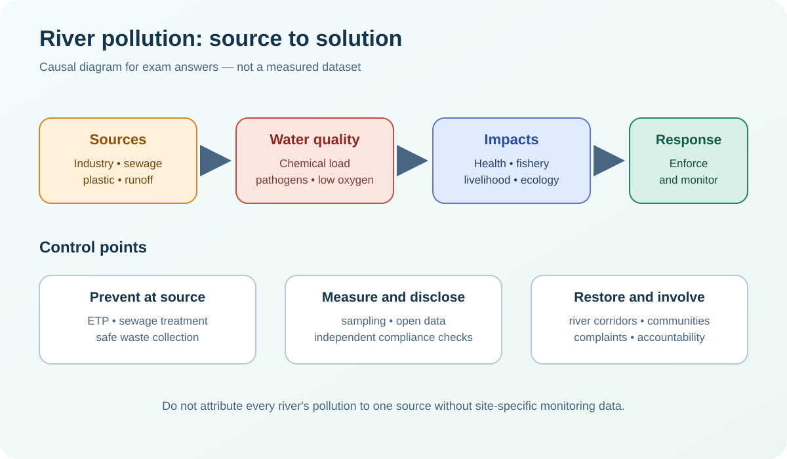

### Visual 10 — Circular economy

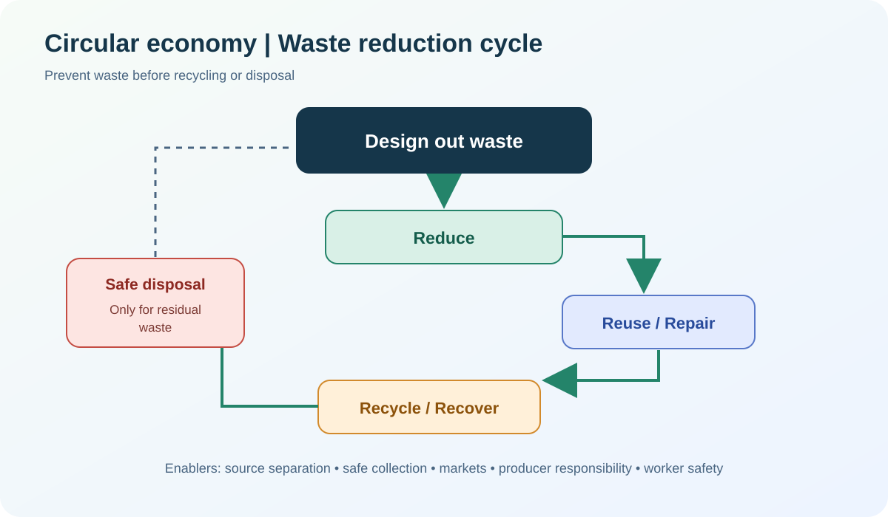

### Visual 11 — Ecosystem services

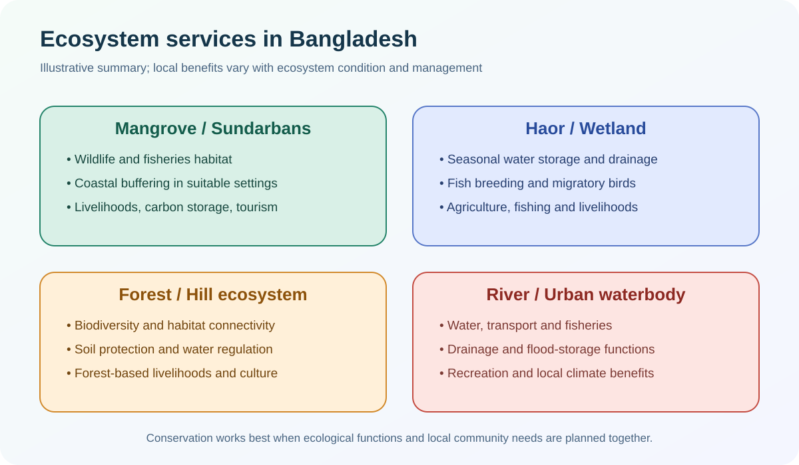

### Visual 12 — Environmental governance roadmap

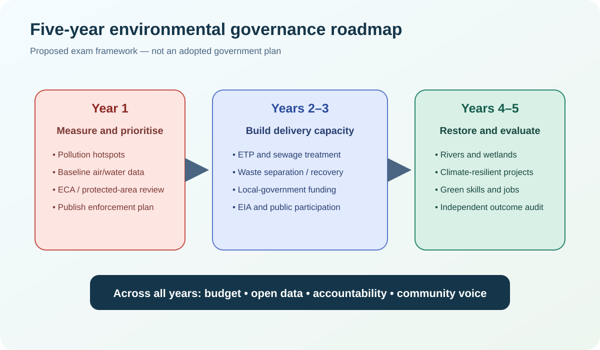

### Visual 13 — Official-data chart: terrestrial protected-area coverage

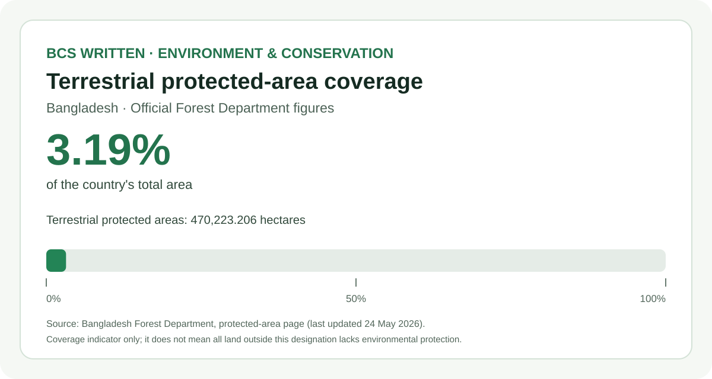

The Bangladesh Forest Department's protected-area page reports **470,223.206 hectares** of terrestrial protected areas, equivalent to **3.19% of Bangladesh's total area**; the page was last updated on **24 May 2026**. This is a source-backed single-indicator chart, not a comparison of all conservation mechanisms. For current designations and area definitions, consult the [official Forest Department page](https://bforest.gov.bd/pages/static-pages/6922e13b933eb65569e2b006).

### Official resources for additional maps and photographs

- **Protected areas:** [Bangladesh Forest Department — protected areas and official map](https://bforest.gov.bd/pages/static-pages/6922e13b933eb65569e2b006)
- **National parks:** [Forest Department / FAO Bangladesh Forest Information System map catalogue](https://bfis.bforest.gov.bd/library/map-of-national-park-locations-in-bangladesh/)
- **Forest and land-cover maps:** [Bangladesh Forest Information System — maps catalogue](https://bfis.bforest.gov.bd/library/category/maps/)
- **ECA and legal documents:** [Ministry of Environment, Forest and Climate Change — ECA resources](https://moef.gov.bd/pages/static-pages/694032cb35ce18e1c0562861)
- **Environment and pollution evidence:** [World Bank, Bangladesh Country Environmental Analysis 2023](https://www.worldbank.org/en/region/sar/publication/bangladesh-country-environmental-analysis-2023)
- **Climate adaptation:** [National Adaptation Plan 2023–2050, UNDP Bangladesh](https://www.undp.org/bangladesh/publications/national-adaptation-plan-bangladesh-2023-2050)

### Additional official risk maps — use the right map for the right claim

| Map / portal | What it helps you explain in a BCS answer | How to cite it safely |
|---|---|---|
| **Bangladesh Climate Risk Maps — BAMIS / Department of Agricultural Extension**: [official risk-map portal](https://www.bamis.gov.bd/risk-map/) | Cyclone, flash flood, river flood, storm surge, salinity intrusion, heat-wave, cold-wave and drought vulnerability layers. Use it to compare regional exposure and agricultural risk. | Name the exact layer, period/model if shown, and the portal access date. Do not treat a vulnerability layer as a forecast of a particular event. |
| **Risk Mapping for Climate Vulnerability of 487 Upazilas**: [World Bank-hosted technical map report (PDF)](https://thedocs.worldbank.org/en/doc/689601574710171334-0310022019/render/MazharulAziz.pdf) | A historical technical reference containing flood-status, inundation and vulnerability maps. It can illustrate the logic of spatial risk mapping. | This is a historical report, not a current live risk map. State its report context and do not present it as 2026 conditions. |
| **Bangladesh Forest Information System**: [BFIS map catalogue](https://bfis.bforest.gov.bd/library/category/maps/) | Forest inventory, national-park locations and conservation-related map resources. | Record the map title, publisher, publication year and scale where provided. |
| **Ecologically Critical Areas (ECA)**: [Ministry of Environment, Forest and Climate Change — law, rules and Gazette resources](https://moef.gov.bd/pages/static-pages/694032cb35ce18e1c0562861) | Legal status and conservation context for ECAs. | For an ECA boundary, name or designation date, consult the applicable Gazette; do not infer legal boundaries from a general protected-area map. |

> **Map-reading rule for written answers:** distinguish (1) an official legal/designation map, (2) a hazard or vulnerability map, (3) a conceptual revision diagram, and (4) a measured statistical chart. They answer different questions. Always note the publisher, date/period, legend and geographic scale where available.

> **Image-use note:** the embedded protected-area map is a real government-hosted map. The SVGs are original study diagrams, not official boundary maps or numerical datasets. Check licensing and attribution before reusing third-party images elsewhere.

[⬆️ উপরে ফিরুন](#top)

---

## ১৩. Previous BCS Question Analysis — 35th–47th BCS

**[Open full 35th–47th BCS PYQ Audit](./PYQ-ANALYSIS-35TH-47TH.md)** — এখানে direct Bangladesh Affairs questions, cross-paper themes এবং যাচাইয়ের সীমাবদ্ধতা আলাদা করে দেখানো হয়েছে।

### Direct Bangladesh Affairs themes verified in the accessible transcription

| BCS | Verified environment-related prompt | What to prepare |
|---|---|---|
| **35th** | Environmental degradation; river pollution; waste management; sea-level rise. | Definitions, cause–effect, waste hierarchy and coastal adaptation. |
| **38th** | Disaster management; Bangladesh's disaster-management capacity; pollution and natural disasters. | Disaster cycle, hazard–exposure–vulnerability and environmental governance. |
| **40th** | Green Economy appears in the Bangladesh Affairs short-note list. | Green growth, clean technology, resource efficiency and just transition. |
| **41st** | Forest-resource protection; sustainable development. | Forest ecosystem services, conservation and source-backed policy. |
| **43rd** | Environmental and nature-related challenges; disaster impacts on agriculture. | Integrated environmental risk and sector-specific adaptation. |
| **46th** | Environmental degradation causes/remedies; marine-resource use. | 20-mark essay structure, enforcement and sustainable marine management. |
| **47th** | Ecologically Critical Areas (ECA); sustainable-development priorities. | ECA definition, significance, examples, management and Gazette verification. |

> **Evidence limitation:** the accessible archive is a third-party transcription, not a complete authenticated BPSC-scan series. “Not verified” does not mean “never appeared”. See the full audit for coverage limits and sources.

### Priority themes

1. Environmental degradation, causes and remedies.
2. River pollution, water security and waste management.
3. Climate change, sea-level rise, disaster risk and adaptation.
4. Forest resources, biodiversity and the Sundarbans.
5. Sustainable development, green economy and environmental justice.
6. ECA, environmental law, EIA and implementation gaps.

### Question verbs and answer design

- **Define / What is:** precise definition + one Bangladesh example.
- **Describe:** key features + examples + significance.
- **Explain / Analyse:** causes → process → impacts → affected groups.
- **Evaluate:** achievements + limitations + evidence + alternatives.
- **Recommend:** institution + action + timeframe + measurable indicator.

[⬆️ উপরে ফিরুন](#top) · [Full PYQ audit](./PYQ-ANALYSIS-35TH-47TH.md) · [30 answered questions](./BCS-WRITTEN-QUESTION-BANK.md)

---

## ১৪. ৩৩টি BCS Written Practice Questions

**Answer support:** [৩০টি পূর্ণাঙ্গ model answer-সহ Question Bank খুলুন](./BCS-WRITTEN-QUESTION-BANK.md)। নিচের ৩৩টি prompt দ্রুত practice-এর জন্য; এগুলো সবই হুবহু বিগত BPSC প্রশ্ন—এমন দাবি করা হচ্ছে না।

### Core concepts
1. **Define sustainable development and explain its relevance to Bangladesh.** — টেকসই উন্নয়ন সংজ্ঞায়িত করে বাংলাদেশের জন্য এর গুরুত্ব ব্যাখ্যা করুন।
2. **Discuss the relationship between environmental quality and public health.** — পরিবেশের গুণমান ও জনস্বাস্থ্যের সম্পর্ক আলোচনা করুন।
3. **Explain the difference between climate change mitigation and adaptation with examples from Bangladesh.** — বাংলাদেশের উদাহরণসহ mitigation ও adaptation-এর পার্থক্য ব্যাখ্যা করুন।
4. **Why should environmental protection be considered an economic priority?** — পরিবেশ সুরক্ষাকে অর্থনৈতিক অগ্রাধিকার হিসেবে দেখা উচিত কেন?

### Air and water
5. **Analyse the causes and consequences of air pollution in Bangladesh.** — বাংলাদেশের বায়ুদূষণের কারণ ও ফলাফল বিশ্লেষণ করুন।
6. **Discuss the health and economic impacts of PM2.5 exposure.** — PM2.5-এর স্বাস্থ্য ও অর্থনৈতিক প্রভাব আলোচনা করুন।
7. **Suggest an integrated strategy for improving urban air quality.** — শহরের বায়ুর মান উন্নয়নে সমন্বিত কৌশল প্রস্তাব করুন।
8. **Discuss the major causes of river pollution in Bangladesh and propose solutions.** — নদী দূষণের কারণ ও সমাধান আলোচনা করুন।
9. **Explain the public-health implications of arsenic contamination in groundwater.** — ভূগর্ভস্থ পানিতে আর্সেনিকের জনস্বাস্থ্যগত প্রভাব ব্যাখ্যা করুন।
10. **How can Bangladesh strengthen water security through integrated water management?** — সমন্বিত পানি ব্যবস্থাপনার মাধ্যমে পানির নিরাপত্তা কীভাবে বাড়ানো যায়?

### Climate, coast and biodiversity
11. **Analyse the major climate risks facing Bangladesh.** — বাংলাদেশের প্রধান জলবায়ু ঝুঁকি বিশ্লেষণ করুন।
12. **Evaluate the role of the National Adaptation Plan 2023–2050.** — National Adaptation Plan 2023–2050-এর ভূমিকা মূল্যায়ন করুন।
13. **Discuss the importance of the Sundarbans for biodiversity and coastal resilience.** — জীববৈচিত্র্য ও উপকূলীয় সহনশীলতায় সুন্দরবনের গুরুত্ব আলোচনা করুন।
14. **Explain how wetland degradation affects livelihoods and disaster risk.** — জলাভূমির অবক্ষয় জীবিকা ও দুর্যোগঝুঁকিকে কীভাবে প্রভাবিত করে?
15. **Discuss the main threats to biodiversity in Bangladesh and measures for conservation.** — বাংলাদেশের জীববৈচিত্র্যের হুমকি ও সংরক্ষণ ব্যবস্থা আলোচনা করুন।
16. **Evaluate nature-based solutions for flood and coastal risk reduction.** — বন্যা ও উপকূলীয় ঝুঁকি কমাতে প্রকৃতিভিত্তিক সমাধান মূল্যায়ন করুন।
17. **Explain the links between salinity intrusion, food security and migration.** — লবণাক্ততা, খাদ্যনিরাপত্তা ও অভিবাসনের সম্পর্ক ব্যাখ্যা করুন.

### Waste, cities and governance
18. **Discuss the challenges of solid-waste and plastic management in Bangladesh.** — কঠিন বর্জ্য ও প্লাস্টিক ব্যবস্থাপনার চ্যালেঞ্জ আলোচনা করুন।
19. **Explain the waste hierarchy and the concept of a circular economy.** — বর্জ্য ব্যবস্থাপনার স্তর ও Circular Economy ব্যাখ্যা করুন।
20. **Analyse the environmental challenges of rapid urbanisation.** — দ্রুত নগরায়ণের পরিবেশগত চ্যালেঞ্জ বিশ্লেষণ করুন।
21. **Discuss the role of Environmental Impact Assessment in sustainable development.** — টেকসই উন্নয়নে EIA-এর ভূমিকা আলোচনা করুন।
22. **Evaluate the effectiveness of the Bangladesh Environment Conservation Act, 1995, in principle and implementation.** — নীতিগত কাঠামো ও বাস্তবায়নের আলোকে ১৯৯৫ সালের পরিবেশ সংরক্ষণ আইন মূল্যায়ন করুন।
23. **Why is coordination among environmental institutions important?** — পরিবেশগত প্রতিষ্ঠানগুলোর সমন্বয় কেন গুরুত্বপূর্ণ?
24. **Discuss environmental justice and its relevance to low-income communities.** — পরিবেশগত ন্যায় ও নিম্নআয়ের জনগোষ্ঠীর প্রাসঙ্গিকতা আলোচনা করুন।
25. **Suggest ways to improve public participation and environmental transparency.** — জনঅংশগ্রহণ ও পরিবেশগত স্বচ্ছতা বাড়ানোর উপায় প্রস্তাব করুন।

### Policy and essay prompts
26. **“Environmental degradation is both a development problem and a public-health problem.” Discuss.** — “পরিবেশের অবক্ষয় উন্নয়ন ও জনস্বাস্থ্য—উভয়ের সমস্যা।” আলোচনা করুন।
27. **Evaluate the opportunities for green growth in Bangladesh.** — বাংলাদেশে Green Growth-এর সম্ভাবনা মূল্যায়ন করুন।
28. **Discuss the role of renewable energy and energy efficiency in climate action.** — জলবায়ু মোকাবিলায় নবায়নযোগ্য শক্তি ও জ্বালানি দক্ষতার ভূমিকা আলোচনা করুন।
29. **How can climate finance be used transparently and equitably?** — জলবায়ু অর্থায়ন কীভাবে স্বচ্ছ ও ন্যায্যভাবে ব্যবহার করা যায়?
30. **Discuss the role of local government in environmental management.** — পরিবেশ ব্যবস্থাপনায় স্থানীয় সরকারের ভূমিকা আলোচনা করুন।
31. **Analyse the links between environmental risk, poverty and gender.** — পরিবেশগত ঝুঁকি, দারিদ্র্য ও লিঙ্গের সম্পর্ক বিশ্লেষণ করুন।
32. **Suggest a practical five-year roadmap for improving environmental governance in Bangladesh.** — বাংলাদেশে পরিবেশগত সুশাসন উন্নয়নে বাস্তবসম্মত পাঁচ বছরের রোডম্যাপ প্রস্তাব করুন।
33. **“Conservation and economic development can reinforce each other if institutions are accountable.” Discuss with examples.** — জবাবদিহিমূলক প্রতিষ্ঠান থাকলে সংরক্ষণ ও অর্থনৈতিক উন্নয়ন পরস্পরকে শক্তিশালী করতে পারে—উদাহরণসহ আলোচনা করুন।

---

## ১৫. BCS Written Answer Strategy — ৫, ১০ ও ২০ নম্বর

### ৫ নম্বর
- সংজ্ঞা/প্রেক্ষাপট ১–২ বাক্যে।
- ৩টি মূল পয়েন্ট বা উদাহরণ।
- একটি প্রাসঙ্গিক আইন/নীতি/প্রতিষ্ঠান।
- এক বাক্যে তাৎপর্য।

### ১০ নম্বর
1. ভূমিকা ও মূল বক্তব্য।
2. কারণ/বর্তমান অবস্থা।
3. স্বাস্থ্য, অর্থনীতি বা বাস্তুতন্ত্রের প্রভাব।
4. আইন/নীতি ও বাস্তবায়নের সীমাবদ্ধতা।
5. ৩–৪টি বাস্তবসম্মত সুপারিশ।
6. সংক্ষিপ্ত উপসংহার।

### ২০ নম্বর
1. **ভূমিকা:** সমস্যার সংজ্ঞা ও বাংলাদেশের প্রেক্ষাপট।
2. **প্রমাণ:** সরকারি/প্রাতিষ্ঠানিক রিপোর্ট, বছরসহ।
3. **কারণ:** কাঠামোগত, অর্থনৈতিক, আচরণগত ও শাসনগত কারণ।
4. **প্রভাব:** স্বাস্থ্য, জীবিকা, উৎপাদনশীলতা, বৈষম্য ও বাস্তুতন্ত্র।
5. **নীতিগত মূল্যায়ন:** আইন, প্রতিষ্ঠান, বাস্তবায়নের ঘাটতি।
6. **সমাধান:** তাৎক্ষণিক, মধ্যমেয়াদি ও দীর্ঘমেয়াদি পদক্ষেপ।
7. **জবাবদিহি:** কে করবে, কীভাবে মাপবে, তথ্য কোথায় প্রকাশ হবে।
8. **উপসংহার:** পরিবেশ ও উন্নয়নকে একসঙ্গে দেখুন।

### সাধারণ ভুল
- পুরোনো পরিসংখ্যানকে বর্তমান বলে লেখা।
- রিপোর্টের হিসাবের বছর বাদ দেওয়া।
- সব পরিবেশগত সমস্যার সমাধান “গাছ লাগানো” বলা।
- আইন আছে মানেই কার্যকর প্রয়োগ হচ্ছে ধরে নেওয়া।
- জলবায়ু adaptation ও mitigation গুলিয়ে ফেলা।
- প্রমাণ ছাড়া নির্দিষ্ট দূষণের উৎসের শতকরা ভাগ লেখা।
- উদ্ধৃতি বা slogan-কে যুক্তির বিকল্প বানানো।

---

## ১৬. One-page Revision — শেষ মুহূর্তে

### ছয়টি কেন্দ্রীয় থিম
1. **Air:** নির্গমন → PM2.5 → স্বাস্থ্য/অর্থনীতি → উৎস নিয়ন্ত্রণ।
2. **Water:** শিল্প/পয়ঃবর্জ্য/আর্সেনিক → নিরাপদ পানি → পরীক্ষা ও শোধন।
3. **Climate:** hazard + exposure + vulnerability → adaptation + mitigation।
4. **Biodiversity:** habitat → ecosystem services → community-led conservation।
5. **Waste:** reduce → reuse → repair → recycle → safe disposal।
6. **Governance:** আইন → তথ্য → প্রয়োগ → স্বচ্ছতা → জবাবদিহি।

### ১০টি self-test
1. টেকসই উন্নয়নের তিনটি মাত্রা কী?
2. PM2.5 জনস্বাস্থ্যের জন্য কেন গুরুত্বপূর্ণ?
3. বায়ুদূষণ নিয়ন্ত্রণে শুধু ব্যক্তিগত সচেতনতা যথেষ্ট নয় কেন?
4. আর্সেনিক দূষণ ও শিল্পবর্জ্য দূষণের পার্থক্য কী?
5. জলবায়ু adaptation ও mitigation-এর দুটি করে উদাহরণ দিন।
6. সুন্দরবন কীভাবে উপকূলীয় সহনশীলতায় ভূমিকা রাখে?
7. Circular Economy কীভাবে বর্জ্য কমাতে পারে?
8. পরিবেশ সংরক্ষণ আইন ও আইন প্রয়োগের মধ্যে পার্থক্য কী?
9. পরিবেশগত ন্যায় বলতে কী বোঝায়?
10. একটি পরিবেশ নীতির সাফল্য মাপতে কোন সূচক ব্যবহার করবেন?

---

## ১৭. Full Source Register — সরকারি ও প্রাতিষ্ঠানিক উৎস

**[S1] Bangladesh Public Service Commission (BPSC).** *Syllabus for BCS (Written) Examination*, Bangladesh Affairs (Compulsory), Subject Code 005, Unit 5.  
https://bpsc.portal.gov.bd/sites/default/files/files/bpsc.portal.gov.bd/page/732e9da5_9514_4252_9a33_119f8c000cc5/SYLLABUS%20FOR%20BCS%20%28WRITTEN%29%20EXAMINATION.pdf

**[S2] Laws of Bangladesh.** *Bangladesh Environment Conservation Act, 1995 (Act No. 1 of 1995).*  
https://bdlaws.minlaw.gov.bd/act-print-791.html

**[S3] Department of Environment, Government of Bangladesh.** Environment policies and laws page, including National Environment Policy 2018, Bangladesh Biological Diversity Act 2017, Environment Court Act 2010 and Environment Conservation Act amendments.  
https://doe.gov.bd/pages/static-pages/6922e0de933eb65569e28f32

**[S4] Ministry of Environment, Forest and Climate Change / Government of Bangladesh.** *National Adaptation Plan of Bangladesh (2023–2050).*  
https://www.undp.org/bangladesh/publications/national-adaptation-plan-bangladesh-2023-2050  
Official ministry notice: https://moefcc.gov.bd/pages/news/6940312ec4774958d7b41313

**[S5] World Bank.** *Bangladesh Country Environmental Analysis 2023.* Pollution, environmental health risks, governance and policy recommendations.  
https://www.worldbank.org/en/region/sar/publication/bangladesh-country-environmental-analysis-2023  
Related official press release (28 March 2024): https://www.worldbank.org/en/news/press-release/2024/03/28/addressing-environmental-pollution-is-critical-for-bangladesh-s-growth-and-development

**[S6] UNDP Bangladesh.** *National Adaptation Plan of Bangladesh (2023–2050)*, published page and report.  
https://www.undp.org/bangladesh/publications/national-adaptation-plan-bangladesh-2023-2050

**[S7] Asian Development Bank, Law and Policy Reform Program.** *Bangladesh Climate Change Strategy and Action Plan 2009.*  
https://lpr.adb.org/resource/bangladesh-climate-change-strategy-and-action-plan-2009

**[S8] World Bank.** *Country Climate and Development Report for Bangladesh* — climate risks, mitigation opportunities and development context.  
https://www.worldbank.org/en/news/feature/2022/10/31/key-highlights-country-climate-and-development-report-for-bangladesh

**[S9] Bangladesh Forest Department, Government of Bangladesh.** Protected-area page and official map resource. The linked map file is dated December 2024; consult the current official list and Gazette for present designations.  
https://bforest.gov.bd/pages/static-pages/6922e13b933eb65569e2b006

**[S10] Ministry of Environment, Forest and Climate Change.** ECA rules and documents; use the applicable Gazette for legal boundaries and current designations.  
https://moef.gov.bd/pages/static-pages/694032cb35ce18e1c0562861

**[S11] United Nations / IPCC / UN-Water.** Sustainable Development Goals, UNFCCC, IPCC AR6 and water-development source texts used in the quotation bank.  
https://sdgs.un.org/goals · https://www.ipcc.ch/report/ar6/syr/ · https://www.unwater.org/publications/un-world-water-development-report-2015

### উৎস ব্যবহারের নিয়ম
- পরিবেশগত আইন/নীতির ক্ষেত্রে সরকারি আইন ও মন্ত্রণালয়ের উৎস অগ্রাধিকার দিন।
- World Bank/UNDP রিপোর্টে উল্লেখিত সংখ্যা ব্যবহার করলে **প্রতিবেদনের বছর, হিসাবের সময়কাল ও সূচক** লিখুন।
- ২০২৩-এর রিপোর্টে থাকা ২০১৯ সালের অর্থনৈতিক হিসাবকে ২০২৬ সালের বর্তমান GDP হিসাব হিসেবে উপস্থাপন করবেন না।
- প্রশ্নসংকলনের থিম আর মূল BPSC প্রশ্নপত্র এক নয়; exact wording/year যাচাই করুন।
- এই অধ্যায়ের SVG diagrams revision-এর জন্য তৈরি; সেগুলো source data বা official government infographic নয়।

[⬆️ উপরে ফিরুন](#top) · [English Quotations + Sources](./QUOTATIONS.md) · [৩০টি Answered Questions](./BCS-WRITTEN-QUESTION-BANK.md) · [35th–47th PYQ Audit](./PYQ-ANALYSIS-35TH-47TH.md) · [PYQ-Based Model Essays](./PYQ-BASED-ESSAYS.md)
