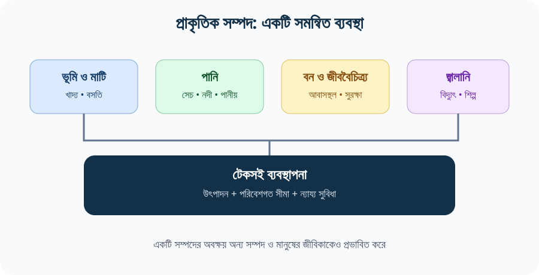
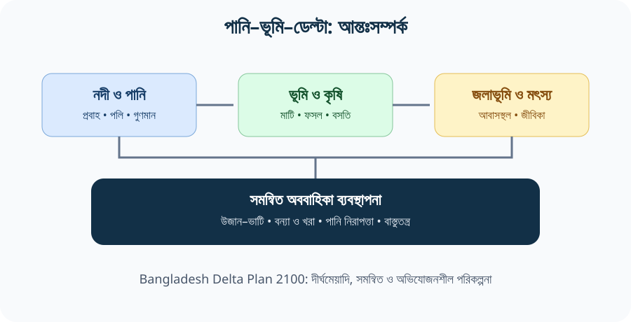
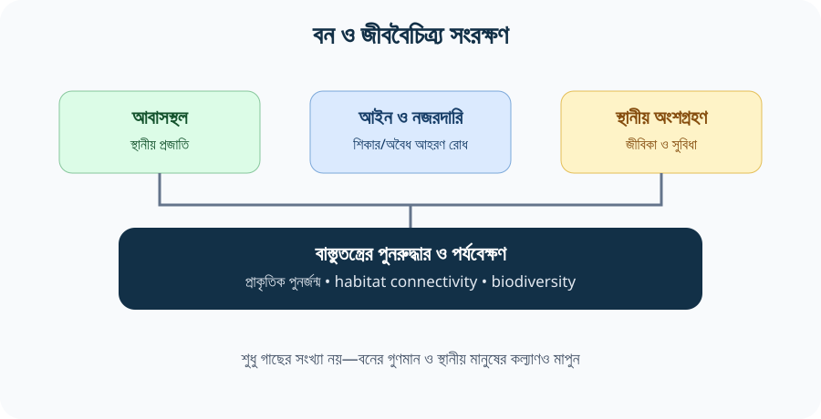
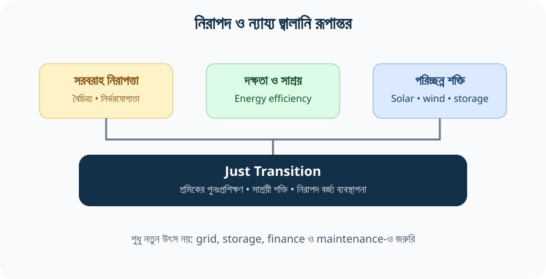
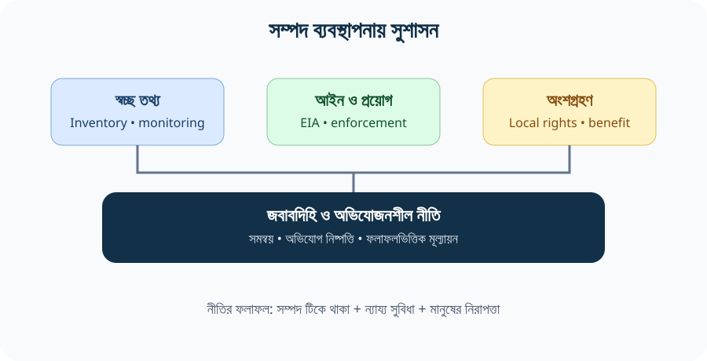

# Chapter 06 — বাংলাদেশের প্রাকৃতিক সম্পদ ও টেকসই ব্যবস্থাপনা
## Natural Resources of Bangladesh: Sustainable Harnessing and Management

> **BCS Written · Bangladesh Affairs · Subject Code 005 · 200 marks · Official Unit 6**  
> **ভাষা:** সহজ, প্রমিত বাংলা; গুরুত্বপূর্ণ English terms প্রথম ব্যবহারে অর্থসহ।  
> **পাঠের বিন্যাস:** ধারণা → সম্পদভিত্তিক আলোচনা → সমস্যা ও কারণ → নীতিগত সমাধান → বিগত প্রশ্নের theme analysis → প্রবন্ধ → ৩৩টি অনুশীলনী → Source Register.  
> **Source review:** ২১ অক্টোবর ২০২৬। পরিবর্তনশীল সংখ্যা ব্যবহারের ক্ষেত্রে reference year ও সংজ্ঞা উল্লেখ করতে হবে।

[← Bangladesh Affairs-এর মূল সূচি](../README.md) · [Chapter 01 — ভূগোল](../Chapter-01/README.md) · [Chapter 04 — অর্থনীতি, সমাজ ও সংস্কৃতি](../Chapter-04/README.md) · [📚 Source-backed Exam Lines / Key facts](./QUOTATIONS.md)

> 📱 **Mobile-friendly:** এই অধ্যায়ের diagrams SVG image হিসেবে দেওয়া হয়েছে। মোবাইলে ছবি না দেখালে visual-এর link খুলুন। দীর্ঘ table-এর ক্ষেত্রে ফোনে horizontal scroll প্রয়োজন হতে পারে।

> [!NOTE]
> **পড়ার সূত্র:** সম্পদ কী → কোথায়/কীভাবে পাওয়া যায় → অর্থনীতিতে ভূমিকা → অতিরিক্ত আহরণে ক্ষতি → টেকসই ব্যবস্থাপনা → বাস্তবায়নের বাধা → পরিমাপযোগ্য সুপারিশ। BCS Written-এ শুধু সম্পদের তালিকা লিখবেন না; বিশ্লেষণ, trade-off এবং নীতি দেখাবেন।

## রঙের সংকেত — Reading Colour Code

| সংকেত | কী শিখবেন |
|---|---|
| 🟨 **Key Fact** | সংজ্ঞা, আইন, পরিকল্পনার সাল বা নির্ভরযোগ্য সংখ্যা |
| 🟩 **Recall Cue** | দ্রুত মনে রাখার সূত্র |
| 🟦 **Source Evidence** | সরকারি/প্রাতিষ্ঠানিক উৎস |
| 🟪 **Critical Note** | তথ্যের সীমাবদ্ধতা, ঝুঁকি বা সতর্কতা |

## বিষয়সূচি — সরাসরি অংশে যান

| শুরু ও মূল ধারণা | সম্পদভিত্তিক আলোচনা | প্রশ্ন, প্রবন্ধ ও উৎস |
|---|---|---|
| [শিখনফল ও সিলেবাস](#start) | [ভূমি ও মৃত্তিকা](#land) | [Previous BCS Question Analysis](#pyq) |
| [পরিভাষা](#keywords) | [পানি ও নদীসম্পদ](#water) | [গুরুত্বপূর্ণ প্রবন্ধ](#essays) |
| [প্রাকৃতিক সম্পদের শ্রেণিবিভাগ](#classification) | [বন ও জীববৈচিত্র্য](#forest) | [৩৩টি Written Practice Questions](#questions) |
| [জাতীয় সম্পদ-সম্পর্ক](#framework) | [মৎস্য ও জলজ সম্পদ](#fisheries) | [Answer-writing Strategy](#strategy) |
| [দ্রুত Visual Revision](#visuals) | [খনিজ ও জ্বালানি](#energy) | [One-page Revision](#revision) |
| [সুশাসন ও আইন](#governance) | [নবায়নযোগ্য শক্তি ও Circular Economy](#renewables) | [Source Register](#sources) |
| [Accuracy & Limitations](#accuracy) | [টেকসই ব্যবস্থাপনার রোডম্যাপ](#roadmap) | [Source-backed Lines](./QUOTATIONS.md) |

---

## ১. BPSC Syllabus Mapping ও শিখনফল

BPSC-এর *Syllabus for BCS (Written) Examination*, Bangladesh Affairs (Compulsory), Subject Code 005-এর ৬ নম্বর বিষয়টি হলো **“Natural resources of Bangladesh with focus on their sustainable harnessing and management.”** অর্থাৎ প্রশ্নের কেন্দ্রে শুধু প্রাকৃতিক সম্পদের নাম বা অবস্থান নয়; সম্পদ কীভাবে দায়িত্বশীলভাবে ব্যবহার, সংরক্ষণ ও ভবিষ্যৎ প্রজন্মের জন্য পরিচালনা করা যায়, সেটিও থাকবে। [S1]

### অধ্যায় শেষে আপনি পারবেন

1. প্রাকৃতিক সম্পদ, renewable/non-renewable, ecosystem services ও sustainability ব্যাখ্যা করতে।
2. বাংলাদেশের ভূমি, মাটি, পানি, বন, জীববৈচিত্র্য, মৎস্য, গ্যাস, কয়লা ও নবায়নযোগ্য শক্তির গুরুত্ব আলোচনা করতে।
3. অতিরিক্ত আহরণ, দূষণ, জলবায়ু পরিবর্তন, ভূমি-ব্যবহারের পরিবর্তন ও দুর্বল ব্যবস্থাপনার কারণ–ফল বিশ্লেষণ করতে।
4. সম্পদ ব্যবস্থাপনায় সরকারি প্রতিষ্ঠান, আইন, স্থানীয় জনগোষ্ঠী ও বেসরকারি খাতের ভূমিকা মূল্যায়ন করতে।
5. বাংলাদেশ ডেল্টা প্ল্যান ২১০০, পরিবেশ সংরক্ষণ, ন্যায্য সুবিধা বণ্টন ও আন্তঃপ্রজন্ম ন্যায়ের সঙ্গে সম্পদ ব্যবস্থাপনাকে যুক্ত করতে।
6. ৫/১০/২০ নম্বরের প্রশ্নে ভূমিকা, যুক্তি, প্রমাণ, সীমাবদ্ধতা, সুপারিশ ও উপসংহারসহ উত্তর লিখতে।

### এক নজরে গুরুত্বপূর্ণ ধারণা

| ধারণা | পরীক্ষায় কীভাবে ব্যবহার করবেন |
|---|---|
| **Renewable resources** | পুনরুৎপাদন/পুনর্ভরণ সম্ভব; কিন্তু ব্যবহারের গতি পুনরুদ্ধারের গতিকে ছাড়ালে নিঃশেষ বা অবক্ষয় হতে পারে |
| **Non-renewable resources** | ভূতাত্ত্বিক সময় ধরে তৈরি; যেমন প্রাকৃতিক গ্যাস, কয়লা, খনিজ |
| **Ecosystem services** | খাদ্য, পানি, কাঠ, পরাগায়ন, বন্যা-নিয়ন্ত্রণ, কার্বন ধারণ ও সাংস্কৃতিক মূল্য |
| **Sustainable use** | বর্তমানের প্রয়োজন পূরণ, কিন্তু ভবিষ্যৎ প্রজন্মের সক্ষমতা ক্ষুণ্ন না করা |
| **Resource governance** | আইন, প্রতিষ্ঠান, তথ্য, স্বচ্ছতা, স্থানীয় অংশগ্রহণ ও জবাবদিহির মাধ্যমে সম্পদ পরিচালনা |
| **Natural capital** | প্রকৃতির সম্পদভিত্তি, যা অর্থনীতি ও মানুষের কল্যাণে অবদান রাখে |
| **Carrying capacity** | পরিবেশের পুনরুদ্ধারক্ষমতা নষ্ট না করে যে মাত্রার চাপ বহন করা যায় |
| **Circular economy** | পণ্য/উপকরণ পুনর্ব্যবহার, মেরামত, পুনঃপ্রক্রিয়াকরণ ও বর্জ্য হ্রাস |

> [!IMPORTANT]
> **মুখস্থের সূত্র:** **সম্পদ → সেবা → চাপ → শাসন → পুনরুদ্ধার**। প্রতিটি সম্পদের প্রবন্ধে এই পাঁচটি স্তর দেখাতে পারলে উত্তর বর্ণনামূলক না থেকে বিশ্লেষণধর্মী হবে।

---

## ২. Key Terms — বাংলা অর্থসহ

| English term | সহজ বাংলা অর্থ | পরীক্ষায় প্রয়োগ |
|---|---|---|
| Natural resource | প্রকৃতিতে বিদ্যমান এবং মানুষের কাজে লাগতে পারে এমন উপাদান/প্রক্রিয়া | ভূমি, পানি, বন, গ্যাস, মাছ |
| Sustainable development | বর্তমানের চাহিদা পূরণ করে ভবিষ্যৎ প্রজন্মের সুযোগ নষ্ট না করা | অর্থনীতি–সমাজ–পরিবেশের ভারসাম্য |
| Resource depletion | সম্পদের পরিমাণ/গুণমান কমে যাওয়া | ভূগর্ভস্থ পানি বা গ্যাসের অতিরিক্ত উত্তোলন |
| Degradation | সম্পদের উৎপাদনক্ষমতা বা পরিবেশগত মানের অবনতি | মাটির উর্বরতা হ্রাস |
| Conservation | সম্পদ ও বাস্তুতন্ত্র রক্ষা এবং দায়িত্বশীল ব্যবহার | বন সংরক্ষণ, জলাভূমি রক্ষা |
| Restoration | ক্ষতিগ্রস্ত বাস্তুতন্ত্রের কার্যকারিতা পুনরুদ্ধার | ম্যানগ্রোভ পুনরুদ্ধার |
| Watershed / catchment | যে এলাকায় বৃষ্টির পানি নির্দিষ্ট নদী/জলাশয়ে প্রবাহিত হয় | উজান–ভাটির সমন্বিত ব্যবস্থাপনা |
| Environmental flow | নদীর পরিবেশগত কাজ বজায় রাখতে প্রয়োজনীয় প্রবাহের ধরন/পরিমাণ | নদীকে শুধু পানি পরিবহনের নালা হিসেবে না দেখা |
| Groundwater recharge | মাটির মধ্য দিয়ে ভূগর্ভস্থ জলাধারে পানি প্রবেশ | বৃষ্টির পানি সংরক্ষণ ও recharge zone রক্ষা |
| Biodiversity | জীব, জিন ও বাস্তুতন্ত্রের বৈচিত্র্য | সুন্দরবন, হাওর, পাহাড়ি বন |
| Ecosystem services | বাস্তুতন্ত্র থেকে পাওয়া প্রত্যক্ষ ও পরোক্ষ সুবিধা | মাছ, পরাগায়ন, বন্যা-প্রশমন, কার্বন ধারণ |
| EIA | Environmental Impact Assessment; পরিবেশগত প্রভাব মূল্যায়ন | প্রকল্পের আগে সম্ভাব্য ক্ষতি বিশ্লেষণ |
| Strategic Environmental Assessment | নীতি/পরিকল্পনা/কর্মসূচির সামগ্রিক পরিবেশগত প্রভাব যাচাই | একক প্রকল্পের বাইরে উন্নয়ন পরিকল্পনা মূল্যায়ন |
| Polluter pays principle | দূষণকারীকে দূষণ-নিয়ন্ত্রণ ও ক্ষতির ব্যয় বহন করতে হবে | শিল্পবর্জ্য নিয়ন্ত্রণ |
| Precautionary principle | গুরুতর/অপরিবর্তনীয় ক্ষতির ঝুঁকিতে পূর্ণ বৈজ্ঞানিক নিশ্চয়তা না থাকলেও সতর্ক পদক্ষেপ | ঝুঁকিপূর্ণ প্রকল্প/প্রজাতি |
| Intergenerational equity | ভবিষ্যৎ প্রজন্মের অধিকার ও সুযোগ বিবেচনা | খনিজ ও জীববৈচিত্র্য সংরক্ষণ |
| Common-pool resource | একাধিক ব্যবহারকারী ভাগ করে নেয়, ব্যবহার নিয়ন্ত্রণ কঠিন | মৎস্য, বন, ভূগর্ভস্থ পানি |
| Blue economy | সমুদ্রসম্পদকে পরিবেশ রক্ষা করে টেকসইভাবে কাজে লাগানো | মৎস্য, বন্দর, সামুদ্রিক গবেষণা |
| Nature-based solutions | প্রকৃতির প্রক্রিয়া ব্যবহার করে ঝুঁকি কমানো | ম্যানগ্রোভ দিয়ে ঢেউ/ঝড়ের প্রভাব প্রশমন |
| Circular economy | বর্জ্য ও নতুন কাঁচামালের চাহিদা কমিয়ে পণ্য/উপকরণকে ব্যবস্থায় ধরে রাখা | পুনর্ব্যবহার, মেরামত, recycling |
| Just transition | জ্বালানি/শিল্প পরিবর্তনের ব্যয় ও সুযোগ শ্রমিক-দরিদ্রদের ওপর অন্যায্যভাবে না চাপানো | জীবাশ্ম জ্বালানি থেকে পরিচ্ছন্ন শক্তিতে রূপান্তর |

**উৎস:** BPSC syllabus; GED, *Bangladesh Delta Plan 2100*; Department of Environment policy/legal resources; UN Sustainable Development Goals. [S1–S5]

---

## ৩. বাংলাদেশের প্রাকৃতিক সম্পদের শ্রেণিবিভাগ

প্রাকৃতিক সম্পদকে সাধারণত নবায়নযোগ্য ও অনবায়নযোগ্য ভাগে ভাগ করা হয়। তবে “নবায়নযোগ্য” মানে অবিরাম বা সীমাহীন নয়। বন কাটার হার বন পুনরুদ্ধারের হার ছাড়িয়ে গেলে, অথবা ভূগর্ভস্থ পানি recharge-এর চেয়ে বেশি উত্তোলিত হলে, নবায়নযোগ্য সম্পদও কার্যত সংকটাপন্ন হয়ে পড়ে।

| সম্পদের ধরন | বাংলাদেশের উদাহরণ | প্রধান ব্যবহার | প্রধান ঝুঁকি |
|---|---|---|---|
| ভূমি ও মাটি | কৃষিজমি, চর, পাহাড়ি ঢাল, উপকূলীয় মাটি | খাদ্য, বসতি, অবকাঠামো | জমির রূপান্তর, ক্ষয়, লবণাক্ততা, দূষণ |
| পানি | নদী, হাওর, বিল, ভূগর্ভস্থ পানি, বৃষ্টি | পানীয়, সেচ, মৎস্য, নৌপরিবহন | দূষণ, মৌসুমি ঘাটতি, অতিরিক্ত উত্তোলন |
| বন | সুন্দরবন, পাহাড়ি ও শালবন, উপকূলীয় বনায়ন | জীববৈচিত্র্য, কাঠ/অ-কাঠ সম্পদ, সুরক্ষা | বনভূমি রূপান্তর, অগ্নিকাণ্ড, অবৈধ আহরণ |
| মৎস্য ও জলজ সম্পদ | নদী, হাওর, বিল, উপকূল ও সামুদ্রিক এলাকা | খাদ্য, আয়, কর্মসংস্থান | অতিরিক্ত আহরণ, আবাসস্থল ধ্বংস, দূষণ |
| জীববৈচিত্র্য | বন্যপ্রাণী, উদ্ভিদ, জলজ ও স্থলজ প্রজাতি | বাস্তুতন্ত্রের স্থিতি, গবেষণা, পর্যটন | আবাসস্থল খণ্ডিত হওয়া, অবৈধ বাণিজ্য |
| জীবাশ্ম জ্বালানি | প্রাকৃতিক গ্যাস, কয়লা, তেল/কনডেনসেট | বিদ্যুৎ, শিল্প, সার, পরিবহন | সীমিত মজুত, দূষণ, আমদানি-ঝুঁকি |
| খনিজ ও নির্মাণসামগ্রী | চুনাপাথর, কঠিন শিলা, বালু, পাথর ইত্যাদি | নির্মাণ ও শিল্প | অনিয়ন্ত্রিত উত্তোলন, ভূমি/নদী ক্ষতি |
| নবায়নযোগ্য শক্তি | সৌর, বায়ু, বায়োগ্যাস, ক্ষুদ্র জলবিদ্যুৎ সম্ভাবনা | বিদ্যুৎ ও তাপ | জমি, grid, অর্থায়ন ও সংরক্ষণ সমস্যা |

### কেন প্রাকৃতিক সম্পদ বাংলাদেশের জন্য কৌশলগত?

বাংলাদেশের কৃষি, শিল্প, বিদ্যুৎ, খাদ্যনিরাপত্তা, নগরায়ণ, জনস্বাস্থ্য এবং রপ্তানি সরবরাহ-শৃঙ্খল প্রকৃতির ওপর নির্ভরশীল। নদী ও জলাভূমি মাছ, সেচ ও জীবিকা দেয়; বন কার্বন ধারণ, মাটি ও উপকূল রক্ষা এবং জীববৈচিত্র্য ধরে রাখতে সাহায্য করে; গ্যাস বিদ্যুৎ ও শিল্পে ভূমিকা রাখে; জমি খাদ্য ও আবাসনের ভিত্তি। এই আন্তঃনির্ভরতার কারণে একটি সম্পদের অব্যবস্থাপনা অন্য সম্পদের ওপরও চাপ তৈরি করে—যেমন জলাভূমি ভরাটে বন্যার পানি ধারণক্ষমতা কমে, দূষণে মাছ ও পানীয় পানি ক্ষতিগ্রস্ত হয়, বন ধ্বংসে ভূমিক্ষয় ও জীববৈচিত্র্যের ক্ষতি বাড়ে।

---

## ৪. টেকসই সম্পদ ব্যবস্থাপনার বিশ্লেষণ কাঠামো

প্রাকৃতিক সম্পদ ব্যবস্থাপনা তিনটি লক্ষ্য একসঙ্গে বিবেচনা করে:

- **Economic efficiency:** সম্পদ থেকে উৎপাদন, আয় ও কর্মসংস্থানের যুক্তিসঙ্গত সুবিধা পাওয়া।
- **Ecological integrity:** বাস্তুতন্ত্রের পুনরুৎপাদন, জীববৈচিত্র্য ও পরিবেশগত কার্যকারিতা বজায় রাখা।
- **Social equity:** স্থানীয় জনগোষ্ঠী, দরিদ্র, নারী, ক্ষুদ্র নৃগোষ্ঠী ও ভবিষ্যৎ প্রজন্মের অধিকার ও সুবিধা বিবেচনা করা।

এই তিনটির মধ্যে ভারসাম্য না থাকলে স্বল্পমেয়াদি লাভ দীর্ঘমেয়াদি ক্ষতি তৈরি করতে পারে। উদাহরণস্বরূপ, নদী থেকে বালু উত্তোলন নির্মাণশিল্পকে উপকৃত করতে পারে; কিন্তু উত্তোলনের স্থান, পরিমাণ ও পদ্ধতি নিয়ন্ত্রিত না হলে নদীতীর, সেতু, জীববৈচিত্র্য ও স্থানীয় জীবিকা ক্ষতিগ্রস্ত হতে পারে। একইভাবে বনভিত্তিক জীবিকা গুরুত্বপূর্ণ, কিন্তু বনকে সম্পূর্ণ উজাড় করে ব্যবহার করলে ভবিষ্যতের আয় ও সুরক্ষা উভয়ই কমে যায়।

### সম্পদ ব্যবস্থাপনার ৭ ধাপ

1. **Inventory:** কী সম্পদ আছে, কোথায় আছে, অবস্থা কী—নির্ভরযোগ্য তথ্য সংগ্রহ।
2. **Demand & pressure assessment:** কারা ব্যবহার করছে, চাহিদা কত, ভবিষ্যৎ চাপ কী।
3. **Ecological limits:** পুনরুদ্ধারের হার, পরিবেশগত প্রবাহ ও carrying capacity নির্ণয়।
4. **Rules & rights:** লাইসেন্স, ব্যবহার-সীমা, স্থানীয় অধিকার ও জবাবদিহি স্পষ্ট করা।
5. **Benefit-sharing:** সম্পদ ব্যবহার থেকে স্থানীয় মানুষ কী সুবিধা পাবে, তা নির্ধারণ।
6. **Monitoring & enforcement:** দূষণ, আহরণ, পুনরুদ্ধার ও আইন প্রয়োগ পর্যবেক্ষণ।
7. **Adaptive management:** নতুন তথ্য, জলবায়ু ও ফলাফলের ভিত্তিতে নীতি সংশোধন।

> [!TIP]
> 🟢 **মনে রাখুন: I-D-L-R-B-M-A** — Inventory, Demand, Limits, Rules, Benefit-sharing, Monitoring, Adaptation. পরীক্ষার সুপারিশ অংশে এই ধাপগুলো থেকে প্রাসঙ্গিক ৪–৬টি বেছে লিখুন।

---

## ৫. ভূমি ও মৃত্তিকা সম্পদ: খাদ্যনিরাপত্তা, নগরায়ণ ও পরিকল্পিত ব্যবহার

ভূমি বাংলাদেশের সবচেয়ে চাপগ্রস্ত প্রাকৃতিক সম্পদগুলোর একটি। কৃষি, বসতি, শিল্প, সড়ক, বন্দর, বিদ্যুৎকেন্দ্র, জলাভূমি এবং বন—সবকিছুর জন্য ভূমি প্রয়োজন। কিন্তু ভূমি সীমিত হওয়ায় এক কাজে জমি ব্যবহার করলে অন্য কাজে তার সুযোগ কমে যেতে পারে। এই প্রতিযোগিতামূলক ব্যবহারকে **land-use trade-off** বলা যায়।

### ভূমি ও মাটির গুরুত্ব

উর্বর পলিমাটি খাদ্য উৎপাদনের ভিত্তি। পাহাড়ি মাটি ও ঢাল বন, চা, ফল, জীববৈচিত্র্য এবং স্থানীয় জীবিকার সঙ্গে যুক্ত। উপকূলীয় জমিতে লবণাক্ততা, জোয়ার-ভাটা ও জলাবদ্ধতা ফসল নির্বাচন ও চাষপদ্ধতিকে প্রভাবিত করে। চরাঞ্চলে ভূমি নতুন করে গঠিত হলেও ভাঙন ও জমির মালিকানা অনিশ্চয়তা কৃষকের বিনিয়োগ ঝুঁকি বাড়ায়। ফলে ভূমি ব্যবস্থাপনা শুধু মানচিত্র বা মালিকানার বিষয় নয়; এটি খাদ্য, বাসস্থান, পরিবেশ, উৎপাদনশীলতা ও সামাজিক ন্যায়ের প্রশ্ন।

### প্রধান সমস্যা

1. **কৃষিজমির রূপান্তর:** পরিকল্পনাহীন আবাসন, শিল্প, ইটভাটা ও অবকাঠামো কৃষিজমি কমাতে পারে।
2. **মাটির অবক্ষয়:** ক্ষয়, জৈব পদার্থের ঘাটতি, অনুপযুক্ত চাষ ও অতিরিক্ত রাসায়নিক ব্যবহার মাটির গুণমান কমাতে পারে।
3. **লবণাক্ততা ও জলাবদ্ধতা:** উপকূলে লবণাক্ত পানি প্রবেশ, নিষ্কাশন সমস্যা ও সমুদ্রপৃষ্ঠের পরিবর্তন কৃষিকে প্রভাবিত করে।
4. **পাহাড় কাটা ও ঢাল ক্ষতি:** বসতি, সড়ক বা বাণিজ্যিক ব্যবহারের জন্য ঢাল কাটা ভূমিধস ও ক্ষয় বাড়াতে পারে।
5. **চর ও নদীতীরের অনিশ্চয়তা:** ভাঙন, নতুন চর সৃষ্টি, জমির রেকর্ড ও দখলসংক্রান্ত বিরোধ জীবিকা ঝুঁকিপূর্ণ করে।
6. **জলাভূমি ভরাট:** পানি ধারণ, মাছ, পাখি, ভূগর্ভস্থ recharge ও বন্যা নিয়ন্ত্রণের ক্ষমতা কমে যেতে পারে।

### করণীয়

- জাতীয় ও স্থানীয় পর্যায়ে land-use zoning এবং কৃষিজমি/জলাভূমির মানচিত্র হালনাগাদ।
- কৃষিজমিতে অপরিকল্পিত শিল্প ও আবাসন রোধে আইন প্রয়োগ এবং বিকল্প শিল্পাঞ্চল পরিকল্পনা।
- মাটির স্বাস্থ্য পরীক্ষা, জৈব পদার্থ বৃদ্ধি, ফসল পর্যায়ক্রম এবং সমন্বিত পুষ্টি ব্যবস্থাপনা।
- উপকূলীয় এলাকায় লবণসহিষ্ণু ফসল, পানি সংরক্ষণ, উন্নত নিষ্কাশন এবং স্থানীয় উপযোগী কৃষি।
- পাহাড়ি অঞ্চলে ঢাল-উপযোগী ভূমি ব্যবহার, বন পুনরুদ্ধার এবং ঝুঁকিপূর্ণ নির্মাণ নিয়ন্ত্রণ।
- চরাঞ্চলে ভূমি রেকর্ড, দুর্যোগ-সহনশীল অবকাঠামো ও জীবিকা বৈচিত্র্য উন্নত করা।
- উন্নয়ন প্রকল্পে পরিবেশগত প্রভাব মূল্যায়ন ও cumulative impacts বিবেচনা।

**মূল বিশ্লেষণ:** ভূমি ব্যবস্থাপনায় “সব জমি কৃষিতে” বা “সব জমি উন্নয়নে”—এমন একমুখী নীতি যথেষ্ট নয়। খাদ্য উৎপাদন, নগরবাস, শিল্প, জীববৈচিত্র্য, পানি নিষ্কাশন ও দুর্যোগ ঝুঁকি মিলিয়ে বিজ্ঞানভিত্তিক পরিকল্পনা প্রয়োজন।

---

## ৬. পানি ও নদীসম্পদ: প্রাচুর্য, মৌসুমি বৈষম্য ও সমন্বিত ব্যবস্থাপনা

বাংলাদেশকে নদীমাতৃক দেশ বলা হলেও সারা বছর, সব অঞ্চল ও সব কাজে সমানভাবে নিরাপদ পানি পাওয়া যায় না। বর্ষায় অতিরিক্ত পানি বন্যা ও জলাবদ্ধতা তৈরি করতে পারে; শুষ্ক মৌসুমে নদীর প্রবাহ কমে, সেচ ও পানীয় পানির চাপ বাড়ে। তাই পানি-সম্পদ নীতি কেবল পানি ধরে রাখা নয়—পরিমাণ, গুণমান, সময়, প্রবেশাধিকার এবং নদীর পরিবেশগত কাজকে একসঙ্গে বিবেচনা করবে।

### পানির প্রধান ব্যবহার

- পানীয় পানি ও গৃহস্থালি প্রয়োজন;
- সেচ, কৃষি ও পশুপালন;
- শিল্প, বিদ্যুৎ ও বাণিজ্য;
- মৎস্য, নৌপরিবহন ও পর্যটন;
- নদী, হাওর, বিল, বন ও জলজ জীববৈচিত্র্য;
- বন্যা-নিয়ন্ত্রণ, নিষ্কাশন ও ভূগর্ভস্থ জলাধারের পুনর্ভরণ।

### মূল চ্যালেঞ্জ

**মৌসুমি ও আঞ্চলিক বৈষম্য:** বর্ষায় পানি বেশি, শুষ্ক সময়ে কিছু অঞ্চলে প্রবাহ ও নিরাপদ পানির ঘাটতি।  
**দূষণ:** অপরিশোধিত শিল্পবর্জ্য, পয়ঃবর্জ্য, কৃষি-রাসায়নিক ও কঠিন বর্জ্য নদী-জলাশয়ের গুণমান নষ্ট করে।  
**ভূগর্ভস্থ পানির চাপ:** অতিরিক্ত উত্তোলনে নির্দিষ্ট এলাকায় পানির স্তর নামতে পারে; উপকূলে লবণাক্ততার ঝুঁকি এবং কিছু এলাকায় ভূগর্ভস্থ পানির প্রাকৃতিক আর্সেনিক সমস্যা আলাদা নজরদারি দাবি করে।  
**নদীখাত ও জলাভূমি সংকোচন:** দখল, ভরাট, অপরিকল্পিত বাঁধ ও নিষ্কাশন বাধাগ্রস্ত হলে বন্যা ও জলাবদ্ধতার ঝুঁকি বাড়তে পারে।  
**উজান–ভাটির আন্তঃসীমান্ত সম্পর্ক:** বাংলাদেশের অনেক নদীর প্রবাহ সীমান্ত অতিক্রম করে; তথ্য বিনিময়, ন্যায্য ব্যবহার ও যৌথ ব্যবস্থাপনা গুরুত্বপূর্ণ।  
**জলবায়ু পরিবর্তন:** বৃষ্টির ধরন, খরা, বন্যা, লবণাক্ততা ও সমুদ্রপৃষ্ঠের পরিবর্তন পানির নিরাপত্তাকে প্রভাবিত করতে পারে।

### সমন্বিত পানি সম্পদ ব্যবস্থাপনা (IWRM)

Integrated Water Resources Management বা IWRM হলো নদী অববাহিকা, জমি, পানি, পরিবেশ ও মানুষের চাহিদাকে একসঙ্গে বিবেচনা করে সমন্বিত সিদ্ধান্ত নেওয়ার পদ্ধতি। এতে পানি সরবরাহ, সেচ, শিল্প, মৎস্য, নদী-পরিবেশ ও দুর্যোগ ব্যবস্থাপনা আলাদা আলাদা প্রকল্প হিসেবে না দেখে পরস্পরের প্রভাব বিচার করা হয়।

### নীতিগত করণীয়

1. নদী ও জলাশয়ের দূষণ উৎসভিত্তিক নিয়ন্ত্রণ; শিল্পে effluent treatment plant কার্যকরভাবে চালানো।
2. পানির গুণমান, ভূগর্ভস্থ স্তর, নদীপ্রবাহ ও উত্তোলনের উন্মুক্ত monitoring data প্রকাশ।
3. বৃষ্টির পানি সংরক্ষণ, recharge area রক্ষা এবং প্রয়োজনমাফিক surface water use বাড়ানো।
4. সেচে পানি-সাশ্রয়ী পদ্ধতি, ফসলের উপযোগী পানি-পরিকল্পনা ও স্থানীয় কৃষকের অংশগ্রহণ।
5. নদীর পরিবেশগত প্রবাহ, মাছের চলাচল ও প্লাবনভূমির সংযোগ বিবেচনায় বাঁধ/ড্রেজিং/অবকাঠামো মূল্যায়ন।
6. উজান–ভাটির তথ্য বিনিময় ও আন্তঃসীমান্ত নদী বিষয়ে নিয়মিত কারিগরি সহযোগিতা।
7. নিরাপদ পানির জন্য দরিদ্র, দুর্গম ও লবণাক্ততা-প্রবণ অঞ্চলে সাশ্রয়ী প্রযুক্তি এবং রক্ষণাবেক্ষণ।
8. পানি প্রকল্পে স্থানীয় জনগোষ্ঠীর অভিযোগ, ভূমি অধিগ্রহণ, ক্ষতিপূরণ ও জীবিকা-প্রভাবের ব্যবস্থা রাখা।

### Bangladesh Delta Plan 2100

বাংলাদেশ ডেল্টা প্ল্যান ২১০০ (BDP 2100) হলো পানি, ভূমি, পরিবেশ, জলবায়ু ঝুঁকি ও অর্থনৈতিক উন্নয়নকে দীর্ঘমেয়াদে সমন্বয় করার জাতীয় কৌশলগত পরিকল্পনা। এটি শুধু একটি অবকাঠামো প্রকল্প নয়; দীর্ঘমেয়াদি লক্ষ্য, বিনিয়োগ, প্রতিষ্ঠান ও অভিযোজনক্ষম ব্যবস্থাপনার কাঠামো। Government’s General Economics Division (GED) এবং বাংলাদেশ পানি উন্নয়ন বোর্ডের তথ্য অনুযায়ী পরিকল্পনাটি ২০১৮ সালে অনুমোদিত হয়; বন্যা, নদীভাঙন, পানি সরবরাহ, নিষ্কাশন, জলাবদ্ধতা ও জলবায়ু সহনশীলতা এর গুরুত্বপূর্ণ বিষয়। [S3–S4]

**পরীক্ষায় লিখবেন:** BDP 2100-এর তাৎপর্য হলো স্বল্পমেয়াদি প্রকল্পের সঙ্গে দীর্ঘমেয়াদি পানি-নিরাপত্তা, খাদ্য-নিরাপত্তা, পরিবেশগত স্থায়িত্ব এবং ঝুঁকি-হ্রাসকে যুক্ত করা। কিন্তু পরিকল্পনার ফল নির্ভর করে অর্থায়ন, প্রকল্পের সমন্বয়, তথ্যের মান, স্থানীয় অংশগ্রহণ, রক্ষণাবেক্ষণ ও জবাবদিহির ওপর।

---

## ৭. বন, সুন্দরবন ও জীববৈচিত্র্য

বন কেবল কাঠের উৎস নয়। বন কার্বন ধারণ, মাটি ও পানি সংরক্ষণ, বন্যপ্রাণীর আবাসস্থল, জীবিকার উপকরণ, পর্যটন, গবেষণা এবং উপকূলীয় ঝুঁকি প্রশমনে অবদান রাখে। বন ধ্বংস হলে কাঠের সরবরাহের বাইরে জলচক্র, মাটি, স্থানীয় জীবিকা এবং জীববৈচিত্র্যের ক্ষতি হয়।

### বাংলাদেশের প্রধান বনপ্রকার

- **ম্যানগ্রোভ বন:** জোয়ার-ভাটা ও লবণাক্ত পরিবেশে অভিযোজিত; সুন্দরবন এর প্রধান উদাহরণ।
- **পাহাড়ি/চিরহরিৎ ও অর্ধচিরহরিৎ বন:** পার্বত্য চট্টগ্রাম ও দেশের দক্ষিণ-পূর্বের পাহাড়ি অঞ্চলে বিস্তৃত।
- **শাল/পত্রঝরা বন:** মধ্যাঞ্চলের কিছু পুরোনো বনভূমিতে পাওয়া যায়।
- **উপকূলীয় বনায়ন:** ঝুঁকিপূর্ণ উপকূলে গাছ লাগিয়ে ভূমি স্থিতিশীলতা ও সুরক্ষা বাড়ানোর প্রচেষ্টা।
- **সামাজিক বন ও agroforestry:** স্থানীয় মানুষের অংশগ্রহণে গাছ, কৃষি ও জীবিকার সমন্বয়।

বনের আয়তনসংক্রান্ত সংখ্যা উৎস ও সংজ্ঞাভেদে ভিন্ন হতে পারে—forest cover, tree cover, legally classified forest land এবং protected area এক নয়। তাই পরীক্ষায় কোনো সংখ্যা দিলে Forest Department/FAO-এর নির্দিষ্ট প্রতিবেদন, বছর ও সংজ্ঞা লিখুন।

### সুন্দরবনের গুরুত্ব

সুন্দরবন বাংলাদেশের গুরুত্বপূর্ণ ম্যানগ্রোভ বাস্তুতন্ত্র; এটি বহু প্রজাতির আবাসস্থল, মাছ ও অন্যান্য জলজ জীবের nursery area, স্থানীয় জীবিকা ও পর্যটনের ভিত্তি। উপকূলীয় অঞ্চলে ম্যানগ্রোভ ঢেউ ও ঝড়ের কিছু প্রভাব কমাতে সাহায্য করতে পারে, তবে এটি একা ঘূর্ণিঝড় থেকে পূর্ণ নিরাপত্তা দেয় না—সাইক্লোন শেল্টার, পূর্বাভাস, বাঁধ, ভূমি-ব্যবহার পরিকল্পনা ও প্রস্তুতির বিকল্প নয়। UNESCO World Heritage Centre-এর Sundarbans নথি এবং বন অধিদপ্তরের তথ্য থেকে ঐতিহ্য ও সংরক্ষণ প্রসঙ্গে নির্ভরযোগ্য তথ্য নেওয়া যায়। [S5–S6]

### বন ও জীববৈচিত্র্যের ঝুঁকি

- বনভূমিকে বসতি, কৃষি, অবকাঠামো বা শিল্পে রূপান্তর;
- অবৈধ কাঠ আহরণ, শিকার ও বন্যপ্রাণী বাণিজ্য;
- বনভূমির খণ্ডিত হওয়া ও wildlife corridor হারানো;
- আগুন, আক্রমণকারী প্রজাতি এবং জলবায়ু-সম্পর্কিত চাপ;
- দূষণ, লবণাক্ততা, নদীর প্রবাহ/পলি পরিবর্তন;
- বননির্ভর জনগোষ্ঠীর অধিকার ও জীবিকার সঙ্গে সংরক্ষণ নীতির সংঘাত।

### সংরক্ষণের নীতিগত পথ

1. বন ও বন্যপ্রাণীর আবাসস্থলভিত্তিক ব্যবস্থাপনা; শুধু গাছ লাগানোর সংখ্যা নয়, টিকে থাকা ও প্রজাতির বৈচিত্র্য মাপা।
2. বন অধিদপ্তর, স্থানীয় সরকার, গবেষক ও বননির্ভর জনগোষ্ঠীর অংশগ্রহণ।
3. অবৈধ শিকার/কাঠ আহরণ প্রতিরোধ, পর্যাপ্ত জনবল, প্রযুক্তি ও বিচারিক প্রক্রিয়া।
4. সংরক্ষণ-সম্পর্কিত বিকল্প জীবিকা, ন্যায্য benefit-sharing এবং স্থানীয় জ্ঞানকে স্বীকৃতি।
5. ম্যানগ্রোভ পুনরুদ্ধারে স্থানীয় প্রজাতি, জোয়ার-ভাটা ও প্রাকৃতিক পুনর্জন্ম বিবেচনা; শুধু এক প্রজাতির plantation নয়।
6. বন্যপ্রাণী সংঘাত কমানো, উদ্ধার-ব্যবস্থা ও habitat connectivity রক্ষা।
7. protected area-র নিয়ম, সীমানা, ব্যবস্থাপনা পরিকল্পনা ও পর্যবেক্ষণ নিয়মিত হালনাগাদ।

**মূল যুক্তি:** বন সংরক্ষণকে উন্নয়নের বিরোধী হিসেবে না দেখে দীর্ঘমেয়াদি অর্থনৈতিক নিরাপত্তা, দুর্যোগ ঝুঁকি হ্রাস ও জীববৈচিত্র্যের বিনিয়োগ হিসেবে ব্যাখ্যা করুন।

---

## ৮. মৎস্য ও জলজ সম্পদ: খাদ্য, পুষ্টি, জীবিকা ও বাস্তুতন্ত্র

মৎস্যসম্পদ বাংলাদেশের খাদ্য ও জীবিকার গুরুত্বপূর্ণ অংশ। নদী, হাওর, বিল, প্লাবনভূমি, পুকুর, ঘের ও সামুদ্রিক অঞ্চলের মাছ ও অন্যান্য জলজ প্রাণী খাদ্য, কর্মসংস্থান, ক্ষুদ্র উদ্যোগ এবং রপ্তানিতে অবদান রাখতে পারে। তবে সম্পদের স্থায়িত্ব নির্ভর করে প্রজননক্ষেত্র, পানির গুণমান, প্রজাতির বৈচিত্র্য, আহরণের মাত্রা ও জলবায়ুর ওপর।

### মৎস্য সম্পদের প্রধান ক্ষেত্র

- **Inland capture fisheries:** নদী, হাওর, বিল ও প্লাবনভূমি থেকে আহরণ।
- **Inland aquaculture:** পুকুর, ঘের ও নিয়ন্ত্রিত জলাশয়ে মাছ চাষ।
- **Coastal/marine fisheries:** উপকূলীয় ও সামুদ্রিক জলসীমায় আহরণ।
- **Integrated aquaculture:** মাছের সঙ্গে কৃষি/পশুপালন বা অন্যান্য ব্যবস্থার সমন্বয়।

### প্রধান সমস্যা

অতিরিক্ত ও অনিয়ন্ত্রিত আহরণ, প্রজনন মৌসুমে নিষিদ্ধ জাল/পদ্ধতি ব্যবহার, জলাভূমি ভরাট, নদীর সংযোগ বিচ্ছিন্নতা, দূষণ, প্লাস্টিক, জলবায়ু পরিবর্তন এবং অবৈধ/অঘোষিত আহরণ মৎস্যসম্পদের ওপর চাপ তৈরি করতে পারে। চাষে রোগ, নিম্নমানের পোনা/খাদ্য, অ্যান্টিমাইক্রোবিয়াল ব্যবহারের অপব্যবহার এবং বর্জ্য ব্যবস্থাপনার দুর্বলতাও সমস্যা সৃষ্টি করতে পারে।

### টেকসই ব্যবস্থাপনা

- বৈজ্ঞানিক তথ্যের ভিত্তিতে প্রজাতি ও অঞ্চলের উপযোগী catch limit/seasonal closure নির্ধারণ।
- মাছের প্রজনন ও nursery habitat, floodplain connectivity এবং নদী-জলাশয়ের গুণমান রক্ষা।
- জেলেদের বিকল্প আয় ও নিষিদ্ধ মৌসুমে সামাজিক সুরক্ষা নিশ্চিত করা; শুধু নিষেধাজ্ঞা দিয়ে জীবিকা উপেক্ষা নয়।
- চাষে biosecurity, মানসম্মত পোনা ও খাদ্য, পানির গুণমান পর্যবেক্ষণ এবং বর্জ্য নিয়ন্ত্রণ।
- সামুদ্রিক মৎস্যে vessel monitoring, traceability, নিরাপদ কর্মপরিবেশ ও অবৈধ আহরণ নিয়ন্ত্রণ।
- স্থানীয় জেলে সম্প্রদায়, গবেষক, মৎস্য অধিদপ্তর ও বাজারের মধ্যে যৌথ ব্যবস্থাপনা।
- মাছের পরিসংখ্যান প্রকাশে উৎপাদন, আহরণ, চাষ, প্রজাতি ও reference year স্পষ্ট করা।

### নীতিগত বিশ্লেষণ

মৎস্য সংরক্ষণে ecological sustainability এবং social justice একসঙ্গে দরকার। নিষিদ্ধ মৌসুমে মাছের প্রজনন রক্ষা দীর্ঘমেয়াদে সম্পদ বাড়াতে পারে; কিন্তু সহায়তা সময়মতো না পৌঁছালে দরিদ্র জেলে ঋণ বা অবৈধ আহরণের দিকে ঠেলে যেতে পারেন। তাই enforcement-এর সঙ্গে বিকল্প জীবিকা, সঠিক উপকারভোগী নির্বাচন, বাজারে ন্যায্য মূল্য ও স্থানীয় অংশগ্রহণ যুক্ত করতে হবে।

**Source line:** *Source: Department of Fisheries, Yearbook of Fisheries Statistics of Bangladesh (use the latest edition and its reference year); BPSC Written Syllabus.*

---

## ৯. খনিজ ও জ্বালানি সম্পদ: নিরাপত্তা, রূপান্তর ও দায়িত্বশীল ব্যবহার

বাংলাদেশের প্রাকৃতিক গ্যাস, কয়লা ও অন্যান্য খনিজ বিদ্যুৎ, শিল্প, সার, নির্মাণ ও অর্থনৈতিক কর্মকাণ্ডে ভূমিকা রাখে। কিন্তু জীবাশ্ম জ্বালানি অনবায়নযোগ্য এবং এর উত্তোলন ও ব্যবহার পরিবেশ, ভূমি, পানি, জনস্বাস্থ্য ও জলবায়ুর ওপর প্রভাব ফেলতে পারে। তাই জ্বালানি নীতিতে সরবরাহের নির্ভরযোগ্যতা, সাশ্রয়, পরিবেশগত নিরাপত্তা, অর্থনৈতিক ব্যয় এবং দীর্ঘমেয়াদি রূপান্তর একসঙ্গে বিবেচনা করা দরকার।

### প্রাকৃতিক গ্যাস

প্রাকৃতিক গ্যাস বিদ্যুৎ, শিল্প, সার ও অন্যান্য উৎপাদনে ব্যবহৃত হয়। গ্যাসের উৎপাদন, মজুত, আমদানি ও চাহিদার সংখ্যা সময়ের সঙ্গে বদলায়; তাই পরীক্ষায় কোনো reserve/production figure দিলে Petrobangla বা সংশ্লিষ্ট সরকারি প্রতিবেদনের বছর ও পরিমাপের সংজ্ঞা লিখুন। শুধু মজুতের পরিমাণ নয়—উৎপাদন হার, নতুন অনুসন্ধান, অবকাঠামো, সরবরাহ-ক্ষতি, মূল্য ও দক্ষ ব্যবহারও গুরুত্বপূর্ণ।

**ঝুঁকি ও করণীয়:** নতুন অনুসন্ধানে স্বচ্ছ চুক্তি ও পরিবেশগত সুরক্ষা, মিথেন লিকেজ কমানো, বিদ্যুৎকেন্দ্র ও শিল্পে শক্তি দক্ষতা, গ্যাসের অপচয় কমানো এবং নবায়নযোগ্য শক্তি ও storage/grid উন্নয়ন। জ্বালানি নিরাপত্তা শুধু নতুন জ্বালানি উৎস নয়; কম অপচয় ও বহুমুখী সরবরাহও নিরাপত্তার অংশ।

### কয়লা ও খনিজ

কয়লা উত্তোলন ভূমি, পানি, কৃষি, বসতি ও স্থানীয় জীবিকার ওপর প্রভাব ফেলতে পারে। প্রকল্পের সিদ্ধান্তে শুধু বিদ্যুৎ বা জ্বালানির সম্ভাব্য লাভ নয়; জলাধার, ভূমি অধিগ্রহণ, পুনর্বাসন, দূষণ, খনি-পরবর্তী ভূমি পুনরুদ্ধার এবং স্থানীয় জনগোষ্ঠীর অধিকারও বিবেচনা করতে হবে। কঠিন শিলা, বালু, পাথর ও অন্যান্য নির্মাণসামগ্রীর উত্তোলনও নদীপ্রবাহ, তীর, বাস্তুতন্ত্র ও ভূদৃশ্যের ক্ষতি করতে পারে যদি তা নিয়ন্ত্রণহীন হয়।

### জ্বালানি রূপান্তর

Energy transition মানে একদিনে সব জীবাশ্ম জ্বালানি বন্ধ করা নয়; বরং ধাপে ধাপে পরিচ্ছন্ন, নির্ভরযোগ্য ও সাশ্রয়ী শক্তির অংশ বাড়ানো, শক্তি দক্ষতা উন্নত করা এবং ক্ষতিগ্রস্ত শ্রমিক/পরিবারের জন্য ন্যায্য রূপান্তর নিশ্চিত করা। এতে দরকার:

- ভবন, শিল্প ও যন্ত্রে শক্তি দক্ষতার মান;
- rooftop solar, utility-scale renewable ও উপযোগী storage;
- grid আধুনিকীকরণ এবং চাহিদা ব্যবস্থাপনা;
- শিল্প ও পরিবহনে বিদ্যুতায়ন যেখানে বাস্তবসম্মত;
- স্বচ্ছ procurement, প্রতিযোগিতামূলক দর ও প্রকল্পের জীবনচক্র-ব্যয় মূল্যায়ন;
- শ্রমিকদের পুনঃপ্রশিক্ষণ এবং জ্বালানি-দরিদ্র পরিবারের সুরক্ষা।

### অর্থনৈতিক ও পরিবেশগত ভারসাম্য

জ্বালানি প্রকল্পে চারটি প্রশ্ন করা দরকার: (১) প্রকৃত চাহিদা কী? (২) মোট জীবনচক্র ব্যয় কত? (৩) পরিবেশ ও স্থানীয় জীবিকার ওপর প্রভাব কী? (৪) কম ক্ষতিকর বিকল্প আছে কি? এভাবে বিশ্লেষণ করলে উত্তর শুধু “খনিজ উত্তোলন বাড়াতে হবে” বা “সব প্রকল্প বন্ধ করতে হবে”—এমন একমুখী অবস্থানে সীমাবদ্ধ থাকে না।

---

## ১০. নবায়নযোগ্য শক্তি, সম্পদ দক্ষতা ও Circular Economy

সৌর, বায়ু, বায়োগ্যাস এবং অন্যান্য নবায়নযোগ্য শক্তি আমদানিকৃত জ্বালানির ওপর নির্ভরতা ও নির্গমন কমাতে সাহায্য করতে পারে। বাংলাদেশের ক্ষেত্রে সৌরশক্তি—বিশেষত rooftop solar, কৃষি/সেচের সঙ্গে সমন্বিত সমাধান এবং grid-connected projects—প্রাসঙ্গিক সম্ভাবনা। তবে বাস্তবায়নে জমি, grid capacity, অর্থায়ন, ব্যাটারি ও যন্ত্রের end-of-life management, রক্ষণাবেক্ষণ এবং বিদ্যুৎ সরবরাহের স্থিতিশীলতা বিবেচনা করতে হবে।

### কেন নবায়নযোগ্য শক্তি একাই সমাধান নয়?

- সৌর ও বায়ু উৎপাদন আবহাওয়া ও সময়ের ওপর নির্ভরশীল; grid, storage ও demand management দরকার।
- প্রকল্পের জমি নির্বাচন কৃষিজমি, জলাভূমি ও জীববৈচিত্র্যকে ক্ষতিগ্রস্ত করা উচিত নয়।
- ব্যাটারি, প্যানেল ও বৈদ্যুতিক যন্ত্রের পুনর্ব্যবহার/বর্জ্য ব্যবস্থাপনা আগেই পরিকল্পনা করতে হবে।
- প্রযুক্তি কেনার পাশাপাশি স্থানীয় দক্ষতা, রক্ষণাবেক্ষণ ও অর্থায়নের ব্যবস্থা থাকতে হবে।
- নিম্ন-আয়ের পরিবারের বিদ্যুৎপ্রাপ্তি ও ব্যয় বিবেচনা না করলে transition-এর সুবিধা অসম হতে পারে।

### Circular economy-এর প্রয়োগ

Circular economy-তে সম্পদ উত্তোলন–ব্যবহার–বর্জ্য ফেলার সরল মডেলের বদলে পণ্য ও উপকরণকে যতদিন সম্ভব ব্যবহারযোগ্য রাখা হয়। মেরামত, পুনঃব্যবহার, পুনঃপ্রক্রিয়াকরণ, বর্জ্য আলাদা সংগ্রহ, শিল্পের by-product অন্য শিল্পে ব্যবহার এবং উৎপাদনে উপকরণ দক্ষতা এর অংশ।

বাংলাদেশে এর সম্ভাব্য ক্ষেত্র: পৌর কঠিন বর্জ্য, প্লাস্টিক, নির্মাণসামগ্রী, পোশাকশিল্পের textile waste, কৃষি-অবশিষ্টাংশ, বায়োগ্যাস ও জৈব সার। তবে recycling-কে অনানুষ্ঠানিক শ্রমিকের স্বাস্থ্যঝুঁকি, বিষাক্ত উপকরণ ও দূষণ উপেক্ষা করে উৎসাহিত করা যাবে না; নিরাপদ কাজ, উৎসে বর্জ্য আলাদা করা এবং মানসম্পন্ন পুনঃপ্রক্রিয়াকরণ দরকার।

### সুপারিশ

1. শক্তি দক্ষতার লক্ষ্য ও নিয়মিত energy audit।
2. rooftop solar এবং পরিবেশগতভাবে উপযোগী নবায়নযোগ্য প্রকল্পের অনুমোদন সহজ করা।
3. grid, storage ও interconnection-এ পরিকল্পিত বিনিয়োগ।
4. ব্যাটারি, ই-বর্জ্য ও solar panel-এর end-of-life rules।
5. শিল্পে উপকরণ দক্ষতা, পুনর্ব্যবহারযোগ্য নকশা এবং বর্জ্য-হ্রাস।
6. নবায়নযোগ্য শক্তি খাতে দক্ষতা উন্নয়ন ও ন্যায্য কর্মসংস্থান।
7. প্রকল্পের ফলাফল, ব্যয় ও পরিবেশগত প্রভাবের স্বচ্ছ প্রতিবেদন।

---

## ১১. সম্পদ ব্যবস্থাপনায় আইন, প্রতিষ্ঠান ও সুশাসন

প্রাকৃতিক সম্পদ ব্যবস্থাপনায় একক কোনো প্রতিষ্ঠান যথেষ্ট নয়। ভূমি, পানি, বন, মৎস্য, খনিজ, জ্বালানি, পরিবেশ, স্থানীয় সরকার ও দুর্যোগ ব্যবস্থাপনার দায়িত্ব একাধিক সংস্থার মধ্যে ভাগ করা। সমন্বয় দুর্বল হলে একই এলাকার জন্য পরস্পরবিরোধী সিদ্ধান্ত, তথ্যের অসামঞ্জস্য এবং দায় এড়ানোর প্রবণতা তৈরি হতে পারে।

### প্রতিষ্ঠান ও তাদের ভূমিকা

| প্রতিষ্ঠান/কাঠামো | সম্পদ ব্যবস্থাপনায় প্রাসঙ্গিক ভূমিকা |
|---|---|
| Ministry of Environment, Forest and Climate Change / Department of Environment | পরিবেশ নীতি, দূষণ নিয়ন্ত্রণ, পরিবেশগত ছাড়পত্র ও পরিবীক্ষণ |
| Forest Department | বন, সংরক্ষিত এলাকা, বন্যপ্রাণী ও বনসম্পদ ব্যবস্থাপনা |
| Ministry of Water Resources / BWDB | পানি উন্নয়ন, বন্যা-নিয়ন্ত্রণ, নদী ও পানি অবকাঠামো; দায়িত্বের নির্দিষ্টতা প্রকল্পভেদে যাচাইযোগ্য |
| Bangladesh Water Development Board (BWDB) | পানি অবকাঠামো, নদী/বন্যা/নিষ্কাশন-সম্পর্কিত কার্যক্রম |
| Department of Fisheries | মৎস্য উন্নয়ন, পরিসংখ্যান, সংরক্ষণ ও ব্যবস্থাপনা |
| Petrobangla ও জ্বালানি-সংশ্লিষ্ট প্রতিষ্ঠান | গ্যাস অনুসন্ধান/উৎপাদন ও জ্বালানি-সম্পর্কিত তথ্য/কার্যক্রম |
| Geological Survey of Bangladesh | ভূতাত্ত্বিক জরিপ ও খনিজসম্পদ সম্পর্কিত তথ্য |
| General Economics Division (GED), Planning Commission | জাতীয় পরিকল্পনা, দীর্ঘমেয়াদি উন্নয়ন কাঠামো ও Delta Plan coordination |
| স্থানীয় সরকার ও স্থানীয় সম্প্রদায় | স্থানীয় বাস্তবায়ন, অংশগ্রহণ, পর্যবেক্ষণ ও অভিযোগ |
| গবেষণা প্রতিষ্ঠান/বিশ্ববিদ্যালয় | বেসলাইন, পরিবেশগত পর্যবেক্ষণ, মূল্যায়ন ও প্রযুক্তিগত পরামর্শ |

### সুশাসনের প্রধান উপাদান

- **Transparency:** অনুমোদন, চুক্তি, পরিবেশগত মূল্যায়ন, monitoring data ও ব্যয় প্রকাশ।
- **Accountability:** ক্ষতি হলে দায়িত্ব নির্ধারণ, অভিযোগ ও প্রতিকার।
- **Participation:** স্থানীয় মানুষ, নারী, জীবিকানির্ভর গোষ্ঠী ও বিশেষজ্ঞদের সিদ্ধান্তে যুক্ত করা।
- **Evidence-based policy:** হালনাগাদ inventory, scientific monitoring ও স্বাধীন মূল্যায়ন।
- **Coordination:** ভূমি, পানি, বন, জ্বালানি ও উন্নয়ন প্রকল্পের সমন্বিত পরিকল্পনা।
- **Fair benefit-sharing:** সম্পদ ব্যবহার থেকে স্থানীয় জনগোষ্ঠী ন্যায্য সুবিধা পাবে।
- **Enforcement:** আইন থাকলেই হবে না; পর্যাপ্ত জনবল, বাজেট, তদন্ত ও বিচারিক ব্যবস্থা দরকার।

### পরিবেশগত প্রভাব মূল্যায়ন (EIA)

EIA হলো কোনো প্রস্তাবিত প্রকল্পের সম্ভাব্য পরিবেশগত প্রভাব আগে থেকে শনাক্ত, পূর্বানুমান ও মূল্যায়নের প্রক্রিয়া। ভালো EIA-তে baseline data, বিকল্প স্থান/প্রযুক্তি, cumulative impact, জনপরামর্শ, mitigation hierarchy, monitoring plan এবং দায়বদ্ধ প্রতিষ্ঠান চিহ্নিত থাকে। কেবল অনুমোদনের কাগজ নয়, প্রকল্প চলাকালীন শর্ত বাস্তবায়ন ও প্রকাশ্য পর্যবেক্ষণও জরুরি।

**মূল কথা:** টেকসই ব্যবস্থাপনার বড় বাধা অনেক সময় সম্পদের অভাব নয়; তথ্যের দুর্বলতা, খণ্ডিত দায়িত্ব, স্বার্থের সংঘাত, দুর্বল প্রয়োগ ও স্থানীয় মানুষের সীমিত অংশগ্রহণ।

---

## ১২. Quick Revision Visual Notes

নিচের চিত্রগুলোকে পরীক্ষার আগে ৩০–৬০ সেকেন্ডে মনে করার জন্য ব্যবহার করুন। চিত্রের পরে একটি বাক্যে নিজে ব্যাখ্যা করুন।

### Visual 1 — Natural resource system

**Recall:** সম্পদ শুধু কাঁচামাল নয়; এর সঙ্গে ecosystem service, জীবিকা, আইন ও ভবিষ্যৎ প্রজন্ম যুক্ত।

### Visual 2 — Sustainable management cycle

**Recall:** Inventory → pressure → limits → rules → benefit-sharing → monitoring → adaptation.

### Visual 3 — Water, land and delta connection

**Recall:** ভূমি ও পানি আলাদা খাত নয়; উজান–ভাটি, নদী–জলাভূমি–কৃষি–শহর একই ব্যবস্থার অংশ।

### Visual 4 — Forest, biodiversity and community

**Recall:** সংরক্ষণ সফল করতে habitat + enforcement + local benefit + monitoring একসঙ্গে দরকার।

### Visual 5 — Energy transition

**Recall:** নিরাপদ জ্বালানি মানে সরবরাহ, সাশ্রয়, পরিচ্ছন্নতা, নির্ভরযোগ্য grid এবং ন্যায্য রূপান্তর।

### Visual 6 — Resource governance

**Recall:** আইন + তথ্য + অংশগ্রহণ + জবাবদিহি ছাড়া সম্পদের টেকসই ব্যবহার দীর্ঘস্থায়ী হয় না।

---

## ১৩. Previous BCS Question Analysis — বিগত প্রশ্নের থিম ও প্রস্তুতির অগ্রাধিকার

**প্রমাণ-সীমা:** প্রকাশ্য BCS question-bank/compilation-এ কৃষি, বন, খনিজ, পানি ও পরিবেশসম্পর্কিত প্রশ্ন পাওয়া যায়। কিছু সংকলন নিজস্বভাবে “written” প্রশ্নব্যাংক দাবি করলেও প্রতিটি item-এর মূল BPSC question-paper scan একই সঙ্গে দেয় না। তাই নিচের তালিকাকে **archive-reported topic map** হিসেবে ধরুন, শতভাগ যাচাইকৃত মূল প্রশ্নপত্রের তালিকা হিসেবে নয়। Preliminary-র তথ্যভিত্তিক প্রশ্ন এবং Written-এর বিশ্লেষণধর্মী প্রশ্ন আলাদা করে পড়বেন। [S7–S8]

### প্রকাশ্য প্রশ্নসংকলন থেকে পাওয়া থিম

| প্রশ্নের ধরন/সংকলনে রিপোর্ট হওয়া বিষয় | পরীক্ষার দক্ষতা | অগ্রাধিকার |
|---|---|---|
| প্রাকৃতিক সম্পদের শ্রেণিবিভাগ, গুরুত্ব ও উদাহরণ | সংজ্ঞা + শ্রেণিবিভাগ | A |
| বাংলাদেশের কৃষি/ভূমি সম্পদ, সেচ ও কৃষির জন্য সম্পদের গুরুত্ব | সম্পর্ক ও প্রয়োগ | A |
| গ্যাস, কয়লা, খনিজ ও জ্বালানি নিরাপত্তা | সম্পদ–অর্থনীতি–পরিবেশ trade-off | A |
| বন, সুন্দরবন, সামাজিক বন ও বন সংরক্ষণ | ecosystem services + policy | A |
| পানি/নদীসম্পদ ও ব্যবস্থাপনা | উজান–ভাটি, দূষণ, বন্যা ও শুষ্ক মৌসুম | A |
| সম্পদের টেকসই ব্যবহার ও সংরক্ষণ | মূল্যায়ন + বাস্তবায়নযোগ্য সুপারিশ | A |
| সম্পদ-নির্ভর উন্নয়ন ও পরিবেশগত সীমা | সমন্বিত বিশ্লেষণ | B |
| renewable energy, recycling ও circular economy | নতুন নীতি-প্রয়োগ | B |

### কীভাবে এই থিমগুলো থেকে পড়বেন

- **প্রশ্ন “বর্ণনা করুন”**: সম্পদ, অবস্থান/প্রকার, ব্যবহার ও উদাহরণ দিন।
- **প্রশ্ন “বিশ্লেষণ করুন”**: কারণ, অর্থনৈতিক ভূমিকা, পরিবেশগত প্রভাব ও সামাজিক প্রভাব যুক্ত করুন।
- **প্রশ্ন “মূল্যায়ন করুন”**: অর্জন/সুফল এবং সীমাবদ্ধতা—দুটিরই প্রমাণ দিন।
- **প্রশ্ন “সুপারিশ দিন”**: দায়িত্বপ্রাপ্ত প্রতিষ্ঠান, বাস্তবায়ন, অর্থায়ন, স্থানীয় অংশগ্রহণ এবং পরিমাপযোগ্য সূচক উল্লেখ করুন।
- **প্রশ্নে “sustainable” থাকলে**: শুধু সংরক্ষণ নয়; ন্যায্য ব্যবহার, জীবিকা, monitoring, পুনরুদ্ধার ও ভবিষ্যৎ প্রজন্মের অধিকারও লিখুন।

### High-yield study priority

**A — অবশ্যই আয়ত্ত করুন:** প্রাকৃতিক সম্পদ ও টেকসই ব্যবস্থাপনার সংজ্ঞা; ভূমি–মাটি; পানি–নদী; বন–সুন্দরবন; মৎস্য; গ্যাস/খনিজ; Delta Plan 2100; আইন ও সুশাসন; ২০ নম্বরের সমন্বিত প্রবন্ধ।

**B — তুলনামূলক/প্রয়োগধর্মী:** নবায়নযোগ্য শক্তি; circular economy; EIA; স্থানীয় জনগোষ্ঠীর অধিকার; জলবায়ু সহনশীল সম্পদ ব্যবস্থাপনা; resource-use trade-offs.

> [!WARNING]
> “এই প্রশ্ন আসবেই” বলা নির্ভরযোগ্য PYQ analysis নয়। অগ্রাধিকার নির্ধারণ করা হয়েছে সরকারি সিলেবাসের সরাসরি ভাষা, প্রকাশ্য প্রশ্নসংকলনের থিম এবং একাধিক প্রশ্নে কাজে লাগে এমন সমন্বিত প্রস্তুতির ভিত্তিতে।

---

## ১৪. BCS Written-এর জন্য সবচেয়ে গুরুত্বপূর্ণ প্রবন্ধ

### প্রবন্ধ ১ — বাংলাদেশের প্রাকৃতিক সম্পদ: জাতীয় উন্নয়নে গুরুত্ব ও টেকসই ব্যবস্থাপনার প্রয়োজন

**সম্ভাব্য প্রশ্ন:** “Discuss the importance of natural resources in Bangladesh and analyse the challenges of their sustainable management.” / “বাংলাদেশের প্রাকৃতিক সম্পদের গুরুত্ব ও টেকসই ব্যবস্থাপনার চ্যালেঞ্জ আলোচনা করুন।”

#### ভূমিকা

প্রাকৃতিক সম্পদ একটি দেশের অর্থনৈতিক উৎপাদন, খাদ্যনিরাপত্তা, জ্বালানি সরবরাহ, জীবিকা, জনস্বাস্থ্য ও পরিবেশগত স্থিতির ভিত্তি। বাংলাদেশের ভূমি, নদী ও ভূগর্ভস্থ পানি, বন, মৎস্য, জীববৈচিত্র্য, প্রাকৃতিক গ্যাস ও খনিজ বিভিন্ন খাতে সরাসরি ও পরোক্ষভাবে অবদান রাখে। কিন্তু সম্পদের পরিমাণ সীমিত, ব্যবহারকারীর সংখ্যা বেশি এবং জলবায়ু ও দূষণজনিত চাপ বাড়তে পারে। তাই জাতীয় উন্নয়নের লক্ষ্য হওয়া উচিত সম্পদ থেকে ন্যায্য অর্থনৈতিক সুবিধা অর্জনের পাশাপাশি তার পুনরুদ্ধারক্ষমতা, পরিবেশগত কার্যকারিতা ও ভবিষ্যৎ প্রজন্মের অধিকার রক্ষা করা।

#### প্রাকৃতিক সম্পদের অর্থনৈতিক ও সামাজিক গুরুত্ব

প্রথমত, **ভূমি ও মাটি** কৃষি, খাদ্য উৎপাদন, বসতি ও অবকাঠামোর ভিত্তি। উর্বর মাটি এবং উপযোগী পানি ব্যবস্থাপনা কৃষি উৎপাদন, গ্রামীণ আয় ও খাদ্য সরবরাহে সহায়তা করে। তবে কৃষিজমি অনিয়ন্ত্রিতভাবে অন্য কাজে রূপান্তরিত হলে খাদ্যনিরাপত্তা ও গ্রামীণ জীবিকার ওপর চাপ পড়ে।

দ্বিতীয়ত, **পানি ও নদী** কৃষি, মৎস্য, নৌপরিবহন, শিল্প, পানীয় জল এবং জলজ বাস্তুতন্ত্রের সঙ্গে যুক্ত। নদী ও প্লাবনভূমি প্রাকৃতিকভাবে পলি পরিবহন ও পানি ধারণে ভূমিকা রাখে। কিন্তু দূষণ, দখল, প্রবাহের মৌসুমি পরিবর্তন এবং অতিরিক্ত উত্তোলন পানির গুণমান ও প্রাপ্যতাকে দুর্বল করতে পারে।

তৃতীয়ত, **বন ও জীববৈচিত্র্য** কাঠ ও অ-কাঠ সম্পদের বাইরে কার্বন ধারণ, মাটি সংরক্ষণ, বন্যপ্রাণীর আবাসস্থল, পরাগায়ন, পর্যটন ও উপকূলীয় ঝুঁকি প্রশমনে অবদান রাখে। সুন্দরবন এ ক্ষেত্রে জাতীয় ও আন্তর্জাতিক গুরুত্বসম্পন্ন বাস্তুতন্ত্র। বনকে শুধু বাণিজ্যিক কাঠের মজুত হিসেবে বিবেচনা করলে এর বহু ecosystem service অদৃশ্য থেকে যায়।

চতুর্থত, **মৎস্যসম্পদ** পুষ্টি, কর্মসংস্থান, আয় এবং স্থানীয় অর্থনীতির ভিত্তি। নদী, হাওর, বিল, পুকুর, ঘের ও সামুদ্রিক অঞ্চলের টেকসই ব্যবহার নির্ভর করে প্রজননক্ষেত্র, পানির গুণমান, আহরণের মাত্রা ও কার্যকর ব্যবস্থাপনার ওপর।

পঞ্চমত, **গ্যাস, কয়লা ও অন্যান্য খনিজ** বিদ্যুৎ, সার, শিল্প ও নির্মাণে ভূমিকা রাখে। তবে এগুলো অনবায়নযোগ্য সম্পদ; উত্তোলনের ব্যয় হিসাবের সময় পরিবেশ, স্থানীয় জনগোষ্ঠী, পুনর্বাসন, দূষণ ও খনি-পরবর্তী ভূমি পুনরুদ্ধারের খরচও বিবেচনা করতে হবে। নবায়নযোগ্য শক্তি ও শক্তি দক্ষতা বাড়ানো দীর্ঘমেয়াদি জ্বালানি নিরাপত্তার অংশ।

#### টেকসই ব্যবস্থাপনার প্রধান চ্যালেঞ্জ

প্রথম চ্যালেঞ্জ হলো **অপরিকল্পিত আহরণ ও ব্যবহার**। বন, মাছ, ভূগর্ভস্থ পানি, বালু ও পাথর আহরণে পরিবেশগত সীমা উপেক্ষা করলে সম্পদের পুনরুদ্ধারক্ষমতা কমে। দ্বিতীয়ত, **দূষণ ও বর্জ্য** নদী, জলাশয়, মাটি ও জীববৈচিত্র্যকে ক্ষতিগ্রস্ত করে। তৃতীয়ত, **ভূমি-ব্যবহারের প্রতিযোগিতা** কৃষি, শিল্প, বসতি, বন ও জলাভূমির মধ্যে সংঘাত তৈরি করে। চতুর্থত, **জলবায়ু পরিবর্তন** লবণাক্ততা, খরা, বন্যা, নদীভাঙন, তাপ ও বাস্তুতন্ত্রের পরিবর্তনের মাধ্যমে সম্পদ ব্যবস্থাপনাকে আরও জটিল করে। পঞ্চমত, **প্রাতিষ্ঠানিক খণ্ডিততা ও দুর্বল প্রয়োগ**—একাধিক সংস্থার দায়িত্ব, দুর্বল তথ্য, স্বার্থের সংঘাত এবং পর্যাপ্ত monitoring-এর অভাব—নীতির কার্যকারিতা কমাতে পারে। ষষ্ঠত, **সুবিধা বণ্টনের বৈষম্য** দেখা দেয় যখন সম্পদ ব্যবহারের লাভ অল্প কিছু গোষ্ঠীর কাছে কেন্দ্রীভূত হয়, কিন্তু পরিবেশগত ক্ষতি স্থানীয় দরিদ্র জনগোষ্ঠী বহন করে।

#### টেকসই ব্যবস্থাপনার করণীয়

১. **নির্ভরযোগ্য সম্পদ-তথ্য:** ভূমি, পানি, বন, মৎস্য ও খনিজের inventory, অবস্থা ও ব্যবহারের তথ্য নিয়মিত হালনাগাদ করতে হবে।  
২. **পরিবেশগত সীমা নির্ধারণ:** পানি উত্তোলন, মাছ ধরা, বন আহরণ, খনিজ উত্তোলন ও বর্জ্য নির্গমনে বৈজ্ঞানিক মানদণ্ড প্রযোজ্য করতে হবে।  
৩. **সমন্বিত পরিকল্পনা:** ভূমি, নদী, কৃষি, শিল্প ও দুর্যোগ পরিকল্পনা আলাদা করে নয়, তাদের পারস্পরিক প্রভাব বিবেচনা করে করতে হবে।  
৪. **আইন প্রয়োগ ও স্বচ্ছতা:** পরিবেশগত ছাড়পত্র, পর্যবেক্ষণ, চুক্তি, দূষণ-তথ্য ও প্রকল্পের ফলাফল প্রকাশ করা উচিত।  
৫. **স্থানীয় অংশগ্রহণ:** জেলে, কৃষক, বননির্ভর জনগোষ্ঠী, নারী ও ক্ষুদ্র নৃগোষ্ঠীর জ্ঞান ও অধিকারকে সিদ্ধান্তে যুক্ত করতে হবে।  
৬. **পুনরুদ্ধার ও প্রকৃতিনির্ভর সমাধান:** ম্যানগ্রোভ, জলাভূমি, নদী-সংযোগ ও ক্ষতিগ্রস্ত ভূমির পুনরুদ্ধারকে উন্নয়ন পরিকল্পনার অংশ করতে হবে।  
৭. **বিকল্প জীবিকা ও ন্যায্য সুবিধা:** সংরক্ষণ বা আহরণ-নিয়ন্ত্রণে ক্ষতিগ্রস্ত জনগোষ্ঠীর জন্য প্রশিক্ষণ, সামাজিক সুরক্ষা ও বিকল্প আয় নিশ্চিত করতে হবে।  
৮. **শক্তি ও উপকরণ দক্ষতা:** নবায়নযোগ্য শক্তি, শক্তি-সাশ্রয়, পুনর্ব্যবহার এবং বর্জ্য হ্রাসের ব্যবস্থা বাড়াতে হবে।

#### নীতি ও প্রাতিষ্ঠানিক কাঠামো

বাংলাদেশ ডেল্টা প্ল্যান ২১০০ পানি, ভূমি, পরিবেশ, জলবায়ু ঝুঁকি ও দীর্ঘমেয়াদি উন্নয়নকে সমন্বয় করার একটি গুরুত্বপূর্ণ কাঠামো। এর সাফল্য নির্ভর করবে বিভিন্ন মন্ত্রণালয় ও সংস্থার সমন্বয়, স্থায়ী অর্থায়ন, স্থানীয় পর্যায়ের বাস্তবায়ন, নির্ভরযোগ্য তথ্য এবং জবাবদিহির ওপর। একই সঙ্গে পরিবেশগত প্রভাব মূল্যায়নকে প্রকল্পের আনুষ্ঠানিকতা না রেখে বিকল্প বিশ্লেষণ, জনপরামর্শ, mitigation ও monitoring-সহ বাস্তব প্রক্রিয়ায় রূপ দিতে হবে।

#### উপসংহার

বাংলাদেশের প্রাকৃতিক সম্পদ উন্নয়নের ভিত্তি হলেও এগুলো সীমাহীন নয়। স্বল্পমেয়াদি আহরণ থেকে দীর্ঘমেয়াদি ব্যবস্থাপনায় রূপান্তর, আইন প্রয়োগ, বিজ্ঞানভিত্তিক তথ্য, স্থানীয় অংশগ্রহণ এবং ন্যায্য সুবিধা বণ্টন অপরিহার্য। টেকসই সম্পদ ব্যবস্থাপনা অর্থনৈতিক প্রবৃদ্ধি ও পরিবেশ সংরক্ষণের মধ্যে কৃত্রিম বিরোধ তৈরি করে না; বরং প্রকৃতির উৎপাদনক্ষমতা বজায় রেখে উন্নয়নের স্থায়িত্ব নিশ্চিত করে।

**Source line:** *Source: BPSC, Syllabus for BCS (Written) Examination, Subject 005, Unit 6; GED, Bangladesh Delta Plan 2100; Department of Environment and Forest Department official resources.*

---

### প্রবন্ধ ২ — বাংলাদেশের পানি ও নদীসম্পদের টেকসই ব্যবস্থাপনা

**সম্ভাব্য প্রশ্ন:** “Analyse the major challenges of water-resource management in Bangladesh and suggest sustainable solutions.”

#### ভূমিকা

বাংলাদেশের নদী ও জলাভূমি কৃষি, মৎস্য, নৌপরিবহন, পানীয় পানি, শিল্প ও জীববৈচিত্র্যের সঙ্গে গভীরভাবে যুক্ত। কিন্তু নদীমাতৃক হওয়া মানেই সব সময় ও সব অঞ্চলে নিরাপদ পানি পাওয়া নয়। বর্ষার অতিরিক্ত পানি, শুষ্ক মৌসুমের ঘাটতি, দূষণ, ভূগর্ভস্থ পানির ওপর চাপ, নদীখাত দখল এবং আন্তঃসীমান্ত প্রবাহের অনিশ্চয়তা পানি ব্যবস্থাপনাকে জটিল করে। তাই সমাধান হতে হবে অববাহিকাভিত্তিক, বৈজ্ঞানিক ও অংশগ্রহণমূলক।

#### পানি-সম্পদের গুরুত্ব

পানি খাদ্য উৎপাদন ও কৃষির প্রধান উপাদান। নদী ও প্লাবনভূমি মৎস্য, নৌপরিবহন ও জীববৈচিত্র্যের আবাসস্থল। নগর ও শিল্পায়নের জন্য নিরাপদ পানি প্রয়োজন; একই সঙ্গে নদী ও জলাভূমি বন্যার পানি ধারণ, পলি পরিবহন ও পরিবেশগত ভারসাম্যে ভূমিকা রাখে। পানি-সম্পদের পরিমাণের পাশাপাশি গুণমান, প্রবেশাধিকার, সময় ও খরচ গুরুত্বপূর্ণ।

#### চ্যালেঞ্জ

প্রথমত, অপরিশোধিত শিল্প ও পয়ঃবর্জ্য নদী ও জলাশয়ের গুণমান নষ্ট করে। দ্বিতীয়ত, ভূগর্ভস্থ পানির অতিরিক্ত উত্তোলন কিছু এলাকায় পানির স্তর নামিয়ে দিতে পারে; উপকূলীয় অঞ্চলে লবণাক্ততা এবং নির্দিষ্ট ভূতাত্ত্বিক অঞ্চলে প্রাকৃতিক আর্সেনিকের ঝুঁকি আলাদা ব্যবস্থাপনা দাবি করে। তৃতীয়ত, নদী ও জলাভূমি দখল, ভরাট এবং অপরিকল্পিত অবকাঠামো পানি নিষ্কাশন ও প্রাকৃতিক সংযোগ ব্যাহত করতে পারে। চতুর্থত, বর্ষা ও শুষ্ক মৌসুমে পানির প্রাপ্যতা ভিন্ন হওয়ায় একই নীতি সব অঞ্চলে সমান ফল দেয় না। পঞ্চমত, উজান–ভাটির আন্তঃসীমান্ত প্রবাহে তথ্য বিনিময় ও যৌথ সহযোগিতা প্রয়োজন। ষষ্ঠত, জলবায়ু পরিবর্তন বন্যা, খরা, লবণাক্ততা ও পানি-নিরাপত্তার ঝুঁকি বাড়াতে পারে।

#### সমাধান

প্রথমে নদী, ভূগর্ভস্থ পানি ও জলাশয়ের নিয়মিত পর্যবেক্ষণ এবং উন্মুক্ত তথ্যভান্ডার গড়ে তুলতে হবে। শিল্পবর্জ্য শোধন, পয়ঃনিষ্কাশন এবং দূষণকারীকে দায়বদ্ধ করার ব্যবস্থা কার্যকর করতে হবে। পানি-সাশ্রয়ী সেচ, বৃষ্টির পানি সংরক্ষণ, recharge zone রক্ষা এবং প্রয়োজন অনুযায়ী surface water use বাড়াতে হবে। নদীর পরিবেশগত প্রবাহ, মাছের প্রজনন, প্লাবনভূমি এবং নদী–জলাভূমির সংযোগ প্রকল্প পরিকল্পনায় বিবেচনা করতে হবে। আন্তঃসীমান্ত নদীতে নিয়মিত তথ্য বিনিময়, যৌথ গবেষণা এবং ন্যায্য ও সহযোগিতামূলক ব্যবস্থাপনা গুরুত্বপূর্ণ।

#### ডেল্টা প্ল্যান ২১০০-এর ভূমিকা

BDP 2100 পানি, ভূমি, পরিবেশ ও জলবায়ু-ঝুঁকিকে দীর্ঘমেয়াদি পরিকল্পনায় যুক্ত করে। এটি প্রকল্পের তালিকার চেয়ে বড় একটি অভিযোজনশীল ব্যবস্থাপনা কাঠামো; এর ফল নির্ভর করে সমন্বয়, অর্থায়ন, প্রকল্প রক্ষণাবেক্ষণ, স্থানীয় অংশগ্রহণ এবং বাস্তবায়নের স্বচ্ছতার ওপর। [S3–S4]

#### উপসংহার

বাংলাদেশের পানি-সম্পদ ব্যবস্থাপনার লক্ষ্য হওয়া উচিত নিরাপদ পানি, উৎপাদনশীলতা, পরিবেশগত প্রবাহ ও ন্যায্য প্রবেশাধিকার একসঙ্গে নিশ্চিত করা। নদীকে শুধু বন্যার ঝুঁকি বা পানির উৎস হিসেবে না দেখে জীবন্ত বাস্তুতন্ত্র হিসেবে বিবেচনা করলেই দীর্ঘমেয়াদি পানি-নিরাপত্তা সম্ভব।

**Source line:** *Source: GED, Bangladesh Delta Plan 2100; Bangladesh Water Development Board; Ministry of Water Resources; BPSC Written Syllabus.*

---

### প্রবন্ধ ৩ — বন ও জীববৈচিত্র্য সংরক্ষণ: সুন্দরবনের অভিজ্ঞতা ও বাংলাদেশের করণীয়

**সম্ভাব্য প্রশ্ন:** “Discuss the importance of forests and biodiversity in Bangladesh. What measures can ensure sustainable conservation?”

#### ভূমিকা

বন ও জীববৈচিত্র্য পরিবেশগত ভারসাম্য, স্থানীয় জীবিকা, জলবায়ু প্রশমন, পানি ও মাটি সংরক্ষণ এবং দুর্যোগ ঝুঁকি হ্রাসে ভূমিকা রাখে। সুন্দরবন বাংলাদেশের ম্যানগ্রোভ বাস্তুতন্ত্রের গুরুত্বপূর্ণ উদাহরণ; পাশাপাশি পাহাড়ি বন, শালবন, জলাভূমি ও উপকূলীয় বনায়ন দেশের প্রাকৃতিক সম্পদের অংশ। বন সংরক্ষণ তাই শুধু গাছের সংখ্যা বাড়ানো নয়; আবাসস্থল, প্রজাতি, স্থানীয় অধিকার ও বাস্তুতন্ত্রের কার্যকারিতা রক্ষার প্রশ্ন।

#### গুরুত্ব

বন কার্বন ধারণ করে, মাটির ক্ষয় কমাতে সাহায্য করে, বন্যপ্রাণীর আবাসস্থল দেয় এবং স্থানীয় মানুষের খাদ্য, জ্বালানি, ঔষধি/অ-কাঠ সম্পদ ও আয়ের উৎস হতে পারে। ম্যানগ্রোভ উপকূলীয় অঞ্চলে ঢেউ ও ঝড়ের কিছু প্রভাব প্রশমিত করতে পারে, যদিও তা ঘূর্ণিঝড়-প্রতিরোধের একমাত্র ব্যবস্থা নয়। জীববৈচিত্র্য কৃষি, মৎস্য, পরাগায়ন, রোগ-নিয়ন্ত্রণ, গবেষণা এবং সাংস্কৃতিক ঐতিহ্যের সঙ্গেও যুক্ত।

#### সমস্যা

বনভূমি রূপান্তর, অবৈধ কাঠ আহরণ, শিকার, আবাসস্থল খণ্ডিত হওয়া, দূষণ, আগুন, জলবায়ু পরিবর্তন ও অনিয়ন্ত্রিত পর্যটন বনের স্থায়িত্বকে হুমকির মুখে ফেলে। সংরক্ষণের নিয়ম স্থানীয় মানুষের জীবিকা বিবেচনা না করলে বিরোধ ও অবৈধ ব্যবহারের ঝুঁকি বাড়ে। আবার কেবল plantation-এর পরিমাণ মাপলে স্থানীয় প্রজাতি, প্রাকৃতিক পুনর্জন্ম, গাছের টিকে থাকা এবং wildlife habitat-এর গুণমান বোঝা যায় না।

#### করণীয়

প্রথমত, বৈজ্ঞানিক inventory ও habitat-based monitoring জোরদার করতে হবে। দ্বিতীয়ত, সংরক্ষিত এলাকার ব্যবস্থাপনা, wildlife corridor ও প্রাকৃতিক পুনর্জন্ম রক্ষা করতে হবে। তৃতীয়ত, অবৈধ শিকার ও আহরণ নিয়ন্ত্রণে আইন প্রয়োগ, পর্যাপ্ত জনবল এবং স্থানীয় নজরদারি দরকার। চতুর্থত, বননির্ভর জনগোষ্ঠীর অংশগ্রহণ, বিকল্প জীবিকা ও ন্যায্য সুবিধা নিশ্চিত করতে হবে। পঞ্চমত, ম্যানগ্রোভ পুনরুদ্ধারে স্থানীয় প্রজাতি, জোয়ার-ভাটা ও প্রাকৃতিক পরিবেশ বিবেচনা করতে হবে। ষষ্ঠত, বন-সংরক্ষণ, দুর্যোগ ব্যবস্থাপনা ও ভূমি-ব্যবহার পরিকল্পনার মধ্যে সমন্বয় দরকার।

#### উপসংহার

বন ও জীববৈচিত্র্যকে দীর্ঘমেয়াদি প্রাকৃতিক পুঁজি হিসেবে দেখা উচিত। কার্যকর সংরক্ষণের জন্য পরিবেশগত বিজ্ঞান, আইন প্রয়োগ, স্থানীয় জনগোষ্ঠীর অধিকার, পর্যবেক্ষণ ও স্থায়ী অর্থায়নের সমন্বয় প্রয়োজন। সুন্দরবনসহ প্রতিটি বাস্তুতন্ত্রের মূল্য শুধু তাৎক্ষণিক আয় নয়, ভবিষ্যৎ প্রজন্মের নিরাপত্তা ও জীবনের ভিত্তিতেও বিচার করতে হবে।

**Source line:** *Source: Bangladesh Forest Department; UNESCO World Heritage Centre, The Sundarbans; Department of Environment; BPSC Written Syllabus.*

---

### প্রবন্ধ ৪ — বাংলাদেশের জ্বালানি ও খনিজ সম্পদ: নিরাপত্তা, পরিবেশ ও ন্যায্য রূপান্তর

**সম্ভাব্য প্রশ্ন:** “Evaluate the role of mineral and energy resources in Bangladesh’s development and discuss sustainable alternatives.”

#### ভূমিকা

জ্বালানি ও খনিজ সম্পদ বিদ্যুৎ, শিল্প, সার, নির্মাণ ও অর্থনৈতিক কর্মকাণ্ডের জন্য গুরুত্বপূর্ণ। বাংলাদেশের প্রাকৃতিক গ্যাস ও কয়লার মতো জীবাশ্ম জ্বালানি অনবায়নযোগ্য; অতিরিক্ত নির্ভরতা সরবরাহ, মূল্য ও পরিবেশগত ঝুঁকি তৈরি করতে পারে। তাই জ্বালানি নিরাপত্তার লক্ষ্য হওয়া উচিত নির্ভরযোগ্য সরবরাহ, সাশ্রয়ী ব্যয়, শক্তি দক্ষতা, পরিবেশগত সুরক্ষা এবং পরিচ্ছন্ন শক্তিতে ধাপে ধাপে রূপান্তর।

#### অর্থনৈতিক ভূমিকা ও সীমাবদ্ধতা

প্রাকৃতিক গ্যাস বিদ্যুৎ, শিল্প ও সার উৎপাদনে ভূমিকা রাখে। খনিজ ও নির্মাণসামগ্রী অবকাঠামো উন্নয়নে ব্যবহৃত হয়। তবে মজুত ও উৎপাদনের পরিসংখ্যান সময়ের সঙ্গে বদলায়; নির্দিষ্ট সংখ্যা লিখতে হলে Petrobangla বা সংশ্লিষ্ট সরকারি প্রতিবেদন থেকে reference year যাচাই করা দরকার। উত্তোলনের সঙ্গে ভূমি, পানি, জীবিকা, দূষণ, পুনর্বাসন ও খনি-পরবর্তী পুনরুদ্ধারের ব্যয়ও যুক্ত।

#### প্রধান চ্যালেঞ্জ

জীবাশ্ম জ্বালানির ওপর নির্ভরতা সরবরাহ-ঝুঁকি ও মূল্য-অস্থিরতার প্রভাব বাড়াতে পারে। দুর্বল শক্তি দক্ষতায় একই উৎপাদনের জন্য বেশি জ্বালানি লাগে। কয়লা/খনিজ উত্তোলন ভূমি ও পানি ক্ষতিগ্রস্ত করতে পারে। নবায়নযোগ্য শক্তি সম্প্রসারণেও grid, storage, জমি, অর্থায়ন ও বর্জ্য ব্যবস্থাপনা প্রয়োজন। তাই কোনো একক প্রযুক্তিকে সর্বসমাধান না ধরে শক্তি-ব্যবস্থার সামগ্রিক রূপান্তর দরকার।

#### সুপারিশ

১. গ্যাস ও জ্বালানির অপচয় কমানো, মিথেন লিকেজ পর্যবেক্ষণ এবং শক্তি দক্ষতা বাড়ানো।  
২. নতুন অনুসন্ধান/উত্তোলনে স্বচ্ছ চুক্তি, পরিবেশগত মূল্যায়ন ও স্থানীয় জনগোষ্ঠীর অধিকার রক্ষা।  
৩. rooftop solar ও উপযোগী নবায়নযোগ্য প্রকল্প, grid modernization এবং storage-এ বিনিয়োগ।  
৪. শিল্প ও ভবনে energy audit এবং দক্ষ যন্ত্রপাতির মান কার্যকর করা।  
৫. ব্যাটারি, solar panel ও e-waste-এর নিরাপদ end-of-life management।  
৬. জ্বালানি খাতের পরিবর্তনে শ্রমিকদের পুনঃপ্রশিক্ষণ এবং নিম্ন-আয়ের পরিবারের ব্যয়-সুরক্ষা।  
৭. প্রকল্প বাছাইয়ে জীবনচক্র ব্যয়, নির্গমন, নির্ভরযোগ্যতা ও পরিবেশগত প্রভাব একসঙ্গে বিচার করা।

#### উপসংহার

জ্বালানি নিরাপত্তা মানে কেবল দেশীয় জ্বালানি উত্তোলন বাড়ানো নয়; দক্ষ ব্যবহার, বৈচিত্র্যময় সরবরাহ, পরিচ্ছন্ন প্রযুক্তি, নির্ভরযোগ্য grid ও ন্যায্য রূপান্তরের সমন্বয়। দীর্ঘমেয়াদি নীতি হতে হবে তথ্যভিত্তিক, স্বচ্ছ এবং পরিবেশগত ও সামাজিক ব্যয়ের প্রতি দায়বদ্ধ।

**Source line:** *Source: Petrobangla and relevant energy-sector official reports; Sustainable and Renewable Energy Development Authority (SREDA); BPSC Written Syllabus.*

---

### প্রবন্ধ ৫ — প্রাকৃতিক সম্পদ ব্যবস্থাপনায় সুশাসন, স্থানীয় অংশগ্রহণ ও বাংলাদেশ ডেল্টা প্ল্যান ২১০০

**সম্ভাব্য প্রশ্ন:** “Why is good governance essential for sustainable natural-resource management in Bangladesh?” / “Assess the significance and implementation challenges of Bangladesh Delta Plan 2100.”

#### ভূমিকা

প্রাকৃতিক সম্পদের টেকসই ব্যবস্থাপনা শুধু প্রযুক্তিগত বা পরিবেশগত সমস্যা নয়; এটি প্রতিষ্ঠান, আইন, তথ্য, অংশগ্রহণ ও ন্যায্য সুবিধা বণ্টনেরও প্রশ্ন। একটি সম্পদ বহু ব্যবহারকারী ব্যবহার করেন এবং তাদের স্বার্থ পরস্পরবিরোধী হতে পারে। দুর্বল সমন্বয় ও প্রয়োগের কারণে ভালো নীতিও কাঙ্ক্ষিত ফল দিতে পারে না। তাই সুশাসন প্রাকৃতিক সম্পদ রক্ষার মূল শর্ত।

#### সুশাসনের প্রয়োজনীয়তা

স্বচ্ছতা থাকলে সম্পদের অবস্থা, অনুমোদন, চুক্তি ও দূষণের তথ্য যাচাই করা যায়। জবাবদিহি থাকলে আইন ভঙ্গ, ক্ষতি বা দুর্নীতির ক্ষেত্রে দায়িত্ব নির্ধারণ সম্ভব। স্থানীয় অংশগ্রহণ সিদ্ধান্তকে বাস্তব প্রয়োজন ও স্থানীয় জ্ঞানের সঙ্গে যুক্ত করে। বিজ্ঞানভিত্তিক monitoring সম্পদের অবস্থা ও নীতির ফল যাচাই করে। ন্যায্য benefit-sharing নিশ্চিত করে যে সম্পদের ব্যবহার থেকে সুবিধা কেবল প্রভাবশালী গোষ্ঠী পাবে না, আর ক্ষতি শুধু স্থানীয় দরিদ্র মানুষ বহন করবেন না।

#### BDP 2100-এর গুরুত্ব

বাংলাদেশ ডেল্টা প্ল্যান ২১০০ দীর্ঘমেয়াদি পানি, ভূমি, পরিবেশ ও জলবায়ু ঝুঁকি ব্যবস্থাপনার সমন্বিত কাঠামো। পরিকল্পনাটি ২০১৮ সালে অনুমোদিত হয় এবং পানি-নিরাপত্তা, খাদ্য-নিরাপত্তা, অর্থনৈতিক উন্নয়ন ও জলবায়ু সহনশীলতাকে যুক্ত করার লক্ষ্য রাখে। [S3–S4] নদীভাঙন, বন্যা, নিষ্কাশন, নগর ও গ্রামীণ পানি সরবরাহ, লবণাক্ততা এবং ভূমি-ব্যবহারের চাপকে আলাদা সমস্যা না দেখে দীর্ঘমেয়াদি সমন্বিত ব্যবস্থাপনায় যুক্ত করা এর গুরুত্বপূর্ণ তাৎপর্য।

#### বাস্তবায়নের চ্যালেঞ্জ

পরিকল্পনা ও বাজেটের মধ্যে ব্যবধান, সংস্থাগুলোর দায়িত্বের পুনরাবৃত্তি, প্রকল্প রক্ষণাবেক্ষণের দুর্বলতা, তথ্যের ঘাটতি, স্থানীয় অংশগ্রহণের সীমাবদ্ধতা এবং জলবায়ু-অনিশ্চয়তা বাস্তবায়নকে জটিল করে। কেবল অবকাঠামো নির্মাণ যথেষ্ট নয়; প্রকল্পের সামাজিক-পরিবেশগত ফল, স্থানীয় জীবিকা, দীর্ঘমেয়াদি maintenance এবং পরিবর্তিত ঝুঁকির সঙ্গে পরিকল্পনা মানিয়ে নেওয়া জরুরি।

#### করণীয়

- মন্ত্রণালয় ও সংস্থাগুলোর মধ্যে স্পষ্ট দায়িত্ব ও যৌথ ফলাফল-সূচক।
- নিয়মিত বেসলাইন, জল-তথ্য, পরিবেশগত monitoring ও প্রকাশ্য প্রতিবেদন।
- প্রকল্পের জীবনচক্র ব্যয় ও রক্ষণাবেক্ষণের অর্থায়ন।
- স্থানীয় সরকার, কৃষক, জেলে, নারী ও ঝুঁকিপূর্ণ জনগোষ্ঠীর অংশগ্রহণ।
- প্রকল্পের বিকল্প বিশ্লেষণ, EIA/SEA, mitigation এবং অভিযোগ নিষ্পত্তি।
- স্বাধীন মূল্যায়ন এবং ব্যর্থতা/নতুন তথ্যের ভিত্তিতে পরিকল্পনা সংশোধন।

#### উপসংহার

টেকসই সম্পদ ব্যবস্থাপনায় আইন, প্রতিষ্ঠান, তথ্য, অংশগ্রহণ ও জবাবদিহি একে অন্যের পরিপূরক। BDP 2100 দীর্ঘমেয়াদি সমন্বয়ের একটি গুরুত্বপূর্ণ কাঠামো; কিন্তু তার সাফল্য নির্ভর করবে পরিকল্পনাকে কার্যকর বাজেট, দায়িত্বশীল প্রতিষ্ঠান, স্থানীয় অংশগ্রহণ এবং ফলাফলভিত্তিক পর্যবেক্ষণের সঙ্গে যুক্ত করার ওপর।

**Source line:** *Source: GED, Bangladesh Planning Commission, Bangladesh Delta Plan 2100; Bangladesh Water Development Board; BPSC Written Syllabus.*

---

## ১৫. ৩৩টি BCS Written Practice Questions — বাংলা নির্দেশনা ও English wording

> এগুলো সিলেবাসভিত্তিক **practice questions**, সবগুলোকে বিগত BPSC পরীক্ষার হুবহু প্রশ্ন বলা হচ্ছে না। প্রশ্নের ধরন বুঝে ৫/১০/২০ নম্বরের উত্তর অনুশীলন করুন।

### সংজ্ঞা ও ধারণা

1. **Define natural resources and classify them with examples from Bangladesh.** — প্রাকৃতিক সম্পদের সংজ্ঞা দিন এবং বাংলাদেশের উদাহরণসহ শ্রেণিবিভাগ করুন।
2. **What is sustainable resource management? Explain its core principles.** — টেকসই সম্পদ ব্যবস্থাপনা কী? মূল নীতিগুলো ব্যাখ্যা করুন।
3. **Distinguish between renewable and non-renewable resources.** — নবায়নযোগ্য ও অনবায়নযোগ্য সম্পদের পার্থক্য লিখুন।
4. **Explain ecosystem services and their relevance to Bangladesh.** — ecosystem services কী এবং বাংলাদেশের জন্য কেন গুরুত্বপূর্ণ?
5. **What is the precautionary principle? Give a Bangladesh-relevant example.** — সতর্কতামূলক নীতি ব্যাখ্যা করুন।

### ভূমি ও পানি

6. **Discuss the pressure on agricultural land in Bangladesh and suggest policy responses.** — কৃষিজমির ওপর চাপ ও করণীয় আলোচনা করুন।
7. **Analyse the causes and consequences of soil degradation.** — মৃত্তিকা অবক্ষয়ের কারণ ও ফল বিশ্লেষণ করুন।
8. **Discuss the major challenges of water-resource management in Bangladesh.** — পানি ব্যবস্থাপনার প্রধান চ্যালেঞ্জ আলোচনা করুন।
9. **Explain the importance of integrated water resources management (IWRM).** — সমন্বিত পানি ব্যবস্থাপনার গুরুত্ব ব্যাখ্যা করুন।
10. **Assess the role of Bangladesh Delta Plan 2100 in sustainable resource management.** — টেকসই সম্পদ ব্যবস্থাপনায় BDP 2100-এর ভূমিকা মূল্যায়ন করুন।
11. **How can river pollution and groundwater stress be reduced?** — নদীদূষণ ও ভূগর্ভস্থ পানির চাপ কীভাবে কমানো যায়?

### বন, জীববৈচিত্র্য ও মৎস্য

12. **Explain the ecological and economic importance of the Sundarbans.** — সুন্দরবনের পরিবেশগত ও অর্থনৈতিক গুরুত্ব ব্যাখ্যা করুন।
13. **Discuss the threats to forests and biodiversity in Bangladesh.** — বন ও জীববৈচিত্র্যের হুমকি আলোচনা করুন।
14. **Suggest a community-based approach to forest conservation.** — জনগোষ্ঠীভিত্তিক বন সংরক্ষণ পদ্ধতি প্রস্তাব করুন।
15. **Evaluate the challenges of sustainable fisheries management.** — টেকসই মৎস্য ব্যবস্থাপনার চ্যালেঞ্জ মূল্যায়ন করুন।
16. **Why should wetland connectivity and fish breeding habitats be protected?** — জলাভূমির সংযোগ ও মাছের প্রজননক্ষেত্র কেন রক্ষা করতে হবে?
17. **Discuss the relationship between biodiversity conservation and local livelihoods.** — জীববৈচিত্র্য সংরক্ষণ ও স্থানীয় জীবিকার সম্পর্ক আলোচনা করুন।

### খনিজ, জ্বালানি ও নবায়নযোগ্য শক্তি

18. **Assess the contribution and limitations of natural gas in Bangladesh’s energy system.** — বাংলাদেশের জ্বালানি ব্যবস্থায় গ্যাসের ভূমিকা ও সীমাবদ্ধতা মূল্যায়ন করুন।
19. **Discuss the environmental and social issues associated with mineral extraction.** — খনিজ উত্তোলনের পরিবেশগত ও সামাজিক সমস্যা আলোচনা করুন।
20. **What should a just energy transition in Bangladesh include?** — বাংলাদেশে ন্যায্য জ্বালানি রূপান্তরে কী থাকা উচিত?
21. **Evaluate the prospects and constraints of renewable energy in Bangladesh.** — নবায়নযোগ্য শক্তির সম্ভাবনা ও সীমাবদ্ধতা মূল্যায়ন করুন।
22. **Explain the role of energy efficiency in energy security.** — জ্বালানি নিরাপত্তায় শক্তি দক্ষতার ভূমিকা ব্যাখ্যা করুন।

### সুশাসন ও সমন্বিত বিশ্লেষণ

23. **Why is good governance essential for sustainable resource management?** — টেকসই সম্পদ ব্যবস্থাপনায় সুশাসন কেন অপরিহার্য?
24. **Explain the purpose and limitations of Environmental Impact Assessment (EIA).** — EIA-এর উদ্দেশ্য ও সীমাবদ্ধতা ব্যাখ্যা করুন।
25. **Discuss the importance of local community participation in resource governance.** — সম্পদ ব্যবস্থাপনায় স্থানীয় অংশগ্রহণের গুরুত্ব আলোচনা করুন।
26. **How can Bangladesh balance economic growth with conservation?** — অর্থনৈতিক প্রবৃদ্ধি ও সংরক্ষণের ভারসাম্য কীভাবে সম্ভব?
27. **Explain the polluter-pays principle and its application to industrial pollution.** — দূষণকারী-ব্যয়বহন নীতি ও শিল্পদূষণে এর প্রয়োগ ব্যাখ্যা করুন।
28. **Analyse the effects of climate change on natural resources in Bangladesh.** — প্রাকৃতিক সম্পদের ওপর জলবায়ু পরিবর্তনের প্রভাব বিশ্লেষণ করুন।
29. **Discuss the role of circular economy in reducing resource pressure.** — সম্পদের ওপর চাপ কমাতে circular economy-এর ভূমিকা আলোচনা করুন।
30. **Explain how reliable data and monitoring improve resource management.** — নির্ভরযোগ্য তথ্য ও পর্যবেক্ষণ কীভাবে ব্যবস্থাপনা উন্নত করে?
31. **What is intergenerational equity? Why is it important for non-renewable resources?** — আন্তঃপ্রজন্ম ন্যায় কী এবং অনবায়নযোগ্য সম্পদে কেন জরুরি?
32. **Suggest a sustainable management plan for a wetland or forest in Bangladesh.** — বাংলাদেশের একটি জলাভূমি বা বনের টেকসই ব্যবস্থাপনা পরিকল্পনা দিন।
33. **“Natural resources are both an economic asset and an ecological responsibility.” Discuss with reference to Bangladesh.** — বাংলাদেশের উদাহরণে উক্তিটি আলোচনা করুন।

---

## ১৬. BCS Written Answer Strategy — ৫, ১০ ও ২০ নম্বর

### ৫ নম্বর
- ১–২ বাক্যে সংজ্ঞা/প্রেক্ষাপট।
- ৩–৪টি মূল পয়েন্ট বা ছোট তুলনা।
- একটি বাংলাদেশি উদাহরণ।
- এক বাক্যে উপসংহার।

### ১০ নম্বর
- সংক্ষিপ্ত ভূমিকা ও মূল বক্তব্য।
- ৩–৪টি উপশিরোনামে কারণ/গুরুত্ব/সমস্যা।
- একটি প্রাসঙ্গিক সরকারি নীতি বা উৎস।
- ৩–৪টি বাস্তবসম্মত সুপারিশ।
- সরাসরি উপসংহার।

### ২০ নম্বর
1. **ভূমিকা:** বিষয় ও মূল যুক্তি স্পষ্ট।
2. **ধারণা/প্রেক্ষাপট:** সংজ্ঞা, শ্রেণি, ভৌগোলিক বা অর্থনৈতিক ভিত্তি।
3. **মূল বিশ্লেষণ:** ৪–৬টি সুস্পষ্ট উপশিরোনাম।
4. **প্রমাণ:** সরকারি সংস্থা, পরিকল্পনা, আইন বা গবেষণা; সাল ও সংজ্ঞা উল্লেখ।
5. **সমালোচনামূলক মূল্যায়ন:** অর্জন, সীমাবদ্ধতা, trade-off ও বাস্তবায়ন-সমস্যা।
6. **সুপারিশ:** কে করবে, কী করবে, কীভাবে পর্যবেক্ষণ হবে।
7. **উপসংহার:** টেকসই ব্যবহার, ন্যায্যতা ও ভবিষ্যৎ প্রজন্মের সঙ্গে মূল যুক্তি মিলিয়ে শেষ করুন।

### উত্তরকে বেশি নম্বর-উপযোগী করার নিয়ম

- প্রশ্নের verb অনুসরণ করুন: Discuss ≠ Evaluate ≠ Suggest.
- প্রতি অনুচ্ছেদে একটি মূল যুক্তি; প্রথম বাক্যেই point পরিষ্কার করুন।
- তথ্য না জানলে অনুমান করে সংখ্যা লিখবেন না।
- “সরকার উদ্যোগ নেবে” না লিখে নির্দিষ্ট পদক্ষেপ ও বাস্তবায়নের বাধা উল্লেখ করুন।
- সংরক্ষণকে মানুষের জীবিকার বিরোধী করে দেখাবেন না; ন্যায্য সুবিধা বণ্টন ব্যাখ্যা করুন।
- source-এর নাম ও বছর লিখুন; URL পরীক্ষার খাতায় লেখার দরকার নেই।
- শেষে প্রশ্নের সরাসরি উত্তর দিন।

---

## ১৭. One-page Revision — শেষ মুহূর্তে মনে রাখুন

### সাতটি মূল কথা

1. **প্রাকৃতিক সম্পদ:** অর্থনৈতিক সম্পদ + ecological services + সামাজিক অধিকার।
2. **ভূমি:** খাদ্য, বসতি ও শিল্পের প্রতিযোগী ব্যবহার; zoning ও মাটির স্বাস্থ্য জরুরি।
3. **পানি:** পরিমাণের পাশাপাশি গুণমান, মৌসুমি প্রাপ্যতা, প্রবেশাধিকার ও নদীর পরিবেশগত প্রবাহ গুরুত্বপূর্ণ।
4. **বন:** শুধু গাছের সংখ্যা নয়; habitat, প্রজাতি, স্থানীয় অংশগ্রহণ ও পুনরুদ্ধারক্ষমতা দেখুন।
5. **মৎস্য:** প্রজননক্ষেত্র, পানির গুণমান, আহরণের সীমা ও জেলেদের বিকল্প জীবিকা একসঙ্গে।
6. **জ্বালানি:** নিরাপত্তা + দক্ষতা + সরবরাহ বৈচিত্র্য + পরিবেশগত সুরক্ষা + just transition.
7. **সুশাসন:** তথ্য + আইন + অংশগ্রহণ + সমন্বয় + জবাবদিহি + monitoring.

### ১২টি self-test

বই বন্ধ করে উত্তর দিন:
1. Renewable resource কেন তবু নিঃশেষ হতে পারে?
2. Ecosystem service-এর চারটি উদাহরণ কী?
3. কৃষিজমি রূপান্তর কেন খাদ্য ও দুর্যোগ-ঝুঁকি উভয়কে প্রভাবিত করে?
4. পানি-সম্পদে quantity ও quality আলাদা করে দেখা কেন জরুরি?
5. IWRM কীভাবে নদী–ভূমি–কৃষি–শিল্পকে একত্র করে?
6. সুন্দরবন সংরক্ষণে স্থানীয় জীবিকা কেন বিবেচনা করতে হবে?
7. মৎস্য নিষেধাজ্ঞার সঙ্গে সামাজিক সুরক্ষা কেন দরকার?
8. গ্যাসের মজুতের সংখ্যা লিখলে কোন তিনটি বিষয় যাচাই করবেন?
9. Renewable energy-এর সঙ্গে grid ও storage কেন দরকার?
10. EIA-তে বিকল্প বিশ্লেষণ কেন গুরুত্বপূর্ণ?
11. BDP 2100-কে শুধু অবকাঠামো প্রকল্প বলা কেন ভুল?
12. ২০ নম্বরের উত্তরে recommendation কীভাবে পরিমাপযোগ্য করবেন?

---

## ১৮. তথ্যের নির্ভুলতা ও সীমাবদ্ধতা

- বনভূমি, বন আচ্ছাদন, protected area ও tree cover এক জিনিস নয়।
- গ্যাসের reserve, production, demand, import এবং recoverable reserve আলাদা সূচক; সাল ছাড়া সংখ্যা লিখবেন না।
- মৎস্য উৎপাদন, capture fisheries, aquaculture ও সামুদ্রিক আহরণ আলাদা করে দেখুন।
- বন্যপ্রাণীর সংখ্যা ও সংরক্ষিত এলাকার পরিমাণের ক্ষেত্রে রিপোর্টের বছর ও সংজ্ঞা উল্লেখ করুন।
- BDP 2100 হলো দীর্ঘমেয়াদি পরিকল্পনা-কাঠামো; এর ঘোষিত লক্ষ্যকে বাস্তবায়িত ফলাফল হিসেবে লিখবেন না।
- প্রশ্নসংকলনে থাকা item মূল BPSC প্রশ্নপত্রের সঙ্গে মিলিয়ে দেখা না হলে “archive-reported” হিসেবে উল্লেখ করতে হবে।
- নীতির সুপারিশে অর্থায়ন, দায়িত্বপ্রাপ্ত প্রতিষ্ঠান, স্থানীয় অংশগ্রহণ, পর্যবেক্ষণ ও ফলাফল-সূচক যুক্ত করুন।
- এই অধ্যায়টি শিক্ষামূলক প্রস্তুতি-সহায়ক; BPSC-এর অনুমোদিত বই নয় এবং কোনো নির্দিষ্ট প্রশ্ন আসার নিশ্চয়তা দেয় না।

---

## ১৯. Full Source Register — সরকারি ও প্রাতিষ্ঠানিক উৎস

**[S1] Bangladesh Public Service Commission (BPSC).** *Syllabus for BCS (Written) Examination*, Bangladesh Affairs (Compulsory), Subject Code 005, Unit 6: Natural resources of Bangladesh with focus on sustainable harnessing and management.  
https://bpsc.portal.gov.bd/sites/default/files/files/bpsc.portal.gov.bd/page/732e9da5_9514_4252_9a33_119f8c000cc5/SYLLABUS%20FOR%20BCS%20%28WRITTEN%29%20EXAMINATION.pdf

**[S2] General Economics Division (GED), Bangladesh Planning Commission.** *Bangladesh Delta Plan 2100* — long-term integrated framework for water, land, ecology, climate resilience and development.  
https://bdp2100kp.gov.bd/BDP2100/Overview  
https://ged.portal.gov.bd/pages/static-pages/6922e07b933eb65569e27466

**[S3] Bangladesh Water Development Board (BWDB).** Bangladesh Delta Plan 2100, official overview and water-management priorities.  
https://bwdb.portal.gov.bd/pages/static-pages/6922dfbd933eb65569e23c3a

**[S4] GED Knowledge Portal.** *Plan Documents — Bangladesh Delta Plan 2100*, including investment-plan materials.  
https://gedkp.gov.bd/lc/plans/plan-delta-plan/plan-documents/

**[S5] Bangladesh Forest Department.** Official forest and protected-area information. Protected-area counts/area can change; check the latest page and distinguish terrestrial from marine protected areas.  
https://bforest.gov.bd/

**[S6] UNESCO World Heritage Centre.** *The Sundarbans* — World Heritage listing and conservation context.  
https://whc.unesco.org/en/list/798/

**[S7] Satt Academy.** *BCS Environment Written Question Bank* — secondary question-bank compilation; useful for topic discovery, not a substitute for original BPSC question-paper scans.  
https://sattacademy.com/question-bank/বিসিএস-লিখিত/পরিবেশ-39695/written

**[S8] BCSPrep.** *বাংলাদেশের কৃষি সম্পদ* question collection — includes factual agriculture/resource questions attributed to different BCS years; primarily a practice/recall source, not an original-paper archive.  
https://bcsprep.com/subject/bangladesh/bangladesher-krishij-sompod

**[S9] Department of Environment (DoE), Bangladesh.** Environmental rules, clearance and pollution-control resources. Check current legislation and amendments before citing a legal section.  
https://doe.gov.bd/

**[S10] Department of Fisheries (DoF), Bangladesh.** *Yearbook of Fisheries Statistics of Bangladesh* and official fisheries publications. Always record edition and reference year.  
https://fisheries.gov.bd/

**[S11] Petrobangla.** Official gas-sector information and annual reports; use for reserve/production and gas-sector claims with year and definition.  
https://petrobangla.org.bd/

**[S12] Sustainable and Renewable Energy Development Authority (SREDA).** Renewable energy and energy-efficiency information and policy resources.  
https://sreda.gov.bd/

**[S13] Geological Survey of Bangladesh (GSB).** Geological and mineral-resource information.  
https://gsb.gov.bd/

**[S14] UN Sustainable Development Goals.** Particularly SDG 6 (water), SDG 7 (energy), SDG 12 (responsible consumption), SDG 14 (life below water) and SDG 15 (life on land).  
https://sdgs.un.org/goals

### পরীক্ষার খাতায় Source Name লেখার নমুনা

- *Source: BPSC, Syllabus for BCS (Written) Examination, Bangladesh Affairs, Unit 6.*
- *Source: General Economics Division, Bangladesh Planning Commission, Bangladesh Delta Plan 2100.*
- *Source: Bangladesh Forest Department, official protected-area information (year accessed: 2026).*
- *Source: Department of Fisheries, Yearbook of Fisheries Statistics of Bangladesh, [edition/year].*
- *Source: Petrobangla, Annual Report [year] (reserve/production definition as reported).*
- *Source: UNESCO World Heritage Centre, The Sundarbans.*

**Citation rule:** উৎসের নাম, রিপোর্টের নাম ও প্রকাশ/তথ্যবর্ষ মনে রাখুন। পরিবর্তনশীল সংখ্যা latest official source থেকে পুনরায় যাচাই করুন। তৃতীয় পক্ষের question bank-কে মূল BPSC প্রশ্নপত্রের সমতুল্য হিসেবে উপস্থাপন করবেন না।

---

[⬆️ উপরে ফিরুন](#top) · [Bangladesh Affairs সূচি](../README.md)
