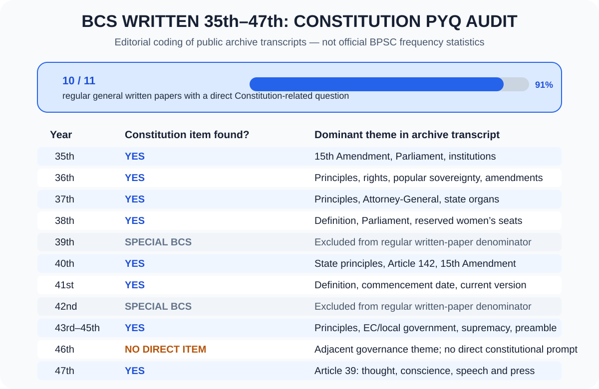

# Chapter 07 — Constitution PYQ Audit: 35th–47th BCS Written
[← মূল অধ্যায়](./README.md) · [২৫টি answered model question](./BCS-WRITTEN-QUESTION-BANK.md) · [English quotations with sources](./QUOTATIONS.md) · [Bangladesh Affairs index](../README.md)

> **Scope:** 35th–47th BCS numbering, Constitution chapter only. Review date: 21 October 2026. The question text below is summarized from a public question-bank transcript, not presented as a BPSC-certified original scan. Always prefer an authenticated BPSC question paper where available.

## কীভাবে প্রশ্ন বিশ্লেষণ করা হয়েছে

1. Public archive-এ থাকা Bangladesh Affairs (Subject Code 005) written paper-এ Constitution, rights, amendments, Parliament, constitutional bodies and constitutional governance-এর সরাসরি/ঘনিষ্ঠ প্রশ্ন খোঁজা হয়েছে।
2. সরাসরি সংবিধান-প্রশ্ন এবং সংলগ্ন প্রতিষ্ঠান/সুশাসনের প্রশ্ন আলাদা করা হয়েছে।
3. 39th ও 42nd ছিল special BCS examination series; সেগুলোকে সাধারণ ক্যাডারের নিয়মিত Bangladesh Affairs written paper-এর সঙ্গে তুলনাযোগ্য ধরা হয়নি।
4. 46th archive transcript-এ সরাসরি Constitution item পাওয়া যায়নি; governance-সংক্রান্ত প্রশ্ন ছিল, সেটি adjacent theme হিসেবে চিহ্নিত।
5. এই শ্রেণিবিন্যাসটি archive transcript-ভিত্তিক সম্পাদকীয় coding—BPSC-এর official topic-frequency statistics নয় এবং ভবিষ্যৎ প্রশ্নের নিশ্চয়তা নয়।

## Year-by-year audit

| BCS | সংবিধান-সম্পর্কিত প্রশ্ন/থিম | শ্রেণি ও প্রস্তুতির নির্দেশনা | Public archive |
|---|---|---|---|
| **35th** | পঞ্চদশ সংশোধনীর পাঁচটি দিক; parliamentary government; Election Commission, Attorney-General ও Ombudsman-এর ভূমিকা | **Direct + adjacent.** Amendments, parliamentary government এবং constitutional/statutory institutions একসঙ্গে পড়ুন। | [35th BCS Written](https://bcsexam.org/written-questions/35th-bcs-written) |
| **36th** | ১৯৭২ সালের সংবিধানের রাষ্ট্র পরিচালনার মূলনীতি; মৌলিক অধিকার; নারীর অধিকার; “প্রজাতন্ত্রের সকল ক্ষমতার মালিক জনগণ”; পঞ্চম, দ্বাদশ, পঞ্চদশ ও ষোড়শ সংশোধনীর প্রেক্ষাপট/গুরুত্ব | **Direct, very high priority.** Part II, Part III, Article 7 এবং amendment history প্রস্তুত করুন। | [36th BCS Written](https://bcsexam.org/written-questions/36th-bcs-written) |
| **37th** | রাষ্ট্র পরিচালনার মূলনীতি; Attorney-General-এর নিয়োগ/দায়িত্ব; আইনসভা, নির্বাহী ও বিচার বিভাগের ভূমিকা | **Direct + institutions.** State principles, Article 64 এবং separation/checks and balances লিখে অনুশীলন করুন। | [37th BCS Written](https://bcsexam.org/written-questions/37th-bcs-written) |
| **38th** | সংবিধানের সংজ্ঞা ও অনুচ্ছেদসংখ্যা; জাতীয় সংসদের গঠন, ক্ষমতা ও কার্যাবলি; সংরক্ষিত নারী আসনের যৌক্তিকতা | **Direct + legislature.** Constitution basics, Part V, Article 65 এবং women’s representation প্রস্তুত করুন। | [38th BCS Written](https://bcsexam.org/written-questions/38th-bcs-written) |
| **39th** | সাধারণ ক্যাডারের নিয়মিত Bangladesh Affairs written paper-এর সঙ্গে তুলনাযোগ্য standard paper নয়; এটি special BCS series | **Excluded from frequency denominator.** Regular written PYQ trend হিসেবে গণনা করা হয়নি। | [BCS question archive index](https://bcsexam.org/written-questions) |
| **40th** | রাষ্ট্র পরিচালনার মূলনীতি (৫); সংবিধান সংশোধনের বিধান (৫); পঞ্চদশ সংশোধনীর মূল বিষয় (১০) | **Direct, very high priority.** Article 8, Article 142, 15th Amendment and constitutional review। | [40th BCS Written](https://bcsexam.org/written-questions/40th-bcs-written) |
| **41st** | সংবিধানের সংজ্ঞা, প্রথম কার্যকর হওয়ার তারিখ ও মূলনীতি; অনুসৃত সংবিধান-সংস্করণের তাৎপর্য | **Direct.** 4 November 1972 (adoption) বনাম 16 December 1972 (commencement) এবং text-versus-judgment distinction বুঝুন। | [41st BCS Written](https://bcsexam.org/written-questions/41st-bcs-written) |
| **42nd** | special BCS series; standard general-cadre Bangladesh Affairs written paper-এর সমতুল্য নয় | **Excluded from frequency denominator.** Regular written-paper trend হিসেবে গণনা করা হয়নি। | [BCS question archive index](https://bcsexam.org/written-questions) |
| **43rd** | রাষ্ট্র পরিচালনার মূলনীতি; রাষ্ট্রের প্রধান অঙ্গ; স্থানীয় সরকার; Election Commission গঠন ও সাংবিধানিক দায়িত্ব | **Direct + institutions.** Part II, separation of powers, Articles 59–60 and 118–126 পড়ুন। | [43rd BCS Written](https://bcsexam.org/written-questions/43rd-bcs-written) |
| **44th** | “সংবিধানই বাংলাদেশের সর্বোচ্চ আইন”; amendment process; High Court Division judges’ removal / Article 96 | **Direct, very high priority.** Article 7, 96, 142 and judicial independence। | [44th BCS Written](https://bcsexam.org/written-questions/44th-bcs-written) |
| **45th** | Preamble-এর গুরুত্ব; পঞ্চদশ সংশোধনীর পরিবর্তন ও প্রভাব | **Direct.** Preamble, four principles, 15th Amendment and later judgments। | [45th BCS Written](https://bcsexam.org/written-questions/45th-bcs-written) |
| **46th** | available archive transcript-এ সরাসরি Constitution-specific item পাওয়া যায়নি; উন্নয়ন প্রকল্প বাস্তবায়নে সুশাসনের প্রতিবন্ধকতা/প্রতিকার ছিল | **Adjacent governance theme, not a direct Constitution question.** Rule of law, accountability and institutions-এর সঙ্গে link-up করে পড়ুন। | [46th BCS Written](https://bcsexam.org/written-questions/46th-bcs-written) |
| **47th** | চিন্তা, বিবেক, বাক্‌স্বাধীনতা ও সংবাদপত্রের স্বাধীনতার সাংবিধানিক বিধান এবং ৫৪ বছরে নাগরিক অভিজ্ঞতার বিশ্লেষণ (২০ নম্বর) | **Direct, very high priority.** Article 39, constitutional restrictions, judicial remedies and real-world implementation—সব এক উত্তরে বিশ্লেষণ করুন। | [47th BCS Written](https://bcsexam.org/written-questions/47th-bcs-written) |

## Trend chart — কী বোঝা যায়?

**Interpretation:** 35th–47th-এর মধ্যে 39th ও 42nd special series হওয়ায় বাদ দিলে 11টি regular general written paper থাকে। Public archive transcript-এ 10টি paper-এ সরাসরি Constitution-related item শনাক্ত হয়েছে; 46th-এ direct item পাওয়া যায়নি, যদিও governance-adjacent question ছিল। এটি **এই audit-এর coding result**, official BPSC statistics নয়। Archive-এর নিজস্ব disclaimer অনুযায়ী প্রশ্নগুলো BPSC-এর original scan থেকে সরাসরি টাইপ করা certified transcript নয়।

## Repeated themes — পড়ার অগ্রাধিকার

### Priority A — অবশ্যই লিখে অনুশীলন করুন
1. **রাষ্ট্র পরিচালনার মূলনীতি বনাম মৌলিক অধিকার:** Article 8–25 বনাম Part III, Articles 26–47A।
2. **সংবিধানের সর্বোচ্চতা ও জনগণের সার্বভৌমত্ব:** Article 7(1)–(2), constitutional supremacy and judicial review।
3. **সংশোধনী:** 5th, 12th, 13th, 15th and 16th Amendment; Article 142; Basic Structure Doctrine।
4. **সংসদ ও সংসদীয় সরকার:** Article 65 onward, Article 70, cabinet responsibility and oversight।
5. **মৌলিক অধিকার ও Article 39:** speech, conscience, press freedom, lawful restrictions, Article 44/102 remedies।
6. **Judiciary:** Articles 94, 96 and 102; independence with accountability।
7. **Constitutional institutions:** Election Commission (118–126), Attorney-General (64), Public Service Commission (137–141), Comptroller and Auditor-General (127–132)।

### Priority B — 10/20 নম্বরের analytical answer
- Preamble as constitutional philosophy.
- Constitutionalism and rule of law.
- Women’s representation and reserved seats.
- Local government and decentralisation (Articles 59–60).
- Difference between constitutional text, amendment history and binding judicial interpretation.
- Practical obstacles: enforcement, institutional independence, accountability, public access to remedies and civic literacy.

## 20-mark answer blueprint

**Introduction (2–3 sentences)** → **relevant Article/Part** → **historical/legal context** → **4–6 analytical points** → **implementation challenge/counterargument** → **realistic recommendations** → **balanced conclusion**. Include an exact Article number and one source name. Use one relevant authentic quotation from [QUOTATIONS.md](./QUOTATIONS.md#verified-quotes), not a fabricated attribution.

## Primary sources and verification

- **Constitution of Bangladesh (official consolidated text):** https://bdlaws.minlaw.gov.bd/act-print-367.html
- **Election Commission-hosted Constitution portal:** https://ecs.gov.bd/page/the-constitution-of-the-peoples-republic-of-bangladesh
- **BCS Written question-bank index and disclaimer:** https://bcsexam.org/written-questions
- **35th:** https://bcsexam.org/written-questions/35th-bcs-written
- **36th:** https://bcsexam.org/written-questions/36th-bcs-written
- **37th:** https://bcsexam.org/written-questions/37th-bcs-written
- **38th:** https://bcsexam.org/written-questions/38th-bcs-written
- **40th:** https://bcsexam.org/written-questions/40th-bcs-written
- **41st:** https://bcsexam.org/written-questions/41st-bcs-written
- **43rd:** https://bcsexam.org/written-questions/43rd-bcs-written
- **44th:** https://bcsexam.org/written-questions/44th-bcs-written
- **45th:** https://bcsexam.org/written-questions/45th-bcs-written
- **46th:** https://bcsexam.org/written-questions/46th-bcs-written
- **47th:** https://bcsexam.org/written-questions/47th-bcs-written

> **Accuracy note:** Archive-reported questions should not be quoted as authenticated verbatim BPSC text unless checked against the original paper. Topic grouping and priority are analytical aids, not predictions or a guarantee of marks.

[⬆️ Back to Chapter 07](./README.md#top) · [২৫টি answered question](./BCS-WRITTEN-QUESTION-BANK.md) · [সূচি](../README.md)
