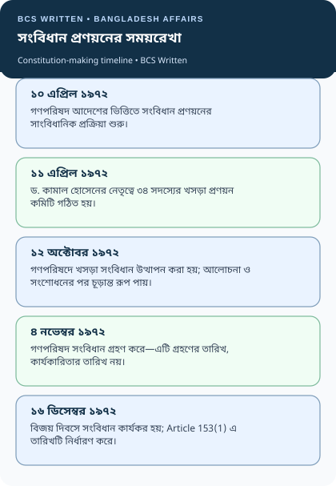
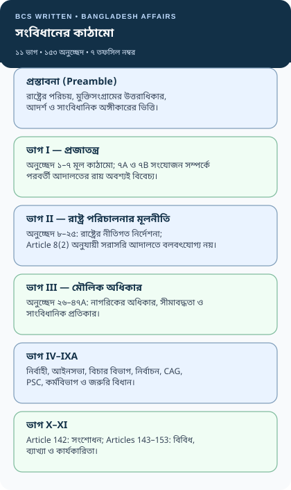
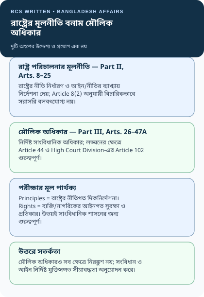
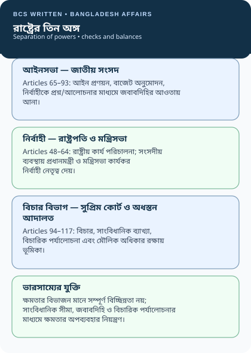
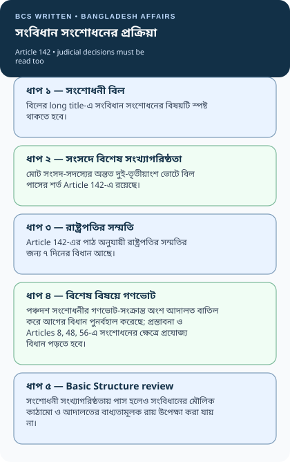
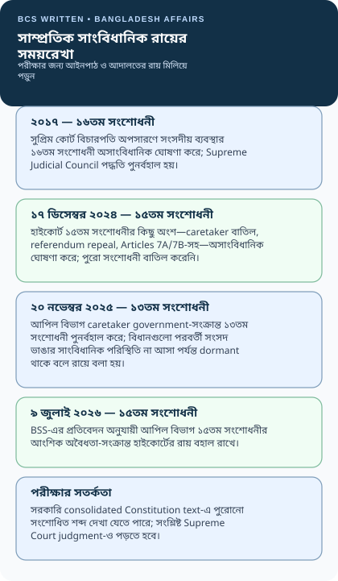
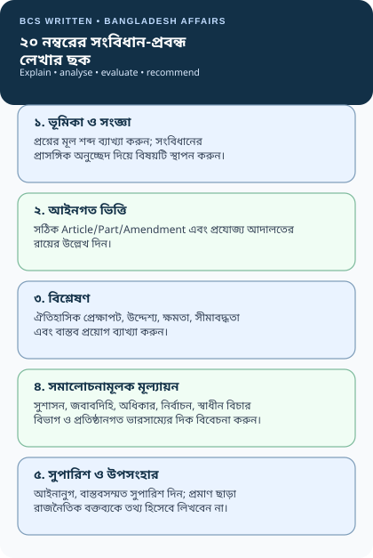

# Chapter 07 — বাংলাদেশের সংবিধান | The Constitution of Bangladesh

> **BCS Written · Bangladesh Affairs · Subject Code 005 · 200 marks**  
> **মূল ভাষা:** বাংলা; প্রয়োজনীয় constitutional/legal terminology English-সহ ব্যাখ্যা করা হয়েছে।  
> **পাঠের বিন্যাস:** সংবিধান প্রণয়নের ইতিহাস → কাঠামো ও মূলনীতি → মৌলিক অধিকার → রাষ্ট্রের অঙ্গ → সংশোধনী ও বিচারিক ব্যাখ্যা → PYQ analysis → প্রবন্ধ ও অনুশীলন।  
> **Source review:** ২১ অক্টোবর ২০২৬। সাম্প্রতিক সাংবিধানিক রায় ও সরকারি consolidated text-এর মধ্যে পার্থক্য থাকলে তা আলাদা করে উল্লেখ করা হয়েছে।

[← Bangladesh Affairs-এর মূল সূচি](../README.md) · [📚 PYQ-ভিত্তিক গুরুত্বপূর্ণ প্রবন্ধ](./PYQ-BASED-ESSAYS.md) · [Source-backed Exam Lines](./QUOTATIONS.md) · [Chapter 01 — ভূগোল](../Chapter-01/README.md)

> 📱 **Mobile-friendly chapter:** সব revision diagram responsive SVG। ছবি না খুললে [diagram folder](./assets/mobile-diagrams) খুলুন। বড় সারণি ফোনে প্রয়োজন হলে আড়াআড়ি scroll করুন।

> [!IMPORTANT]
> **এই অধ্যায়ের সবচেয়ে গুরুত্বপূর্ণ সতর্কতা:** বাংলাদেশের সংবিধানের সরকারি consolidated text-এ ২০১১ সালের পঞ্চদশ সংশোধনীর কিছু ভাষা এখনো দেখা যেতে পারে। কিন্তু ১৩তম, ১৫তম ও ১৬তম সংশোধনী-সংক্রান্ত পরবর্তী Supreme Court judgment সাংবিধানিক অবস্থাকে প্রভাবিত করেছে। তাই শুধু সংবিধানের অনলাইন পাঠ মুখস্থ নয়—সংশ্লিষ্ট আদালতের রায়ও পড়তে হবে। এই অধ্যায়ে ২১ অক্টোবর ২০২৬ পর্যন্ত যাচাই করা অবস্থান আলাদা করে দেখানো হয়েছে।

## বিষয়সূচি — সরাসরি অংশে যান

| ভিত্তি ও ইতিহাস | সংবিধানের বিধান | বিশ্লেষণ ও পরীক্ষা |
|---|---|---|
| [১. শিখনফল ও সিলেবাস](#start) | [৫. সংবিধানের কাঠামো](#structure) | [১২. গুরুত্বপূর্ণ সংশোধনী](#amendments) |
| [২. Previous BCS Written Question Analysis](#pyq) | [৬. প্রস্তাবনা ও রাষ্ট্রীয় আদর্শ](#preamble) | [১৩. সাম্প্রতিক সাংবিধানিক রায়](#recent-judgments) |
| [৩. সংবিধান ও সাংবিধানিকতাবাদ](#concepts) | [৭. রাষ্ট্র পরিচালনার মূলনীতি](#principles) | [১৪. গুরুত্বপূর্ণ প্রবন্ধ](#essays) |
| [৪. প্রণয়নের ইতিহাস](#history) | [৮. মৌলিক অধিকার](#rights) | [১৫. ৫/১০/২০ নম্বরের উত্তর কাঠামো](#answer-strategy) |
| [দ্রুত Revision Visuals](#visuals) | [৯. রাষ্ট্রের তিন অঙ্গ](#organs) | [১৬. ৩৩টি অনুশীলনী](#questions) |
| [গুরুত্বপূর্ণ Article Map](#article-map) | [১০. সাংবিধানিক প্রতিষ্ঠান](#institutions) | [১৭. সাধারণ ভুল](#common-mistakes) |
|  | [১১. সংশোধন ও Basic Structure](#amendment-process) | [১৮. Memory Check](#memory-check) |
|  |  | [১৯. Full Source Register](#sources) |

---

## ১. শিখনফল ও BCS Written Syllabus Mapping

এই অধ্যায়ের লক্ষ্য সংবিধানের অনুচ্ছেদ কেবল মুখস্থ করানো নয়; কোন বিধান কী উদ্দেশ্যে তৈরি, রাষ্ট্রের ক্ষমতা কীভাবে সীমাবদ্ধ, নাগরিকের অধিকার কীভাবে সুরক্ষিত, এবং আদালত কীভাবে সংবিধানের ব্যাখ্যা দেয়—সেগুলো যুক্তিসহ বোঝানো।

অধ্যায়টি শেষ করলে শিক্ষার্থী পারবে—

1. সংবিধান প্রণয়নের ইতিহাস, গৃহীত হওয়ার তারিখ ও কার্যকর হওয়ার তারিখ আলাদা করে ব্যাখ্যা করতে।
2. প্রস্তাবনা, চার রাষ্ট্রীয় মূলনীতি, মৌলিক অধিকার এবং রাষ্ট্র পরিচালনার মূলনীতির পার্থক্য বিশ্লেষণ করতে।
3. Article 7, 26–47A, 44, 65, 70, 94, 96, 102, 118, 137 ও 142-এর তাৎপর্য ব্যাখ্যা করতে।
4. আইনসভা, নির্বাহী বিভাগ ও বিচার বিভাগের ক্ষমতা ও পারস্পরিক ভারসাম্য মূল্যায়ন করতে।
5. সংবিধানের গুরুত্বপূর্ণ সংশোধনী ও Basic Structure Doctrine-এর সম্পর্ক বুঝতে।
6. ১৩তম, ১৫তম ও ১৬তম সংশোধনী-সংক্রান্ত সাম্প্রতিক বিচারিক অবস্থান সতর্কভাবে ব্যাখ্যা করতে।
7. উৎস, অনুচ্ছেদ ও যুক্তি ব্যবহার করে ৫, ১০ ও ২০ নম্বরের উত্তর লিখতে।

**সিলেবাসের সঙ্গে সম্পর্ক:** BPSC-এর Bangladesh Affairs (Compulsory), Subject Code 005, ২০০ নম্বরের লিখিত পত্র বাংলাদেশের ইতিহাস, রাজনীতি, সমাজ, অর্থনীতি ও রাষ্ট্রব্যবস্থা নিয়ে বিশ্লেষণধর্মী উত্তর দাবি করে। সংবিধান একটি আলাদা অধ্যায় হিসেবে এখানে সাজানো হলেও এটি রাষ্ট্রের প্রতিষ্ঠান, নির্বাচন, বিচার বিভাগ, মানবাধিকার, সুশাসন এবং মুক্তিযুদ্ধের সাংবিধানিক উত্তরাধিকারের সঙ্গে সরাসরি যুক্ত। সরকারি সিলেবাস: [BPSC — BCS Written Examination Syllabus](https://bpsc.gov.bd/pages/psc-exams/%E0%A6%AC%E0%A6%BF-%E0%A6%B8%E0%A6%BF-%E0%A6%8F%E0%A6%B8-%E0%A6%B2%E0%A6%BF%E0%A6%96%E0%A6%BF%E0%A6%A4-%E0%A6%AA%E0%A6%B0%E0%A7%80%E0%A6%95%E0%A7%8D%E0%A6%B7%E0%A6%BE%E0%A6%B0-%E0%A6%B8%E0%A6%BF%E0%A6%B2%E0%A7%87%E0%A6%AC%E0%A6%BE%E0%A6%B8-08e202-6919974adbfbab28ceff0121)।

---

## ২. Previous BCS Written Question Analysis — কোন বিষয়গুলো সবচেয়ে গুরুত্বপূর্ণ?

### ২.১ বিশ্লেষণের পদ্ধতি ও সতর্কতা

নিচের টেবিলটি ৩৬তম, ৩৭তম, ৩৮তম, ৪০তম, ৪১তম, ৪৩তম, ৪৪তম ও ৪৫তম BCS Written-এর প্রকাশ্য question-bank transcript থেকে তৈরি। প্রশ্নব্যাংকটির নিজস্ব disclaimer অনুযায়ী প্রশ্নগুলো BPSC-এর মূল scan থেকে সরাসরি প্রকাশিত নয়; তাই এগুলোকে **archive-reported questions** হিসেবে চিহ্নিত করা হয়েছে, certified original scan হিসেবে নয়। এখানে পুনরাবৃত্ত বিষয় শনাক্ত করা হয়েছে—এটি কোনো ভবিষ্যৎ প্রশ্নের নিশ্চয়তা বা সব বছরের পূর্ণ পরিসংখ্যান নয়।

| BCS Written | সংবিধান-সম্পর্কিত প্রশ্নের বিষয় | নম্বর ও পরীক্ষার ইঙ্গিত |
|---|---|---|
| ৩৬তম | রাষ্ট্র পরিচালনার মূলনীতি, মৌলিক অধিকার, নারীর অধিকার, জনগণের সার্বভৌমত্ব; ৫ম, ১২তম, ১৫তম ও ১৬তম সংশোধনীর রাজনৈতিক প্রেক্ষাপট ও গুরুত্ব | চারটি ৫ নম্বরের অংশ এবং চারটি সংশোধনী নিয়ে আরও ২০ নম্বরের প্রশ্ন; অনুচ্ছেদ + ইতিহাস + মূল্যায়ন জরুরি |
| ৩৭তম | রাষ্ট্র পরিচালনার মূলনীতি; Attorney-General-এর নিয়োগ ও দায়িত্ব; আইনসভা, নির্বাহী ও বিচার বিভাগের ভূমিকা | মূলনীতি নিয়ে ১৫ এবং রাষ্ট্রের অঙ্গ নিয়ে ২০ নম্বরের প্রশ্ন; বড় উত্তর লেখার অনুশীলন দরকার |
| ৩৮তম | সংবিধানের সংজ্ঞা, অনুচ্ছেদের সংখ্যা, জাতীয় সংসদের গঠন/ক্ষমতা/কার্যাবলি, সংরক্ষিত নারী আসন | তথ্যভিত্তিক ৫ নম্বরের সঙ্গে বিশ্লেষণধর্মী ১০ নম্বরের প্রশ্ন |
| ৪০তম | সংবিধানের মূলনীতি, সংশোধনের বিধান, পঞ্চদশ সংশোধনীর মূল বিষয় | ৫ + ৫ + ১০ নম্বর; Article 142 ও amendment analysis উচ্চ অগ্রাধিকার |
| ৪১তম | সংবিধানের সংজ্ঞা, প্রথম কার্যকর হওয়ার তারিখ, মূলনীতি, বর্তমান সংবিধান-সংস্করণের তাৎপর্য | ১০ + ১০ নম্বর; তারিখ ও “বর্তমান সংস্করণ” বিষয়ে ধারণাগত নির্ভুলতা দরকার |
| ৪৩তম | রাষ্ট্র পরিচালনার মূলনীতি, রাষ্ট্রের প্রধান অঙ্গ, স্থানীয় সরকার, নির্বাচন কমিশনের গঠন ও দায়িত্ব | সংবিধান শুধু বইয়ের তথ্য নয়; রাষ্ট্রীয় প্রতিষ্ঠান ও বাস্তব প্রয়োগও গুরুত্বপূর্ণ |
| ৪৪তম | “সংবিধানই বাংলাদেশের সর্বোচ্চ আইন”, সংশোধন প্রক্রিয়া ও সংশ্লিষ্ট অনুচ্ছেদ, হাইকোর্ট বিভাগের বিচারপতি অপসারণ | ৫ + ১০ + ৫ নম্বর; supremacy, Article 142 ও Article 96 গুরুত্বপূর্ণ |
| ৪৫তম | সংবিধানের প্রস্তাবনা ও গুরুত্ব; পঞ্চদশ সংশোধনীর পরিবর্তন ও প্রভাব | ২০ নম্বরের বিশ্লেষণধর্মী প্রশ্ন; ইতিহাস, আইন ও প্রভাব একসঙ্গে লিখতে হবে |

**প্রশ্নব্যাংকের সরাসরি উৎস:** [৩৬তম](https://bcsexam.org/written-questions/36th-bcs-written) · [৩৭তম](https://bcsexam.org/written-questions/37th-bcs-written) · [৩৮তম](https://bcsexam.org/written-questions/38th-bcs-written) · [৪০তম](https://bcsexam.org/written-questions/40th-bcs-written) · [৪১তম](https://bcsexam.org/written-questions/41st-bcs-written) · [৪৩তম](https://bcsexam.org/written-questions/43rd-bcs-written) · [৪৪তম](https://bcsexam.org/written-questions/44th-bcs-written) · [৪৫তম](https://bcsexam.org/written-questions/45th-bcs-written)। Question-bank-এর উৎস ও সীমাবদ্ধতা: [৩৫তম–৫০তম লিখিত প্রশ্নের সূচি](https://bcsexam.org/written-questions)।

### ২.২ PYQ থেকে বের হওয়া High-Priority Cluster

**Priority A — আগে ভালোভাবে শেষ করুন**

1. রাষ্ট্র পরিচালনার চার মূলনীতি এবং Part II বনাম Part III-এর পার্থক্য।
2. সংবিধানের সর্বোচ্চতা, জনগণের সার্বভৌমত্ব ও Rule of Law — Article 7।
3. সংবিধান সংশোধনের পদ্ধতি — Article 142; Basic Structure Doctrine।
4. পঞ্চদশ সংশোধনী: বিষয়বস্তু, রাজনৈতিক-সাংবিধানিক প্রেক্ষাপট এবং সাম্প্রতিক আদালতের রায়।
5. মৌলিক অধিকার, Article 44, Article 102 ও বিচারিক পর্যালোচনা।
6. সংসদ, Article 70, নির্বাহী বিভাগ ও বিচার বিভাগের পারস্পরিক সম্পর্ক।
7. Article 96, বিচারপতি অপসারণ ও Supreme Judicial Council।

**Priority B — দ্বিতীয় ধাপে প্রস্তুত করুন**

8. প্রস্তাবনা, সংবিধান প্রণয়নের ইতিহাস, গৃহীত ও কার্যকর হওয়ার তারিখ।
9. সংবিধানের কাঠামো: ১১ ভাগ, ১৫৩ অনুচ্ছেদ, তফসিল ও Article mapping।
10. ৫ম, ৮ম, ১২তম, ১৩তম, ১৫তম, ১৬তম ও ১৭তম সংশোধনী।
11. নির্বাচন কমিশন, সরকারি কর্ম কমিশন, মহা হিসাব-নিরীক্ষক ও নিয়ন্ত্রক।
12. Attorney-General, স্থানীয় সরকার, সাংবিধানিক পদ ও সাংবিধানিক জবাবদিহি।

**পরীক্ষার কৌশল:** বিগত প্রশ্নে একই বিষয় ভিন্ন ভাষায় এসেছে—“মূলনীতি বর্ণনা করুন”, “তাৎপর্য ব্যাখ্যা করুন”, “প্রভাবসহ আলোচনা করুন”, “সংশ্লিষ্ট অনুচ্ছেদ উল্লেখ করুন”। তাই একটি সংজ্ঞা মুখস্থ করলেই যথেষ্ট নয়। প্রতিটি বিষয়কে **সংজ্ঞা → Article → ঐতিহাসিক প্রেক্ষাপট → প্রয়োগ → সীমাবদ্ধতা → সুপারিশ** এই ছকে প্রস্তুত করুন।

---

## ৩. সংবিধান ও সাংবিধানিকতাবাদ: ধারণা, বৈশিষ্ট্য ও গুরুত্ব

### ৩.১ সংবিধান কাকে বলে?

সংবিধান (Constitution) হলো রাষ্ট্রের সর্বোচ্চ মৌলিক আইন, যা রাষ্ট্রের পরিচয়, ক্ষমতার উৎস, সরকার গঠনের পদ্ধতি, রাষ্ট্রের অঙ্গসমূহের ক্ষমতা ও সীমা, নাগরিকের অধিকার এবং রাষ্ট্র পরিচালনার মৌলিক নীতি নির্ধারণ করে। বাংলাদেশের সংবিধানের Article 7(2) সংবিধানকে প্রজাতন্ত্রের সর্বোচ্চ আইন হিসেবে ঘোষণা করে; সংবিধানের সঙ্গে অসামঞ্জস্যপূর্ণ অন্য আইন অসামঞ্জস্যের পরিমাণে বাতিল হবে।

### ৩.২ সাংবিধানিকতাবাদ (Constitutionalism)

সাংবিধানিকতাবাদ শুধু লিখিত সংবিধান থাকা নয়। এর অর্থ হলো—রাষ্ট্রীয় ক্ষমতা সংবিধান দ্বারা সীমাবদ্ধ থাকবে, ক্ষমতাসীন ব্যক্তি বা প্রতিষ্ঠান আইন ঊর্ধ্বে থাকবে না, নাগরিক অধিকার রক্ষার কার্যকর ব্যবস্থা থাকবে এবং স্বাধীন বিচার বিভাগ আইন ও রাষ্ট্রীয় কার্যক্রমের সাংবিধানিকতা পরীক্ষা করতে পারবে।

| ধারণা | মূল প্রশ্ন | পরীক্ষায় কী লিখবেন |
|---|---|---|
| Constitution | রাষ্ট্রের মৌলিক আইন কী? | ক্ষমতা, প্রতিষ্ঠান, অধিকার ও নীতির কাঠামো |
| Constitutionalism | ক্ষমতার অপব্যবহার কীভাবে ঠেকবে? | Rule of Law, rights, accountability, judicial review |
| Rule of Law | আইন কি সবার ওপর সমভাবে প্রযোজ্য? | আইনানুগ ক্ষমতা, সমতা, ন্যায়বিচার ও প্রতিকার |
| Constitutional Supremacy | চূড়ান্ত আইন কোনটি? | Article 7; অসামঞ্জস্যপূর্ণ আইন বাতিল |
| Separation of Powers | রাষ্ট্রের ক্ষমতা কীভাবে ভাগ হবে? | আইনসভা, নির্বাহী ও বিচার বিভাগের পৃথক ভূমিকা এবং checks and balances |

### ৩.৩ সংবিধানের প্রধান কাজ

- রাষ্ট্রের আইনগত পরিচয় ও ভূখণ্ড নির্ধারণ।
- জনগণের সার্বভৌমত্বকে সাংবিধানিক রূপ দেওয়া।
- সরকার গঠন, ক্ষমতা বণ্টন ও ক্ষমতার সীমা নির্ধারণ।
- নাগরিকের মৌলিক অধিকার ও আদালতে প্রতিকারের ব্যবস্থা করা।
- রাষ্ট্র পরিচালনার মূলনীতি নির্ধারণ।
- নির্বাচন, সংসদ, বিচার বিভাগ ও সাংবিধানিক প্রতিষ্ঠানকে আইনগত ভিত্তি দেওয়া।
- ক্ষমতার শান্তিপূর্ণ হস্তান্তর, জবাবদিহি ও স্থিতিশীলতার জন্য কাঠামো তৈরি করা।

### ৩.৪ বাংলাদেশের সংবিধানের প্রধান বৈশিষ্ট্য

বাংলাদেশের সংবিধান লিখিত, সর্বোচ্চ আইন, জনগণের সার্বভৌমত্ব-স্বীকৃত, একক রাষ্ট্রের কাঠামোভিত্তিক এবং সংসদীয় সরকারব্যবস্থাসম্পন্ন। এতে মৌলিক অধিকার ও রাষ্ট্র পরিচালনার মূলনীতি আলাদা ভাগে রয়েছে। সংবিধান সংশোধনের জন্য বিশেষ সংখ্যাগরিষ্ঠতার বিধান রয়েছে; তবে সংশোধনের ক্ষমতা ও তার সীমা বিচারিক ব্যাখ্যার বিষয়ও হয়েছে। সংবিধানের বহু বিধান রাষ্ট্রের বিভিন্ন প্রতিষ্ঠানের ক্ষমতা নির্ধারণ করে, আর Article 102-এর মাধ্যমে High Court Division নির্দিষ্ট ক্ষেত্রে সাংবিধানিক প্রতিকার দিতে পারে।

**সমালোচনামূলক মূল্যায়ন:** লিখিত সংবিধান থাকলেই গণতন্ত্র বা মানবাধিকার স্বয়ংক্রিয়ভাবে নিশ্চিত হয় না। প্রয়োজন স্বাধীন ও নিরপেক্ষ প্রতিষ্ঠান, কার্যকর সংসদীয় নজরদারি, আইনানুগ প্রশাসন, নাগরিকের অধিকার প্রয়োগের সুযোগ, স্বচ্ছ নির্বাচন এবং আদালতের রায় বাস্তবায়ন। এই পার্থক্যই constitution ও constitutionalism-এর মূল।

---

## ৪. বাংলাদেশের সংবিধান প্রণয়নের ইতিহাস

বাংলাদেশের সংবিধান মুক্তিযুদ্ধ, স্বাধীনতার ঘোষণা, জনগণের আত্মনিয়ন্ত্রণের আকাঙ্ক্ষা এবং স্বাধীন রাষ্ট্রের প্রতিষ্ঠান নির্মাণের ধারাবাহিকতার ফল। ১৯৭২ সালের সংবিধান রাষ্ট্রকে শুধু প্রশাসনিক কাঠামো দেয়নি; রাষ্ট্রের বৈধতার ভিত্তি হিসেবে জনগণ, মুক্তিসংগ্রাম, মৌলিক অধিকার এবং চার মূলনীতিকেও স্থাপন করেছে।

| তারিখ/সময় | ঘটনা | সাংবিধানিক তাৎপর্য |
|---|---|---|
| ২৬ মার্চ ১৯৭১ | স্বাধীনতার ঘোষণা | স্বাধীন ও সার্বভৌম রাষ্ট্র প্রতিষ্ঠার ঐতিহাসিক ভিত্তি |
| ১০ এপ্রিল ১৯৭১ | স্বাধীনতার ঘোষণাপত্র (Proclamation of Independence) গৃহীত | মুক্তিযুদ্ধকালীন রাষ্ট্রীয় বৈধতা ও সরকার পরিচালনার ভিত্তি; পরবর্তীতে সংবিধানের সপ্তম তফসিলে অন্তর্ভুক্ত |
| ১৭ এপ্রিল ১৯৭১ | মুজিবনগর সরকার শপথ নেয় | যুদ্ধকালীন সরকার ও রাষ্ট্রীয় ধারাবাহিকতার বাস্তব রূপ |
| ১০ এপ্রিল ১৯৭২ | গণপরিষদের প্রথম অধিবেশন | সংবিধান প্রণয়নের আনুষ্ঠানিক কাজ শুরু |
| ১১ এপ্রিল ১৯৭২ | ড. কামাল হোসেনের নেতৃত্বে ৩৪ সদস্যের খসড়া প্রণয়ন কমিটি গঠিত | সংবিধানের খসড়া তৈরির প্রাতিষ্ঠানিক প্রক্রিয়া |
| ১২ অক্টোবর ১৯৭২ | খসড়া সংবিধান গণপরিষদে উত্থাপন | গণপরিষদে আলোচনা ও সংশোধনের পর্যায় |
| ৪ নভেম্বর ১৯৭২ | সংবিধান গৃহীত | গ্রহণের দিন; সংবিধান দিবস হিসেবে পরিচিত |
| ১৬ ডিসেম্বর ১৯৭২ | সংবিধান কার্যকর | Article 153(1)-এ কার্যকারিতার তারিখ নির্ধারিত |

**দুটি তারিখ কখনো গুলিয়ে ফেলবেন না:** ৪ নভেম্বর ১৯৭২ = গৃহীত; ১৬ ডিসেম্বর ১৯৭২ = কার্যকর। Article 153(1) অনুসারে সংবিধান ১৬ ডিসেম্বর ১৯৭২ থেকে কার্যকর হয়। [সরকারি সংবিধান পাঠ — Article 153](https://bdlaws.minlaw.gov.bd/act-367/section-24718.html?lang=en)।

### ইতিহাস থেকে পরীক্ষার বিশ্লেষণ

১. সংবিধান প্রণয়ন স্বাধীনতা-পরবর্তী রাষ্ট্র গঠনের অংশ; এটি কেবল আইনবিদদের কারিগরি দলিল নয়।  
২. প্রস্তাবনায় মুক্তিযুদ্ধ ও জনগণের আকাঙ্ক্ষার উল্লেখ সংবিধানের ঐতিহাসিক বৈধতার ভিত্তি।  
৩. সংবিধান গৃহীত হওয়ার পরও রাজনৈতিক বাস্তবতা, সামরিক শাসন, সংসদীয়-রাষ্ট্রপতি শাসনের পরিবর্তন এবং বিভিন্ন সংশোধনীর মাধ্যমে সাংবিধানিক কাঠামো বদলেছে।  
৪. তাই সংবিধানের ইতিহাস বলতে ১৯৭২ সালের মূল দলিল এবং পরবর্তী সংশোধনী ও আদালতের ব্যাখ্যা—দুই ধারাই বুঝতে হবে।

---

## ৫. Quick Revision Visuals — দ্রুত দেখে মনে রাখুন

### ৫.১ সংবিধান প্রণয়নের সময়রেখা

### ৫.২ সংবিধানের কাঠামো

### ৫.৩ রাষ্ট্র পরিচালনার মূলনীতি বনাম মৌলিক অধিকার

### ৫.৪ রাষ্ট্রের তিন অঙ্গ ও ক্ষমতার ভারসাম্য

### ৫.৫ সংবিধান সংশোধনের ধাপ

### ৫.৬ সাম্প্রতিক সাংবিধানিক রায়

### ৫.৭ ২০ নম্বরের উত্তর লেখার কাঠামো

---

## ৬. সংবিধানের কাঠামো: ভাগ, অনুচ্ছেদ ও তফসিল

বাংলাদেশের সংবিধানের পরিচিত কাঠামো হলো—একটি প্রস্তাবনা, ১১টি ভাগ, ১৫৩টি সংখ্যায়িত অনুচ্ছেদ এবং সাতটি তফসিল নম্বর। দ্বিতীয় তফসিল রহিত হয়েছে; তাই “সাতটি তফসিল নম্বর” বলা আর “সাতটিই বর্তমানে কার্যকর”—দুটি এক কথা নয়। সংশোধনীতে কিছু অনুচ্ছেদে অক্ষর-সংযোজন হয়েছে, কিছু বিধান রহিত বা আদালতের রায়ে অকার্যকর হয়েছে। ফলে Article count-কে শুধু সরল যোগ-বিয়োগ হিসেবে পড়বেন না।

| ভাগ | বিষয় | সাধারণ Article range | পরীক্ষার মূল গুরুত্ব |
|---|---|---|---|
| প্রস্তাবনা | রাষ্ট্রের আদর্শ ও অঙ্গীকার | Preamble | মুক্তিযুদ্ধ, জনগণ, ন্যায়বিচার, মৌলিক আদর্শ |
| Part I | প্রজাতন্ত্র | ১–৭ এবং সংশোধনীতে সংযোজিত বিধান | রাষ্ট্রের পরিচয়, ভাষা, ভূখণ্ড, জনগণের ক্ষমতা, সর্বোচ্চ আইন |
| Part II | রাষ্ট্র পরিচালনার মূলনীতি | ৮–২৫ | রাষ্ট্রের নীতি, সামাজিক ন্যায়, শিক্ষা, স্বাস্থ্য, পরিবেশ |
| Part III | মৌলিক অধিকার | ২৬–৪৭A | সমতা, স্বাধীনতা, আইনের আশ্রয়, সাংবিধানিক প্রতিকার |
| Part IV | নির্বাহী বিভাগ | ৪৮–৬৪ | রাষ্ট্রপতি, প্রধানমন্ত্রী, মন্ত্রিসভা, Attorney-General |
| Part V | আইনসভা | ৬৫–৯৩ | জাতীয় সংসদ, আইন প্রণয়ন, Article 70, বাজেট ও অধ্যাদেশ |
| Part VI | বিচার বিভাগ | ৯৪–১১৭ | সুপ্রিম কোর্ট, বিচারপতি, writ, judicial review |
| Part VII | নির্বাচন | ১১৮–১২৬ | নির্বাচন কমিশন ও নির্বাচন-সংক্রান্ত বিধান |
| Part VIII | মহা হিসাব-নিরীক্ষক ও নিয়ন্ত্রক | ১২৭–১৩২ | সরকারি অর্থের নিরীক্ষা ও আর্থিক জবাবদিহি |
| Part IX | বাংলাদেশের কর্মবিভাগ | ১৩৩–১৪১ | সরকারি কর্ম, চাকরির শর্ত ও Public Service Commission-সংক্রান্ত বিধান |
| Part IXA | জরুরি বিধানাবলি | ১৪১A–১৪১C | জরুরি অবস্থা ঘোষণার সাংবিধানিক কাঠামো |
| Part X | সংবিধান সংশোধন | ১৪২ | সংশোধনী বিল, বিশেষ সংখ্যাগরিষ্ঠতা ও গণভোটের বিচারিকভাবে পুনর্বহাল বিধান |
| Part XI | বিবিধ | ১৪৩–১৫৩ | সম্পত্তি, চুক্তি, ব্যাখ্যা, কার্যকারিতা ও অন্যান্য বিধান |

**গুরুত্বপূর্ণ আইনি নোট:** সরকারি consolidated text-এ Article 7A ও 7B-এর মতো ১৫তম সংশোধনীতে সংযোজিত বিধান দেখা যেতে পারে। কিন্তু ১৫তম সংশোধনী মামলায় হাইকোর্টের সিদ্ধান্ত এবং পরবর্তী আপিল বিভাগের সিদ্ধান্তের আলোকে এগুলোর আইনগত অবস্থান আলাদাভাবে বুঝতে হবে। সংশ্লিষ্ট আলোচনা [Section 13 — সাম্প্রতিক সাংবিধানিক রায়](#recent-judgments)-এ আছে।

---

## ৭. প্রস্তাবনা (Preamble): সংবিধানের দর্শন ও গুরুত্ব

প্রস্তাবনা সংবিধানের শুরুতে রাষ্ট্রের ঐতিহাসিক ভিত্তি, জনগণের অভিপ্রায়, মৌলিক আদর্শ এবং রাষ্ট্রের লক্ষ্য প্রকাশ করে। বাংলাদেশের প্রস্তাবনায় স্বাধীনতার ঘোষণা, জাতীয় মুক্তিসংগ্রাম, জনগণের ইচ্ছা, জাতীয়তাবাদ, সমাজতন্ত্র, গণতন্ত্র ও ধর্মনিরপেক্ষতার ঐতিহাসিক উল্লেখ রয়েছে। একই সঙ্গে আইনের শাসন, মৌলিক মানবাধিকার, স্বাধীনতা, সাম্য ও ন্যায়বিচার প্রতিষ্ঠার অঙ্গীকার প্রকাশিত হয়েছে।

### প্রস্তাবনার গুরুত্ব

- **ঐতিহাসিক বৈধতা:** রাষ্ট্রের জন্ম ও মুক্তিসংগ্রামের সঙ্গে সাংবিধানিক কাঠামোর সম্পর্ক স্থাপন করে।
- **আদর্শগত ভিত্তি:** রাষ্ট্র পরিচালনার মূলনীতি বুঝতে সহায়তা করে।
- **ব্যাখ্যামূলক ভূমিকা:** সাংবিধানিক ভাষার উদ্দেশ্য ও মূল্যবোধ বোঝার ক্ষেত্রে আদালত প্রস্তাবনা বিবেচনা করতে পারে।
- **রাষ্ট্রীয় অঙ্গীকার:** মানবাধিকার, ন্যায়বিচার, সমতা ও জনগণের ক্ষমতার মতো মূল্যবোধকে সামনে আনে।
- **সংশোধনী বিতর্ক:** প্রস্তাবনা সংশোধনযোগ্য কি না, সংশোধনের সীমা কী—এসব প্রশ্ন Basic Structure Doctrine এবং Article 142-এর আলোচনার সঙ্গে যুক্ত।

### পরীক্ষায় কীভাবে লিখবেন?

প্রস্তাবনাকে “শুধু ভূমিকা” বলে ছোট করবেন না। এর ঐতিহাসিক পটভূমি, মূলনীতি, Rule of Law, মানবাধিকার ও রাষ্ট্রের লক্ষ্য ব্যাখ্যা করুন। এরপর প্রস্তাবনার সঙ্গে Part II-এর মূলনীতি এবং Part III-এর অধিকারগুলোর সম্পর্ক দেখান। প্রশ্ন যদি ১৫তম সংশোধনীর প্রভাব জানতে চায়, তবে সংশোধনীর পরিবর্তন এবং পরবর্তী আদালতের রায়—দুটি আলাদা করে লিখবেন।

---

## ৮. রাষ্ট্র পরিচালনার মূলনীতি (Fundamental Principles of State Policy)

Part II-এর Articles 8–25 রাষ্ট্র পরিচালনার মৌলিক নীতি নির্ধারণ করে। Article 8(1)-এ চারটি মূলনীতি—জাতীয়তাবাদ, সমাজতন্ত্র, গণতন্ত্র ও ধর্মনিরপেক্ষতা—উল্লেখ আছে। Article 8(2) অনুসারে এই নীতিগুলো রাষ্ট্র পরিচালনা, আইন প্রণয়ন ও সংবিধান/আইনের ব্যাখ্যায় নির্দেশনা দেয়; তবে এগুলো সরাসরি আদালতের মাধ্যমে বলবৎযোগ্য নয়।

### ৮.১ চারটি মূলনীতি

**১. জাতীয়তাবাদ (Nationalism)**  
জাতীয়তাবাদ রাষ্ট্রের ঐতিহাসিক অভিজ্ঞতা, জনগণের সম্মিলিত পরিচয় ও স্বাধীনতার সংগ্রামের সঙ্গে যুক্ত। বাংলাদেশের প্রেক্ষাপটে ভাষা আন্দোলন ও মুক্তিযুদ্ধ জাতীয় পরিচয়ের গুরুত্বপূর্ণ ভিত্তি। তবে জাতীয়তাবাদকে অন্য জাতিগোষ্ঠী বা নাগরিকের অধিকার অস্বীকারের যুক্তি হিসেবে ব্যবহার করা যায় না; সংবিধানের অন্যান্য বিধান ও বৈচিত্র্যের প্রতি সম্মানও গুরুত্বপূর্ণ।

**২. সমাজতন্ত্র (Socialism)**  
সংবিধানের প্রেক্ষাপটে সমাজতন্ত্রের লক্ষ্য শোষণমুক্ত সমাজ, অর্থনৈতিক ও সামাজিক ন্যায় এবং সুযোগের অধিকতর ন্যায্য বণ্টনের সঙ্গে যুক্ত। এটি কেবল রাষ্ট্রীয় মালিকানার একটি পদ্ধতি নয়; বৈষম্য কমানো, শ্রমের মর্যাদা ও সামাজিক ন্যায় প্রতিষ্ঠার সাংবিধানিক আদর্শ হিসেবেও ব্যাখ্যা করা হয়।

**৩. গণতন্ত্র (Democracy)**  
গণতন্ত্রের মধ্যে জনগণের সার্বভৌমত্ব, নির্বাচন, প্রতিনিধিত্ব, মতপ্রকাশ, সংগঠন, জবাবদিহি এবং শান্তিপূর্ণ ক্ষমতা হস্তান্তর অন্তর্ভুক্ত। Article 11 গণতন্ত্র, মানবাধিকার ও মানবমর্যাদার মূল্যকে সামনে আনে। নির্বাচন নিয়মিত হওয়া জরুরি, কিন্তু শুধু ভোটের দিন নয়—নির্বাচনের বিশ্বাসযোগ্যতা, বিরোধী মতের সুযোগ, সংসদীয় জবাবদিহি ও স্বাধীন প্রতিষ্ঠানও গণতন্ত্রের গুণমান নির্ধারণ করে।

**৪. ধর্মনিরপেক্ষতা (Secularism)**  
Article 12 ধর্মনিরপেক্ষতার নীতিকে ব্যাখ্যা করে। ধর্মনিরপেক্ষতা মানে ধর্মীয় বিশ্বাসের স্বাধীনতা অস্বীকার করা নয়; বরং সাম্প্রদায়িকতা ও ধর্মের রাজনৈতিক অপব্যবহার রোধ এবং ধর্ম পালনে সমান অধিকার সুরক্ষার আদর্শ। Article 2A-তে রাষ্ট্রধর্ম-সংক্রান্ত বিধান এবং Article 12-এর ধর্মনিরপেক্ষতার নীতি একসঙ্গে পাঠ করতে হয়। পরীক্ষায় একটি বিধান তুলে অন্যটি উপেক্ষা করলে বিশ্লেষণ অসম্পূর্ণ হবে।

### ৮.২ Part II-এর নির্বাচিত অনুচ্ছেদ

| Article | বিষয় | উত্তরে কীভাবে ব্যবহার করবেন |
|---|---|---|
| ৮ | মূলনীতি ও তাদের ভূমিকা | Part II-এর আইনগত ভিত্তি |
| ১১ | গণতন্ত্র, মানবাধিকার, মর্যাদা ও নির্বাচিত প্রতিনিধির মাধ্যমে অংশগ্রহণ | গণতান্ত্রিক শাসন ও জবাবদিহি |
| ১২ | ধর্মনিরপেক্ষতা ও সাম্প্রদায়িকতা রোধ | ধর্মীয় স্বাধীনতা ও রাষ্ট্রের নিরপেক্ষতার আলোচনা |
| ১৩–১৪ | মালিকানার নীতি; কৃষক-শ্রমিকের মুক্তি | অর্থনৈতিক ন্যায় ও সামাজিক নীতি |
| ১৫ | মৌলিক প্রয়োজন: খাদ্য, বস্ত্র, আশ্রয়, শিক্ষা, চিকিৎসা ইত্যাদি | কল্যাণরাষ্ট্র ও সামাজিক সুরক্ষা |
| ১৬ | গ্রামীণ উন্নয়ন ও কৃষি বিপ্লব | গ্রাম-শহর বৈষম্য ও অন্তর্ভুক্তিমূলক উন্নয়ন |
| ১৭ | অবৈতনিক ও বাধ্যতামূলক শিক্ষা-সংক্রান্ত রাষ্ট্রীয় লক্ষ্য | শিক্ষা ও মানবসম্পদ উন্নয়ন |
| ১৮ | জনস্বাস্থ্য, পুষ্টি ও নৈতিকতার প্রশ্ন | স্বাস্থ্যনীতি ও জনকল্যাণ |
| ১৮A | পরিবেশ ও জীববৈচিত্র্য সংরক্ষণ | জলবায়ু ঝুঁকি ও টেকসই উন্নয়ন |
| ১৯ | সুযোগের সমতা | বৈষম্য ও অন্তর্ভুক্তি |
| ২০ | কাজ অধিকার, কর্তব্য ও মর্যাদার বিষয় | শ্রমের মর্যাদা ও উৎপাদনশীলতা |
| ২১ | নাগরিক ও সরকারি কর্মচারীর কর্তব্য | আইনের প্রতি আনুগত্য ও জনসেবা |
| ২২ | নির্বাহী বিভাগ থেকে বিচার বিভাগের পৃথকীকরণ | বিচার বিভাগের স্বাধীনতা |
| ২৩ ও ২৩A | জাতীয় সংস্কৃতি এবং ক্ষুদ্র নৃগোষ্ঠী/সম্প্রদায়ের সংস্কৃতি | সাংস্কৃতিক অধিকার ও বহুত্ববাদ |
| ২৪ | জাতীয় স্মৃতিনিদর্শন | ঐতিহ্য সংরক্ষণ |
| ২৫ | আন্তর্জাতিক শান্তি, নিরাপত্তা ও সংহতি | পররাষ্ট্রনীতি ও আন্তর্জাতিক সহযোগিতা |

**বিশ্লেষণ:** রাষ্ট্র পরিচালনার মূলনীতি সরাসরি আদালতে বলবৎযোগ্য না হলেও এগুলো সাংবিধানিক ব্যাখ্যা ও নীতিনির্ধারণে গুরুত্বপূর্ণ। মূলনীতি ও মৌলিক অধিকারকে প্রতিদ্বন্দ্বী নয়, বরং পরস্পর-সম্পূরক কাঠামো হিসেবে বোঝা উচিত। অধিকার নাগরিককে সুরক্ষা দেয়; মূলনীতি রাষ্ট্রকে এমন নীতি গড়তে নির্দেশ করে যাতে অধিকার বাস্তব জীবনে অর্থবহ হয়।

---

## ৯. মৌলিক অধিকার (Fundamental Rights)

সংবিধানের Part III-তে Articles 26–47A মৌলিক অধিকার ও সংশ্লিষ্ট বিধান নিয়ে আলোচনা করে। এগুলো রাষ্ট্রীয় ক্ষমতার সীমা নির্ধারণ করে এবং নাগরিকের স্বাধীনতা, সমতা, মর্যাদা ও ন্যায়বিচারের সুরক্ষা দেয়। Article 26 মৌলিক অধিকারের সঙ্গে অসামঞ্জস্যপূর্ণ আইনকে অসামঞ্জস্যের পরিমাণে বাতিলযোগ্য করে; Article 44 মৌলিক অধিকার বলবৎ করার জন্য High Court Division-এ যাওয়ার অধিকার নিশ্চিত করে; Article 102-এ আদালতের writ ও অন্যান্য প্রতিকারমূলক ক্ষমতা বর্ণিত।

### ৯.১ গুরুত্বপূর্ণ অধিকার ও অনুচ্ছেদ

| Article | অধিকার/বিধান | পরীক্ষায় মূল ব্যাখ্যা |
|---|---|---|
| ২৬ | মৌলিক অধিকারের সঙ্গে অসামঞ্জস্যপূর্ণ আইন | সাংবিধানিক সর্বোচ্চতা ও বিচারিক পর্যালোচনার ভিত্তি |
| ২৭ | আইনের দৃষ্টিতে সমতা ও সমান আইনি সুরক্ষা | Equality before law |
| ২৮ | ধর্ম, বর্ণ, জাত, লিঙ্গ বা জন্মস্থানের ভিত্তিতে বৈষম্য নিষিদ্ধ | সমতা; নারী ও শিশুর জন্য বিশেষ বিধানের সুযোগ |
| ২৯ | সরকারি চাকরিতে সুযোগের সমতা | Merit, equality ও বৈধ বিশেষ ব্যবস্থা |
| ৩১ | আইনের আশ্রয় লাভ ও আইনানুগ আচরণ | Protection of law |
| ৩২ | জীবন ও ব্যক্তিস্বাধীনতার অধিকার | Life and personal liberty |
| ৩৩ | গ্রেপ্তার ও আটক-সম্পর্কিত সুরক্ষা | Arrest/detention safeguards |
| ৩৪ | জবরদস্তিমূলক শ্রম নিষিদ্ধ | Forced labour |
| ৩৫ | বিচার ও দণ্ড বিষয়ে সুরক্ষা | Fair trial, retrospective punishment-এর সীমা, self-incrimination-সংক্রান্ত সুরক্ষা |
| ৩৬ | চলাফেরার স্বাধীনতা | Freedom of movement |
| ৩৭ | শান্তিপূর্ণ সমাবেশের স্বাধীনতা | Freedom of assembly |
| ৩৮ | সংগঠন গঠনের স্বাধীনতা | Freedom of association |
| ৩৯ | চিন্তা, বিবেক, বাক্‌ ও মতপ্রকাশের স্বাধীনতা; সংবাদপত্রের স্বাধীনতা | Freedom of speech/expression, subject to constitutional restrictions |
| ৪০ | আইনসঙ্গত পেশা ও ব্যবসার স্বাধীনতা | Freedom of profession or occupation |
| ৪১ | ধর্ম পালন, চর্চা ও প্রচারের স্বাধীনতা | Freedom of religion, subject to law and public order |
| ৪২ | সম্পত্তির অধিকার | Property rights under constitutional conditions |
| ৪৩ | গৃহ ও যোগাযোগের গোপনীয়তার সুরক্ষা | Privacy-related protection |
| ৪৪ | মৌলিক অধিকার বলবৎ করার অধিকার | Constitutional remedy |
| ৪৫–৪৭A | বিশেষ পরিস্থিতি, আইন ও সীমাবদ্ধতা-সম্পর্কিত বিধান | প্রতিটি অধিকারকে প্রাসঙ্গিক ব্যতিক্রমসহ পড়তে হবে |

### ৯.২ মৌলিক অধিকার কি নিরঙ্কুশ?

না। কিছু অধিকারের ক্ষেত্রে সংবিধান নির্দিষ্ট যুক্তিসঙ্গত সীমাবদ্ধতা অনুমোদন করে—যেমন রাষ্ট্রের নিরাপত্তা, জনশৃঙ্খলা, শালীনতা, নৈতিকতা বা অন্যের অধিকার রক্ষার প্রয়োজন। কিন্তু সীমাবদ্ধতা আইনসম্মত ও সাংবিধানিক হতে হবে; “জনস্বার্থ” শব্দ ব্যবহার করলেই যেকোনো সীমা বৈধ হয়ে যায় না। আদালত নির্দিষ্ট মামলায় আইন, তথ্য ও সাংবিধানিক বিধান বিচার করে।

### ৯.৩ Article 44 ও Article 102: পার্থক্য

- **Article 44:** মৌলিক অধিকার বলবৎ করতে High Court Division-এ যাওয়ার সাংবিধানিক অধিকার নিশ্চিত করে।
- **Article 102:** High Court Division-এর writ ও অন্যান্য প্রতিকারমূলক ক্ষমতার কাঠামো নির্ধারণ করে।
- **Article 26:** মৌলিক অধিকারের সঙ্গে অসামঞ্জস্যপূর্ণ আইন সম্পর্কে সাংবিধানিক মানদণ্ড দেয়।

এই তিনটি অনুচ্ছেদ একসঙ্গে পড়লে rights enforcement-এর যুক্তি পরিষ্কার হয়।

### ৯.৪ Writ jurisdiction-এর মূল ধারণা

| Writ | সাধারণ উদ্দেশ্য |
|---|---|
| Habeas Corpus | আটক ব্যক্তিকে আদালতে হাজির করে আটকের বৈধতা পরীক্ষা |
| Mandamus | আইনগত কর্তব্য পালনে উপযুক্ত কর্তৃপক্ষকে নির্দেশ |
| Prohibition | নিম্ন আদালত/ট্রাইব্যুনালকে এখতিয়ারবহির্ভূত কার্যক্রম থেকে বিরত রাখা |
| Certiorari | এখতিয়ার বা আইনি ত্রুটিযুক্ত সিদ্ধান্ত পরীক্ষা/বাতিলের প্রতিকার |
| Quo Warranto | কোনো ব্যক্তি কোন কর্তৃত্বে সরকারি/জনপদে অধিষ্ঠিত—তা পরীক্ষা |

এই নামগুলোকে মুখস্থ করার পাশাপাশি প্রতিটির কাজ এক বাক্যে ব্যাখ্যা করতে অনুশীলন করুন। সব writ সব পরিস্থিতিতে প্রযোজ্য নয়; আদালত প্রযোজ্য আইন, এখতিয়ার ও মামলার তথ্য দেখে সিদ্ধান্ত দেয়।

### ৯.৫ অধিকার বাস্তবায়নের চ্যালেঞ্জ

- মামলা নিষ্পত্তির বিলম্ব ও আইনি সহায়তার সীমাবদ্ধতা।
- দরিদ্র, নারী, শিশু, প্রতিবন্ধী ব্যক্তি ও প্রান্তিক জনগোষ্ঠীর প্রতিকার পাওয়ার বাস্তব বাধা।
- আইন প্রয়োগে বৈষম্য বা প্রশাসনিক ক্ষমতার অপব্যবহারের অভিযোগ।
- বাক্‌স্বাধীনতা, নিরাপত্তা, জনশৃঙ্খলা ও ব্যক্তিগত মর্যাদার মধ্যে ভারসাম্য রক্ষা।
- আদালতের রায় বাস্তবায়ন ও সরকারি প্রতিষ্ঠানের জবাবদিহি।

**উত্তরে করণীয়:** অধিকার উল্লেখ করে থামবেন না। Article, রাষ্ট্রীয় দায়িত্ব, আদালতে প্রতিকার এবং বাস্তবায়নের চ্যালেঞ্জ—এই চারটি স্তর লিখলে উত্তর বিশ্লেষণধর্মী হবে।

---

## ১০. রাষ্ট্রের তিন অঙ্গ: আইনসভা, নির্বাহী ও বিচার বিভাগ

বাংলাদেশের সংবিধান রাষ্ট্রের আইন প্রণয়ন, প্রশাসন এবং বিচারিক ক্ষমতার জন্য আলাদা প্রতিষ্ঠান ও পদ্ধতি নির্ধারণ করেছে। সংসদীয় সরকারব্যবস্থায় নির্বাহী বিভাগ আইনসভার আস্থা ও জবাবদিহির সঙ্গে যুক্ত; বিচার বিভাগ আইন ও সাংবিধানিক বিধানের ব্যাখ্যা এবং নির্দিষ্ট ক্ষেত্রে রাষ্ট্রীয় কার্যক্রমের বৈধতা পরীক্ষা করে। কার্যকর সাংবিধানিক শাসনের জন্য শুধু ক্ষমতা বণ্টন নয়, প্রতিষ্ঠানগুলোর স্বাধীনতা, পারস্পরিক নিয়ন্ত্রণ ও জবাবদিহিও প্রয়োজন।

### ১০.১ নির্বাহী বিভাগ (Executive)

**রাষ্ট্রপতি — Articles 48–54:** রাষ্ট্রপতি রাষ্ট্রের সাংবিধানিক প্রধান। Article 48(3)-এর সাধারণ কাঠামো অনুসারে নির্দিষ্ট ব্যতিক্রম ছাড়া রাষ্ট্রপতি প্রধানমন্ত্রীর পরামর্শ অনুযায়ী কাজ করেন। রাষ্ট্রপতির ভূমিকা বুঝতে হলে তাঁকে নির্বাহী ক্ষমতার একমাত্র স্বাধীন কেন্দ্র হিসেবে কল্পনা না করে সংসদীয় কাঠামো ও সাংবিধানিক দায়িত্বের মধ্যে দেখতে হবে।

**প্রধানমন্ত্রী ও মন্ত্রিসভা — Articles 55–58:** Article 55-এ প্রজাতন্ত্রের নির্বাহী ক্ষমতা প্রয়োগের সাংবিধানিক কাঠামো রয়েছে; মন্ত্রিসভা সংসদের কাছে যৌথভাবে দায়ী। প্রধানমন্ত্রী ও মন্ত্রিসভা সরকারের নীতি ও প্রশাসনিক কার্যক্রম পরিচালনা করে। সংসদীয় জবাবদিহি বাস্তবে কার্যকর হওয়ার জন্য প্রশ্নোত্তর, সংসদীয় কমিটি, বাজেট পরীক্ষা, তথ্যপ্রাপ্তি এবং কার্যকর বিরোধী মতের ভূমিকা গুরুত্বপূর্ণ।

**Attorney-General — Article 64:** তিনি রাষ্ট্রের প্রধান আইন কর্মকর্তা হিসেবে সরকারের পক্ষে আইনগত বিষয়ে দায়িত্ব পালন করেন এবং সংবিধান ও আইন অনুযায়ী নির্ধারিত কার্যাবলি সম্পাদন করেন। ৩৭তম BCS Written-এর archive-reported প্রশ্নে তাঁর নিয়োগ ও দায়িত্ব নিয়ে প্রশ্ন এসেছে।

### ১০.২ আইনসভা — জাতীয় সংসদ (Legislature)

Article 65 জাতীয় সংসদ প্রতিষ্ঠা করে। বর্তমান সাংবিধানিক কাঠামোতে ৩০০ জন সদস্য সাধারণ আসনে সরাসরি নির্বাচিত হন এবং নারীদের জন্য ৫০টি সংরক্ষিত আসন রয়েছে; ফলে মোট আসনসংখ্যা ৩৫০। Article 65-এর সংরক্ষিত আসন-সংক্রান্ত বিধান ও তার মেয়াদ বুঝতে সর্বশেষ সংশোধিত পাঠ দেখতে হবে।

**সংসদের প্রধান কাজ**
- আইন প্রণয়ন ও সংশোধন।
- বাজেট ও কর-সংক্রান্ত প্রস্তাব অনুমোদন।
- প্রশ্ন, আলোচনা ও কমিটির মাধ্যমে নির্বাহী বিভাগের জবাবদিহি।
- জাতীয় নীতি নিয়ে বিতর্ক এবং জনস্বার্থের বিষয় উত্থাপন।
- সংবিধান অনুযায়ী বিশেষ সংখ্যাগরিষ্ঠতায় সংশোধনী বিল বিবেচনা।

**Article 70 — দলত্যাগ ও দলের বিপক্ষে ভোট:** Article 70 সংসদ-সদস্যের দলীয় অবস্থান ও সংসদে ভোটদানের বিষয়ে বিধিনিষেধ আরোপ করে। সমর্থকেরা একে দলীয় স্থিতি ও সরকার পরিচালনার ধারাবাহিকতার সুরক্ষা হিসেবে ব্যাখ্যা করেন; সমালোচকেরা বলেন, এটি সংসদ-সদস্যের স্বাধীন বিবেচনা এবং নির্বাহী বিভাগের ওপর সংসদের কার্যকর নিয়ন্ত্রণ দুর্বল করতে পারে। ভালো উত্তরে দুই যুক্তি তুলে ধরে প্রাতিষ্ঠানিক ভারসাম্যের প্রস্তাব দিন।

### ১০.৩ বিচার বিভাগ (Judiciary)

Article 94 সুপ্রিম কোর্ট প্রতিষ্ঠা করে, যার দুটি বিভাগ—Appellate Division ও High Court Division। বিচার বিভাগের প্রধান দায়িত্ব আইন প্রয়োগ, বিরোধ নিষ্পত্তি, সাংবিধানিক ব্যাখ্যা এবং আইনসম্মত প্রতিকার প্রদান।

| Article | বিষয় | পরীক্ষার গুরুত্ব |
|---|---|---|
| ৯৪ | সুপ্রিম কোর্ট | বিচার বিভাগের সাংবিধানিক ভিত্তি |
| ৯৫ | বিচারক নিয়োগ | নিয়োগ ও বিচারিক স্বাধীনতার প্রশ্ন |
| ৯৬ | বিচারকের পদে থাকা/অপসারণের বিধান | ১৬তম সংশোধনী মামলা ও Supreme Judicial Council |
| ১০২ | High Court Division-এর writ ক্ষমতা | মৌলিক অধিকার ও judicial review |
| ১০৪ | Appellate Division-এর complete justice-এর ক্ষমতা | সর্বোচ্চ আদালতের প্রতিকারমূলক ভূমিকা |
| ১০৯ | অধস্তন আদালত ও ট্রাইব্যুনালের ওপর তত্ত্বাবধান | বিচার প্রশাসনের কাঠামো |
| ১১১ | সুপ্রিম কোর্টের ঘোষিত আইনের বাধ্যতামূলক প্রভাব | বিচারিক নজির ও আইনগত ধারাবাহিকতা |
| ১১২ | সুপ্রিম কোর্টের সহায়তায় সব নির্বাহী ও বিচারিক কর্তৃপক্ষের দায়িত্ব | রায় বাস্তবায়ন ও প্রতিষ্ঠানগত সহযোগিতা |

**বিচার বিভাগের স্বাধীনতা কেন জরুরি?** বিচারক যদি নির্বাহী বা আইনসভার অযৌক্তিক চাপের মধ্যে থাকেন, তবে মৌলিক অধিকার, নির্বাচনের বৈধতা, প্রশাসনিক সিদ্ধান্ত ও সাংবিধানিক সীমা নিরপেক্ষভাবে পরীক্ষা করা কঠিন হয়। স্বাধীনতা মানে জবাবদিহির বাইরে থাকা নয়; বরং বিচারিক সিদ্ধান্তে অনুচিত প্রভাব থেকে সুরক্ষা এবং ন্যায্য, স্বচ্ছ বিচারপ্রক্রিয়া।

### ১০.৪ Separation of Powers ও Checks and Balances

বাংলাদেশে সংসদীয় ব্যবস্থার কারণে আইনসভা ও নির্বাহী বিভাগের মধ্যে ঘনিষ্ঠ সম্পর্ক রয়েছে; তাই ক্ষমতার বিভাজনকে সম্পূর্ণ বিচ্ছিন্নতা হিসেবে ব্যাখ্যা করা ঠিক নয়। কার্যকর checks and balances-এর জন্য সংসদীয় নজরদারি, স্বাধীন বিচার বিভাগ, নিরপেক্ষ নির্বাচন কমিশন, নিরীক্ষা, গণমাধ্যম ও নাগরিক সমাজের বৈধ ভূমিকা এবং আইনানুগ প্রশাসন দরকার।

**সমালোচনামূলক মূল্যায়ন:** সাংবিধানিক নকশা প্রতিষ্ঠান তৈরি করে, কিন্তু প্রতিষ্ঠান কার্যকর হয় নিয়ম, প্রচলন, রাজনৈতিক আচরণ, স্বচ্ছতা ও আইনের প্রতি আনুগত্যের মাধ্যমে। এ কারণেই BCS উত্তরে “কী আছে” এবং “কীভাবে কার্যকর হয়”—দুই দিকই দেখাতে হবে।

---

## ১১. গুরুত্বপূর্ণ সাংবিধানিক প্রতিষ্ঠান

| প্রতিষ্ঠান | Article | প্রধান কাজ | BCS Written-এ ব্যবহার |
|---|---|---|---|
| নির্বাচন কমিশন (Election Commission) | ১১৮–১২৬ | নির্বাচনের সাংবিধানিক ব্যবস্থাপনা; নির্বাচনী আইন ও দায়িত্ব অনুসারে নির্বাচন পরিচালনা | স্বাধীনতা, নিরপেক্ষতা, ভোটার তালিকা ও নির্বাচন পরিচালনা |
| মহা হিসাব-নিরীক্ষক ও নিয়ন্ত্রক (CAG) | ১২৭–১৩২ | সরকারি হিসাব নিরীক্ষা এবং সরকারি অর্থ ব্যবহারে জবাবদিহি | আর্থিক স্বচ্ছতা ও public accountability |
| সরকারি কর্ম কমিশন (PSC) | ১৩৭–১৪১ | সরকারি নিয়োগে পরীক্ষা/পরামর্শসহ সংবিধান ও আইননির্ধারিত কাজ | মেধাভিত্তিক নিয়োগ ও নিরপেক্ষ প্রশাসন |
| Attorney-General | ৬৪ | সরকারের প্রধান আইন কর্মকর্তা হিসেবে দায়িত্ব | রাষ্ট্রের আইনগত প্রতিনিধিত্ব ও সাংবিধানিক ভূমিকা |
| Ombudsman | ৭৭ | Ombudsman প্রতিষ্ঠার সাংবিধানিক বিধান | প্রশাসনিক জবাবদিহির প্রাতিষ্ঠানিক সম্ভাবনা ও বাস্তবায়ন-ঘাটতি |
| স্থানীয় সরকার | ৫৯–৬০ | নির্বাচিত স্থানীয় প্রতিষ্ঠানের মাধ্যমে স্থানীয় শাসন ও দায়িত্ব | বিকেন্দ্রীকরণ, অংশগ্রহণ ও স্থানীয় জবাবদিহি |

### নির্বাচন কমিশন কেন গুরুত্বপূর্ণ?

নির্বাচন জনগণের সার্বভৌমত্ব বাস্তবায়নের একটি প্রধান মাধ্যম। Article 118–126 নির্বাচন কমিশনের সাংবিধানিক অবস্থান ও নির্বাচন-সম্পর্কিত কাঠামো নির্ধারণ করে। কমিশনের নিরপেক্ষতা শুধু নিয়োগপদ্ধতির প্রশ্ন নয়; ভোটার তালিকা, প্রার্থীর সমান সুযোগ, নির্বাচনী আইন প্রয়োগ, প্রশাসনিক নিরপেক্ষতা, পর্যবেক্ষণ, অভিযোগ নিষ্পত্তি ও ফলাফলের গ্রহণযোগ্যতার সঙ্গেও যুক্ত।

### সরকারি কর্ম কমিশন কেন গুরুত্বপূর্ণ?

রাষ্ট্রীয় প্রশাসনে দক্ষতা ও মেধাভিত্তিক নিয়োগ সুশাসনের ভিত্তি। Article 137–141 সরকারি কর্ম কমিশনের সাংবিধানিক কাঠামো দেয়। কার্যকর কমিশনের জন্য স্বচ্ছ পরীক্ষা, নির্ভরযোগ্য মূল্যায়ন, সময়মতো নিয়োগ, বৈষম্যহীন সুযোগ এবং নিয়োগ-প্রক্রিয়ার ওপর আস্থা গুরুত্বপূর্ণ।

### স্থানীয় সরকার ও বিকেন্দ্রীকরণ

Articles 59–60 স্থানীয় সরকার প্রতিষ্ঠানের মাধ্যমে প্রশাসনিক ও অর্থনৈতিক দায়িত্বের বিকেন্দ্রীকরণের সাংবিধানিক ভিত্তি দেয়। স্থানীয় সরকার নাগরিকের কাছাকাছি সেবা, অংশগ্রহণ ও জবাবদিহি বাড়াতে পারে; তবে বাস্তব ফল নির্ভর করে দায়িত্বের স্পষ্টতা, অর্থায়ন, দক্ষতা, নিরীক্ষা, স্বচ্ছতা ও কেন্দ্র-স্থানীয় সম্পর্কের ওপর।

---

## ১২. সংবিধান সংশোধন, Article 142 ও Basic Structure Doctrine

### ১২.১ Article 142 — সংশোধনের সাংবিধানিক পদ্ধতি

সংবিধান সংশোধনের জন্য Article 142-এ বিশেষ প্রক্রিয়া নির্ধারিত। সংশোধনী বিলের long title-এ সংবিধানের বিধান সংশোধনের উদ্দেশ্য স্পষ্টভাবে উল্লেখ করতে হয়; সংসদের মোট সদস্যসংখ্যার অন্তত দুই-তৃতীয়াংশ ভোটে বিল পাসের শর্ত রয়েছে; এবং রাষ্ট্রপতির সম্মতির জন্য সাত দিনের বিধান উল্লেখ আছে।

তবে Article 142-কে শুধু সংসদে ভোটের সূত্র হিসেবে মুখস্থ করবেন না। সাম্প্রতিক আদালতের রায়ে পঞ্চদশ সংশোধনীর referendum-সংক্রান্ত অংশ বাতিল এবং আগের বিধান পুনর্বহালের প্রশ্ন এসেছে। তাই গণভোট-সংক্রান্ত বিধান লিখলে ১৫তম সংশোধনীর consolidated text এবং আদালতের পরবর্তী রায়ের মধ্যে পার্থক্য ব্যাখ্যা করতে হবে। বর্তমান অবস্থানের বিস্তারিত Section 13-এ দেওয়া আছে।

### ১২.২ Basic Structure Doctrine কী?

Basic Structure Doctrine বা সংবিধানের মৌলিক কাঠামো তত্ত্বের মূল বক্তব্য হলো—সংবিধান সংশোধনের ক্ষমতা থাকলেও সেই ক্ষমতা ব্যবহার করে সংবিধানের মৌলিক পরিচয় ও ভিত্তি ধ্বংস করা যায় কি না, তা আদালত পরীক্ষা করতে পারে। বাংলাদেশের সাংবিধানিক বিচারব্যবস্থায় অষ্টম সংশোধনী মামলা (Anwar Hossain Chowdhury v. Bangladesh, 41 DLR (AD) 165 (1989)) এই তত্ত্বের গুরুত্বপূর্ণ নজির হিসেবে পরিচিত।

মৌলিক কাঠামো বলতে বিচারিক ব্যাখ্যা ও মামলার প্রেক্ষাপট অনুযায়ী সংবিধানের ভিত্তিগত বৈশিষ্ট্য—যেমন জনগণের সার্বভৌমত্ব, গণতান্ত্রিক চরিত্র, সংবিধানের সর্বোচ্চতা ও বিচার বিভাগের স্বাধীনতা—আলোচনায় আসতে পারে। তবে কোনো তালিকাকে সব পরিস্থিতিতে চূড়ান্ত ও অপরিবর্তনীয় পূর্ণ তালিকা হিসেবে লিখবেন না; আদালতের রায় ও নির্দিষ্ট আইনি প্রশ্ন উল্লেখ করুন।

### ১২.৩ সংশোধনী পাস হলেই কি তা চূড়ান্তভাবে বৈধ?

না। সংসদে প্রয়োজনীয় সংখ্যাগরিষ্ঠতা একটি গুরুত্বপূর্ণ শর্ত, কিন্তু সাংবিধানিকতা নিয়ে প্রশ্ন উঠলে আদালত সংশোধনীর পদ্ধতি, ক্ষমতার সীমা ও মৌলিক কাঠামোর সঙ্গে তার সামঞ্জস্য বিচার করতে পারে। একইভাবে, আদালতের রায় কী অংশে প্রযোজ্য, তা prospective কি না, এবং কোনো বিধান স্বয়ংক্রিয়ভাবে পুনরুজ্জীবিত হয়েছে কি না—এসব প্রশ্নে রায়ের সুনির্দিষ্ট ভাষা অনুসরণ করতে হবে।

### ১২.৪ ১৯৭২–২০১৮: গুরুত্বপূর্ণ সংশোধনীর সংক্ষিপ্ত তালিকা

নিচের তালিকা দ্রুত পুনরালোচনার জন্য। প্রতিটি সংশোধনীর ক্ষেত্রে রাজনৈতিক প্রেক্ষাপট, সংশোধিত বিধান, তাৎপর্য এবং পরবর্তী আদালতের রায়—এই চারটি দিক মিলিয়ে পড়ুন।

| সংশোধনী | বছর | প্রধান বিষয়/পরীক্ষার গুরুত্ব |
|---|---:|---|
| ১ম | ১৯৭৩ | আন্তর্জাতিক অপরাধ, গণহত্যা ও মানবতাবিরোধী অপরাধের বিচারের সাংবিধানিক ভিত্তি-সম্পর্কিত বিধান |
| ২য় | ১৯৭৩ | জরুরি অবস্থা ও preventive detention-সংক্রান্ত বিধান; Part IXA-র সূচনা |
| ৩য় | ১৯৭৪ | বাংলাদেশ–ভারত সীমান্ত/ভূখণ্ড-সংক্রান্ত চুক্তি বাস্তবায়নের সাংবিধানিক ভিত্তি |
| ৪র্থ | ১৯৭৫ | সংসদীয় কাঠামো থেকে রাষ্ট্রপতি-শাসিত ব্যবস্থায় পরিবর্তনসহ রাষ্ট্রীয় প্রতিষ্ঠান ও ক্ষমতার কাঠামোয় বড় পরিবর্তন |
| ৫ম | ১৯৭৯ | সামরিক শাসন-পর্বের ঘোষণাপত্র/কার্যক্রমকে বৈধতা দেওয়ার চেষ্টা; পরবর্তী বিচারিক রায়ে গুরুত্বপূর্ণ অংশ অবৈধ ঘোষিত |
| ৬ষ্ঠ | ১৯৮১ | রাষ্ট্রপতি/উপরাষ্ট্রপতির প্রার্থিতা ও সাংবিধানিক যোগ্যতা-সম্পর্কিত পরিবর্তন |
| ৭ম | ১৯৮৬ | সামরিক শাসন-পর্বের কার্যক্রম বৈধতা দেওয়ার চেষ্টা; পরবর্তী বিচারিক পর্যালোচনায় গুরুত্বপূর্ণ |
| ৮ম | ১৯৮৮ | ইসলামকে রাষ্ট্রধর্ম ঘোষণা; হাইকোর্টের স্থায়ী বেঞ্চ-সংক্রান্ত বিধানও গুরুত্বপূর্ণ বিচারিক বিতর্কের বিষয় |
| ৯ম | ১৯৮৯ | উপরাষ্ট্রপতি নির্বাচন ও রাষ্ট্রপতির মেয়াদ-সংক্রান্ত বিধান পরিবর্তন |
| ১০ম | ১৯৯০ | নারীদের জন্য সংরক্ষিত আসন-সংক্রান্ত মেয়াদ/ব্যবস্থার পরিবর্তন |
| ১১তম | ১৯৯১ | অন্তর্বর্তী রাজনৈতিক রূপান্তর ও Acting President বিচারপতি শাহাবুদ্দীন আহমদের দায়িত্ব-সংক্রান্ত বৈধতা |
| ১২তম | ১৯৯১ | সংসদীয় সরকারব্যবস্থা পুনঃপ্রবর্তন; রাষ্ট্রপতি ও প্রধানমন্ত্রীর সাংবিধানিক ভূমিকার পুনর্বিন্যাস; নির্দিষ্ট সংশোধনীতে গণভোটের বিধান |
| ১৩তম | ১৯৯৬ | নির্দলীয় তত্ত্বাবধায়ক সরকারব্যবস্থা; পরবর্তী ২০২৫ সালের আপিল বিভাগের রায়ে পুনর্বহাল, তবে কার্যকর হওয়ার সময়-শর্ত রয়েছে |
| ১৪তম | ২০০৪ | নারীদের সংরক্ষিত আসন বৃদ্ধি এবং বিচারপতিদের অবসরের বয়সসহ বিভিন্ন বিধানের পরিবর্তন |
| ১৫তম | ২০১১ | চার মূলনীতি, পরিবেশ, নারী আসনসহ একাধিক পরিবর্তন; caretaker system বিলোপ ও referendum repeal নিয়ে পরবর্তী রায় |
| ১৬তম | ২০১৪ | সংসদ কর্তৃক সুপ্রিম কোর্টের বিচারপতি অপসারণের বিধান; ২০১৭ সালের আপিল বিভাগের রায়ে অসাংবিধানিক ঘোষিত |
| ১৭তম | ২০১৮ | নারীদের জন্য সংরক্ষিত ৫০ আসনের মেয়াদ আরও ২৫ বছর বাড়ানো |

**সংশোধনী নিয়ে পরীক্ষার নিয়ম:** “পঞ্চদশ সংশোধনীতে কী হয়েছিল?”—এ প্রশ্নে শুধু ২০১১ সালের আইনের তালিকা লিখবেন না। পরবর্তী High Court ও Appellate Division-এর রায় কোন অংশে কী প্রভাব ফেলেছে তা আলাদা অনুচ্ছেদে লিখুন। একইভাবে ১৩তম সংশোধনী বিষয়ে ২০১১ সালের রায় ও ২০২৫ সালের পরবর্তী রায়ের মধ্যে সময়গত পার্থক্য ব্যাখ্যা করুন।

---

## ১৩. সংশোধনী ও আদালতের রায়: যে বিষয়গুলো হালনাগাদ করে লিখতে হবে

### ১৩.১ পঞ্চম সংশোধনী ও সামরিক শাসন

পঞ্চম সংশোধনী ১৯৭৫-পরবর্তী সামরিক শাসন-পর্বের ঘোষণাপত্র ও কার্যক্রমকে বৈধতা দেওয়ার সঙ্গে যুক্ত। *Bangladesh Italian Marble Works Ltd. v. Government of Bangladesh* মামলায় আদালত সামরিক শাসন ও সংবিধানের সর্বোচ্চতার প্রশ্নে গুরুত্বপূর্ণ সিদ্ধান্ত দেয়। পরীক্ষায় এই বিষয় লিখলে সাংবিধানিক সর্বোচ্চতা, গণতান্ত্রিক বৈধতা এবং ক্ষমতা দখল/ক্ষমতা প্রয়োগের আইনগত সীমার সঙ্গে সম্পর্ক দেখান।

### ১৩.২ অষ্টম সংশোধনী ও Basic Structure

অষ্টম সংশোধনী মামলায় হাইকোর্ট বিভাগের স্থায়ী বেঞ্চ-সংক্রান্ত বিধান ও সংবিধানের মৌলিক কাঠামো নিয়ে গুরুত্বপূর্ণ বিচারিক আলোচনা হয়। *Anwar Hossain Chowdhury v. Bangladesh*, 41 DLR (AD) 165 (1989), বাংলাদেশের Basic Structure Doctrine-এর একটি প্রধান নজির। সংবিধান সংশোধনের ক্ষমতা এবং সংবিধানের মৌলিক পরিচয় রক্ষার সীমা ব্যাখ্যায় এই মামলা উল্লেখযোগ্য।

### ১৩.৩ ১৩তম সংশোধনী: তত্ত্বাবধায়ক সরকারব্যবস্থার বর্তমান অবস্থান

১৩তম সংশোধনী ১৯৯৬ সালে জাতীয় সংসদ নির্বাচনের জন্য নির্দলীয় তত্ত্বাবধায়ক সরকারব্যবস্থা প্রবর্তন করে। ২০১১ সালের আপিল বিভাগের সিদ্ধান্তের পর পঞ্চদশ সংশোধনীতে ব্যবস্থাটি বিলোপ করা হয়। পরে ২০ নভেম্বর ২০২৫ তারিখে Supreme Court-এর Appellate Division ১৩তম সংশোধনী-সংক্রান্ত review/appeal proceedings-এ ব্যবস্থা পুনর্বহালের সিদ্ধান্ত দেয়। আদালতের পূর্ণাঙ্গ রায়ে বলা হয়েছে, restored provisions সঙ্গে সঙ্গে যেকোনো সময়ে প্রয়োগযোগ্য নয়; সংশ্লিষ্ট সাংবিধানিক শর্ত—বিশেষত সংসদ ভাঙার পরিস্থিতি—পূরণ হলে তা কার্যকর হওয়ার প্রশ্ন আসবে।

বাংলাদেশ জাতীয় সংসদের সরকারি তথ্য অনুযায়ী ত্রয়োদশ সংসদের প্রথম অধিবেশন ১৭ ফেব্রুয়ারি ২০২৬-এ শুরু হয়েছে। অতএব ২১ অক্টোবর ২০২৬ তারিখে এই সংসদ বহাল থাকা অবস্থায় caretaker provisions-কে ইতিমধ্যে কার্যকর অন্তর্বর্তী সরকারব্যবস্থা হিসেবে বর্ণনা করা সঠিক নয়। আদালতের রায় অনুযায়ী পরবর্তী প্রযোজ্য সাংবিধানিক পরিস্থিতি এলে এর প্রয়োগের প্রশ্ন উঠবে।  
**Primary source:** [Supreme Court of Bangladesh, Appellate Division — Civil Appeal No. 112 of 2025 and connected matters, judgment dated 20 November 2025](https://supremecourt.gov.bd/translation/process.php?file=3360840_CA_112of2025_13_ammendment.pdf)।  
**Parliament status:** [Bangladesh Parliament — Tenure of All Parliaments](https://www.parliament.gov.bd/about/tenure-of-all-parliaments)।

### ১৩.৪ পঞ্চদশ সংশোধনী: ২০২৪–২০২৬ সালের বিচারিক অবস্থান

পঞ্চদশ সংশোধনী ২০১১ সালে সংবিধানে বহু পরিবর্তন আনে। এর মধ্যে caretaker government বিলোপ, Article 142-এর referendum বিধান অপসারণ এবং Articles 7A ও 7B সংযোজন বিশেষভাবে আলোচিত। ১৭ ডিসেম্বর ২০২৪-এ হাইকোর্ট বিভাগ পঞ্চদশ সংশোধনীর কিছু অংশ অসাংবিধানিক ঘোষণা করে। আদালত পুরো সংশোধনীকে বাতিল ঘোষণা করেনি; নির্দিষ্ট অংশের আইনগত অবস্থান নিয়ে সিদ্ধান্ত দেয়।

Supreme Court-এর High Court Division Online Bulletin-এ প্রকাশিত রায় অনুযায়ী, caretaker system বিলোপকারী সংশ্লিষ্ট ধারা, referendum অপসারণ, Articles 7A ও 7B সংযোজন এবং Article 44(2)-এর নির্দিষ্ট পরিবর্তন নিয়ে আদালত সিদ্ধান্ত দেয়। ৯ জুলাই ২০২৬-এ Appellate Division আপিল খারিজ করে এই আংশিক অবৈধতা-সংক্রান্ত রায় বহাল রাখে বলে Bangladesh Sangbad Sangstha (BSS) প্রতিবেদন প্রকাশ করে।

**উত্তরে অবশ্যই আলাদা করুন:**
- পঞ্চদশ সংশোধনী **পুরোটা** বাতিল হয়নি।
- আদালত **নির্দিষ্ট অংশ** সম্পর্কে রায় দিয়েছে।
- সংবিধানের consolidated database-এ পুরোনো সংশোধিত পাঠ দৃশ্যমান থাকতে পারে; আদালতের পরবর্তী binding judgment-ও আইনি অবস্থানের অংশ।
- Referendum-সংক্রান্ত পুনর্বহাল বিধানকে বর্তমান Article 142-এর আলোচনায় উপেক্ষা করা যাবে না।

**Primary/official sources:**  
- [Supreme Court Online Bulletin — 15th Amendment judgment, 20 SCOB (2025) HCD](https://supremecourt.gov.bd/web/index.php/web/contents/resources/rules/web/indexnnnnnnnn.php?div_id=2&issue=20&menu=00&page=bulletin/bulletin_list_HD_20.php)  
- [BSS — Appellate Division upholds the 15th Amendment judgment, 9 July 2026](https://b.bssnews.net/law-and-court/403889)

### ১৩.৫ ষোড়শ সংশোধনী: বিচারপতি অপসারণ

ষোড়শ সংশোধনী ২০১৪ সালে সুপ্রিম কোর্টের বিচারপতি অপসারণের ক্ষমতা সংসদের হাতে দেওয়ার বিধান আনে। ২০১৭ সালে আপিল বিভাগ সংশোধনীটিকে অসাংবিধানিক ঘোষণা করে; বিচারপতির অপসারণের ক্ষেত্রে Supreme Judicial Council-ভিত্তিক ব্যবস্থা পুনরায় কার্যকর হয়। এ মামলা বিচার বিভাগের স্বাধীনতা, ক্ষমতার বিভাজন ও Basic Structure Doctrine-এর আলোচনায় গুরুত্বপূর্ণ।

**Primary source:** [Supreme Court of Bangladesh — Civil Appeal No. 6 of 2017, 16th Amendment judgment](https://www.supremecourt.gov.bd/translation/process.php?file=1082040_C.A.6of2017_Final_3.8.2017_2.pdf)।

### ১৩.৬ “বর্তমানে সংবিধানের কোন সংস্করণ অনুসরণ করা হয়?” — সঠিকভাবে উত্তর দিন

এই প্রশ্নে “১৭তম সংশোধনীই বর্তমান সংবিধান”—এভাবে এক লাইনে উত্তর দিলে তা অসম্পূর্ণ হতে পারে। বাংলাদেশের সংবিধান ১৯৭২ সালের মূল দলিল, পরবর্তী সংশোধনীসমূহ এবং সংশ্লিষ্ট আদালতের কার্যকর রায়ের আলোকে পড়তে হয়। ১৭তম সংশোধনী ২০১৮ সালের সর্বশেষ আনুষ্ঠানিক সংশোধনী হলেও পরবর্তী বিচারিক সিদ্ধান্ত ১৩তম, ১৫তম ও ১৬তম সংশোধনীর কিছু বিধানের কার্যকারিতা বা প্রয়োগকে প্রভাবিত করেছে। তাই পরীক্ষায় লিখুন: **“The Constitution of the People’s Republic of Bangladesh, 1972, as amended and interpreted by binding judicial decisions.”** এরপর সাম্প্রতিক উদাহরণ দিন।

---

## ১৪. PYQ-ভিত্তিক গুরুত্বপূর্ণ প্রবন্ধ

নিচের বিষয়গুলো বিগত প্রশ্নের পুনরাবৃত্ত theme, ২০ নম্বরের বিশ্লেষণধর্মী প্রশ্ন এবং সংবিধানের সাম্প্রতিক পরিবর্তনের ভিত্তিতে অগ্রাধিকার পেয়েছে। প্রতিটি প্রবন্ধের পূর্ণ মডেল উত্তর, উৎস ও পরীক্ষায় ব্যবহারযোগ্য যুক্তি আলাদা ফাইলে আছে।

**[➡️ Chapter 07 — PYQ Analysis + Source-backed Model Essays](./PYQ-BASED-ESSAYS.md)**

১. সংবিধানের সর্বোচ্চতা, Rule of Law ও জনগণের সার্বভৌমত্ব।  
২. প্রস্তাবনা ও রাষ্ট্র পরিচালনার চার মূলনীতি।  
৩. মৌলিক অধিকার, Article 44 ও judicial review।  
৪. সংবিধান সংশোধন, Article 142 ও Basic Structure Doctrine।  
৫. পঞ্চদশ সংশোধনী: পরিবর্তন, প্রভাব ও ২০২৪–২০২৬ সালের বিচারিক সিদ্ধান্ত।  
৬. সংসদীয় সরকারব্যবস্থা, Article 70 ও রাষ্ট্রের তিন অঙ্গের ভারসাম্য।  
৭. বিচার বিভাগের স্বাধীনতা, Article 96 ও Supreme Judicial Council।  
৮. নির্বাচন, caretaker government এবং সাংবিধানিক বৈধতা।  

---

## ১৫. ৫, ১০ ও ২০ নম্বরের উত্তর লেখার কৌশল

### ৫ নম্বরের প্রশ্ন

**লক্ষ্য:** সংজ্ঞা + Article + মূল ব্যাখ্যা।  
প্রস্তাবিত বিন্যাস: ১–২ বাক্যের ভূমিকা, ৩–৪টি মূল পয়েন্ট, প্রাসঙ্গিক অনুচ্ছেদ, এক বাক্যের উপসংহার।

উদাহরণ: “সংবিধানই বাংলাদেশের সর্বোচ্চ আইন”—Article 7(2) উল্লেখ করুন, অসামঞ্জস্যপূর্ণ আইন বাতিলের নীতি ব্যাখ্যা করুন, শেষে বলুন রাষ্ট্রের সব অঙ্গ সাংবিধানিক সীমার মধ্যে ক্ষমতা প্রয়োগ করে।

### ১০ নম্বরের প্রশ্ন

**লক্ষ্য:** সংজ্ঞা + ইতিহাস/আইনগত ভিত্তি + বিশ্লেষণ + তাৎপর্য।  
প্রস্তাবিত বিন্যাস: ভূমিকা, সংশ্লিষ্ট Articles, ৪–৬টি ব্যাখ্যামূলক পয়েন্ট, প্রয়োগ/সীমাবদ্ধতা, সংক্ষিপ্ত উপসংহার।

উদাহরণ: Article 142-এ সংশোধন প্রক্রিয়া লিখতে হলে বিলের long title, দুই-তৃতীয়াংশ সংখ্যাগরিষ্ঠতা, রাষ্ট্রপতির সম্মতি এবং referendum-সংক্রান্ত বর্তমান বিচারিক অবস্থান উল্লেখ করুন।

### ২০ নম্বরের প্রশ্ন

**লক্ষ্য:** একটি পূর্ণ প্রবন্ধ, যেখানে আইনগত তথ্য ও সমালোচনামূলক বিশ্লেষণ থাকবে।  
প্রস্তাবিত বিন্যাস:

1. ভূমিকা ও প্রশ্নের মূল ধারণা।
2. ঐতিহাসিক প্রেক্ষাপট।
3. প্রাসঙ্গিক Article/Part/Amendment।
4. মূল বিধান ও তার ব্যাখ্যা।
5. রাজনৈতিক-প্রাতিষ্ঠানিক প্রভাব।
6. সীমাবদ্ধতা/সমালোচনা—তথ্যভিত্তিক ও ভারসাম্যপূর্ণ।
7. সংস্কার/সুপারিশ।
8. উপসংহার ও উৎসের নাম।

**পরীক্ষায় Source line লেখার নমুনা:**  
- *Source: The Constitution of the People’s Republic of Bangladesh, Articles 7, 26–47A and 142.*  
- *Source: Supreme Court of Bangladesh, Appellate Division, Civil Appeal No. 112 of 2025, judgment dated 20 November 2025.*  
- *Source: Supreme Court Online Bulletin, 20 SCOB (2025) HCD, judgment on the Fifteenth Amendment.*  
- *Source: Bangladesh Public Service Commission, Syllabus for BCS Written Examination, Bangladesh Affairs, Subject Code 005.*

---

## ১৬. ৩৩টি BCS Written অনুশীলনী

### A. সংজ্ঞা, ইতিহাস ও কাঠামো

1. সংবিধান কাকে বলে? রাষ্ট্র পরিচালনায় সংবিধানের প্রয়োজনীয়তা ব্যাখ্যা করুন। (৫)
2. বাংলাদেশের সংবিধান কবে গৃহীত ও কবে কার্যকর হয়? দুই তারিখের পার্থক্য লিখুন। (৫)
3. বাংলাদেশের সংবিধান প্রণয়নের প্রধান ধাপগুলো আলোচনা করুন। (১০)
4. বাংলাদেশের সংবিধানের প্রধান বৈশিষ্ট্যগুলো ব্যাখ্যা করুন। (১০)
5. সংবিধানের প্রস্তাবনার গুরুত্ব আলোচনা করুন। (১০)
6. বাংলাদেশের সংবিধানের কাঠামো—ভাগ, অনুচ্ছেদ ও তফসিল—সংক্ষেপে বর্ণনা করুন। (৫)

### B. মূলনীতি ও মৌলিক অধিকার

7. সংবিধানে বর্ণিত রাষ্ট্র পরিচালনার চার মূলনীতি ব্যাখ্যা করুন। (১০)
8. রাষ্ট্র পরিচালনার মূলনীতি ও মৌলিক অধিকারের মধ্যে পার্থক্য লিখুন। (১০)
9. “প্রজাতন্ত্রের সকল ক্ষমতার মালিক জনগণ”—Article 7 অনুসারে ব্যাখ্যা করুন। (৫)
10. Article 27–29-এর সমতা-সংক্রান্ত বিধানগুলো আলোচনা করুন। (১০)
11. Article 31–35 নাগরিককে কী ধরনের আইনগত সুরক্ষা দেয়? ব্যাখ্যা করুন। (১০)
12. Article 39-এর বাক্‌স্বাধীনতা ও সংবাদপত্রের স্বাধীনতার তাৎপর্য আলোচনা করুন। (১০)
13. মৌলিক অধিকার বলবৎ করতে Article 44 ও Article 102-এর ভূমিকা ব্যাখ্যা করুন। (১০)
14. পাঁচ ধরনের writ-এর উদ্দেশ্য উদাহরণসহ ব্যাখ্যা করুন। (১০)

### C. রাষ্ট্রের অঙ্গ ও প্রতিষ্ঠান

15. বাংলাদেশের সংসদের গঠন, ক্ষমতা ও কার্যাবলি আলোচনা করুন। (১০)
16. Article 70 সংসদীয় গণতন্ত্র ও সংসদ-সদস্যের স্বাধীনতার ওপর কী প্রভাব ফেলে? মূল্যায়ন করুন। (১০)
17. বাংলাদেশের সংসদীয় সরকারব্যবস্থায় রাষ্ট্রপতি, প্রধানমন্ত্রী ও মন্ত্রিসভার ভূমিকা ব্যাখ্যা করুন। (১০)
18. আইনসভা, নির্বাহী বিভাগ ও বিচার বিভাগের ভূমিকা এবং পারস্পরিক ভারসাম্য বর্ণনা করুন। (২০)
19. বিচার বিভাগের স্বাধীনতা কেন প্রয়োজন? বাংলাদেশের সাংবিধানিক কাঠামোর আলোকে আলোচনা করুন। (১০)
20. Article 96 এবং বিচারপতি অপসারণের সাংবিধানিক বিধান আলোচনা করুন। (১০)
21. নির্বাচন কমিশনের সাংবিধানিক অবস্থান, দায়িত্ব ও নিরপেক্ষতার গুরুত্ব ব্যাখ্যা করুন। (১০)
22. সরকারি কর্ম কমিশন ও মহা হিসাব-নিরীক্ষক ও নিয়ন্ত্রকের ভূমিকা আলোচনা করুন। (১০)

### D. সংশোধনী ও বিচারিক পর্যালোচনা

23. সংবিধান সংশোধনের প্রক্রিয়া প্রাসঙ্গিক অনুচ্ছেদসহ বর্ণনা করুন। (১০)
24. Basic Structure Doctrine কী? বাংলাদেশের সাংবিধানিক আইনে এর গুরুত্ব আলোচনা করুন। (১০)
25. পঞ্চম, দ্বাদশ, পঞ্চদশ ও ষোড়শ সংশোধনীর রাজনৈতিক-সাংবিধানিক তাৎপর্য তুলনা করুন। (২০)
26. পঞ্চদশ সংশোধনীর গুরুত্বপূর্ণ পরিবর্তন ও তার ওপর পরবর্তী বিচারিক সিদ্ধান্তের প্রভাব আলোচনা করুন। (২০)
27. তত্ত্বাবধায়ক সরকারব্যবস্থার ইতিহাস, বিলোপ ও পুনর্বহাল-সংক্রান্ত সাংবিধানিক অবস্থান ব্যাখ্যা করুন। (২০)
28. “সংবিধান সংশোধনের ক্ষমতা সীমাহীন নয়”—Basic Structure Doctrine ও বিচারিক পর্যালোচনার আলোকে মূল্যায়ন করুন। (২০)

### E. সমালোচনামূলক ও প্রয়োগমূলক প্রশ্ন

29. বাংলাদেশের সংবিধানে মৌলিক অধিকার থাকলেও বাস্তবায়নে কী কী প্রাতিষ্ঠানিক চ্যালেঞ্জ রয়েছে? সুপারিশ দিন। (২০)
30. সংবিধানের সর্বোচ্চতা নিশ্চিত করতে সংসদ, নির্বাহী ও বিচার বিভাগের কী ভূমিকা থাকা উচিত? (২০)
31. সংসদীয় জবাবদিহি শক্তিশালী করতে Article 70-সহ কোন কোন প্রাতিষ্ঠানিক সংস্কার বিবেচনা করা যেতে পারে? (২০)
32. নির্বাচনী বিশ্বাসযোগ্যতা, জনগণের সার্বভৌমত্ব ও সাংবিধানিক বৈধতার সম্পর্ক আলোচনা করুন। (২০)
33. বাংলাদেশের সাংবিধানিক শাসনকে শক্তিশালী করার জন্য পাঁচটি বাস্তবসম্মত সুপারিশ দিন। (২০)

---

## ১৭. পরীক্ষায় যে ভুলগুলো এড়িয়ে চলবেন

- ৪ নভেম্বর ১৯৭২-কে সংবিধান কার্যকর হওয়ার তারিখ বলা। সঠিক কার্যকর হওয়ার তারিখ ১৬ ডিসেম্বর ১৯৭২।
- রাষ্ট্র পরিচালনার মূলনীতি ও মৌলিক অধিকারকে একই বিষয় মনে করা।
- Article 44 ও Article 102-কে একই অনুচ্ছেদ হিসেবে লেখা।
- সংবিধান সংশোধনের জন্য দুই-তৃতীয়াংশ ভোটকে মোট উপস্থিত সদস্যের দুই-তৃতীয়াংশ বলা; Article 142-এর ভাষায় মোট সদস্যসংখ্যার শর্ত আছে।
- ১৫তম সংশোধনী পুরোপুরি বাতিল হয়েছে বলা; আদালত নির্দিষ্ট অংশ নিয়ে রায় দিয়েছে।
- ১৩তম সংশোধনী পুনর্বহাল মানেই বর্তমান সংসদ চলাকালে caretaker government তাৎক্ষণিকভাবে কার্যকর—এমন দাবি করা। আদালতের রায়ে activation condition উল্লেখ আছে।
- ১৬তম সংশোধনী কার্যকর আছে বলে বিচারপতি অপসারণের সংসদীয় পদ্ধতিকে বর্তমান চূড়ান্ত পদ্ধতি হিসেবে লেখা; সংশ্লিষ্ট Supreme Court judgment পড়ুন।
- ১৭তম সংশোধনীকে আদালতের পরবর্তী রায়-সহ সব সাংবিধানিক অবস্থানের একমাত্র উত্তর হিসেবে উপস্থাপন করা।
- প্রশ্নে “প্রভাব”, “তাৎপর্য”, “মূল্যায়ন” বা “সুপারিশ” চাইলে শুধু তালিকা লিখে শেষ করা।
- প্রশ্নব্যাংকের transcript-কে BPSC-certified original scan বলা। মূল প্রশ্নপত্র না থাকলে উৎসের সীমাবদ্ধতা উল্লেখ করুন।

---

## ১৮. Memory Check — নিজেকে যাচাই করুন

প্রথমে উত্তর না দেখে চেষ্টা করুন; পরে সংবিধান ও এই অধ্যায়ের সঙ্গে মিলিয়ে নিন।

1. সংবিধান গৃহীত ও কার্যকর হওয়ার তারিখ কী?
2. Article 7(2)-এর মূল বক্তব্য কী?
3. রাষ্ট্র পরিচালনার চার মূলনীতি কোন Article-এ?
4. রাষ্ট্র পরিচালনার মূলনীতি কোন Part-এ?
5. মৌলিক অধিকার কোন Part ও Article range-এ?
6. Article 44 ও 102-এর পার্থক্য কী?
7. সংসদ প্রতিষ্ঠার Article কোনটি?
8. Article 70 কেন গুরুত্বপূর্ণ?
9. সুপ্রিম কোর্ট প্রতিষ্ঠার Article কোনটি?
10. বিচারপতি অপসারণ নিয়ে কোন সংশোধনী আদালত অসাংবিধানিক ঘোষণা করে?
11. Article 142 কী নিয়ে?
12. Basic Structure Doctrine-এর সঙ্গে কোন বিখ্যাত বাংলাদেশি মামলা যুক্ত?
13. ১২তম সংশোধনী কোন সরকারব্যবস্থা পুনঃপ্রবর্তন করে?
14. ১৩তম সংশোধনী কোন ব্যবস্থা প্রবর্তন করেছিল?
15. ২০ নভেম্বর ২০২৫-এর আপিল বিভাগের রায়ের caretaker provisions নিয়ে মূল শর্ত কী?
16. ১৫তম সংশোধনী-সংক্রান্ত ২০২৪ ও ২০২৬ সালের সিদ্ধান্ত কেন গুরুত্বপূর্ণ?
17. Article 118–126 কোন প্রতিষ্ঠান ও বিষয় নিয়ে?
18. Article 137–141 কোন সাংবিধানিক প্রতিষ্ঠানের সঙ্গে যুক্ত?
19. রাষ্ট্রের তিন অঙ্গের মধ্যে কার্যকর ভারসাম্য কেন দরকার?
20. “বর্তমান সংবিধানের সংস্করণ” বলতে কেন শুধু সংশোধনীর ক্রমিক নম্বর বলা যথেষ্ট নয়?

**নিজের মূল্যায়ন:** ১৬–২০টি ঠিক হলে article mapping ভালো হয়েছে; ১১–১৫টি হলে Part/Article table আবার পড়ুন; ১০ বা কম হলে প্রথমে Sections 4, 6, 8, 12 ও 13 পুনরায় পড়ুন।

---

## ১৯. Full Source Register — প্রাথমিক ও সহায়ক উৎস

### A. প্রাথমিক আইন ও সরকারি দলিল

**[S1] The Constitution of the People’s Republic of Bangladesh — Laws of Bangladesh, Ministry of Law, Justice and Parliamentary Affairs.**  
পূর্ণ পাঠ: https://bdlaws.minlaw.gov.bd/act-print-367.html  
Article 153 ও কার্যকারিতা: https://bdlaws.minlaw.gov.bd/act-367/section-24718.html?lang=en  
রাষ্ট্রের কাঠামো ও সংসদ: https://bdlaws.minlaw.gov.bd/act-367/act-chapter-print-685.html

**[S2] Bangladesh Public Service Commission — BCS Written Examination Syllabus.**  
https://bpsc.gov.bd/pages/psc-exams/%E0%A6%AC%E0%A6%BF-%E0%A6%B8%E0%A6%BF-%E0%A6%8F%E0%A6%B8-%E0%A6%B2%E0%A6%BF%E0%A6%96%E0%A6%BF%E0%A6%A4-%E0%A6%AA%E0%A6%B0%E0%A7%80%E0%A6%95%E0%A7%8D%E0%A6%B7%E0%A6%BE%E0%A6%B0-%E0%A6%B8%E0%A6%BF%E0%A6%B2%E0%A7%87%E0%A6%AC%E0%A6%BE%E0%A6%B8-08e202-6919974adbfbab28ceff0121

**[S3] Supreme Court of Bangladesh, Appellate Division — 13th Amendment proceedings, Civil Appeal No. 112 of 2025 and connected matters; judgment dated 20 November 2025.**  
https://supremecourt.gov.bd/translation/process.php?file=3360840_CA_112of2025_13_ammendment.pdf  
Judgment PDF: https://www.supremecourt.gov.bd/resources/documents/3360840_CA_112of2025_13_ammendment.pdf

**[S4] Supreme Court Online Bulletin — Dr. Badiul Alam Majumdar and others v. Government of Bangladesh and others, 20 SCOB (2025) HCD; Fifteenth Amendment judgment.**  
https://supremecourt.gov.bd/web/index.php/web/contents/resources/rules/web/indexnnnnnnnn.php?div_id=2&issue=20&menu=00&page=bulletin/bulletin_list_HD_20.php

**[S5] Bangladesh Sangbad Sangstha (BSS) — Appellate Division upholds High Court verdict on parts of the Fifteenth Amendment, 9 July 2026.**  
https://b.bssnews.net/law-and-court/403889

**[S6] Supreme Court of Bangladesh, Appellate Division — Sixteenth Amendment judgment, Civil Appeal No. 6 of 2017.**  
https://www.supremecourt.gov.bd/translation/process.php?file=1082040_C.A.6of2017_Final_3.8.2017_2.pdf

**[S7] Bangladesh Parliament — Tenure of All Parliaments.**  
https://www.parliament.gov.bd/about/tenure-of-all-parliaments

### B. Previous BCS Written question archive — secondary source

**[Q1] BCS EXAM, 35th–50th BCS Written Questions.**  
https://bcsexam.org/written-questions  
**সতর্কতা:** এটি প্রকাশ্য question-bank transcript; মূল BPSC scan-এর বিকল্প নয়। এই অধ্যায়ে ৩৬তম, ৩৭তম, ৩৮তম, ৪০তম, ৪১তম, ৪৩তম, ৪৪তম ও ৪৫তম প্রশ্নের যে theme analysis করা হয়েছে, তা ওই transcript-এর ভিত্তিতে। মূল প্রশ্নপত্র পাওয়া গেলে বছর, ভাষা ও নম্বর পুনরায় মিলিয়ে নেওয়া উচিত।

### C. সাংবিধানিক মামলার নাম—লিখিত উত্তরে ব্যবহারের জন্য

- *Anwar Hossain Chowdhury v. Bangladesh*, 41 DLR (AD) 165 (1989) — Basic Structure Doctrine-এর গুরুত্বপূর্ণ নজির।
- *Bangladesh Italian Marble Works Ltd. v. Government of Bangladesh*, 62 DLR (AD) 298 (2010) — সামরিক শাসন ও পঞ্চম সংশোধনী-সংক্রান্ত বিচারিক আলোচনা।
- *Sixteenth Amendment Case*, Civil Appeal No. 6 of 2017 — বিচারপতি অপসারণ ও বিচার বিভাগের স্বাধীনতা।
- *Thirteenth Amendment Case*, Civil Appeal No. 112 of 2025 and connected matters, judgment dated 20 November 2025 — caretaker system-এর পুনর্বহাল ও প্রয়োগের সময়-শর্ত।
- *Fifteenth Amendment Case*, 20 SCOB (2025) HCD, subsequent Appellate Division decision reported 9 July 2026 — সংশোধনীর নির্দিষ্ট অংশের আইনগত অবস্থান।

### উৎস ব্যবহারের নীতি

১. সংবিধানের অনুচ্ছেদ উদ্ধৃত করার আগে সরকারি পাঠ দেখুন।  
২. সাম্প্রতিক সাংবিধানিক প্রশ্নে statute text-এর পাশাপাশি Supreme Court judgment পড়ুন।  
৩. প্রশ্নব্যাংকের প্রশ্নকে certified BPSC scan বলে দাবি করবেন না।  
৪. কোনো সংশোধনী বা আদালতের রায় সম্পর্কে “পুরোটা বাতিল” বা “পুরোটা বহাল”—এমন সার্বিক দাবি করার আগে রায়ের operative part পড়ুন।  
৫. পরীক্ষার খাতায় URL লিখতে হয় না; প্রতিষ্ঠানের নাম, আইনের নাম/Article এবং রায়ের নাম-সাল যথেষ্ট।

---

### অধ্যায়ের শেষ কথা

বাংলাদেশের সংবিধান বুঝতে হলে তিনটি স্তর একসঙ্গে পড়তে হবে: **(১) ১৯৭২ সালের মূল সাংবিধানিক অঙ্গীকার, (২) পরবর্তী সংশোধনী ও রাষ্ট্রীয় প্রতিষ্ঠানের বিকাশ, (৩) আদালতের বাধ্যতামূলক ব্যাখ্যা।** BCS Written-এ সর্বোচ্চ নম্বরের উপযোগী উত্তর শুধু Article নম্বরের তালিকা নয়; প্রতিটি বিধানের উদ্দেশ্য, প্রাতিষ্ঠানিক প্রভাব, সীমাবদ্ধতা ও বাস্তবসম্মত উন্নয়নের পথ দেখায়।

[⬆️ বিষয়সূচিতে ফিরে যান](#top) · [PYQ-ভিত্তিক পূর্ণ প্রবন্ধ](./PYQ-BASED-ESSAYS.md) · [Source-backed Exam Lines](./QUOTATIONS.md)
