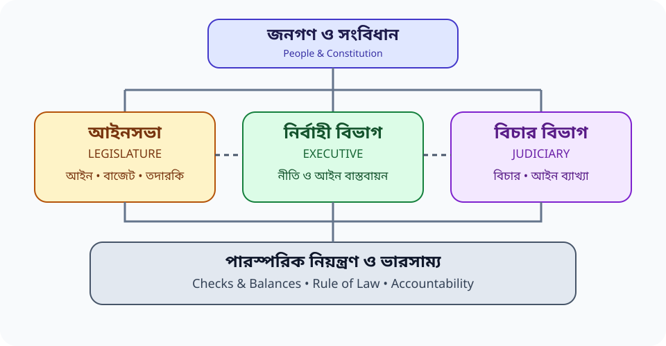

# Chapter 08 — রাষ্ট্রের অঙ্গসমূহ: আইন, নির্বাহী ও বিচার বিভাগ
> **BCS Written · Bangladesh Affairs · Subject Code 005**  
> **মূল ভাষা:** বাংলা; গুরুত্বপূর্ণ টার্ম ও প্রশ্ন: English  
> **পাঠের বিন্যাস:** সংবিধানভিত্তিক ধারণা → অঙ্গভিত্তিক বিশ্লেষণ → ক্ষমতার ভারসাম্য → বিগত প্রশ্নের থিম → মডেল উত্তর → পুনরালোচনা।

[← মূল ১৬ অধ্যায়ের সূচি](../README.md) · [🧾 35th–47th PYQ Map](./PYQ-35-47-MAP.md) · [📘 25 Answered Model Q&A](./BCS-WRITTEN-QUESTION-BANK.md) · [💬 English Quotations](./QUOTATIONS.md) · [📝 Model Essays](./PYQ-BASED-ESSAYS.md)

> [!NOTE]
> 📱 **মোবাইল-ফ্রেন্ডলি অধ্যায়:** ছোট অনুচ্ছেদ, responsive Markdown tables, সহজ text-diagram এবং সরাসরি section navigation রাখা হয়েছে। বড় সারণি ফোনে প্রয়োজন হলে horizontal scroll করুন।

<a id="top"></a>

## Visual Atlas — বাস্তব প্রতিষ্ঠান ও সংবিধানভিত্তিক চিত্র

> **ছবি ব্যবহারের নোট:** Wikimedia Commons-এর উৎস ও লাইসেন্সের পাতা লিংক করা আছে। ছবিগুলো প্রতিষ্ঠান চেনার সহায়ক, আইনগত ক্ষমতার প্রমাণ নয়।

### জাতীয় সংসদ ভবন — Legislature


**Attribution:** Subarashitours, [Wikimedia Commons file page](https://commons.wikimedia.org/wiki/File:Jatiya_Sangsad_Bhaban,_Dhaka,_Bangladesh.jpg), CC BY-SA 4.0.

### বাংলাদেশ সুপ্রিম কোর্ট — Judiciary


**Attribution:** Basir Shikder, [Wikimedia Commons file page](https://commons.wikimedia.org/wiki/File:Bangladesh_Supreme_Court_Main_Building.jpg), CC BY-SA 4.0.

### সংবিধান ও প্রতিষ্ঠান বুঝতে SVG visual
- [🧭 Three Organs of the State](./assets/three-organs-map.svg)
- [⚖️ Checks and Balances](./assets/checks-balances.svg)
- [📝 Constitutional Remedy Flowchart](./assets/constitutional-remedy-flow.svg)
- [আগের responsive diagram](./assets/state-organs.svg)

**নোট:** এই অধ্যায়ে ভৌগোলিক মানচিত্র মূল বিষয় নয়; তাই অপ্রাসঙ্গিক map না দিয়ে প্রতিষ্ঠান, সাংবিধানিক ক্ষমতা ও প্রতিকার-প্রক্রিয়ার diagram দেওয়া হয়েছে।


> [!TIP]
> 🟢 **পড়ার পদ্ধতি:** ধারণা বুঝুন → অনুচ্ছেদ/অনুচ্ছেদ নম্বর মিলিয়ে নিন → আইনসভা, নির্বাহী ও বিচার বিভাগের তুলনা করুন → ২০ নম্বরের একটি উত্তর লিখুন → শেষে Quick Revision দেখুন।

## বিষয়সূচি

| শেখার ধাপ | মূল বিষয় | পরীক্ষার অনুশীলন |
|---|---|---|
| [শিখনফল](#start) | [রাষ্ট্রের অঙ্গ ও সাংবিধানিক কাঠামো](#concept) | [বিগত প্রশ্নের থিম অডিট](#pyq) |
| [মূল পরিভাষা](#terms) | [আইনসভা—জাতীয় সংসদ](#legislature) | [উত্তর লেখার কৌশল](#strategy) |
| [সংবিধানের ভিত্তি](#constitution) | [নির্বাহী বিভাগ](#executive) | [মডেল প্রশ্ন ও উত্তর](#questions) |
| [তিন অঙ্গের সম্পর্ক](#checks) | [বিচার বিভাগ](#judiciary) | [দ্রুত পুনরালোচনা](#revision) |
| [চিত্র ও তুলনা](#visuals) | [চ্যালেঞ্জ ও সংস্কার](#reform) | [উৎস তালিকা](#sources) |
| [35th–47th PYQ Map](./PYQ-35-47-MAP.md) | [২৫টি Model Q&A](./BCS-WRITTEN-QUESTION-BANK.md) | [English Quotations](./QUOTATIONS.md) |

<a id="start"></a>
## ১. শিখনফল ও অধ্যায়ের সারকথা

এই অধ্যায়ের উদ্দেশ্য শুধু রাষ্ট্রপতি, প্রধানমন্ত্রী, সংসদ বা আদালতের নাম মুখস্থ করানো নয়; বরং রাষ্ট্রক্ষমতা কীভাবে গঠিত, প্রয়োগ, নিয়ন্ত্রিত ও পর্যালোচিত হয় তা বোঝানো। সংবিধান রাষ্ট্রের সর্বোচ্চ আইনগত কাঠামো নির্ধারণ করে। আইনসভা আইন প্রণয়ন ও সরকারের জবাবদিহি নিশ্চিত করে; নির্বাহী বিভাগ আইন ও নীতি বাস্তবায়ন করে; বিচার বিভাগ আইন ব্যাখ্যা, বিরোধ নিষ্পত্তি এবং সাংবিধানিক অধিকার রক্ষায় ভূমিকা রাখে। কার্যকর রাষ্ট্রে কোনো অঙ্গই সীমাহীন নয়—প্রত্যেকের ক্ষমতা সংবিধান ও আইনের দ্বারা সীমাবদ্ধ।

**এ অধ্যায় শেষে আপনি পারবেন:**
- বাংলাদেশের রাষ্ট্রের তিন অঙ্গের গঠন, ক্ষমতা ও দায়িত্ব তুলনা করতে;
- সংবিধানের ৫৫, ৬৫, ৭০, ৯৪, ১০২ ও ১১১ অনুচ্ছেদের প্রাসঙ্গিকতা ব্যাখ্যা করতে;
- সংসদীয় সরকারব্যবস্থায় মন্ত্রিসভার যৌথ দায়বদ্ধতা ও সংসদীয় তদারকির সম্পর্ক দেখাতে;
- বিচার বিভাগের স্বাধীনতা, বিচারিক পর্যালোচনা ও আইনের শাসনের গুরুত্ব বিশ্লেষণ করতে;
- ক্ষমতার বিভাজন, পারস্পরিক নিয়ন্ত্রণ ও ভারসাম্যের সীমাবদ্ধতা মূল্যায়ন করতে;
- প্রশ্নের নির্দেশক শব্দ অনুযায়ী ৫/১০/২০ নম্বরের উত্তর লিখতে।

> [!IMPORTANT]
> **মূল যুক্তি:** রাষ্ট্রের তিন অঙ্গের কার্যকর সমন্বয় দরকার, কিন্তু সমন্বয় যেন এক অঙ্গের হাতে অতিরিক্ত ক্ষমতা কেন্দ্রীভূত না করে। দক্ষতা, স্বাধীনতা, স্বচ্ছতা ও জবাবদিহির ভারসাম্যই সাংবিধানিক শাসনের ভিত্তি।

<a id="concept"></a>
## ২. রাষ্ট্রের অঙ্গসমূহ: ধারণা ও সাংবিধানিক দর্শন

রাষ্ট্রের অঙ্গ (Organs of the State) বলতে রাষ্ট্রীয় ক্ষমতা প্রয়োগের প্রধান সাংবিধানিক প্রতিষ্ঠানগুলোকে বোঝায়। প্রচলিত বিশ্লেষণে এগুলো তিনটি: Legislature, Executive ও Judiciary। এই বিভাজন কার্যগত—আইন তৈরি, আইন বাস্তবায়ন এবং আইন ব্যাখ্যা/বিচার। বাস্তবে তিন অঙ্গের মধ্যে যোগাযোগ ও কিছু সাংবিধানিক পারস্পরিক নির্ভরতা থাকে। তাই “separation of powers” মানে সব ক্ষেত্রে সম্পূর্ণ বিচ্ছিন্নতা নয়; বরং দায়িত্বের স্বাতন্ত্র্য, ক্ষমতার সীমা এবং একে অন্যকে জবাবদিহির আওতায় রাখার ব্যবস্থা।

### ক্ষমতার বিভাজন ও ভারসাম্য
ক্ষমতার বিভাজনের মূল উদ্দেশ্য হলো স্বেচ্ছাচার প্রতিরোধ, নাগরিক স্বাধীনতা সুরক্ষা এবং রাষ্ট্রীয় সিদ্ধান্তের বৈধতা নিশ্চিত করা। আইনসভা নির্বাহীকে প্রশ্ন করতে পারে; আদালত আইন বা প্রশাসনিক পদক্ষেপের সাংবিধানিকতা পরীক্ষা করতে পারে; নির্বাহী আইন বাস্তবায়ন ও রাষ্ট্র পরিচালনার দায়িত্ব পালন করে। তবে কোনো ব্যবস্থাই শুধু কাগুজে কাঠামোর কারণে কার্যকর হয় না—প্রতিষ্ঠানগত সক্ষমতা, রাজনৈতিক সংস্কৃতি, তথ্যপ্রাপ্তি, স্বাধীন বিচারব্যবস্থা ও নাগরিক অংশগ্রহণও জরুরি।

**পরীক্ষার জন্য পার্থক্য মনে রাখুন**
- **Separation of powers:** দায়িত্ব ও ক্ষমতার প্রাতিষ্ঠানিক স্বাতন্ত্র্য।
- **Checks and balances:** এক অঙ্গের ক্ষমতা অন্য অঙ্গের মাধ্যমে সংবিধানসঙ্গতভাবে নিয়ন্ত্রিত হওয়া।
- **Rule of law:** ব্যক্তি বা প্রতিষ্ঠান নির্বিশেষে আইন অনুযায়ী ক্ষমতা প্রয়োগ; স্বেচ্ছাচার নয়।
- **Constitutionalism:** ক্ষমতা সংবিধান দ্বারা সীমিত এবং অধিকার-জবাবদিহির কাঠামো দ্বারা নিয়ন্ত্রিত।
- **Judicial review:** আদালতের মাধ্যমে আইন বা সরকারি পদক্ষেপের সাংবিধানিক বৈধতা পরীক্ষা।

<a id="constitution"></a>
## ৩. সাংবিধানিক ভিত্তি: পরীক্ষায় যেসব অনুচ্ছেদ কাজে লাগবে

বাংলাদেশের সংবিধান ১৯৭২ সালে গৃহীত হয়। রাষ্ট্রের অঙ্গসমূহের গঠন ও ক্ষমতা সংবিধানের বিভিন্ন ভাগে বণ্টিত। অনুচ্ছেদ নম্বর মুখস্থ করার চেয়ে সংশ্লিষ্ট নীতি ও প্রয়োগ বোঝা বেশি গুরুত্বপূর্ণ।

| অনুচ্ছেদ | বিষয় | উত্তরে কীভাবে ব্যবহার করবেন |
|---|---|---|
| ৭ | সংবিধানের প্রাধান্য ও জনগণের সার্বভৌমত্ব | রাষ্ট্রীয় ক্ষমতার সাংবিধানিক সীমা |
| ২২ | নির্বাহী অঙ্গ থেকে বিচার বিভাগের পৃথকীকরণে রাষ্ট্রের নির্দেশনা | বিচারিক স্বাধীনতা ও প্রাতিষ্ঠানিক সংস্কার |
| ৫৫ | মন্ত্রিসভা, নির্বাহী ক্ষমতা ও সংসদের কাছে যৌথ দায়বদ্ধতা | সংসদীয় সরকারব্যবস্থা |
| ৬৫ | জাতীয় সংসদ ও আইন প্রণয়ন ক্ষমতা | আইনসভার সাংবিধানিক ভিত্তি |
| ৭০ | দলত্যাগ/দলীয় অবস্থানের সঙ্গে আসন শূন্য হওয়ার বিধান | দলীয় শৃঙ্খলা বনাম সংসদ সদস্যের স্বাধীন মত |
| ৭৬ | সংসদীয় স্থায়ী কমিটি | নির্বাহী তদারকি ও কমিটির কার্যকারিতা |
| ৮০–৮১ | বিল ও অর্থবিল-সংক্রান্ত বিধান | আইন প্রণয়নের প্রক্রিয়া |
| ৯৪ | সুপ্রিম কোর্ট; আপিল বিভাগ ও হাইকোর্ট বিভাগ | বিচার বিভাগের কাঠামো ও বিচারিক স্বাধীনতা |
| ১০২ | হাইকোর্ট বিভাগের রিট-সংক্রান্ত ক্ষমতা | মৌলিক অধিকার ও বিচারিক পর্যালোচনা |
| ১০৯ | অধস্তন আদালত ও ট্রাইব্যুনালের ওপর হাইকোর্ট বিভাগের তত্ত্বাবধান/নিয়ন্ত্রণ | বিচারব্যবস্থার প্রশাসনিক কাঠামো |
| ১১১ | সুপ্রিম কোর্টের ঘোষিত আইনের বাধ্যতামূলক প্রভাব | বিচারিক নজির ও আইনের ধারাবাহিকতা |
| ১১২ | প্রজাতন্ত্রের সকল কর্তৃপক্ষের সুপ্রিম কোর্টকে সহায়তার দায়িত্ব | আদালতের আদেশ কার্যকর করার গুরুত্ব |

> [!NOTE]
> 🔵 **Source for exam:** *The Constitution of the People’s Republic of Bangladesh*, Government of Bangladesh, Laws of Bangladesh (BDLaws), Parts V–VI. অনুচ্ছেদের হালনাগাদ পাঠ লিখতে পরীক্ষার আগে সরকারি আইনভান্ডার দেখুন; সংশোধনীতে ভাষা/প্রয়োগ বদলাতে পারে।

<a id="terms"></a>
## ৪. মূল পরিভাষা — English–বাংলা

| English term | সহজ বাংলা অর্থ | পরীক্ষামুখী ব্যাখ্যা |
|---|---|---|
| Legislature | আইনসভা | আইন প্রণয়ন, বাজেট অনুমোদন ও নির্বাহী তদারকি |
| Executive | নির্বাহী বিভাগ | আইন ও নীতি বাস্তবায়ন, প্রশাসন পরিচালনা |
| Judiciary | বিচার বিভাগ | বিরোধ নিষ্পত্তি, আইন ব্যাখ্যা, অধিকার সুরক্ষা |
| Parliament / Jatiya Sangsad | জাতীয় সংসদ | সংবিধান অনুযায়ী আইন প্রণয়নের কেন্দ্রীয় প্রতিষ্ঠান |
| Cabinet | মন্ত্রিসভা | প্রধানমন্ত্রীর নেতৃত্বে নীতি ও নির্বাহী সিদ্ধান্তের কাঠামো |
| Collective responsibility | যৌথ দায়বদ্ধতা | মন্ত্রিসভার সংসদের কাছে সম্মিলিত রাজনৈতিক দায় |
| Judicial independence | বিচারিক স্বাধীনতা | চাপ বা অনুচিত হস্তক্ষেপ ছাড়া বিচারিক সিদ্ধান্ত |
| Judicial review | বিচারিক পর্যালোচনা | আইন/প্রশাসনিক পদক্ষেপের সাংবিধানিক বৈধতা পরীক্ষা |
| Writ | রিট | অধিকার ও আইনগত সীমা রক্ষায় উচ্চ আদালতের নির্দেশ |
| Accountability | জবাবদিহি | সিদ্ধান্তের কারণ, ফল ও দায় ব্যাখ্যার বাধ্যবাধকতা |
| Oversight | তদারকি | তথ্য, প্রশ্ন, কমিটি, নিরীক্ষা ও শুনানির মাধ্যমে পর্যবেক্ষণ |
| Rule of law | আইনের শাসন | আইনসম্মত, সমান ও পূর্বানুমেয় শাসন |
| Due process | ন্যায়সংগত আইনগত প্রক্রিয়া | সিদ্ধান্তের আগে আইনানুগ ও ন্যায্য প্রক্রিয়া অনুসরণ |
| Checks and balances | ক্ষমতার পারস্পরিক নিয়ন্ত্রণ | ক্ষমতার অপব্যবহার ঠেকাতে প্রতিষ্ঠানগুলোর নিয়ন্ত্রণব্যবস্থা |

<a id="legislature"></a>
## ৫. আইনসভা: জাতীয় সংসদের গঠন, ক্ষমতা ও কার্যাবলি

### ৫.১ সাংবিধানিক অবস্থান
সংবিধানের ৬৫ অনুচ্ছেদ অনুযায়ী বাংলাদেশের আইন প্রণয়ন ক্ষমতা জাতীয় সংসদে ন্যস্ত, সংবিধানের বিধান সাপেক্ষে। সংসদ আইন পাস করে, রাষ্ট্রীয় আয়-ব্যয়ের অনুমোদন দেয়, জাতীয় সমস্যা নিয়ে আলোচনা করে এবং নির্বাহী বিভাগের জবাবদিহির একটি প্রধান মঞ্চ হিসেবে কাজ করে। সংসদের ভূমিকা কেবল আইন তৈরিতে সীমিত নয়; এটি জনগণের দাবি রাষ্ট্রীয় আলোচনায় আনে এবং বিভিন্ন নীতি ও প্রশাসনিক সিদ্ধান্তের রাজনৈতিক বৈধতা যাচাই করে।

সংসদের কার্যকারিতা নির্ভর করে নিয়মিত অধিবেশন, মানসম্মত বিতর্ক, বিরোধী মতের সুযোগ, কার্যকর কমিটি, নির্ভরযোগ্য তথ্য এবং সংসদ সদস্যদের গবেষণা-সহায়তার ওপর। সংখ্যাগরিষ্ঠতা সরকার গঠনে গুরুত্বপূর্ণ হলেও তা সংসদীয় আলোচনার বিকল্প নয়। শক্তিশালী সংসদ মানে কেবল দ্রুত বিল পাস নয়; বরং আইন প্রণয়নের আগে প্রভাব মূল্যায়ন, সংশ্লিষ্ট পক্ষের মতামত এবং বাস্তবায়ন পর্যবেক্ষণ।

### ৫.২ সংসদের প্রধান কাজ
**প্রথমত, আইন প্রণয়ন।** বিল উত্থাপন, আলোচনা, সংশোধন, ভোট এবং সংবিধানসম্মত প্রক্রিয়ায় রাষ্ট্রপতির সম্মতির পর আইন কার্যকর হয়। আইন প্রণয়নের মান বাড়াতে খসড়া আইন প্রকাশ, জনপরামর্শ, বিশেষজ্ঞ মতামত এবং মানবাধিকার/অর্থনৈতিক প্রভাব বিশ্লেষণ সহায়ক।

**দ্বিতীয়ত, আর্থিক নিয়ন্ত্রণ।** বাজেট, কর আরোপ, সরকারি ব্যয় ও রাষ্ট্রীয় অর্থ ব্যবহারের অনুমোদনে সংসদের ভূমিকা কেন্দ্রীয়। বাজেট পাসের পাশাপাশি বাস্তব ব্যয়, প্রকল্পের ফলাফল এবং নিরীক্ষা-আপত্তির নিষ্পত্তি পর্যবেক্ষণ করা প্রয়োজন। অর্থের অনুমোদন ও অর্থের ফলাফল যাচাই—দুটিই আর্থিক জবাবদিহির অংশ।

**তৃতীয়ত, নির্বাহী তদারকি।** প্রশ্নোত্তর, আলোচনা, মুলতবি প্রস্তাব/আলোচনা, সংসদীয় কমিটি, প্রতিবেদন এবং নিরীক্ষা-সংক্রান্ত অনুসরণের মাধ্যমে সরকারকে জবাবদিহির আওতায় আনা যায়। কমিটির কার্যকারিতা বাড়াতে পর্যাপ্ত গবেষণা সহায়তা, সময়মতো তথ্যপ্রাপ্তি, সুপারিশ বাস্তবায়নের ট্র্যাকিং এবং নিরপেক্ষ শুনানি গুরুত্বপূর্ণ।

**চতুর্থত, প্রতিনিধিত্ব ও জনমত।** সংসদ সদস্যরা এলাকার চাহিদা, নাগরিক সমস্যা ও জাতীয় নীতির প্রশ্ন সংসদে উত্থাপন করেন। কার্যকর প্রতিনিধিত্বের জন্য নারী, সংখ্যালঘু, প্রান্তিক জনগোষ্ঠী ও ভৌগোলিকভাবে পিছিয়ে থাকা এলাকার মতামত শোনা প্রয়োজন।

**পঞ্চমত, সাংবিধানিক ও রাজনৈতিক ভূমিকা।** সংবিধান সংশোধন, নির্দিষ্ট সাংবিধানিক পদে প্রযোজ্য সংসদীয় প্রক্রিয়া এবং জাতীয় সংকটে আলোচনা—সবই আইনসভার দায়িত্বের অংশ, তবে প্রতিটি ক্ষেত্রে সংবিধানের নির্দিষ্ট শর্ত মানতে হয়।

### ৫.৩ চ্যালেঞ্জ ও করণীয়
দলীয় মেরুকরণ, বিরোধী মতের সীমিত জায়গা, কমিটির সুপারিশ বাস্তবায়নে ঘাটতি, আইন প্রণয়নে পর্যাপ্ত পরামর্শের অভাব এবং সদস্যদের গবেষণা-সহায়তার সীমাবদ্ধতা সংসদের মান কমাতে পারে। সমাধান হিসেবে কমিটিকে শক্তিশালী করা, আইন প্রস্তাবের সঙ্গে explanatory note ও impact assessment প্রকাশ, বাজেট-পরবর্তী ফলাফল পর্যালোচনা, উন্মুক্ত তথ্য এবং কার্যকর বিরোধী দলের অংশগ্রহণ প্রয়োজন। সংবিধানের ৭০ অনুচ্ছেদ নিয়ে আলোচনায় দলীয় স্থিতিশীলতা ও সংসদ সদস্যের বিবেকনির্ভর ভোটের মধ্যে ভারসাম্য বিবেচনা করতে হবে; সরলভাবে একে শুধু ভালো বা খারাপ বলা যথেষ্ট নয়।

<a id="executive"></a>
## ৬. নির্বাহী বিভাগ: রাষ্ট্রপতি, প্রধানমন্ত্রী, মন্ত্রিসভা ও প্রশাসন

### ৬.১ নির্বাহী বিভাগের অর্থ
নির্বাহী বিভাগ আইন বাস্তবায়ন, সরকারি নীতি পরিচালনা, জনসেবা প্রদান, আইনশৃঙ্খলা ও নিরাপত্তা ব্যবস্থাপনা, বাজেট বাস্তবায়ন এবং দুর্যোগ মোকাবিলার দায়িত্ব পালন করে। এর মধ্যে সাংবিধানিক নির্বাহী, মন্ত্রিসভা, মন্ত্রণালয়/বিভাগ, অধিদপ্তর এবং মাঠ প্রশাসনের বিভিন্ন স্তর রয়েছে। প্রশাসনিক সিদ্ধান্ত আইনসম্মত, যুক্তিসংগত, বৈষম্যহীন ও জনস্বার্থমুখী হওয়া প্রয়োজন।

### ৬.২ রাষ্ট্রপতির ভূমিকা
রাষ্ট্রপতি রাষ্ট্রের সাংবিধানিক প্রধান। রাষ্ট্রপতির নির্বাচন, মেয়াদ, ক্ষমতা ও দায়িত্ব সংবিধানে নির্ধারিত। সংসদীয় ব্যবস্থায় রাষ্ট্রপতির অনেক কার্যাবলি সংবিধান ও প্রচলিত সাংবিধানিক পদ্ধতি অনুযায়ী সম্পাদিত হয়; সব বিষয়ে রাষ্ট্রপতি একক রাজনৈতিক নির্বাহী হিসেবে কাজ করেন—এমন ধারণা সঠিক নয়। রাষ্ট্রপতির ক্ষমতা ব্যাখ্যা করতে সংশ্লিষ্ট অনুচ্ছেদ এবং প্রযোজ্য পরামর্শ/ব্যতিক্রমের বিধান উল্লেখ করা উচিত।

### ৬.৩ প্রধানমন্ত্রী ও মন্ত্রিসভা
সংবিধানের ৫৫ অনুচ্ছেদে প্রধানমন্ত্রীর নেতৃত্বে মন্ত্রিসভার কথা বলা হয়েছে এবং মন্ত্রিসভার সংসদের কাছে যৌথ দায়বদ্ধতা নির্ধারিত। সংসদীয় সরকারব্যবস্থায় প্রধানমন্ত্রী সরকারের নীতি ও নির্বাহী কাজের কেন্দ্রীয় নেতৃত্ব দেন; মন্ত্রীরা নিজ নিজ মন্ত্রণালয়ের দায়িত্ব পালন করেন। যৌথ দায়বদ্ধতার অর্থ হলো মন্ত্রিসভার সিদ্ধান্তের রাজনৈতিক দায় সম্মিলিতভাবে বহন করা, এবং সংসদের আস্থা হারালে সরকারকে সাংবিধানিক পরিণতির মুখোমুখি হতে হয়।

### ৬.৪ প্রশাসনিক দক্ষতা ও জবাবদিহি
নীতির ঘোষণা ও বাস্তব ফলাফলের মধ্যে ব্যবধান কমানো নির্বাহী বিভাগের বড় দায়িত্ব। এ জন্য প্রয়োজন দক্ষ জনবল, সুস্পষ্ট দায়িত্ববণ্টন, সময়সীমাভিত্তিক সেবা, অভিযোগ নিষ্পত্তি, সরকারি ক্রয়ে স্বচ্ছতা, অভ্যন্তরীণ নিরীক্ষা, কর্মসম্পাদন মূল্যায়ন এবং তথ্য অধিকার। ডিজিটাল সেবা নাগরিকের সময় ও ব্যয় কমাতে পারে; কিন্তু ডিজিটাল বিভাজন, ব্যক্তিগত তথ্যের নিরাপত্তা এবং মানবিক সহায়তার বিকল্প না থাকার বিষয়ও বিবেচ্য।

**নির্বাহী বিভাগের সাধারণ ঝুঁকি:** অতিরিক্ত কেন্দ্রীকরণ, রাজনৈতিক/ব্যক্তিগত প্রভাব, দীর্ঘসূত্রতা, দুর্নীতি, দুর্বল সমন্বয়, তথ্য গোপন, প্রকল্পের ব্যয় বৃদ্ধি এবং সেবার অসম বণ্টন। এগুলো মোকাবিলায় নিয়মভিত্তিক সিদ্ধান্ত, উন্মুক্ত তথ্য, স্বাধীন নিরীক্ষা, নাগরিক সনদ, অভিযোগের কার্যকর প্রতিকার এবং ফলাফলভিত্তিক মূল্যায়ন দরকার।

<a id="judiciary"></a>
## ৭. বিচার বিভাগ: কাঠামো, ক্ষমতা ও স্বাধীনতা

### ৭.১ কাঠামো
সংবিধানের ৯৪ অনুচ্ছেদ অনুযায়ী বাংলাদেশের সুপ্রিম কোর্টের দুটি বিভাগ—আপিল বিভাগ (Appellate Division) এবং হাইকোর্ট বিভাগ (High Court Division)। এর বাইরে আইন অনুযায়ী অধস্তন দেওয়ানি ও ফৌজদারি আদালত এবং বিশেষায়িত ট্রাইব্যুনাল রয়েছে। আদালতের এখতিয়ার নির্ধারিত হয় সংবিধান ও প্রযোজ্য আইন দ্বারা; সব আদালতের ক্ষমতা একই নয়।

### ৭.২ বিচার বিভাগের মূল কাজ
**বিরোধ নিষ্পত্তি:** ব্যক্তি, প্রতিষ্ঠান ও রাষ্ট্রের মধ্যে আইনগত বিরোধ নিষ্পত্তি করা।  
**আইন ব্যাখ্যা:** আইন ও সংবিধানের বিধান ব্যাখ্যা করে ধারাবাহিকতা এবং পূর্বানুমেয়তা বজায় রাখা।  
**মৌলিক অধিকার সুরক্ষা:** আইনসম্মত প্রতিকার, বিশেষত প্রযোজ্য ক্ষেত্রে হাইকোর্ট বিভাগের রিট-এখতিয়ার ব্যবহার করে সরকারি কর্তৃপক্ষকে আইনগত সীমার মধ্যে রাখা।  
**বিচারিক পর্যালোচনা:** আইন বা সরকারি পদক্ষেপ সংবিধানবিরোধী কি না, উপযুক্ত মামলায় তা পরীক্ষা করা।  
**আইনের শাসন:** ক্ষমতাবান বা সাধারণ নাগরিক—সবার ক্ষেত্রে আইন প্রয়োগের নীতি শক্তিশালী করা।

### ৭.৩ বিচারিক স্বাধীনতা কেন গুরুত্বপূর্ণ?
বিচারককে রাজনৈতিক চাপ, ব্যক্তিগত স্বার্থ, ভয় বা অনুচিত প্রভাব ছাড়া প্রমাণ ও আইন অনুসারে সিদ্ধান্ত দিতে পারতে হবে। বিচারিক স্বাধীনতা বিচারকের ব্যক্তিগত সুবিধা নয়; এটি ন্যায়বিচার পাওয়ার নাগরিক অধিকার ও সংবিধানের কার্যকারিতার নিশ্চয়তা। স্বাধীনতার সঙ্গে জবাবদিহিও জরুরি—স্বচ্ছ নিয়োগ ও পদোন্নতি-প্রক্রিয়া, নৈতিক মানদণ্ড, কারণসম্বলিত রায়, সময়মতো বিচার এবং শৃঙ্খলাপূর্ণ প্রশাসন জনগণের আস্থা বাড়ায়।

### ৭.৪ বিচারপ্রাপ্তির প্রতিবন্ধকতা
মামলার জট, বিচার শেষ হতে দীর্ঘ সময়, মামলার খরচ, আইনগত সহায়তা সম্পর্কে অজ্ঞতা, সাক্ষী হাজিরার সমস্যা, তদন্তের মান এবং আদালতের অবকাঠামোগত সীমাবদ্ধতা বিচারপ্রাপ্তি বাধাগ্রস্ত করতে পারে। শুধু বিচারকের সংখ্যা বাড়ানোই যথেষ্ট নয়; বিকল্প বিরোধ নিষ্পত্তি যেখানে উপযুক্ত, ডিজিটাল কেস ম্যানেজমেন্ট, সময়সীমাভিত্তিক শুনানি, আইনগত সহায়তা, দক্ষ তদন্ত, সাক্ষী সুরক্ষা এবং রায় বাস্তবায়নের সক্ষমতাও প্রয়োজন।

> [!WARNING]
> **আইনগত নির্ভুলতা:** রিট, আপিল, রিভিশন, মূল এখতিয়ার ও পরামর্শমূলক এখতিয়ারকে একই বিষয় হিসেবে লিখবেন না। প্রতিটি ক্ষমতার ভিত্তি ও সীমা আলাদা; প্রশ্নে প্রাসঙ্গিক অনুচ্ছেদ/আইন উল্লেখ করুন।

<a id="checks"></a>
## ৮. তিন অঙ্গের পারস্পরিক সম্পর্ক: checks and balances

রাষ্ট্রের অঙ্গগুলোর কাজ আলাদা হলেও তাদের মধ্যে নিয়ন্ত্রিত সম্পর্ক রয়েছে। সংসদ আইন করে এবং নির্বাহীকে প্রশ্ন করে; নির্বাহী নীতি বাস্তবায়ন করে ও সংসদে বাজেট/প্রতিবেদন উপস্থাপন করে; বিচার বিভাগ বিরোধ নিষ্পত্তি ও সাংবিধানিক বৈধতা পরীক্ষা করে। আবার আদালতের সিদ্ধান্ত বাস্তবায়নে প্রশাসনিক সহযোগিতা প্রয়োজন, এবং আদালতও সংবিধান ও আইনের সীমার মধ্যে কাজ করে।

### এক নজরে তুলনা

| বিষয় | আইনসভা | নির্বাহী বিভাগ | বিচার বিভাগ |
|---|---|---|---|
| মূল কাজ | আইন প্রণয়ন, বাজেট, তদারকি | আইন/নীতি বাস্তবায়ন, জনসেবা | বিচার, আইন ব্যাখ্যা, অধিকার সুরক্ষা |
| কেন্দ্রীয় প্রতিষ্ঠান | জাতীয় সংসদ | রাষ্ট্রপতি, প্রধানমন্ত্রী, মন্ত্রিসভা ও প্রশাসন—সংবিধান অনুযায়ী | সুপ্রিম কোর্ট, অধস্তন আদালত/ট্রাইব্যুনাল |
| প্রধান জবাবদিহির পথ | ভোটার, সংসদীয় বিধি, জনআলোচনা | সংসদ, আইন, নিরীক্ষা, প্রশাসনিক/বিচারিক পর্যালোচনা | সংবিধান, আইন, আপিল ও নৈতিক/প্রাতিষ্ঠানিক মানদণ্ড |
| সাধারণ ঝুঁকি | দুর্বল বিতর্ক/তদারকি | ক্ষমতার কেন্দ্রীকরণ/দুর্নীতি/অদক্ষতা | মামলাজট/প্রবেশগম্যতা/স্বাধীনতার ঝুঁকি |
| উন্নয়নের উপায় | শক্তিশালী কমিটি, তথ্য ও জনপরামর্শ | দক্ষতা, স্বচ্ছতা, ফলাফল মূল্যায়ন | স্বাধীনতা, কেস ম্যানেজমেন্ট, আইনি সহায়তা |

<a id="visuals"></a>
## ৯. সহজ চিত্র — রাষ্ট্রক্ষমতার প্রবাহ



**অতিরিক্ত চিত্র:** [তিন অঙ্গের মানচিত্র](./assets/three-organs-map.svg) · [Checks & Balances](./assets/checks-balances.svg) · [Constitutional Remedy Flow](./assets/constitutional-remedy-flow.svg)


```text
                 জনগণ ও সংবিধান
                        |
          +-------------+-------------+
          |             |             |
      আইনসভা         নির্বাহী       বিচার বিভাগ
   আইন/বাজেট/       নীতি ও আইন      বিচার/আইন
   তদারকি            বাস্তবায়ন       ব্যাখ্যা
          |             |             |
          +------ পারস্পরিক নিয়ন্ত্রণ ------+
                        |
          আইনের শাসন • অধিকার • জবাবদিহি
```

**চিত্রের ব্যাখ্যা:** তিন অঙ্গের বৈধতা সংবিধান ও আইনের কাঠামোর সঙ্গে যুক্ত। জনগণ ভোট, মতপ্রকাশ, তথ্যপ্রাপ্তি ও আইনসম্মত অংশগ্রহণের মাধ্যমে শাসনব্যবস্থায় ভূমিকা রাখে। কোনো একটি অঙ্গ অন্য দুটির দায়িত্ব সম্পূর্ণভাবে প্রতিস্থাপন করতে পারে না।

<a id="pyq"></a>
## ১০. বিগত BCS Written প্রশ্নের থিম অডিট

**গুরুত্বপূর্ণ পদ্ধতিগত নোট:** BPSC-এর প্রতিটি মূল প্রশ্নপত্রের স্ক্যান এই অধ্যায়ে আলাদাভাবে সংযুক্ত ও line-by-line যাচাই করা হয়নি। তাই নিচের অগ্রাধিকারকে “এই প্রশ্ন নিশ্চিতভাবে এসেছে” বলা হচ্ছে না। এটি BPSC-এর Bangladesh Affairs syllabus, প্রকাশ্য লিখিত প্রশ্ন-আর্কাইভ এবং রাষ্ট্রের অঙ্গসমূহের পুনরাবৃত্তিযোগ্য সাংবিধানিক ধারণার ভিত্তিতে প্রস্তুতির মানচিত্র। মূল প্রশ্নপত্র যাচাই ছাড়া কোনো নির্দিষ্ট বছর/প্রশ্নকে verified PYQ হিসেবে উদ্ধৃত করবেন না।

**বছরভিত্তিক audit ও source links:** [Chapter 08 — 35th–47th BCS Question Map](./PYQ-35-47-MAP.md). ৩৫তম, ৪৫তম ও ৪৭তম পরীক্ষার প্রাসঙ্গিক থিম আলাদা করে দেখানো হয়েছে; অন্য বছরের item-level verification বাকি থাকলে তা স্পষ্টভাবে চিহ্নিত।

### প্রশ্নের ধরন অনুযায়ী প্রস্তুতি

| থিম | অগ্রাধিকার | কেন প্রস্তুত করবেন | সম্ভাব্য নির্দেশক শব্দ |
|---|---|---|---|
| জাতীয় সংসদের গঠন, ক্ষমতা ও কার্যাবলি | A | আইনসভা ও গণতান্ত্রিক প্রতিনিধিত্বের মূল বিষয় | Discuss / Explain |
| সংসদীয় তদারকি ও মন্ত্রিসভার যৌথ দায়বদ্ধতা | A | আইনসভা-নির্বাহীর সম্পর্ক ব্যাখ্যা করে | Examine / Assess |
| বিচার বিভাগের স্বাধীনতা ও আইনের শাসন | A | অধিকার, ন্যায়বিচার ও সাংবিধানিক শাসনের কেন্দ্রীয় বিষয় | Evaluate / Analyse |
| বিচারিক পর্যালোচনা ও রিট | A | আদালতের সাংবিধানিক ভূমিকা বোঝায় | Explain / Discuss |
| ক্ষমতার বিভাজন ও checks and balances | A | তিন অঙ্গকে সমন্বিতভাবে বিশ্লেষণের সুযোগ | Critically analyse |
| সংসদীয় কমিটি ও জবাবদিহি | B | তদারকির বাস্তব প্রক্রিয়া ও সংস্কার | Suggest / Evaluate |
| বিচারপ্রাপ্তি, মামলাজট ও বিচার সংস্কার | B | নীতি-সমস্যা-সমাধান কাঠামোর উপযোগী | Identify problems / Recommend |
| দলীয় শৃঙ্খলা ও সংসদ সদস্যের ভূমিকা | B | অনুচ্ছেদ ৭০-সংক্রান্ত ভারসাম্যপূর্ণ আলোচনা | Discuss critically |

**Evidence base:** BPSC, *Syllabus for BCS (Written) Examination*, Bangladesh Affairs (Subject 005); BCS EXAM-এর প্রকাশ্য লিখিত প্রশ্ন আর্কাইভ (৩৫তম–৫০তম তালিকা) একটি secondary index হিসেবে। আর্কাইভে সব প্রশ্নের মূল স্ক্যান বা বিষয়-ট্যাগ সমানভাবে পাওয়া যায় কি না তা আলাদা করে যাচাই করতে হবে। [S1–S2]

### ১০.১ লিখে অনুশীলনের জন্য Archive-reported PYQ

নিচের প্রশ্নগুলো প্রকাশ্য BCS Written question-bank-এ রিপোর্ট হওয়া প্রশ্নের সারমর্ম/ভাবানুবাদ। এগুলো হুবহু মূল প্রশ্নপত্রের transcription নয়; BPSC-এর original scan দিয়ে স্বাধীনভাবে যাচাই না হওয়ায় **archive-reported** হিসেবে চিহ্নিত। রাষ্ট্রের অঙ্গসমূহের সঙ্গে সরাসরি সম্পর্কিত প্রশ্নগুলো এখানে আলাদা করে দেওয়া হলো।

| BCS Written | প্রশ্ন হিসেবে অনুশীলন করুন | নম্বর/প্রাসঙ্গিকতা | উৎস |
|---|---|---|---|
| **৩৭তম** | আইনসভা, নির্বাহী বিভাগ ও বিচার বিভাগের সাংবিধানিক ভূমিকা, அதிகார-সীমা এবং পারস্পরিক নিয়ন্ত্রণ বিশ্লেষণ করুন। | ২০ নম্বরের প্রশ্ন হিসেবে archive-এ রিপোর্ট | [BCS EXAM — 37th Written](https://bcsexam.org/written-questions/37th-bcs-written) |
| **৩৮তম** | জাতীয় সংসদের গঠন, ক্ষমতা ও কার্যাবলি ব্যাখ্যা করুন; সংসদে নারীদের সংরক্ষিত আসনের সাংবিধানিক ব্যবস্থার তাৎপর্য আলোচনা করুন। | সংসদ-সম্পর্কিত সংক্ষিপ্ত ও বিশ্লেষণধর্মী উপপ্রশ্ন হিসেবে রিপোর্ট | [BCS EXAM — 38th Written](https://bcsexam.org/written-questions/38th-bcs-written) |
| **৪৩তম** | রাষ্ট্রের প্রধান অঙ্গগুলোর দায়িত্ব ব্যাখ্যা করুন। স্থানীয় সরকার ও নির্বাচন কমিশনের সাংবিধানিক গঠন, ভূমিকা ও জবাবদিহি আলোচনা করুন। | একাধিক প্রতিষ্ঠানভিত্তিক প্রশ্ন-থিম; নম্বর মূল scan দিয়ে পুনরায় যাচাই করতে হবে | [BCS EXAM — 43rd Written](https://bcsexam.org/written-questions/43rd-bcs-written) |
| **৪৪তম** | হাইকোর্ট বিভাগের বিচারপতি অপসারণের সাংবিধানিক পদ্ধতি ব্যাখ্যা করুন এবং বিচার বিভাগের স্বাধীনতার সঙ্গে এর সম্পর্ক বিশ্লেষণ করুন। | ৫ নম্বরের প্রশ্ন হিসেবে archive-এ রিপোর্ট | [BCS EXAM — 44th Written](https://bcsexam.org/written-questions/44th-bcs-written) |

**এই প্রশ্নগুলো থেকে যে বিষয়গুলো প্রস্তুত হবে:** সংসদের ক্ষমতা ও তদারকি, মন্ত্রিসভার যৌথ দায়বদ্ধতা, বিচার বিভাগের স্বাধীনতা, Article 70, Article 96, Article 102, নির্বাচন কমিশন, এবং ক্ষমতার বিভাজন ও checks and balances।

### কীভাবে এই থিমগুলোকে পরীক্ষার প্রশ্নে রূপ দেবেন
1. **Explain** — সংজ্ঞা, সাংবিধানিক ভিত্তি, কাজ ও একটি উদাহরণ।
2. **Discuss** — একাধিক দিক, গুরুত্ব, সীমাবদ্ধতা এবং ভারসাম্যপূর্ণ উপসংহার।
3. **Evaluate/Critically analyse** — মানদণ্ড নির্ধারণ, অর্জন ও দুর্বলতা, কারণ, ফল এবং বাস্তবসম্মত সংস্কার।
4. **Suggest measures** — সমস্যার সঙ্গে সরাসরি যুক্ত, বাস্তবায়নযোগ্য সুপারিশ; শুধু “সচেতনতা বাড়াতে হবে” লিখবেন না।

<a id="strategy"></a>
## ১১. BCS Written-এ উত্তর লেখার কৌশল

### ২০ নম্বরের উত্তরের কাঠামো
1. **ভূমিকা (প্রায় ১০%)** — প্রশ্নের ধারণা ও বাংলাদেশের সাংবিধানিক প্রেক্ষাপট।
2. **আইনগত ভিত্তি (প্রায় ১৫%)** — প্রাসঙ্গিক অনুচ্ছেদ/আইন সঠিকভাবে উল্লেখ।
3. **বিশ্লেষণ (প্রায় ৪০%)** — ভূমিকা, ক্ষমতা, কার্যকারিতা ও আন্তঃসম্পর্ক।
4. **সমস্যা ও মূল্যায়ন (প্রায় ২০%)** — বাস্তব চ্যালেঞ্জ; অতিরঞ্জন নয়।
5. **সুপারিশ ও উপসংহার (প্রায় ১৫%)** — সমস্যাভিত্তিক সমাধান ও প্রশ্নের সরাসরি উত্তর।

**ভালো উত্তরের সূত্র:** সংজ্ঞা + সাংবিধানিক অনুচ্ছেদ + প্রতিষ্ঠানের কাজ + বাস্তব সমস্যা + নির্দিষ্ট সংস্কার + ভারসাম্যপূর্ণ উপসংহার।

<a id="questions"></a>
## ১২. গুরুত্বপূর্ণ প্রশ্ন ও সংক্ষিপ্ত নির্দেশনা

1. Explain the composition and major functions of the Jatiya Sangsad.
2. Discuss the role of Parliament in ensuring executive accountability.
3. Analyse collective responsibility of the Cabinet under the Constitution of Bangladesh.
4. Explain the constitutional position of the President in a parliamentary system.
5. Evaluate the importance of judicial independence in upholding the rule of law.
6. Discuss the structure and jurisdiction of the Supreme Court of Bangladesh.
7. What is judicial review? Explain its relevance to constitutional governance.
8. Analyse the significance and limitations of parliamentary standing committees.
9. Discuss separation of powers and checks and balances in Bangladesh.
10. Identify barriers to access to justice and suggest reforms.
11. Critically discuss the relationship between party discipline and the role of MPs.
12. “Institutional independence must be accompanied by accountability.” Discuss with reference to the three organs of the state.

### ৫ নম্বরের উত্তর লেখার নমুনা: Judicial review
Judicial review is the power of a competent court to examine whether a law or public action is consistent with the Constitution. In Bangladesh, the High Court Division’s writ jurisdiction under Article 102 is an important constitutional mechanism for reviewing unlawful public action and protecting legal rights. Judicial review supports constitutional supremacy, rule of law and accountability. However, courts must act within their jurisdiction, rely on legal reasoning and respect the constitutional allocation of powers.

### ১০ নম্বরের উত্তর লেখার নমুনা: সংসদের জবাবদিহিমূলক ভূমিকা
জাতীয় সংসদ আইন প্রণয়নের পাশাপাশি নির্বাহী বিভাগের জবাবদিহি নিশ্চিত করার সাংবিধানিক মঞ্চ। সংসদ সদস্যদের প্রশ্ন, আলোচনা, বাজেট পরীক্ষা এবং স্থায়ী কমিটির মাধ্যমে মন্ত্রণালয়ের কাজ, সরকারি ব্যয় ও নীতির ফলাফল পর্যালোচনা করা যায়। সংবিধানের ৫৫ অনুচ্ছেদে মন্ত্রিসভার সংসদের কাছে যৌথ দায়বদ্ধতার নীতি এবং ৬৫ অনুচ্ছেদে সংসদের আইন প্রণয়ন ক্ষমতা এই সম্পর্কের সাংবিধানিক ভিত্তি দেয়। তবে তদারকি কার্যকর হতে হলে সংসদীয় কমিটিকে তথ্য ও গবেষণা সহায়তা, সুপারিশ বাস্তবায়নের অনুসরণ, বিরোধী মতের সুযোগ এবং উন্মুক্ত শুনানি দিতে হবে। অতএব, শক্তিশালী সংসদীয় জবাবদিহি কেবল সরকারের সমালোচনা নয়; এটি জনসম্পদের সঠিক ব্যবহার, নীতির মান এবং জনগণের আস্থা বৃদ্ধির ব্যবস্থা।

<a id="reform"></a>
## ১৩. কার্যকর রাষ্ট্রের জন্য সংস্কার-অগ্রাধিকার

**আইনসভা:** সংসদীয় কমিটির গবেষণা সক্ষমতা বাড়ানো; খসড়া আইনে জনপরামর্শ ও প্রভাব মূল্যায়ন; নিরীক্ষা-আপত্তি ও কমিটি-সুপারিশের অনুসরণ; সংসদীয় তথ্য সহজলভ্য করা।

**নির্বাহী বিভাগ:** দায়িত্ব ও সময়সীমা নির্দিষ্ট করা; সরকারি ক্রয় ও প্রকল্প বাস্তবায়নে উন্মুক্ত তথ্য; স্বাধীন নিরীক্ষা; নাগরিক সনদ ও অভিযোগ নিষ্পত্তি; যোগ্যতা-ভিত্তিক নিয়োগ ও প্রশিক্ষণ; ডিজিটাল সেবায় গোপনীয়তা ও অন্তর্ভুক্তি নিশ্চিত করা।

**বিচার বিভাগ:** বিচারিক স্বাধীনতা রক্ষা; মামলার ব্যবস্থাপনা ও সময়মতো শুনানি; উপযুক্ত ক্ষেত্রে ADR; আইনগত সহায়তা সম্প্রসারণ; সাক্ষী ও ভুক্তভোগী সুরক্ষা; রায় বাস্তবায়ন ও আদালতের প্রশাসনিক দক্ষতা বৃদ্ধি।

**সমন্বিত সংস্কার:** তথ্য অধিকার, স্বাধীন গণমাধ্যম, নাগরিক সমাজ, নিরীক্ষা ও দুর্নীতি প্রতিরোধের প্রতিষ্ঠান এবং জনসম্পৃক্ততা তিন অঙ্গের কাজকে সহায়তা করে। সংস্কারের লক্ষ্য কোনো একটি অঙ্গকে সর্বশক্তিমান করা নয়; বরং সংবিধানসঙ্গত দায়িত্ব পালনের সক্ষমতা ও জবাবদিহি বাড়ানো।

<a id="revision"></a>
## ১৪. One-page Quick Revision

- **তিন অঙ্গ:** Legislature—আইন; Executive—বাস্তবায়ন; Judiciary—বিচার/আইন ব্যাখ্যা।
- **Article 55:** Cabinet, executive power ও collective responsibility-এর মূল ভিত্তি।
- **Article 65:** জাতীয় সংসদ ও আইন প্রণয়ন ক্ষমতা।
- **Article 70:** সংসদ সদস্যের দলীয় অবস্থান/আসন-সংক্রান্ত সাংবিধানিক বিধান; বিশ্লেষণে ভারসাম্য জরুরি।
- **Article 76:** সংসদীয় স্থায়ী কমিটি।
- **Article 94:** সুপ্রিম কোর্ট—আপিল বিভাগ ও হাইকোর্ট বিভাগ।
- **Article 102:** হাইকোর্ট বিভাগের রিট-এখতিয়ার।
- **Article 109:** অধস্তন আদালত ও ট্রাইব্যুনালের ওপর হাইকোর্ট বিভাগের তত্ত্বাবধান/নিয়ন্ত্রণ।
- **Article 111:** সুপ্রিম কোর্টের ঘোষিত আইনের বাধ্যতামূলক প্রভাব।
- **মূল নীতি:** Rule of law + constitutional supremacy + independence + accountability.
- **উত্তরের কাঠামো:** ভূমিকা → অনুচ্ছেদ → বিশ্লেষণ → সমস্যা → সুপারিশ → উপসংহার।
- **সাধারণ ভুল এড়ান:** সব ক্ষমতা রাষ্ট্রপতির বলে লেখা; সংসদকে শুধু আইন তৈরির প্রতিষ্ঠান ভাবা; বিচারিক স্বাধীনতাকে জবাবদিহির বিপরীত বলা; উৎস যাচাই ছাড়া কোনো নির্দিষ্ট PYQ দাবি করা।

<a id="sources"></a>
## ১৫. Full Source Register

**[S1] Bangladesh Public Service Commission (BPSC).** *Syllabus for BCS (Written) Examination*; Bangladesh Affairs, Subject Code 005.  
https://bpsc.portal.gov.bd/sites/default/files/files/bpsc.portal.gov.bd/page/732e9da5_9514_4252_9a33_119f8c000cc5/SYLLABUS%20FOR%20BCS%20%28WRITTEN%29%20EXAMINATION.pdf

**[S2] BCS EXAM.** *বিগত বিসিএস লিখিত প্রশ্ন—৩৫তম থেকে ৫০তম* (secondary question archive; use as an index, not as a substitute for BPSC originals).  
https://bcsexam.org/written-questions

**[S3] Government of Bangladesh, Laws of Bangladesh (BDLaws).** *The Constitution of the People’s Republic of Bangladesh*, Part V—The Legislature, Article 65 and related provisions.  
https://bdlaws.minlaw.gov.bd/act-367/act-part-print-202.html

**[S4] Government of Bangladesh, Laws of Bangladesh (BDLaws).** *The Constitution of the People’s Republic of Bangladesh*, Part VI—The Judiciary, Article 94 and related provisions.  
https://bdlaws.minlaw.gov.bd/act-chapter-print-688.html

**[S5] Government of Bangladesh, Laws of Bangladesh (BDLaws).** *The Constitution of the People’s Republic of Bangladesh*, Article 55 and executive provisions.  
https://bdlaws.minlaw.gov.bd/act-print-367.html

**Source-use note:** সংবিধানের অনুচ্ছেদ নম্বর/পাঠ উদ্ধৃতির আগে সরকারি আইনভান্ডারের সর্বশেষ পাঠ দেখুন। Secondary question archive থেকে থিম নির্ধারণ করা হয়েছে; এখানে যাচাই না-করা কোনো নির্দিষ্ট প্রশ্নকে নির্দিষ্ট BCS সালের verified question হিসেবে উপস্থাপন করা হয়নি।

<a id="accuracy"></a>
## ১৬. Accuracy & Limitations

- এই অধ্যায়টি BCS Written প্রস্তুতির সহায়ক পাঠ; BPSC-অনুমোদিত প্রকাশনা নয়।
- সাংবিধানিক বিধান সংশোধিত হতে পারে; সর্বশেষ সরকারি পাঠই চূড়ান্ত।
- PYQ অংশটি প্রস্তুতির থিম-অডিট, পূর্ণাঙ্গ প্রশ্নপত্র-ভিত্তিক পরিসংখ্যানগত frequency analysis নয়।
- পরীক্ষায় চলমান রাজনৈতিক পরিস্থিতি নিয়ে প্রশ্ন এলে দলীয় মতামতের বদলে সংবিধান, প্রমাণ, প্রতিষ্ঠানগত মানদণ্ড ও বাস্তবসম্মত সুপারিশ ব্যবহার করুন।

[⬆️ সূচিতে ফিরে যান](#top)


<a id="question-bank"></a>

> **সম্পূর্ণ আলাদা question-bank file:** [২৫টি Model Question & Answer](./BCS-WRITTEN-QUESTION-BANK.md) · [English Quotation Bank](./QUOTATIONS.md) · [35th–47th PYQ Map](./PYQ-35-47-MAP.md)

## ১৭. ৩৩টি English–বাংলা অনুশীলনী প্রশ্ন ও নমুনা উত্তর

> **ব্যবহারবিধি:** এগুলো BCS Written-এর সিলেবাসভিত্তিক practice questions; BPSC-এর মূল প্রশ্নপত্র থেকে হুবহু নেওয়া বলে দাবি করা হচ্ছে না। ৫ নম্বরের জন্য উত্তর সংক্ষেপ করুন, ১০ নম্বরে অনুচ্ছেদ ও উদাহরণ বাড়ান, আর ২০ নম্বরে সমস্যা–মূল্যায়ন–সুপারিশ যুক্ত করুন।

### প্রশ্ন ১ — What are the three organs of the state?
**বাংলা:** রাষ্ট্রের তিনটি অঙ্গ কী এবং তাদের প্রধান কাজ কী?

**নমুনা উত্তর:** রাষ্ট্রের প্রধান তিন অঙ্গ হলো আইনসভা, নির্বাহী বিভাগ ও বিচার বিভাগ। আইনসভা আইন প্রণয়ন ও সরকারের তদারকি করে; নির্বাহী বিভাগ আইন ও নীতি বাস্তবায়ন করে; বিচার বিভাগ বিরোধ নিষ্পত্তি, আইন ব্যাখ্যা ও অধিকার সুরক্ষা করে। তাদের ক্ষমতা সংবিধান ও আইনের দ্বারা সীমাবদ্ধ।

### প্রশ্ন ২ — Explain the principle of separation of powers.
**বাংলা:** ক্ষমতার বিভাজন নীতি ব্যাখ্যা করুন।

**নমুনা উত্তর:** ক্ষমতার বিভাজন হলো রাষ্ট্রীয় দায়িত্ব আইনসভা, নির্বাহী ও বিচার বিভাগের মধ্যে বণ্টন করা। এর উদ্দেশ্য একক প্রতিষ্ঠানের হাতে ক্ষমতা কেন্দ্রীভূত হওয়া ও স্বেচ্ছাচার ঠেকানো। আধুনিক সংসদীয় ব্যবস্থায় সম্পূর্ণ বিচ্ছিন্নতার বদলে দায়িত্বের স্বাতন্ত্র্য, সহযোগিতা এবং পারস্পরিক নিয়ন্ত্রণ বেশি গুরুত্বপূর্ণ।

### প্রশ্ন ৩ — What is meant by checks and balances?
**বাংলা:** Checks and balances বলতে কী বোঝায়?

**নমুনা উত্তর:** Checks and balances হলো এমন সাংবিধানিক ব্যবস্থা, যাতে রাষ্ট্রের এক অঙ্গ অন্য অঙ্গের ক্ষমতা আইনসম্মতভাবে পরীক্ষা বা নিয়ন্ত্রণ করতে পারে। সংসদ নির্বাহীকে জবাবদিহির আওতায় আনে; আদালত উপযুক্ত ক্ষেত্রে আইন বা সরকারি পদক্ষেপের বৈধতা পরীক্ষা করে; নির্বাহী আইন বাস্তবায়ন করে।

### প্রশ্ন ৪ — Discuss the constitutional position of the Jatiya Sangsad.
**বাংলা:** জাতীয় সংসদের সাংবিধানিক অবস্থান আলোচনা করুন।

**নমুনা উত্তর:** সংবিধানের ৬৫ অনুচ্ছেদ জাতীয় সংসদের আইন প্রণয়ন ক্ষমতার ভিত্তি নির্ধারণ করে। সংসদ আইন পাস, বাজেট অনুমোদন, জনসমস্যা নিয়ে আলোচনা এবং নির্বাহী বিভাগের তদারকি করে। সংসদের কার্যকারিতা নির্ভর করে মানসম্মত বিতর্ক, কার্যকর কমিটি, নির্ভরযোগ্য তথ্য ও প্রতিনিধিত্বের ওপর।

### প্রশ্ন ৫ — Explain the major functions of Parliament.
**বাংলা:** সংসদের প্রধান কার্যাবলি ব্যাখ্যা করুন।

**নমুনা উত্তর:** সংসদের প্রধান কাজ আইন প্রণয়ন, রাষ্ট্রীয় আয়-ব্যয়ের অনুমোদন, নির্বাহী তদারকি, জনমতের প্রতিনিধিত্ব এবং সংবিধাননির্ধারিত অন্যান্য দায়িত্ব পালন। কার্যকর সংসদ শুধু বিল পাস করে না; আইনটির সামাজিক প্রভাব, বাস্তবায়নযোগ্যতা এবং সরকারি ব্যয়ের ফলাফলও পর্যালোচনা করে।

### প্রশ্ন ৬ — How does Parliament ensure executive accountability?
**বাংলা:** সংসদ কীভাবে নির্বাহী বিভাগের জবাবদিহি নিশ্চিত করে?

**নমুনা উত্তর:** সংসদীয় প্রশ্ন, বিতর্ক, স্থায়ী কমিটি, বাজেট পর্যালোচনা, প্রতিবেদন এবং নিরীক্ষা-আপত্তির অনুসরণের মাধ্যমে নির্বাহী বিভাগকে জবাবদিহির আওতায় আনা যায়। এ ব্যবস্থা কার্যকর করতে মন্ত্রণালয়ের তথ্য সময়মতো পাওয়া, কমিটির গবেষণা সহায়তা এবং সুপারিশ বাস্তবায়নের অগ্রগতি প্রকাশ জরুরি।

### প্রশ্ন ৭ — Assess the role of parliamentary standing committees.
**বাংলা:** সংসদীয় স্থায়ী কমিটির ভূমিকা মূল্যায়ন করুন।

**নমুনা উত্তর:** স্থায়ী কমিটি মন্ত্রণালয়ের কাজ, প্রকল্প, ব্যয় ও নীতি বিস্তারিতভাবে পরীক্ষা করতে পারে। সংবিধানের ৭৬ অনুচ্ছেদ কমিটি-ব্যবস্থার গুরুত্বপূর্ণ ভিত্তি। তবে কমিটির কার্যকারিতা নির্ভর করে তথ্যপ্রাপ্তি, গবেষণা সহায়তা, নিরপেক্ষ শুনানি এবং সুপারিশ বাস্তবায়নের অনুসরণের ওপর।

### প্রশ্ন ৮ — Discuss the significance of Article 70.
**বাংলা:** সংবিধানের ৭০ অনুচ্ছেদের তাৎপর্য আলোচনা করুন।

**নমুনা উত্তর:** ৭০ অনুচ্ছেদ সংসদ সদস্যের দলীয় অবস্থান ও আসন-সংক্রান্ত সাংবিধানিক বিধানের সঙ্গে যুক্ত। এটি দলীয় স্থিতিশীলতা ও সরকার পরিচালনায় শৃঙ্খলা রক্ষার যুক্তি বহন করে; অন্যদিকে সংসদ সদস্যের স্বাধীন মতপ্রকাশ ও সংসদীয় তদারকির পরিসর নিয়ে বিতর্ক তৈরি করে। মূল্যায়নে উভয় দিক বিবেচনা করা উচিত।

### প্রশ্ন ৯ — Explain the collective responsibility of the Cabinet.
**বাংলা:** মন্ত্রিসভার যৌথ দায়বদ্ধতা ব্যাখ্যা করুন।

**নমুনা উত্তর:** সংবিধানের ৫৫ অনুচ্ছেদে মন্ত্রিসভার সংসদের কাছে যৌথ দায়বদ্ধতার নীতি রয়েছে। এর অর্থ হলো মন্ত্রিসভার সিদ্ধান্তের রাজনৈতিক দায় সম্মিলিতভাবে বহন করা এবং সংসদীয় আস্থার গুরুত্ব স্বীকার করা। এই নীতি নির্বাহী বিভাগের সিদ্ধান্তকে সংসদীয় ব্যবস্থার সঙ্গে যুক্ত করে।

### প্রশ্ন ১০ — Explain the constitutional role of the President.
**বাংলা:** বাংলাদেশের সংসদীয় ব্যবস্থায় রাষ্ট্রপতির সাংবিধানিক ভূমিকা ব্যাখ্যা করুন।

**নমুনা উত্তর:** রাষ্ট্রপতি বাংলাদেশের রাষ্ট্রপ্রধান; তাঁর নির্বাচন, মেয়াদ ও ক্ষমতা সংবিধানে নির্ধারিত। সংসদীয় ব্যবস্থায় রাষ্ট্রপতির কাজ সাংবিধানিক বিধান ও প্রযোজ্য পরামর্শ-পদ্ধতির অধীন। তাই রাষ্ট্রপতিকে সব বিষয়ে একক রাজনৈতিক নির্বাহী হিসেবে বর্ণনা করা সঠিক নয়; নির্দিষ্ট ক্ষমতা ব্যাখ্যায় সংশ্লিষ্ট অনুচ্ছেদ উল্লেখ করতে হবে।

### প্রশ্ন ১১ — Discuss the role of the Prime Minister and Cabinet.
**বাংলা:** প্রধানমন্ত্রী ও মন্ত্রিসভার ভূমিকা আলোচনা করুন।

**নমুনা উত্তর:** সংসদীয় ব্যবস্থায় প্রধানমন্ত্রী সরকারের নীতি ও নির্বাহী কাজের কেন্দ্রীয় নেতৃত্ব দেন; মন্ত্রিসভা নীতি সমন্বয় ও সিদ্ধান্ত গ্রহণে ভূমিকা রাখে। মন্ত্রীরা নিজ নিজ মন্ত্রণালয়ের দায়িত্ব পালন করেন। তাদের কার্যকারিতা নির্ভর করে সমন্বয়, স্পষ্ট দায়িত্ববণ্টন, সংসদীয় জবাবদিহি এবং প্রশাসনিক বাস্তবায়ন সক্ষমতার ওপর।

### প্রশ্ন ১২ — What is the role of the executive in public service delivery?
**বাংলা:** জনসেবা প্রদানে নির্বাহী বিভাগের ভূমিকা কী?

**নমুনা উত্তর:** নির্বাহী বিভাগ স্বাস্থ্য, শিক্ষা, নিরাপত্তা, সামাজিক সুরক্ষা, অবকাঠামো ও অন্যান্য সরকারি সেবা বাস্তবায়ন করে। সেবার মান বাড়াতে স্পষ্ট দায়িত্ব, নির্দিষ্ট সময়সীমা, দক্ষ জনবল, অভিযোগ নিষ্পত্তি, উন্মুক্ত তথ্য এবং ফলাফলভিত্তিক মূল্যায়ন প্রয়োজন। ডিজিটাল সেবার পাশাপাশি ডিজিটাল সুবিধাবঞ্চিত নাগরিকের বিকল্প সহায়তাও রাখতে হবে।

### প্রশ্ন ১৩ — Identify major challenges facing public administration.
**বাংলা:** জনপ্রশাসনের প্রধান চ্যালেঞ্জগুলো চিহ্নিত করুন।

**নমুনা উত্তর:** দীর্ঘসূত্রতা, অতিরিক্ত কেন্দ্রীকরণ, দুর্নীতির ঝুঁকি, দক্ষতার ঘাটতি, সংস্থার মধ্যে সমন্বয়হীনতা, তথ্যের অস্বচ্ছতা এবং প্রকল্প ব্যয় বৃদ্ধি জনপ্রশাসনের কার্যকারিতা কমাতে পারে। সমাধানে যোগ্যতা-ভিত্তিক ব্যবস্থাপনা, স্বাধীন নিরীক্ষা, উন্মুক্ত ক্রয়তথ্য, নাগরিক সনদ ও অভিযোগের সময়সীমাবদ্ধ নিষ্পত্তি দরকার।

### প্রশ্ন ১৪ — What is judicial independence and why is it important?
**বাংলা:** বিচার বিভাগের স্বাধীনতা কী এবং কেন তা গুরুত্বপূর্ণ?

**নমুনা উত্তর:** বিচারিক স্বাধীনতা হলো আইন ও প্রমাণের ভিত্তিতে অনুচিত রাজনৈতিক, ব্যক্তিগত বা প্রশাসনিক চাপ ছাড়াই বিচারিক সিদ্ধান্ত দেওয়ার সক্ষমতা। এটি নাগরিক অধিকার, নিরপেক্ষ বিচার, সাংবিধানিক সীমা এবং আইনের শাসন রক্ষা করে। স্বাধীনতার সঙ্গে নৈতিকতা, কারণসম্বলিত রায় ও কার্যকর আপিলব্যবস্থার মতো জবাবদিহিও প্রয়োজন।

### প্রশ্ন ১৫ — Describe the structure of the Supreme Court of Bangladesh.
**বাংলা:** বাংলাদেশের সুপ্রিম কোর্টের কাঠামো বর্ণনা করুন।

**নমুনা উত্তর:** সংবিধানের ৯৪ অনুচ্ছেদ অনুযায়ী বাংলাদেশের সুপ্রিম কোর্টের দুটি বিভাগ—আপিল বিভাগ ও হাইকোর্ট বিভাগ। তাদের এখতিয়ার ও কাজ এক নয়; সংবিধান ও আইন অনুযায়ী তা নির্ধারিত। সুপ্রিম কোর্টের বাইরে আইন অনুযায়ী অধস্তন দেওয়ানি ও ফৌজদারি আদালত এবং বিভিন্ন ট্রাইব্যুনালও বিচারব্যবস্থার অংশ।

### প্রশ্ন ১৬ — What is judicial review?
**বাংলা:** বিচারিক পর্যালোচনা কী?

**নমুনা উত্তর:** Judicial review হলো উপযুক্ত মামলায় কোনো আইন বা সরকারি পদক্ষেপ সংবিধান ও আইনের সঙ্গে সামঞ্জস্যপূর্ণ কি না তা আদালতের পরীক্ষা। এটি সাংবিধানিক সর্বোচ্চতা, আইনের শাসন ও জবাবদিহি কার্যকর করতে সাহায্য করে। তবে আদালতকে তার এখতিয়ার ও প্রযোজ্য আইন মেনে সিদ্ধান্ত দিতে হয়।

### প্রশ্ন ১৭ — Explain the importance of Article 102.
**বাংলা:** সংবিধানের ১০২ অনুচ্ছেদের গুরুত্ব ব্যাখ্যা করুন।

**নমুনা উত্তর:** ১০২ অনুচ্ছেদ হাইকোর্ট বিভাগের নির্দিষ্ট রিট-সংক্রান্ত ক্ষমতার সাংবিধানিক ভিত্তি। উপযুক্ত ক্ষেত্রে এটি সরকারি কর্তৃপক্ষের আইনগত সীমা পরীক্ষা এবং অধিকার রক্ষায় প্রতিকার দিতে পারে। তবে প্রতিটি বিরোধে রিট প্রযোজ্য নয়; এখতিয়ার, বিকল্প প্রতিকার ও মামলার পরিস্থিতি বিবেচ্য।

### প্রশ্ন ১৮ — What is the rule of law?
**বাংলা:** আইনের শাসন বলতে কী বোঝায়?

**নমুনা উত্তর:** আইনের শাসন হলো ব্যক্তি বা প্রতিষ্ঠান নির্বিশেষে আইন অনুযায়ী ক্ষমতা প্রয়োগ এবং স্বেচ্ছাচার প্রতিরোধের নীতি। এর জন্য স্পষ্ট আইন, নিরপেক্ষ বিচার, সমান আইনি সুরক্ষা, ন্যায়সংগত প্রক্রিয়া ও সরকারি সিদ্ধান্তের পর্যালোচনার সুযোগ প্রয়োজন। শুধু আইন থাকা নয়, আইন ন্যায্যভাবে প্রয়োগ করাও জরুরি।

### প্রশ্ন ১৯ — How does the judiciary protect fundamental rights?
**বাংলা:** বিচার বিভাগ কীভাবে মৌলিক অধিকার রক্ষা করে?

**নমুনা উত্তর:** আদালত অধিকার-সংক্রান্ত বিরোধ নিষ্পত্তি, আইন ব্যাখ্যা এবং উপযুক্ত ক্ষেত্রে অসাংবিধানিক বা বেআইনি সরকারি পদক্ষেপের বিরুদ্ধে প্রতিকার দিতে পারে। সংবিধানের ১০২ অনুচ্ছেদের রিট-এখতিয়ার এ ক্ষেত্রে গুরুত্বপূর্ণ। অধিকার বাস্তবে সুরক্ষিত করতে বিচারপ্রাপ্তির সুযোগ, আইনি সহায়তা এবং আদালতের আদেশ কার্যকর হওয়াও প্রয়োজন।

### প্রশ্ন ২০ — What are the main barriers to access to justice?
**বাংলা:** বিচারপ্রাপ্তির প্রধান বাধাগুলো কী?

**নমুনা উত্তর:** মামলাজট, দীর্ঘসূত্রতা, মামলা পরিচালনার ব্যয়, আইনি সহায়তার সীমাবদ্ধতা, তদন্তের মান, সাক্ষী হাজিরার সমস্যা এবং আদালতে যাতায়াতের অসুবিধা বিচারপ্রাপ্তির বাধা। সমাধানে কেস ম্যানেজমেন্ট, আইনি সহায়তা, দক্ষ তদন্ত, উপযুক্ত বিকল্প বিরোধ নিষ্পত্তি ও সময়মতো শুনানি প্রয়োজন।

### প্রশ্ন ২১ — Suggest reforms to reduce case backlog.
**বাংলা:** মামলাজট কমানোর জন্য সংস্কার প্রস্তাব করুন।

**নমুনা উত্তর:** নির্ভরযোগ্য ডিজিটাল কেস ম্যানেজমেন্ট, মুলতবির কারণ পর্যবেক্ষণ, বিচারক ও সহায়ক কর্মীর সক্ষমতা বৃদ্ধি, দক্ষ তদন্ত, আইনি সহায়তা এবং উপযুক্ত ক্ষেত্রে মধ্যস্থতা মামলাজট কমাতে সাহায্য করতে পারে। তবে দ্রুত নিষ্পত্তির জন্য ন্যায়সংগত শুনানি বা প্রতিরক্ষার অধিকার খর্ব করা যাবে না।

### প্রশ্ন ২২ — Discuss the relationship between judicial independence and accountability.
**বাংলা:** বিচারিক স্বাধীনতা ও জবাবদিহির সম্পর্ক আলোচনা করুন।

**নমুনা উত্তর:** বিচারিক স্বাধীনতা বিচারককে চাপমুক্ত সিদ্ধান্ত নিতে সাহায্য করে; জবাবদিহি নৈতিকতা, কারণসম্বলিত রায়, যথাযথ আপিল ও প্রাতিষ্ঠানিক মানদণ্ডের মাধ্যমে আস্থা বাড়ায়। জবাবদিহির নামে বিচারিক সিদ্ধান্তে অনুচিত হস্তক্ষেপ করা যেমন ক্ষতিকর, তেমনি স্বাধীনতার নামে অনিয়ম বা অদক্ষতা উপেক্ষা করাও গ্রহণযোগ্য নয়।

### প্রশ্ন ২৩ — Explain constitutional supremacy.
**বাংলা:** সংবিধানের সর্বোচ্চতা ব্যাখ্যা করুন।

**নমুনা উত্তর:** সংবিধানের সর্বোচ্চতা মানে রাষ্ট্রীয় ক্ষমতা ও আইন সংবিধানের নির্ধারিত সীমার মধ্যে থাকতে হবে। সংবিধানের ৭ অনুচ্ছেদ এই নীতির গুরুত্বপূর্ণ ভিত্তি। আইনসভা, নির্বাহী ও বিচার বিভাগসহ কোনো প্রতিষ্ঠানই সংবিধানের ঊর্ধ্বে নয়; সাংবিধানিক সীমা কার্যকর রাখতে স্বাধীন প্রতিষ্ঠান ও আইনগত প্রতিকার জরুরি।

### প্রশ্ন ২৪ — What is constitutionalism?
**বাংলা:** সাংবিধানিকতাবাদ কী?

**নমুনা উত্তর:** সাংবিধানিকতাবাদ হলো এমন শাসননীতি যেখানে রাষ্ট্রীয় ক্ষমতা সংবিধান দ্বারা সীমাবদ্ধ এবং অধিকার, জবাবদিহি ও আইনের শাসনের অধীন থাকে। লিখিত সংবিধান থাকাই যথেষ্ট নয়; প্রতিষ্ঠানগুলোর স্বাধীনতা, আইনের ন্যায্য প্রয়োগ, স্বচ্ছতা ও নাগরিকের প্রতিকার পাওয়ার সুযোগও প্রয়োজন।

### প্রশ্ন ২৫ — Analyse the relationship among the three organs of the state.
**বাংলা:** রাষ্ট্রের তিন অঙ্গের পারস্পরিক সম্পর্ক বিশ্লেষণ করুন।

**নমুনা উত্তর:** আইনসভা আইন ও বাজেট অনুমোদন করে এবং নির্বাহীকে তদারকি করে; নির্বাহী আইন বাস্তবায়ন ও সেবা প্রদান করে; বিচার বিভাগ বিরোধ নিষ্পত্তি ও আইনের ব্যাখ্যা দেয়। তাদের মধ্যে সহযোগিতা প্রয়োজন, তবে দায়িত্বের সীমা ও পারস্পরিক নিয়ন্ত্রণও জরুরি। ভারসাম্য দুর্বল হলে ক্ষমতার অপব্যবহার বা প্রশাসনিক অচলাবস্থা তৈরি হতে পারে।

### প্রশ্ন ২৬ — How can parliamentary oversight be strengthened?
**বাংলা:** সংসদীয় তদারকি কীভাবে শক্তিশালী করা যায়?

**নমুনা উত্তর:** কমিটিকে গবেষণা সহায়তা, সময়মতো সরকারি নথি, বিশেষজ্ঞ শুনানি এবং সুপারিশ বাস্তবায়নের অগ্রগতি পর্যবেক্ষণের সুযোগ দিতে হবে। বাজেট ও নিরীক্ষা-প্রতিবেদন নিয়মিত পর্যালোচনা, শুনানির নথি প্রকাশ এবং বিরোধী মতের অর্থবহ অংশগ্রহণও জরুরি। শুধু কমিটি গঠন নয়, সুপারিশের বাস্তব ফল মূল্যায়ন করতে হবে।

### প্রশ্ন ২৭ — Discuss the role of transparency in executive accountability.
**বাংলা:** নির্বাহী বিভাগের জবাবদিহিতে স্বচ্ছতার ভূমিকা আলোচনা করুন।

**নমুনা উত্তর:** সরকারি সিদ্ধান্ত, বাজেট, ক্রয়, প্রকল্পের অগ্রগতি ও সেবার মান সম্পর্কে তথ্য প্রকাশ করলে নাগরিক, সংসদ ও নিরীক্ষা প্রতিষ্ঠান সিদ্ধান্ত যাচাই করতে পারে। তবে ব্যক্তিগত তথ্য ও বৈধ গোপনীয়তা রক্ষার সীমা মানতে হবে। স্বচ্ছতার সঙ্গে অভিযোগের প্রতিকার ও অনিয়মের পরিণতি যুক্ত না হলে জবাবদিহি অসম্পূর্ণ থাকে।

### প্রশ্ন ২৮ — Evaluate e-governance as a tool of public accountability.
**বাংলা:** জবাবদিহি বৃদ্ধির উপায় হিসেবে ই-গভর্ন্যান্স মূল্যায়ন করুন।

**নমুনা উত্তর:** ই-গভর্ন্যান্স সেবার সময় ও খরচ কমাতে, আবেদন ট্র্যাক করতে এবং তথ্য সহজলভ্য করতে পারে। তবে ইন্টারনেট ও ডিজিটাল দক্ষতার বৈষম্য, তথ্যের নিরাপত্তা এবং প্রযুক্তিগত ত্রুটি ঝুঁকি তৈরি করে। তাই ডিজিটাল সেবার পাশাপাশি সহায়তাকেন্দ্র, গোপনীয়তা সুরক্ষা, অভিযোগ নিষ্পত্তি ও নিয়মিত নিরীক্ষা প্রয়োজন।

### প্রশ্ন ২৯ — How can conflicts among state organs be managed?
**বাংলা:** রাষ্ট্রের অঙ্গগুলোর মধ্যে বিরোধ কীভাবে সামলানো যায়?

**নমুনা উত্তর:** সংবিধান ও আইনের স্পষ্ট ব্যাখ্যা, নির্ধারিত প্রক্রিয়া, আন্তঃপ্রাতিষ্ঠানিক সংলাপ এবং উপযুক্ত ক্ষেত্রে বিচারিক নিষ্পত্তির মাধ্যমে বিরোধ সামলানো যায়। কোনো অঙ্গ যেন অন্যের সাংবিধানিক দায়িত্ব দখল না করে, আবার বৈধ তদারকি এড়াতেও না পারে। সিদ্ধান্তে আইনগত যুক্তি ও প্রাতিষ্ঠানিক সংযম জরুরি।

### প্রশ্ন ৩০ — Discuss the role of Parliament in financial accountability.
**বাংলা:** আর্থিক জবাবদিহিতে সংসদের ভূমিকা আলোচনা করুন।

**নমুনা উত্তর:** সংসদ বাজেট ও সরকারি ব্যয়ের অনুমোদন দেয় এবং ব্যয়ের ফলাফল পর্যালোচনা করতে পারে। কার্যকর আর্থিক জবাবদিহির জন্য বাজেট বিশ্লেষণ, প্রকল্পের অগ্রগতি, নিরীক্ষা-আপত্তি ও সুপারিশ বাস্তবায়নের অনুসরণ দরকার। বরাদ্দ অনুমোদনই যথেষ্ট নয়; অর্থের ব্যবহার জনস্বার্থে হয়েছে কি না তাও যাচাই করতে হবে।

### প্রশ্ন ৩১ — Why is public participation important in law-making?
**বাংলা:** আইন প্রণয়নে জনঅংশগ্রহণ কেন গুরুত্বপূর্ণ?

**নমুনা উত্তর:** জনপরামর্শের মাধ্যমে আইনপ্রণেতারা বাস্তব সমস্যা, বিভিন্ন গোষ্ঠীর প্রয়োজন এবং সম্ভাব্য অনিচ্ছাকৃত প্রভাব বুঝতে পারেন। এতে আইনের গ্রহণযোগ্যতা ও বাস্তবায়নযোগ্যতা বাড়তে পারে। তবে পরামর্শ অর্থবহ হতে হলে খসড়া আইন ও প্রাসঙ্গিক তথ্য প্রকাশ, বিভিন্ন গোষ্ঠীর অংশগ্রহণ এবং মতামতের প্রতিক্রিয়া জানানো প্রয়োজন।

### প্রশ্ন ৩২ — “Independence without accountability may weaken public trust.” Discuss.
**বাংলা:** “জবাবদিহি ছাড়া স্বাধীনতা জনআস্থা দুর্বল করতে পারে”—আলোচনা করুন।

**নমুনা উত্তর:** স্বাধীনতা প্রতিষ্ঠানকে অনুচিত চাপ থেকে রক্ষা করে; জবাবদিহি নিশ্চিত করে যে ক্ষমতা দায়িত্বশীলভাবে প্রয়োগ হচ্ছে। বিচার বিভাগ, নির্বাহী বা সংসদ—কোনো অঙ্গের স্বাধীন দায়িত্বই অনিয়মের ছাড়পত্র নয়। কার্যকর সাংবিধানিক শাসনে স্বাধীনতা, স্বচ্ছতা, নৈতিকতা, আইনগত পর্যালোচনা এবং জনসম্পৃক্ততার ভারসাম্য প্রয়োজন।

### প্রশ্ন ৩৩ — Recommend a balanced reform agenda for the three organs of the state.
**বাংলা:** রাষ্ট্রের তিন অঙ্গের জন্য ভারসাম্যপূর্ণ সংস্কার-পরিকল্পনা সুপারিশ করুন।

**নমুনা উত্তর:** আইনসভার জন্য শক্তিশালী কমিটি, জনপরামর্শ ও বাজেট তদারকি; নির্বাহী বিভাগের জন্য স্বচ্ছতা, যোগ্যতা-ভিত্তিক প্রশাসন ও ফলাফল মূল্যায়ন; বিচার বিভাগের জন্য স্বাধীনতা, আইনি সহায়তা ও দক্ষ কেস ম্যানেজমেন্ট প্রয়োজন। সব সংস্কারে সংবিধান, মানবাধিকার, উন্মুক্ত তথ্য ও জবাবদিহি বজায় রাখতে হবে। লক্ষ্য কোনো অঙ্গকে সর্বশক্তিমান করা নয়, বরং প্রতিষ্ঠানগত ভারসাম্য ও জনআস্থা বাড়ানো।

### উত্তর লেখার Self-check

- [ ] প্রশ্নের নির্দেশক শব্দ (Discuss / Analyse / Evaluate / Suggest) অনুযায়ী উত্তর সাজিয়েছি।
- [ ] প্রাসঙ্গিক সাংবিধানিক অনুচ্ছেদ সঠিকভাবে উল্লেখ করেছি।
- [ ] অন্তত একটি বিশ্লেষণ, একটি সীমাবদ্ধতা ও বাস্তবসম্মত সুপারিশ দিয়েছি।
- [ ] যাচাই না-করা কোনো প্রশ্নকে নির্দিষ্ট সালের verified BCS question বলিনি।
- [ ] উপসংহারে প্রশ্নের সরাসরি উত্তর দিয়েছি।

