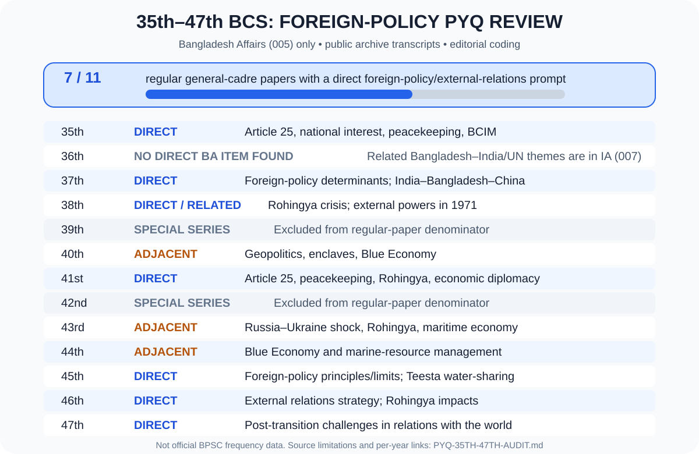

# Chapter 09 — 35th–47th BCS Written PYQ Audit
## বাংলাদেশের পররাষ্ট্রনীতি ও বৈদেশিক সম্পর্ক | Subject Code 005
[← মূল অধ্যায়](./README.md) · [২৫টি Answered Model Q&A](./BCS-WRITTEN-QUESTION-BANK.md) · [১৮টি sourced English quotations](./QUOTATIONS.md#verified-quotes) · [৮টি Model Essay](./PYQ-BASED-ESSAYS.md) · [Bangladesh Affairs index](../README.md)

> **Scope & method.** This audit examines the Bangladesh Affairs written paper (Subject Code 005) from the 35th to 47th BCS, focusing on foreign policy, bilateral relations, geopolitics, UN peacekeeping, Rohingya diplomacy, economic diplomacy, maritime relations and external economic exposure. It does **not** merge International Affairs (Subject Code 007) questions into Bangladesh Affairs counts. The public BCS EXAM archive explicitly says its transcripts were not typed directly from authenticated BPSC original scans; treat these as *archive-reported* prompts and verify against an original paper whenever available. Topic labels and priority ratings below are editorial coding, not official BPSC statistics or predictions.

## 1. Year-by-year review

| BCS | Bangladesh Affairs (005): relevant archive-reported theme | Classification for Chapter 09 | What to prepare | Public archive |
|---|---|---|---|---|
| **35th** | Q27: principles of Bangladesh’s foreign policy; national interest as the main determinant; economic importance of Bangladesh’s UN peacekeeping participation; BCIM regional cooperation. Q29 notes include international labour market and Bangladesh–WTO relations. | **Direct — very high priority** | Article 25, national interest, determinants, peacekeeping, BCIM concept and economic diplomacy. | [35th Written](https://bcsexam.org/written-questions/35th-bcs-written) |
| **36th** | No direct foreign-policy prompt identified in the available Bangladesh Affairs (005) transcript. The separate International Affairs (007) paper includes Bangladesh–India relations, China–US relations, UN Security Council reform and peacekeeping. | **No direct BA item found; cross-paper items kept separate** | Do not count International Affairs questions as Bangladesh Affairs. Use them as optional integrated practice. | [36th Written](https://bcsexam.org/written-questions/36th-bcs-written) |
| **37th** | Q25: determinants of foreign-policy formulation and the feasible relationship among India, Bangladesh and China in the current geopolitical setting. Q29 notes include export trade/WTO and IMF. | **Direct — very high priority** | Policy determinants, strategic balance, trade and international financial institutions. | [37th Written](https://bcsexam.org/written-questions/37th-bcs-written) |
| **38th** | Q21: Rohingya identity, the crisis created by large-scale arrivals and possible solutions. Q23: the roles of the United States, former Soviet Union, China and India in the Liberation War. Q30 notes include maritime resources. | **Direct/closely related** | Rohingya diplomacy, burden-sharing, historical diplomacy and maritime interests. | [38th Written](https://bcsexam.org/written-questions/38th-bcs-written) |
| **39th** | Special BCS series; not treated as a comparable regular general-cadre Bangladesh Affairs written paper in this frequency review. | **Excluded from denominator** | Do not use it to inflate regular-paper frequency. | [Question archive index](https://bcsexam.org/written-questions) |
| **40th** | Q20: Bangladesh’s geographic position, strategic geopolitical importance and risks. Q29 notes include the enclave issue and Blue Economy. The separate International Affairs paper includes public diplomacy/BRI themes. | **Adjacent — high relevance** | Geopolitics, neighbourhood policy, maritime strategy, connectivity and public diplomacy; keep Subject Code 007 separate. | [40th Written](https://bcsexam.org/written-questions/40th-bcs-written) |
| **41st** | Q24: basis of Bangladesh’s foreign policy, Bangladesh Army’s role in UN peacekeeping, and the Ministry of Foreign Affairs’ role in Rohingya repatriation. Q29 notes include economic diplomacy and maritime-boundary settlement. | **Direct — very high priority** | Article 25, peacekeeping, Rohingya, economic diplomacy and maritime diplomacy. | [41st Written](https://bcsexam.org/written-questions/41st-bcs-written) |
| **42nd** | Special BCS series; not treated as a comparable regular general-cadre Bangladesh Affairs written paper in this frequency review. | **Excluded from denominator** | Do not use it to inflate regular-paper frequency. | [Question archive index](https://bcsexam.org/written-questions) |
| **43rd** | Q26: effects of the Russia–Ukraine war on Bangladesh’s economy and government measures for Rohingya refugees. Q29 notes include Blue Economy and a deep-sea port. | **Adjacent — high relevance** | External shocks, energy/food security, humanitarian response and maritime connectivity. No direct foreign-policy-principles question was identified in the BA section reviewed. | [43rd Written](https://bcsexam.org/written-questions/43rd-bcs-written) |
| **44th** | Q24: Blue Economy, its contribution to Bangladesh’s economy and government measures to use marine resources. No explicit foreign-policy prompt identified in the BA section reviewed. | **Adjacent — maritime diplomacy** | Bay of Bengal, maritime governance, blue economy and international law. | [44th Written](https://bcsexam.org/written-questions/44th-bcs-written) |
| **45th** | Q26: define foreign policy and discuss Bangladesh’s principles, objectives, weaknesses and limitations. Q31: the need for a Teesta water-sharing agreement and actions by Bangladesh and India. | **Direct — very high priority** | Comprehensive foreign-policy essay, constraints, bilateral negotiation and water diplomacy. | [45th Written](https://bcsexam.org/written-questions/45th-bcs-written) |
| **46th** | Q31: review Bangladesh’s current measures to improve foreign relations and recommend ways to strengthen them. Q32: socioeconomic impacts of the Rohingya crisis and ways to address it. Q30 also covers marine-resource opportunities and constraints. | **Direct — very high priority** | Current external relations, actionable recommendations, Rohingya burden-sharing and maritime diplomacy. | [46th Written](https://bcsexam.org/written-questions/46th-bcs-written) |
| **47th** | Q28: challenges to Bangladesh’s relations with the outside world after the July mass uprising and steps to address them. Other questions link national development to geography and global economic trends. | **Direct — very high priority** | Foreign-policy continuity, diplomatic credibility, national interest, economic diversification and a balanced post-transition strategy. | [47th Written](https://bcsexam.org/written-questions/47th-bcs-written) |

### Summary chart — direct foreign-policy prompts

**Interpretation:** In the available public archive transcripts, direct foreign-policy/external-relations prompts were identified in 7 of the 11 regular general-cadre papers reviewed (35th, 37th, 38th, 41st, 45th, 46th and 47th). The 36th paper had no direct Bangladesh Affairs item identified; 40th, 43rd and 44th contained closely related geopolitical, Rohingya, global-shock or maritime themes. The 39th and 42nd special series are excluded. This is a transparent editorial count of the reviewed archive, **not an official BPSC frequency statistic**.

## 2. Cross-paper connections — International Affairs (007), not included in the count above

These are useful for integrated preparation but must not be described as Bangladesh Affairs questions:

- **35th:** Bangladesh–India relations and connectivity; UN Security Council reform; GSP-related diplomatic negotiation.
- **36th:** Bangladesh–India relations; China–US relations; UN Security Council reform and Bangladesh’s peacekeeping role.
- **40th:** public diplomacy and the Belt and Road Initiative.
- **43rd:** levels of diplomacy, back-channel diplomacy and OIC.
- **45th:** Indo-Pacific security and international climate security.
- **46th:** economic diplomacy, negotiation (position versus interest), Indo-Pacific strategy and national interest/power balance.
- **47th:** Myanmar’s 2021 coup and regional/global powers; China–US relations; food/energy security and climate–trade negotiations.

## 3. High-priority themes derived from the audit

### Priority A — answer confidently in 10/20 marks
1. Article 25 and the principles of Bangladesh’s foreign policy.
2. National interest and the domestic/external determinants of policy.
3. Geopolitics: India, China, Myanmar, the Bay of Bengal and the wider Indo-Pacific.
4. Rohingya crisis: humanitarian protection, host-community impact, burden-sharing and safe, voluntary, dignified and sustainable repatriation.
5. Bangladesh’s contribution to UN peacekeeping: mandate, professional benefits, reputation, risks and accountability.
6. Economic diplomacy: export-market diversification, FDI, trade rules, labour rights, technology, foreign aid and remittance.
7. Current external relations and diplomatic credibility after political transition.
8. Blue Economy, maritime diplomacy, maritime law and regional connectivity.

### Priority B — short notes / integrated essays
- BCIM: historical concept and present constraints; do not describe it as a fully functioning corridor.
- SAARC versus BIMSTEC: different memberships, geographic scope and implementation constraints.
- UN, NAM, OIC, D-8, WTO, IMF, World Bank and ADB: each institution’s distinct purpose.
- Teesta water-sharing and other transboundary-water negotiations.
- GSP/preferential market access, rules of origin, labour and environmental compliance.
- Climate finance, loss and damage, food/energy security and the impact of international conflict on Bangladesh.

## 4. BCS Written answer method

For a 20-mark foreign-policy question, structure the answer as follows:

1. **Introduction and definition** — directly answer the command word.
2. **Constitutional anchor** — Article 25, where relevant.
3. **National-interest analysis** — identify security, economic, humanitarian and diplomatic interests.
4. **Evidence/examples** — dated official source, bilateral issue, agreement or multilateral forum.
5. **Balanced evaluation** — gains, constraints, trade-offs and counterargument.
6. **Actionable recommendations** — name the actor, instrument and intended outcome.
7. **Conclusion** — a balanced, national-interest-based judgement.

Do not list every country or international organisation without explaining how it advances Bangladesh’s interests. A sourced quotation is optional; one relevant quotation plus analysis is stronger than a decorative quote list.

## 5. Source register and limitations

### Official / primary sources
- **Constitution of Bangladesh, Article 25:** https://bdlaws.minlaw.gov.bd/act-367/part-details-199.html?lang=en
- **Ministry of Foreign Affairs, Bangladesh — Foreign Policy:** https://sittwe.mofa.gov.bd/pages/static-pages/foreign-policy-of-bangladesh-edc320-695266ac35ce18e1c05aab1e
- **BPSC, Syllabus for BCS Written Examination, Bangladesh Affairs, Subject Code 005, Unit 9:** https://objectstorage.ap-dcc-gazipur-1.oraclecloud15.com/n/axvjbnqprylg/b/V2Ministry/o/office-bpsc/2024/12/df968f7fa918431dae3ed31b43206f6f.pdf
- **UN Charter:** https://www.un.org/en/about-us/un-charter/full-text
- **UN Peacekeeping, Troop and Police Contributors:** https://peacekeeping.un.org/en/troop-and-police-contributors
- **Armed Forces Division — Bangladesh’s troop-contribution position (2026: 4th):** https://afd.gov.bd/index.php/un-peacekeeping/position-of-bangladesh-in-un-peace-operation
- **UNHCR — Bangladesh country portal and 2025–26 Joint Response Plan:** https://data.unhcr.org/en/country/BGD/12110
- **UN in Bangladesh — 2026 JRP update:** https://bangladesh.un.org/en/315838-recalibrating-rohingya-response-2025-26-joint-response-plan
- **WTO — Marrakesh Agreement:** https://www.wto.org/english/docs_e/legal_e/04-wto_e.htm

### Public archive (secondary transcripts)
- [35th](https://bcsexam.org/written-questions/35th-bcs-written) · [36th](https://bcsexam.org/written-questions/36th-bcs-written) · [37th](https://bcsexam.org/written-questions/37th-bcs-written) · [38th](https://bcsexam.org/written-questions/38th-bcs-written) · [40th](https://bcsexam.org/written-questions/40th-bcs-written) · [41st](https://bcsexam.org/written-questions/41st-bcs-written) · [43rd](https://bcsexam.org/written-questions/43rd-bcs-written) · [44th](https://bcsexam.org/written-questions/44th-bcs-written) · [45th](https://bcsexam.org/written-questions/45th-bcs-written) · [46th](https://bcsexam.org/written-questions/46th-bcs-written) · [47th](https://bcsexam.org/written-questions/47th-bcs-written)

**Accuracy note:** The archive itself warns that its question text is not a certified transcription of the BPSC original scans and may contain transcription errors. Topic matching, classification and priority are editorial study aids, not official exam statistics or a guarantee that a topic will appear.

[⬆️ Back to Chapter 09](./README.md#top) · [২৫টি model answer](./BCS-WRITTEN-QUESTION-BANK.md) · [English quotations](./QUOTATIONS.md#verified-quotes)
