# Chapter 09 — বাংলাদেশের পররাষ্ট্রনীতি ও বৈদেশিক সম্পর্ক
> **BCS Written · Bangladesh Affairs · Subject Code 005 · 200 marks**  
> বাংলা ব্যাখ্যা + English terminology + বিগত প্রশ্নের theme + source-backed essays + ৩৩টি অনুশীলনী + English quotation bank.

[← Bangladesh Affairs সূচি](../README.md) · [35th–47th PYQ Audit](./PYQ-35TH-47TH-AUDIT.md) · [২৫টি Answered Model Q&A](./BCS-WRITTEN-QUESTION-BANK.md) · [📚 PYQ-ভিত্তিক প্রবন্ধ](./PYQ-BASED-ESSAYS.md) · [💬 ১৪টি English Quotations with sources](./QUOTATIONS.md) · [Chapter 01-এর format](../Chapter-01/README.md)

> [!IMPORTANT]
> **মূল সূত্র:** বাংলাদেশের পররাষ্ট্রনীতি বুঝতে জাতীয় স্বার্থ, সংবিধানের ২৫ অনুচ্ছেদ, ভৌগোলিক অবস্থান, অর্থনৈতিক সক্ষমতা, আন্তর্জাতিক আইন এবং কূটনৈতিক বিকল্প—এই বিষয়গুলো একসঙ্গে বিশ্লেষণ করুন। পরিবর্তনশীল সংখ্যা লিখলে তারিখসহ সরকারি উৎস যাচাই করুন।

## বিষয়সূচি
1. [Syllabus ও learning outcomes](#syllabus)
2. [Previous BCS Written question analysis](#pyq) · [35th–47th full audit](./PYQ-35TH-47TH-AUDIT.md) · [২৫টি answered model Q&A](./BCS-WRITTEN-QUESTION-BANK.md)
3. [পররাষ্ট্রনীতি: ধারণা, লক্ষ্য ও নির্ধারক](#concept)
4. [সাংবিধানিক ভিত্তি](#constitution)
5. [Policy formulation ও national power](#formulation)
6. [বাংলাদেশের ভূরাজনীতি](#geopolitics)
7. [দ্বিপাক্ষিক সম্পর্ক](#bilateral)
8. [বহুপাক্ষিক কূটনীতি](#multilateral)
9. [জাতিসংঘ ও শান্তিরক্ষা](#un)
10. [Economic diplomacy, trade ও manpower](#economic)
11. [জলবায়ু, সমুদ্র ও মানবিক নিরাপত্তা](#security)
12. [চ্যালেঞ্জ ও সুপারিশ](#challenges)
13. [Revision visuals ও internet image](#visuals)
14. [৩৩টি practice questions](#questions)
15. [উত্তর লেখার কৌশল](#answer)
16. [Source register](#sources)

## ১. BPSC syllabus mapping ও শিখনফল

BPSC-এর Bangladesh Affairs, Subject Code 005, লিখিত সিলেবাসের Unit 9-এ বাংলাদেশের পররাষ্ট্রনীতি ও বৈদেশিক সম্পর্ক অন্তর্ভুক্ত: goals, determinants, policy formulation, national power, security strategies, geopolitics, environmental issues, economic diplomacy, manpower, UN ও peacekeeping, NAM, SAARC, OIC, BIMSTEC, D-8, international economic institutions, foreign aid ও international trade. [S1]

এই অধ্যায় শেষে আপনি পারবেন: (ক) Article 25 ব্যাখ্যা করতে; (খ) national interest ও policy determinants বিশ্লেষণ করতে; (গ) bilateral ও multilateral diplomacy তুলনা করতে; (ঘ) UN, NAM, SAARC, BIMSTEC, OIC, D-8, WTO, IMF ও World Bank-এর প্রাসঙ্গিকতা লিখতে; (ঙ) বাণিজ্য, প্রবাসী কর্মী, জলবায়ু, সমুদ্র ও Rohingya সংকটকে কূটনীতির সঙ্গে যুক্ত করতে; (চ) বাস্তবসম্মত সুপারিশসহ ১০/২০ নম্বরের উত্তর লিখতে।

## ২. Previous BCS Written Question Analysis

### ২.১ যাচাইযোগ্য প্রশ্নের উদাহরণ

**[➡️ ৩৫তম–৪৭তম BCS year-by-year audit খুলুন](./PYQ-35TH-47TH-AUDIT.md)** · **[➡️ ২৫টি প্রশ্নের পূর্ণ মডেল উত্তর খুলুন](./BCS-WRITTEN-QUESTION-BANK.md)**
প্রকাশ্য BCS EXAM question archive-এ **৩৫তম BCS Written, Bangladesh Affairs, Question 27**-এ বাংলাদেশের পররাষ্ট্রনীতির মূলনীতি এবং “জাতীয় স্বার্থ সংরক্ষণই বাংলাদেশের পররাষ্ট্রনীতির মূল নির্ধারক”—এই বক্তব্য ব্যাখ্যা করতে বলা হয়েছিল। [Q1] **৫০তম BCS Written International Affairs, Subject Code 007**-এ economic sanctions ও Track II diplomacy এসেছে; এটি আলাদা পেপার, তাই Bangladesh Affairs প্রশ্নের সঙ্গে এক করে গণনা করা যাবে না। [Q2]

**সতর্কতা:** প্রশ্ন-আর্কাইভ secondary transcript; মূল BPSC scan নয়। এই অগ্রাধিকার syllabus coverage, যাচাইযোগ্য উদাহরণ এবং একাধিক প্রশ্নে প্রয়োগযোগ্যতার ভিত্তিতে—সব বছরের statistical frequency audit নয়।

### ২.২ High-priority topic map

| অগ্রাধিকার | থিম | কেন গুরুত্বপূর্ণ |
|---|---|---|
| A | Article 25 ও foreign policy principles | সরাসরি সাংবিধানিক ভিত্তি; ৩৫তম BCS-এর প্রশ্নের theme |
| A | National interest ও determinants | পররাষ্ট্রনীতির প্রায় সব উত্তরে প্রয়োগযোগ্য |
| A | Geopolitics ও India-China-US balancing | নিরাপত্তা, বাণিজ্য, যোগাযোগ ও কৌশলগত নির্ভরতার সংযোগ |
| A | UN, peacekeeping ও multilateralism | syllabus-এর কেন্দ্রীয় অংশ |
| A | Economic diplomacy, trade, foreign aid ও manpower | রপ্তানি, বিনিয়োগ, রেমিট্যান্স ও শ্রমিকের অধিকার |
| B | SAARC, BIMSTEC, OIC, NAM, D-8 | আঞ্চলিক ও বহুপাক্ষিক সহযোগিতা |
| B | Climate diplomacy, Bay of Bengal ও Blue Economy | পরিবেশ, অর্থনীতি ও নিরাপত্তা |
| B | Rohingya crisis ও burden-sharing | মানবিক ও কূটনৈতিক সংকট |
| B | Sanctions ও Track II diplomacy | related International Affairs theme; paper distinction বজায় রাখতে হবে |

**প্রশ্নের নির্দেশক শব্দ:** “Explain” হলে ধারণা ও ভিত্তি; “Analyse” হলে কারণ–প্রভাব; “Evaluate” হলে সাফল্য-সীমাবদ্ধতা; “Recommend” হলে বাস্তবায়নযোগ্য পদক্ষেপ লিখুন।

## ৩. পররাষ্ট্রনীতি: ধারণা, লক্ষ্য ও নির্ধারক

### ৩.১ Foreign policy কী?
Foreign policy হলো অন্য রাষ্ট্র, আন্তর্জাতিক সংস্থা ও বৈশ্বিক শক্তির সঙ্গে সম্পর্ক পরিচালনায় রাষ্ট্রের লক্ষ্য, অগ্রাধিকার ও পদক্ষেপের সমষ্টি। কূটনৈতিক বিবৃতি ছাড়াও বাণিজ্যচুক্তি, নিরাপত্তা সহযোগিতা, উন্নয়ন অর্থায়ন, প্রবাসী সুরক্ষা, জলবায়ু আলোচনা ও আন্তর্জাতিক আইন এর অংশ।

### ৩.২ প্রধান লক্ষ্য
1. **সার্বভৌমত্ব ও নিরাপত্তা:** স্বাধীন সিদ্ধান্ত, সীমান্ত ও সামুদ্রিক স্বার্থ রক্ষা।
2. **অর্থনৈতিক উন্নয়ন:** রপ্তানি বাজার, বিনিয়োগ, প্রযুক্তি ও উন্নয়ন অর্থায়ন।
3. **আন্তর্জাতিক মর্যাদা:** বহুপাক্ষিক ফোরামে গঠনমূলক ভূমিকা।
4. **প্রবাসী নাগরিকের সুরক্ষা:** শ্রম অধিকার, নিরাপদ অভিবাসন ও কনস্যুলার সহায়তা।
5. **আঞ্চলিক স্থিতিশীলতা:** সীমান্ত, পানি, বাণিজ্য ও যোগাযোগে সহযোগিতা।
6. **বৈশ্বিক দায়িত্ব:** জলবায়ু ন্যায়বিচার, শান্তিরক্ষা ও বাস্তুচ্যুত মানুষের টেকসই সমাধান।

### ৩.৩ পররাষ্ট্রনীতির নির্ধারক (Determinants)

| নির্ধারক | বাংলাদেশের ক্ষেত্রে প্রাসঙ্গিকতা |
|---|---|
| Geography | ভারত ও মিয়ানমারের প্রতিবেশ, বঙ্গোপসাগর, ভারত মহাসাগরীয় সংযোগ |
| History and identity | মুক্তিযুদ্ধ, আত্মনিয়ন্ত্রণ ও উপনিবেশবিরোধী অভিজ্ঞতা |
| Economy | রপ্তানি বাজার, আমদানি, জ্বালানি, উন্নয়ন অর্থায়ন ও রেমিট্যান্স |
| Security | সীমান্ত, সামুদ্রিক নিরাপত্তা, সাইবার ঝুঁকি ও বাস্তুচ্যুতি |
| State capacity | অর্থনীতি, প্রযুক্তি, দক্ষ কূটনীতিক, গবেষণা ও প্রতিরক্ষা |
| Domestic politics | নীতির ধারাবাহিকতা, জনমত ও আন্তঃমন্ত্রণালয় সমন্বয় |
| International system | বড় শক্তির প্রতিযোগিতা, যুদ্ধ, নিষেধাজ্ঞা, বাণিজ্য ও জলবায়ু |
| International law | UN Charter, treaties, UNCLOS ও মানবাধিকার কাঠামো |

“Friendship to all, malice towards none” বাংলাদেশের কূটনৈতিক পরিচয়ের বহুল ব্যবহৃত নীতিবাক্য। এর অর্থ সব দেশের সব অবস্থান সমর্থন নয়; জাতীয় স্বার্থ, সংবিধান ও আন্তর্জাতিক আইন অনুযায়ী প্রতিটি বিষয়ে সিদ্ধান্ত নেওয়া।

## ৪. সাংবিধানিক ভিত্তি: Article 25

#### সংবিধান ও পররাষ্ট্রনীতির ভিত্তি

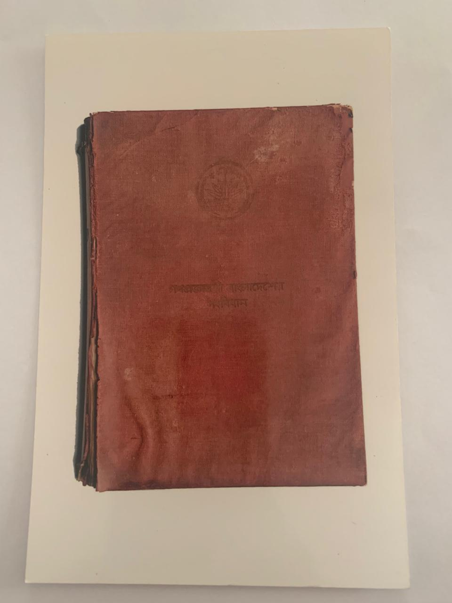

*চিত্র-পাঠ:* সংবিধানের ২৫ অনুচ্ছেদের মূলনীতি—জাতীয় সার্বভৌমত্ব, সমতা, অন্য রাষ্ট্রের অভ্যন্তরীণ বিষয়ে হস্তক্ষেপ না করা, আন্তর্জাতিক বিরোধের শান্তিপূর্ণ নিষ্পত্তি ও আন্তর্জাতিক আইনকে সম্মান—উত্তরে যুক্ত করুন। [ছবির উৎস](https://commons.wikimedia.org/wiki/File:The_original_front_page_of_constitution_of_BD.jpg) · [সরকারি Bangladesh Laws](http://bdlaws.minlaw.gov.bd/)

সংবিধানের ২৫ অনুচ্ছেদ আন্তর্জাতিক সম্পর্কের ভিত্তি হিসেবে জাতীয় সার্বভৌমত্ব ও সমতার প্রতি শ্রদ্ধা, অন্য রাষ্ট্রের অভ্যন্তরীণ বিষয়ে হস্তক্ষেপ না করা, আন্তর্জাতিক বিরোধের শান্তিপূর্ণ সমাধান এবং আন্তর্জাতিক আইন ও UN Charter-এর নীতির প্রতি শ্রদ্ধা নির্ধারণ করে। এতে বলপ্রয়োগ পরিহার, সাধারণ ও সম্পূর্ণ নিরস্ত্রীকরণের চেষ্টা এবং জনগণের নিজস্ব রাজনৈতিক-অর্থনৈতিক ব্যবস্থা নির্ধারণের অধিকারের কথাও রয়েছে। [S2]

**পরীক্ষায় তিনটি স্তর লিখুন:**  
- **Sovereignty and equality:** রাষ্ট্রের স্বাধীন সিদ্ধান্ত ও সমতার প্রতি শ্রদ্ধা।  
- **Peaceful and lawful conduct:** বিরোধের শান্তিপূর্ণ নিষ্পত্তি ও আন্তর্জাতিক আইন মানা।  
- **Self-determination:** জনগণের নিজস্ব ব্যবস্থা নির্ধারণের অধিকার।

Article 25 নীতিগত মানদণ্ড। বাস্তবে বাণিজ্য, নিরাপত্তা, মানবাধিকার ও ভূরাজনৈতিক প্রতিযোগিতার মধ্যে trade-off দেখা দিলে নীতি, জাতীয় স্বার্থ এবং আন্তর্জাতিক আইন একসঙ্গে বিবেচনা করতে হয়।

## ৫. Policy formulation ও National Power

#### কূটনৈতিক সিদ্ধান্ত গ্রহণ: পররাষ্ট্র মন্ত্রণালয়ে দ্বিপাক্ষিক বৈঠক

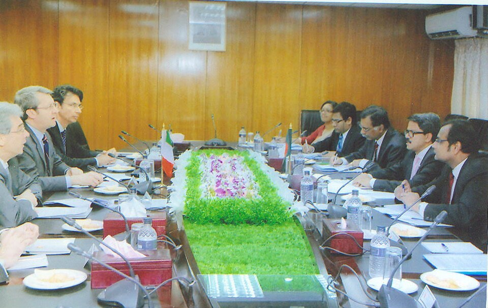

*চিত্র-পাঠ:* পররাষ্ট্রনীতি নির্ধারণে সংবিধান, প্রধানমন্ত্রীর কার্যালয়, পররাষ্ট্র মন্ত্রণালয়, অন্যান্য মন্ত্রণালয়, সংসদীয় তদারকি ও জাতীয় স্বার্থের ভূমিকা মিলিয়ে পড়ুন। [ছবির উৎস ও বর্ণনা](https://commons.wikimedia.org/wiki/File:Bangladesh_Italy_Bilateral_Meeting_Ministry_of_Foreign_Affairs_Dhaka_2015-02-19_(PID-0060574).jpg) · [পররাষ্ট্র মন্ত্রণালয়](https://mofa.gov.bd/)

### ৫.১ নীতি প্রণয়নের ধাপ
1. সমস্যা ও জাতীয় স্বার্থ শনাক্ত করা।
2. দূতাবাস, সরকারি সংস্থা, বাণিজ্যতথ্য ও গবেষণা থেকে evidence সংগ্রহ।
3. আলোচনা, মধ্যস্থতা, চুক্তি, বহুপাক্ষিক ফোরাম বা আইনি পদক্ষেপের বিকল্প তৈরি।
4. পররাষ্ট্র, বাণিজ্য, অর্থ, শ্রম, পরিবেশ, স্বরাষ্ট্র ও নিরাপত্তা সংস্থার সমন্বয়।
5. সংবিধান ও আইন অনুযায়ী সিদ্ধান্ত/অনুমোদন।
6. কূটনৈতিক বাস্তবায়ন—আলোচনা, যৌথ কমিশন, চুক্তি ও আন্তর্জাতিক প্রস্তাব।
7. ফলাফল, খরচ, ঝুঁকি ও পরবর্তী পদক্ষেপ মূল্যায়ন।

### ৫.২ National power-এর উপাদান
- **Geographical:** অবস্থান, বন্দর, সামুদ্রিক অঞ্চল ও আঞ্চলিক সংযোগ।
- **Economic:** বাজার, উৎপাদন, রপ্তানি বৈচিত্র্য, বিনিয়োগ ও আর্থিক স্থিতি।
- **Human:** দক্ষতা, শিক্ষা, প্রবাসী নেটওয়ার্ক ও সাংস্কৃতিক সংযোগ।
- **Security:** প্রতিরক্ষা, maritime awareness, দুর্যোগ সহায়তা।
- **Diplomatic:** দূতাবাস, আলোচনার দক্ষতা, ভাষা, গবেষণা ও negotiation.
- **Institutional credibility:** নীতির ধারাবাহিকতা, চুক্তি বাস্তবায়ন ও স্বচ্ছতা।

ছোট বা মাঝারি শক্তির রাষ্ট্র কেবল সামরিক শক্তির ওপর নির্ভর করে না; কূটনীতি, অর্থনৈতিক সম্পর্কের বৈচিত্র্য, আন্তর্জাতিক আইন ও বহুপাক্ষিক জোটকে leverage হিসেবে ব্যবহার করতে পারে।

## ৬. বাংলাদেশের ভূরাজনীতি: সুযোগ ও ঝুঁকি

#### মানচিত্র: বঙ্গোপসাগর ও বাংলাদেশের কৌশলগত অবস্থান

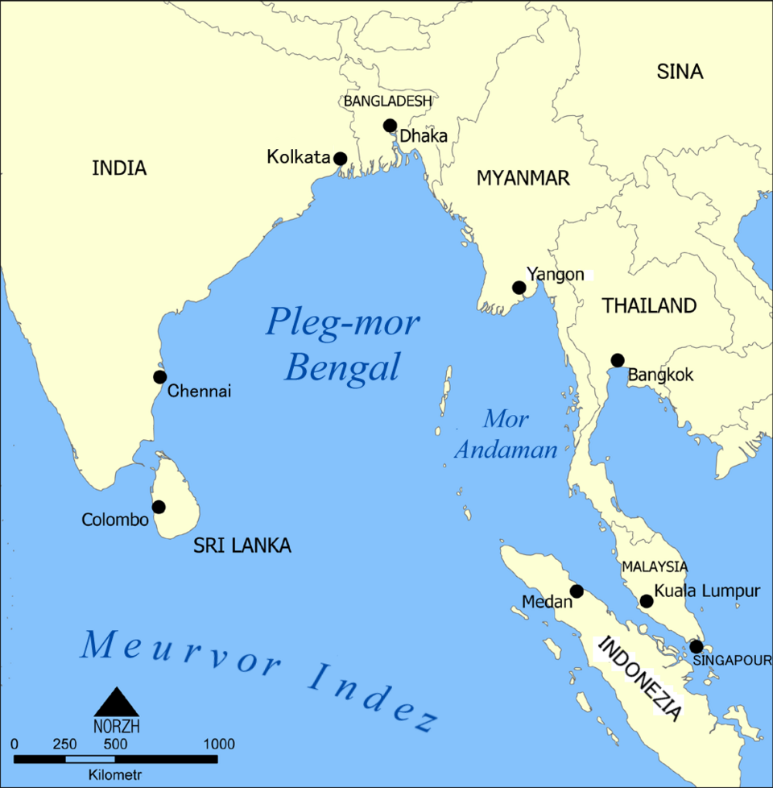

*চিত্র-পাঠ:* বঙ্গোপসাগর, ভারত ও মিয়ানমারের সঙ্গে স্থলসীমান্ত, সমুদ্রপথ, বন্দর এবং Indo-Pacific যোগাযোগ—এই উপাদানগুলো বাংলাদেশের ভূরাজনৈতিক গুরুত্ব নির্ধারণ করে। [মানচিত্রের উৎস ও লাইসেন্স](https://commons.wikimedia.org/wiki/File:Bay_of_Bengal_map-br.png)

বাংলাদেশ দক্ষিণ এশিয়া ও বঙ্গোপসাগরীয় অঞ্চলে অবস্থিত। ভারতের সঙ্গে দীর্ঘ স্থলসীমান্ত ও অর্থনৈতিক সম্পর্ক, মিয়ানমারের সঙ্গে সীমান্ত ও বাস্তুচ্যুতি সংকট, এবং বঙ্গোপসাগরের বাণিজ্যপথ বাংলাদেশের কৌশলগত গুরুত্ব বাড়ায়।

**সুযোগ:** বন্দর ও logistics, regional supply chain, জ্বালানি ও বিদ্যুৎ সংযোগ, Blue Economy, BIMSTEC-ভিত্তিক সহযোগিতা, সামুদ্রিক গবেষণা ও জলবায়ু কূটনীতি।

**ঝুঁকি:** বড় শক্তির প্রতিযোগিতা, একক অংশীদারের ওপর অতিনির্ভরতা, সীমান্ত ও পানি-সংক্রান্ত মতভেদ, সমুদ্রদূষণ, জলবায়ু পরিবর্তন, আমদানি সরবরাহে বিঘ্ন এবং Rohingya সংকট।

**Strategic balance** মানে সব শক্তির সঙ্গে সমান দূরত্ব নয়; প্রতিটি বিষয়ে জাতীয় স্বার্থ নির্ধারণ, ঝুঁকি বৈচিত্র্যকরণ, আন্তর্জাতিক আইন মানা এবং কোনো একক অংশীদারের ওপর অতিরিক্ত নির্ভরতা কমানো।

## ৭. দ্বিপাক্ষিক সম্পর্ক: পরীক্ষায় কীভাবে বিশ্লেষণ করবেন

#### বাস্তব ছবি: বাংলাদেশ–ভারত স্থলবন্দর ও সীমান্ত বাণিজ্য

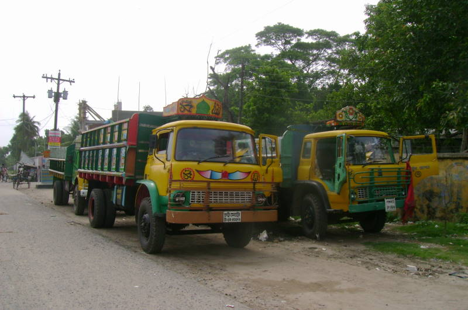

*চিত্র-পাঠ:* দ্বিপাক্ষিক সম্পর্ক ব্যাখ্যায় সীমান্ত ব্যবস্থাপনা, বাণিজ্য, যোগাযোগ, পানি বণ্টন, জ্বালানি ও মানুষে-মানুষে যোগাযোগকে পৃথক ক্ষেত্র হিসেবে বিশ্লেষণ করুন। [ছবির উৎস](https://commons.wikimedia.org/wiki/File:BD_Benapole_0906_(17)_(17023318140).jpg) · [Bangladesh Land Port Authority](https://blpa.gov.bd/)

### ৭.১ ভারত
প্রধান ক্ষেত্র: সীমান্ত ব্যবস্থাপনা, নদীর পানি, বাণিজ্য, বিদ্যুৎ ও জ্বালানি, যোগাযোগ, নিরাপত্তা এবং মানুষে-মানুষে সম্পর্ক। উত্তর সাজান—**অভিন্ন স্বার্থ → সংবেদনশীল/অমীমাংসিত ইস্যু → বিদ্যমান আলোচনার পথ → সুপারিশ**। যৌথ নদী কমিশন, নিয়মিত সীমান্ত সংলাপ, বাণিজ্য বাধা হ্রাস ও যোগাযোগের সুফল ভাগাভাগি প্রাসঙ্গিক।

### ৭.২ চীন
বাণিজ্য, অবকাঠামো, প্রযুক্তি ও উন্নয়ন সহযোগিতা সুযোগ সৃষ্টি করতে পারে। প্রকল্প মূল্যায়নে ঋণের শর্ত, debt sustainability, procurement transparency, স্থানীয় কর্মসংস্থান, maintenance cost ও strategic dependence পরীক্ষা জরুরি। কোনো প্রকল্পকে শুধু ভূরাজনৈতিক label দিয়ে নয়, তার অর্থনৈতিক viability ও জনস্বার্থ দিয়ে বিচার করুন।

### ৭.৩ যুক্তরাষ্ট্র ও ইউরোপীয় অংশীদার
বাণিজ্য, তৈরি পোশাক, বিনিয়োগ, প্রযুক্তি, শিক্ষা, শ্রম অধিকার, পরিবেশগত মান ও নিরাপত্তা সহযোগিতা গুরুত্বপূর্ণ। বাজার প্রবেশাধিকারের পাশাপাশি labour compliance, উৎপাদনশীলতা, পণ্য বৈচিত্র্য ও trade-risk management দরকার।

### ৭.৪ জাপান ও অন্যান্য উন্নয়ন অংশীদার
অবকাঠামো, প্রযুক্তি, দক্ষতা উন্নয়ন ও শিল্প সহযোগিতায় concessionality, প্রযুক্তি স্থানান্তর, প্রকল্পের জীবনচক্র ব্যয়, স্থানীয় দক্ষতা ও রক্ষণাবেক্ষণ বিবেচনা করা উচিত।

### ৭.৫ মিয়ানমার ও Rohingya সংকট
সংকটটি মানবিক, অর্থনৈতিক, পরিবেশগত, সামাজিক ও নিরাপত্তাগত চাপ সৃষ্টি করে। টেকসই সমাধানের কেন্দ্র হলো **স্বেচ্ছামূলক, নিরাপদ, মর্যাদাপূর্ণ ও টেকসই প্রত্যাবাসন**, শরণার্থীদের সুরক্ষা, host community-র সহায়তা, আন্তর্জাতিক burden-sharing এবং ধারাবাহিক কূটনৈতিক যোগাযোগ। জোরপূর্বক বা অনিরাপদ প্রত্যাবাসনকে সমাধান হিসেবে উপস্থাপন করবেন না।

## ৮. বহুপাক্ষিক কূটনীতি ও আন্তর্জাতিক সংস্থা

#### বাস্তব ছবি: জাতিসংঘ সদর দপ্তর

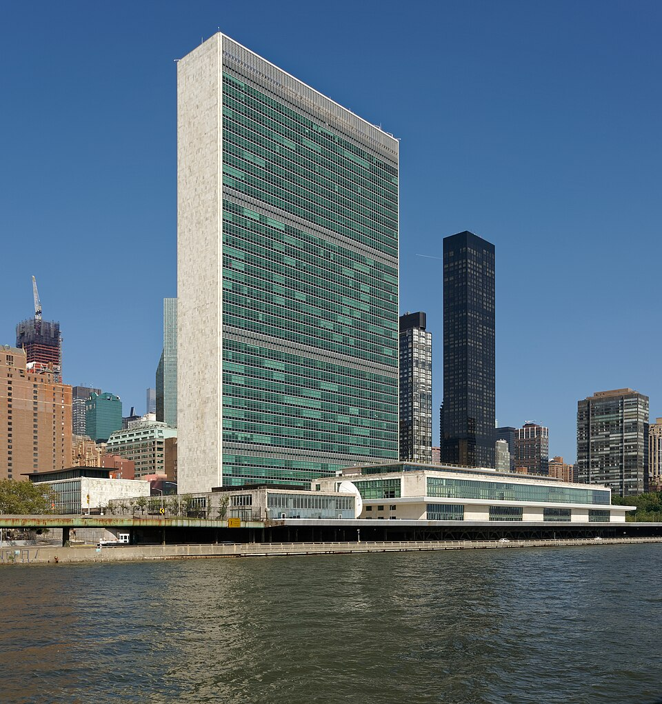

*চিত্র-পাঠ:* UN, NAM, SAARC, BIMSTEC, OIC ও D-8-এর ভূমিকা তুলনা করুন—সদস্যপদ, উদ্দেশ্য, সিদ্ধান্ত গ্রহণ ও বাংলাদেশের স্বার্থের ভিত্তিতে। [ছবির উৎস ও লাইসেন্স](https://commons.wikimedia.org/wiki/File:Headquarters_of_the_United_Nations,_New_York_City,_20231001_1103_1006.jpg) · [United Nations](https://www.un.org/)

| সংস্থা | মূল ক্ষেত্র | বাংলাদেশের জন্য ব্যবহার |
|---|---|---|
| UN | শান্তি, নিরাপত্তা, উন্নয়ন, আন্তর্জাতিক আইন | Peacekeeping, climate, displacement, multilateral negotiation |
| NAM | কৌশলগত স্বায়ত্তশাসন ও উন্নয়নশীল দেশের সহযোগিতা | বড় শক্তির প্রতিযোগিতায় স্বাধীন অবস্থান |
| SAARC | দক্ষিণ এশীয় সহযোগিতা | বাণিজ্য, শিক্ষা, স্বাস্থ্য ও যোগাযোগ; রাজনৈতিক বাধা আছে |
| BIMSTEC | বঙ্গোপসাগর-সংলগ্ন আঞ্চলিক সহযোগিতা | সংযোগ, জ্বালানি, বাণিজ্য ও দুর্যোগ ব্যবস্থাপনা |
| OIC | মুসলিম-সংখ্যাগরিষ্ঠ রাষ্ট্রের সহযোগিতা | Rohingya ইস্যু, শিক্ষা, বাণিজ্য ও কূটনৈতিক সমর্থন |
| D-8 | উন্নয়নশীল অর্থনীতির সহযোগিতা | বাণিজ্য, শিল্প, খাদ্য ও প্রযুক্তি |
| Commonwealth | শিক্ষা, শাসন ও উন্নয়ন বিনিময় | প্রতিষ্ঠানগত সহযোগিতা |
| WTO | বৈশ্বিক বাণিজ্যের নিয়ম | বাজার প্রবেশ, বিরোধ নিষ্পত্তি |
| IMF | সামষ্টিক স্থিতিশীলতা ও balance-of-payments | অর্থনৈতিক নীতি ও বৈদেশিক লেনদেন |
| World Bank / ADB / AIIB / IDB | উন্নয়ন অর্থায়ন | অবকাঠামো, সামাজিক উন্নয়ন ও climate projects |

### SAARC বনাম BIMSTEC
SAARC দক্ষিণ এশিয়ার বিস্তৃত আঞ্চলিক কাঠামো; BIMSTEC বঙ্গোপসাগর-সংলগ্ন দক্ষিণ ও দক্ষিণ-পূর্ব এশিয়ার রাষ্ট্রগুলোর মধ্যে কার্যকরী সহযোগিতার সুযোগ তৈরি করে। SAARC রাজনৈতিক বিরোধে সীমিত হতে পারে; BIMSTEC-এও বাস্তবায়ন, অর্থায়ন ও অবকাঠামোর বাধা আছে। এগুলোকে পরস্পরের বিকল্প নয়, ভিন্ন পরিসরের পরিপূরক ফোরাম হিসেবে দেখা যায়।

Multilateral diplomacy ছোট/মাঝারি রাষ্ট্রকে যৌথ অবস্থান, আন্তর্জাতিক নিয়ম ও অংশীদার জোটের মাধ্যমে bargaining power বাড়াতে সাহায্য করে। তবে সদস্যপদ নিজেই সাফল্য নয়; প্রস্তুতকৃত position paper, দক্ষ প্রতিনিধি, জোট গঠন এবং বাস্তবায়ন-পরবর্তী follow-up দরকার।

## ৯. জাতিসংঘ ও শান্তিরক্ষা

#### শান্তিরক্ষা মিশনে বাংলাদেশি সদস্য

*চিত্র-পাঠ:* শান্তিরক্ষা, বেসামরিক নাগরিক সুরক্ষা, সংঘাত-পরবর্তী স্থিতিশীলতা এবং বাংলাদেশের আন্তর্জাতিক অবদান একসঙ্গে পড়ুন। [ছবির প্রকাশনা-উৎস](https://www.dhakatribune.com/) · [UN Peacekeeping—Bangladesh](https://peacekeeping.un.org/en/bangladesh)

বাংলাদেশ ১৭ সেপ্টেম্বর ১৯৭৪-এ জাতিসংঘের সদস্য হয়। [S4] UN বাংলাদেশের জন্য শান্তি ও নিরাপত্তা, উন্নয়ন, জলবায়ু, মানবিক সংকট এবং আন্তর্জাতিক আইন বিষয়ে গুরুত্বপূর্ণ কূটনৈতিক মঞ্চ।

UN peacekeeping-এ বাংলাদেশি সামরিক, পুলিশ ও অন্যান্য uniformed personnel অংশ নেন। UN-এর ৩১ জুলাই ২০২৫-এর contribution table-এ বাংলাদেশের মোট uniformed personnel **৫,৬৮৫** দেখানো হয়েছে; এটি ওই তারিখের snapshot, বর্তমান সংখ্যা নয়। [S5] শান্তিরক্ষা পেশাগত অভিজ্ঞতা, আন্তর্জাতিক সহযোগিতা ও দেশের পরিচিতি বাড়াতে পারে; একই সঙ্গে প্রশিক্ষণ, equipment, mandate clarity, civilian protection, safety ও misconduct prevention জরুরি।

Peacekeeping যুদ্ধজয় বা জোর করে রাজনৈতিক সমাধান চাপিয়ে দেওয়ার সমার্থক নয়। প্রতিটি মিশনের mandate আলাদা। বাংলাদেশের বহুপাক্ষিক অগ্রাধিকার হওয়া উচিত peacekeeping, climate finance, displacement response, fair trade, peaceful dispute settlement এবং আন্তর্জাতিক আইনের প্রতি শ্রদ্ধা।

## ১০. Economic diplomacy, trade ও manpower

#### বাস্তব ছবি: চট্টগ্রাম বন্দরের কনটেইনার টার্মিনাল

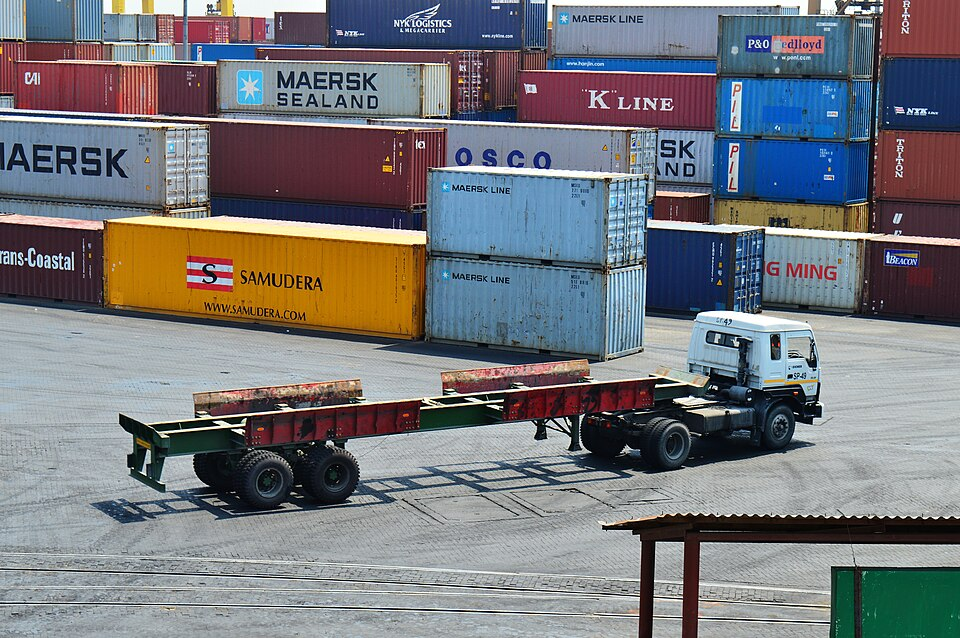

*চিত্র-পাঠ:* রপ্তানি-আমদানি, সরবরাহ-শৃঙ্খল, বন্দর দক্ষতা, বৈদেশিক বিনিয়োগ এবং অর্থনৈতিক কূটনীতির সম্পর্ক বুঝুন। [ছবির উৎস ও লাইসেন্স](https://commons.wikimedia.org/wiki/File:Stacking_Intermodal_container_in_Port_of_Chittagong_(14).jpg) · [চট্টগ্রাম বন্দর কর্তৃপক্ষ](https://cpa.gov.bd/)

#### বাস্তব ছবি: বাংলাদেশি অভিবাসী শ্রমিকদের সঙ্গে আলোচনা

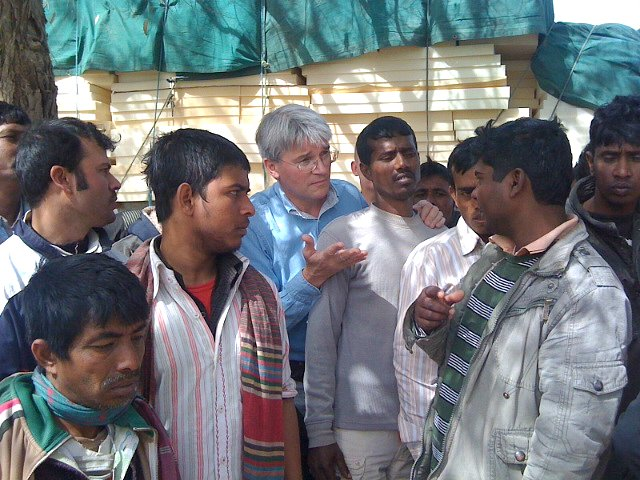

*চিত্র-পাঠ:* নিরাপদ অভিবাসন, দক্ষতা উন্নয়ন, শ্রমিকের অধিকার, কনস্যুলার সহায়তা ও রেমিট্যান্স—এই পাঁচটি দিক লিখুন। [ছবির উৎস](https://commons.wikimedia.org/wiki/File:Secretary_of_State_for_International_Development_Andrew_Mitchell_speaking_to_Bangladeshi_migrant_workers._(5499005775).jpg) · [প্রবাসী কল্যাণ ও বৈদেশিক কর্মসংস্থান মন্ত্রণালয়](https://probashi.gov.bd/)

Economic diplomacy হলো কূটনৈতিক সম্পর্ক ব্যবহার করে বাজার প্রবেশ, বিনিয়োগ, প্রযুক্তি, উন্নয়ন অর্থায়ন, রপ্তানি ও কর্মসংস্থানের সুযোগ বাড়ানো।

### ১০.১ Trade ও investment
একটি পণ্য বা সীমিত বাজারের ওপর অতিনির্ভরতা বৈশ্বিক মন্দা, শুল্ক ও মানদণ্ড পরিবর্তনের ঝুঁকি বাড়ায়। Export diversification, productivity, labour rights, environmental compliance, predictable regulation ও dispute resolution দীর্ঘমেয়াদি প্রতিযোগিতা বাড়াতে পারে।

### ১০.২ Foreign aid ও development finance
প্রকল্প বাছাইয়ে grant বনাম loan, interest, grace period, foreign-exchange risk, procurement terms, local capacity, maintenance cost ও economic return বিবেচনা করতে হবে। অর্থ পাওয়া নয়, জাতীয় উন্নয়ন পরিকল্পনার সঙ্গে সামঞ্জস্য রেখে ফল অর্জনই লক্ষ্য।

### ১০.৩ Manpower diplomacy
নিরাপদ শ্রম অভিবাসনে recruitment fee, contract substitution, wage theft, unsafe conditions ও skills mismatch ঝুঁকি। প্রয়োজন:
1. enforceable bilateral labour agreements;
2. recruitment agency ও contract verification;
3. দূতাবাসে দ্রুত অভিযোগ ও আইনি সহায়তা;
4. ভাষা ও পেশাগত দক্ষতার স্বীকৃতি;
5. নতুন শ্রমবাজারে তথ্যভিত্তিক প্রবেশ;
6. সাশ্রয়ী formal remittance channel।

### ১০.৪ Transit, transshipment ও connectivity
Transit সাধারণত অন্য দেশের ভূখণ্ড দিয়ে পণ্য/যান চলাচলের অনুমতি; transshipment এক পরিবহন মাধ্যম বা জাহাজ থেকে অন্যটিতে পণ্য স্থানান্তর। চুক্তিতে customs, security, infrastructure cost, fees, insurance, environmental impact ও লাভের বণ্টন স্পষ্ট থাকা উচিত।

## ১১. জলবায়ু, সমুদ্র ও মানবিক নিরাপত্তা

#### জলবায়ু কূটনীতি: বাংলাদেশের উপকূলীয় ঝুঁকি

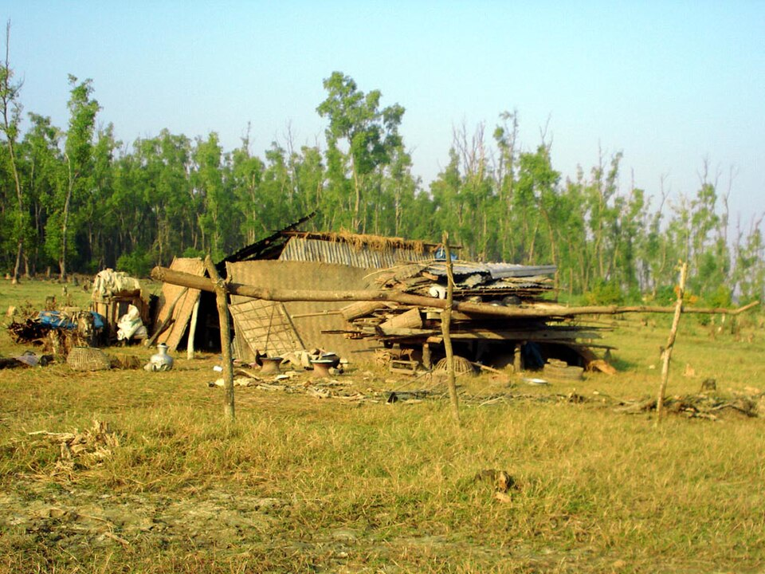

*চিত্র-পাঠ:* জলবায়ু অভিযোজন, ক্ষয়ক্ষতি ও ক্ষতি-লোকসান (Loss and Damage), জলবায়ু অর্থায়ন এবং উপকূলীয় স্থিতিস্থাপকতার সঙ্গে ছবিটি মিলিয়ে পড়ুন। [ছবির উৎস](https://commons.wikimedia.org/wiki/File:Cyclone_Aila_Climate_Change_Nijhum_Dwip_2009_Dec_Bangladesh.jpg) · [UNFCCC](https://unfccc.int/)

#### মানবিক কূটনীতি: রোহিঙ্গা শরণার্থী সংকট

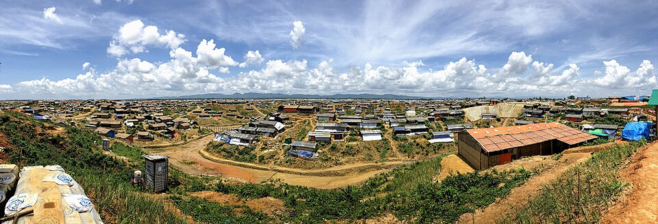

*চিত্র-পাঠ:* প্রত্যাবাসনের নিরাপত্তা ও মর্যাদা, আন্তর্জাতিক burden-sharing, মানবিক সহায়তা এবং মিয়ানমারের সঙ্গে কূটনৈতিক যোগাযোগ আলাদা করে বিশ্লেষণ করুন। [ছবির উৎস](https://commons.wikimedia.org/wiki/File:Rohingya_Camps_in_Cox%27s_Bazar,_Bangladesh.jpg) · [UNHCR Bangladesh](https://www.unhcr.org/bangladesh.html)

### Climate diplomacy
বাংলাদেশের বদ্বীপীয় ভৌগোলিক বাস্তবতায় adaptation, disaster preparedness, loss and damage, technology ও climate finance গুরুত্বপূর্ণ। আন্তর্জাতিক আলোচনায় নির্ভরযোগ্য ঝুঁকি-তথ্য, বাস্তবায়নযোগ্য project pipeline, স্বচ্ছ অর্থব্যবস্থা ও নিজস্ব অভিযোজন পরিকল্পনা দরকার।

### Blue Economy ও maritime diplomacy
বঙ্গোপসাগর বাণিজ্য, মৎস্য, বন্দর, সামুদ্রিক পরিবেশ, জ্বালানি ও যোগাযোগের সঙ্গে যুক্ত। Sustainable fisheries, marine science, pollution control, port efficiency, maritime safety, search and rescue এবং UNCLOS-সম্মত বিরোধ নিষ্পত্তি জরুরি।

### Human security ও Rohingya response
Human security মানুষের জীবন, জীবিকা, খাদ্য, স্বাস্থ্য, নিরাপত্তা ও মর্যাদাকে গুরুত্ব দেয়। Rohingya সংকটে শরণার্থীদের সুরক্ষা, host community-র ওপর চাপ কমানো, আন্তর্জাতিক অর্থায়ন, আঞ্চলিক কূটনীতি ও নিরাপদ প্রত্যাবাসনের শর্ত একসঙ্গে বিবেচনা করতে হবে।

## ১২. প্রধান চ্যালেঞ্জ ও বাস্তবসম্মত সুপারিশ

| চ্যালেঞ্জ | প্রস্তাবিত নীতিগত প্রতিক্রিয়া |
|---|---|
| বড় শক্তির প্রতিযোগিতা | issue-based diplomacy ও ঝুঁকি বৈচিত্র্যকরণ |
| বাজার/সরবরাহ-শৃঙ্খলে অতিনির্ভরতা | export, energy, technology ও investment diversification |
| শ্রম অভিবাসনে শোষণ | labour agreements, recruitment oversight, consular support |
| আঞ্চলিক সহযোগিতার দুর্বলতা | SAARC/BIMSTEC-এ measurable sectoral projects |
| Rohingya সংকট | safe repatriation conditions, burden-sharing ও sustained diplomacy |
| climate finance gap | evidence-based proposals, transparent project tracking |
| সীমিত diplomatic capacity | গবেষণা ইউনিট, ভাষা ও অঞ্চলভিত্তিক বিশেষজ্ঞ, data-driven briefing |
| নীতির ধারাবাহিকতার ঝুঁকি | আন্তঃমন্ত্রণালয় সমন্বয়, প্রাতিষ্ঠানিক স্মৃতি ও নিয়মিত policy review |

**পাঁচটি অগ্রাধিকার:**  
1. প্রতিটি বড় চুক্তির economic, legal, environmental ও security impact assessment।  
2. দূতাবাসে market intelligence, trade promotion ও labour-market information শক্তিশালী করা।  
3. বাজার, পণ্য, শ্রমগন্তব্য, জ্বালানি ও প্রযুক্তি-উৎস বৈচিত্র্য করা।  
4. UN/WTO/আঞ্চলিক ফোরামে research-based position paper ও coalition-building।  
5. প্রবাসী কর্মী ও সংকটে পড়া নাগরিকের দ্রুত consular service এবং measurable performance review।

## ১৩. Quick Revision Visuals

### ১৩.১ পররাষ্ট্রনীতি প্রণয়নের চক্র
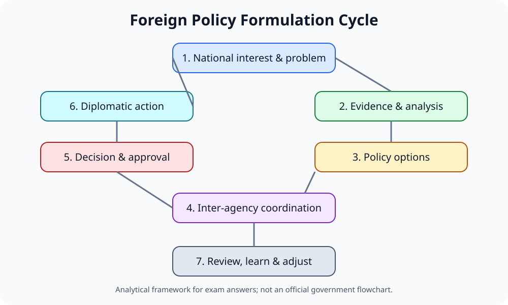

### ১৩.২ জাতীয় স্বার্থের স্তর
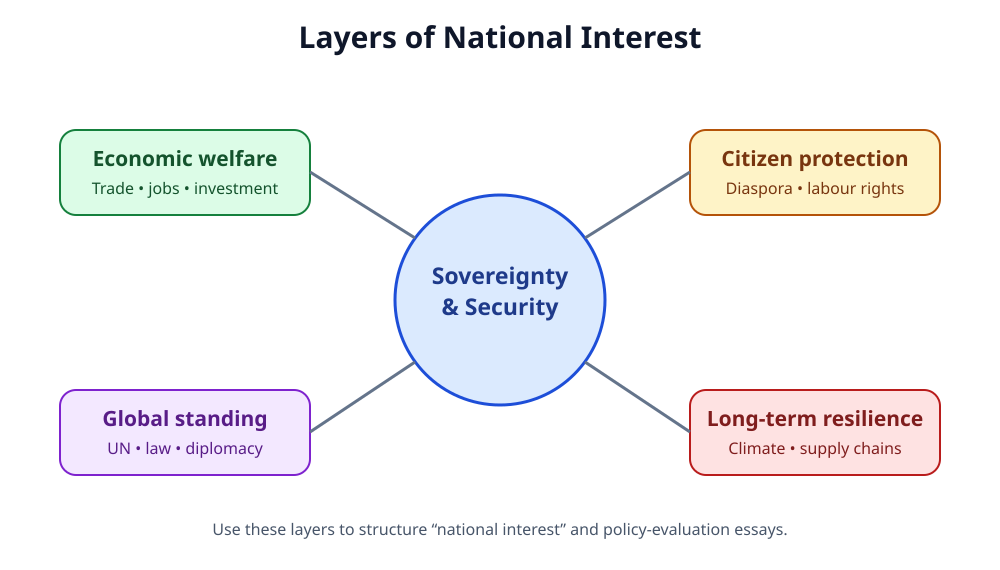

### ১৩.৩ বাংলাদেশের বহুপাক্ষিক কূটনীতি
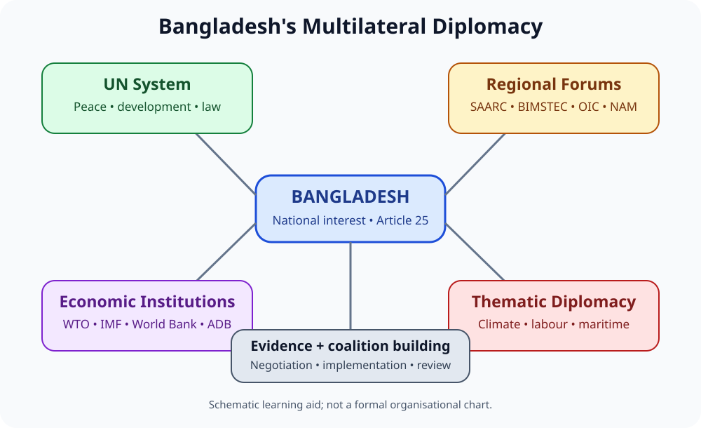

### ১৩.৪ Internet image — বাংলাদেশি UN peacekeepers

Source: Dhaka Tribune, [Bangladesh’s robust role and commitment towards international peace and security](https://www.dhakatribune.com/opinion/longform/314708/bangladesh%E2%80%99s-robust-role-and-commitment-towards). Image reuse rights should be checked with publisher.

### ১৩.৫ Bilateral relations: issue matrix

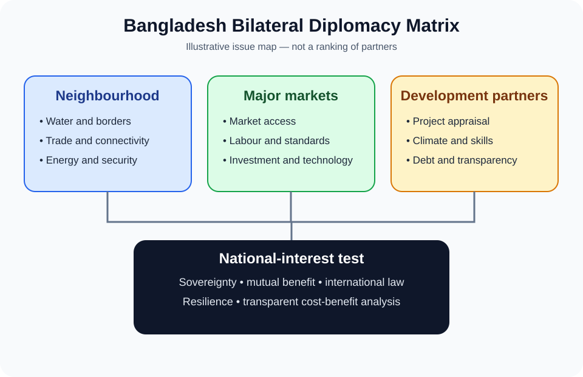

### ১৩.৬ Economic diplomacy: outcome pipeline

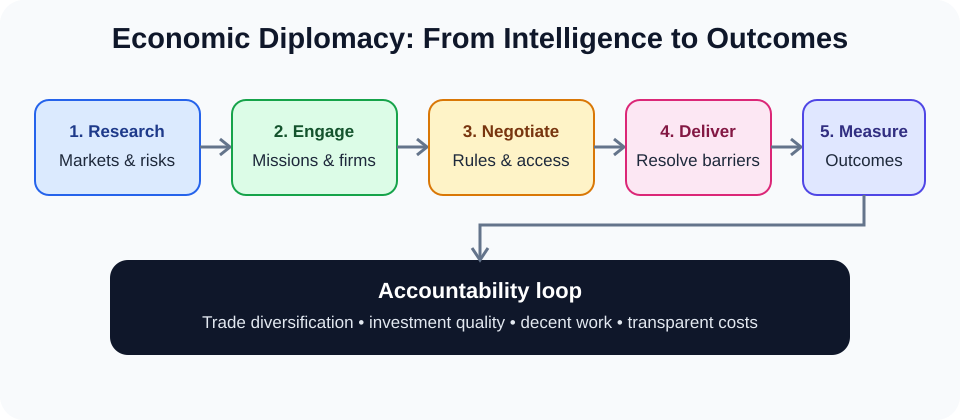

### ১৩.৭ Rohingya response: parallel diplomatic tracks

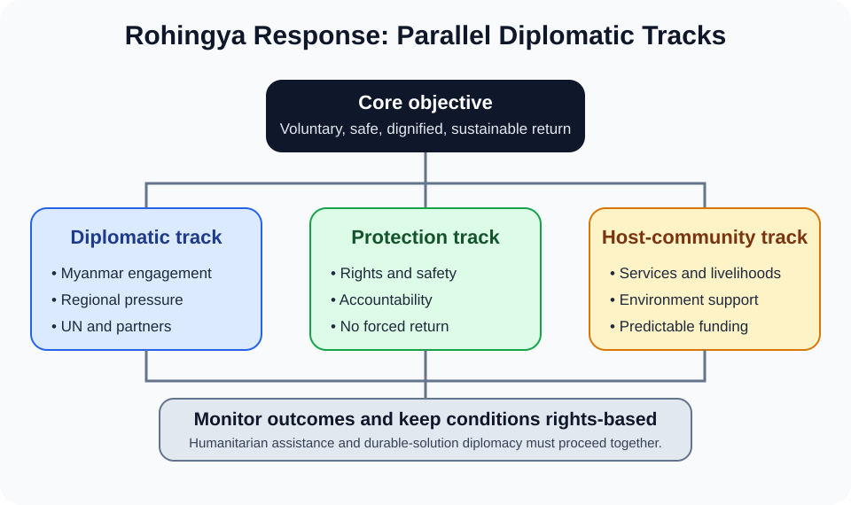

### ১৩.৮ Official geopolitical reference map

Bangladesh shares land borders with India and Myanmar and has a southern coastline on the Bay of Bengal. For exact borders and geographic context, use a dated cartographic source rather than treating a schematic as a map: [CIA World Factbook — Bangladesh map and geography](https://www.cia.gov/the-world-factbook/countries/bangladesh/map/). Check the map's date and reuse terms before embedding it in a distributable notebook.

### ১৩.৯ Historical image and background — Bangladesh and UN
[United Nations in Bangladesh — Bangladesh and the United Nations: 50 Years of Partnership](https://bangladesh.un.org/en/282417-bangladesh-and-united-nations-50-years-partnership)

## ১৪. ৩৩টি BCS Written practice questions

এগুলো দ্রুত self-practice-এর জন্য। প্রতিটি প্রশ্নের বিস্তৃত মডেল উত্তর পেতে [২৫টি Answered Model Question Bank](./BCS-WRITTEN-QUESTION-BANK.md) ব্যবহার করুন। PYQ-এর বছরভিত্তিক evidence ও সীমাবদ্ধতা দেখুন [35th–47th audit](./PYQ-35TH-47TH-AUDIT.md)-এ।

> এগুলো syllabus-based practice questions; BPSC-এর মূল প্রশ্নপত্র থেকে হুবহু নেওয়া বলে দাবি করা হচ্ছে না।

### A. ধারণা ও সাংবিধানিক ভিত্তি
1. পররাষ্ট্রনীতি কী? বাংলাদেশের পররাষ্ট্রনীতির প্রধান লক্ষ্যগুলো ব্যাখ্যা করুন। (৫)
2. “Friendship to all, malice towards none”—নীতিবাক্যটির তাৎপর্য আলোচনা করুন। (১০)
3. Article 25-কে বাংলাদেশের পররাষ্ট্রনীতির সাংবিধানিক ভিত্তি হিসেবে বিশ্লেষণ করুন। (১০)
4. “জাতীয় স্বার্থ সংরক্ষণই বাংলাদেশের পররাষ্ট্রনীতির মূল নির্ধারক”—ব্যাখ্যা করুন। (১০)
5. বাংলাদেশের পররাষ্ট্রনীতির অভ্যন্তরীণ ও বহিরাগত নির্ধারক আলোচনা করুন। (১০)
6. National power-এর উপাদানগুলো এবং কূটনৈতিক সক্ষমতায় তাদের ভূমিকা ব্যাখ্যা করুন। (১০)

### B. ভূরাজনীতি ও দ্বিপাক্ষিক সম্পর্ক
7. বাংলাদেশের ভূরাজনৈতিক অবস্থানের সুযোগ ও চ্যালেঞ্জ বিশ্লেষণ করুন। (১০)
8. ভারতের সঙ্গে বাংলাদেশের সম্পর্কের প্রধান ইস্যু ও সহযোগিতার ক্ষেত্র আলোচনা করুন। (১০)
9. চীনের সঙ্গে অর্থনৈতিক সহযোগিতা ও কৌশলগত ভারসাম্য বজায় রাখতে বাংলাদেশের করণীয় মূল্যায়ন করুন। (১০)
10. যুক্তরাষ্ট্র ও ইউরোপীয় অংশীদারদের সঙ্গে বাণিজ্য, শ্রমমান ও উন্নয়ন সহযোগিতা বিশ্লেষণ করুন। (১০)
11. বাংলাদেশের উন্নয়ন কূটনীতিতে জাপান ও অন্যান্য অংশীদারের ভূমিকা আলোচনা করুন। (৫)
12. Rohingya সংকট সমাধানে বাংলাদেশের কূটনৈতিক কৌশল মূল্যায়ন করুন। (২০)

### C. বহুপাক্ষিক কূটনীতি
13. বাংলাদেশের পররাষ্ট্রনীতিতে জাতিসংঘের গুরুত্ব আলোচনা করুন। (১০)
14. UN peacekeeping-এ বাংলাদেশের অবদান, সুফল ও চ্যালেঞ্জ মূল্যায়ন করুন। (১০)
15. SAARC ও BIMSTEC-এর উদ্দেশ্য ও বাংলাদেশের স্বার্থ তুলনা করুন। (১০)
16. বাংলাদেশের পররাষ্ট্রনীতিতে OIC ও D-8-এর প্রাসঙ্গিকতা আলোচনা করুন। (৫)
17. বর্তমান বিশ্বে বাংলাদেশের জন্য NAM কতটা প্রাসঙ্গিক? মূল্যায়ন করুন। (১০)
18. WTO, IMF ও World Bank-এর সঙ্গে বাংলাদেশের সম্পর্কের সুযোগ ও চ্যালেঞ্জ ব্যাখ্যা করুন। (১০)

### D. Economic diplomacy ও security
19. Economic diplomacy কী? রপ্তানি ও বিনিয়োগ বৃদ্ধিতে এর ভূমিকা আলোচনা করুন। (১০)
20. বিদেশি সহায়তা ও উন্নয়ন অর্থায়ন গ্রহণে কোন বিষয় বিবেচনা করা উচিত? (১০)
21. নিরাপদ শ্রম অভিবাসন ও প্রবাসী কর্মীর অধিকার রক্ষায় কূটনৈতিক করণীয় ব্যাখ্যা করুন। (১০)
22. Transit, transshipment ও regional connectivity কীভাবে সুযোগ তৈরি করে? (১০)
23. বাংলাদেশের climate diplomacy ও climate finance অর্জনের কৌশল আলোচনা করুন। (১০)
24. বঙ্গোপসাগর ও Blue Economy পররাষ্ট্রনীতি ও জাতীয় নিরাপত্তায় কেন গুরুত্বপূর্ণ? (১০)

### E. বিশ্লেষণ ও সমস্যা সমাধান
25. বড় শক্তির প্রতিযোগিতার মধ্যে বাংলাদেশের কৌশলগত ভারসাম্য কীভাবে বজায় রাখা উচিত? (২০)
26. বাংলাদেশের foreign-policy formulation process ও প্রাতিষ্ঠানিক চ্যালেঞ্জ বিশ্লেষণ করুন। (১০)
27. “Multilateral diplomacy can amplify the voice of a small state”—বাংলাদেশের প্রেক্ষাপটে ব্যাখ্যা করুন। (১০)
28. Rohingya সংকটে মানবিক দায়িত্ব, জাতীয় নিরাপত্তা ও international burden-sharing-এর ভারসাম্য কীভাবে আনা যায়? (২০)
29. বাংলাদেশের economic diplomacy-র দুর্বলতা চিহ্নিত করে সংস্কার প্রস্তাব করুন। (২০)
30. “Foreign policy must balance values and interests”—Article 25-এর আলোকে মূল্যায়ন করুন। (২০)
31. SAARC, BIMSTEC ও bilateral diplomacy কীভাবে পরস্পরকে পরিপূরক করতে পারে? (২০)
32. কোনো গুরুত্বপূর্ণ বাজার বাংলাদেশের রপ্তানিতে নতুন বাধা দিলে কূটনীতিক হিসেবে কী পদক্ষেপ নেবেন? (১৫)
33. আগামী দশকে বাংলাদেশের পররাষ্ট্রনীতির পাঁচটি অগ্রাধিকার যুক্তিসহ সুপারিশ করুন। (২০)

## ১৫. Written answer framework

**৫ নম্বর:** সংজ্ঞা/মূল বক্তব্য → ৩–৪টি পয়েন্ট → একটি প্রাসঙ্গিক উদাহরণ → উপসংহার।  
**১০ নম্বর:** ভূমিকা → Article/প্রেক্ষাপট → ৪–৬টি বিশ্লেষণ → সীমাবদ্ধতা → উপসংহার।  
**২০ নম্বর:** প্রশ্নের দাবি → Article 25/জাতীয় স্বার্থ → ভৌগোলিক, অর্থনৈতিক, নিরাপত্তা ও আন্তর্জাতিক মাত্রা → সুবিধা ও সীমাবদ্ধতা → ৪–৫টি বাস্তব সুপারিশ → ভারসাম্যপূর্ণ উপসংহার।

### Self-check
- [ ] Article 25-এর মূলনীতি ব্যাখ্যা করতে পারি।
- [ ] ৩৫তম BCS Written-এর পররাষ্ট্রনীতি প্রশ্নের theme জানি।
- [ ] UN, NAM, SAARC, BIMSTEC, OIC, D-8 ও WTO-এর পার্থক্য বুঝি।
- [ ] National interest ও নীতিবাক্যের সম্পর্ক ব্যাখ্যা করতে পারি।
- [ ] Economic diplomacy-র তিনটি বাস্তব সুপারিশ লিখতে পারি।
- [ ] বিশ্লেষণ, counterpoint ও source line ব্যবহার করি।

## ১৬. Full Source Register

### সরকারি ও প্রাথমিক উৎস
**[S1] Bangladesh Public Service Commission (BPSC).** *Syllabus for BCS (Written) Examination*, Bangladesh Affairs, Subject Code 005, Unit 9.  
https://bpsc.portal.gov.bd/sites/default/files/files/bpsc.portal.gov.bd/page/732e9da5_9514_4252_9a33_119f8c000cc5/SYLLABUS%20FOR%20BCS%20%28WRITTEN%29%20EXAMINATION.pdf

**[S2] Government of Bangladesh, Laws of Bangladesh.** *The Constitution of the People’s Republic of Bangladesh*, Article 25.  
https://bdlaws.minlaw.gov.bd/act-367/part-details-199.html?lang=en

**[S3] Ministry of Foreign Affairs, Bangladesh.** *Foreign Policy of Bangladesh: Friendship to all, malice to none.*  
https://sittwe.mofa.gov.bd/pages/static-pages/foreign-policy-of-bangladesh-edc320-695266ac35ce18e1c05aab1e

**[S4] United Nations.** *Member States — Bangladesh*, admission date 17 September 1974.  
https://www.un.org/about-us/member-states

**[S5] United Nations Peacekeeping.** *Contribution of Uniformed Personnel to UN by Country and Personnel Type*, data as of 31 July 2025.  
https://peacekeeping.un.org/sites/default/files/01_contributions_to_un_peacekeeping_operations_by_country_and_post_88_july_2025.pdf

**[S6] United Nations in Bangladesh.** *Bangladesh and the United Nations: 50 Years of Partnership* (31 October 2024).  
https://bangladesh.un.org/en/282417-bangladesh-and-united-nations-50-years-partnership

**[S7] United Nations Treaty Collection.** Bangladesh’s acceptance of obligations under the UN Charter.  
https://treaties.un.org/doc/source/docs/bangladesh-E.pdf

### Previous-question archive — secondary source
**[Q1] BCS EXAM.** *35th BCS Written Questions*, Bangladesh Affairs, Question 27.  
https://bcsexam.org/written-questions/35th-bcs-written

**[Q2] BCS EXAM.** *50th BCS Written Questions*, International Affairs, Subject Code 007; related theme only, not counted as Bangladesh Affairs.  
https://bcsexam.org/written-questions/50th-bcs-written

### Image source
- Dhaka Tribune, [Bangladesh’s robust role and commitment towards international peace and security](https://www.dhakatribune.com/opinion/longform/314708/bangladesh%E2%80%99s-robust-role-and-commitment-towards). Reuse rights should be checked with the publisher.
- United Nations in Bangladesh, [Bangladesh and the United Nations: 50 Years of Partnership](https://bangladesh.un.org/en/282417-bangladesh-and-united-nations-50-years-partnership).

### উৎস ব্যবহারের নীতি
1. সাংবিধানিক বক্তব্যে Article 25-এর সরকারি পাঠ অগ্রাধিকার দিন।
2. পরিবর্তনশীল পরিসংখ্যানের সঙ্গে observation date উল্লেখ করুন।
3. secondary question archive-কে official BPSC scan বলবেন না।
4. সদস্যপদ, বাণিজ্য ও peacekeeping figures পরীক্ষার আগে হালনাগাদ করুন।
5. পরীক্ষার খাতায় URL প্রয়োজন নেই; প্রতিষ্ঠানের নাম, নথির নাম ও Article/তারিখ যথেষ্ট।

---

### অধ্যায়ের শেষ কথা
বাংলাদেশের পররাষ্ট্রনীতির সাফল্য শুধু কত দেশের সঙ্গে সম্পর্ক আছে তা দিয়ে মাপা যায় না। প্রকৃত মানদণ্ড হলো সার্বভৌমত্ব ও জাতীয় স্বার্থ রক্ষা, অর্থনৈতিক সুযোগ সৃষ্টি, নাগরিক ও প্রবাসীদের সুরক্ষা, আন্তর্জাতিক আইন মেনে বিরোধ সামলানো এবং বহুপাক্ষিক ব্যবস্থায় কার্যকর অবদান। Article 25, তথ্যনির্ভর কূটনীতি, সম্পর্কের বৈচিত্র্য ও বাস্তবায়নযোগ্য সুপারিশ—এই চার স্তর একসঙ্গে লিখলে উত্তর হবে বিশ্লেষণধর্মী ও BCS Written-উপযোগী।

[⬆️ সূচিতে ফিরে যান](#top) · [35th–47th PYQ Audit](./PYQ-35TH-47TH-AUDIT.md) · [২৫টি Answered Model Q&A](./BCS-WRITTEN-QUESTION-BANK.md) · [PYQ-ভিত্তিক প্রবন্ধ](./PYQ-BASED-ESSAYS.md) · [English Quotations](./QUOTATIONS.md)

**ছবির কৃতিত্ব ও লাইসেন্স:** [ছবির উৎসতালিকা](../assets/photos/SOURCES.md)।
