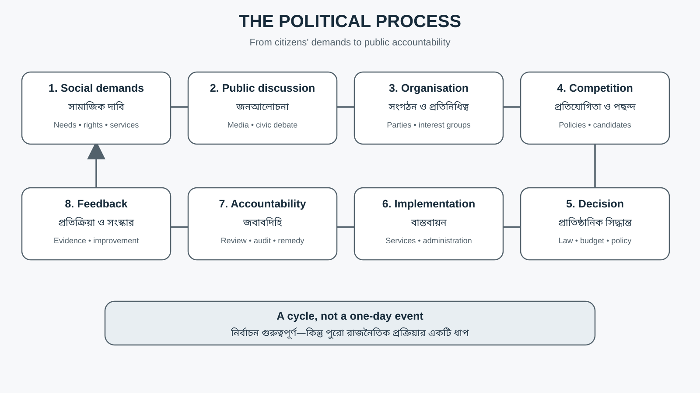
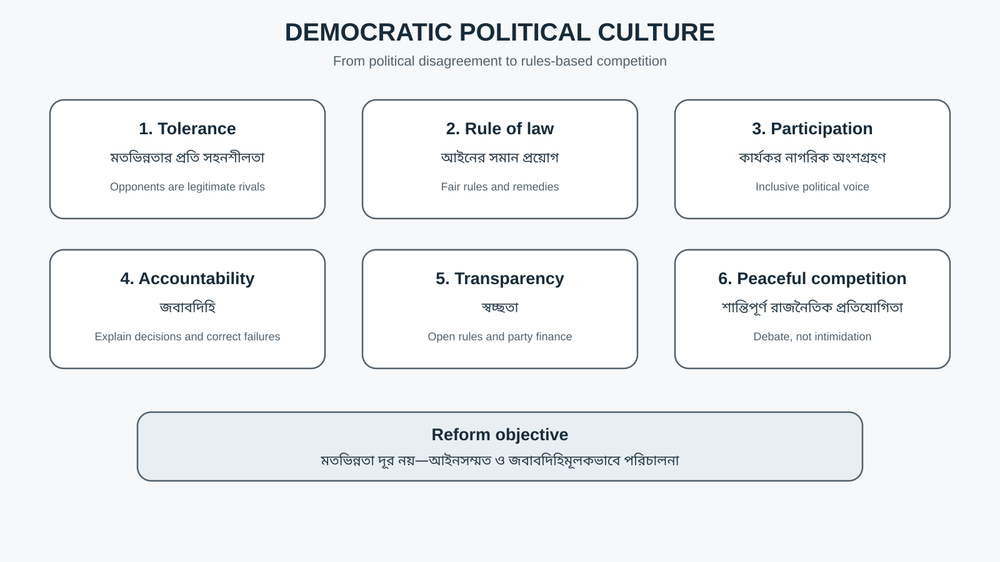
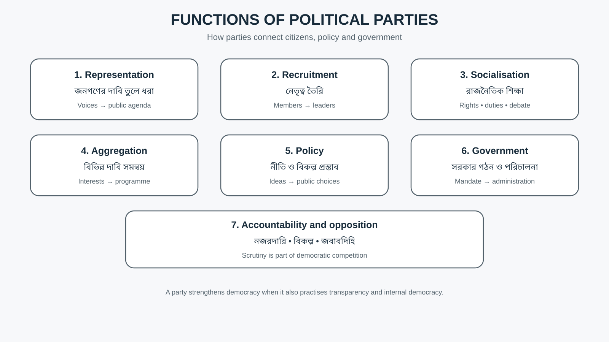
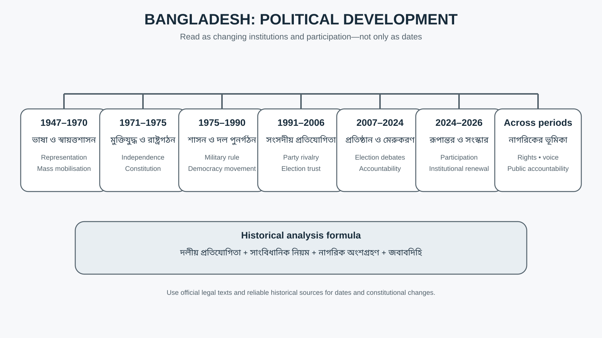
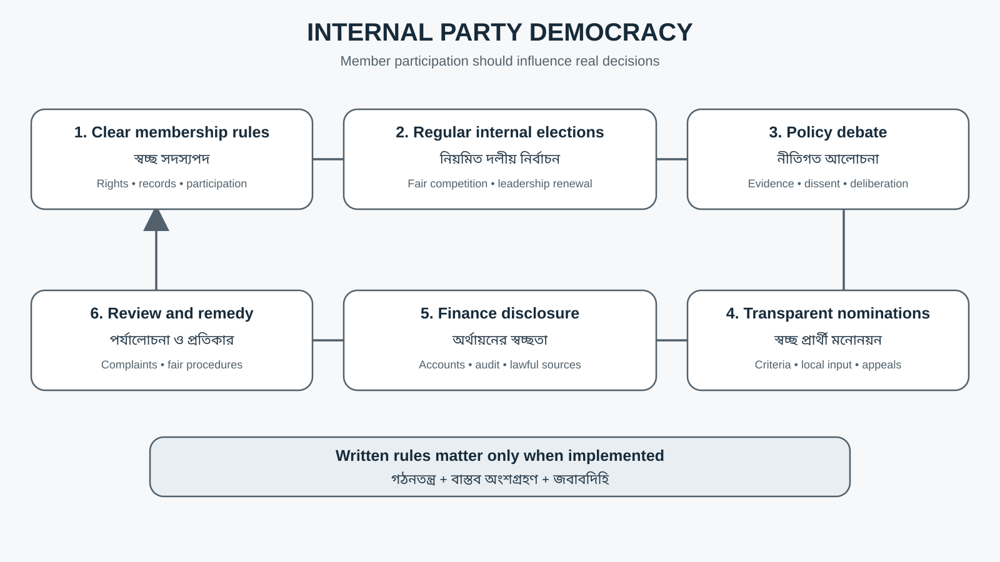
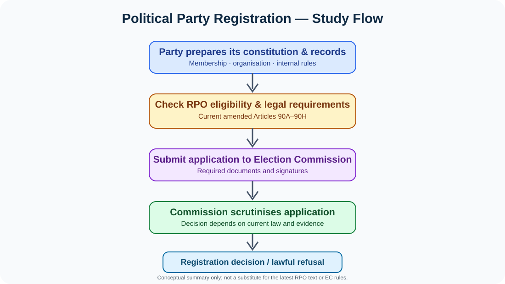

# Chapter 10 — রাজনৈতিক দল ও রাজনৈতিক প্রক্রিয়া | Political Parties & Political Process

> **BCS Written · Bangladesh Affairs · Subject Code 005**  
> বাংলা ব্যাখ্যা + English terminology + source-backed analysis + archive-reported PYQ + ৮টি প্রবন্ধ + ৩৩টি Model Q&A + ৬টি responsive revision diagrams + real-institution image atlas + 25-question standalone bank + year-by-year PYQ evidence map + English quotation bank.  
> **সর্বশেষ উৎস পর্যালোচনা:** ২১ অক্টোবর ২০২৬।

[← Bangladesh Affairs সূচি](../README.md) · [🧭 35th–47th BCS PYQ Map](./PYQ-35-47-MAP.md) · [📘 25 Answered Model Q&A](./BCS-WRITTEN-QUESTION-BANK.md) · [💬 English Quotations + Sources](./QUOTATIONS.md) · [Chapter 1-এর format reference](../Chapter-01/README.md)

## Visual Atlas — real institutions, location map and legal process

### Bangladesh Election Commission — the institution that registers political parties

**Image source/licence:** [Wikimedia Commons file page](https://commons.wikimedia.org/wiki/File:Bangladesh_Election_Commission.jpg), author ইব্রাহিম হাসান, own work, **CC BY-SA 4.0**. Attribute the creator and link the licence if reusing the image.

**Location:** [OpenStreetMap — Bangladesh Election Commission, Agargaon](https://www.openstreetmap.org/?mlat=23.777147&mlon=90.374392#map=17/23.777147/90.374392). This is a location reference, not an electoral constituency map.

### National Parliament Building — the institutional setting of party competition

**Image source/licence:** [Wikimedia Commons file page](https://commons.wikimedia.org/wiki/File:National_Parliament_Building.jpg), author Helal321, own work, **CC BY-SA 4.0**.

### Additional responsive study diagrams
- [Political Process Cycle](./assets/political-process-cycle.svg)
- [Functions of Political Parties](./assets/party-functions.svg)
- [Bangladesh Political Development Timeline](./assets/political-timeline.svg)
- [Democratic Political Culture Framework](./assets/democratic-political-culture.svg)
- [Internal Party Democracy](./assets/internal-party-democracy.svg)
- [Political Party Registration Flow](./assets/party-registration-flow.svg)

**Why no unrelated geographical map?** This chapter concerns political institutions and political behaviour, not physical geography. The map link locates the Election Commission; diagrams explain the political process and legal workflow. Current party-registration status should be checked against the [official Election Commission list](https://ecs.gov.bd/political-parties), which is dynamic.

> [!IMPORTANT]
> **এই অধ্যায়ের কেন্দ্রীয় ধারণা:** রাজনৈতিক দল শুধু নির্বাচনে অংশ নেওয়ার সংগঠন নয়; নাগরিকের দাবি সংগঠিত করা, নেতৃত্ব তৈরি, নীতি প্রস্তাব, সরকার গঠন, বিরোধী দলের মাধ্যমে জবাবদিহি এবং রাষ্ট্র ও সমাজের মধ্যে যোগাযোগ তৈরিও তার কাজ। গণতান্ত্রিক রাজনৈতিক প্রক্রিয়া তখনই কার্যকর হয়, যখন দলগুলো আইন মানে, অভ্যন্তরীণভাবে গণতান্ত্রিক থাকে, শান্তিপূর্ণ প্রতিযোগিতা করে এবং নাগরিকের অধিকারকে সম্মান করে।

## 🟨🟩 রঙের সংকেত — Reading Colour Code

| চিহ্ন | কী বোঝায় | পড়ার কৌশল |
|---|---|---|
| 🟨 **Key Fact** | সংবিধান, আইন, সাল ও মূল ধারণা | আগে মুখস্থ করুন |
| 🟩 **Recall Cue** | এক লাইনের স্মরণ-সূত্র | বই বন্ধ করে মনে করুন |
| 🟦 **Source Evidence** | সরকারি আইন, BPSC বা গবেষণার উৎস | প্রতিষ্ঠানের নাম ও প্রকাশনার শিরোনাম শিখুন |
| 🟪 **Must Know** | ব্যাখ্যা, মূল্যায়ন ও পরীক্ষার মূল যুক্তি | নিজের ভাষায় বুঝিয়ে বলুন |

> [!TIP]
> **Read → Recall → Apply:** প্রতিটি অংশ পড়ুন, তিনটি key word মনে করুন, তারপর সেই অংশ থেকে একটি English question-এর উত্তর বাংলায় লিখুন। শুধু সাল বা সংজ্ঞা মুখস্থ না করে কারণ, প্রভাব, উদাহরণ ও সমাধান যুক্ত করুন।

## অধ্যায় ১০-এর গুরুত্বপূর্ণ উদ্ধৃতি

> “The Republic shall be a democracy … in which effective participation by the people through their elected representatives … shall be ensured.”
>
> — Constitution of Bangladesh, Article 11 (short excerpt)

**বাংলা ভাবানুবাদ:** জনগণের নির্বাচিত প্রতিনিধিদের মাধ্যমে কার্যকর অংশগ্রহণ নিশ্চিত করা গণতান্ত্রিক রাষ্ট্রের সাংবিধানিক অঙ্গীকার।

[➡️ English Quotations + বাংলা অর্থ + source links — আলাদা quotation bank খুলুন](./QUOTATIONS.md)

## 📑 বিষয়সূচি — সরাসরি অংশে যান

| শুরু ও শেখার ধাপ | মূল বিষয় | প্রশ্ন ও উৎস |
|---|---|---|
| [Syllabus & learning outcomes](#syllabus) | [Political parties: meaning and functions](#meaning) | [Previous BCS question analysis](#pyq) |
| [Key terms](#terms) | [বাংলাদেশের রাজনৈতিক ইতিহাস](#history) | [৮টি source-backed প্রবন্ধ](#essays) |
| [Political process](#process) | [দলীয় ব্যবস্থা ও রাজনৈতিক সংস্কৃতি](#culture) | [৩৩টি Model Q&A](#questions) |
| [সংবিধান ও আইন](#law) | [চ্যালেঞ্জ ও সংস্কার](#reform) | [Answer-writing strategy](#strategy) |
| [Revision diagrams](#visuals) | [নারী, তরুণ ও নাগরিক অংশগ্রহণ](#inclusion) | [Full source register](#sources) |
| [English Quotations](./QUOTATIONS.md) | [One-page revision](#revision) | [Quote source register](./QUOTATIONS.md#quote-sources) |
| [35th–47th BCS PYQ audit](./PYQ-35-47-MAP.md) | [২৫টি Answered Model Q&A](./BCS-WRITTEN-QUESTION-BANK.md) | [Political Party Registration Flow](./assets/party-registration-flow.svg) |

---

## ১. BPSC Syllabus Mapping ও Learning Outcomes

এই অধ্যায় BCS Written Bangladesh Affairs-এর **“Political Parties and Political Process”** বিষয়কে কেন্দ্র করে সাজানো। সরকারি সিলেবাসের পূর্ণ PDF পড়ার জন্য: [BPSC — Syllabus for BCS (Written) Examination](https://bpsc.portal.gov.bd/sites/default/files/files/bpsc.portal.gov.bd/page/732e9da5_9514_4252_9a33_119f8c000cc5/SYLLABUS%20FOR%20BCS%20%28WRITTEN%29%20EXAMINATION.pdf).

**এ অধ্যায় শেষে আপনি পারবেন:**

1. Political party, party system, political process, political culture ও political participation-এর পার্থক্য ব্যাখ্যা করতে।
2. বাংলাদেশের রাজনৈতিক দলের ঐতিহাসিক বিকাশকে ভাষা আন্দোলন, মুক্তিযুদ্ধ, সাংবিধানিক পরিবর্তন ও গণতান্ত্রিক আন্দোলনের সঙ্গে যুক্ত করতে।
3. সংবিধানের ১১, ৩৮, ৩৯ ও ৭০ অনুচ্ছেদ এবং RPO 1972-এর দল নিবন্ধনসংক্রান্ত বিধানের প্রাসঙ্গিকতা ব্যাখ্যা করতে।
4. রাজনৈতিক দলের প্রধান কাজ, অভ্যন্তরীণ গণতন্ত্র, নেতৃত্ব নির্বাচন, প্রার্থী মনোনয়ন ও রাজনৈতিক অর্থায়ন বিশ্লেষণ করতে।
5. ৪৭তম BCS Written-এ archive-reported রাজনৈতিক সংস্কৃতিবিষয়ক প্রশ্নের মতো বিশ্লেষণধর্মী প্রশ্নের উত্তর সাজাতে।
6. রাজনৈতিক মেরুকরণ, সহিংসতা, পৃষ্ঠপোষকতাভিত্তিক রাজনীতি ও আস্থার সংকটের কারণ–প্রভাব–সমাধান লিখতে।
7. নারী, তরুণ, সংখ্যালঘু ও প্রান্তিক জনগোষ্ঠীর অংশগ্রহণকে গণতান্ত্রিক প্রতিনিধিত্বের সঙ্গে যুক্ত করতে।
8. ৫, ১০ ও ২০ নম্বরের জন্য সংক্ষিপ্ত, মধ্যম ও পূর্ণাঙ্গ উত্তর লিখতে।

### সিলেবাস-থিম থেকে প্রস্তুতির মানচিত্র

| প্রস্তুতির বিষয় | যে প্রশ্নের উত্তর দিতে শিখবেন | অধ্যায়ের অংশ |
|---|---|---|
| Political party | দল কী, কেন প্রয়োজন, কী কাজ করে? | §২–৩ |
| Political process | দাবি কীভাবে নীতি ও সিদ্ধান্তে রূপ নেয়? | §৪ |
| Historical development | বাংলাদেশের দলীয় রাজনীতির বিকাশ কীভাবে ঘটেছে? | §৫ |
| Party system and culture | প্রতিযোগিতা, মেরুকরণ ও রাজনৈতিক আচরণের ধরন কী? | §৬–৭ |
| Constitutional and legal framework | দলীয় অধিকার, নিবন্ধন ও সংসদীয় শৃঙ্খলার ভিত্তি কী? | §৮ |
| Democratic inclusion | নারী, তরুণ ও ভিন্নমতের অংশগ্রহণ কীভাবে বাড়ানো যায়? | §৯ |
| Challenges and reforms | কোন প্রাতিষ্ঠানিক সংস্কার বাস্তবসম্মত? | §১০–১১ |
| Exam application | বিগত প্রশ্নের থিম কীভাবে উত্তর-লেখায় ব্যবহার করবেন? | §১২–১৭ |

## ২. মূল পরিভাষা — English Term, বাংলা অর্থ ও সহজ ব্যাখ্যা

| Term | বাংলা অর্থ | সহজ ব্যাখ্যা |
|---|---|---|
| Political party | রাজনৈতিক দল | অভিন্ন নীতি বা লক্ষ্য নিয়ে রাষ্ট্রক্ষমতা অর্জন বা নীতিতে প্রভাব বিস্তারের উদ্দেশ্যে সংগঠিত রাজনৈতিক সংগঠন। |
| Political process | রাজনৈতিক প্রক্রিয়া | দাবি উত্থাপন, মতামত গঠন, সংগঠন, নির্বাচন, নীতি প্রণয়ন, বাস্তবায়ন ও জবাবদিহির ধারাবাহিকতা। |
| Party system | দলীয় ব্যবস্থা | একটি রাজনৈতিক ব্যবস্থায় দলের সংখ্যা, প্রতিযোগিতা, পারস্পরিক সম্পর্ক ও ক্ষমতা অর্জনের ধরন। |
| Political culture | রাজনৈতিক সংস্কৃতি | নাগরিক ও রাজনৈতিক প্রতিষ্ঠানের মধ্যে রাজনীতি সম্পর্কে মূল্যবোধ, মনোভাব, বিশ্বাস ও আচরণের সামগ্রিক ধরন। |
| Political participation | রাজনৈতিক অংশগ্রহণ | ভোট দেওয়া, আলোচনা, সংগঠন, প্রচার, আবেদন, শান্তিপূর্ণ প্রতিবাদ ও নীতিনির্ধারণে অংশ নেওয়া। |
| Political socialization | রাজনৈতিক সমাজীকরণ | পরিবার, শিক্ষা, গণমাধ্যম, সামাজিক সংগঠন ও অভিজ্ঞতার মাধ্যমে রাজনৈতিক ধারণা শেখার প্রক্রিয়া। |
| Internal party democracy | দলীয় অভ্যন্তরীণ গণতন্ত্র | নেতৃত্ব, নীতি ও প্রার্থী নির্বাচনে সদস্যদের বাস্তব অংশগ্রহণ, প্রতিযোগিতা ও জবাবদিহি। |
| Party discipline | দলীয় শৃঙ্খলা | দলের সিদ্ধান্ত ও বিধি মেনে চলার ব্যবস্থা; তবে এটি যুক্তিসংগত মতভিন্নতা বা সংসদীয় আলোচনার জায়গা সংকুচিত করবে কি না, সেটিও গুরুত্বপূর্ণ প্রশ্ন। |
| Opposition | বিরোধী দল | সরকারের বিকল্প নীতি উপস্থাপন, সংসদীয় নজরদারি ও নির্বাহী ক্ষমতার জবাবদিহি নিশ্চিত করার দায়িত্বে থাকা দল বা দলসমূহ। |
| Political polarization | রাজনৈতিক মেরুকরণ | রাজনৈতিক প্রতিদ্বন্দ্বিতা যখন পারস্পরিক অবিশ্বাস, শত্রুতা ও সমঝোতার অক্ষমতায় রূপ নেয়। |
| Patronage politics | পৃষ্ঠপোষকতাভিত্তিক রাজনীতি | নীতি বা যোগ্যতার পরিবর্তে রাজনৈতিক আনুগত্যের বিনিময়ে সুবিধা, পদ বা সম্পদ বণ্টনের প্রবণতা। |
| Clientelism | আনুগত্যের বিনিময়ে সুবিধা | ব্যক্তি বা গোষ্ঠীভিত্তিক সমর্থনের বিনিময়ে লক্ষ্যভিত্তিক সুবিধা প্রদানের রাজনৈতিক সম্পর্ক। |
| Political legitimacy | রাজনৈতিক বৈধতা | আইন, জনসম্মতি ও ন্যায্য প্রক্রিয়ার ভিত্তিতে কর্তৃত্ব গ্রহণযোগ্য হওয়ার অবস্থা। |
| Civil society | নাগরিক সমাজ | রাষ্ট্র ও বাজারের বাইরে নাগরিকদের স্বেচ্ছামূলক সংগঠন, পেশাজীবী, অধিকারকর্মী ও জনস্বার্থভিত্তিক উদ্যোগের পরিসর। |
| Interest group | স্বার্থগোষ্ঠী | নির্দিষ্ট সামাজিক বা অর্থনৈতিক স্বার্থে নীতিকে প্রভাবিত করতে চাওয়া সংগঠন; সাধারণত সরাসরি সরকার গঠন করাই প্রধান লক্ষ্য নয়। |
| Political accountability | রাজনৈতিক জবাবদিহি | ক্ষমতাসীনদের সিদ্ধান্তের ব্যাখ্যা, পর্যালোচনা এবং ভুল হলে প্রতিকার বা পরিণতির মুখোমুখি হওয়ার ব্যবস্থা। |
| Political pluralism | রাজনৈতিক বহুত্ববাদ | বিভিন্ন মত, দল, সংগঠন ও পরিচয়ের বৈধ সহাবস্থান ও প্রতিযোগিতার সুযোগ। |
| Electoral mandate | নির্বাচনী ম্যান্ডেট | নির্বাচনের মাধ্যমে জনগণের কাছ থেকে প্রতিনিধি বা দলের পাওয়া শাসন ও নীতি বাস্তবায়নের অনুমোদন; এটি সীমাহীন ক্ষমতা নয়। |
| Deliberation | যুক্তিনির্ভর গণআলোচনা | সিদ্ধান্ত নেওয়ার আগে তথ্য, যুক্তি ও পাল্টা যুক্তির ভিত্তিতে মতবিনিময়। |
| Rule of law | আইনের শাসন | ব্যক্তি বা দলের পরিচয় নির্বিশেষে আইনসম্মত ও ন্যায়সংগত নিয়ম প্রয়োগ। |

### মনে রাখার পার্থক্য

- **Political party ≠ interest group:** রাজনৈতিক দল সাধারণত সরকার গঠন বা নির্বাচনী প্রতিনিধিত্বের দিকে এগোয়; স্বার্থগোষ্ঠী নির্দিষ্ট নীতিতে প্রভাব বিস্তারে বেশি মনোযোগী।
- **Political process ≠ election only:** নির্বাচন একটি গুরুত্বপূর্ণ ধাপ, কিন্তু রাজনৈতিক প্রক্রিয়ায় নির্বাচন-পূর্ব মতগঠন, নীতি প্রণয়ন, বাস্তবায়ন ও জবাবদিহিও আছে।
- **Party discipline ≠ internal democracy:** সিদ্ধান্ত হওয়ার পরে দলীয় শৃঙ্খলা প্রয়োজন হতে পারে; কিন্তু সিদ্ধান্ত নেওয়ার আগে সদস্যদের মত প্রকাশ ও প্রতিযোগিতার সুযোগও দরকার।
- **Political competition ≠ political enmity:** প্রতিযোগিতা নীতির বিকল্প তুলে ধরে; শত্রুতামূলক রাজনীতি প্রতিপক্ষের বৈধ অস্তিত্বকেই অস্বীকার করে।

## ৩. রাজনৈতিক দল: ধারণা, বৈশিষ্ট্য ও গণতন্ত্রে ভূমিকা

### ৩.১ Political party কী?

রাজনৈতিক দল হলো এমন একটি সংগঠিত গোষ্ঠী, যারা কিছু নীতি, মূল্যবোধ বা কর্মসূচির ভিত্তিতে জনগণের সমর্থন অর্জন করে এবং নির্বাচনের মাধ্যমে বা বৈধ রাজনৈতিক প্রক্রিয়ায় রাষ্ট্রক্ষমতা অর্জন, সরকারে অংশগ্রহণ অথবা সরকারি নীতিকে প্রভাবিত করতে চায়। International IDEA-র ২০২৫ সালের *Political Parties: Constitutional Roles, Recognition, Rights and Regulations* primer-এ দলকে সাধারণ নীতি বা কর্মসূচিতে ঐকমত্য থাকা মানুষের সংগঠন হিসেবে ব্যাখ্যা করা হয়েছে, যারা সেই নীতিকে বাস্তবায়নের জন্য নির্বাচিত পদ অর্জনের চেষ্টা করে।

### ৩.২ একটি কার্যকর রাজনৈতিক দলের প্রধান বৈশিষ্ট্য

1. **Shared political programme:** অর্থনীতি, শিক্ষা, স্বাস্থ্য, স্থানীয় সরকার, পররাষ্ট্রনীতি ও সামাজিক ন্যায়বিচার নিয়ে ব্যাখ্যাযোগ্য কর্মসূচি।
2. **Organisation:** কেন্দ্রীয় নেতৃত্বের পাশাপাশি স্থানীয় ও আঞ্চলিক কাঠামো, সদস্যপদ ও দায়িত্ববণ্টন।
3. **Public support:** নাগরিকদের সঙ্গে নিয়মিত যোগাযোগ, সমর্থন গঠন ও নির্বাচনী অংশগ্রহণ।
4. **Leadership recruitment:** নতুন নেতা তৈরি, প্রশিক্ষণ এবং দায়িত্ব হস্তান্তরের ব্যবস্থা।
5. **Internal rules:** দলীয় গঠনতন্ত্র, সদস্যদের অধিকার, সিদ্ধান্ত গ্রহণ ও বিরোধ নিষ্পত্তির নিয়ম।
6. **Public accountability:** অর্থায়ন, মনোনয়ন ও নীতিগত সিদ্ধান্তের ব্যাখ্যা দেওয়ার সক্ষমতা।
7. **Constitutional conduct:** রাজনৈতিক লক্ষ্য অর্জনে সহিংসতা, ভয়ভীতি বা বেআইনি পদ্ধতির বদলে বৈধ ও শান্তিপূর্ণ পথ অনুসরণ।

### ৩.৩ রাজনৈতিক দলের সাতটি প্রধান কাজ

| কাজ | কীভাবে কাজ করে | উদাহরণ |
|---|---|---|
| Representation | বিভিন্ন অঞ্চলের ও শ্রেণির দাবি নীতিতে তুলে ধরে | কৃষক, শ্রমিক, ব্যবসায়ী, তরুণ ও নারীর দাবি |
| Political recruitment | নেতা ও প্রার্থী নির্বাচন করে | স্থানীয় নেতা থেকে জাতীয় নেতৃত্বে উন্নীত হওয়ার পথ |
| Political socialization | নাগরিককে রাজনৈতিক অধিকার ও দায়িত্ব সম্পর্কে শেখায় | কর্মসূচি, আলোচনা, রাজনৈতিক শিক্ষা |
| Interest aggregation | পরস্পর ভিন্ন দাবি মিলিয়ে কর্মসূচি তৈরি করে | কর, ভর্তুকি, কর্মসংস্থান ও পরিবেশ নীতির ভারসাম্য |
| Policy formulation | সমস্যার সমাধানের জন্য বিকল্প নীতি প্রস্তাব করে | শিক্ষা, স্বাস্থ্য, কর্মসংস্থান, স্থানীয় সরকার |
| Government formation | নির্বাচনী সমর্থন ও সাংবিধানিক নিয়মের ভিত্তিতে সরকার গঠনে অংশ নেয় | সংসদীয় সংখ্যাগরিষ্ঠতা |
| Accountability and opposition | সরকারি সিদ্ধান্তের সমালোচনা, বিকল্প প্রস্তাব ও সংসদীয় নজরদারি | প্রশ্ন, বিতর্ক, কমিটি, জনমত |

### ৩.৪ রাজনৈতিক দল কেন প্রয়োজন?

আধুনিক রাষ্ট্রে মানুষের স্বার্থ ও মতামত বহুমুখী। সংগঠিত রাজনৈতিক দল ছাড়া বিচ্ছিন্ন দাবিকে জাতীয় কর্মসূচিতে রূপ দেওয়া, নেতৃত্ব নির্বাচন, নীতি নিয়ে প্রতিযোগিতা এবং সরকারকে বিকল্পের মুখোমুখি করা কঠিন। দল রাজনৈতিক অংশগ্রহণকে সংগঠিত করে এবং নাগরিকের দাবি ও রাষ্ট্রীয় সিদ্ধান্তের মধ্যে সংযোগ তৈরি করে।

তবে দল থাকলেই গণতন্ত্র নিশ্চিত হয় না। দল যদি ব্যক্তিকেন্দ্রিক হয়, সদস্যরা নেতৃত্ব নির্বাচন করতে না পারেন, বিরোধী মতকে শত্রু হিসেবে দেখে, অর্থায়নের উৎস গোপন থাকে অথবা রাজনৈতিক প্রতিযোগিতা সহিংস হয়ে ওঠে, তাহলে দল গণতন্ত্রকে শক্তিশালী করার বদলে দুর্বলও করতে পারে। তাই **দলের অস্তিত্বের পাশাপাশি দলের আচরণ, গঠনতন্ত্র ও জবাবদিহি** মূল্যায়ন করতে হবে।

> [!TIP]
> **Exam line:** A political party is both a vehicle of representation and an institution that must itself practise accountability.

## ৪. Political Process — রাজনৈতিক প্রক্রিয়া কীভাবে কাজ করে?

রাজনৈতিক প্রক্রিয়া হলো সমাজের সমস্যা ও দাবি কীভাবে রাজনৈতিক আলোচনায় আসে, সংগঠিত হয়, প্রতিদ্বন্দ্বী প্রস্তাবে রূপ নেয়, আইন বা সরকারি নীতিতে পরিণত হয় এবং পরে কীভাবে মূল্যায়ন ও সংশোধনের মুখোমুখি হয়—তার ধারাবাহিকতা।

### ৪.১ রাজনৈতিক প্রক্রিয়ার ধাপ

1. **Social demands:** মূল্যস্ফীতি, কর্মসংস্থান, শিক্ষা, নিরাপত্তা, অধিকার বা স্থানীয় সেবার মতো সমস্যা।
2. **Public discussion:** পরিবার, সংবাদমাধ্যম, বিশ্ববিদ্যালয়, পেশাজীবী সংগঠন, নাগরিক সমাজ ও সামাজিক মাধ্যমে আলোচনা।
3. **Organisation and representation:** রাজনৈতিক দল ও স্বার্থগোষ্ঠী দাবিগুলোকে সংগঠিত করে।
4. **Competition and choice:** নীতি, নেতৃত্ব, প্রার্থী ও কর্মসূচি নিয়ে প্রতিযোগিতা।
5. **Institutional decision:** আইনসভা, সরকার, স্থানীয় সরকার বা অন্য বৈধ প্রতিষ্ঠান সিদ্ধান্ত নেয়।
6. **Implementation:** প্রশাসন নীতি বাস্তবায়ন করে; বাজেট, জনবল ও সেবা প্রয়োজন হয়।
7. **Monitoring and accountability:** সংসদ, আদালত, গণমাধ্যম, নিরীক্ষা, নাগরিক ও বিরোধী দল ফলাফল পর্যালোচনা করে।
8. **Feedback and reform:** ফল ভালো না হলে নীতি, নেতৃত্ব বা প্রতিষ্ঠানের পরিবর্তনের দাবি ওঠে।

### ৪.২ রাজনৈতিক প্রক্রিয়ার প্রধান অংশীজন

- **Citizens and voters:** ভোট, আলোচনা, সংগঠন, আবেদন ও শান্তিপূর্ণ প্রতিবাদে অংশগ্রহণ।
- **Political parties:** দাবি সংগঠিত করা, কর্মসূচি প্রস্তাব, প্রার্থী মনোনয়ন ও সরকার গঠন।
- **Parliament and government:** আইন, বাজেট, নীতি ও নির্বাহী সিদ্ধান্ত।
- **Opposition:** বিকল্প নীতি, প্রশ্ন, সমালোচনা ও নজরদারি।
- **Election Commission:** প্রযোজ্য আইনের অধীনে নির্বাচনী দায়িত্ব ও রাজনৈতিক দলের নিবন্ধনসংক্রান্ত কাজ।
- **Courts and legal institutions:** আইনসম্মত বিরোধ ও অধিকারসংক্রান্ত প্রতিকার।
- **Media and civil society:** তথ্য, জনআলোচনা, পর্যবেক্ষণ ও নাগরিক সচেতনতা।
- **Local government:** স্থানীয় সমস্যা ও নাগরিক অংশগ্রহণের প্রাতিষ্ঠানিক ক্ষেত্র।
- **Interest groups and professional bodies:** নির্দিষ্ট দাবি ও নীতির পক্ষে যুক্তি উপস্থাপন।

### ৪.৩ Political process ও governance-এর সম্পর্ক

রাজনৈতিক প্রক্রিয়া নির্ধারণ করে কারা দাবি তুলতে পারে, কোন দাবি অগ্রাধিকার পায় এবং কে সিদ্ধান্ত নেয়। Governance হলো সেই সিদ্ধান্ত বাস্তবায়ন, সেবা প্রদান, সম্পদ ব্যবহার ও জবাবদিহির বিস্তৃত প্রক্রিয়া। রাজনৈতিক প্রক্রিয়া অন্তর্ভুক্তিমূলক না হলে নীতি কিছু গোষ্ঠীর প্রভাবের অধীনে চলে যেতে পারে; প্রশাসনিক সক্ষমতা দুর্বল হলে ভালো নীতিও ফল দিতে পারে না।

### ৪.৪ নির্বাচনই কি পুরো রাজনৈতিক প্রক্রিয়া?

না। নির্বাচন নাগরিকের প্রতিনিধিত্ব বাছাইয়ের একটি গুরুত্বপূর্ণ মাধ্যম। কিন্তু নির্বাচনের আগে মত প্রকাশ ও সংগঠনের স্বাধীনতা, প্রার্থী মনোনয়নের স্বচ্ছতা, অর্থায়নের নিয়ম, সমান রাজনৈতিক সুযোগ, নির্বাচনের পরে সংসদীয় নজরদারি এবং পরবর্তী নীতির জবাবদিহিও প্রয়োজন। তাই রাজনৈতিক প্রক্রিয়া মূল্যায়নে **before, during and after the election**—তিনটি সময়পর্ব বিবেচনা করুন।

## ৫. বাংলাদেশের রাজনৈতিক দল ও রাজনৈতিক প্রক্রিয়ার ঐতিহাসিক বিকাশ

বাংলাদেশের রাজনৈতিক ইতিহাসকে কয়েকটি বড় পর্যায়ে পড়লে দল, গণআন্দোলন, সাংবিধানিক পরিবর্তন এবং রাষ্ট্রগঠনের সম্পর্ক পরিষ্কার হয়। প্রতিটি পর্যায়ে দলীয় সংগঠন ও রাজনৈতিক অংশগ্রহণের সুযোগ একই ছিল না।

### ৫.১ ঔপনিবেশিক ও বঙ্গীয় পটভূমি

উনিশ ও বিশ শতকের প্রথমার্ধে বঙ্গীয় রাজনীতি জাতীয়তাবাদ, ঔপনিবেশিক শাসনের বিরোধিতা, সামাজিক সংস্কার, কৃষক-শ্রমিকের দাবি এবং ধর্মীয়-সামাজিক পরিচয়ের প্রশ্নে বিকশিত হয়। ১৮৮৫ সালে Indian National Congress এবং ১৯০৬ সালে ঢাকায় All-India Muslim League প্রতিষ্ঠা উপমহাদেশের সংগঠিত দলীয় রাজনীতির গুরুত্বপূর্ণ মাইলফলক। তবে বর্তমান বাংলাদেশের রাজনৈতিক পরিচয়কে শুধু এই দুই সংগঠনের মাধ্যমে ব্যাখ্যা করা যাবে না; ভাষা, শ্রেণি, আঞ্চলিক বৈষম্য ও গণআন্দোলনও গুরুত্বপূর্ণ।

### ৫.২ পাকিস্তান পর্ব: ভাষা, প্রতিনিধিত্ব ও স্বায়ত্তশাসনের দাবি

১৯৪৭ সালের পর পূর্ব বাংলার জনগণের ভাষাগত, অর্থনৈতিক ও রাজনৈতিক প্রতিনিধিত্বের প্রশ্ন কেন্দ্রীয় রাজনীতির গুরুত্বপূর্ণ বিষয় হয়ে ওঠে। ১৯৫২ সালের ভাষা আন্দোলন, ১৯৫৪ সালের যুক্তফ্রন্টের নির্বাচনী বিজয়, ১৯৬৬ সালের ছয় দফা এবং ১৯৬৯ সালের গণঅভ্যুত্থান সংগঠিত রাজনৈতিক দল ও জনআন্দোলনের সম্পর্ককে গভীর করে। ১৯৭০ সালের নির্বাচনে পূর্ব পাকিস্তানের প্রতিনিধিত্বমূলক ম্যান্ডেট এবং ক্ষমতা হস্তান্তরের সংকট স্বাধীনতা সংগ্রামের রাজনৈতিক প্রেক্ষাপটের অংশ।

**পরীক্ষার যুক্তি:** এই সময়ের ইতিহাস দেখায় যে রাজনৈতিক দল কেবল নির্বাচন করে না; ভাষা, স্বায়ত্তশাসন, অর্থনৈতিক ন্যায় ও প্রতিনিধিত্বের দাবিকে সংগঠিত আন্দোলনে রূপ দিতে পারে।

### ৫.৩ মুক্তিযুদ্ধ ও রাষ্ট্র প্রতিষ্ঠা, ১৯৭১–১৯৭৫

১৯৭১ সালে মুক্তিযুদ্ধের মাধ্যমে স্বাধীন বাংলাদেশ প্রতিষ্ঠিত হয়। ১৯৭২ সালের সংবিধানে জাতীয়তাবাদ, সমাজতন্ত্র, গণতন্ত্র ও ধর্মনিরপেক্ষতাকে রাষ্ট্র পরিচালনার মূলনীতি হিসেবে গ্রহণ করা হয়। স্বাধীনতার পর রাষ্ট্র পুনর্গঠন, যুদ্ধবিধ্বস্ত অর্থনীতি, প্রশাসনিক সক্ষমতা, রাজনৈতিক প্রতিযোগিতা ও নিরাপত্তার প্রশ্ন সামনে আসে। ১৯৭৫ সালের চতুর্থ সংশোধনী এবং BAKSAL-ভিত্তিক একদলীয় ব্যবস্থা বাংলাদেশের দলীয় রাজনীতির ইতিহাসে একটি গুরুত্বপূর্ণ সাংবিধানিক মোড়; এটি মূল্যায়নের সময় রাজনৈতিক স্থিতিশীলতার ঘোষিত যুক্তির পাশাপাশি বহুদলীয় প্রতিযোগিতা ও রাজনৈতিক স্বাধীনতার ওপর প্রভাবও উল্লেখ করতে হবে।

### ৫.৪ ১৯৭৫–১৯৯০: সামরিক শাসন, দল পুনর্গঠন ও গণতান্ত্রিক আন্দোলন

১৯৭৫-পরবর্তী রাজনৈতিক পরিবর্তন, সামরিক শাসন, নতুন দলীয় জোট ও সংগঠন এবং নির্বাচনী ব্যবস্থার পরিবর্তন দলীয় রাজনীতিকে নতুনভাবে গড়ে তোলে। এই সময় দলীয় সংগঠন ও নির্বাচনী রাজনীতি ফিরে এলেও সামরিক কর্তৃত্ব, বিরোধী আন্দোলন, রাজনৈতিক সংঘাত ও প্রাতিষ্ঠানিক দুর্বলতা গুরুত্বপূর্ণ বৈশিষ্ট্য ছিল। ১৯৯০ সালের গণআন্দোলন সামরিক শাসনের অবসান এবং সংসদীয় গণতন্ত্রে ফেরার পথ তৈরি করে।

### ৫.৫ ১৯৯১–২০০৬: সংসদীয় ব্যবস্থা ও দ্বিদলীয় প্রতিদ্বন্দ্বিতার প্রাধান্য

১৯৯১ সালে সংসদীয় সরকারব্যবস্থায় প্রত্যাবর্তনের পর নির্বাচনী প্রতিযোগিতা, সরকার ও বিরোধী দলের ভূমিকা এবং ক্ষমতা হস্তান্তর দলীয় রাজনীতির কেন্দ্রে আসে। একই সঙ্গে প্রধান রাজনৈতিক শিবিরগুলোর মধ্যে তীব্র প্রতিদ্বন্দ্বিতা, সংসদ বর্জন, হরতাল ও রাজনৈতিক সংঘাত, নির্বাচনকালীন নিরপেক্ষতা নিয়ে বিরোধ এবং আস্থার সংকট দেখা যায়। ১৯৯৬ সালের ত্রয়োদশ সংশোধনীতে নির্বাচনকালীন তত্ত্বাবধায়ক সরকারব্যবস্থা প্রবর্তন এবং পরবর্তী সাংবিধানিক-রাজনৈতিক বিতর্ক নির্বাচনী বিশ্বাসযোগ্যতার প্রশ্নকে সামনে আনে।

### ৫.৬ ২০০৭–২০০৮: জরুরি অবস্থা ও রাজনৈতিক পুনর্বিন্যাস

২০০৭ সালে জরুরি অবস্থার প্রেক্ষাপটে রাজনৈতিক কার্যক্রম ও নির্বাচন প্রক্রিয়ায় বড় পরিবর্তন আসে। ২০০৮ সালের নির্বাচনের মাধ্যমে নির্বাচিত সরকারের কাছে ক্ষমতা ফেরে। এই পর্যায় থেকে শিক্ষা হলো: নির্বাচন আয়োজনের পাশাপাশি সাংবিধানিক সীমা, নাগরিক অধিকার, রাজনৈতিক সংগঠনের স্বাধীনতা ও প্রতিষ্ঠানগুলোর দীর্ঘমেয়াদি স্থিতিশীলতা গুরুত্বপূর্ণ।

### ৫.৭ ২০০৯–২০২৪: ক্ষমতার কেন্দ্রীকরণ, নির্বাচন নিয়ে বিতর্ক ও মেরুকরণ

এই পর্যায়কে এক বাক্যে ব্যাখ্যা না করে কয়েকটি প্রবণতা বিশ্লেষণ করতে হবে: প্রধান দলগুলোর মধ্যে দীর্ঘস্থায়ী মেরুকরণ, নির্বাচনী বিশ্বাসযোগ্যতা নিয়ে বিতর্ক, সংসদ ও বিরোধী দলের কার্যকারিতা, দলীয় সংগঠনের অভ্যন্তরীণ গণতন্ত্র, প্রশাসনিক প্রতিষ্ঠানগুলোর নিরপেক্ষতা নিয়ে প্রশ্ন এবং রাজনৈতিক অধিকার ও নাগরিক স্বাধীনতা নিয়ে আলোচনা। একাডেমিক গবেষণা বাংলাদেশের দলীয় ব্যবস্থায় মেরুকরণ ও দুর্বল প্রাতিষ্ঠানিকীকরণের সম্পর্ক বিশ্লেষণ করেছে (Tahmina Rahman, 2019)। তবে গবেষণার ব্যাখ্যাকে সব ঘটনা বা সব দলের একমাত্র ব্যাখ্যা হিসেবে উপস্থাপন করা উচিত নয়।

### ৫.৮ ২০২৪–২০২৬: গণআন্দোলন, রাজনৈতিক রূপান্তর ও প্রাতিষ্ঠানিক পুনর্বিন্যাস

২০২৪ সালের জুলাই–আগস্টের গণআন্দোলন বাংলাদেশের রাজনৈতিক ব্যবস্থায় বড় পরিবর্তনের সূচনা করে। এর পরের সময় রাজনৈতিক সংস্কার, সাংবিধানিক ও নির্বাচনী প্রতিষ্ঠান, দলীয় প্রতিযোগিতা, নাগরিক অধিকার, জবাবদিহি এবং নতুন রাজনৈতিক অংশগ্রহণের প্রশ্নকে সামনে আনে। ২০২৬ সালের নির্বাচন ও সংশ্লিষ্ট রাজনৈতিক প্রক্রিয়া সম্পর্কে তথ্য লেখার সময় নির্বাচন কমিশনের সর্বশেষ সরকারি তথ্য ব্যবহার করতে হবে; কোনো দলীয় দাবি, সংবাদ শিরোনাম বা সামাজিক মাধ্যমের পোস্টকে সরকারি ফলাফল বা আইনগত অবস্থার বিকল্প হিসেবে ব্যবহার করবেন না।

**এই পর্যায়ের মূল্যায়নের কাঠামো:**  
(ক) রাজনৈতিক অন্তর্ভুক্তি ও অংশগ্রহণ; (খ) আইন ও প্রতিষ্ঠানের বিশ্বাসযোগ্যতা; (গ) দলগুলোর শান্তিপূর্ণ প্রতিযোগিতা; (ঘ) সংস্কারের বাস্তবায়ন ও জনজবাবদিহি; (ঙ) অর্থনৈতিক ও সামাজিক অগ্রাধিকারের সঙ্গে রাজনৈতিক স্থিতিশীলতার সম্পর্ক।

> [!NOTE]
> **Source caution:** ইতিহাসের সাল ও সাংবিধানিক পরিবর্তনের জন্য সংবিধান, আইন, Banglapedia এবং নির্ভরযোগ্য একাডেমিক ইতিহাস ব্যবহার করুন। ২০২৪–২০২৬ সালের পরিবর্তনশীল তথ্যের ক্ষেত্রে বাংলাদেশ নির্বাচন কমিশন ও সরকারি গেজেটকে অগ্রাধিকার দিন।

## ৬. বাংলাদেশের Party System — দলীয় ব্যবস্থা ও প্রতিযোগিতা

### ৬.১ দলীয় ব্যবস্থার ধরন

| ধরন | বৈশিষ্ট্য | বিশ্লেষণ |
|---|---|---|
| One-party system | একটি দল রাষ্ট্রক্ষমতা ও রাজনৈতিক প্রতিযোগিতায় একচেটিয়া অবস্থান রাখে | রাজনৈতিক বহুত্ববাদ ও বিকল্প ক্ষমতা অর্জনের সুযোগ সীমিত হতে পারে |
| Dominant-party system | একাধিক দল থাকে, তবে দীর্ঘ সময় একটি দল ধারাবাহিকভাবে প্রাধান্য পায় | নির্বাচনী প্রতিযোগিতা, প্রতিষ্ঠান ও বিরোধী দলের কার্যকারিতা পরীক্ষা করতে হয় |
| Two-party competition | প্রধানত দুটি বড় দল বা জোট সরকার গঠনের প্রতিযোগিতায় প্রাধান্য পায় | বিকল্প পরিষ্কার হতে পারে; ছোট গোষ্ঠীর প্রতিনিধিত্ব কমে যেতে পারে |
| Multiparty system | বহু দল নির্বাচনী ও সংসদীয় রাজনীতিতে অংশ নেয় | বৈচিত্র্যময় প্রতিনিধিত্ব; জোট ও সমঝোতার প্রয়োজন বাড়তে পারে |
| Polarized pluralism | বহু দল থাকলেও শিবিরভিত্তিক তীব্র বিভাজন ও পারস্পরিক অবিশ্বাস প্রাধান্য পায় | সমঝোতা ও নীতিনির্ভর প্রতিযোগিতা দুর্বল হতে পারে |

বাংলাদেশের দলীয় ব্যবস্থাকে শুধু “দ্বিদলীয়” বা “বহুদলীয়” বলে থামানো ঠিক নয়। বহু দল আইনগত ও রাজনৈতিক পরিসরে থাকলেও প্রধান শিবিরগুলোর প্রতিযোগিতা, জোট, দলীয় নেতৃত্বের ধরন, সংসদীয় কার্যকারিতা ও রাজনৈতিক মেরুকরণ বাস্তবে ব্যবস্থাকে প্রভাবিত করে। কোন সময়ে কোন দল বা জোট প্রাধান্য পেয়েছে তা সময়সীমা উল্লেখ করে লিখুন।

### ৬.২ দলীয় ব্যবস্থার প্রাতিষ্ঠানিকীকরণ (Party-system institutionalisation)

একটি প্রাতিষ্ঠানিকভাবে শক্তিশালী দলীয় ব্যবস্থায় দলগুলোর পরিচয় ও নিয়ম স্থিতিশীল থাকে, নেতৃত্ব বদলের নিয়ম বোঝা যায়, নির্বাচনী প্রতিযোগিতা নিয়মিত হয়, এবং দলীয় আচরণ ব্যক্তিগত সম্পর্কের বদলে নীতি ও প্রতিষ্ঠানের ওপর নির্ভর করে। দুর্বল প্রাতিষ্ঠানিকীকরণে ব্যক্তিকেন্দ্রিক নেতৃত্ব, ঘনঘন ভাঙন, অনানুষ্ঠানিক পৃষ্ঠপোষকতা এবং রাজনৈতিক প্রতিদ্বন্দ্বিতার নিয়ম নিয়ে অনিশ্চয়তা বাড়তে পারে।

### ৬.৩ দলীয় জোটের সুবিধা ও ঝুঁকি

**সুবিধা:** ভিন্ন সামাজিক গোষ্ঠীর প্রতিনিধিত্ব, নির্বাচনী সমন্বয়, যৌথ কর্মসূচি এবং সংসদীয় সংখ্যাগরিষ্ঠতা গঠনে সহায়তা।

**ঝুঁকি:** নীতিগত অস্পষ্টতা, ছোট দলের ওপর বড় দলের আধিপত্য, নির্বাচনের পরে কর্মসূচি থেকে সরে আসা এবং দায়িত্ব কার—তা নির্ধারণে অসুবিধা।

### ৬.৪ দলীয় প্রতিযোগিতা কেমন হলে গণতন্ত্র শক্তিশালী হয়?

- দলগুলো বাস্তবসম্মত ও তুলনাযোগ্য নীতি উপস্থাপন করে।
- বিরোধী দলকে রাষ্ট্রের শত্রু না ভেবে বৈধ প্রতিদ্বন্দ্বী হিসেবে স্বীকার করা হয়।
- ভোটাররা তথ্যভিত্তিক পছন্দ করতে পারেন।
- প্রার্থী মনোনয়ন ও দলীয় নেতৃত্বে নিয়ম থাকে।
- নির্বাচনী ব্যয় ও অনুদানের উৎস আইন অনুযায়ী প্রকাশিত হয়।
- ক্ষমতার পরিবর্তন শান্তিপূর্ণ ও সাংবিধানিক প্রক্রিয়ায় হয়।
- পরাজিত পক্ষের অধিকার ও পরবর্তী নির্বাচনে অংশ নেওয়ার সুযোগ অক্ষুণ্ণ থাকে।

## ৭. Political Culture — বাংলাদেশের রাজনৈতিক সংস্কৃতি

রাজনৈতিক সংস্কৃতি হলো নাগরিক, রাজনৈতিক দল ও রাষ্ট্রীয় প্রতিষ্ঠানের মধ্যে রাজনীতি সম্পর্কে প্রচলিত মূল্যবোধ, প্রত্যাশা, মনোভাব ও আচরণের সমষ্টি। এটি শুধু নেতাদের আচরণ নয়; ভোটারের মনোভাব, বিরোধী মতের প্রতি সহনশীলতা, আইন মানার প্রবণতা, আলোচনার সংস্কৃতি ও প্রতিষ্ঠান সম্পর্কে জনআস্থাও এর অংশ।

### ৭.১ বাংলাদেশের রাজনৈতিক সংস্কৃতির ইতিবাচক বৈশিষ্ট্য

1. **আন্দোলন ও গণঅংশগ্রহণের ঐতিহ্য:** ভাষা আন্দোলন, স্বায়ত্তশাসনের আন্দোলন, মুক্তিযুদ্ধ ও বিভিন্ন গণআন্দোলন সংগঠিত রাজনৈতিক অংশগ্রহণের গুরুত্ব দেখায়।
2. **রাজনৈতিক সচেতনতা:** জাতীয় প্রশ্নে নাগরিকের আগ্রহ, সংবাদমাধ্যম ও জনআলোচনা রাজনৈতিক প্রক্রিয়াকে প্রভাবিত করে।
3. **সংগঠিত দলীয় প্রতিযোগিতা:** দল, জোট, নির্বাচন ও নাগরিক উদ্যোগের মাধ্যমে নীতি ও নেতৃত্ব নিয়ে প্রতিযোগিতার পরিসর তৈরি হয়।
4. **অধিকার-সচেতনতা:** ভাষা, ভোট, মতপ্রকাশ, শিক্ষা, কর্মসংস্থান ও সামাজিক ন্যায় নিয়ে দাবি রাজনৈতিক আলোচনার অংশ।
5. **তরুণদের সক্রিয়তা:** ছাত্র, তরুণ পেশাজীবী ও অনলাইন নাগরিক গোষ্ঠী নতুন প্রশ্ন ও বিকল্প উপস্থাপন করতে পারে।

### ৭.২ গণতান্ত্রিক আদর্শ থেকে বিচ্যুতি বা চ্যালেঞ্জ

- **অতিরিক্ত মেরুকরণ:** প্রতিপক্ষের যুক্তি শোনার বদলে পরিচয় ও আনুগত্যের ভিত্তিতে বিচার।
- **ব্যক্তিকেন্দ্রিক নেতৃত্ব:** দলীয় নীতি ও প্রতিষ্ঠান অপেক্ষা ব্যক্তির প্রতি আনুগত্য বেশি গুরুত্বপূর্ণ হয়ে ওঠা।
- **দুর্বল অভ্যন্তরীণ গণতন্ত্র:** নেতৃত্ব নির্বাচন, প্রার্থী মনোনয়ন ও নীতিগত সিদ্ধান্তে সদস্যদের সীমিত ভূমিকা।
- **সংসদীয় বিরোধিতার দুর্বলতা:** সংসদ বর্জন, বিতর্কের সীমাবদ্ধতা বা কার্যকর নজরদারির অভাব।
- **রাজনৈতিক সহিংসতা ও ভয়ভীতি:** সভা, প্রচার, মনোনয়ন বা স্থানীয় প্রতিযোগিতায় বাধা সৃষ্টি।
- **পৃষ্ঠপোষকতা ও স্বজনপ্রীতি:** যোগ্যতা ও নীতির বদলে রাজনৈতিক আনুগত্যের বিনিময়ে সুযোগ বণ্টনের অভিযোগ।
- **অর্থের অসম প্রভাব:** ব্যয়বহুল প্রচার, অনুদানের অস্বচ্ছতা ও প্রভাবশালী গোষ্ঠীর সুবিধা।
- **ভুল তথ্য ও অপপ্রচার:** যাচাই ছাড়া দাবি ছড়ানো, ডিজিটাল হয়রানি ও বিভ্রান্তিকর কনটেন্ট।
- **নারী ও প্রান্তিক গোষ্ঠীর কম প্রতিনিধিত্ব:** দলীয় পদ ও নীতিনির্ধারণে বাস্তব অংশগ্রহণের বাধা।
- **প্রতিষ্ঠানের প্রতি আস্থার সংকট:** আইন, নির্বাচন, প্রশাসন ও বিরোধ নিষ্পত্তির নিরপেক্ষতা নিয়ে বিতর্ক।

### ৭.৩ রাজনৈতিক সংস্কৃতি মূল্যায়নের সতর্ক পদ্ধতি

একটি দলের সমালোচনা বা প্রশংসাকে পুরো রাজনৈতিক সংস্কৃতির ব্যাখ্যা বানাবেন না। আচরণকে প্রতিষ্ঠান, সময়, আইন, সামাজিক কাঠামো ও প্রমাণের সঙ্গে যুক্ত করুন। “সব দল একই” বা “একটি দলই সব সমস্যার কারণ”—এ ধরনের অপ্রমাণিত সাধারণীকরণের বদলে সমস্যার ধরন, প্রাতিষ্ঠানিক কারণ, ভিন্ন সময়ে তার পরিবর্তন এবং কার্যকর সমাধান লিখুন।

### ৭.৪ Political tolerance ও peaceful competition

গণতান্ত্রিক সংস্কৃতিতে রাজনৈতিক বিরোধ থাকা স্বাভাবিক। লক্ষ্য হলো বিরোধ দূর করা নয়, বরং আইন ও আলোচনার মাধ্যমে বিরোধ সামলানো। নির্বাচনে হার মানা, সংসদে বিরোধী মত শোনা, শান্তিপূর্ণ সমাবেশের অধিকার, স্বাধীন গণমাধ্যম এবং আদালতে প্রতিকার পাওয়ার সুযোগ রাজনৈতিক প্রতিযোগিতাকে সহিংসতার বদলে নিয়মভিত্তিক করে।

## ৮. সাংবিধানিক ও আইনগত কাঠামো — যে অনুচ্ছেদগুলো লিখতে হবে

> [!IMPORTANT]
> **আইনভিত্তিক উত্তর লেখার নিয়ম:** অনুচ্ছেদ নম্বর লিখে থামবেন না। প্রথমে বিধানটির সারকথা, পরে রাজনৈতিক দল ও প্রক্রিয়ার সঙ্গে সম্পর্ক, শেষে বাস্তব প্রয়োগের প্রশ্ন ব্যাখ্যা করুন। সংশোধিত আইন নিয়ে লিখলে বর্তমান consolidated text দেখুন।

### ৮.১ সংবিধানের গুরুত্বপূর্ণ অনুচ্ছেদ

| অনুচ্ছেদ | মূল বিষয় | রাজনৈতিক দল ও প্রক্রিয়ায় তাৎপর্য |
|---|---|---|
| **Article 11** | গণতন্ত্র, মৌলিক অধিকার, মানবমর্যাদা ও নির্বাচিত প্রতিনিধির মাধ্যমে কার্যকর জনগণ-অংশগ্রহণ | প্রতিনিধিত্ব ও গণতান্ত্রিক রাষ্ট্রের সাংবিধানিক অঙ্গীকার |
| **Article 38** | আইনসম্মত সীমাবদ্ধতার অধীনে সমিতি বা সংগঠন গঠনের অধিকার | দল ও নাগরিক সংগঠনের স্বাধীনতার সাংবিধানিক ভিত্তি |
| **Article 39** | চিন্তা, বিবেক, বাক্‌স্বাধীনতা ও সংবাদপত্রের স্বাধীনতা; সংবিধান ও আইনে নির্ধারিত সীমা | রাজনৈতিক মত প্রকাশ, সমালোচনা ও জনআলোচনা |
| **Article 70** | নির্দিষ্ট পরিস্থিতিতে দলীয় মনোনয়নে নির্বাচিত সংসদ সদস্যের আসন শূন্য হওয়ার বিধান | দলীয় শৃঙ্খলা ও সংসদ সদস্যের স্বাধীন বিবেচনার ভারসাম্য নিয়ে বিতর্ক |
| **Article 90A–90I, RPO 1972** | রাজনৈতিক দলের নিবন্ধন, যোগ্যতা, সুবিধা, তথ্য ও নিবন্ধন বাতিল/আপিলসংক্রান্ত বিধান | দলীয় নিবন্ধন ও নির্বাচনী ব্যবস্থায় আইনগত শর্ত |

**Article 11:** গণতন্ত্র শুধু ভোটগ্রহণের একটি পদ্ধতি নয়; নির্বাচিত প্রতিনিধির মাধ্যমে জনগণের কার্যকর অংশগ্রহণও সাংবিধানিক নীতির অংশ।

**Article 38:** সংগঠন গঠনের অধিকার আইনসম্মত সীমাবদ্ধতার অধীন। তাই দলীয় স্বাধীনতার প্রশ্নে অধিকার এবং আইনগত দায়িত্ব—দুটিই আলোচনা করতে হবে।

**Article 39:** রাজনৈতিক দল, সংবাদমাধ্যম ও নাগরিকদের মত প্রকাশ গণতান্ত্রিক আলোচনার জন্য গুরুত্বপূর্ণ; একই সঙ্গে আইনসম্মত সীমা ও অন্যের অধিকার বিবেচনা করতে হয়।

**Article 70:** দলীয় শৃঙ্খলা সংসদীয় সরকারব্যবস্থায় দলীয় কর্মসূচি বাস্তবায়নে সহায়তা করতে পারে। তবে এর প্রভাব সংসদ সদস্যের স্বাধীন মত, সংসদীয় বিতর্ক ও নির্বাহী বিভাগের ওপর কার্যকর নজরদারির সঙ্গে তুলনামূলকভাবে মূল্যায়ন করা প্রয়োজন। একে শুধু সুবিধা বা শুধু সমস্যা বলে উপস্থাপন না করে দুই দিক লিখুন।

### ৮.২ Representation of the People Order (RPO), 1972: রাজনৈতিক দল নিবন্ধন

RPO-এর Chapter VIA-তে রাজনৈতিক দলের নিবন্ধনসংক্রান্ত Articles 90A–90I রয়েছে। বর্তমান সংকলিত আইনপাঠ অনুযায়ী নিবন্ধনের ক্ষেত্রে নির্বাচনী ইতিহাস অথবা নির্দিষ্ট সাংগঠনিক উপস্থিতির শর্ত, দলের গঠনতন্ত্রে কমিটি নির্বাচনের ব্যবস্থা, নারীর প্রতিনিধিত্বের লক্ষ্য, মনোনয়ন প্রক্রিয়া, নির্দিষ্ট তথ্য প্রদান এবং নিবন্ধন বাতিল বা আপিলের মতো বিষয় রয়েছে। নির্দিষ্ট যোগ্যতার শর্ত পরীক্ষায় লিখতে হলে আইনপাঠের বর্তমান ভাষা মিলিয়ে নিন।

**বিশেষভাবে মনে রাখুন:**

- Article 90B-তে নিবন্ধনের জন্য নির্ধারিত নির্বাচনী বা সাংগঠনিক যোগ্যতার বিকল্প আছে।
- দলীয় গঠনতন্ত্রে বিভিন্ন স্তরের কমিটি নির্বাচনের বিধান রাখা প্রয়োজন।
- আইনপাঠে ২০৩০ সালের মধ্যে দলের কমিটিতে অন্তত ৩৩ শতাংশ নারী রাখার লক্ষ্য উল্লেখ আছে।
- কেন্দ্রীয় মনোনয়ন বোর্ডের সিদ্ধান্তে সংশ্লিষ্ট স্থানীয় কমিটির প্রস্তুত প্যানেল বিবেচনার বিধান রয়েছে।
- নিবন্ধন, তথ্য প্রদান, অর্থায়ন ও নিবন্ধন স্থগিত/বাতিলের নিয়ম সংশোধিত আইন অনুযায়ী প্রয়োগ করতে হবে।

**Source:** [The Representation of the People Order, 1972 — Registration of Political Parties](https://bdlaws.minlaw.gov.bd/act-424/chapter-details-709.html) · [Bangladesh Election Commission — RPO updates](https://ecs.gov.bd/en/category/regarding-representation-of-the-people-order-rpo-2830760191).

### ৮.৩ দলীয় অর্থায়ন ও স্বচ্ছতা

রাজনৈতিক দল প্রচার, গবেষণা, সংগঠন, কর্মী প্রশিক্ষণ ও নির্বাচনী কার্যক্রমের জন্য অর্থ ব্যবহার করে। অর্থায়নের নিয়মের লক্ষ্য হলো বৈধ রাজনৈতিক কর্মকাণ্ড সম্ভব করা, একই সঙ্গে গোপন প্রভাব, অবৈধ অনুদান, স্বার্থের সংঘাত এবং অসম প্রতিযোগিতার ঝুঁকি কমানো।

একটি কার্যকর ব্যবস্থায় প্রয়োজন:

1. আয়ের উৎস ও ব্যয়ের হিসাব সংরক্ষণ;
2. আইন অনুযায়ী নিরীক্ষা ও নির্ধারিত কর্তৃপক্ষকে প্রতিবেদন;
3. নিষিদ্ধ উৎস থেকে অনুদান গ্রহণ না করা;
4. নির্বাচনী ব্যয়ের সীমা ও রিপোর্টিং নিয়ম মানা;
5. অনুদান ও ব্যয়ের তথ্য জনসাধারণের যাচাইয়ের উপযোগী করা;
6. অভিযোগ তদন্ত ও অনিয়মের বিরুদ্ধে সমানভাবে আইন প্রয়োগ।

### ৮.৪ আইন বনাম বাস্তব প্রয়োগ

আইনে অধিকার থাকা মানেই সব নাগরিক তা সমানভাবে ব্যবহার করতে পারছেন—এটি নিশ্চিত নয়। একইভাবে, আইন থাকা মানেই নিয়ম বাস্তবায়িত হচ্ছে—এ কথাও বলা যায় না। লিখুন: **legal framework → institutional capacity → fair implementation → accessible remedy → public trust**। এই পাঁচটি ধাপ দিয়ে যেকোনো আইনভিত্তিক প্রশ্ন মূল্যায়ন করা যায়।

## ৯. নারী, তরুণ, সংখ্যালঘু ও প্রান্তিক গোষ্ঠীর রাজনৈতিক অংশগ্রহণ

গণতান্ত্রিক প্রতিনিধিত্ব শুধু ভোটারসংখ্যা দিয়ে মাপা যায় না। কে দলীয় পদ পায়, কে প্রার্থী হতে পারে, কার কথা নীতিনির্ধারণে শোনা হয় এবং কে রাজনৈতিক কর্মকাণ্ডে নিরাপদে অংশ নিতে পারে—এসবও গুরুত্বপূর্ণ।

### ৯.১ নারীর অংশগ্রহণ

- দলীয় কমিটি ও নেতৃত্বে বাস্তব অংশগ্রহণ বাড়ানো;
- প্রার্থী মনোনয়ন ও রাজনৈতিক অর্থায়নে সমান সুযোগ;
- সভা, প্রচার ও অনলাইন পরিসরে হয়রানি ও সহিংসতা প্রতিরোধ;
- নারীদের নীতিগত অগ্রাধিকারকে শুধু “নারী ইস্যু” না ধরে অর্থনীতি, নিরাপত্তা, স্বাস্থ্য, শিক্ষা ও শ্রমনীতির অংশ হিসেবে দেখা;
- আইনগত লক্ষ্য ও বাস্তব প্রতিনিধিত্বের মধ্যে অগ্রগতি নিয়মিত পরিমাপ করা।

### ৯.২ তরুণ ও ছাত্ররাজনীতি

তরুণদের অংশগ্রহণ নতুন নেতৃত্ব, নীতি উদ্ভাবন, নাগরিক সচেতনতা ও সামাজিক সমস্যার নতুন ব্যাখ্যা আনতে পারে। শিক্ষাপ্রতিষ্ঠানে ছাত্ররাজনীতির ইতিবাচক ভূমিকা আলোচনা করতে হলে প্রতিনিধিত্ব, নেতৃত্বের প্রশিক্ষণ ও অধিকার-সচেতনতার দিক তুলে ধরুন। একই সঙ্গে ভয়ভীতি, দলীয় আধিপত্য, শিক্ষার পরিবেশে বিঘ্ন, সহিংসতা ও জবাবদিহির ঘাটতি থাকলে সেগুলোও উল্লেখ করতে হবে। সমাধান হলো রাজনৈতিক অংশগ্রহণ নিষিদ্ধ করা নয়; আইন, নিরাপত্তা, স্বচ্ছতা, শিক্ষার্থীর স্বাধীনতা ও জবাবদিহির ভারসাম্য গড়া।

### ৯.৩ সংখ্যালঘু ও প্রান্তিক জনগোষ্ঠী

নিরাপদ রাজনৈতিক অংশগ্রহণ, বৈষম্যহীন সদস্যপদ, প্রতিনিধিত্বমূলক প্রার্থী মনোনয়ন, ভাষা ও তথ্যের সহজপ্রাপ্যতা এবং সহিংসতা থেকে সুরক্ষা অন্তর্ভুক্তিমূলক রাজনৈতিক প্রক্রিয়ার অংশ। কোনো গোষ্ঠীর প্রতিনিধিত্বকে প্রতীকী পদে সীমাবদ্ধ না রেখে তাদের বাস্তব নীতি-প্রভাব মূল্যায়ন করা প্রয়োজন।

### ৯.৪ ডিজিটাল রাজনৈতিক অংশগ্রহণ

সামাজিক মাধ্যম দ্রুত মতপ্রকাশ, প্রচার ও সংগঠনের সুযোগ তৈরি করে। তবে গুজব, deepfake, ব্যক্তিগত তথ্যের অপব্যবহার, সংগঠিত হয়রানি, অ্যালগরিদমিক বিভাজন ও অনলাইন সহিংসতার ঝুঁকিও আছে। দল ও প্রার্থীর উচিত উৎস যাচাই, সংশোধনী প্রকাশ, নাগরিকদের গোপনীয়তা রক্ষা এবং আইনসম্মত রাজনৈতিক বক্তব্যের স্বাধীনতা সম্মান করা।

## ১০. বাংলাদেশের রাজনৈতিক প্রক্রিয়ার প্রধান চ্যালেঞ্জ

### ১০.১ রাজনৈতিক মেরুকরণ ও আস্থার সংকট

দীর্ঘস্থায়ী মেরুকরণে প্রতিপক্ষকে বৈধ প্রতিদ্বন্দ্বী হিসেবে স্বীকার করার প্রবণতা দুর্বল হতে পারে। এর ফলে সংসদীয় আলোচনা, নীতিগত সমঝোতা, স্থানীয় সহযোগিতা এবং ক্ষমতা হস্তান্তরের ওপর চাপ পড়ে। সমাধানের জন্য শুধু “সহনশীলতা বাড়াতে হবে” বলা যথেষ্ট নয়; নিয়মিত সংলাপ, সংসদীয় কমিটি, বিরোধী মতের সুরক্ষা, স্বাধীন বিরোধ নিষ্পত্তি ও নিরপেক্ষ আইন প্রয়োগের মতো প্রাতিষ্ঠানিক ব্যবস্থা প্রয়োজন।

### ১০.২ দুর্বল অভ্যন্তরীণ গণতন্ত্র

নেতৃত্ব ও প্রার্থী মনোনয়ন অস্বচ্ছ হলে সদস্যদের আস্থা কমে, নতুন নেতৃত্ব উঠে আসার পথ সংকুচিত হয় এবং দলীয় সিদ্ধান্তে স্থানীয় মানুষের প্রভাব কমতে পারে। দলীয় গঠনতন্ত্র অনুযায়ী নিয়মিত নির্বাচন, প্রতিদ্বন্দ্বিতামূলক মনোনয়ন, সদস্যদের অভিযোগ নিষ্পত্তি ও আর্থিক প্রতিবেদন এই সমস্যা কমাতে পারে।

### ১০.৩ মনোনয়ন-সংঘাত ও রাজনৈতিক সহিংসতা

মনোনয়নকে সীমিত সম্পদ হিসেবে দেখা, স্থানীয় প্রতিযোগিতার দুর্বল নিষ্পত্তি, পৃষ্ঠপোষকতা ও দণ্ডহীনতার ধারণা সংঘাত বাড়াতে পারে। প্রার্থী বাছাইয়ের প্রকাশ্য মানদণ্ড, আপিলের ব্যবস্থা, সহিংসতার নিরপেক্ষ তদন্ত এবং দলীয় শৃঙ্খলার ন্যায়সংগত প্রয়োগ জরুরি।

### ১০.৪ অর্থ ও পৃষ্ঠপোষকতার প্রভাব

রাজনৈতিক অর্থায়ন গোপন থাকলে সিদ্ধান্তে অঘোষিত প্রভাব, স্বার্থের সংঘাত ও জনসম্পদের অপব্যবহারের ঝুঁকি বাড়ে। সমাধান: হিসাব প্রকাশ, নিরীক্ষা, আইন অনুযায়ী দানের উৎস যাচাই, নির্বাচনী ব্যয় তদারকি ও অভিযোগের প্রতিকার।

### ১০.৫ সংসদীয় জবাবদিহির সীমাবদ্ধতা

সংসদ কার্যকর হতে হলে আইন প্রণয়ন, বাজেট পর্যালোচনা, কমিটি, প্রশ্নোত্তর, বিরোধী দলের বক্তব্য ও নাগরিকের উদ্বেগের জন্য বাস্তব সময় দরকার। দলীয় শৃঙ্খলা এবং সংসদ সদস্যের স্বাধীন বিবেচনার ভারসাম্য নিয়ে যুক্তিসংগত আলোচনা করা প্রয়োজন।

### ১০.৬ রাজনৈতিক তথ্য পরিবেশের সংকট

মিথ্যা তথ্য, ভুয়া পরিচয়, সম্পাদিত ভিডিও ও AI-generated content ভোটারকে বিভ্রান্ত করতে পারে। সরকারি তথ্যের সহজপ্রাপ্যতা, স্বাধীন যাচাই, গণমাধ্যমের পেশাগত মান, ডিজিটাল সাক্ষরতা ও সংশোধনের দ্রুত ব্যবস্থা গুরুত্বপূর্ণ।

### ১০.৭ প্রতিনিধিত্বের অসমতা

নারী, তরুণ, সংখ্যালঘু, প্রতিবন্ধী এবং প্রান্তিক অঞ্চলের নাগরিকদের রাজনৈতিক পদে প্রবেশে বাধা থাকতে পারে। সমাধান শুধু কোটা বা প্রতীকী প্রতিনিধিত্ব নয়; নিরাপদ অংশগ্রহণ, প্রশিক্ষণ, অর্থায়নে প্রবেশাধিকার, স্থানীয় সংগঠন এবং সিদ্ধান্ত গ্রহণে বাস্তব ভূমিকা নিশ্চিত করতে হবে।

## ১১. রাজনৈতিক সংস্কার: বাস্তবসম্মত সুপারিশ

| সংস্কারের ক্ষেত্র | করণীয় | কীভাবে অগ্রগতি মাপবেন |
|---|---|---|
| Internal party democracy | নিয়মিত ও প্রতিদ্বন্দ্বিতামূলক দলীয় নির্বাচন; সদস্যের অধিকার | নির্বাচনের নিয়মিততা, প্রতিযোগিতা ও অভিযোগ নিষ্পত্তি |
| Candidate nomination | প্রকাশ্য মানদণ্ড, স্থানীয় মতামত, আপিল | মনোনয়ন প্রক্রিয়ার স্বচ্ছতা ও সংঘাতের নিষ্পত্তি |
| Political finance | আয়-ব্যয়ের হিসাব, নিরীক্ষা ও আইনসম্মত প্রকাশ | সময়মতো প্রতিবেদন ও নিরীক্ষা-অনুসরণ |
| Peaceful competition | রাজনৈতিক সহিংসতা প্রতিরোধ, সমান আইন প্রয়োগ | অভিযোগের তদন্ত, বিচার ও পুনরাবৃত্তি পর্যবেক্ষণ |
| Parliament | কমিটি, প্রশ্নোত্তর ও নীতিগত বিতর্কের কার্যকারিতা | কমিটির কাজ, প্রতিবেদন ও সুপারিশের বাস্তবায়ন |
| Opposition rights | সংসদীয় ও আইনসম্মত রাজনৈতিক কার্যক্রমের সুযোগ | বিতর্কে অংশগ্রহণ, প্রস্তাব ও নজরদারি |
| Women and youth | নেতৃত্ব প্রশিক্ষণ, নিরাপদ অংশগ্রহণ ও বাস্তব প্রতিনিধিত্ব | দলীয় পদ, প্রার্থী ও সিদ্ধান্তে অংশগ্রহণের তথ্য |
| Public information | নির্ভরযোগ্য তথ্য, fact-checking ও digital literacy | সংশোধনী প্রকাশ, যাচাইয়ের সক্ষমতা ও নাগরিক জ্ঞান |
| Local democracy | স্থানীয় সমস্যা ও সিদ্ধান্তে জনগণের অংশগ্রহণ | উন্মুক্ত সভা, অংশগ্রহণ ও স্থানীয় জবাবদিহি |
| Civic education | সংবিধান, অধিকার, সহনশীলতা ও তথ্য যাচাই শিক্ষা | শিক্ষাক্রম ও নাগরিক-শিক্ষা কার্যক্রমের মূল্যায়ন |

### ১১.১ সংস্কারের পাঁচটি নীতি

1. **Legality:** সংস্কার সংবিধান ও আইনসম্মত হতে হবে।
2. **Inclusiveness:** রাজনৈতিক অধিকার ও অংশগ্রহণে বৈষম্য কমাতে হবে।
3. **Transparency:** নিয়ম, অর্থায়ন ও সিদ্ধান্তের তথ্য প্রকাশযোগ্য হতে হবে।
4. **Accountability:** অভিযোগের নিরপেক্ষ তদন্ত ও কার্যকর প্রতিকার থাকতে হবে।
5. **Measurability:** শুধু প্রতিশ্রুতি নয়, সময়সীমা ও সূচক দিয়ে বাস্তবায়ন মূল্যায়ন করতে হবে।

### ১১.২ সংস্কার যেন প্রতিশোধের হাতিয়ার না হয়

রাজনৈতিক সংস্কারের লক্ষ্য হওয়া উচিত ভবিষ্যতে সবার জন্য সমান নিয়ম তৈরি করা। কোনো দল বা গোষ্ঠীকে সুবিধা বা অসুবিধা দেওয়ার উদ্দেশ্যে আইন প্রয়োগ করলে আস্থা কমে। তাই স্পষ্ট আইন, ন্যায্য শুনানি, প্রমাণভিত্তিক সিদ্ধান্ত, আপিলের সুযোগ এবং স্বাধীন তদারকি অপরিহার্য।

## ১২. Quick Revision Visual Notes — Responsive SVG Atlas

চিত্রগুলো এই repository-র নিজস্ব SVG। মোবাইল স্ক্রিনে দেখার সুবিধার জন্য প্রতিটি ছবিতে scalable viewBox ব্যবহার করা হয়েছে; প্রয়োজনে ছবিতে ক্লিক করে আলাদা করে খুলুন।

### ১২.১ Political Process Cycle

**মনে রাখুন:** Demand → Discussion → Organisation → Competition → Decision → Implementation → Accountability → Feedback.

### ১২.২ Functions of Political Parties

**মনে রাখুন:** Representation, Recruitment, Socialisation, Aggregation, Policy, Government, Accountability.

### ১২.৩ Bangladesh Political Development Timeline

**মনে রাখুন:** ঐতিহাসিক পর্যায়গুলোকে বিচ্ছিন্ন সাল হিসেবে নয়—প্রতিনিধিত্ব, আন্দোলন, সংবিধান ও প্রতিষ্ঠানের পরিবর্তনের ধারাবাহিকতা হিসেবে ব্যাখ্যা করুন।

### ১২.৪ Democratic Political Culture Framework

**মনে রাখুন:** Tolerance + Rule of law + Participation + Accountability + Peaceful competition.

### ১২.৫ Internal Party Democracy

**মনে রাখুন:** Membership → Internal election → Policy debate → Candidate selection → Finance disclosure → Review.

### ১২.৬ Party Registration: legal workflow

**Source:** Representation of the People Order, 1972, Chapter VIA, Articles 90A–90H; see [current legal text](https://bdlaws.minlaw.gov.bd/act-print-424.html). This diagram is a study summary, not legal advice.

## ১৩. Previous BCS Written Question Analysis — বিগত প্রশ্নের উৎসভিত্তিক বিশ্লেষণ

**পূর্ণ বছরভিত্তিক cross-check:** [Chapter 10 — 35th–47th BCS PYQ Map](./PYQ-35-47-MAP.md). এতে direct, related, special-exam ও item-level verification pending—এই চার ধরনের প্রমাণ আলাদা করা হয়েছে।

### ১৩.১ প্রমাণের অবস্থা

BCS EXAM-এর প্রকাশ্য archive-এ ৩৫তম থেকে ৫০তম BCS Written-এর প্রশ্নগুলো বিষয়ভিত্তিকভাবে সংকলিত হয়েছে। archive নিজেই জানিয়েছে, প্রশ্নগুলো BPSC-র প্রকাশিত মূল প্রশ্নপত্র থেকে সরাসরি টাইপ করা নয় এবং কিছু অংশ অসম্পূর্ণ হতে পারে। তাই এই অধ্যায়ে প্রশ্নকে **archive-reported** বলা হয়েছে; মূল BPSC scan স্বাধীনভাবে মিলিয়ে না দেখা পর্যন্ত “official-original verified” বলা হয়নি।

### ১৩.২ সরাসরি সম্পর্কিত archive-reported প্রশ্ন

| BCS | প্রশ্নের সারমর্ম | নম্বর | প্রমাণ-অবস্থা | কী প্রস্তুত করবেন |
|---|---|---:|---|---|
| **47th Written, Bangladesh Affairs, Q26** | “বাংলাদেশের রাজনৈতিক সংস্কৃতির মূল বৈশিষ্ট্যসমূহ বিশ্লেষণ করুন। গণতান্ত্রিক রাজনৈতিক সংস্কৃতির আদর্শ থেকে বর্তমান রাজনৈতিক সংস্কৃতির বিচ্যুতিগুলো চিহ্নিত করুন এবং এ সকল বিচ্যুতি দূর করার জন্য আপনার সুপারিশ প্রস্তাব করুন।” | ২০ | **Archive-reported; মূল scan দিয়ে শব্দশব্দ যাচাই করা হয়নি** | রাজনৈতিক সংস্কৃতির বৈশিষ্ট্য, আদর্শ–বাস্তবতার পার্থক্য, কারণ ও সংস্কার |
| **47th Written, Q25 — related constitutional theme** | চিন্তা, বিবেক, বাক্‌স্বাধীনতা ও সংবাদপত্রের স্বাধীনতার সাংবিধানিক বিধান এবং নাগরিক অভিজ্ঞতা বিশ্লেষণ | ২০ | **Archive-reported; রাজনৈতিক প্রক্রিয়ার সঙ্গে সম্পর্কিত** | Articles 38–39, নাগরিক স্বাধীনতা, গণমাধ্যম ও জবাবদিহি |
| **47th Written, Q28 — cross-unit related theme** | জুলাই গণঅভ্যুত্থান-পরবর্তী বাস্তবতায় বহির্বিশ্বের সঙ্গে সম্পর্ক রক্ষার চ্যালেঞ্জ ও সুপারিশ | ২০ | **Archive-reported; মূলত পররাষ্ট্রনীতি, রাজনৈতিক রূপান্তরের সঙ্গে সম্পর্কিত** | রাজনৈতিক পরিবর্তন, প্রতিষ্ঠান, বৈদেশিক সম্পর্ক ও নীতি-ধারাবাহিকতা |

**Primary archive page:** [BCS EXAM — 47th BCS Written Questions](https://bcsexam.org/written-questions/47th-bcs-written).  
**Archive collection and limitations:** [BCS EXAM — 35th–50th Written Questions](https://bcsexam.org/written-questions).

### ১৩.৩ প্রশ্ন থেকে প্রস্তুতির অগ্রাধিকার

| Priority | বিষয় | কেন পড়বেন |
|---|---|---|
| **Very high** | বাংলাদেশের রাজনৈতিক সংস্কৃতি: বৈশিষ্ট্য, বিচ্যুতি ও সুপারিশ | ৪৭তম BCS Written-এর ২০ নম্বরের archive-reported সরাসরি প্রশ্ন |
| **Very high** | দলীয় মেরুকরণ, সহনশীলতা ও শান্তিপূর্ণ প্রতিযোগিতা | রাজনৈতিক সংস্কৃতি প্রশ্নের কারণ–প্রভাব বিশ্লেষণে কেন্দ্রীয় |
| **High** | রাজনৈতিক দলের কাজ, অভ্যন্তরীণ গণতন্ত্র ও নেতৃত্ব নির্বাচন | দলীয় প্রতিষ্ঠান ও সংস্কারের প্রশ্নে প্রয়োগযোগ্য |
| **High** | Article 11, 38, 39 ও 70; RPO party registration | সংবিধান ও আইনের সঙ্গে উত্তরকে নির্ভরযোগ্য করে |
| **High** | রাজনৈতিক অর্থায়ন, মনোনয়ন ও জবাবদিহি | বাস্তবভিত্তিক সংস্কার প্রস্তাবের ভিত্তি |
| **High** | নারী, তরুণ ও প্রান্তিক গোষ্ঠীর অংশগ্রহণ | অন্তর্ভুক্তিমূলক রাজনৈতিক প্রক্রিয়ার প্রশ্ন |
| **Medium–High** | রাজনৈতিক ইতিহাস ও দলীয় ব্যবস্থার বিকাশ | প্রবন্ধের ভূমিকা ও বিশ্লেষণকে ঐতিহাসিক প্রেক্ষাপট দেয় |
| **Medium–High** | ডিজিটাল রাজনৈতিক অংশগ্রহণ, misinformation ও AI | সমসাময়িক উদাহরণ ও ভবিষ্যৎ সুপারিশ |

### ১৩.৪ বিগত প্রশ্ন থেকে উত্তর লেখার শিক্ষা

৪৭তম BCS-এর archive-reported প্রশ্নটি তিনটি আলাদা কাজ চায়:

1. **Analyse the characteristics:** রাজনৈতিক সংস্কৃতির বৈশিষ্ট্য ব্যাখ্যা করুন—শুধু তালিকা নয়, প্রতিটি বৈশিষ্ট্যের প্রমাণ ও তাৎপর্য লিখুন।
2. **Identify deviations:** গণতান্ত্রিক আদর্শের সঙ্গে বাস্তব আচরণের পার্থক্য দেখান—সহনশীলতা, বহুত্ববাদ, জবাবদিহি, অধিকার ও শান্তিপূর্ণ প্রতিযোগিতার মানদণ্ড ব্যবহার করুন।
3. **Propose recommendations:** বাস্তবসম্মত সমাধান দিন—দলীয় নির্বাচন, অর্থায়নের স্বচ্ছতা, সংসদীয় নজরদারি, সহিংসতার নিরপেক্ষ বিচার ও নাগরিক শিক্ষা।

**সতর্কতা:** কোনো বছরের archive-এ নির্দিষ্ট প্রশ্ন পাওয়া না যাওয়ার অর্থ এই নয় যে মূল প্রশ্নপত্রে বিষয়টি ছিল না। “বারবার এসেছে” বা “নিশ্চিত আসবে”—এমন দাবি করতে পূর্ণ ও যাচাইকৃত প্রশ্নপত্রের তথ্য দরকার। এখানে priority হলো syllabus relevance + পাওয়া archive evidence + বিষয়টির বিশ্লেষণী গুরুত্বের সমন্বয়।

## ১৪. BCS Written-এর জন্য ৮টি Source-backed Model Essay

নিচের প্রবন্ধগুলো ১০–২০ নম্বরের উত্তরের ভিত্তি হিসেবে লেখা। পরীক্ষায় নম্বর অনুযায়ী সংক্ষিপ্ত বা বিস্তৃত করবেন। প্রতিটি প্রবন্ধের শেষে উৎস দেওয়া আছে; উদ্ধৃতি ব্যবহার করলে আলাদা [English quotation bank](./QUOTATIONS.md) দেখুন।

### প্রবন্ধ ১ — বাংলাদেশের রাজনৈতিক সংস্কৃতি: বৈশিষ্ট্য, বিচ্যুতি ও সংস্কারের পথ

রাজনৈতিক সংস্কৃতি বলতে রাজনীতি, রাষ্ট্রীয় প্রতিষ্ঠান, রাজনৈতিক দল, বিরোধী মত ও নাগরিক অংশগ্রহণ সম্পর্কে সমাজে প্রচলিত মূল্যবোধ, বিশ্বাস ও আচরণের সামগ্রিক ধরনকে বোঝায়। বাংলাদেশের রাজনৈতিক সংস্কৃতি ইতিহাস, ভাষা আন্দোলন, মুক্তিযুদ্ধ, গণআন্দোলন, দলীয় প্রতিযোগিতা ও রাষ্ট্রগঠনের অভিজ্ঞতায় গড়ে উঠেছে। ৪৭তম BCS Written-এর প্রকাশ্য archive-এ রাজনৈতিক সংস্কৃতির বৈশিষ্ট্য, গণতান্ত্রিক আদর্শ থেকে বিচ্যুতি এবং সংস্কার নিয়ে ২০ নম্বরের একটি প্রশ্ন রিপোর্ট করা হয়েছে; মূল BPSC scan দিয়ে শব্দশব্দ যাচাই না হওয়ায় এটিকে archive-reported প্রশ্ন হিসেবে উল্লেখ করা উচিত।

বাংলাদেশের রাজনৈতিক সংস্কৃতির একটি ইতিবাচক বৈশিষ্ট্য হলো রাজনৈতিক সচেতনতা ও গণঅংশগ্রহণের ঐতিহ্য। ভাষা আন্দোলন, স্বায়ত্তশাসনের আন্দোলন, মুক্তিযুদ্ধ ও পরবর্তী গণআন্দোলন দেখায় যে জনগণ রাজনৈতিক অধিকার ও প্রতিনিধিত্বের প্রশ্নে সংগঠিত হতে পারে। দলীয় সংগঠন, নির্বাচন, সংবাদমাধ্যম, নাগরিক সমাজ ও ডিজিটাল যোগাযোগ জনআলোচনার ক্ষেত্র তৈরি করেছে।

তবে গণতান্ত্রিক আদর্শের সঙ্গে কিছু বিচ্যুতিও রয়েছে। রাজনৈতিক মেরুকরণ প্রতিপক্ষকে বৈধ প্রতিদ্বন্দ্বী হিসেবে দেখার সুযোগ কমাতে পারে। দলীয় নেতৃত্ব ও প্রার্থী মনোনয়নে সদস্যদের অংশগ্রহণ দুর্বল হলে অভ্যন্তরীণ গণতন্ত্র বাধাগ্রস্ত হয়। রাজনৈতিক সহিংসতা, পৃষ্ঠপোষকতাভিত্তিক সুবিধা, অর্থায়নের অস্বচ্ছতা, সংসদীয় নজরদারির সীমাবদ্ধতা এবং ভুল তথ্যের বিস্তার জনআস্থা দুর্বল করতে পারে। Tahmina Rahman-এর ২০১৯ সালের গবেষণা বাংলাদেশের দলীয় ব্যবস্থার দুর্বল প্রাতিষ্ঠানিকীকরণ ও রাজনৈতিক মেরুকরণের সম্পর্ক বিশ্লেষণ করেছে; এই গবেষণা একটি বিশ্লেষণী কাঠামো, সব রাজনৈতিক ঘটনার একমাত্র ব্যাখ্যা নয়।

সংস্কারের জন্য দলীয় গঠনতন্ত্র অনুযায়ী নিয়মিত নির্বাচন, স্বচ্ছ মনোনয়ন, রাজনৈতিক অর্থায়নের নিরীক্ষা, সংসদীয় কমিটির কার্যকারিতা, বিরোধী মতের অধিকার, সহিংসতার নিরপেক্ষ তদন্ত, নারী ও তরুণদের বাস্তব অংশগ্রহণ এবং নাগরিক শিক্ষা জোরদার করা প্রয়োজন। আইন প্রয়োগে সমতা ও অভিযোগ নিষ্পত্তিতে ন্যায়সংগত প্রক্রিয়া নিশ্চিত করতে হবে। সংস্কারের ফল নিয়মিত সূচক দিয়ে মূল্যায়ন করা উচিত।

পরিশেষে, রাজনৈতিক সংস্কৃতি উন্নত করা কোনো একক দলের কাজ নয়। রাষ্ট্রীয় প্রতিষ্ঠান, রাজনৈতিক দল, গণমাধ্যম, শিক্ষাপ্রতিষ্ঠান ও নাগরিকদের সম্মিলিত দায়িত্ব হলো মতভিন্নতাকে স্বাভাবিক করে তোলা এবং রাজনৈতিক প্রতিযোগিতাকে নিয়মভিত্তিক, শান্তিপূর্ণ ও জবাবদিহিমূলক করা।

**Sources:** Constitution of Bangladesh, Articles 11, 38 and 39; Tahmina Rahman, “Party System Institutionalization and Pernicious Polarization in Bangladesh,” *The ANNALS*, 2019; BCS EXAM, 47th BCS Written archive.

### প্রবন্ধ ২ — গণতন্ত্রে রাজনৈতিক দলের ভূমিকা ও কার্যকারিতা

রাজনৈতিক দল আধুনিক প্রতিনিধিত্বমূলক গণতন্ত্রের একটি গুরুত্বপূর্ণ প্রতিষ্ঠান। নাগরিকের বিচ্ছিন্ন দাবি সংগঠিত করা, নীতি প্রস্তাব তৈরি, নেতৃত্ব নির্বাচন, নির্বাচনী প্রতিযোগিতা এবং সরকারকে জবাবদিহির মুখোমুখি করা দলগুলোর প্রধান কাজ। দল ছাড়া বৃহৎ রাষ্ট্রে নাগরিকের মতামতকে সমন্বিত জাতীয় কর্মসূচিতে রূপ দেওয়া কঠিন।

প্রথমত, রাজনৈতিক দল প্রতিনিধিত্বের মাধ্যম। কৃষক, শ্রমিক, ব্যবসায়ী, পেশাজীবী, নারী, তরুণ ও আঞ্চলিক জনগোষ্ঠীর দাবি দলীয় কর্মসূচিতে স্থান পেতে পারে। দ্বিতীয়ত, দল রাজনৈতিক নেতৃত্ব তৈরি করে এবং নির্বাচনের মাধ্যমে সরকার গঠনে অংশ নেয়। তৃতীয়ত, দল নীতি প্রণয়ন ও বিকল্প কর্মসূচি উপস্থাপন করে, ফলে ভোটাররা ভিন্ন পরিকল্পনার তুলনা করতে পারেন। চতুর্থত, বিরোধী দল সংসদীয় বিতর্ক, প্রশ্ন, কমিটি ও জনসমালোচনার মাধ্যমে নির্বাহী ক্ষমতার জবাবদিহি বাড়াতে পারে।

তবে দলীয় সংগঠন সবসময় গণতন্ত্রকে শক্তিশালী করে না। নেতৃত্ব ব্যক্তিকেন্দ্রিক হলে সদস্যদের মতামত উপেক্ষিত হতে পারে। মনোনয়ন অস্বচ্ছ হলে যোগ্য ও নতুন নেতৃত্বের প্রবেশ বাধাগ্রস্ত হয়। অর্থায়নের উৎস গোপন থাকলে স্বার্থের সংঘাত তৈরি হতে পারে। রাজনৈতিক মেরুকরণ ও সহিংসতা নাগরিকের স্বাধীন অংশগ্রহণ কমাতে পারে। তাই দলীয় কার্যকারিতা মূল্যায়নে শুধু নির্বাচনী সাফল্য নয়, অভ্যন্তরীণ গণতন্ত্র, নীতি-ভিত্তিক প্রতিযোগিতা, স্বচ্ছতা ও জবাবদিহিও দেখতে হবে।

বাংলাদেশে RPO 1972-এর দল নিবন্ধনবিষয়ক বিধান রাজনৈতিক দলের গঠনতন্ত্র, সাংগঠনিক উপস্থিতি, কমিটি নির্বাচন ও নারীর প্রতিনিধিত্বের লক্ষ্যের মতো বিষয়কে গুরুত্ব দেয়। আইনগত শর্ত কার্যকর করতে নির্বাচন কমিশনের নিরপেক্ষ প্রয়োগ, দলের নিজস্ব জবাবদিহি ও নাগরিক পর্যবেক্ষণ দরকার।

সুতরাং রাজনৈতিক দল গণতন্ত্রের প্রয়োজনীয় মাধ্যম হলেও দলীয় সংগঠনের ভেতরেই গণতান্ত্রিক চর্চা থাকতে হবে। প্রতিনিধিত্ব, নীতি, অংশগ্রহণ ও জবাবদিহির সমন্বয়ই রাজনৈতিক দলের কার্যকারিতা নির্ধারণ করে।

**Sources:** International IDEA, *Political Parties: Constitutional Roles, Recognition, Rights and Regulations* (2025); Constitution of Bangladesh, Articles 11 and 38; RPO 1972, Chapter VIA.

### প্রবন্ধ ৩ — অভ্যন্তরীণ দলীয় গণতন্ত্র ও নেতৃত্ব নির্বাচন

অভ্যন্তরীণ দলীয় গণতন্ত্র হলো এমন ব্যবস্থা, যেখানে দলের সদস্যরা নেতৃত্ব নির্বাচন, নীতি নির্ধারণ, প্রার্থী মনোনয়ন ও সাংগঠনিক সিদ্ধান্তে নিয়মতান্ত্রিকভাবে অংশ নিতে পারেন। রাজনৈতিক দল রাষ্ট্রে গণতন্ত্র প্রতিষ্ঠার দাবি করলে তাদের নিজস্ব সিদ্ধান্ত গ্রহণেও স্বচ্ছতা, অংশগ্রহণ ও জবাবদিহি থাকা প্রয়োজন।

অভ্যন্তরীণ গণতন্ত্রের প্রথম উপাদান হলো নিয়মিত দলীয় নির্বাচন। নেতৃত্বের মেয়াদ, নির্বাচন পদ্ধতি, ভোটার তালিকা ও ফলাফল পরিষ্কার হলে ক্ষমতা হস্তান্তর ব্যক্তিগত সমঝোতার ওপর নির্ভর করে না। দ্বিতীয়ত, প্রার্থী মনোনয়নে যোগ্যতা, জনসম্পৃক্ততা, সততা, কাজের রেকর্ড ও স্থানীয় মতামত বিবেচনা করা উচিত। তৃতীয়ত, সদস্যদের অভিযোগ নিষ্পত্তি ও মতভিন্নতা প্রকাশের নিরাপদ পদ্ধতি থাকতে হবে। চতুর্থত, অর্থায়ন ও ব্যয়ের হিসাব প্রকাশ করলে সদস্য ও জনসাধারণ সিদ্ধান্তের পেছনের প্রভাব যাচাই করতে পারেন।

দুর্বল অভ্যন্তরীণ গণতন্ত্রের ফলে ব্যক্তিকেন্দ্রিক নেতৃত্ব, পরিবার বা গোষ্ঠীকেন্দ্রিক প্রভাব, স্থানীয় নেতাদের অসন্তোষ, মনোনয়ন-সংঘাত ও নতুন নেতৃত্বের ঘাটতি তৈরি হতে পারে। তবে দলীয় গণতন্ত্র মানে প্রতিটি সিদ্ধান্তে অনির্দিষ্ট বিতর্ক নয়; দলের গঠনতন্ত্রে নির্ধারিত প্রক্রিয়া অনুসরণ করে সিদ্ধান্ত নেওয়া এবং পরে জবাবদিহির ব্যবস্থা থাকা প্রয়োজন।

বাংলাদেশের RPO-এর Article 90B-তে দলের বিভিন্ন স্তরের কমিটি নির্বাচনের বিধান এবং নারীর প্রতিনিধিত্ব বাড়ানোর লক্ষ্য উল্লেখ আছে। এটি আইনগত ভিত্তি দিলেও বাস্তব অগ্রগতি মাপতে দলের নির্বাচনের নিয়মিততা, প্রতিযোগিতা, সদস্যদের অংশগ্রহণ ও নারীর বাস্তব ভূমিকা দেখতে হবে।

সংস্কারের জন্য প্রকাশ্য দলীয় নির্বাচন, স্বচ্ছ সদস্যপদ, স্বাধীন আপিল ব্যবস্থা, স্থানীয় কমিটির সুপারিশ, প্রার্থী বাছাইয়ের প্রকাশ্য মানদণ্ড, নারী ও তরুণ নেতৃত্বের প্রশিক্ষণ এবং আর্থিক প্রতিবেদন জরুরি। অভ্যন্তরীণ গণতন্ত্র দলকে শক্তিশালী করে, কারণ নেতৃত্বের বৈধতা ও সদস্যদের আস্থা বাড়ে।

**Sources:** RPO 1972, Article 90B; International IDEA (2025), *Political Parties: Constitutional Roles, Recognition, Rights and Regulations*.

### প্রবন্ধ ৪ — রাজনৈতিক মেরুকরণ, সহনশীলতা ও শান্তিপূর্ণ প্রতিযোগিতা

রাজনৈতিক মেরুকরণ তখনই সমস্যাজনক হয়, যখন নীতি ও কর্মসূচি নিয়ে মতভিন্নতা পারস্পরিক অবিশ্বাস, শত্রুতা এবং প্রতিপক্ষের বৈধ রাজনৈতিক ভূমিকা অস্বীকার করার দিকে যায়। গণতন্ত্রে বিরোধ স্বাভাবিক; কিন্তু বিরোধের সমাধান যদি সংলাপ ও আইনসম্মত প্রক্রিয়ার বদলে ভয়ভীতি বা সহিংসতায় নির্ভর করে, তাহলে প্রতিষ্ঠান দুর্বল হয়।

বাংলাদেশের দলীয় রাজনীতি ইতিহাস, জাতীয় পরিচয়, রাষ্ট্র পরিচালনার মডেল, নির্বাচন ও ক্ষমতার প্রতিযোগিতার অভিজ্ঞতায় প্রভাবিত। Tahmina Rahman-এর গবেষণা স্বাধীনতার পর থেকে রাজনৈতিক মেরুকরণ ও দুর্বল দলীয় প্রাতিষ্ঠানিকীকরণের সম্পর্ক আলোচনা করেছে। গবেষণাটিকে একটি একাডেমিক ব্যাখ্যা হিসেবে ব্যবহার করা উচিত; রাজনৈতিক মেরুকরণের কারণ বহুমাত্রিক এবং সময়ের সঙ্গে পরিবর্তিত হতে পারে।

মেরুকরণের প্রভাব কয়েকটি স্তরে দেখা যায়। সংসদে নীতিগত বিতর্কের বদলে দলীয় সংঘাত প্রাধান্য পেতে পারে; নির্বাচনে পরাজয় মেনে নেওয়া কঠিন হয়; স্থানীয় পর্যায়ে প্রতিদ্বন্দ্বিতা ব্যক্তিগত বা গোষ্ঠীগত সংঘাতে রূপ নিতে পারে; নাগরিকরা ভিন্নমত প্রকাশে অনিরাপদ বোধ করতে পারেন। অনলাইন গুজব ও রাজনৈতিক অপপ্রচারও বিভাজন বাড়াতে পারে।

সমাধানের জন্য প্রতিপক্ষকে বৈধ রাজনৈতিক প্রতিদ্বন্দ্বী হিসেবে স্বীকার করা, সংসদীয় কমিটি ও নীতিগত বিতর্ককে কার্যকর করা, দলীয় অর্থায়ন ও মনোনয়ন স্বচ্ছ করা, সহিংসতার নিরপেক্ষ তদন্ত, স্বাধীন অভিযোগ নিষ্পত্তি এবং রাজনৈতিক শিক্ষা জোরদার করা প্রয়োজন। গণমাধ্যম ও নাগরিক সংগঠন তথ্য যাচাই এবং যুক্তিনির্ভর আলোচনার ক্ষেত্র তৈরি করতে পারে।

শান্তিপূর্ণ প্রতিযোগিতা মানে মতভিন্নতা মুছে ফেলা নয়; বরং প্রতিটি পক্ষ যেন আইনসম্মতভাবে মত প্রকাশ করতে পারে এবং সিদ্ধান্তের জন্য প্রমাণ, যুক্তি ও প্রতিষ্ঠানকে ব্যবহার করে। এভাবেই রাজনৈতিক বহুত্ববাদ ও জনআস্থা শক্তিশালী হয়।

**Sources:** Tahmina Rahman, *The ANNALS* (2019); Constitution of Bangladesh, Articles 11, 38 and 39; UN Sustainable Development Goal 16.

### প্রবন্ধ ৫ — রাজনৈতিক অর্থায়নের স্বচ্ছতা ও জবাবদিহি

রাজনৈতিক দল পরিচালনা, গবেষণা, কর্মী প্রশিক্ষণ, প্রচার ও নির্বাচনী কর্মকাণ্ডের জন্য অর্থের প্রয়োজন। কিন্তু অর্থায়নের উৎস ও ব্যয় অস্বচ্ছ হলে নীতি প্রণয়নে গোপন প্রভাব, স্বার্থের সংঘাত, অসম প্রতিযোগিতা এবং জনসম্পদের অপব্যবহারের ঝুঁকি বাড়ে। তাই রাজনৈতিক অর্থায়নের লক্ষ্য হওয়া উচিত বৈধ রাজনৈতিক কর্মকাণ্ডকে সম্ভব করা এবং অর্থের প্রভাবকে স্বচ্ছ ও জবাবদিহিমূলক রাখা।

প্রথমত, দল ও প্রার্থীর আয়-ব্যয়ের হিসাব নিয়ম অনুযায়ী সংরক্ষণ করা জরুরি। দ্বিতীয়ত, অনুদানের উৎস ও নির্দিষ্ট সীমার তথ্য আইন অনুযায়ী প্রকাশ ও যাচাই করতে হবে। তৃতীয়ত, স্বাধীন নিরীক্ষা এবং নির্ধারিত কর্তৃপক্ষের কাছে প্রতিবেদন জমা দেওয়ার ব্যবস্থা থাকতে হবে। চতুর্থত, নিষিদ্ধ উৎস থেকে অর্থ গ্রহণের বিরুদ্ধে কার্যকর নজরদারি দরকার। পঞ্চমত, নির্বাচনী ব্যয় ও অনুদানসংক্রান্ত অভিযোগ তদন্তে সমান আইন প্রয়োগ নিশ্চিত করতে হবে।

বাংলাদেশে RPO 1972 এবং তার সংশোধিত বিধান দল নিবন্ধন, দলীয় অর্থায়ন ও নির্বাচনী হিসাবের জন্য আইনগত কাঠামো দেয়। নির্দিষ্ট দানের সীমা বা কোনো ধারা পরীক্ষায় লিখতে হলে বর্তমান consolidated আইনপাঠ যাচাই করা উচিত, কারণ সংশোধনীতে বিধান পরিবর্তিত হতে পারে।

অর্থায়নের স্বচ্ছতা দলগুলোর প্রতি জনআস্থা বাড়াতে পারে এবং প্রভাবশালী অর্থদাতার অঘোষিত প্রভাব কমাতে সহায়তা করতে পারে। তবে শুধু প্রকাশ বাধ্যতামূলক করলেই যথেষ্ট নয়; তথ্য সময়মতো প্রকাশ, নিরীক্ষার মান, অভিযোগ তদন্ত এবং শাস্তির ন্যায়সংগত প্রয়োগও প্রয়োজন।

সুতরাং রাজনৈতিক অর্থায়ন গণতান্ত্রিক প্রতিযোগিতার অপরিহার্য অংশ, কিন্তু তা অবশ্যই আইনি সীমা, স্বচ্ছতা, নিরীক্ষা ও জবাবদিহির অধীন হতে হবে।

**Sources:** RPO 1972, Chapter VIA; International IDEA (2025), *Political Parties: Constitutional Roles, Recognition, Rights and Regulations*.

### প্রবন্ধ ৬ — নারী ও তরুণদের রাজনৈতিক অংশগ্রহণ: প্রতিনিধিত্ব থেকে সিদ্ধান্ত গ্রহণ

গণতান্ত্রিক রাজনৈতিক প্রক্রিয়ার মান নির্ভর করে নাগরিকরা কতটা কার্যকরভাবে অংশ নিতে পারেন তার ওপর। নারী ও তরুণদের ভোটার হিসেবে অংশগ্রহণ গুরুত্বপূর্ণ হলেও দলীয় নেতৃত্ব, প্রার্থী মনোনয়ন, নীতি নির্ধারণ ও সংসদীয় আলোচনায় তাদের বাস্তব ভূমিকা আরও গুরুত্বপূর্ণ।

নারীরা রাজনৈতিক সংগঠনে অংশ নিলেও নিরাপত্তা, অর্থায়ন, সামাজিক বাধা, অনলাইন হয়রানি ও নেতৃত্বের সুযোগের অসমতা তাদের অগ্রগতিকে সীমিত করতে পারে। তরুণরা নতুন নীতি, প্রযুক্তিগত দক্ষতা ও নাগরিক উদ্যোগ আনতে পারে; তবে তাদের অংশগ্রহণ যেন কেবল প্রচার বা মাঠপর্যায়ের কাজেই সীমাবদ্ধ না থাকে, সে বিষয়ে দলীয় কাঠামোতে সুযোগ তৈরি করা প্রয়োজন।

RPO 1972-এর Article 90B-তে দলের বিভিন্ন স্তরের কমিটি নির্বাচনের বিধানের পাশাপাশি ২০৩০ সালের মধ্যে কমিটির অন্তত ৩৩ শতাংশ পদে নারীর প্রতিনিধিত্বের লক্ষ্য উল্লেখ আছে। এই বিধানকে শুধু আনুষ্ঠানিক লক্ষ্য হিসেবে না দেখে বাস্তব অগ্রগতি মূল্যায়ন করা দরকার: দলীয় কমিটিতে নারীর অংশ, নেতৃত্বের পদ, প্রার্থী মনোনয়ন, প্রচারের অর্থায়ন এবং সিদ্ধান্ত গ্রহণে তাদের প্রভাব কতটা?

তরুণদের ক্ষেত্রে রাজনৈতিক শিক্ষা, নেতৃত্ব প্রশিক্ষণ, নীতিগত গবেষণা, স্থানীয় সরকারে অংশগ্রহণ, উন্মুক্ত আলোচনা এবং নিরাপদ সংগঠনের সুযোগ গুরুত্বপূর্ণ। শিক্ষাপ্রতিষ্ঠানে রাজনৈতিক অংশগ্রহণের অধিকার ও শিক্ষার পরিবেশের সুরক্ষা একসঙ্গে বিবেচনা করতে হবে। ভয়ভীতি বা সহিংসতা কোনোভাবেই অংশগ্রহণের গ্রহণযোগ্য পদ্ধতি নয়।

সংস্কারের জন্য দলীয় প্রশিক্ষণ, স্বচ্ছ মনোনয়ন, নারী ও তরুণ প্রার্থীর নিরাপত্তা, রাজনৈতিক অর্থায়নে প্রবেশাধিকার, বৈষম্যবিরোধী নীতি এবং তথ্যভিত্তিক পর্যবেক্ষণ প্রয়োজন। প্রতিনিধিত্ব তখনই কার্যকর হয়, যখন সংশ্লিষ্ট গোষ্ঠী সিদ্ধান্তে প্রভাব রাখতে পারে এবং তাদের প্রতি জবাবদিহি থাকে।

**Sources:** RPO 1972, Article 90B; Constitution of Bangladesh, Articles 11 and 38; International IDEA (2025).

### প্রবন্ধ ৭ — রাজনৈতিক প্রক্রিয়ায় গণমাধ্যম, নাগরিক সমাজ ও ডিজিটাল অংশগ্রহণ

রাজনৈতিক প্রক্রিয়া কেবল রাজনৈতিক দল ও নির্বাচনী প্রতিষ্ঠানের মধ্যে সীমাবদ্ধ নয়। গণমাধ্যম, নাগরিক সমাজ, পেশাজীবী সংগঠন, শিক্ষাপ্রতিষ্ঠান ও অনলাইন নাগরিক পরিসর জনমত গঠন, তথ্য যাচাই, নীতির সমালোচনা এবং প্রান্তিক মানুষের দাবি তুলে ধরতে পারে। এদের কার্যকর ভূমিকা রাজনৈতিক জবাবদিহি ও অংশগ্রহণকে শক্তিশালী করে।

গণমাধ্যম সরকারি সিদ্ধান্ত, বাজেট, রাজনৈতিক প্রতিশ্রুতি, দুর্নীতির অভিযোগ ও জনসেবার ফলাফল নিয়ে তথ্য প্রকাশ করতে পারে। নাগরিক সমাজ অধিকার, পরিবেশ, শিক্ষা, স্বাস্থ্য, শ্রম ও স্থানীয় সমস্যা নিয়ে গবেষণা ও জনআলোচনা তৈরি করে। ডিজিটাল প্ল্যাটফর্ম দ্রুত সংগঠন ও মতপ্রকাশের সুযোগ দেয়, বিশেষ করে তরুণদের জন্য।

তবে ঝুঁকিও আছে। ভুল তথ্য, ভুয়া পরিচয়, সম্পাদিত ভিডিও, deepfake, ব্যক্তিগত তথ্য ফাঁস ও অনলাইন হয়রানি রাজনৈতিক আলোচনাকে বিভ্রান্ত করতে পারে। গণমাধ্যমের পক্ষপাত বা তথ্যের অসম প্রবেশাধিকারও নাগরিকের সিদ্ধান্তকে প্রভাবিত করতে পারে। তাই মতপ্রকাশের স্বাধীনতা রক্ষা করার পাশাপাশি তথ্য যাচাই, সংশোধনী প্রকাশ, গোপনীয়তা ও নিরাপত্তার দায়িত্বও গুরুত্বপূর্ণ।

সমাধানের জন্য সরকারি তথ্য সহজলভ্য করা, স্বাধীন ও পেশাগত সাংবাদিকতার পরিবেশ, নাগরিকের ডিজিটাল সাক্ষরতা, দলগুলোর যাচাইকৃত তথ্য প্রকাশ, অনলাইন অপপ্রচারের বিরুদ্ধে প্রমাণভিত্তিক প্রতিক্রিয়া এবং অভিযোগের ন্যায়সংগত নিষ্পত্তি দরকার। আইন প্রয়োগ যেন বৈধ রাজনৈতিক মতপ্রকাশকে অযথা সীমিত না করে, সেটিও নিশ্চিত করতে হবে।

সুতরাং গণমাধ্যম ও নাগরিক সমাজ রাজনৈতিক দলকে প্রতিস্থাপন করে না; তারা তথ্য, অংশগ্রহণ ও জবাবদিহির পরিবেশ তৈরি করে। একটি সুস্থ রাজনৈতিক প্রক্রিয়ায় দল, প্রতিষ্ঠান, নাগরিক সমাজ ও গণমাধ্যমের ভূমিকা পরস্পর-সম্পূরক।

**Sources:** Constitution of Bangladesh, Article 39; UN Sustainable Development Goal 16; International IDEA (2025).

### প্রবন্ধ ৮ — রাজনৈতিক প্রক্রিয়ায় আস্থা ও প্রাতিষ্ঠানিক জবাবদিহি পুনর্গঠন

রাজনৈতিক আস্থা হলো নাগরিকদের বিশ্বাস যে রাজনৈতিক প্রতিষ্ঠান ও নেতারা আইন, ন্যায্যতা ও জনস্বার্থের ভিত্তিতে কাজ করবেন। আস্থা শুধু জনপ্রিয়তার ওপর নির্ভর করে না; স্বচ্ছ নিয়ম, কার্যকর সেবা, অধিকার সুরক্ষা, নিরপেক্ষ তদন্ত ও সিদ্ধান্তের ব্যাখ্যা তার গুরুত্বপূর্ণ ভিত্তি।

বাংলাদেশের রাজনৈতিক ইতিহাসে গণআন্দোলন ও অংশগ্রহণের শক্তিশালী ঐতিহ্য রয়েছে। একই সঙ্গে বিভিন্ন সময়ে নির্বাচন, দলীয় প্রতিযোগিতা, সংসদীয় কার্যকারিতা, রাজনৈতিক অধিকার ও প্রতিষ্ঠানগুলোর নিরপেক্ষতা নিয়ে বিতর্ক তৈরি হয়েছে। ২০২৪ সালের গণআন্দোলনের পর রাজনৈতিক রূপান্তর ও সংস্কার নিয়ে আলোচনা রাজনৈতিক প্রক্রিয়ায় জনআস্থা ও প্রাতিষ্ঠানিক স্থিতিশীলতার গুরুত্বকে নতুন করে সামনে আনে। ২০২৬ সালের পরিবর্তনশীল রাজনৈতিক তথ্য মূল্যায়নে সরকারি আইন, গেজেট ও নির্বাচন কমিশনের প্রকাশিত তথ্য ব্যবহার করা উচিত।

আস্থা বাড়াতে প্রথমত, আইন সবার জন্য সমানভাবে প্রয়োগ করতে হবে। দ্বিতীয়ত, রাজনৈতিক দলকে নেতৃত্ব নির্বাচন, প্রার্থী মনোনয়ন ও অর্থায়নের ক্ষেত্রে নিজস্ব নিয়ম মানতে হবে। তৃতীয়ত, সংসদ ও বিরোধী দলকে নীতি পর্যালোচনা ও জবাবদিহির বাস্তব সুযোগ দিতে হবে। চতুর্থত, অভিযোগ ও অধিকার লঙ্ঘনের ক্ষেত্রে নিরপেক্ষ তদন্ত এবং সময়মতো প্রতিকার প্রয়োজন। পঞ্চমত, সরকারি তথ্য, বাজেট ও নীতি বাস্তবায়নের ফলাফল নাগরিকের জন্য সহজলভ্য করতে হবে।

রাজনৈতিক সংস্কারকে কেবল নতুন আইন প্রণয়নের মাধ্যমে মূল্যায়ন করা যাবে না। বাস্তবায়নের সময়সীমা, দায়িত্বপ্রাপ্ত প্রতিষ্ঠান, প্রকাশ্য সূচক, নাগরিক পর্যবেক্ষণ এবং স্বাধীন পর্যালোচনা থাকা প্রয়োজন। একই সঙ্গে সংস্কার যেন কোনো নির্দিষ্ট দলকে স্থায়ী সুবিধা না দেয়, বরং ভবিষ্যতের সব রাজনৈতিক প্রতিযোগীর জন্য সমান নিয়ম তৈরি করে।

পরিশেষে, আস্থা গড়ে ওঠে ধারাবাহিক আচরণ ও কার্যকর প্রতিষ্ঠানের মাধ্যমে। গণতান্ত্রিক স্থিতিশীলতার জন্য রাজনৈতিক দল, রাষ্ট্রীয় প্রতিষ্ঠান ও নাগরিকদের দায়িত্ব হলো আইনসম্মত প্রতিযোগিতা, শান্তিপূর্ণ মতভিন্নতা ও জবাবদিহিকে দৈনন্দিন রাজনৈতিক চর্চায় পরিণত করা।

**Sources:** Constitution of Bangladesh, Articles 11, 38 and 39; Bangladesh Election Commission; International IDEA (2025); BCS EXAM, 47th BCS Written archive.

## ১৫. Important English Questions — ৩৩টি বাংলা Model Answer

> **আলাদা study file:** [২৫টি নির্বাচিত উত্তরসহ Model Q&A](./BCS-WRITTEN-QUESTION-BANK.md) · [35th–47th PYQ evidence map](./PYQ-35-47-MAP.md) · [English Quotations](./QUOTATIONS.md)

> প্রশ্নগুলো BCS Written-এর syllabus-oriented practice questions। যেগুলোর পাশে PYQ evidence দেওয়া আছে, সেগুলো archive-reported প্রশ্নের থিম; অন্যগুলো প্রস্তুতির জন্য তৈরি model questions—মূল BPSC প্রশ্ন হিসেবে দাবি করা হচ্ছে না।

### A. Concept and functions

#### 01. What is a political party? Explain its main characteristics. (5 marks)

**Model answer:** A political party is an organised group that seeks public support to gain elected office, participate in government or influence public policy. Its main characteristics include a shared programme, an organisational structure, leadership, membership, public support and a commitment to political competition. A democratic party should also maintain internal rules, transparent finances and accountable decision-making. Its effectiveness should be assessed not only by electoral success but also by how it represents citizens and respects constitutional rules.

#### 02. Explain the major functions of political parties in a democracy. (10 marks)

**Model answer:** Political parties represent social interests, recruit leaders, educate citizens, aggregate competing demands, formulate policy and participate in government formation. Opposition parties scrutinise government decisions and present alternatives. Parties also connect local issues with national policy. These functions strengthen democracy when parties are inclusive, internally accountable and committed to peaceful competition. They weaken democracy when decisions become personalised, finance is opaque or opponents are treated as enemies rather than lawful competitors.

#### 03. Distinguish between a political party and an interest group. (5 marks)

**Model answer:** A political party generally seeks elected office, government participation or a broad mandate for a policy programme. An interest group mainly seeks to influence specific public policies on behalf of a sector or cause. Parties usually address a wide range of issues and nominate candidates; interest groups may lobby, conduct research, organise campaigns or submit policy proposals. The two can cooperate, but they are not identical.

#### 04. What is the political process? Why is an election only one part of it? (5 marks)

**Model answer:** The political process includes public demand formation, discussion, organisation, political competition, institutional decisions, policy implementation and accountability. Elections are crucial because they allow voters to choose representatives, but democratic politics also requires freedom of expression, party organisation, legislative debate, effective administration and remedies after decisions are made. The whole cycle matters for public trust.

#### 05. Define political culture and identify its major elements. (5 marks)

**Model answer:** Political culture is the set of beliefs, values, expectations and behaviours through which citizens and institutions relate to politics. Its elements include political tolerance, trust in institutions, attitudes toward opposition, participation, respect for law, political socialisation and expectations of accountability. Political culture is shaped by history, education, media, leadership and everyday institutional experience.

### B. Bangladesh’s political development

#### 06. Discuss the role of political organisations in the language movement and the struggle for autonomy. (10 marks)

**Model answer:** Political organisations helped turn linguistic, economic and representational grievances into organised demands. The Language Movement of 1952, the United Front election of 1954, the Six-Point Movement of 1966, the mass uprising of 1969 and the 1970 election formed important stages in the political mobilisation of East Pakistan. These developments connected identity, representation and self-government. A balanced answer should show the contribution of organised parties as well as students, workers, professionals and ordinary citizens.

#### 07. Explain the relationship between political parties and the emergence of Bangladesh in 1971. (10 marks)

**Model answer:** Political parties helped organise demands for representation, autonomy and democratic mandate in Pakistan. The 1970 election established a clear electoral mandate in East Pakistan, while the failure to transfer power deepened the constitutional and political crisis. The struggle for independence in 1971 involved political leadership, mass mobilisation and armed resistance. The answer should distinguish the electoral mandate, the crisis of power transfer and the subsequent liberation war rather than treating them as a single event.

#### 08. Briefly assess major turning points in Bangladesh’s post-independence party politics. (10 marks)

**Model answer:** Important turning points include the 1972 Constitution, the 1975 constitutional shift toward a one-party arrangement, military rule and party reorganisation after 1975, the 1990 mass movement, the return to parliamentary government in 1991, disputes over election-time arrangements, the 2007–08 emergency period and political developments after 2024. Each stage should be evaluated in terms of party competition, constitutional rules, participation and institutional accountability. Avoid reducing the entire history to a single party or leader.

#### 09. Explain the characteristics of Bangladesh’s party system. (10 marks)

**Model answer:** Bangladesh has had multiple political parties, while competition among major parties and alliances has often shaped the broader system. Relevant characteristics include mass mobilisation, strong party identity, leadership-centred organisation, electoral competition, coalition-building and periods of intense polarisation. The balance among these features has changed over time. A good answer should define the period being discussed and avoid presenting the party system as unchanging.

#### 10. What is party-system institutionalisation? Why does it matter? (5 marks)

**Model answer:** Party-system institutionalisation refers to the stability of party organisations, their rules, public identities and patterns of competition. It matters because predictable rules make leadership change, electoral competition and peaceful transfers of power more credible. Weak institutionalisation can encourage personalism, factional splits, patronage and uncertainty over political rules.

### C. Political culture and democracy

#### 11. Analyse the main characteristics of Bangladesh’s political culture. (20 marks; PYQ-related)

**Model answer:** Bangladesh’s political culture combines a strong tradition of mass participation and political awareness with challenges such as polarisation, personalistic leadership, limited internal party democracy, political violence and distrust of institutions. The country’s history of the Language Movement, the Liberation War and later mass movements shows the capacity for collective political action. However, democratic culture also requires tolerance, lawful opposition, accountability, evidence-based debate and acceptance of peaceful competition. These principles should be assessed across parties and institutions rather than attributed to one group alone. Reforms should strengthen internal party elections, transparent nomination, parliamentary oversight, political finance disclosure, equal enforcement of law and civic education.

#### 12. Identify deviations from democratic political culture and recommend remedies. (20 marks; directly related to the 47th BCS archive-reported question)

**Model answer:** Major deviations may include treating opponents as enemies, intolerance of dissent, opaque candidate selection, violence, patronage, weak parliamentary scrutiny, misinformation and unequal access to political participation. Remedies should be institution-based: regular internal party elections, published nomination criteria, audited party accounts, effective parliamentary committees, independent investigation of violence, protection of lawful speech and access to reliable public information. Each recommendation should name an implementing actor and an indicator of progress.

#### 13. Discuss political polarisation and its effects on democratic institutions. (10 marks)

**Model answer:** Polarisation becomes harmful when disagreement over policies turns into deep mutual distrust and rejection of opponents’ legitimacy. It can weaken parliamentary debate, discourage compromise, intensify local conflict and undermine confidence in elections and public institutions. Remedies include rules-based competition, dialogue, equal application of law, transparent institutions and public accountability. Political disagreement itself is normal; the challenge is to manage it peacefully.

#### 14. Explain the importance of political tolerance and peaceful opposition. (5 marks)

**Model answer:** Political tolerance allows citizens and parties to disagree without denying one another’s rights. Peaceful opposition scrutinises government decisions, presents alternatives and gives voters a lawful choice. Without tolerance, competition may turn into intimidation; without effective opposition, government accountability may weaken. Both are essential to pluralist democracy.

#### 15. How can political socialisation improve democratic citizenship? (5 marks)

**Model answer:** Political socialisation helps people understand constitutional rights, responsibilities, public institutions and lawful participation. Families, schools, universities, media, civic organisations and political parties can develop critical thinking, tolerance and fact-checking skills. It should encourage independent judgement rather than partisan indoctrination.

### D. Constitutional and legal framework

#### 16. Explain the relevance of Article 11 of the Constitution to political participation. (5 marks)

**Model answer:** Article 11 describes Bangladesh as a democracy and emphasises fundamental rights, human dignity and effective participation through elected representatives. It provides a constitutional basis for representative government and public involvement. Its practical value depends on institutions and rules that enable citizens to participate meaningfully and hold representatives accountable.

#### 17. Discuss Article 38 and the freedom of association. (5 marks)

**Model answer:** Article 38 recognises citizens’ right to form associations or unions subject to constitutionally permitted legal restrictions. This right is relevant to political parties, civic organisations and collective political activity. A balanced answer should explain both the importance of association and the fact that the right operates within the Constitution and applicable law.

#### 18. Evaluate Article 70: party discipline and parliamentary independence. (10 marks)

**Model answer:** Article 70 provides a constitutional rule concerning when a member elected as a party candidate vacates the seat after resigning from the party or voting against it. Supporters of strict party discipline argue that it promotes government stability and protects the electoral mandate. Critics argue that it may limit independent legislative judgement and reduce scrutiny of the executive. A strong answer should explain both sides and discuss how effective parliamentary committees, debate and transparent party decision-making can strengthen accountability.

#### 19. Summarise the legal framework for registering political parties in Bangladesh. (10 marks)

**Model answer:** The Representation of the People Order, 1972, Chapter VIA, Articles 90A–90I, sets out rules for party registration and related obligations. The consolidated law includes qualifying electoral or organisational conditions, requirements for party constitutions, internal committee elections, a goal for women’s representation, nomination procedures and provisions concerning information, cancellation and appeal. Because the RPO has been amended, candidates should cite the current consolidated text rather than memorise an outdated version.

#### 20. Why are transparency and accountability important in political party finance? (10 marks)

**Model answer:** Transparent finance reduces the risk of hidden influence, conflicts of interest and unfair competition. Parties should maintain lawful income and expenditure records, comply with donation restrictions, submit required reports and support appropriate auditing. Disclosure alone is insufficient unless information is timely, regulators act impartially and violations can be challenged through fair procedures.

### E. Participation, reform and contemporary issues

#### 21. Discuss the importance of internal party democracy. (10 marks)

**Model answer:** Internal party democracy allows members to influence leadership, policy and candidate selection. It can improve legitimacy, renew leadership, reduce factional conflict and make parties more responsive. Useful measures include regular internal elections, clear membership rules, transparent nominations, internal appeals and financial disclosure. Party democracy should be judged by actual participation, not only by the existence of a written constitution.

#### 22. How can political parties improve women’s representation? (10 marks)

**Model answer:** Parties can expand women’s participation through transparent selection criteria, leadership training, safe political environments, fair access to campaign resources and meaningful roles in policy committees. The RPO’s consolidated text sets a target of at least 33 per cent of committee positions for women by 2030. Progress should be measured through leadership positions, nominations and influence over decisions, not merely symbolic appointments.

#### 23. Assess the role of young people in political processes. (10 marks)

**Model answer:** Young people can introduce new policy ideas, use digital tools, organise civic campaigns and renew political leadership. Their participation should extend from mobilisation to policy design and institutional decision-making. Barriers include lack of resources, limited leadership opportunities, misinformation and unsafe political environments. Civic education, leadership training and transparent participation channels can help.

#### 24. Explain the positive and negative dimensions of student politics. (10 marks)

**Model answer:** Student politics can train future leaders, raise civic awareness and represent student concerns. It becomes harmful when intimidation, violence, partisan domination or disruption of education displaces debate and representation. Reforms should protect lawful student participation while enforcing clear rules against violence, ensuring due process and safeguarding academic freedom.

#### 25. How can political finance reforms reduce patronage politics? (10 marks)

**Model answer:** Transparent donations, audited accounts, disclosure of campaign spending, enforcement of lawful contribution limits and accessible complaint procedures can make financial influence easier to scrutinise. Reforms should also address public procurement transparency and conflicts of interest. These measures will work only if rules are enforced equally and data are available for public review.

#### 26. Discuss the role of media and civil society in political accountability. (10 marks)

**Model answer:** Media can report public decisions and scrutinise promises, while civil society can research policy, represent community concerns and monitor implementation. Their work improves accountability when information is accurate and participation is peaceful. Risks include misinformation, partisan distortion, harassment and unequal access to public data. Freedom, professional standards and transparent correction procedures should be protected together.

#### 27. What are the risks of misinformation and AI-generated political content? (5 marks)

**Model answer:** False claims, manipulated videos and synthetic audio may mislead voters, damage reputations and intensify polarisation. Responses should include source verification, prompt corrections, digital literacy and transparent platform practices. Legal measures should follow clear rules and due process so that they do not unnecessarily restrict lawful political speech.

#### 28. Explain how local government can strengthen political participation. (10 marks)

**Model answer:** Local government creates opportunities for citizens to influence services, budgets and local priorities. Open meetings, participatory planning, public disclosure, accessible complaint mechanisms and inclusive consultation can strengthen accountability. Local participation works best when local institutions have clear responsibilities, adequate resources and protection from undue partisan interference.

#### 29. Recommend reforms to improve parliamentary accountability. (10 marks)

**Model answer:** Reforms should strengthen committee scrutiny, question periods, budget review, access to information and timely publication of proceedings. Opposition members need a meaningful role, while all members should follow clear ethical and procedural rules. Performance should be assessed through committee activity, implementation of recommendations and the quality of legislative scrutiny.

#### 30. How can political reform remain inclusive and constitutionally legitimate? (10 marks)

**Model answer:** Reform should be grounded in constitutional principles, evidence, public consultation and clear legal procedures. All affected stakeholders should have an opportunity to express views, and decisions should be explained publicly. Independent review, fair hearings and accessible remedies help ensure that reform strengthens equal political competition rather than granting permanent advantages to one group.

### F. Analytical and problem-solving questions

#### 31. A party’s candidate nomination has triggered conflict in a constituency. Propose a democratic response. (10 marks)

**Model answer:** The party should publish clear nomination criteria, record the reasons for its decision, consult local members and provide a timely internal appeal. Allegations of intimidation or violence should be referred to lawful authorities for impartial investigation. The party should protect peaceful political activity and avoid using organisational power to silence dissent. After the dispute, it should review the nomination process and publish corrective measures.

#### 32. A political party receives a large donation from a source that may violate the law. What should it do? (10 marks)

**Model answer:** The party should verify the donor’s identity and eligibility, preserve the transaction records, suspend use of the disputed funds where legally appropriate, obtain independent compliance advice and report the matter to the competent authority as required. It should disclose information in accordance with the law and cooperate with a fair investigation. The same rules should apply to all parties.

#### 33. Design a five-point plan to improve Bangladesh’s political culture. (20 marks)

**Model answer:** First, strengthen internal party democracy through regular elections and transparent nominations. Second, improve parliamentary accountability through committees, questions and public reporting. Third, ensure transparent political finance and impartial investigation of violence. Fourth, expand safe participation for women, young people and marginalised communities. Fifth, promote civic education, reliable public information and structured dialogue across political differences. Each reform should have a responsible institution, a time frame and measurable indicators. The aim is not to eliminate disagreement but to make political competition peaceful, lawful and accountable.

## ১৬. পরীক্ষার উত্তর লেখার কৌশল — ৫/১০/২০ নম্বর

### ১৬.১ প্রশ্নের verb দেখে উত্তর সাজান

| Verb | কী চাইছে | উত্তর কাঠামো |
|---|---|---|
| Define | সংজ্ঞা | সংজ্ঞা + একটি উদাহরণ |
| Describe | বর্ণনা | বৈশিষ্ট্য + সংগঠিত পয়েন্ট |
| Explain | ব্যাখ্যা | কারণ → প্রক্রিয়া → ফল |
| Analyse | বিশ্লেষণ | উপাদান + কারণ + প্রভাব + সম্পর্ক |
| Compare | তুলনা | মানদণ্ডভিত্তিক টেবিল |
| Evaluate | মূল্যায়ন | সুবিধা + সীমাবদ্ধতা + প্রমাণভিত্তিক সিদ্ধান্ত |
| Recommend | সুপারিশ | সমস্যা + করণীয় + দায়িত্বপ্রাপ্ত প্রতিষ্ঠান + সূচক |

### ১৬.২ Marks-based structure

**৫ নম্বর:** ১–২ বাক্যের সংজ্ঞা, ৩টি মূল পয়েন্ট, একটি উদাহরণ বা অনুচ্ছেদ, ১ বাক্যের উপসংহার।

**১০ নম্বর:** সংক্ষিপ্ত ভূমিকা, ৪–৬টি ব্যাখ্যামূলক পয়েন্ট, একটি তুলনামূলক টেবিল/উদাহরণ, চ্যালেঞ্জ বা সীমাবদ্ধতা, সুসংগত উপসংহার।

**২০ নম্বর:**  
1. ভূমিকা ও সংজ্ঞা  
2. ঐতিহাসিক/সাংবিধানিক প্রেক্ষাপট  
3. প্রধান বৈশিষ্ট্য বা কারণ  
4. উদাহরণ ও প্রমাণ  
5. সমস্যা ও বিপরীত যুক্তি  
6. বাস্তবসম্মত সুপারিশ  
7. উপসংহার

### ১৬.৩ W-H-I-P-C method

- **W — What:** বিষয়টি কী?
- **H — How:** এটি কীভাবে কাজ করে?
- **I — Importance/Impact:** কেন গুরুত্বপূর্ণ, কী প্রভাব?
- **P — Problems:** সীমাবদ্ধতা বা চ্যালেঞ্জ কী?
- **C — Corrective action/Conclusion:** কী করা উচিত, সিদ্ধান্ত কী?

### ১৬.৪ Source citing in the exam

পরীক্ষার খাতায় URL লেখার প্রয়োজন নেই। প্রতিষ্ঠানের নাম, আইন/প্রতিবেদনের শিরোনাম বা অনুচ্ছেদ উল্লেখ করুন। উদাহরণ:

- *Source: Constitution of the People’s Republic of Bangladesh, Article 11.*
- *Source: Representation of the People Order, 1972, Chapter VIA, as amended.*
- *Source: International IDEA, Political Parties: Constitutional Roles, Recognition, Rights and Regulations (2025).*
- *Source: Tahmina Rahman, “Party System Institutionalization and Pernicious Polarization in Bangladesh,” The ANNALS (2019).*

### ১৬.৫ সাধারণ ভুল এড়িয়ে চলুন

- কোনো archive-reported প্রশ্নকে মূল BPSC scan-এ যাচাই করা হয়েছে বলে লিখবেন না।
- রাজনৈতিক সংস্কৃতিকে কেবল দলীয় স্লোগান বা একক নেতার আচরণ দিয়ে ব্যাখ্যা করবেন না।
- Article 70-এর মতো বিতর্কিত বিধান নিয়ে লিখলে উভয় দিক ব্যাখ্যা করুন।
- আইন সংশোধিত হলে পুরোনো বিধান বর্তমান আইন হিসেবে লিখবেন না।
- সুপারিশে শুধু “সচেতনতা বাড়াতে হবে” না লিখে দায়িত্বপ্রাপ্ত প্রতিষ্ঠান, বাস্তব পদক্ষেপ ও মূল্যায়ন-সূচক দিন।
- উদ্ধৃতির বাংলা ভাবানুবাদকে হুবহু ইংরেজি মূল উদ্ধৃতি হিসেবে দেখাবেন না।

## ১৭. One-page Revision — শেষ মুহূর্তের পুনরালোচনা

### ১৭.১ সাতটি মূল ধারণা

1. **Political party:** জনসমর্থন, নীতি, নেতৃত্ব ও নির্বাচনী প্রতিনিধিত্বের সংগঠন।
2. **Political process:** দাবি → আলোচনা → সংগঠন → প্রতিযোগিতা → সিদ্ধান্ত → বাস্তবায়ন → জবাবদিহি।
3. **Party functions:** representation, recruitment, socialisation, aggregation, policy, government, accountability.
4. **Democratic culture:** tolerance, pluralism, rule of law, peaceful competition, accountability.
5. **Legal framework:** Constitution Articles 11, 38, 39, 70; RPO 1972, Chapter VIA.
6. **Key challenges:** polarisation, weak internal democracy, opaque finance, violence, misinformation, unequal participation.
7. **Reform formula:** internal elections + transparent finance + parliamentary oversight + equal law enforcement + inclusive participation.

### ১৭.২ ২০ নম্বরের political culture প্রশ্নের compact plan

**Introduction:** political culture-এর সংজ্ঞা ও বাংলাদেশের ঐতিহাসিক পটভূমি।

**Characteristics:** গণঅংশগ্রহণ, রাজনৈতিক সচেতনতা, দলীয় প্রতিযোগিতা, আন্দোলনের ঐতিহ্য।

**Deviations:** মেরুকরণ, অসহিষ্ণুতা, ব্যক্তিকেন্দ্রিকতা, দুর্বল অভ্যন্তরীণ গণতন্ত্র, সহিংসতা, অর্থায়নের অস্বচ্ছতা, ভুল তথ্য।

**Analysis:** প্রতিষ্ঠান, নেতৃত্ব, দলীয় নিয়ম, রাজনৈতিক প্রণোদনা ও নাগরিক আস্থার সম্পর্ক।

**Recommendations:** দলীয় নির্বাচন, স্বচ্ছ মনোনয়ন ও অর্থায়ন, সংসদীয় নজরদারি, নিরপেক্ষ আইন প্রয়োগ, নাগরিক শিক্ষা, নারী ও তরুণের অংশগ্রহণ।

**Conclusion:** মতভিন্নতা দূর করা নয়; নিয়মভিত্তিক, শান্তিপূর্ণ ও জবাবদিহিমূলক প্রতিযোগিতা প্রতিষ্ঠা।

### ১৭.৩ ১০টি শেষ-মুহূর্তের keyword

**Representation · Accountability · Internal democracy · Political socialisation · Party system · Polarisation · Political tolerance · Party finance · Parliamentary oversight · Inclusive participation**

## ১৮. Full Source Register — প্রতিষ্ঠান, শিরোনাম ও সরাসরি উৎস

### সরকারি ও প্রাথমিক উৎস

| Code | Source | কীসের জন্য ব্যবহার করবেন | Link |
|---|---|---|---|
| S1 | Bangladesh Public Service Commission, *Syllabus for BCS (Written) Examination*, Bangladesh Affairs, Subject Code 005 | সিলেবাসের পরিধি | [Official BPSC syllabus PDF](https://bpsc.portal.gov.bd/sites/default/files/files/bpsc.portal.gov.bd/page/732e9da5_9514_4252_9a33_119f8c000cc5/SYLLABUS%20FOR%20BCS%20%28WRITTEN%29%20EXAMINATION.pdf) |
| S2 | Constitution of the People’s Republic of Bangladesh | Articles 11, 38, 39, 70 | [Laws of Bangladesh — Constitution](https://bdlaws.minlaw.gov.bd/act-367.html) |
| S3 | The Representation of the People Order, 1972, Chapter VIA, Articles 90A–90I | Party registration, internal rules, women’s representation and appeals | [Official consolidated law text](https://bdlaws.minlaw.gov.bd/act-424/chapter-details-709.html) |
| S4 | Bangladesh Election Commission, RPO notices and amendments | Current legal updates and official election information | [ECS — RPO updates](https://ecs.gov.bd/en/category/regarding-representation-of-the-people-order-rpo-2830760191) |
| S5 | United Nations, Universal Declaration of Human Rights, Article 21 | Popular sovereignty and participation | [United Nations — UDHR](https://www.un.org/en/about-us/universal-declaration-of-human-rights) |
| S6 | United Nations, International Covenant on Civil and Political Rights, Article 25 | Political participation and free choice | [OHCHR — ICCPR](https://www.ohchr.org/en/instruments-mechanisms/instruments/international-covenant-civil-and-political-rights) |
| S7 | United Nations, Sustainable Development Goal 16, Target 16.7 | Inclusive, participatory and representative decision-making | [UN SDG 16](https://sdgs.un.org/goals/goal16) |

### একাডেমিক ও নীতিগত উৎস

| Code | Source | কীসের জন্য ব্যবহার করবেন | Link |
|---|---|---|---|
| A1 | International IDEA, *Political Parties: Constitutional Roles, Recognition, Rights and Regulations* (2025) | দলীয় ভূমিকা, নিবন্ধন, অভ্যন্তরীণ গণতন্ত্র ও অর্থায়ন | [International IDEA primer (PDF)](https://www.idea.int/sites/default/files/2025-09/political-parties-constitutional-roles-recognition-rights-and-regulations.pdf) |
| A2 | Tahmina Rahman, “Party System Institutionalization and Pernicious Polarization in Bangladesh,” *The ANNALS of the American Academy of Political and Social Science*, Vol. 681, Issue 1, pp. 173–192 (2019) | মেরুকরণ ও দলীয় ব্যবস্থার প্রাতিষ্ঠানিকীকরণ | [SAGE article](https://journals.sagepub.com/doi/10.1177/0002716218817280) |
| A3 | “Internal party democracy in Bangladesh,” *Party Politics*, Vol. 22, Issue 1, pp. 49–58 (2016) | দলীয় অভ্যন্তরীণ গণতন্ত্র | [SAGE journal record](https://journals.sagepub.com/doi/pdf/10.1177/002083451606600204?download=true) |
| A4 | *A History of Bangladesh*, chapter “Shaping a Political System” | বাংলাদেশের দলীয় রাজনীতির ঐতিহাসিক প্রেক্ষাপট | [Cambridge University Press](https://www.cambridge.org/core/books/history-of-bangladesh/shaping-a-political-system/99D89617A68C755C2817A4F73603F088) |

### Previous-question archive — secondary source, not original BPSC scan

| Code | Source | ব্যবহার |
|---|---|---|
| Q1 | BCS EXAM, *47th BCS Written Questions* | ৪৭তম BCS-এর রাজনৈতিক সংস্কৃতি প্রশ্নের archive-reported wording ও নম্বর |
| Q2 | BCS EXAM, *35th–50th Written Questions* | archive coverage ও নিজস্ব সতর্কতা যাচাই |

- [47th BCS Written — Bangladesh Affairs Q26](https://bcsexam.org/written-questions/47th-bcs-written)
- [35th–50th BCS Written archive](https://bcsexam.org/written-questions)

> [!WARNING]
> **Evidence rule:** BCS EXAM একটি তৃতীয় পক্ষের প্রকাশ্য প্রশ্নসংকলন; এটি নিজেই জানিয়েছে যে প্রশ্নগুলো BPSC-র মূল প্রকাশিত প্রশ্নপত্র থেকে সরাসরি টাইপ করা নয় এবং কিছু অংশ অসম্পূর্ণ হতে পারে। তাই এখানে ৪৭তম BCS-এর প্রশ্নকে **archive-reported** বলা হয়েছে, independently verified official scan বলা হয়নি।

### উৎস ব্যবহারের নীতি

1. আইন ও সাংবিধানিক বিধানের জন্য সরকারি আইনপাঠকে অগ্রাধিকার দিন।
2. রাজনৈতিক দলের বর্তমান নিবন্ধন, নির্বাচনী নিয়ম বা সংশোধনী নিয়ে লিখলে সর্বশেষ আইন ও নির্বাচন কমিশনের বিজ্ঞপ্তি দেখুন।
3. গবেষণাপত্র থেকে কোনো ব্যাখ্যা নিলে লেখক, শিরোনাম ও সাল উল্লেখ করুন; একাডেমিক মতকে চূড়ান্ত সরকারি সিদ্ধান্ত হিসেবে উপস্থাপন করবেন না।
4. প্রশ্নপত্রের archive-কে প্রশ্নের প্রমাণ হিসেবে ব্যবহার করুন, কিন্তু archive নিজে যে সীমাবদ্ধতা জানিয়েছে তা গোপন করবেন না।
5. পরীক্ষায় source name লিখুন; URL মুখস্থ করার প্রয়োজন নেই।

---

## অধ্যায়ের শেষ কথা

রাজনৈতিক দল ও রাজনৈতিক প্রক্রিয়া বুঝতে হলে তিনটি বিষয় একসঙ্গে পড়তে হবে: **নাগরিকের অংশগ্রহণ, রাজনৈতিক প্রতিষ্ঠানের নিয়ম এবং ক্ষমতার জবাবদিহি**। দল গণতন্ত্রকে শক্তিশালী করতে পারে, যদি তা সদস্যদের প্রতিনিধিত্ব করে, স্বচ্ছভাবে কাজ করে, শান্তিপূর্ণ প্রতিযোগিতা মেনে চলে এবং বিরোধী মতের অধিকারকে সম্মান করে। রাজনৈতিক সংস্কারের লক্ষ্য মতভিন্নতা মুছে ফেলা নয়; বরং মতভিন্নতাকে আইনসম্মত, অন্তর্ভুক্তিমূলক ও জবাবদিহিমূলক প্রক্রিয়ায় পরিচালনা করা।

[⬆️ Go to Contents](#top) · [💬 English Quotations + Sources](./QUOTATIONS.md) · [← Bangladesh Affairs সূচি](../README.md)