

## Visual Atlas — Maps, Official Records & Revision Diagrams

এই অধ্যায়ে **১৭টি SVG visual resource** (আগের ১০টি diagram-সহ), বর্তমান ভোটার-তথ্যের chart, ২০২৬ সালের নির্বাচন-সংক্রান্ত বাস্তব ছবি এবং সরকারি constituency boundary records যুক্ত করা হয়েছে। আইনগত সীমানা যাচাইয়ের ক্ষেত্রে সরকারি গেজেট ও নির্বাচন কমিশনের constituency lookup-ই চূড়ান্ত reference; তৃতীয়-পক্ষের result map-কে আইনি boundary map হিসেবে ব্যবহার করবেন না। কোনো screenshot বা boundary image-কে বর্তমান আইনগত সীমানা হিসেবে ভুল বোঝা এড়াতে মানচিত্রের ক্ষেত্রে সরকারি গেজেটকে অগ্রাধিকার দিন।

### ১. বাংলাদেশের নির্বাচনী ব্যবস্থার সাংবিধানিক মানচিত্র
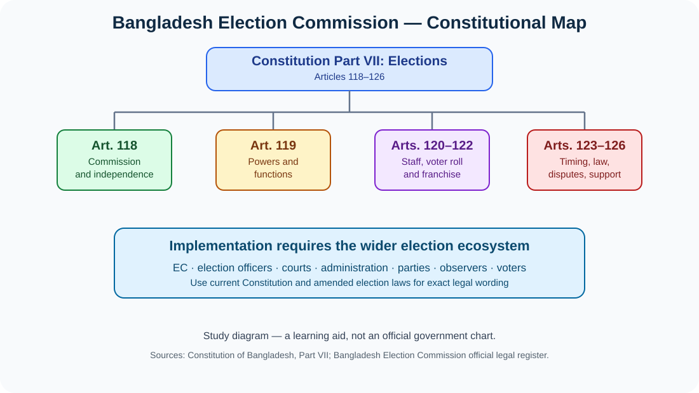

[Open diagram separately](./assets/constitutional-map-expanded.svg) · **Source:** Constitution of Bangladesh, Part VII, Articles 118–126; [official legal text](https://bdlaws.minlaw.gov.bd/act-print-367.html).

### ২. নির্বাচনচক্র — ভোটার তালিকা থেকে প্রতিকার
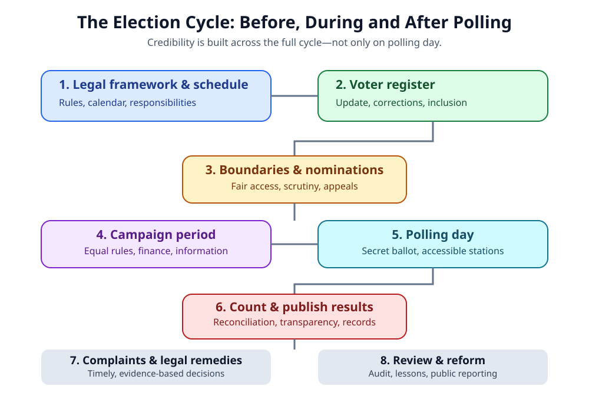

[Open diagram separately](./assets/election-cycle-expanded.svg) · **Source:** Representation of the People Order, 1972, as amended; [official EC legal register](https://ecs.gov.bd/en/page/national-parliament-election-law).

### ৩. নির্বাচনী সততার ছয়টি স্তম্ভ

[Open diagram separately](./assets/election-integrity-pillars.svg). Independence, equal competition, secret ballot, verifiable counting, inclusion and remedies—এগুলোকে উত্তর লেখার analytical framework হিসেবে ব্যবহার করুন।

### ৪. নির্বাচনে প্রযুক্তি: সুবিধা, ঝুঁকি ও safeguards
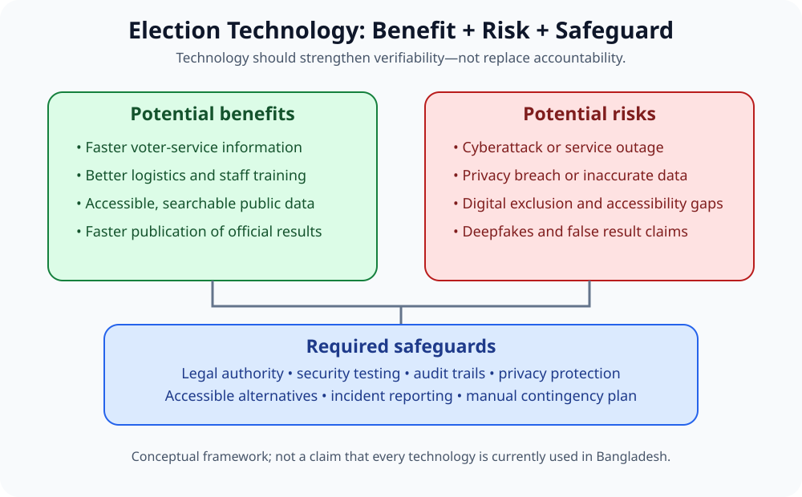

[Open diagram separately](./assets/election-technology-risks.svg). এটি conceptual study diagram; বাংলাদেশের কোনো নির্দিষ্ট প্রযুক্তি বর্তমানে ব্যবহৃত হচ্ছে—এমন দাবি নয়।

### ৫. নির্বাচনী অভিযোগ ও আইনগত প্রতিকার
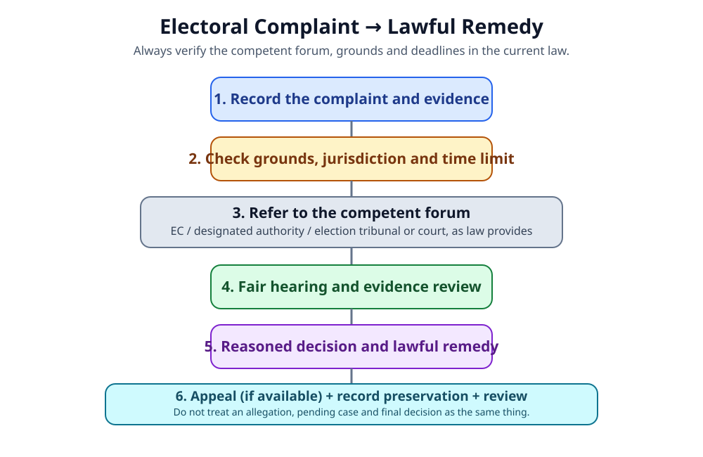

[Open diagram separately](./assets/electoral-dispute-flow.svg). প্রকৃত অভিযোগে সঠিক কর্তৃপক্ষ, সময়সীমা ও প্রতিকার প্রযোজ্য আইন থেকে যাচাই করতে হবে।

### ৬–১০. বিদ্যমান revision diagrams
- [Constitutional Articles Map](./assets/constitutional-articles-map.svg)
- [Election Stakeholders and Responsibilities](./assets/election-stakeholders.svg)
- [Electoral System Comparison](./assets/electoral-system-comparison.svg)
- [Election Cycle](./assets/election-cycle.svg)
- [Election Integrity](./assets/election-integrity.svg)

### ১১–১৭. নতুন source-linked SVG visuals

#### ১১. Voter-register snapshot — 21 October 2026
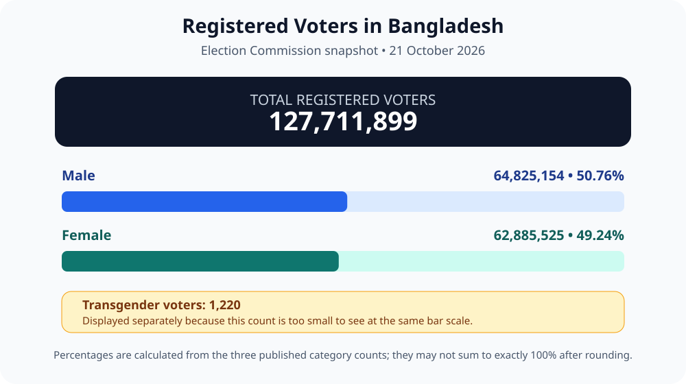

[Open chart](./assets/voter-register-snapshot-2026.svg) · Source: [Bangladesh Election Commission](https://ecs.gov.bd/en/constituency). This is a dated snapshot; current counts can change.

#### ১২. Constitutional articles map — Articles 118–126
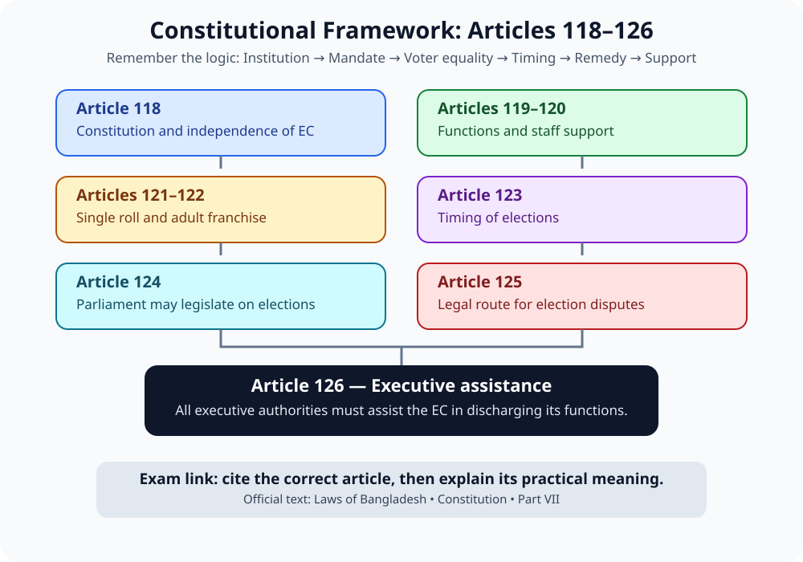

[Open diagram](./assets/constitutional-articles-map.svg) · Source: [Constitution of Bangladesh](https://bdlaws.minlaw.gov.bd/act-print-367.html).

#### ১৩. Expanded election cycle

[Open diagram](./assets/election-cycle-expanded.svg) · Source: [RPO 1972, as amended](https://bdlaws.minlaw.gov.bd/act-print-424.html).

#### ১৪. Six pillars of electoral integrity
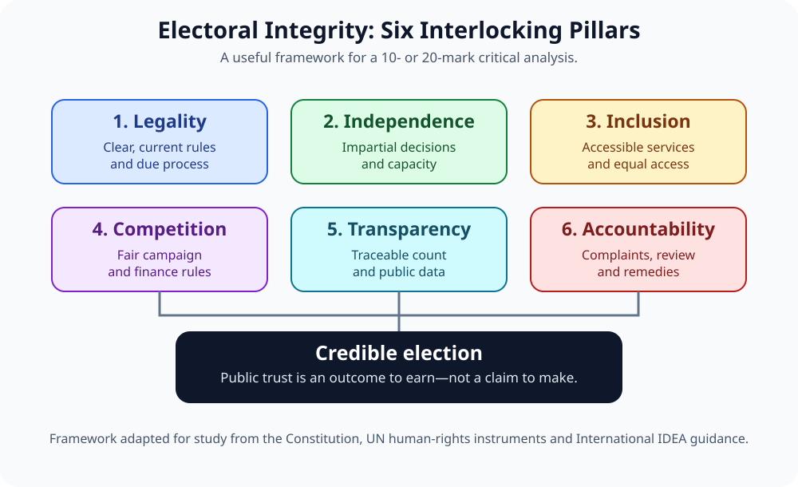

[Open diagram](./assets/electoral-integrity-dashboard.svg) · Study framework based on the Constitution, ICCPR and [International IDEA](https://www.idea.int/publications/catalogue/electoral-management-design-revised-edition?lang=en).

#### ১৫. Stakeholder roles and accountability

[Open diagram](./assets/election-stakeholder-accountability.svg) · Constitutional anchor: Article 126 and the applicable election laws.

#### ১৬. RPO Amendment Act 2026 — study map
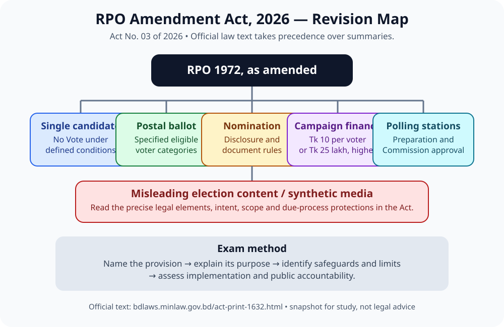

[Open diagram](./assets/rpo-amendment-2026-map.svg) · Read the exact provision in the [official Act No. 03 of 2026](https://bdlaws.minlaw.gov.bd/act-print-1632.html); this is a revision aid, not a substitute for statutory text.

#### ১৭. BCS PYQ topic timeline
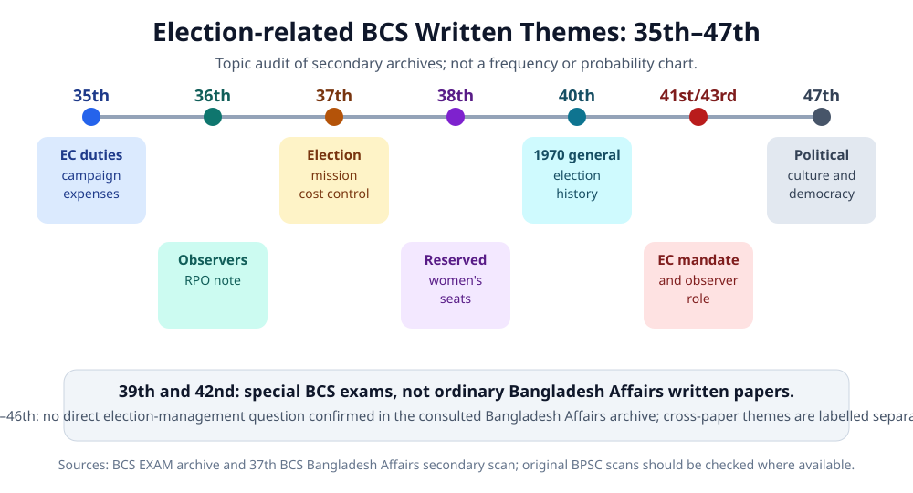

[Open timeline](./assets/pyq-topic-timeline-35-47.svg) · For exact scope and caveats, read the [full 35th–47th audit](./PYQ-35TH-47TH-ANALYSIS.md).

### Official and real-world photo references

#### Bangladesh Election Commission headquarters

**Source:** Bangladesh Election Commission official website, 2026 carousel. This is an institutional reference image, not an electoral map. [Official ECS website](https://ecs.gov.bd/en).

#### Voters at a polling station — 12 February 2026

**Source and licence:** Bangladesh Press Information Department photograph hosted on Wikimedia Commons; marked public domain in Bangladesh. [Original file and licensing page](https://commons.wikimedia.org/wiki/File:Queues_of_voters_at_polling_station,_capital_city,_Thirteenth_National_Parliament_Election_and_2026_Referendum_2026-02-12.jpg). The photo illustrates participation; it is not evidence about overall election quality.

#### 2026 constituency result map — supplementary visual only

**Attribution:** FlyJet777, *2026 Bangladesh General Election Alliance Wise Result Map*, CC BY 4.0. [File page and licence](https://commons.wikimedia.org/wiki/File:2026_Bangladesh_General_Election_Alliance_Wise_Result_Map.svg).

**Critical limitation:** this is a community-created election-results map, not an official legal boundary map, and it is a dated results snapshot. For exact current boundaries, use the EC’s official constituency lookup and revised 300-seat boundary gazette below. Do not quote current party seat totals from this image without checking the latest official results.

### Official electoral maps and current legal maps

- **বর্তমান constituency lookup:** [Bangladesh Election Commission — Constituency](https://ecs.gov.bd/en/constituency). আসন-নির্দিষ্ট তথ্য যাচাইয়ের জন্য এই অফিসিয়াল lookup ব্যবহার করুন।
- **৩০০ সংসদীয় আসনের সীমানার সরকারি নথি:** [EC — National Parliament Election Law](https://ecs.gov.bd/en/page/national-parliament-election-law) এবং [revised boundary gazette, 11 December 2025 (PDF)](https://asset.ecs.gov.bd/media/uploaded_files/notices/2025/12/gTe7PMU3SDbRB5pni6rdNQYZyZ7AQXrgUui3SDPs.pdf). এই PDF-তে constituency boundary description রয়েছে; এটি নিজে illustrated map নয়। পরীক্ষায় “বর্তমান সীমানা” লিখলে সংশ্লিষ্ট সর্বশেষ সংশোধিত গেজেট অনুসরণ করুন।
- **নির্বাচনী আইন ও ২০২৬ সংশোধন:** [EC — RPO legal records](https://ecs.gov.bd/category/regarding-representation-of-the-people-order-rpo-2830760191), [RPO 1972 (Bangladesh Laws)](https://bdlaws.minlaw.gov.bd/act-print-424.html), [Representation of the People (Amendment) Act, 2026](https://bdlaws.minlaw.gov.bd/act-print-1632.html).
- **বাংলাদেশ নির্বাচন কমিশনের অবস্থান:** [OpenStreetMap location search](https://www.openstreetmap.org/search?query=Bangladesh%20Election%20Commission%20Agargaon%20Dhaka).
- **ভোটকেন্দ্র/নির্বাচনী এলাকা:** কোনো নির্দিষ্ট আসন বা কেন্দ্রের map ব্যবহার করার আগে EC-এর সংশ্লিষ্ট constituency gazette বা polling-centre publication মিলিয়ে নিন; সাধারণ web map আইনগত সীমানার বিকল্প নয়।

# Chapter 11 — নির্বাচন ও নির্বাচনী ব্যবস্থাপনা | Elections & Electoral Management

**BCS Written · Bangladesh Affairs · Subject Code 005**  
বাংলা ব্যাখ্যা + English terminology + source-backed essays + previous-question analysis + ৩৩টি model question and answer + revision visuals

[🧭 35th–47th BCS PYQ Audit](./PYQ-35TH-47TH-ANALYSIS.md) · [📘 25 Answered Model Q&A + 4 full worked answers](./BCS-WRITTEN-QUESTION-BANK.md) · [💬 English Quotations & Sources](./QUOTATIONS.md) · [বিগত BCS প্রশ্ন বিশ্লেষণ](#pyq) · [৩৩টি Model Q&A](#model-questions) · [গুরুত্বপূর্ণ প্রবন্ধ](#essays) · [Visual Atlas](#visual-atlas) · [Sources](#sources)

> **এই অধ্যায়ের লক্ষ্য:** একবার মনোযোগ দিয়ে পড়লে বাংলাদেশের নির্বাচনী ব্যবস্থার সাংবিধানিক ভিত্তি, নির্বাচন কমিশনের দায়িত্ব, ভোটার তালিকা, নির্বাচনী প্রক্রিয়া, নির্বাচনী অনিয়ম, সংস্কার এবং পরীক্ষায় বিশ্লেষণধর্মী উত্তর লেখার মূল কাঠামো বুঝতে পারবেন। এটি BPSC-এর সরকারি প্রকাশনা নয়; BCS Written প্রস্তুতির জন্য তৈরি শিক্ষাসামগ্রী।

> **Evidence rule:** BPSC-এর মূল প্রশ্নপত্রের scan/PDF দিয়ে স্বাধীনভাবে যাচাই করা হয়নি—এমন প্রশ্নকে “verified official PYQ” বলা হবে না। তৃতীয়-পক্ষের question archive-এ রিপোর্ট করা প্রশ্নকে “archive-reported” এবং এই অধ্যায়ে তৈরি প্রশ্নকে “model/practice question” বলা হয়েছে।

### অধ্যায় ১১-এর গুরুত্বপূর্ণ উদ্ধৃতি

> “The Election Commission shall be independent in the exercise of its functions.”  
> — Constitution of Bangladesh, Article 118(4)

> “The power of voters is the liberation of Democracy.”  
> — Bangladesh Election Commission, National Voters Day 2026 theme

**পরীক্ষায় ব্যবহার:** প্রথম উদ্ধৃতিটি নির্বাচন কমিশনের সাংবিধানিক স্বাধীনতা নিয়ে; দ্বিতীয়টি ভোটারের ভূমিকা ও নাগরিক অংশগ্রহণ নিয়ে লিখতে পারেন। উদ্ধৃতির সঙ্গে সম্পর্কিত ব্যাখ্যা ও আইনি প্রেক্ষাপট অবশ্যই যোগ করবেন।

[সম্পূর্ণ English quotation bank, বাংলা ভাবানুবাদ ও source links →](./QUOTATIONS.md)

## 🟨🟩 রঙের সংকেত — Reading Colour Code

- 🟨 **মুখস্থযোগ্য তথ্য:** অনুচ্ছেদ, আইন, প্রতিষ্ঠান, গুরুত্বপূর্ণ ধারণা।
- 🟩 **বিশ্লেষণ:** কারণ, প্রভাব, সুবিধা–সীমাবদ্ধতা, নীতিগত সুপারিশ।
- 🟦 **Source/evidence:** সরকারি আইন, সংবিধান, BPSC, নির্বাচন কমিশন, আন্তর্জাতিক সংস্থা।
- 🟥 **Exam trap:** পুরোনো আইন, অসমর্থিত দাবি, direct PYQ ও model question গুলিয়ে ফেলা।

## 📑 বিষয়সূচি — সরাসরি অংশে যান

| অংশ | বিষয় |
|---|---|
| ১ | শিখনফল, সিলেবাস ও দ্রুত পরিচিতি |
| ২ | মূল পরিভাষা ও নির্বাচনী ব্যবস্থার ধারণা |
| ৩ | বাংলাদেশের সাংবিধানিক কাঠামো: অনুচ্ছেদ ১১৮–১২৬ |
| ৪ | নির্বাচন কমিশন: গঠন, স্বাধীনতা ও কার্যাবলি |
| ৫ | ভোটার তালিকা, ভোটাধিকার ও অন্তর্ভুক্তিমূলক অংশগ্রহণ |
| ৬ | নির্বাচনী এলাকার সীমানা, প্রার্থী মনোনয়ন ও দল নিবন্ধন |
| ৭ | নির্বাচন পরিচালনার ধাপ: তফসিল থেকে ফলাফল |
| ৮ | নির্বাচন আইন ও ২০২৬ সালের গুরুত্বপূর্ণ সংশোধন |
| ৯ | নির্বাচনী সততা, চ্যালেঞ্জ ও প্রতিকার |
| ১০ | নির্বাচনে প্রযুক্তি, গণমাধ্যম ও তথ্যের সততা |
| ১১ | নারী, তরুণ, সংখ্যালঘু ও প্রতিবন্ধী ভোটারের অংশগ্রহণ |
| ১২ | নির্বাচনী বিরোধ, অভিযোগ ও জবাবদিহি |
| ১৩ | Previous BCS Question Analysis |
| ১৩A | [৩৫তম–৪৭তম BCS-এর পূর্ণ year-by-year audit](./PYQ-35TH-47TH-ANALYSIS.md) |
| ১৩B | [২৫টি Answered Model Q&A + ৪টি full 15/20-mark worked answer](./BCS-WRITTEN-QUESTION-BANK.md) |
| ১৪ | গুরুত্বপূর্ণ প্রবন্ধ ও model essays |
| ১৫ | ৩৩টি English–বাংলা Model Questions & Answers |
| ১৬ | ৫, ১০ ও ২০ নম্বরের উত্তর লেখার কৌশল |
| ১৭ | Quick revision ও self-test |
| ১৮ | Source register |
| ১৮A | [১৩টি authentic English quotation with direct source links](./QUOTATIONS.md#authentic-quotations) |

---

## ১. BPSC Syllabus Mapping ও শিখনফল

BCS Written Bangladesh Affairs একটি ২০০ নম্বরের compulsory paper। নির্বাচন ও নির্বাচনী ব্যবস্থাপনা বিষয়টি বাংলাদেশের রাজনৈতিক প্রতিষ্ঠান, গণতন্ত্র, সাংবিধানিক শাসন, রাজনৈতিক সংস্কৃতি ও সুশাসনের সঙ্গে সম্পর্কিত। এই অধ্যায়কে রাজনৈতিক দল ও রাজনৈতিক প্রক্রিয়ার অধ্যায়ের সঙ্গে মিলিয়ে পড়লে বিষয়গুলো সহজে মনে থাকবে। [BPSC Written Syllabus](https://bpsc.gov.bd/pages/psc-exams/%E0%A6%AC%E0%A6%BF-%E0%A6%B8%E0%A6%BF-%E0%A6%8F%E0%A6%B8-%E0%A6%B2%E0%A6%BF%E0%A6%96%E0%A6%BF%E0%A6%A4-%E0%A6%AA%E0%A6%B0%E0%A7%80%E0%A6%95%E0%A7%8D%E0%A6%B7%E0%A6%BE%E0%A6%B0-%E0%A6%B8%E0%A6%BF%E0%A6%B2%E0%A7%87%E0%A6%AC%E0%A6%BE%E0%A6%B8-08e202-6919974adbfbab28ceff0121)

### অধ্যায় শেষে আপনি পারবেন

1. বাংলাদেশের নির্বাচন কমিশনের সাংবিধানিক ভিত্তি ও দায়িত্ব ব্যাখ্যা করতে।
2. সংবিধানের ১১৮–১২৬ অনুচ্ছেদের মূল বিষয়গুলো উদাহরণসহ লিখতে।
3. ভোটার তালিকা, প্রাপ্তবয়স্কের ভোটাধিকার, constituency delimitation ও nomination-এর পার্থক্য বুঝতে।
4. নির্বাচন-পূর্ব, নির্বাচন-দিন এবং নির্বাচন-পরবর্তী ধাপগুলো ধারাবাহিকভাবে ব্যাখ্যা করতে।
5. free and fair election-এর পূর্বশর্ত, বাধা ও বাস্তবসম্মত সংস্কার বিশ্লেষণ করতে।
6. ২০২৬ সালের Representation of the People (Amendment) Act-এর গুরুত্বপূর্ণ পরিবর্তনকে পুরোনো বিধানের সঙ্গে গুলিয়ে না ফেলতে।
7. ৫, ১০ ও ২০ নম্বরের প্রশ্নে তথ্য, বিশ্লেষণ, উদাহরণ এবং সুপারিশ যুক্ত করতে।

### এক নজরে গুরুত্বপূর্ণ তথ্য

| বিষয় | পরীক্ষায় মনে রাখবেন |
|---|---|
| সংবিধানের অংশ | Part VII — Elections |
| নির্বাচন কমিশন প্রতিষ্ঠা | অনুচ্ছেদ ১১৮ |
| নির্বাচন কমিশনের দায়িত্ব | অনুচ্ছেদ ১১৯ |
| কমিশনের জন্য কর্মচারী | অনুচ্ছেদ ১২০ |
| এক নির্বাচনী এলাকার এক ভোটার তালিকা | অনুচ্ছেদ ১২১ |
| ভোটার হওয়ার যোগ্যতা ও adult franchise | অনুচ্ছেদ ১২২ |
| সংসদ নির্বাচনের সময় | অনুচ্ছেদ ১২৩ |
| নির্বাচন-সংক্রান্ত আইন | অনুচ্ছেদ ১২৪ |
| নির্বাচনের বৈধতা ও election petition | অনুচ্ছেদ ১২৫ |
| নির্বাহী কর্তৃপক্ষের সহায়তা | অনুচ্ছেদ ১২৬ |
| প্রধান নির্বাচন আইন | Representation of the People Order, 1972 (RPO), পরবর্তী সংশোধনীসহ |
| ভোটার তালিকার আইন | Electoral Rolls Act, 2009 |
| আন্তর্জাতিক অধিকার-ভিত্তি | UDHR Article 21; ICCPR Article 25 |
| উত্তর লেখার সূত্র | **Law → Institution → Process → Integrity → Reform** |

**বর্তমান আইন-সংক্রান্ত সতর্কতা:** আইন ও বিধি সংশোধিত হতে পারে। ২০২৬ সালের আইনসহ সংশ্লিষ্ট সরকারি গেজেট এবং নির্বাচন কমিশনের সর্বশেষ নির্দেশনা দেখে পরীক্ষার আগে তারিখ/সংখ্যা পুনরায় যাচাই করবেন। [Constitution of Bangladesh](https://bdlaws.minlaw.gov.bd/act-print-367.html) · [RPO 1972](https://bdlaws.minlaw.gov.bd/act-print-424.html) · [RPO Amendment Act 2026](https://bdlaws.minlaw.gov.bd/act-print-1632.html)

---

## ২. মূল পরিভাষা — English Term, বাংলা অর্থ ও সহজ ব্যাখ্যা

| English term | বাংলা অর্থ | সহজ ব্যাখ্যা |
|---|---|---|
| Election | নির্বাচন | নির্দিষ্ট নিয়মে প্রতিনিধি বা কোনো প্রস্তাবের বিষয়ে ভোটের মাধ্যমে সিদ্ধান্ত গ্রহণ |
| Electoral management | নির্বাচনী ব্যবস্থাপনা | ভোটার তালিকা থেকে ফল প্রকাশ পর্যন্ত সব প্রশাসনিক ও আইনগত কাজ |
| Election Commission (EC) | নির্বাচন কমিশন | সংবিধান ও আইনের অধীনে নির্বাচন পরিচালনাকারী সাংবিধানিক প্রতিষ্ঠান |
| Electoral integrity | নির্বাচনী সততা | পুরো প্রক্রিয়ায় আইন, নিরপেক্ষতা, স্বচ্ছতা ও জবাবদিহি বজায় রাখা |
| Universal adult franchise | প্রাপ্তবয়স্কের সর্বজনীন ভোটাধিকার | আইনগত যোগ্যতা পূরণকারী প্রাপ্তবয়স্ক নাগরিকের ভোটার হওয়ার অধিকার |
| Electoral roll | ভোটার তালিকা | নির্দিষ্ট নির্বাচনী এলাকার নিবন্ধিত ভোটারদের আইনগত তালিকা |
| Constituency | নির্বাচনী এলাকা | যে ভৌগোলিক এলাকা থেকে প্রতিনিধি নির্বাচিত হন |
| Delimitation | নির্বাচনী সীমানা নির্ধারণ | জনসংখ্যা, ভৌগোলিক বাস্তবতা ও আইনি নীতির আলোকে আসনের সীমানা নির্ধারণ |
| Nomination | প্রার্থিতা মনোনয়ন | আইনানুগভাবে নির্বাচনে প্রতিদ্বন্দ্বিতার জন্য প্রার্থীর নাম দাখিল |
| Scrutiny | মনোনয়ন যাচাই | প্রার্থীর কাগজপত্র ও যোগ্যতা আইন অনুযায়ী পরীক্ষা |
| Returning Officer (RO) | রিটার্নিং কর্মকর্তা | নির্দিষ্ট নির্বাচনী এলাকার নির্বাচন পরিচালনা ও ফল একীভূত করার দায়িত্বপ্রাপ্ত কর্মকর্তা |
| Presiding Officer | প্রিসাইডিং কর্মকর্তা | নির্দিষ্ট ভোটকেন্দ্রে ভোটগ্রহণ পরিচালনার দায়িত্বপ্রাপ্ত কর্মকর্তা |
| Polling agent | পোলিং এজেন্ট | আইন ও কমিশনের নিয়ম মেনে প্রার্থীর পক্ষে ভোটকেন্দ্রের প্রক্রিয়া পর্যবেক্ষণকারী প্রতিনিধি |
| Secret ballot | গোপন ব্যালট | ভোটার কাকে ভোট দিয়েছেন তা গোপন রাখার ব্যবস্থা |
| Campaign finance | নির্বাচনী প্রচারের অর্থায়ন | প্রচারের আয়-ব্যয়, অনুদান, ব্যয়সীমা ও হিসাবের নিয়ম |
| Code of conduct | আচরণবিধি | প্রার্থী, দল ও সংশ্লিষ্টদের নির্বাচনী আচরণের বিধিবদ্ধ মানদণ্ড |
| Election observer | নির্বাচন পর্যবেক্ষক | অনুমোদিত নিয়মে নির্বাচন প্রক্রিয়া পর্যবেক্ষণকারী ব্যক্তি/প্রতিষ্ঠান |
| Election petition | নির্বাচনী আবেদন/মামলা | আইন নির্ধারিত কর্তৃপক্ষের কাছে নির্বাচনের বৈধতা চ্যালেঞ্জ করার পদ্ধতি |
| Voter education | ভোটার শিক্ষা | ভোটাধিকার, ভোটদানের নিয়ম ও তথ্য যাচাই বিষয়ে নাগরিককে জানানো |
| Electoral violence | নির্বাচনী সহিংসতা | ভোট বা রাজনৈতিক প্রতিযোগিতাকে প্রভাবিত করার উদ্দেশ্যে ভয়ভীতি, হামলা বা জবরদস্তি |
| Vote buying | ভোট কেনাবেচা | অর্থ, উপহার বা সুবিধার বিনিময়ে ভোট প্রভাবিত করার চেষ্টা |
| Disinformation | উদ্দেশ্যমূলক মিথ্যা তথ্য | মানুষকে বিভ্রান্ত বা প্রক্রিয়াকে ক্ষতিগ্রস্ত করার জন্য ছড়ানো মিথ্যা/বিভ্রান্তিকর তথ্য |
| Proportional representation (PR) | আনুপাতিক প্রতিনিধিত্ব | ভোটের অনুপাতের সঙ্গে আসন বণ্টনের সম্পর্কযুক্ত পদ্ধতি |
| First-past-the-post (FPTP) | সর্বাধিক ভোটপ্রাপ্ত প্রার্থী বিজয়ী | এক আসনে যে প্রার্থী অন্যদের চেয়ে বেশি ভোট পান, তিনি নির্বাচিত হন; নির্দিষ্ট আইনি নিয়ম প্রযোজ্য |
| Postal ballot | ডাকযোগে ব্যালট | আইন ও কমিশনের নির্ধারিত যোগ্যতা/প্রক্রিয়ায় ডাকযোগে ভোট দেওয়া |
| No Vote option | ‘কোনো প্রার্থীকে নয়’ বিকল্প | ২০২৬ সালের সংশোধিত RPO-তে একক প্রার্থী থাকলে প্রযোজ্য নির্দিষ্ট ব্যবস্থার অংশ; সাধারণ নির্বাচনে সব ক্ষেত্রে প্রযোজ্য বলে লিখবেন না |

### একটি গুরুত্বপূর্ণ পার্থক্য

**Election administration** হলো নির্বাচন পরিচালনার বাস্তব কাজ; **electoral integrity** হলো সেই কাজ কতটা আইনসম্মত, নিরপেক্ষ, অন্তর্ভুক্তিমূলক, স্বচ্ছ ও বিশ্বাসযোগ্য—তার সামগ্রিক মান। কেবল ভোটগ্রহণ সম্পন্ন হলেই নির্বাচনের মান বিচার শেষ হয় না; ভোটারের স্বাধীনতা, প্রতিদ্বন্দ্বিতার ন্যায্যতা, গণনা, অভিযোগ নিষ্পত্তি ও ফলের গ্রহণযোগ্যতাও বিবেচ্য। [International IDEA — Electoral Management Design](https://www.idea.int/publications/catalogue/electoral-management-design-revised-edition?lang=en)

---

## ৩. বাংলাদেশের নির্বাচনী ব্যবস্থার সাংবিধানিক কাঠামো

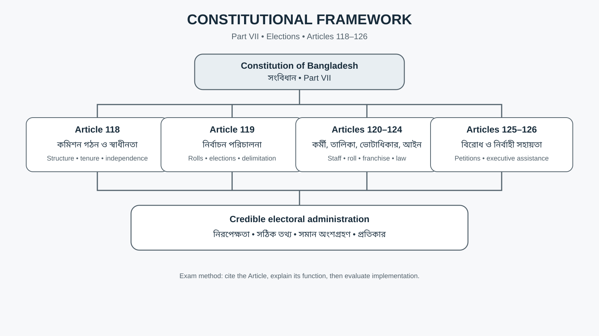

বাংলাদেশের সংবিধানের Part VII-তে নির্বাচন কমিশন, ভোটার তালিকা, ভোটাধিকার এবং নির্বাচন-সংক্রান্ত বিধান রয়েছে। পরীক্ষায় শুধু অনুচ্ছেদের নম্বর লিখলে উত্তর পূর্ণ হয় না; প্রতিটি অনুচ্ছেদের **কাজ এবং গণতান্ত্রিক গুরুত্ব** ব্যাখ্যা করা প্রয়োজন। [সরকারি সংবিধানপাঠ](https://bdlaws.minlaw.gov.bd/act-print-367.html)

| অনুচ্ছেদ | মূল বিষয় | উত্তর লেখার সময় গুরুত্ব |
|---|---|---|
| ১১৮ | নির্বাচন কমিশন প্রতিষ্ঠা, গঠন, মেয়াদ ও স্বাধীনতা | সাংবিধানিক স্বাধীনতা ও প্রাতিষ্ঠানিক নিরাপত্তা |
| ১১৯ | ভোটার তালিকা প্রস্তুতি, রাষ্ট্রপতি ও সংসদ নির্বাচন, নির্বাচনী এলাকার সীমানা | নির্বাচন পরিচালনায় কমিশনের মূল দায়িত্ব |
| ১২০ | কমিশনের প্রয়োজনীয় কর্মচারী | প্রশাসনিক সক্ষমতা ও মাঠপর্যায়ের ব্যবস্থাপনা |
| ১২১ | প্রতিটি নির্বাচনী এলাকার জন্য এক ভোটার তালিকা; ধর্ম, জাত, বর্ণ বা লিঙ্গভিত্তিক বিশেষ তালিকা নয় | সমতা ও বৈষম্যহীনতা |
| ১২২ | সংসদ নির্বাচনে adult franchise ও ভোটার নিবন্ধনের যোগ্যতা | ভোটার হওয়ার আইনি শর্ত |
| ১২৩ | রাষ্ট্রপতি ও সংসদ নির্বাচনের সময়-সংক্রান্ত বিধান | নির্বাচনী সময়সূচির সাংবিধানিক সীমা |
| ১২৪ | সংসদ নির্বাচন বিষয়ে আইন প্রণয়নের ক্ষমতা | নির্বাচন আইন ও পদ্ধতির আইনগত ভিত্তি |
| ১২৫ | নির্বাচনী আইনের বৈধতা ও নির্বাচনী আবেদন | নির্বাচনী বিরোধের আইনি পথ |
| ১২৬ | নির্বাহী কর্তৃপক্ষের কমিশনকে সহায়তা | প্রতিষ্ঠানগুলোর সহযোগিতা ও বাস্তব প্রয়োগ |

### ৩.১ অনুচ্ছেদ ১১৮: কমিশনের গঠন ও স্বাধীনতা

সংবিধান অনুযায়ী নির্বাচন কমিশনে একজন প্রধান নির্বাচন কমিশনার এবং অনধিক চারজন নির্বাচন কমিশনার থাকতে পারেন। নিয়োগ রাষ্ট্রপতি করেন, সংবিধান ও প্রযোজ্য আইনের বিধান সাপেক্ষে। কমিশনারের সাংবিধানিক মেয়াদ পাঁচ বছর। সংবিধান কমিশনকে দায়িত্ব পালনের ক্ষেত্রে স্বাধীন হিসেবে নির্ধারণ করেছে। [Article 118](https://bdlaws.minlaw.gov.bd/act-367/act-part-print-205.html)

**বিশ্লেষণ:** স্বাধীনতা শুধু আইনের ভাষায় থাকলেই যথেষ্ট নয়। নিরপেক্ষ সিদ্ধান্ত, দক্ষ জনবল, পর্যাপ্ত অর্থ ও লজিস্টিক, তথ্যের নির্ভরযোগ্যতা, আইন প্রয়োগে ধারাবাহিকতা এবং সব পক্ষের জন্য একই মানদণ্ড প্রয়োজন। একই সঙ্গে কমিশনকেও আইন, যুক্তিসংগত সিদ্ধান্ত, স্বচ্ছতা ও জবাবদিহির মধ্যে কাজ করতে হয়।

### ৩.২ অনুচ্ছেদ ১১৯: নির্বাচন কমিশনের প্রধান দায়িত্ব

কমিশনের মূল দায়িত্বের মধ্যে রয়েছে সংসদ ও রাষ্ট্রপতি নির্বাচন পরিচালনা, ভোটার তালিকা প্রস্তুতির তত্ত্বাবধান-নির্দেশ-নিয়ন্ত্রণ এবং সংসদীয় নির্বাচনী এলাকার সীমানা নির্ধারণ। অন্যান্য দায়িত্ব সংবিধান বা আইনেও নির্ধারিত হতে পারে। [Article 119](https://bdlaws.minlaw.gov.bd/act-367/section-24678.html)

**পরীক্ষায় প্রয়োগ:** “নির্বাচন কমিশনের ভূমিকা মূল্যায়ন করুন” প্রশ্নে দায়িত্বের তালিকা দিয়ে থামবেন না। দায়িত্ব পালনের সক্ষমতা, নিরপেক্ষতা, অভিযোগ নিষ্পত্তি, রাজনৈতিক আস্থা, মাঠ প্রশাসনের সহযোগিতা এবং সংস্কারের প্রয়োজন ব্যাখ্যা করুন।

### ৩.৩ অনুচ্ছেদ ১২১–১২২: সমতা ও ভোটার হওয়ার যোগ্যতা

অনুচ্ছেদ ১২১ প্রতিটি নির্বাচনী এলাকার জন্য একটি ভোটার তালিকার কথা বলে এবং ধর্ম, জাত, বর্ণ বা লিঙ্গের ভিত্তিতে পৃথক বিশেষ তালিকা তৈরির অনুমতি দেয় না। অনুচ্ছেদ ১২২ সংসদ নির্বাচনে adult franchise এবং ভোটার হিসেবে নিবন্ধনের আইনি যোগ্যতার ভিত্তি। বাস্তবে ভোটার তালিকার কাজ Electoral Rolls Act, 2009 ও সংশ্লিষ্ট নিয়মের সঙ্গে মিলিয়ে পড়তে হবে।

**বিশ্লেষণ:** সঠিক ভোটার তালিকা নির্বাচনের গ্রহণযোগ্যতার ভিত্তি। মৃত বা অযোগ্য ব্যক্তির নাম, যোগ্য ভোটারের বাদ পড়া, দ্বৈত নিবন্ধন, স্থানান্তর-সংক্রান্ত সমস্যা বা নথি যাচাইয়ের অসামঞ্জস্য থাকলে ভোটের সমতা ও বিশ্বাসযোগ্যতা ক্ষতিগ্রস্ত হতে পারে। সমাধানে নিয়মিত হালনাগাদ, সহজ সংশোধন, প্রকাশ্য যাচাই, অভিযোগের সুযোগ ও ব্যক্তিগত তথ্যের নিরাপত্তা দরকার।

### ৩.৪ অনুচ্ছেদ ১২৩–১২৬: সময়, আইন, বিরোধ ও সহায়তা

অনুচ্ছেদ ১২৩ নির্বাচনের সময়-সংক্রান্ত সাংবিধানিক বিধান নির্ধারণ করে; নির্দিষ্ট পরিস্থিতির ক্ষেত্রে প্রযোজ্য সময়সীমা সংবিধানের বর্তমান পাঠ দেখে লিখতে হবে। অনুচ্ছেদ ১২৪ সংসদকে নির্বাচন-সম্পর্কিত আইন প্রণয়নের ক্ষমতা দেয়। অনুচ্ছেদ ১২৫ নির্বাচনের বৈধতা চ্যালেঞ্জের জন্য আইননির্ধারিত election petition-এর পথ নির্দেশ করে। অনুচ্ছেদ ১২৬ অনুযায়ী নির্বাহী কর্তৃপক্ষের নির্বাচন কমিশনকে দায়িত্ব পালনে সহায়তা করা কর্তব্য। [Constitution of Bangladesh](https://bdlaws.minlaw.gov.bd/act-print-367.html)

> **Exam trap:** অনুচ্ছেদ ১২৫-কে “যে কোনো আদালত যে কোনো সময়ে নির্বাচনের ফল বাতিল করতে পারে” হিসেবে ব্যাখ্যা করবেন না। নির্বাচনী বিরোধের জন্য প্রযোজ্য আইন, কর্তৃপক্ষ, সময় ও পদ্ধতি উল্লেখ করুন।

---

## ৪. নির্বাচন কমিশন: গঠন, স্বাধীনতা ও কার্যাবলি

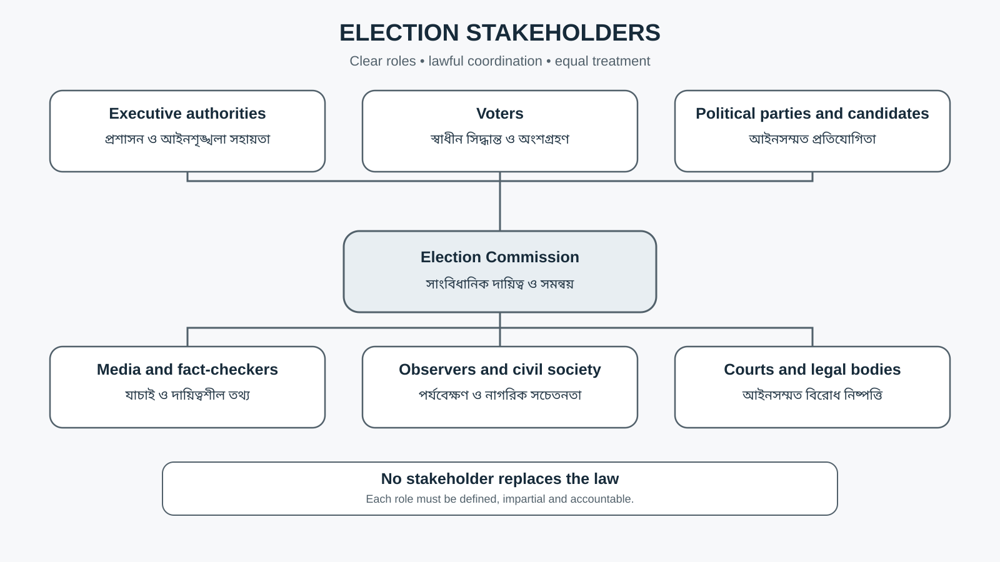

বাংলাদেশ নির্বাচন কমিশন একটি সাংবিধানিক প্রতিষ্ঠান। এর দায়িত্ব শুধু ভোটের দিন ব্যালট নেওয়া নয়; ভোটার তালিকা, সীমানা নির্ধারণ, নির্বাচন-সংক্রান্ত বিধি বাস্তবায়ন, প্রার্থী ও দলের আইনগত শর্ত, তফসিল, ভোটকেন্দ্র, গণনা ও ফলাফল-সম্পর্কিত কাজও নির্বাচনী কাঠামোর অংশ। কমিশনের সরকারি পরিচিতি ও দায়িত্বের সারাংশ [Election Commission of Bangladesh](https://ecs.gov.bd/en/page/about-bangladesh-election-commission)-এ দেওয়া আছে।

### ৪.১ কমিশনের কাজকে চার ভাগে মনে রাখুন

1. **Preparation:** ভোটার তালিকা, নির্বাচনী এলাকার সীমানা, ভোটকেন্দ্র, কর্মী ও লজিস্টিক।
2. **Regulation:** মনোনয়ন, রাজনৈতিক দলের নিবন্ধন, আচরণবিধি, প্রচার ও ব্যয়ের নিয়ম।
3. **Conduct:** ভোটগ্রহণ, পর্যবেক্ষণ, অভিযোগ, গণনা ও ফল একীভূত করা।
4. **Accountability:** অনিয়মের অভিযোগ, আইনগত ব্যবস্থা, তদন্ত, ফল প্রকাশ ও প্রযোজ্য বিরোধ নিষ্পত্তি।

### ৪.২ স্বাধীন কমিশন কেন জরুরি?

- সরকার বা ক্ষমতাসীন দলের দৈনন্দিন রাজনৈতিক নির্দেশ থেকে নির্বাচনী সিদ্ধান্তকে পৃথক রাখা।
- প্রার্থী, দল ও ভোটারের ক্ষেত্রে একই আইন প্রয়োগ।
- ভোটার তালিকা ও ফলাফলের ওপর জনআস্থা বাড়ানো।
- অনিয়মের অভিযোগের দ্রুত, ন্যায্য ও নথিভিত্তিক নিষ্পত্তি।
- মাঠ প্রশাসন ও আইনশৃঙ্খলা বাহিনীর সঙ্গে স্পষ্ট দায়িত্ববণ্টন।

### ৪.৩ স্বাধীনতার পাশাপাশি জবাবদিহি

কমিশনের স্বাধীনতা মানে সিদ্ধান্তের ব্যাখ্যা না দেওয়া নয়। আইনসম্মত কারণ প্রকাশ, সময়মতো নির্দেশনা, নির্ভরযোগ্য তথ্য, অভিযোগের রেকর্ড, ব্যয়ের স্বচ্ছতা, পর্যবেক্ষকদের জন্য স্পষ্ট নিয়ম এবং সিদ্ধান্তের বিরুদ্ধে আইনি প্রতিকারের সুযোগ—এসবই প্রাতিষ্ঠানিক বিশ্বাসযোগ্যতার অংশ। একটি শক্তিশালী উত্তর তাই “কমিশনকে স্বাধীন করতে হবে” বলেই শেষ হয় না; স্বাধীনতা কার্যকর করার ব্যবস্থা ব্যাখ্যা করে।

---

## ৫. ভোটার তালিকা, ভোটাধিকার ও অন্তর্ভুক্তিমূলক অংশগ্রহণ

ভোটার তালিকা একটি প্রশাসনিক তালিকা হলেও এর রাজনৈতিক গুরুত্ব মৌলিক: কে ভোট দিতে পারবেন, কোন এলাকায় ভোট দেবেন এবং নির্বাচনে অংশগ্রহণের সুযোগ কতটা সমান—এসব প্রশ্ন এর সঙ্গে যুক্ত। ভোটার নিবন্ধনের কাজকে গোপনীয়তা, সঠিকতা, সহজ সংশোধন ও ন্যায্য আপিলের সঙ্গে যুক্ত রাখতে হয়।

### ৫.১ ভোটার তালিকার গুণগত মানের চারটি মানদণ্ড

| মানদণ্ড | অর্থ | ঝুঁকি হলে কী হতে পারে |
|---|---|---|
| Accuracy | সঠিক ব্যক্তির সঠিক তথ্য | ভুল বা দ্বৈত তথ্য |
| Completeness | যোগ্য ভোটারের নাম অন্তর্ভুক্ত | যোগ্য ভোটার বাদ পড়া |
| Currency | মৃত্যু, স্থানান্তর ও সংশোধন সময়মতো হালনাগাদ | পুরোনো তথ্য |
| Accessibility | ভোটার সহজে তালিকা যাচাই/সংশোধন করতে পারেন | দরিদ্র, প্রবীণ, প্রতিবন্ধী বা দূরবর্তী এলাকার মানুষের বাধা |

### ৫.২ ভোটাধিকার ও নাগরিক দায়িত্ব

ভোটাধিকার নাগরিকের রাজনৈতিক অংশগ্রহণের গুরুত্বপূর্ণ মাধ্যম। তবে শুধু ভোটকেন্দ্রে উপস্থিত হওয়াই অংশগ্রহণের পূর্ণ রূপ নয়। নির্ভরযোগ্য তথ্য জানা, প্রার্থীর নীতি ও হলফনামা পড়া, গুজব যাচাই, শান্তিপূর্ণ রাজনৈতিক মতপ্রকাশ, অনিয়মের আইনসম্মত অভিযোগ এবং ফলাফলের জবাবদিহি চাওয়াও গণতান্ত্রিক সংস্কৃতির অংশ।

### ৫.৩ অন্তর্ভুক্তিমূলক ভোটার সেবা

- ভোটকেন্দ্রে শারীরিক প্রবেশগম্যতা ও সহায়ক ব্যবস্থা।
- ভোটের নিয়ম সহজ ভাষায় এবং প্রয়োজনীয় ফরম্যাটে প্রকাশ।
- নারী ও ঝুঁকিপূর্ণ ভোটারের নিরাপত্তা।
- দুর্গম, চর, হাওর, পাহাড়ি ও উপকূলীয় এলাকায় উপযুক্ত লজিস্টিক পরিকল্পনা।
- প্রবাসী ও আইন অনুযায়ী ডাকযোগে ভোট দেওয়ার যোগ্য ব্যক্তিদের জন্য স্পষ্ট পদ্ধতি।
- অভিযোগ ও তথ্যসেবার সহজলভ্যতা।
- ব্যক্তিগত তথ্য ও ভোটের গোপনীয়তা রক্ষা।

**গুরুত্বপূর্ণ পার্থক্য:** নির্বাচনী অন্তর্ভুক্তি মানে প্রত্যেকের জন্য একই নিয়মকে যান্ত্রিকভাবে প্রয়োগ করা নয়; বরং একই ভোটাধিকার বাস্তবে প্রয়োগ করতে যে যৌক্তিক সহায়তা প্রয়োজন, তা আইন ও নিরপেক্ষতার সঙ্গে সামঞ্জস্য রেখে নিশ্চিত করা।

---

## ৬. নির্বাচনী সীমানা, মনোনয়ন ও রাজনৈতিক দলের নিবন্ধন

### ৬.১ নির্বাচনী এলাকার সীমানা নির্ধারণ

Delimitation-এর লক্ষ্য হলো আইনসম্মত, যুক্তিসংগত ও প্রতিনিধিত্বমূলক নির্বাচনী এলাকার সীমানা নির্ধারণ। জনসংখ্যার পরিবর্তন, ভৌগোলিক ধারাবাহিকতা, যোগাযোগ, প্রশাসনিক সীমানা এবং প্রযোজ্য আইন বিবেচ্য হতে পারে। সীমানা নির্ধারণে অস্বচ্ছতা বা পক্ষপাতের ধারণা তৈরি হলে ভোটের সমতা ও রাজনৈতিক আস্থা ক্ষতিগ্রস্ত হয়।

**একটি ভালো বিশ্লেষণে থাকবে:** আইনি ভিত্তি → তথ্যের মান → সীমানার যুক্তি → জনশুনানি/অভিযোগের সুযোগ যেখানে প্রযোজ্য → সিদ্ধান্তের ব্যাখ্যা → আইনসম্মত পর্যালোচনা।

### ৬.২ মনোনয়ন ও যাচাই

প্রার্থী মনোনয়নে নির্ধারিত ফরম, জামানত, হলফনামা, প্রয়োজনীয় নথি এবং আইনগত যোগ্যতা গুরুত্বপূর্ণ। রিটার্নিং কর্মকর্তা মনোনয়নপত্র যাচাই করেন; সিদ্ধান্তে অসন্তুষ্ট পক্ষের জন্য RPO-তে নির্ধারিত আপিলের পথ থাকতে পারে। নির্দিষ্ট সময়সীমা ও যোগ্যতা লিখতে হলে সর্বশেষ সংশোধিত আইনের পাঠ ব্যবহার করুন।

### ৬.৩ রাজনৈতিক দলের নিবন্ধন

দল নিবন্ধন নির্বাচনী প্রতিযোগিতায় অংশগ্রহণের আইনগত কাঠামোর অংশ। নিবন্ধনের মানদণ্ড স্বচ্ছ, পূর্বঘোষিত, সকল দলের জন্য সমান এবং আইনসম্মতভাবে প্রয়োগ করা জরুরি। নিবন্ধন-প্রক্রিয়ার স্বচ্ছতা রাজনৈতিক বহুত্ববাদ ও জনআস্থাকে প্রভাবিত করে।

### ৬.৪ নির্বাচনী অর্থায়ন

প্রচার ব্যয় ও অনুদানের নিয়মের উদ্দেশ্য হলো অর্থের অস্বচ্ছ প্রভাব, ভোট কেনাবেচা এবং অসম প্রতিযোগিতার ঝুঁকি কমানো। কার্যকর ব্যবস্থা হিসেবে প্রয়োজন:
- আয় ও ব্যয়ের নির্ধারিত হিসাব;
- অনুদানের উৎস প্রকাশের নিয়ম;
- ব্যয়সীমা ও নিরীক্ষা;
- আইনভঙ্গের জন্য কার্যকর, সমানুপাতিক ব্যবস্থা;
- প্রার্থী ও দলের জন্য একই মানদণ্ড;
- নিয়ম প্রয়োগের স্বচ্ছতা।

International IDEA-র বিশ্লেষণ অনুযায়ী, যথাযথ নিয়ন্ত্রণ না থাকলে রাজনৈতিক অর্থায়ন নির্বাচনী প্রক্রিয়া ও প্রতিষ্ঠানের সততাকে দুর্বল করতে পারে। [International IDEA — Money in Politics](https://www.idea.int/theme/money-politics)

### ৬.৫ নির্বাচনী পদ্ধতি: FPTP, PR ও বাংলাদেশের ব্যবস্থা

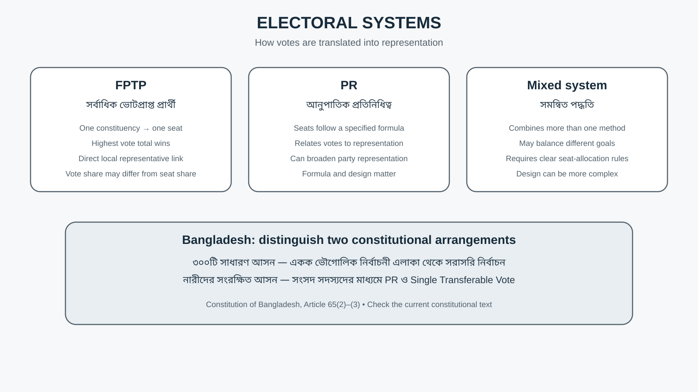

নির্বাচনী পদ্ধতি ভোটকে প্রতিনিধিত্ব বা আসনে রূপান্তর করার নিয়ম নির্ধারণ করে। কোনো পদ্ধতি সব দেশে সমানভাবে কার্যকর নয়; এর ফল নির্ভর করে সংবিধান, দলীয় ব্যবস্থা, সামাজিক বৈচিত্র্য, আসনের কাঠামো এবং প্রশাসনিক বাস্তবতার ওপর। International IDEA-এর Electoral System Design handbook এই সিদ্ধান্তকে গণতান্ত্রিক প্রতিষ্ঠানের একটি গুরুত্বপূর্ণ নকশাগত পছন্দ হিসেবে বিবেচনা করে। [International IDEA](https://www.idea.int/publications/catalogue/electoral-system-design-new-international-idea-handbook)

| পদ্ধতি | মূল বৈশিষ্ট্য | সম্ভাব্য সুবিধা | সম্ভাব্য সীমাবদ্ধতা |
|---|---|---|---|
| First-past-the-post (FPTP) | একক আসনে সর্বাধিক ভোট পাওয়া প্রার্থী জয়ী হন; ৫০ শতাংশের বেশি ভোট পাওয়া সবসময় বাধ্যতামূলক নয় | সহজে বোঝা যায়; নির্বাচনী এলাকার সঙ্গে প্রতিনিধির সরাসরি সম্পর্ক | মোট ভোটের অনুপাত ও আসনের অনুপাতের মধ্যে বড় পার্থক্য হতে পারে |
| Proportional representation (PR) | নির্ধারিত সূত্রে ভোটের অনুপাতের সঙ্গে আসন বণ্টনের সম্পর্ক স্থাপন | দলীয় ভোটের অনুপাত ও প্রতিনিধিত্বের মধ্যে তুলনামূলক ভারসাম্য তৈরি করতে পারে | নকশাভেদে জটিলতা; দলীয় তালিকা ও বণ্টন-সূত্রের গুরুত্ব |
| Mixed system | একই ব্যবস্থায় একাধিক পদ্ধতির সমন্বয় | স্থানীয় প্রতিনিধিত্ব ও আনুপাতিক প্রতিনিধিত্বের কিছু সুবিধা একত্র করা যায় | নকশা জটিল; দুই পদ্ধতির ফল কীভাবে একত্র হবে তা স্পষ্ট হওয়া দরকার |

**বাংলাদেশের সাংবিধানিক কাঠামো:** সংবিধানের ৬৫(২) অনুচ্ছেদে ৩০০টি সাধারণ সংসদীয় আসনের জন্য একক ভৌগোলিক নির্বাচনী এলাকা থেকে সরাসরি নির্বাচনের বিধান রয়েছে। ৬৫(৩) অনুচ্ছেদে নির্দিষ্ট মেয়াদের জন্য নারীদের সংরক্ষিত আসনের বিধান এবং সংসদ সদস্যদের মাধ্যমে proportional representation ও single transferable vote পদ্ধতিতে নির্বাচনের কথা বলা হয়েছে। এই দুই ব্যবস্থাকে একই ধরনের সরাসরি ভোট হিসেবে বর্ণনা করবেন না। [Constitution of Bangladesh, Article 65](https://bdlaws.minlaw.gov.bd/act-367/act-chapter-print-685.html)

**Exam method:** পদ্ধতির নাম মুখস্থ করলেই যথেষ্ট নয়। কোন পদ্ধতিতে ভোট কীভাবে আসনে রূপান্তরিত হয়, স্থানীয় প্রতিনিধিত্ব কীভাবে তৈরি হয়, এবং প্রতিনিধিত্বের সমতা ও প্রশাসনিক সরলতার মধ্যে কী trade-off আছে—তা ব্যাখ্যা করুন।

---

## ৭. নির্বাচন পরিচালনার ধাপ: তফসিল থেকে ফলাফল

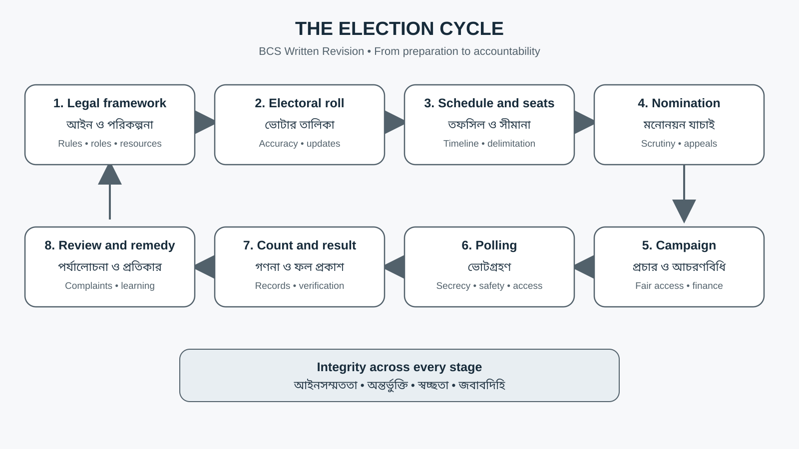

একটি নির্বাচনকে এক দিনের ঘটনা হিসেবে নয়, ধারাবাহিক প্রশাসনিক প্রক্রিয়া হিসেবে বুঝতে হবে। প্রক্রিয়ার কোনো এক ধাপে অনিয়ম হলে পরবর্তী ধাপগুলোর ওপরও তার প্রভাব পড়তে পারে।

### ৭.১ নির্বাচন-পূর্ব ধাপ

1. প্রযোজ্য আইন, নিয়ম ও নির্বাচনকালীন নির্দেশনা নির্ধারণ।
2. ভোটার তালিকা ও নির্বাচনী এলাকার তথ্য যাচাই।
3. নির্বাচন কমিশনের তফসিল প্রকাশ।
4. মনোনয়নপত্র দাখিল, যাচাই, আপিল ও প্রত্যাহার।
5. বৈধ প্রার্থী ও প্রতীক সংক্রান্ত তথ্য প্রকাশ।
6. ভোটকেন্দ্র, জনবল, ব্যালট, নিরাপত্তা, পরিবহন ও প্রশিক্ষণের পরিকল্পনা।
7. আচরণবিধি, প্রচার ব্যয় ও ভোটার-তথ্য প্রচার।
8. পর্যবেক্ষক ও গণমাধ্যমের প্রবেশাধিকার বিষয়ে নিয়ম প্রয়োগ।

### ৭.২ ভোটগ্রহণের দিন

- ভোটকেন্দ্র সময়মতো প্রস্তুত ও খোলা;
- ভোটারের পরিচয় ও তালিকা যাচাই;
- গোপন ব্যালট নিশ্চিত করা;
- অনুমোদিত এজেন্ট ও পর্যবেক্ষকদের নিয়ম মেনে কাজের সুযোগ;
- কেন্দ্রের শৃঙ্খলা ও নিরাপত্তা;
- অনিয়ম, বাধা বা ব্যালটের ক্ষতি হলে আইন অনুযায়ী রিপোর্ট ও প্রয়োজনীয় ব্যবস্থা;
- ভোটগ্রহণ শেষে ব্যালট ও নথির হিসাব মিলানো।

### ৭.৩ গণনা ও ফল প্রকাশ

গণনায় স্বচ্ছ পদ্ধতি, ব্যালটের সঠিক শ্রেণিবিন্যাস, প্রার্থীদের/এজেন্টদের প্রযোজ্য উপস্থিতির সুযোগ, গণনার রেকর্ড, ফল একীভূতকরণ এবং ফল প্রকাশ গুরুত্বপূর্ণ। গণনায় বিরোধ বা অনিয়মের অভিযোগ থাকলে নির্ধারিত আইনগত পদ্ধতি অনুসরণ করতে হয়।

### ৭.৪ নির্বাচন-পরবর্তী ধাপ

- ফলাফল ও প্রাসঙ্গিক নথি সংরক্ষণ;
- ব্যয় ও হলফনামার নিয়ম অনুযায়ী প্রতিবেদন;
- নির্বাচনী অভিযোগ ও আবেদন নিষ্পত্তি;
- প্রশাসনিক মূল্যায়ন এবং শেখা বিষয় নথিবদ্ধ করা;
- পরবর্তী নির্বাচনের জন্য লজিস্টিক, প্রশিক্ষণ ও আইন প্রয়োগের উন্নয়ন।

**Memory code:** **L–R–N–C–P–V–C–R**  
Law → Roll → Nomination → Campaign → Polling → Verification/count → Result → Review.

---

## ৮. নির্বাচন আইন ও ২০২৬ সালের গুরুত্বপূর্ণ সংশোধন

বাংলাদেশের সংসদ নির্বাচনের জন্য গুরুত্বপূর্ণ আইন হলো Representation of the People Order, 1972 (RPO), যা পরবর্তী আইন ও সংশোধনীর মাধ্যমে পরিবর্তিত হয়েছে। ভোটার তালিকার জন্য Electoral Rolls Act, 2009-ও গুরুত্বপূর্ণ। পরীক্ষার আগে পুরোনো গাইডের সঙ্গে বর্তমান সরকারি আইন মিলিয়ে নেওয়া জরুরি। [RPO 1972](https://bdlaws.minlaw.gov.bd/act-print-424.html) · [RPO Amendment Act 2026](https://bdlaws.minlaw.gov.bd/act-print-1632.html)

### ৮.১ ২০২৬ সালের সংশোধনী থেকে যে বিষয়গুলো পড়বেন

| বিষয় | ২০২৬ সালের সংশোধনীতে কী দেখা যায় | পরীক্ষায় কীভাবে ব্যবহার করবেন |
|---|---|---|
| একক প্রার্থী | নির্দিষ্ট পরিস্থিতিতে একক প্রার্থীর সঙ্গে “No Vote” বিকল্পে ভোটের বিধান; No Vote বেশি হলে নতুন তফসিলে পুনর্নির্বাচনের ব্যবস্থা, তবে পরবর্তী নির্বাচনে আবার একক প্রার্থী থাকলে আইনে নির্ধারিত পরিণতি প্রযোজ্য | বিনা প্রতিদ্বন্দ্বিতায় নির্বাচনের ধারণা ও নতুন বিধান গুলিয়ে ফেলবেন না |
| Postal ballot | নির্দিষ্ট যোগ্য শ্রেণি—যেমন দায়িত্বের কারণে নিজ নির্বাচনী এলাকার বাইরে থাকা সরকারি কর্মচারী, আইনগত হেফাজতে থাকা ব্যক্তি, অন্য কেন্দ্রে দায়িত্বপ্রাপ্ত নির্বাচনী কর্মী এবং বিদেশে বসবাসকারী বাংলাদেশি ভোটারের জন্য সংশোধিত বিধান | যোগ্যতা ও নিবন্ধনের পদ্ধতি কমিশনের সর্বশেষ নির্দেশনা দিয়ে যাচাই করুন |
| নির্বাচনী ব্যয়সীমা | প্রার্থীর ব্যয়, মনোনয়নকারী দলের প্রার্থীর জন্য ব্যয়-সহ, ভোটারপ্রতি ১০ টাকা বা মোট ২৫ লাখ টাকা—যেটি বেশি—এই ভিত্তিতে সীমা নির্ধারণের বিধান | আইনের বর্তমান wording ও প্রয়োগের সময়সীমা উল্লেখ করুন |
| মিথ্যা/AI-উৎপাদিত কনটেন্ট | নির্দিষ্ট নির্বাচনী সময়ে প্রার্থী/দল/কমিশনকে লক্ষ্য করে নির্বাচনী সততা ক্ষুণ্ণের উদ্দেশ্যে মিথ্যা বা বিভ্রান্তিকর কনটেন্ট, synthetic media বা automated bot ব্যবহারের বিরুদ্ধে বিধান সংযোজিত হয়েছে | প্রযুক্তি-সম্পর্কিত উত্তরে মতপ্রকাশের স্বাধীনতা ও বেআইনি উদ্দেশ্যমূলক প্রতারণার পার্থক্য বুঝিয়ে লিখুন |
| ভোটকেন্দ্রে শৃঙ্খলা | অনুমোদিত ব্যক্তি ছাড়া অযথা ভিড়/অবস্থান নিয়ন্ত্রণ ও প্রয়োজনীয় ব্যবস্থা নেওয়ার বিধান সংশোধিত হয়েছে | ভোটার নিরাপত্তা, পর্যবেক্ষক ও কেন্দ্রের শৃঙ্খলার ভারসাম্য |
| আচরণবিধি | আচরণবিধি ভঙ্গের জন্য সংশোধিত শাস্তি ও প্রয়োগের ব্যবস্থা রয়েছে | শাস্তির নির্দিষ্ট অঙ্ক/মেয়াদ লিখলে সর্বশেষ আইন থেকে পুনরায় যাচাই করুন |
| EVM-সংক্রান্ত পাঠ | ২০২৬ সালের সংশোধনীতে RPO-র কিছু EVM-নির্দিষ্ট উল্লেখ ও বিধান অপসারণ করা হয়েছে | পুরোনো বইয়ের EVM-সংক্রান্ত RPO পাঠকে বর্তমান আইন বলে উদ্ধৃত করবেন না |

**সতর্কতা:** এই সারণি ১০ এপ্রিল ২০২৬-এর Representation of the People (Amendment) Act, 2026-এর পাঠের সারাংশ। আইন প্রয়োগ, বিধি, পরবর্তী সংশোধনী ও কমিশনের সার্কুলার পরিবর্তিত হতে পারে। নির্দিষ্ট ধারার ভাষা বা শাস্তি উদ্ধৃত করার আগে [সরকারি আইনপাঠ](https://bdlaws.minlaw.gov.bd/act-print-1632.html) এবং [বাংলাদেশ নির্বাচন কমিশন](https://ecs.gov.bd/) দেখুন।

### ৮.২ “No Vote” ব্যবস্থা নিয়ে উত্তর লেখার কাঠামো

**সংজ্ঞা:** নির্দিষ্ট আইনি পরিস্থিতিতে যখন যাচাইয়ের পর বা প্রত্যাহারের পর একজন প্রার্থীই অবশিষ্ট থাকেন, সংশোধিত RPO-তে সেই প্রার্থী ও “No Vote” বিকল্পের মধ্যে ভোটের ব্যবস্থা করা হয়েছে।

**বিশ্লেষণ:** ব্যবস্থাটি ভোটারের পছন্দ প্রকাশের একটি সীমিত আইনি পথ তৈরি করে। তবে এটি সব আসনে, সব নির্বাচনে বা সাধারণ ব্যালটে সর্বদা প্রযোজ্য—এমনভাবে লেখা যাবে না। একক প্রার্থী, No Vote-এর ফল এবং পরবর্তী নির্বাচনের পরিণতি সংশোধিত ধারার শর্তের সঙ্গে মিলিয়ে ব্যাখ্যা করতে হবে। [Official Amendment Act, 2026](https://bdlaws.minlaw.gov.bd/act-print-1632.html)

---

## ৯. নির্বাচনী সততা, চ্যালেঞ্জ ও প্রতিকার

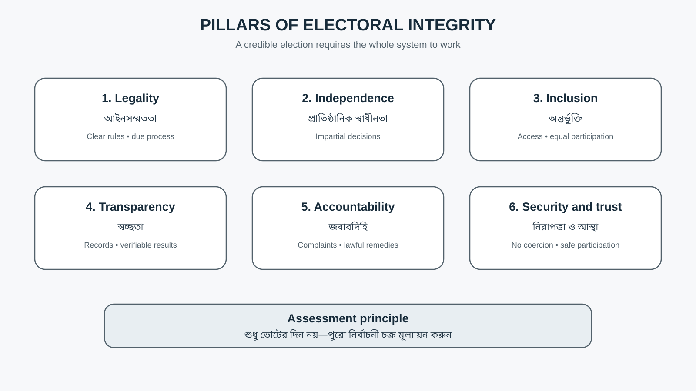

Free and fair election-এর মূল্যায়ন শুধু ভোটের সংখ্যা বা ভোটকেন্দ্র খোলা থাকার ওপর নির্ভর করে না। ভোটার স্বাধীনভাবে সিদ্ধান্ত নিতে পেরেছেন কি না, প্রার্থীরা ন্যায্য প্রতিযোগিতার সুযোগ পেয়েছেন কি না, প্রশাসন নিরপেক্ষ ছিল কি না, গণনা যাচাইযোগ্য কি না এবং অভিযোগের কার্যকর প্রতিকার ছিল কি না—এসবও গুরুত্বপূর্ণ। [International IDEA — International Electoral Standards](https://www.idea.int/publications/catalogue/international-electoral-standards-guidelines-reviewing-legal-framework)

### ৯.১ প্রধান চ্যালেঞ্জ

| চ্যালেঞ্জ | কীভাবে সততা ক্ষতিগ্রস্ত হয় | সম্ভাব্য প্রতিকার |
|---|---|---|
| রাজনৈতিক পক্ষপাতের ধারণা | কমিশন/প্রশাসনের সিদ্ধান্তে আস্থা কমে | পূর্বঘোষিত নিয়ম, লিখিত কারণ, সমান প্রয়োগ |
| ভোটার তালিকার ভুল | যোগ্য ভোটার বাদ পড়া বা ভুল তথ্য | সময়মতো হালনাগাদ, সহজ সংশোধন ও আপিল |
| ভয়ভীতি ও সহিংসতা | ভোটার বা প্রার্থী স্বাধীনভাবে অংশ নিতে পারেন না | ঝুঁকিভিত্তিক নিরাপত্তা পরিকল্পনা, অভিযোগ নথিবদ্ধকরণ, আইনের সমান প্রয়োগ |
| ভোট কেনাবেচা | ভোটারের সিদ্ধান্তকে অর্থ/সুবিধা দিয়ে প্রভাবিত করা | ব্যয় ও অনুদানের স্বচ্ছতা, তদন্ত ও আইনানুগ ব্যবস্থা |
| প্রশাসনিক সম্পদের অপব্যবহার | প্রতিদ্বন্দ্বীদের মধ্যে অসম সুবিধা | স্পষ্ট নিষেধাজ্ঞা, পর্যবেক্ষণ ও নিরপেক্ষ প্রয়োগ |
| গুজব ও AI-ভিত্তিক বিভ্রান্তি | মিথ্যা তথ্য দ্রুত ছড়ায়; ভোটার বিভ্রান্ত হন | দ্রুত যাচাই, উৎস-স্বচ্ছতা, আইনানুগ তদন্ত, নাগরিকের media literacy |
| অস্বচ্ছ গণনা/ফল প্রকাশ | ফল নিয়ে বিরোধ ও অবিশ্বাস | নথিভিত্তিক গণনা, প্রযোজ্য পর্যবেক্ষণ, ফলের দ্রুত ও যাচাইযোগ্য প্রকাশ |
| অভিযোগ নিষ্পত্তিতে বিলম্ব | কার্যকর প্রতিকার দুর্বল হয় | স্পষ্ট সময়সীমা, প্রশিক্ষিত কর্তৃপক্ষ, প্রকাশ্য প্রক্রিয়া |
| নারী ও প্রান্তিক ভোটারের বাধা | অংশগ্রহণে বৈষম্য তৈরি হয় | নিরাপত্তা, প্রবেশগম্যতা, তথ্য ও অভিযোগসেবা |
| প্রচার ব্যয়ের অস্বচ্ছতা | বড় অর্থের প্রভাব ও অসম প্রতিযোগিতা | আয়-ব্যয়ের প্রতিবেদন, প্রকাশ, নিরীক্ষা ও শাস্তির সমান প্রয়োগ |

### ৯.২ নির্বাচনকে কীভাবে মূল্যায়ন করবেন?

একটি ভালো analytical answer পাঁচটি মানদণ্ড ব্যবহার করতে পারে:

1. **Legality:** নির্বাচন সংবিধান ও প্রযোজ্য আইনের সঙ্গে সামঞ্জস্যপূর্ণ কি?
2. **Inclusiveness:** যোগ্য ভোটার ও প্রার্থী অংশগ্রহণের বাস্তব সুযোগ পেয়েছেন কি?
3. **Competition:** প্রতিদ্বন্দ্বিতা কার্যকর ও ন্যায্য ছিল কি?
4. **Transparency:** ভোট, গণনা, ফল ও অভিযোগের তথ্য যাচাই করা যায় কি?
5. **Accountability:** অনিয়মের অভিযোগে স্বাধীন ও কার্যকর প্রতিকার আছে কি?

কোনো একটি সূচক দিয়ে পুরো নির্বাচনের মান ঘোষণা করবেন না। প্রমাণ, সময়সীমা, উৎস এবং সীমাবদ্ধতা উল্লেখ করে সিদ্ধান্ত দিন।

### ৯.৩ সংস্কারের অগ্রাধিকার

- কমিশনের প্রাতিষ্ঠানিক স্বাধীনতা ও প্রশাসনিক সক্ষমতা কার্যকর করা;
- ভোটার তালিকা যাচাই, সংশোধন ও অভিযোগের সুযোগ সহজ করা;
- নির্বাচনী এলাকার সীমানা নির্ধারণে স্বচ্ছতা ও তথ্যের মান উন্নত করা;
- আচরণবিধি, প্রচার ব্যয় ও অনুদানের নিয়ম সমানভাবে প্রয়োগ;
- ভোটকেন্দ্রের নিরাপত্তা এবং পর্যবেক্ষণের ন্যায্য সুযোগ;
- ফল গণনা ও প্রকাশে নির্ভরযোগ্য নথি;
- নির্বাচনী বিরোধের সময়মতো নিষ্পত্তি;
- মিথ্যা তথ্য, AI-উৎপাদিত বিভ্রান্তিকর কনটেন্ট ও অনলাইন হয়রানি মোকাবিলায় আইনসম্মত, আনুপাতিক এবং অধিকার-সম্মত ব্যবস্থা;
- নারী, প্রতিবন্ধী, সংখ্যালঘু ও দূরবর্তী এলাকার ভোটারের ব্যবহারিক বাধা কমানো;
- প্রতিটি নির্বাচনের পর স্বাধীন মূল্যায়ন ও শেখা বিষয় প্রকাশ।

---

## ১০. নির্বাচনে প্রযুক্তি, গণমাধ্যম ও তথ্যের সততা

প্রযুক্তি ভোটার নিবন্ধন, তথ্য প্রকাশ, ফল ব্যবস্থাপনা, অভিযোগ গ্রহণ ও নাগরিক যোগাযোগকে দ্রুত করতে পারে। কিন্তু প্রযুক্তি নিজে নিরপেক্ষতা বা নির্ভুলতার নিশ্চয়তা দেয় না। ভুল ডেটা, দুর্বল সাইবার নিরাপত্তা, ডিজিটাল বিভাজন, ব্যক্তিগত তথ্যের অপব্যবহার, গুজব এবং অস্বচ্ছ algorithmic decision—এসব ঝুঁকিও আছে।

### ১০.১ প্রযুক্তির সম্ভাবনা ও ঝুঁকি

| প্রয়োগ | সম্ভাব্য সুবিধা | ঝুঁকি ও সুরক্ষা |
|---|---|---|
| অনলাইন ভোটার তথ্য | দ্রুত যাচাই ও সংশোধনের সুযোগ | পরিচয় চুরি, ভুল তথ্য; নিরাপদ যাচাই দরকার |
| ডিজিটাল অভিযোগ ব্যবস্থা | দ্রুত অভিযোগ জমা ও tracking | অভিযোগের গোপনীয়তা, acknowledgement ও নিষ্পত্তির রেকর্ড |
| ফল প্রকাশ | দ্রুত ও সহজলভ্য তথ্য | প্রাথমিক ফল ও চূড়ান্ত ফল আলাদা চিহ্নিত করা |
| সামাজিক মাধ্যম | ভোটার শিক্ষা ও দ্রুত ঘোষণা | ভুয়া তথ্য, bot, deepfake; উৎস-যাচাই ও দ্রুত সংশোধন |
| ডিজিটাল postal ballot workflow | যোগ্য ভোটারের অংশগ্রহণ সহজ করা | পরিচয় যাচাই, গোপনীয়তা, ballot tracking ও সময়সীমা |
| তথ্য বিশ্লেষণ | লজিস্টিক পরিকল্পনা ও ঝুঁকি শনাক্ত | পক্ষপাতদুষ্ট ডেটা, অতিরিক্ত নজরদারি ও ভুল অনুমান |

### ১০.২ গণমাধ্যমের ভূমিকা

- নির্বাচন কমিশনের আনুষ্ঠানিক ঘোষণা ও আইনি নথি যাচাই করে প্রকাশ;
- প্রার্থী ও দলের বক্তব্যের সঙ্গে তথ্যের সত্যতা যাচাই;
- সব পক্ষের বক্তব্যে ন্যায্যতা ও প্রাসঙ্গিকতা;
- গুজব, ভুল ছবি বা পুরোনো ভিডিওকে যাচাই ছাড়া প্রচার না করা;
- নির্বাচনী সহিংসতা বা অনিয়মের রিপোর্টে ব্যক্তিগত নিরাপত্তা ও গোপনীয়তা রক্ষা;
- ফলাফল সম্পর্কে প্রাথমিক/অসম্পূর্ণ তথ্যকে চূড়ান্ত বলে উপস্থাপন না করা।

### ১০.৩ AI-উৎপাদিত মিথ্যা কনটেন্ট

২০২৬ সালের সংশোধিত RPO-তে নির্দিষ্ট নির্বাচনী সময়কালে নির্বাচনী সততা বা ফলকে প্রভাবিত করার উদ্দেশ্যে মিথ্যা বা বিভ্রান্তিকর কনটেন্ট, synthetic media বা automated bot ব্যবহারের বিষয়ে বিধান যুক্ত হয়েছে। তবে সব AI-তৈরি কনটেন্ট নিজে থেকেই বেআইনি—এমন সাধারণীকরণ করা ঠিক নয়; প্রযোজ্য আইনের ভাষা, উদ্দেশ্য, সময়সীমা ও নির্দিষ্ট পরিস্থিতি বিবেচ্য। [RPO Amendment Act 2026](https://bdlaws.minlaw.gov.bd/act-print-1632.html)

---

## ১১. নারী, তরুণ, সংখ্যালঘু ও প্রতিবন্ধী ভোটারের অংশগ্রহণ

অন্তর্ভুক্তিমূলক নির্বাচন মানে প্রত্যেক নাগরিকের রাজনৈতিক অধিকারকে বাস্তবে প্রয়োগের সুযোগ দেওয়া। আইনগত অধিকার থাকা সত্ত্বেও নিরাপত্তা, যাতায়াত, তথ্যের অভাব, সামাজিক বাধা, পরিচয়পত্র-সংক্রান্ত সমস্যা বা শারীরিক প্রবেশগম্যতার অভাবে কেউ অংশ নিতে না পারলে গণতান্ত্রিক অংশগ্রহণ অসম্পূর্ণ থাকে।

### ১১.১ নারী ও প্রতিনিধিত্ব

নারীর ভোটার হিসেবে অংশগ্রহণ এবং নির্বাচিত প্রতিনিধি হিসেবে অংশগ্রহণ দুটি সম্পর্কিত কিন্তু আলাদা বিষয়। নারীর নিরাপত্তা, প্রচারে সমান সুযোগ, অর্থায়ন, দলীয় মনোনয়ন, হয়রানি প্রতিরোধ এবং নেতৃত্বের বিকাশকে একসঙ্গে দেখতে হবে। শুধু সংরক্ষিত আসনের সংখ্যা দিয়ে রাজনৈতিক প্রতিনিধিত্বের সব দিক মূল্যায়ন করা যায় না।

### ১১.২ তরুণ ভোটার

তরুণ ভোটারদের জন্য নাগরিক শিক্ষা, প্রার্থীর নীতি তুলনা, তথ্য যাচাই, রাজনৈতিক সহনশীলতা এবং শান্তিপূর্ণ অংশগ্রহণ গুরুত্বপূর্ণ। অনলাইনে সক্রিয়তা ভোটার-সচেতনতা বাড়াতে পারে; আবার ভুল তথ্য ও আবেগনির্ভর প্রচারও দ্রুত ছড়াতে পারে। তাই media literacy এবং civic education সমান জরুরি।

### ১১.৩ সংখ্যালঘু ও প্রান্তিক জনগোষ্ঠী

নির্বাচনী পরিবেশে ভয়ভীতি, বৈষম্য বা নিরাপত্তাহীনতা কোনো গোষ্ঠীর অংশগ্রহণ কমিয়ে দিতে পারে। প্রতিকার হিসেবে অভিযোগের নিরাপদ পথ, নিরপেক্ষ নিরাপত্তা, তথ্যের সহজলভ্যতা এবং আইন প্রয়োগের সমতা প্রয়োজন। “অন্তর্ভুক্তি”কে প্রতীকী প্রচার নয়, বাস্তব বাধা কমানোর মাধ্যমে মূল্যায়ন করা উচিত।

### ১১.৪ প্রতিবন্ধী ও দূরবর্তী এলাকার ভোটার

ভোটকেন্দ্রে প্রবেশগম্যতা, উপযুক্ত নির্দেশনা, সহায়তার আইনসম্মত ব্যবস্থা, সহজ ভাষায় তথ্য এবং দুর্গম অঞ্চলের পরিবহন-লজিস্টিক পরিকল্পনা অংশগ্রহণ বাড়াতে পারে। সহায়তার পদ্ধতি এমন হওয়া দরকার যাতে ভোটের গোপনীয়তা ও ভোটারের স্বাধীন সিদ্ধান্ত অক্ষুণ্ণ থাকে।

**International framework:** UN-এর গণতন্ত্রবিষয়ক নির্দেশনায় অংশগ্রহণ, রাজনৈতিক সমতা, অন্তর্ভুক্তিমূলক প্রতিষ্ঠান এবং প্রান্তিক গোষ্ঠীর অধিকার সুরক্ষার গুরুত্ব তুলে ধরা হয়েছে। [UN — Guidance Note on Democracy](https://www.un.org/democracyfund/en/content/guidance-note-un-secretary-general-democracy)

---

## ১২. নির্বাচনী বিরোধ, অভিযোগ ও জবাবদিহি

নির্বাচনী অভিযোগের ব্যবস্থা এমন হতে হবে যাতে অভিযোগ জমা দেওয়া সম্ভব, প্রমাণ সংরক্ষণ করা যায়, সংশ্লিষ্ট পক্ষের বক্তব্য শোনা হয় এবং আইনের নির্ধারিত পদ্ধতিতে সিদ্ধান্ত আসে। নির্বাচনী বিরোধের ক্ষেত্রে সংবিধানের ১২৫ অনুচ্ছেদ এবং RPO-র প্রাসঙ্গিক বিধান গুরুত্বপূর্ণ। [Article 125](https://bdlaws.minlaw.gov.bd/act-367/section-24684.html)

### অভিযোগের কার্যকর ব্যবস্থার উপাদান

1. অভিযোগের ধরন ও দায়িত্বপ্রাপ্ত কর্তৃপক্ষ স্পষ্ট করা।
2. সময়মতো জমা দেওয়ার নিয়ম প্রকাশ করা।
3. প্রমাণ, সাক্ষ্য, নথি ও ডিজিটাল উপাদান নিরাপদে সংরক্ষণ করা।
4. সংশ্লিষ্ট পক্ষের বক্তব্য শোনার সুযোগ দেওয়া।
5. নিরপেক্ষ সিদ্ধান্ত এবং লিখিত কারণ প্রকাশ করা।
6. প্রযোজ্য আপিল বা election petition-এর পথ জানানো।
7. অভিযোগের সংখ্যা, ধরন, নিষ্পত্তি ও শেখা বিষয় থেকে ভবিষ্যৎ সংস্কার নির্ধারণ করা।

**Exam point:** অভিযোগের সংখ্যা বেশি মানেই সব অভিযোগ সত্য নয়; আবার অভিযোগ কম মানেই অনিয়ম নেই—এমনও নয়। অভিযোগের প্রবেশগম্যতা, নথির মান, তদন্ত, নিষ্পত্তি এবং ফলের ওপর তার প্রভাব আলাদাভাবে বিচার করতে হবে।

---

## ১৩. Previous BCS Question Analysis — বিগত প্রশ্নের থিম ও প্রস্তুতির অগ্রাধিকার

৩৫তম–৪৭তম BCS-এর year-by-year audit এখন আলাদা ফাইলে আছে: **[Open full PYQ audit](./PYQ-35TH-47TH-ANALYSIS.md)**। এতে সরাসরি নির্বাচন কমিশন/RPO প্রশ্ন, সম্পর্কিত রাজনৈতিক সংস্কৃতি/প্রতিনিধিত্বের প্রশ্ন, special BCS paper-এর সীমাবদ্ধতা এবং secondary-source caveat আলাদা করা হয়েছে।

### এই অধ্যায়ের জন্য গুরুত্বপূর্ণ archive-reported clusters

| পরীক্ষা | রিপোর্ট করা প্রশ্নের থিম | প্রস্তুতির গুরুত্ব |
|---|---|---|
| ৩৫তম | নির্বাচন কমিশনের গঠন/দায়িত্ব; ২০০১ সাল থেকে নির্বাচনী ব্যয়ের পরিবর্তন | EC + campaign finance |
| ৩৬তম | election-observation teams; RPO short note | observers + election law |
| ৩৭তম | গণতান্ত্রিক প্রক্রিয়ায় election missions; নির্বাচনী ব্যয় হ্রাস; ১৯৭০ সালের সাধারণ নির্বাচন | observers + finance + history |
| ৩৮তম | সংসদে নারীদের সংরক্ষিত আসনের যৌক্তিকতা | representation + inclusion |
| ৪০তম | ১৯৭০ সালের নির্বাচনের স্বাধীনতা সংগ্রামে প্রভাব | historical electoral mandate |
| ৪১তম | RPO, EC-এর ভূমিকা, observers | direct EC/legal questions |
| ৪৩তম | গণতন্ত্র প্রতিষ্ঠায় নির্বাচন; EC গঠন ও সাংবিধানিক দায়িত্ব | highest-priority constitutional cluster |
| ৪৭তম | রাজনৈতিক সংস্কৃতির বৈশিষ্ট্য, গণতান্ত্রিক আদর্শ থেকে বিচ্যুতি ও সুপারিশ | political culture + accountability |

**৩৯তম ও ৪২তম ছিল special BCS**; এগুলোকে ordinary Bangladesh Affairs written-paper frequency-তে গণনা করা হয়নি। ৪৪তম–৪৬তমের consulted Bangladesh Affairs archives-এ সরাসরি EC/RPO প্রশ্ন নিশ্চিত করা যায়নি; ৪৬তমের “গণতান্ত্রিক রাষ্ট্র ও স্বাধীন গণমাধ্যম” রচনাটি Bangla paper-এর, Bangladesh Affairs paper-এর নয়।

### Exam strategy
- **প্রথমে শিখুন:** Articles 118–126, EC functions, RPO, observer role, campaign finance.
- **এরপর অনুশীলন করুন:** free/fair election, political culture, women’s representation, dispute resolution, digital misinformation.
- **উত্তরের কাঠামো:** legal basis → institution/process → evidence-based analysis → limitations → actionable recommendations.
- **প্রমাণের সতর্কতা:** এগুলো public secondary archives-এ রিপোর্ট করা প্রশ্ন। মূল BPSC scan দিয়ে স্বাধীনভাবে যাচাই না করা প্রশ্নকে “officially verified exact wording” বলা হচ্ছে না।

[পূর্ণ বছরভিত্তিক বিশ্লেষণ ও source links →](./PYQ-35TH-47TH-ANALYSIS.md) · [২৫টি answered model Q&A](./BCS-WRITTEN-QUESTION-BANK.md)

---

## ১৪. BCS Written-এর জন্য গুরুত্বপূর্ণ প্রবন্ধ ও Model Essays

নিচের আটটি প্রবন্ধ এই অধ্যায়ের প্রধান থিমগুলোকে একত্র করেছে। প্রতিটি প্রবন্ধে ভূমিকা, মূল বিশ্লেষণ, বাংলাদেশের প্রেক্ষাপট, করণীয় এবং উপসংহার রয়েছে। পরীক্ষায় প্রশ্নের ভাষা অনুযায়ী প্রবন্ধ ছোট বা বড় করবেন। সংবিধান ও আইনের নির্দিষ্ট তথ্যের জন্য [Source Register](#sources) দেখুন।

### প্রবন্ধ ১ — বাংলাদেশে অবাধ, সুষ্ঠু ও বিশ্বাসযোগ্য নির্বাচনের পূর্বশর্ত

গণতন্ত্রের স্থায়িত্ব নির্ভর করে নাগরিকরা স্বাধীনভাবে প্রতিনিধি নির্বাচন করতে পারেন কি না এবং নির্বাচিত প্রতিনিধিরা জনসম্মতির ভিত্তিতে দায়িত্ব পালন করেন কি না তার ওপর। নির্বাচন কেবল ভোটগ্রহণের একটি দিন নয়; ভোটার তালিকা, প্রার্থী মনোনয়ন, প্রচার, ভোটগ্রহণ, গণনা, ফল প্রকাশ এবং অভিযোগ নিষ্পত্তির সমন্বিত প্রক্রিয়া। এই প্রতিটি ধাপে আইন, নিরপেক্ষতা ও জবাবদিহি বজায় না থাকলে নির্বাচনের বিশ্বাসযোগ্যতা দুর্বল হতে পারে।

বাংলাদেশের সংবিধানের ১১৮ ও ১১৯ অনুচ্ছেদ নির্বাচন কমিশনের গঠন ও দায়িত্ব নির্ধারণ করেছে; ১২৬ অনুচ্ছেদ নির্বাহী কর্তৃপক্ষের সহায়তার দায়িত্ব উল্লেখ করে। ফলে বিশ্বাসযোগ্য নির্বাচন নিশ্চিত করা শুধু কমিশনের একক কাজ নয়। কমিশনের স্বাধীন সিদ্ধান্ত, দক্ষ জনবল ও লজিস্টিক, মাঠ প্রশাসনের আইনসম্মত সহায়তা, প্রার্থী ও দলের আচরণবিধি মানা, গণমাধ্যমের দায়িত্বশীলতা এবং নাগরিকের সচেতন অংশগ্রহণ একে অপরের পরিপূরক।

প্রধান চ্যালেঞ্জের মধ্যে রয়েছে ভোটার তালিকার ভুল, রাজনৈতিক সহিংসতা, ভয়ভীতি, অর্থের অসম প্রভাব, গুজব, প্রশাসনিক সম্পদের অপব্যবহার এবং অভিযোগ নিষ্পত্তিতে বিলম্ব। এসব সমস্যা মোকাবিলায় ভোটার তালিকার স্বচ্ছ যাচাই, প্রার্থীর আয়-ব্যয়ের হিসাব, নিরপেক্ষ নিরাপত্তা পরিকল্পনা, গণনার যাচাইযোগ্য রেকর্ড, পর্যবেক্ষণের স্পষ্ট নিয়ম এবং সময়মতো আইনি প্রতিকার প্রয়োজন। নির্বাচন-পরবর্তী মূল্যায়নও গুরুত্বপূর্ণ, কারণ তা পরবর্তী নির্বাচনে একই ভুল কমাতে সাহায্য করে।

অতএব, বিশ্বাসযোগ্য নির্বাচন কোনো একক প্রতিষ্ঠানের ঘোষণায় প্রতিষ্ঠিত হয় না; তা তৈরি হয় আইনসম্মত প্রতিযোগিতা, স্বাধীন প্রশাসন, অন্তর্ভুক্তিমূলক অংশগ্রহণ, স্বচ্ছ তথ্য এবং কার্যকর জবাবদিহির সমন্বয়ে। **সংবিধান, নিরপেক্ষতা, স্বচ্ছতা ও প্রতিকার—এই চারটি স্তম্ভই নির্বাচনী আস্থার ভিত্তি।**

**Source lines:** Constitution of Bangladesh, Articles 118–126; RPO 1972 (as amended); International IDEA, *International Electoral Standards*.

### প্রবন্ধ ২ — নির্বাচন কমিশনের স্বাধীনতা ও কার্যকারিতা: বাংলাদেশের প্রেক্ষাপট

নির্বাচন কমিশন গণতান্ত্রিক ব্যবস্থার একটি গুরুত্বপূর্ণ সাংবিধানিক প্রতিষ্ঠান। এর দায়িত্ব হলো নির্বাচনী আইন অনুযায়ী ভোটার তালিকা, নির্বাচনী এলাকার সীমানা এবং রাষ্ট্রপতি ও সংসদ নির্বাচন পরিচালনা করা। সংবিধানের ১১৮ অনুচ্ছেদ কমিশনের গঠন ও স্বাধীনতা এবং ১১৯ অনুচ্ছেদ তার প্রধান কার্যাবলি নির্ধারণ করেছে। কিন্তু আইনে স্বাধীনতার স্বীকৃতি থাকলেই কার্যকর স্বাধীনতা নিশ্চিত হয় না; এর জন্য বাস্তব সক্ষমতা ও জবাবদিহিও প্রয়োজন।

কমিশনের কার্যকারিতার প্রথম শর্ত হলো নিরপেক্ষ সিদ্ধান্ত। একই ধরনের ঘটনায় সরকার, বিরোধী দল, স্বতন্ত্র প্রার্থী ও অন্যান্য প্রতিদ্বন্দ্বীর ক্ষেত্রে একই নিয়ম প্রয়োগ করতে হবে। দ্বিতীয়ত, ভোটার তালিকা, ভোটকেন্দ্র, প্রশিক্ষণ, পরিবহন, ব্যালট এবং ফল ব্যবস্থাপনার জন্য দক্ষ জনবল ও পর্যাপ্ত লজিস্টিক প্রয়োজন। তৃতীয়ত, মাঠ প্রশাসন ও আইনশৃঙ্খলা বাহিনীর দায়িত্ব স্পষ্ট থাকা দরকার, কারণ সংবিধানের ১২৬ অনুচ্ছেদ নির্বাহী কর্তৃপক্ষকে কমিশনকে সহায়তার দায়িত্ব দেয়।

কমিশনের স্বাধীনতা শক্তিশালী করার জন্য নিয়োগ ও সিদ্ধান্তের প্রক্রিয়ায় স্বচ্ছতা, আইনসম্মত আর্থিক ও প্রশাসনিক সক্ষমতা, প্রকাশ্য নির্দেশনা, অভিযোগের নথি এবং সিদ্ধান্তের যুক্তি গুরুত্বপূর্ণ। একই সঙ্গে কমিশনেরও উচিত সময়মতো তথ্য প্রকাশ, প্রযোজ্য আইন ব্যাখ্যা, অভিযোগের ন্যায্য নিষ্পত্তি এবং নির্বাচন-পরবর্তী মূল্যায়ন করা। স্বাধীনতা যেন জবাবদিহিহীন ক্ষমতায় পরিণত না হয়, সেই ভারসাম্যও জরুরি।

সুতরাং, নির্বাচন কমিশনের কার্যকারিতা মূল্যায়নে শুধু সাংবিধানিক ক্ষমতা নয়, সেই ক্ষমতা কীভাবে প্রয়োগ হয় তা দেখতে হবে। স্বাধীনতা, দক্ষতা, সমান আইন প্রয়োগ, স্বচ্ছতা ও প্রতিকার—এই উপাদানগুলো একসঙ্গে কাজ করলেই কমিশনের ওপর জনআস্থা বৃদ্ধি পেতে পারে।

**Source lines:** Constitution, Articles 118, 119 and 126; Bangladesh Election Commission, “About the Commission”; International IDEA, *Electoral Management Design*.

### প্রবন্ধ ৩ — ভোটার তালিকার নির্ভুলতা ও সর্বজনীন ভোটাধিকার

ভোটার তালিকা নির্বাচনী ব্যবস্থার ভিত্তি। কে ভোট দিতে পারবেন এবং কোন নির্বাচনী এলাকায় ভোট দেবেন, তা সঠিকভাবে নির্ধারণ না হলে সমান ভোটাধিকার বাস্তবে নিশ্চিত করা কঠিন। বাংলাদেশের সংবিধানের ১২১ অনুচ্ছেদ প্রতিটি নির্বাচনী এলাকার জন্য একটি ভোটার তালিকা এবং ধর্ম, জাত, বর্ণ বা লিঙ্গের ভিত্তিতে পৃথক বিশেষ তালিকা না করার নীতি নির্ধারণ করে। ১২২ অনুচ্ছেদ সংসদ নির্বাচনে adult franchise-এর ভিত্তি স্থাপন করে।

একটি ভালো ভোটার তালিকায় চারটি গুণ থাকা দরকার: নির্ভুলতা, সম্পূর্ণতা, সময়মতো হালনাগাদ এবং সহজলভ্যতা। ভুল বা দ্বৈত তথ্য, মৃত ব্যক্তির নাম, স্থানান্তর-সংক্রান্ত সমস্যা কিংবা যোগ্য ভোটারের নাম বাদ পড়া—সবই আস্থা ও সমতার ওপর প্রভাব ফেলতে পারে। বিশেষ করে দরিদ্র, প্রবীণ, নারী, প্রতিবন্ধী, দূরবর্তী এলাকার বাসিন্দা বা নথি-সংক্রান্ত বাধার মুখোমুখি ব্যক্তিরা সংশোধন প্রক্রিয়া জটিল হলে অসুবিধায় পড়তে পারেন।

সমাধানের জন্য নিয়মিত হালনাগাদ, সহজ ও সময়মতো সংশোধন, ভোটার তালিকা যাচাইয়ের সুযোগ, অভিযোগ ও আপিল, তথ্যের গোপনীয়তা এবং মাঠপর্যায়ে নাগরিক সহায়তা প্রয়োজন। ডিজিটাল সেবা কাজে লাগানো যায়, তবে যারা প্রযুক্তি ব্যবহার করতে পারেন না তাদের জন্য সরাসরি সহায়তাও রাখতে হবে। তালিকার ভুল সংশোধনের সিদ্ধান্তে স্বচ্ছ মানদণ্ড এবং নথিবদ্ধ প্রক্রিয়া থাকা জরুরি।

সর্বজনীন ভোটাধিকার কেবল আইনগত অধিকার নয়; ভোটার যেন বাস্তবে সেই অধিকার প্রয়োগ করতে পারেন, সেটিও গুরুত্বপূর্ণ। তাই নির্ভুল ভোটার তালিকা, সহজ সংশোধন, নিরাপদ তথ্য ব্যবস্থাপনা এবং অন্তর্ভুক্তিমূলক সেবা গণতান্ত্রিক নির্বাচনের অপরিহার্য পূর্বশর্ত।

**Source lines:** Constitution, Articles 121–122; Electoral Rolls Act, 2009; Bangladesh Election Commission.

### প্রবন্ধ ৪ — নির্বাচনী ব্যবস্থাপনার ধাপ ও প্রশাসনিক সমন্বয়

নির্বাচনী ব্যবস্থাপনা একটি ধারাবাহিক প্রক্রিয়া, যার মধ্যে পরিকল্পনা, ভোটার তালিকা, তফসিল, মনোনয়ন, প্রচার, ভোটগ্রহণ, গণনা, ফল প্রকাশ ও বিরোধ নিষ্পত্তি অন্তর্ভুক্ত। এই ধাপগুলোর যেকোনো একটিতে গুরুতর ত্রুটি হলে পুরো প্রক্রিয়ার বিশ্বাসযোগ্যতা ক্ষতিগ্রস্ত হতে পারে। তাই নির্বাচন পরিচালনার জন্য আইনি স্পষ্টতা, সময়মতো পরিকল্পনা এবং দায়িত্বপ্রাপ্ত প্রতিষ্ঠানগুলোর সমন্বয় প্রয়োজন।

নির্বাচন কমিশন সাংবিধানিক দায়িত্ব পালন করে; রিটার্নিং কর্মকর্তা ও অন্যান্য নির্বাচনী কর্মকর্তা মাঠপর্যায়ে নির্দিষ্ট কাজ করেন। সংবিধানের ১২৬ অনুচ্ছেদ নির্বাহী কর্তৃপক্ষকে কমিশনকে সহায়তার দায়িত্ব দেয়। ফলে নির্বাচন পরিচালনায় কমিশন, প্রশাসন, আইনশৃঙ্খলা বাহিনী, প্রার্থী, রাজনৈতিক দল, পর্যবেক্ষক, গণমাধ্যম ও নাগরিকের ভূমিকা পৃথক হলেও পরস্পর সম্পর্কযুক্ত।

নির্বাচন-পূর্ব পর্যায়ে ভোটার তালিকা ও কেন্দ্রের তথ্য যাচাই, মনোনয়ন যাচাই, কর্মীদের প্রশিক্ষণ, ব্যালট ও পরিবহন, নিরাপত্তা এবং ভোটার শিক্ষা জরুরি। ভোটের দিন গোপন ব্যালট, পরিচয় যাচাই, কেন্দ্রের শৃঙ্খলা, এজেন্ট ও পর্যবেক্ষকদের নিয়মমাফিক উপস্থিতি এবং অনিয়মের নথিবদ্ধকরণ নিশ্চিত করতে হয়। ভোটের পর গণনা, ফল একীভূতকরণ, প্রকাশ্য তথ্য, অভিযোগের প্রতিকার এবং নথি সংরক্ষণ প্রয়োজন।

কার্যকর সমন্বয়ের জন্য স্পষ্ট দায়িত্ববণ্টন, যোগাযোগব্যবস্থা, contingency plan, প্রশিক্ষণ, অভিযোগের দ্রুত escalation এবং নির্বাচন-পরবর্তী পর্যালোচনা দরকার। দুর্যোগ, সহিংসতা, বিদ্যুৎ বা যোগাযোগ বিচ্ছিন্নতা এবং ভুল তথ্যের মতো ঝুঁকি আগে থেকে বিবেচনায় নিতে হবে।

অতএব, নির্বাচনী ব্যবস্থাপনার মান নির্ভর করে শুধু ভোটগ্রহণের দক্ষতার ওপর নয়; প্রস্তুতি থেকে জবাবদিহি পর্যন্ত প্রতিটি ধাপ কতটা আইনসম্মত, স্বচ্ছ ও সমন্বিতভাবে পরিচালিত হয়েছে তার ওপর।

**Source lines:** Constitution, Articles 119–126; RPO 1972 (as amended); International IDEA, *Electoral Management Design*.

### প্রবন্ধ ৫ — নির্বাচনী অর্থায়ন, আচরণবিধি ও সমান প্রতিযোগিতা

নির্বাচনী প্রচারে অর্থের প্রয়োজন রয়েছে, কারণ প্রার্থী ও দলকে ভোটারের কাছে নীতি, কর্মসূচি ও পরিচিতি পৌঁছে দিতে হয়। কিন্তু অর্থের উৎস ও ব্যয় অস্বচ্ছ হলে বড় আর্থিক শক্তি প্রতিযোগিতায় অসম প্রভাব ফেলতে পারে। ভোট কেনাবেচা, অবৈধ অনুদান, প্রশাসনিক সম্পদের অপব্যবহার ও ব্যয়সীমা লঙ্ঘন নির্বাচনের ন্যায্যতাকে দুর্বল করতে পারে। তাই নির্বাচনী অর্থায়নকে স্বচ্ছ ও জবাবদিহিমূলক করা জরুরি।

প্রথমত, প্রার্থী ও দলের আয়-ব্যয়ের হিসাব সংরক্ষণ এবং আইন অনুযায়ী জমা দেওয়া দরকার। দ্বিতীয়ত, অনুদানের উৎস, ব্যয়ের ধরন ও প্রযোজ্য সীমা সম্পর্কে স্পষ্ট নিয়ম থাকতে হবে। তৃতীয়ত, আচরণবিধি সব প্রার্থী ও দলের ক্ষেত্রে সমানভাবে প্রয়োগ করতে হবে। চতুর্থত, অভিযোগ তদন্ত ও শাস্তির পদ্ধতি এমন হতে হবে যাতে তা রাজনৈতিক প্রতিপক্ষকে অন্যায্যভাবে হয়রানির উপায় না হয়, আবার প্রকৃত অনিয়মও উপেক্ষিত না থাকে।

বাংলাদেশের RPO ও সংশোধনীতে নির্বাচনী ব্যয়, আচরণবিধি এবং সংশ্লিষ্ট বিধান রয়েছে। ২০২৬ সালের সংশোধনীতে প্রার্থীর ব্যয়সীমা গণনার একটি নতুন ভিত্তি নির্ধারণ করা হয়েছে; সুনির্দিষ্ট সংখ্যা লিখলে সর্বশেষ সরকারি আইনপাঠ মিলিয়ে নিতে হবে। কাগজে আইন থাকা যথেষ্ট নয়—নিরীক্ষা, প্রকাশ্য তথ্য, কার্যকর তদন্ত এবং সমান প্রয়োগ দরকার।

সুতরাং, নির্বাচনী অর্থায়নের উদ্দেশ্য প্রচার বন্ধ করা নয়; বরং অর্থের প্রভাবকে স্বচ্ছ, নিয়ন্ত্রিত ও ন্যায্য প্রতিযোগিতার মধ্যে রাখা। স্বচ্ছ হিসাব, সমান নিয়ম ও বিশ্বাসযোগ্য প্রয়োগ নির্বাচনী সততা শক্তিশালী করতে পারে।

**Source lines:** RPO 1972 (as amended), Articles on campaign finance and conduct; Representation of the People (Amendment) Act, 2026; International IDEA, *Money in Politics*.

### প্রবন্ধ ৬ — ডিজিটাল যুগে নির্বাচন: ভুল তথ্য, AI ও গণমাধ্যমের দায়িত্ব

ডিজিটাল প্রযুক্তি নির্বাচনী তথ্য দ্রুত ছড়াতে, ভোটারকে সেবা দিতে এবং ফল প্রকাশে সহায়তা করতে পারে। কিন্তু একই প্রযুক্তি ভুয়া ছবি, পুরোনো ভিডিও, deepfake, automated bot এবং বিভ্রান্তিকর প্রচারকে দ্রুত ছড়িয়ে দিতে পারে। তাই প্রযুক্তির ব্যবহার নির্বাচনের স্বচ্ছতা বাড়াতে পারে, তবে এর জন্য নিরাপত্তা, যাচাই ও জবাবদিহির ব্যবস্থা অপরিহার্য।

ভুল তথ্য ভোটারের সিদ্ধান্ত, প্রার্থীর সুনাম এবং নির্বাচন কমিশনের ওপর আস্থাকে ক্ষতিগ্রস্ত করতে পারে। সামাজিক মাধ্যমে একটি মিথ্যা দাবি অল্প সময়ে ব্যাপকভাবে ছড়ালেও তার সংশোধন একই গতিতে পৌঁছায় না। ফলে কমিশন, গণমাধ্যম, রাজনৈতিক দল, প্রযুক্তি প্ল্যাটফর্ম এবং নাগরিকদের দায়িত্ব আলাদা হলেও সমন্বিতভাবে কাজ করা প্রয়োজন।

প্রতিকারের জন্য সরকারি তথ্যের দ্রুত ও সহজলভ্য প্রকাশ, নির্ভরযোগ্য fact-checking, সংবাদমাধ্যমের যাচাই, নাগরিকের media literacy এবং প্রযোজ্য আইনের স্বচ্ছ প্রয়োগ দরকার। ২০২৬ সালের RPO সংশোধনীতে নির্দিষ্ট নির্বাচনী সময়কালে নির্বাচনী সততা ক্ষুণ্ণের উদ্দেশ্যে মিথ্যা বা বিভ্রান্তিকর কনটেন্ট ও AI-উৎপাদিত উপাদান ব্যবহারের বিষয়ে বিধান রয়েছে। তবে সব AI-তৈরি কনটেন্টকে বেআইনি বলা ঠিক নয়; উদ্দেশ্য, সময়, প্রেক্ষাপট ও আইনের শর্ত বিবেচনা করতে হবে।

প্রযুক্তি ব্যবহারে ব্যক্তিগত তথ্য, ভোটের গোপনীয়তা, সাইবার নিরাপত্তা এবং ডিজিটাল সেবা ব্যবহার করতে অক্ষম মানুষের অধিকারও রক্ষা করতে হবে। প্রযুক্তির সাফল্য শুধু গতি দিয়ে নয়, নির্ভুলতা, নিরাপত্তা, প্রবেশগম্যতা এবং জনআস্থা দিয়ে মূল্যায়ন করা উচিত।

অতএব, ডিজিটাল নির্বাচন-পরিবেশে তথ্যের সততা রক্ষা করা এখন নির্বাচনী ব্যবস্থাপনার গুরুত্বপূর্ণ অংশ। দ্রুত তথ্যপ্রকাশ, স্বাধীন যাচাই, দায়িত্বশীল গণমাধ্যম এবং আইনসম্মত প্রতিকার একসঙ্গে কাজ করলেই বিভ্রান্তির ঝুঁকি কমানো সম্ভব।

**Source lines:** RPO Amendment Act 2026; Bangladesh Election Commission; International IDEA, *Electoral Processes*; UN Guidance Note on Democracy.

### প্রবন্ধ ৭ — নির্বাচনে নারী ও প্রান্তিক জনগোষ্ঠীর অর্থবহ অংশগ্রহণ

গণতন্ত্রের গুণমান নির্ভর করে রাজনৈতিক প্রক্রিয়ায় কারা অংশ নিতে পারেন এবং কার কণ্ঠস্বর সিদ্ধান্তে প্রতিফলিত হয় তার ওপর। ভোটার হিসেবে অংশগ্রহণ এবং নির্বাচিত প্রতিনিধি হিসেবে অংশগ্রহণ আলাদা বিষয়। নারী, তরুণ, সংখ্যালঘু, প্রতিবন্ধী ব্যক্তি, দূরবর্তী এলাকার বাসিন্দা এবং সামাজিকভাবে প্রান্তিক জনগোষ্ঠী বিভিন্ন ধরনের বাস্তব বাধার মুখোমুখি হতে পারেন।

ভোটকেন্দ্রে যাতায়াত, নিরাপত্তাহীনতা, তথ্যের অভাব, সামাজিক চাপ, ডিজিটাল বিভাজন, রাজনৈতিক প্রচারে হয়রানি বা আর্থিক সীমাবদ্ধতা অংশগ্রহণ কমাতে পারে। নারী প্রার্থীর ক্ষেত্রে মনোনয়ন, প্রচার অর্থায়ন, সহিংসতা ও হয়রানি বিশেষ চ্যালেঞ্জ তৈরি করতে পারে। প্রতিবন্ধী ভোটারের ক্ষেত্রে প্রবেশগম্য কেন্দ্র, সহায়ক নির্দেশনা এবং গোপনীয়তা রক্ষা জরুরি। দূরবর্তী এলাকায় লজিস্টিক পরিকল্পনা না থাকলে ভোটদানের বাস্তব সুযোগ কমে যেতে পারে।

সমাধানে নিরাপদ ভোটকেন্দ্র, সহজ ভাষায় ভোটার শিক্ষা, অভিযোগের গোপনীয় ও কার্যকর ব্যবস্থা, শারীরিক প্রবেশগম্যতা, নিরপেক্ষ নিরাপত্তা, তথ্যের বহুমাধ্যমে প্রচার এবং আইনসম্মত সহায়ক ব্যবস্থার প্রয়োজন। রাজনৈতিক দলগুলোরও উচিত প্রার্থী মনোনয়ন ও নেতৃত্ব বিকাশে সমান সুযোগ নিশ্চিত করা। অংশগ্রহণের মূল্যায়নে শুধু ভোটার বা প্রার্থীর সংখ্যা নয়, ভয়ভীতি ছাড়া অংশ নেওয়া, কার্যকর প্রতিনিধিত্ব এবং অভিযোগের প্রতিকারও দেখতে হবে।

অন্তর্ভুক্তি কোনো আলাদা দয়া বা সুবিধা নয়; এটি সমান নাগরিক অধিকার বাস্তবায়নের অংশ। তাই নির্বাচনী ব্যবস্থাপনায় অন্তর্ভুক্তিমূলক পরিকল্পনা, নিরাপত্তা ও প্রবেশগম্যতাকে শুরু থেকেই বিবেচনা করা প্রয়োজন।

**Source lines:** Constitution, Articles 121–122; UN Guidance Note on Democracy; International IDEA, *Electoral Management Design*.

### প্রবন্ধ ৮ — নির্বাচনী সংস্কার, জবাবদিহি ও জনআস্থা

নির্বাচনী সংস্কারের উদ্দেশ্য কেবল নিয়ম পরিবর্তন নয়; এমন প্রতিষ্ঠান ও প্রক্রিয়া গড়ে তোলা, যাতে ভোটার স্বাধীনভাবে সিদ্ধান্ত নিতে পারেন, প্রতিযোগিতা ন্যায্য থাকে এবং ফলাফল নিয়ে বিরোধ হলে আইনসম্মত প্রতিকার পাওয়া যায়। সংস্কারকে বাস্তব সমস্যা, প্রমাণ, সাংবিধানিক কাঠামো ও প্রশাসনিক সক্ষমতার সঙ্গে যুক্ত করতে হয়।

প্রথমত, নির্বাচন কমিশনের স্বাধীনতা ও কার্যকর সক্ষমতা শক্তিশালী করতে হবে। দ্বিতীয়ত, ভোটার তালিকা, সীমানা নির্ধারণ, প্রার্থী মনোনয়ন ও প্রচার ব্যয়ের নিয়ম স্বচ্ছ করতে হবে। তৃতীয়ত, ভোটকেন্দ্রে নিরাপত্তা ও ভোটের গোপনীয়তা নিশ্চিত করতে হবে। চতুর্থত, গণনা ও ফল প্রকাশের প্রক্রিয়া নথিভিত্তিক এবং যাচাইযোগ্য হতে হবে। পঞ্চমত, অভিযোগ ও election petition-এর পথ সহজে বোঝা যায় এমনভাবে প্রকাশ করতে হবে এবং আইন অনুযায়ী সময়মতো নিষ্পত্তি নিশ্চিত করতে হবে।

সংস্কারের ক্ষেত্রে রাজনৈতিক ঐকমত্য, জনপরামর্শ, আইনগত সামঞ্জস্য, বাস্তবায়নের খরচ এবং সম্ভাব্য অনাকাঙ্ক্ষিত প্রভাব বিবেচনা করা দরকার। কোনো নতুন প্রযুক্তি বা নতুন বিধানকে শুধু আধুনিকতার কারণে গ্রহণ করা উচিত নয়; নিরাপত্তা, নির্ভুলতা, প্রবেশগম্যতা ও নিরীক্ষাযোগ্যতার প্রমাণ থাকতে হবে। নির্বাচন-পরবর্তী মূল্যায়ন ও প্রকাশ্য প্রতিবেদন পরবর্তী নির্বাচনে উন্নতির পথ দেখাতে পারে।

জনআস্থা শুধু ফলাফল পছন্দ হওয়ার ওপর নির্ভর করে না; নিয়ম, প্রক্রিয়া ও অভিযোগ নিষ্পত্তি ন্যায্য বলে মনে হওয়াও গুরুত্বপূর্ণ। তাই সংস্কারের লক্ষ্য হওয়া উচিত প্রতিষ্ঠানকে শক্তিশালী করা, আইনকে সমানভাবে প্রয়োগ করা এবং নাগরিকের অধিকার রক্ষা করা। **স্বচ্ছ নিয়ম, কার্যকর প্রতিষ্ঠান ও বিশ্বাসযোগ্য প্রতিকার—দীর্ঘমেয়াদি নির্বাচনী সংস্কারের মূল ভিত্তি।**

**Source lines:** Constitution, Articles 118–126; RPO 1972 (as amended); International IDEA, *International Electoral Standards* and *Electoral Management Design*.

---

## ১৫. ৩৩টি English–বাংলা Model Questions & Answers

**ব্যবহারের নিয়ম:** প্রশ্নের English wording দেখে আগে নিজের ভাষায় উত্তর লেখার চেষ্টা করুন। নিচের উত্তরগুলো সংক্ষিপ্ত model framework; ২০ নম্বরের উত্তরে প্রয়োজন অনুযায়ী আইন, উদাহরণ, বিশ্লেষণ ও সুপারিশ যোগ করবেন। এগুলো model/practice questions, অতীতের আসল প্রশ্ন নয়—যদি না প্রশ্নের পাশে স্পষ্টভাবে archive-reported বলা থাকে।

### A. সংজ্ঞা ও সাংবিধানিক ভিত্তি

#### 01. What is an election, and why is it important in a democracy? (5 marks)

**Model answer:** An election is a legally regulated process through which voters choose representatives or decide on a public question. In a democracy, it provides political participation, representation and a mechanism of accountability. A credible election requires eligible voters, genuine competition, secret ballot, transparent counting and effective remedies for violations. Elections alone cannot guarantee democracy; civil liberties, rule of law and responsible institutions are also essential.

#### 02. Explain the constitutional status of the Election Commission of Bangladesh. (10 marks)

**Model answer:** The Election Commission is a constitutional body established under Article 118 of the Constitution. Article 119 assigns it key responsibilities relating to electoral rolls, elections to Parliament and the presidency, and delimitation of parliamentary constituencies. Article 126 requires executive authorities to assist it. Its effectiveness depends on independence, professional capacity, impartial application of law, transparency and accountability. A strong answer should distinguish constitutional authority from the practical ability to carry out that authority.

#### 03. Discuss the importance of Articles 118 and 119 of the Constitution. (10 marks)

**Model answer:** Article 118 establishes the Commission and sets out its constitutional structure, tenure and independence. Article 119 defines core functions, including electoral-roll preparation and the conduct of parliamentary and presidential elections. Together, they provide the institutional foundation for electoral administration. Their practical value depends on competent staff, adequate logistics, transparent decisions and cooperation from other public authorities. The articles should be explained as complementary: one establishes the institution, while the other defines its central mandate.

#### 04. Why is Article 126 important for election administration? (5 marks)

**Model answer:** Article 126 makes it the duty of executive authorities to assist the Election Commission in carrying out its functions. Election administration requires coordination with field officials, security agencies and public services. Such assistance must support the Commission’s lawful mandate rather than undermine its independence. The article therefore connects constitutional responsibility with practical implementation.

#### 05. Explain adult franchise and its significance. (5 marks)

**Model answer:** Adult franchise is the principle that eligible adult citizens should have the right to participate in elections under the law. Article 122 of Bangladesh’s Constitution provides the constitutional basis for adult franchise in parliamentary elections and sets the framework for voter qualification. Its significance lies in political equality, representation and accountability. In practice, the principle requires accurate registration, accessible information and protection against unlawful exclusion.

#### 06. What is an electoral roll? Why must it be accurate? (5 marks)

**Model answer:** An electoral roll is the official list of eligible registered voters for an electoral area. Accuracy is essential because errors may exclude eligible voters or create incorrect entries. A reliable roll should be accurate, complete, up to date and accessible for lawful verification and correction. Regular updating, transparent procedures and privacy protection help improve confidence in the list.

#### 07. Explain constituency delimitation and its democratic importance. (10 marks)

**Model answer:** Constituency delimitation is the process of defining electoral boundaries under the Constitution and applicable law. It affects how voters are grouped and how representatives relate to communities. Transparent delimitation should use reliable information and apply consistent legal criteria. Unclear or apparently partisan boundaries may undermine equality and public trust. A sound process requires clear reasons, accessible information and lawful opportunities to raise objections where provided.

#### 08. Compare FPTP and proportional representation with reference to Bangladesh. (10 marks)

**Model answer:** Under first-past-the-post (FPTP), the candidate with the highest number of votes in a single-member constituency wins; the winner does not necessarily need more than half of all votes. Proportional representation (PR) aims to relate the allocation of seats to the share of votes under a specified formula. In Bangladesh, Article 65(2) provides for direct election from 300 territorial constituencies, while Article 65(3) provides for reserved women’s seats elected by members of Parliament through proportional representation using the single transferable vote. The two arrangements should be distinguished. FPTP can strengthen a local representative link, while PR can support proportional representation; each system also has design-specific trade-offs.

### B. Election process and electoral integrity

#### 09. Describe the major stages of a parliamentary election. (10 marks)

**Model answer:** The main stages include legal and logistical preparation, electoral-roll verification, announcement of the schedule, nomination, scrutiny and withdrawal, campaign, polling, counting, consolidation and publication of results, and post-election review or legal challenges. Each stage has specific rules and deadlines. Transparent communication, trained officials, security planning and documented decisions are essential throughout the cycle.

#### 10. What are the essential conditions for a free and fair election? (10 marks)

**Model answer:** Essential conditions include an impartial legal framework, an effective election-management body, accurate voter rolls, genuine competition, freedom from coercion, secret ballot, fair campaign opportunities, transparent counting, accessible observation and effective remedies. These conditions are interconnected. A technically well-organised polling day cannot compensate for systematic exclusion or a lack of meaningful competition before polling.

#### 11. Assess the role of the Election Commission in ensuring electoral integrity. (20 marks)

**Model answer framework:** Begin with Articles 118–119. Explain electoral rolls, delimitation, schedule, nominations, campaign regulation, polling, counting and results. Evaluate independence, staffing, logistics, consistent enforcement and complaint handling. Discuss the need for cooperation under Article 126. Recommend transparent procedures, timely information, documented decisions, impartial law enforcement and post-election evaluation. Conclude that credibility depends on both legal authority and effective, fair implementation.

#### 12. Why is secret ballot important? (5 marks)

**Model answer:** Secret ballot protects voters from pressure, retaliation and coercion by preventing others from knowing their individual choice. It helps voters make decisions independently. The secrecy of the vote must be combined with transparent and verifiable procedures for counting and reporting the aggregate result. Secrecy protects individual choice; transparency supports confidence in the overall process.

#### 13. Discuss the role of political parties and candidates in credible elections. (10 marks)

**Model answer:** Political parties and candidates present policies, nominate representatives, mobilise voters and contribute to political debate. They also have responsibilities to follow election law, respect opponents, avoid intimidation, disclose campaign expenditure as required and refrain from disinformation or vote buying. Fair competition requires both effective regulation and responsible political conduct. Parties should promote peaceful participation and respect lawful outcomes and remedies.

#### 14. What is campaign finance, and why should it be regulated? (10 marks)

**Model answer:** Campaign finance refers to the money received and spent in connection with electoral campaigning. Regulation is necessary to reduce opaque funding, vote buying, excessive financial influence and unfair advantages. Effective rules require clear expenditure limits, records, disclosure, audit and equal enforcement. The objective is not to eliminate legitimate campaigning but to protect fair competition and public accountability.

#### 15. Explain the role of election observers. (5 marks)

**Model answer:** Election observers monitor relevant stages of the process according to the rules governing their accreditation and access. They may document procedures, identify concerns and provide evidence-based assessments. Observers do not replace the Election Commission or courts, and their access must respect voter secrecy and the law. Clear methodology and impartial reporting improve the usefulness of observation.

#### 16. Why is transparent vote counting important? (10 marks)

**Model answer:** Counting is the stage where individual ballots are converted into an official result. Transparent procedures, accurate ballot accounting, proper documentation and lawful access for authorised representatives help reduce disputes. Results should be consolidated and published according to law. When irregularities occur, records and established remedies are needed to investigate them fairly rather than relying on rumours.

#### 17. Explain the purpose of an election petition. (5 marks)

**Model answer:** An election petition is a legal mechanism for challenging an election in the manner prescribed by law. It allows specific disputes to be assessed through evidence and lawful procedure rather than through intimidation or unsupported public claims. The applicable authority, grounds, deadline and remedy must be checked in the relevant law. Article 125 of the Constitution is a key starting point for parliamentary election disputes.

### C. Problems, reform and current law

#### 18. Analyse the main challenges to credible elections in Bangladesh. (20 marks)

**Model answer framework:** Discuss political distrust, voter-roll errors, intimidation, violence, unequal campaign resources, opaque finance, misinformation, administrative bias concerns and delayed remedies. Separate allegations from established evidence. Link each challenge to a remedy: transparent procedures, impartial enforcement, voter services, campaign-finance oversight, secure counting, accessible complaints and timely adjudication. Conclude that no single reform can solve every problem.

#### 19. How can voter-roll management be improved? (10 marks)

**Model answer:** Regular updating, accessible verification, timely correction, clear appeal routes, privacy protection and reliable field-level records are important. Information should be available through both digital and non-digital channels. The process should protect eligible voters from wrongful exclusion while preventing duplicate or inaccurate entries. Independent quality checks and public reporting of aggregate corrections can strengthen trust.

#### 20. Discuss the relationship between election administration and public trust. (10 marks)

**Model answer:** Public trust grows when rules are clear, decisions are impartial, information is timely, polling and counting are verifiable, and complaints are handled fairly. Trust may decline when procedures appear inconsistent or evidence is not addressed. Trust is not simply public approval of a result; it also depends on whether people believe that the process and remedies are lawful and fair.

#### 21. Explain the risks of election-related misinformation and deepfakes. (10 marks)

**Model answer:** False claims, manipulated images, synthetic audio or video and automated accounts may confuse voters, damage reputations and weaken confidence. Responses should include prompt official information, independent fact-checking, media literacy, evidence preservation and lawful investigation. Restrictions must be grounded in law and proportionate; not every mistaken statement or AI-generated item is automatically an electoral offence.

#### 22. What important election-related changes were introduced by the Representation of the People (Amendment) Act, 2026? (10 marks)

**Model answer:** The 2026 Act amended the RPO on several issues, including a “No Vote” mechanism in the specified single-candidate situation, postal-ballot provisions for defined eligible groups, campaign-expenditure limits and rules addressing certain election-related false or misleading content. It also changed other operational provisions. Candidates should read the current official text before quoting exact article numbers or penalties. The key lesson is to distinguish current law from superseded ordinances and older guidebooks.

#### 23. Discuss the advantages and risks of technology in election management. (10 marks)

**Model answer:** Technology can improve access to information, voter-service delivery, logistics and result publication. Risks include cyberattack, inaccurate data, privacy breaches, unequal digital access and rapid spread of disinformation. Every tool should be assessed for accuracy, security, auditability, accessibility and legal compliance. Technology should support transparent procedures rather than replace accountability.

#### 24. How can women and marginalised groups participate more effectively in elections? (10 marks)

**Model answer:** Measures include accessible polling stations, safe transport and voting environments, inclusive voter education, effective complaints, protection from intimidation and fair opportunities for political participation. Parties can improve nomination and leadership pathways. Evaluation should consider both numerical representation and the real ability to participate without coercion or discrimination.

#### 25. Explain the importance of election-related complaint mechanisms. (10 marks)

**Model answer:** Complaint mechanisms allow voters, candidates and authorised stakeholders to report alleged violations. They need clear jurisdiction, deadlines, secure evidence handling, impartial investigation, written decisions and lawful appeal. The number of complaints alone does not prove the presence or absence of irregularities. Their accessibility, credibility and resolution are more informative.

#### 26. “An independent Election Commission is necessary but not sufficient for a credible election.” Discuss. (20 marks)

**Model answer framework:** Explain constitutional independence under Article 118. Then discuss voter-roll quality, fair competition, trained staff, security, finance rules, media, observers, counting and remedies. Independence can be weakened in practice by inadequate capacity or inconsistent enforcement. Recommend institutional independence plus transparent procedures, resources, cooperation under Article 126 and accountability. Conclude that credibility is a system-wide outcome.

#### 27. How does electoral culture affect democratic consolidation? (20 marks)

**Model answer framework:** Define electoral culture as the norms and practices through which parties, candidates, institutions and voters engage in elections. Analyse tolerance, respect for opposition, lawful campaigning, acceptance of verified outcomes and peaceful dispute resolution. Discuss intimidation, misinformation, winner-takes-all attitudes and distrust as potential obstacles. Recommend civic education, responsible parties, impartial institutions, free media and credible legal remedies.

#### 28. Evaluate the importance of campaign expenditure disclosure. (10 marks)

**Model answer:** Disclosure makes it easier to assess whether campaign-finance rules are followed and whether donors or expenditure create conflicts of interest. It can deter hidden funding and improve public scrutiny. Disclosure must be supported by usable formats, audit, consistent deadlines and sanctions for false reporting. Privacy and lawful protections should also be respected where relevant.

#### 29. What is the difference between election observation and election administration? (5 marks)

**Model answer:** Election administration is the official conduct of legally assigned electoral duties. Election observation is the monitoring of relevant processes by accredited or authorised observers under the applicable rules. Observers can report findings but do not replace election officials or adjudicating bodies. The distinction protects both operational authority and independent scrutiny.

#### 30. Discuss the importance of post-election review. (10 marks)

**Model answer:** A post-election review identifies logistical failures, training gaps, complaint patterns, data errors and lessons for future elections. It should use evidence, document corrective actions and assign responsibility for follow-up. Review is not a substitute for legal adjudication of a disputed election; administrative learning and legal remedies serve different purposes.

#### 31. What should a fair election-reform agenda include? (20 marks)

**Model answer framework:** Start from documented problems and constitutional requirements. Include EC capacity and independence, voter-roll quality, delimitation transparency, candidate and party rules, campaign finance, voter access, polling security, counting records, misinformation response and complaint resolution. Consult stakeholders, estimate costs and assess unintended effects. Define measurable indicators and publish progress. Reform should strengthen equal application of law rather than advantage a particular party.

#### 32. Explain the importance of voter education. (5 marks)

**Model answer:** Voter education helps citizens understand registration, polling procedures, ballot secrecy, candidate information, misinformation and lawful complaint channels. It should be accurate, accessible, impartial and available through multiple channels. The aim is to help voters make independent decisions, not to promote any party or candidate.

#### 33. Write a conclusion on the future of electoral democracy in Bangladesh. (10 marks)

**Model answer:** The future of electoral democracy depends on more than holding elections at regular intervals. Constitutional institutions must be effective, voters must participate freely, parties must compete lawfully, information must be trustworthy and disputes must receive fair remedies. Reforms should be evidence-based, inclusive and transparent. Long-term public confidence grows when citizens can verify that rules apply equally and their political rights are protected.

---

## ১৬. BCS Written Answer Strategy — ৫, ১০ ও ২০ নম্বর

### ৫ নম্বর: Definition + Law + Significance

- ১–২ বাক্যে সংজ্ঞা;
- প্রাসঙ্গিক অনুচ্ছেদ বা আইন;
- ২–৩টি মূল পয়েন্ট;
- একটি ছোট উপসংহার।

### ১০ নম্বর: Context + Analysis + Remedy

- ভূমিকা ও সংজ্ঞা;
- সাংবিধানিক/আইনি ভিত্তি;
- ৩–৪টি বিশ্লেষণধর্মী দিক;
- বাংলাদেশের প্রেক্ষাপট;
- ২–৩টি বাস্তবসম্মত সুপারিশ;
- উপসংহার।

### ২০ নম্বর: WHIP-C Method

- **W — What:** বিষয়টি কী, সংজ্ঞা ও প্রেক্ষাপট।
- **H — How:** আইন, প্রতিষ্ঠান ও প্রক্রিয়া কীভাবে কাজ করে।
- **I — Issues:** সমস্যা, কারণ, প্রভাব ও পাল্টা যুক্তি।
- **P — Policy:** বাস্তবায়নযোগ্য সুপারিশ, দায়িত্বপ্রাপ্ত প্রতিষ্ঠান ও অগ্রাধিকার।
- **C — Conclusion:** প্রশ্নের নির্দেশক শব্দের সরাসরি উত্তর।

### Question verb দেখেই উত্তর পরিকল্পনা করুন

| Verb | পরীক্ষক কী চান | উত্তর লেখার পদ্ধতি |
|---|---|---|
| Define | সংজ্ঞা | সংজ্ঞা + আইন/উদাহরণ |
| Describe | বিবরণ | ধাপ বা বৈশিষ্ট্য ধারাবাহিকভাবে |
| Explain | ব্যাখ্যা | কারণ + প্রক্রিয়া + ফল |
| Discuss | বিভিন্ন দিক | যুক্তি, উদাহরণ, সীমাবদ্ধতা |
| Analyse | সম্পর্ক ও কারণ | কারণ → প্রভাব → প্রমাণ |
| Evaluate | বিচারমূলক মূল্যায়ন | মানদণ্ড + শক্তি/দুর্বলতা + সিদ্ধান্ত |
| Critically analyse | গভীর বিশ্লেষণ | বিপরীত যুক্তি, সীমাবদ্ধতা ও প্রমাণ |
| Recommend | করণীয় | নির্দিষ্ট পদক্ষেপ + দায়িত্ব + বাস্তবায়ন |
| Compare | তুলনা | একই মানদণ্ডে সাদৃশ্য ও পার্থক্য |

### Source citing in the exam

পরীক্ষার খাতায় URL লিখতে হবে না। প্রয়োজনমতো উৎসের নাম ও প্রাসঙ্গিক অনুচ্ছেদ/আইন উল্লেখ করুন:
- Constitution of Bangladesh, Articles 118–126;
- Representation of the People Order, 1972, as amended;
- Electoral Rolls Act, 2009;
- Bangladesh Election Commission;
- International IDEA, *Electoral Management Design*;
- United Nations, *Universal Declaration of Human Rights*, Article 21;
- International Covenant on Civil and Political Rights, Article 25.

**সতর্কতা:** সুনির্দিষ্ট সংখ্যা, শাস্তি বা সময়সীমা লিখলে সর্বশেষ আইনপাঠ যাচাই করবেন। ভুল ধারা উদ্ধৃত করার চেয়ে নীতিটি সঠিকভাবে ব্যাখ্যা করা ভালো।

---

## ১৭. One-page Revision — শেষ মুহূর্তে মনে রাখুন

### সাতটি মূল কথা

1. **Article 118:** নির্বাচন কমিশন প্রতিষ্ঠা, গঠন, মেয়াদ ও স্বাধীনতা।
2. **Article 119:** ভোটার তালিকা, নির্বাচন পরিচালনা ও সংসদীয় নির্বাচনী সীমানা।
3. **Article 121–122:** এক ভোটার তালিকা এবং adult franchise/ভোটার নিবন্ধনের ভিত্তি।
4. **Article 125–126:** নির্বাচনী বিরোধের আইনি পথ এবং নির্বাহী কর্তৃপক্ষের সহায়তা।
5. **Election cycle:** Law → Roll → Nomination → Campaign → Polling → Count → Result → Review.
6. **Electoral integrity:** legality + inclusion + competition + transparency + accountability.
7. **Answer structure:** definition → constitutional/legal basis → analysis → evidence/example → feasible reforms → conclusion.

### ১২টি Self-test

1. Article 118 ও 119-এর পার্থক্য কী?
2. Article 126 কেন গুরুত্বপূর্ণ?
3. ভোটার তালিকার চারটি গুণ কী?
4. Delimitation কেন বিতর্কিত হতে পারে?
5. Free and fair election-এর পাঁচটি শর্ত কী?
6. ভোটের গোপনীয়তা ও গণনার স্বচ্ছতা কীভাবে একসঙ্গে সম্ভব?
7. Campaign finance কেন নিয়ন্ত্রণ করা হয়?
8. Election observation ও election administration-এর পার্থক্য কী?
9. ২০২৬ সালের RPO সংশোধনীতে “No Vote” কোন পরিস্থিতিতে প্রাসঙ্গিক?
10. AI-উৎপাদিত কনটেন্ট নিয়ে আইন আলোচনা করার সময় কী সতর্কতা দরকার?
11. Election petition কেন গুরুত্বপূর্ণ?
12. নির্বাচনী সংস্কারের অগ্রগতি কীভাবে পরিমাপ করবেন?

### পরীক্ষার আগে চেকলিস্ট

- [ ] সংবিধানের ১১৮–১২৬ অনুচ্ছেদের মূল বিষয় বলতে পারি।
- [ ] ভোটার তালিকা ও নির্বাচনী এলাকার সীমানা ব্যাখ্যা করতে পারি।
- [ ] নির্বাচন পরিচালনার ধাপ ধারাবাহিকভাবে লিখতে পারি।
- [ ] অন্তত তিনটি চ্যালেঞ্জের সঙ্গে নির্দিষ্ট সমাধান যুক্ত করতে পারি।
- [ ] direct PYQ, archive-reported question ও model question আলাদা করতে পারি।
- [ ] ২০২৬ সালের আইন উদ্ধৃত করার আগে সরকারি আইনপাঠ মিলিয়ে নেব।
- [ ] অন্তত দুটি source-backed English line মনে রাখতে পারি।

---

## ১৮. Full Source Register — সরকারি ও প্রাতিষ্ঠানিক উৎস

### S1. Bangladesh Public Service Commission (BPSC)
**Source:** *Syllabus for BCS (Written) Examination*, Bangladesh Affairs, Subject Code 005.  
**ব্যবহার:** পরীক্ষার কাঠামো ও সিলেবাসভিত্তিক প্রস্তুতি।  
**Link:** [BPSC Written Syllabus](https://bpsc.gov.bd/pages/psc-exams/%E0%A6%AC%E0%A6%BF-%E0%A6%B8%E0%A6%BF-%E0%A6%8F%E0%A6%B8-%E0%A6%B2%E0%A6%BF%E0%A6%96%E0%A6%BF%E0%A6%A4-%E0%A6%AA%E0%A6%B0%E0%A7%80%E0%A6%95%E0%A7%8D%E0%A6%B7%E0%A6%BE%E0%A6%B0-%E0%A6%B8%E0%A6%BF%E0%A6%B2%E0%A7%87%E0%A6%AC%E0%A6%BE%E0%A6%B8-08e202-6919974adbfbab28ceff0121)

### S2. Constitution of the People’s Republic of Bangladesh
**Source:** Part VII, Elections; Articles 118–126.  
**ব্যবহার:** নির্বাচন কমিশন, ভোটার তালিকা, adult franchise, নির্বাচনী বিরোধ ও নির্বাহী সহায়তা।  
**Link:** [Laws of Bangladesh — Constitution](https://bdlaws.minlaw.gov.bd/act-print-367.html)

### S3. Bangladesh Election Commission
**Source:** Official Commission overview and election-related services.  
**ব্যবহার:** কমিশনের দায়িত্ব, অফিসিয়াল ঘোষণা, ভোটার সেবা, নির্বাচন-সংক্রান্ত নির্দেশনা।  
**Link:** [Election Commission of Bangladesh](https://ecs.gov.bd/en/page/about-bangladesh-election-commission) · [ECS home](https://ecs.gov.bd/)

### S4. Representation of the People Order, 1972
**Source:** President’s Order No. 155 of 1972, as amended.  
**ব্যবহার:** সংসদ নির্বাচন, মনোনয়ন, প্রচার, ভোটগ্রহণ, গণনা, ফল, আচরণবিধি ও সংশ্লিষ্ট আইন।  
**Link:** [Laws of Bangladesh — RPO 1972](https://bdlaws.minlaw.gov.bd/act-print-424.html)

### S5. Representation of the People (Amendment) Act, 2026
**Source:** Act No. 03 of 2026, dated 10 April 2026; the Act states its deemed effective date as 3 November 2025.  
**ব্যবহার:** “No Vote” বিধান, postal ballot, ব্যয়সীমা, AI/মিথ্যা কনটেন্ট, ভোটকেন্দ্র ও অন্যান্য সংশোধন।  
**Link:** [Official 2026 Amendment Act](https://bdlaws.minlaw.gov.bd/act-print-1632.html)

### S6. Electoral Rolls Act, 2009
**Source:** Electoral Rolls Act, 2009, read with the Constitution and current Election Commission directions.  
**ব্যবহার:** ভোটার নিবন্ধন, ভোটার এলাকার অধিবাসী ও ভোটার তালিকা-সম্পর্কিত বিধান।  
**Link:** [Election Commission source document referring to the Act](https://www.ecs.gov.bd/files/AP1v1XGZtUbdN73nwvuRHaBkNjHHGRZUVTHaokYd.pdf)  
**Note:** ভোটার নিবন্ধনের নির্দিষ্ট শর্ত উদ্ধৃত করার আগে আইনটির বর্তমান পাঠ এবং কমিশনের নির্দেশনা মিলিয়ে নিন।

### S7. BCS EXAM — Previous Written Questions
**Source:** Public secondary archive of BCS Written questions, including the 47th BCS Bangladesh Affairs paper.  
**ব্যবহার:** archive-reported প্রশ্নের থিম বিশ্লেষণ; BPSC original paper নয়।  
**Link:** [BCS Written archive](https://bcsexam.org/written-questions) · [47th BCS Written](https://bcsexam.org/written-questions/47th-bcs-written) · [46th BCS Written](https://bcsexam.org/written-questions/46th-bcs-written)

### S8. International IDEA — Electoral Management Design
**Source:** *Electoral Management Design: Revised Edition*.  
**ব্যবহার:** নির্বাচনী ব্যবস্থাপনা প্রতিষ্ঠান, দায়িত্ব, পরিকল্পনা, প্রযুক্তি, অংশীজন ও মূল্যায়ন।  
**Link:** [International IDEA publication](https://www.idea.int/publications/catalogue/electoral-management-design-revised-edition?lang=en)

### S9. International IDEA — International Electoral Standards
**Source:** *International Electoral Standards: Guidelines for Reviewing the Legal Framework of Elections*.  
**ব্যবহার:** নির্বাচনী আইন, সীমানা নির্ধারণ, ভোটার নিবন্ধন, প্রচার ব্যয়, ভোটগ্রহণ, গণনা, অভিযোগ ও পর্যবেক্ষণ।  
**Link:** [International IDEA publication](https://www.idea.int/publications/catalogue/international-electoral-standards-guidelines-reviewing-legal-framework)

### S10. International IDEA — Electoral System Design
**Source:** *The New International IDEA Handbook*.  
**ব্যবহার:** নির্বাচনী পদ্ধতি, প্রতিনিধিত্ব, সিস্টেম ডিজাইনের সুবিধা ও সীমাবদ্ধতা।  
**Link:** [International IDEA publication](https://www.idea.int/publications/catalogue/electoral-system-design-new-international-idea-handbook)

### S11. International IDEA — Money in Politics
**Source:** Political finance, transparency and accountability resources.  
**ব্যবহার:** নির্বাচনী অর্থায়ন ও ব্যয়সীমার নীতিগত বিশ্লেষণ।  
**Link:** [International IDEA — Money in Politics](https://www.idea.int/theme/money-politics)

### S12. United Nations — Universal Declaration of Human Rights
**Source:** Article 21, participation in government and genuine elections.  
**ব্যবহার:** ভোটাধিকার ও রাজনৈতিক অংশগ্রহণের আন্তর্জাতিক নীতিগত ভিত্তি।  
**Link:** [UN — Universal Declaration of Human Rights](https://www.un.org/en/about-us/universal-declaration-of-human-rights)

### S13. United Nations — Guidance Note on Democracy
**Source:** *Guidance Note of the UN Secretary-General on Democracy*.  
**ব্যবহার:** অংশগ্রহণ, রাজনৈতিক সমতা, অন্তর্ভুক্তিমূলক প্রতিষ্ঠান ও free and fair elections।  
**Link:** [UN Democracy Fund](https://www.un.org/democracyfund/en/content/guidance-note-un-secretary-general-democracy)

### S14. International Covenant on Civil and Political Rights (ICCPR)
**Source:** Article 25, political participation and genuine periodic elections.  
**ব্যবহার:** ভোট দেওয়া, নির্বাচিত হওয়ার সুযোগ এবং স্বাধীন ভোটের নীতিগত ভিত্তি।  
**Link:** [OHCHR — ICCPR](https://www.ohchr.org/en/instruments-mechanisms/instruments/international-covenant-civil-and-political-rights)

---

## অধ্যায়ের গুরুত্বপূর্ণ English Quotations

এই অধ্যায়ের জন্য আলাদা quotation bank রাখা হয়েছে, যেখানে সংক্ষিপ্ত English quotation, বাংলা ভাবানুবাদ, পরীক্ষায় ব্যবহার এবং প্রত্যক্ষ source link দেওয়া আছে।

**[💬 Open Chapter 11 — English Quotations & Source Bank](./QUOTATIONS.md)**

সেখানে Constitution, UDHR, ICCPR, International IDEA, UN এবং বাংলাদেশের নির্বাচন-আইনের সঙ্গে সম্পর্কিত source-backed lines সাজানো হয়েছে। হুবহু quotation ও exam-ready paraphrase আলাদা রাখা হয়েছে, যাতে পরীক্ষার খাতায় ভুলভাবে কোনো বাক্যকে সরাসরি উদ্ধৃতি হিসেবে না লেখা হয়।

---

## শেষ কথা

নির্বাচন গণতন্ত্রের গুরুত্বপূর্ণ প্রক্রিয়া, কিন্তু শুধু ভোটগ্রহণই গণতন্ত্রের পূর্ণ পরিচয় নয়। সংবিধানসম্মত প্রতিষ্ঠান, সঠিক ভোটার তালিকা, সমান প্রতিযোগিতা, গোপন ভোট, স্বচ্ছ গণনা, অন্তর্ভুক্তিমূলক অংশগ্রহণ এবং কার্যকর আইনি প্রতিকার—সবগুলো উপাদান একত্রে নির্বাচনী বিশ্বাসযোগ্যতা তৈরি করে। BCS Written-এ সবচেয়ে ভালো উত্তর হবে সেই উত্তর, যা আইন ও প্রতিষ্ঠানের তথ্যের সঙ্গে বাংলাদেশের বাস্তব সমস্যা, প্রমাণভিত্তিক বিশ্লেষণ এবং বাস্তবায়নযোগ্য সংস্কার যুক্ত করে।

[⬆ Back to top](#top)
