# Chapter 12 — Visual Atlas, Official Maps and Real-World Images
## Communication, ICT, Media, RTI and E-Governance | BCS Written

[← Main Chapter](./README.md#top) · [35th–47th PYQ Audit](./PYQ-ANALYSIS-35TH-47TH.md) · [25 Model Answers](./BCS-WRITTEN-QUESTION-BANK.md) · [8 Essays](./PYQ-BASED-ESSAYS.md) · [Quotations](./QUOTATIONS.md)

> **Visual standard:** This chapter has 14 local SVG diagrams and 10 topic-aligned internet images embedded beside the relevant discussion in [the main chapter](./README.md). To keep the total at or below 30 image/diagram embeds across both files, this atlas embeds six photo references: five are also shown beside the relevant topic in the main chapter, while the bdnews24 cable-station photo is supplementary. The historical 2017 cable-map page and disaster-recovery photo are linked rather than embedded here. Diagrams are explanatory, not a substitute for an official map or legal text. External images remain owned by their original publishers; check reuse permissions before republishing outside this study notebook.

## A. Visual revision sheets — 14 diagrams (12 core + 2 bonus)

### 01. Communication process and feedback
[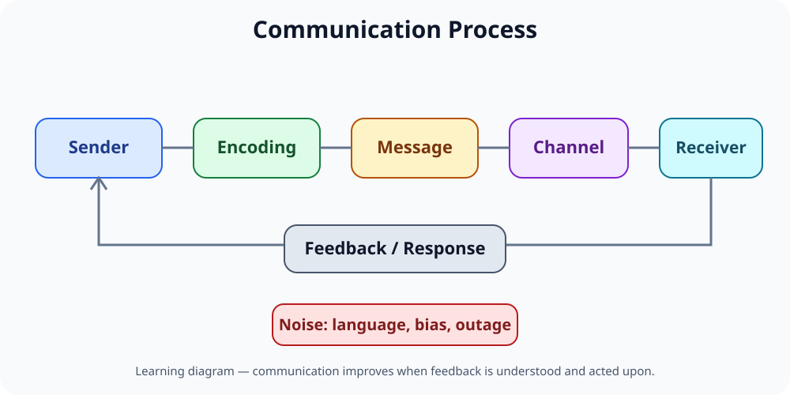](./assets/communication-process.svg)

**Exam use:** Define sender, message, channel, receiver, context, feedback and noise. Use with Q01–Q02.

### 02. RTI and accountability
[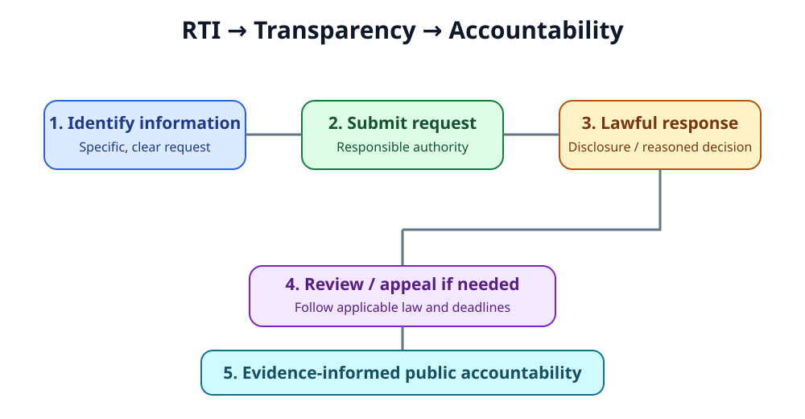](./assets/rti-accountability.svg)

**Exam use:** Link the right to request information with record-keeping, disclosure, review and public accountability. Use with Q08–Q11.

### 03. Citizen-centred e-governance cycle
[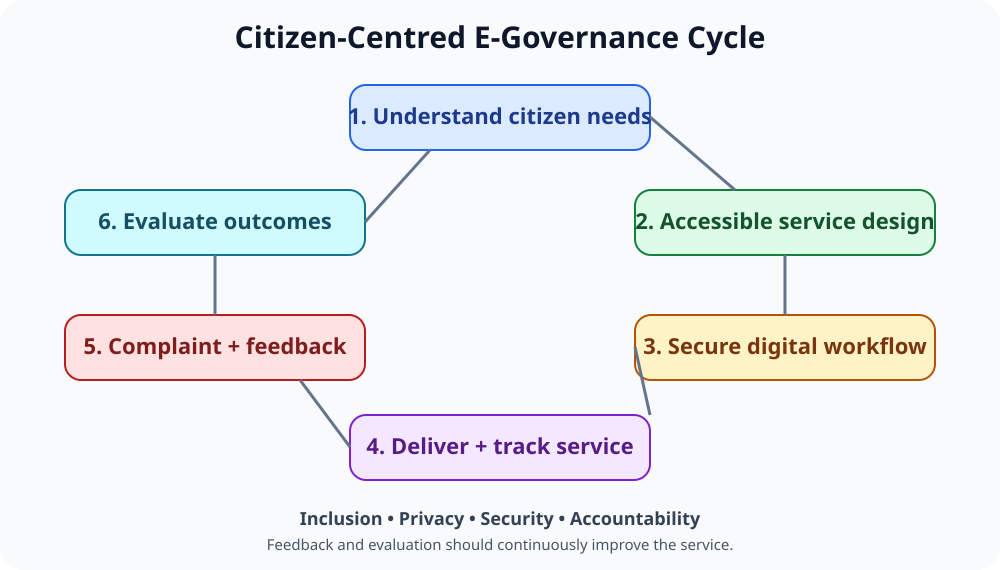](./assets/egovernance-cycle.svg)

**Exam use:** Show why online service, process reform, feedback and remedy should form one cycle. Use with Q06–Q07 and Q25.

### 04. Bangladesh digital connectivity architecture
[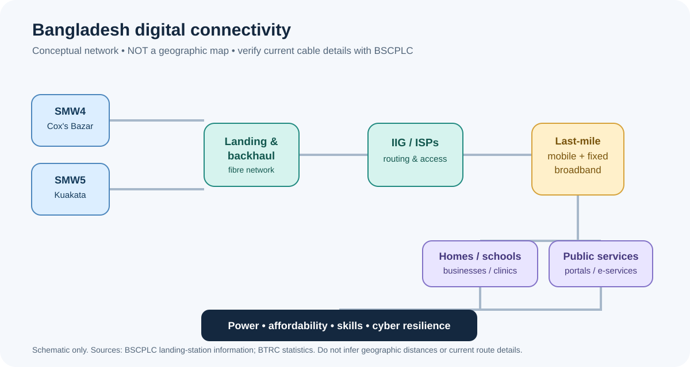](./assets/digital-infrastructure.svg)

**Exam use:** Understand international cable landing, backhaul fibre, gateways, ISPs, mobile/fixed networks and public services. **This is a schematic, not a geographic map.** Use with Q16–Q17.

### 05. Closing the digital divide
[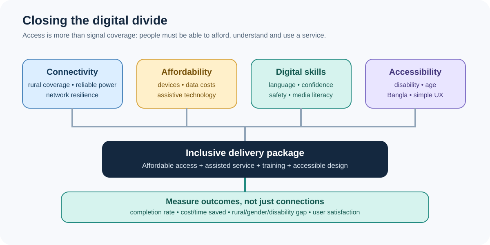](./assets/digital-divide.svg)

**Exam use:** Organise the causes and remedies under connectivity, affordability, skills and accessibility. Use with Q05 and Q23.

### 06. Media verification workflow
[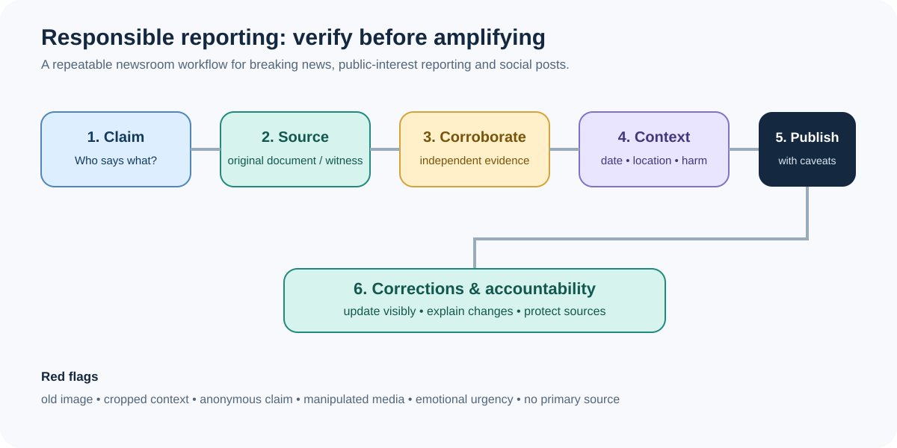](./assets/media-verification.svg)

**Exam use:** Claim → original source → corroboration → context/harm check → publication → correction. Use with Q12–Q15.

### 07. RTI workflow under the law
[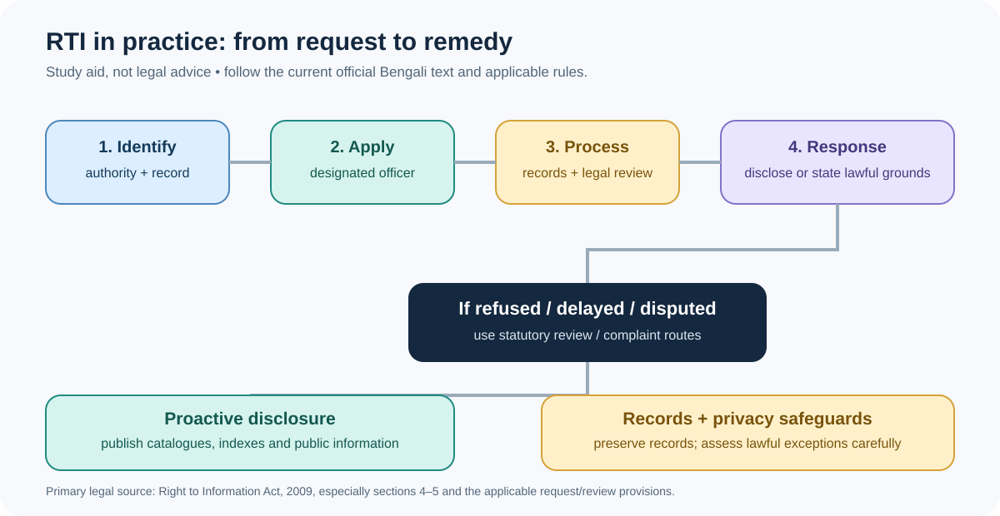](./assets/rti-workflow.svg)

**Exam use:** Identify authority and record, submit request, process lawfully, respond and use the statutory remedy if needed. Consult the Act for deadlines and exact procedure.

### 08. E-governance interaction models
[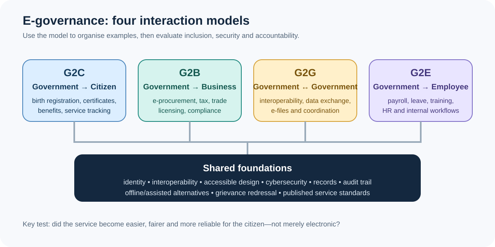](./assets/egovernance-models.svg)

**Exam use:** Define the four interaction types and give Bangladesh-relevant examples. Use with Q06 and Q21.

### 09. Cybersecurity and privacy by design
[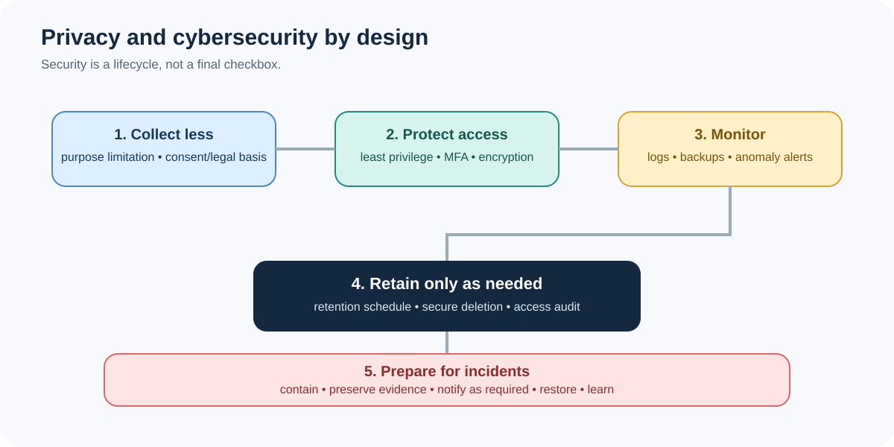](./assets/cybersecurity-privacy.svg)

**Exam use:** Data minimisation, access controls, encryption, monitoring, retention and incident response. Use with Q19–Q20.

### 10. Internet subscriptions — BTRC data
[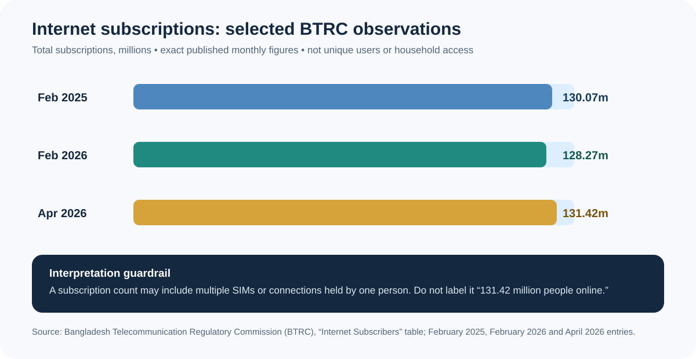](./assets/internet-subscriptions.svg)

**Data points:** 130.07 million (Feb 2025), 128.27 million (Feb 2026), 131.42 million (Apr 2026). These are subscriptions, **not unique people**. Source: BTRC monthly “Internet Subscribers” table. Use with Q17.

### 11. Digital Centre assisted service flow
[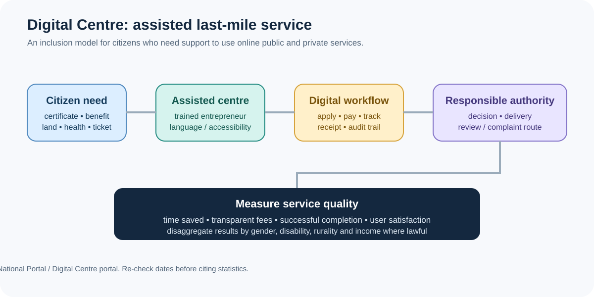](./assets/digital-centre-service.svg)

**Exam use:** Citizen need → assisted centre → digital workflow → responsible authority → outcome and grievance tracking. Use with Q18 and Q23.

### 12. Digital governance performance scorecard
[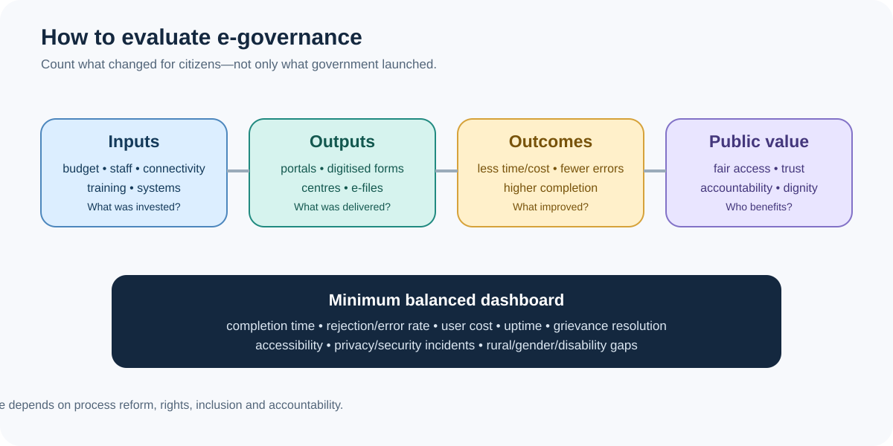](./assets/policy-outcomes.svg)

**Exam use:** Distinguish inputs, outputs, outcomes and public value. Use with Q07 and Q25.

### Bonus diagram — AI safeguards in public services
[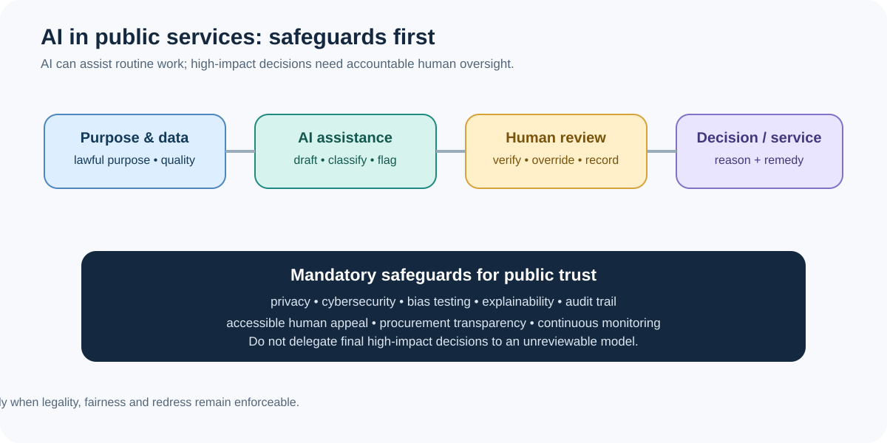](./assets/ai-public-services.svg)

**Exam use:** Purpose and data quality → AI assistance → human review → decision, explanation and appeal. Use with Q20.

### Bonus diagram — Information ecosystem
[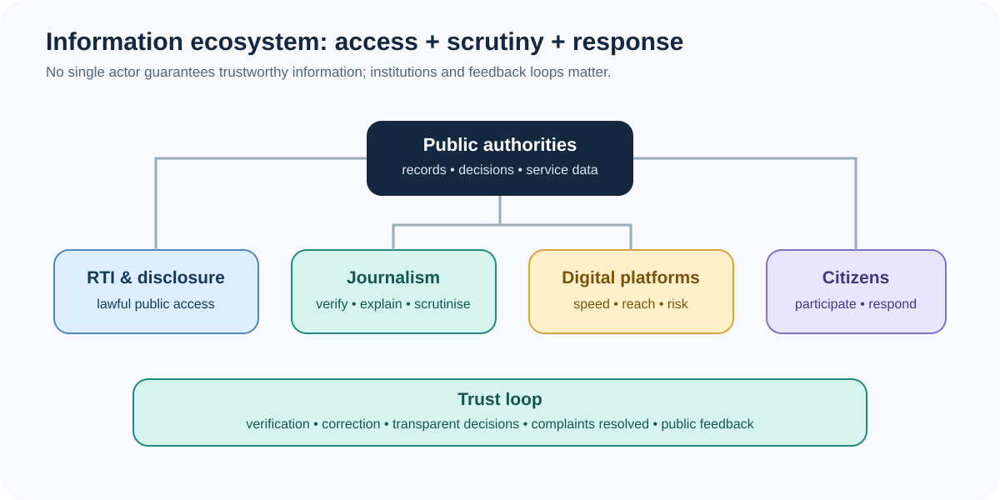](./assets/media-governance-ecosystem.svg)

**Exam use:** RTI + public authorities + journalism + digital platforms + citizen feedback. Use with Q12–Q15 and Q25.

## B. Exact, source-linked real-world images and map

> The main chapter embeds 10 topic-matched internet images beside the related lessons. This atlas embeds six quick-reference photos: five are repeated from the main chapter and one additional cable-station photo is included here. The historical cable-map page and disaster-recovery image are linked rather than embedded to keep the chapter-wide total within 30 visual embeds.

### 1. Historical submarine-cable landing-site map (2017)
**Open the map:** [Historical SEA-ME-WE 4 Cox's Bazar and SEA-ME-WE 5 Kuakata landing-site map](https://lirneasia.net/2017/10/bangladesh-submarine-cables-1-1-not-necessarily-2/smw5/).

**Source:** [LIRNEasia — “Bangladesh submarine cables: 1 + 1 is not necessarily 2”](https://lirneasia.net/2017/10/bangladesh-submarine-cables-1-1-not-necessarily-2/). This is a historical 2017 map, not a complete current cable-route map. The map labels Cox's Bazar (SEA-ME-WE 4) and Kuakata (SEA-ME-WE 5); check current cable-system details against [BSCPLC official information](https://bscplc.portal.gov.bd/pages/static-pages/6922de55933eb65569e19f01).

### 2. Rural Digital Centre — service delivery in practice

**Image source:** [GovInsider — Inside the Digital Bangladesh 2021 vision](https://govinsider.asia/intl-en/article/inside-the-digital-bangladesh-2021-vision). Use to illustrate assisted digital access; it is a historical photograph, not proof of today's centre count.

### 3. Submarine cable landing-station entrance

**Image source:** [bdnews24.com — Bangladesh users may face slow internet speed over maintenance](https://bdnews24.com/technology/bp4721l17g). Pair the photograph with BSCPLC's official description rather than inferring technical capacity from the image.

### 4. Data-centre infrastructure

**Image source:** [The Daily Star — Meghna Cloud data centre starts operation](https://www.thedailystar.net/tech-startup/news/meghna-cloud-bangladeshs-first-cloud-data-centre-starts-operation-3544496). Use as an example of physical infrastructure behind cloud services; do not assume it is a government national data centre.

### 5. Digital Centre and last-mile public service

**Image source:** [UNDP Bangladesh — a2i's public-service innovation network](https://www.undp.org/bangladesh/stories/a2is-public-service-innovation-network-made-partner-month-south-south-galaxy). Use to illustrate people-centred assisted service, not a current statistical claim.

### 6. Disaster recovery and data resilience
**Image (embedded beside the cybersecurity section in the main chapter):** [Open the Disaster Recovery Data Center photograph](https://www.rupalibangladesh.com/media/imgAll/2025July/tecnoloty-20250820195810.jpg).

**Image source:** [Rupali Bangladesh — National Data Centre and Disaster Recovery Centre report](https://www.rupalibangladesh.com/economy-business-news/68300). For an exam answer, verify institutional and operational claims with Bangladesh Computer Council / ICT Division primary sources.

### 7. Citizen passport service kiosk

**Image source:** [Migration Concern — Gulshan passport service launch](https://www.migrationconcern.com/bangladesh/2622). Use as a visual example of assisted service; confirm policy details with the relevant government authority.

### 8. Union Digital Centre service session

**Image source:** [The Daily Observer — Union Digital Centre services](https://www.observerbd.com/news.php?id=314592). Historical image; use only for illustrating the service concept.

## C. Official map, image and data portals

1. **Bangladesh Submarine Cables PLC (BSCPLC):** [official landing-station/service information](https://bscplc.portal.gov.bd/pages/static-pages/6922de55933eb65569e19f01). Its service description identifies Cox's Bazar and Kuakata and references the company's submarine-cable systems. Do not infer cable-specific routes beyond the official source.
2. **BTRC — internet subscriptions:** [official monthly subscriber table](https://btrc.gov.bd/pages/static-pages/6922e0a3933eb65569e27f59). Check the latest month before using changing figures.
3. **BTRC — tele-density and penetration:** [official table](https://btrc.gov.bd/pages/static-pages/6922e009933eb65569e2524c). Distinguish subscriptions from unique people and penetration from household access.
4. **ICT Division — National ICT Policy 2018:** [policy and official documents](https://ictd.gov.bd/pages/policies).
5. **ICT Policy Dashboard:** [official dashboard](https://ictpolicy.ictd.gov.bd/). If it requires JavaScript, use the ICT Division's policy and implementation documents.
6. **Bangladesh National Portal — Digital Centre:** [official description and service model](https://bangladesh.gov.bd/pages/static-pages/69a55ba386514399668e4e65).
7. **Digital Centre portal:** [current dashboard and centre locator](https://digitalcentre.gov.bd/). Dynamic figures must be dated when cited.
8. **a2i — Government Service Portal:** [official description of service process maps](https://a2i.gov.bd/pages/static-pages/6922de87933eb65569e1b522).
9. **Bangladesh Computer Council:** [official website and e-services](https://bcc.gov.bd/).
10. **UN Sustainable Development Goal 16:** [official targets on effective institutions, participation and public access to information](https://sdgs.un.org/goals/goal16).
11. **Right to Information Act, 2009:** [official law text](https://bdlaws.minlaw.gov.bd/act-print-1011.html).
12. **BPSC written syllabus:** [official Bangladesh Affairs syllabus PDF](https://bpsc.portal.gov.bd/sites/default/files/files/bpsc.portal.gov.bd/page/732e9da5_9514_4252_9a33_119f8c000cc5/SYLLABUS%20FOR%20BCS%20%28WRITTEN%29%20EXAMINATION.pdf).

## D. Diagram-based written practice

1. Use the communication diagram to explain feedback and noise. (5)
2. Use the digital-divide sheet to propose a policy package for rural women and persons with disabilities. (10)
3. Draw the RTI workflow and explain why records catalogues and indexes matter under section 5. (10)
4. Use the submarine-cable architecture diagram to discuss connectivity resilience without treating the schematic as a map. (10)
5. Compare G2C, G2B, G2G and G2E. (10)
6. Use the media-verification workflow to distinguish fact-checking from censorship. (10)
7. Interpret the BTRC chart and explain why subscriptions are not the same as unique internet users. (5)
8. Use the scorecard diagram to distinguish outputs from outcomes in e-governance. (10)
9. Explain how AI safeguards protect due process in a digital public service. (10)
10. Integrate RTI, journalism, ICT and citizen feedback in a 20-mark answer on good governance.

## E. Attribution and accuracy checklist

- [ ] Map title, publisher and year are stated.
- [ ] The 2017 cable map is labelled historical; current details are checked against BSCPLC.
- [ ] Real-world photos are linked to their publisher; reuse rights are not assumed.
- [ ] BTRC statistics include month, unit and a subscription-count caveat.
- [ ] Digital Centre statistics are dated because the official portal is dynamic.
- [ ] A schematic diagram is never described as a geographically accurate map.
- [ ] Legal claims are checked against the current official RTI Act and Constitution.
- [ ] A model question is not labelled as a verified PYQ unless the evidence supports it.

[⬆️ Back to top](#chapter-12--visual-atlas-official-maps-and-real-world-images)
