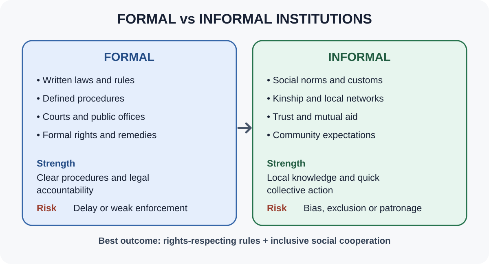
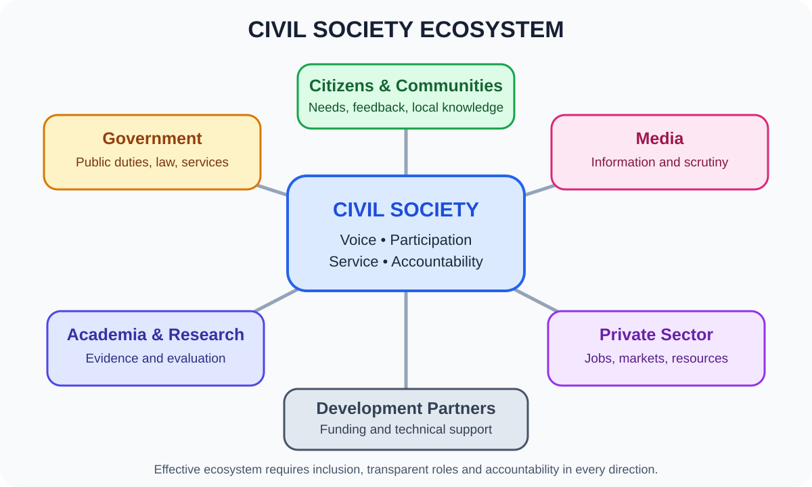
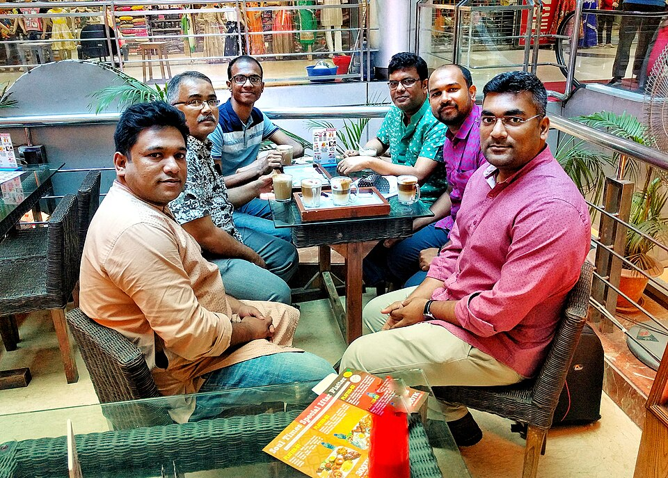
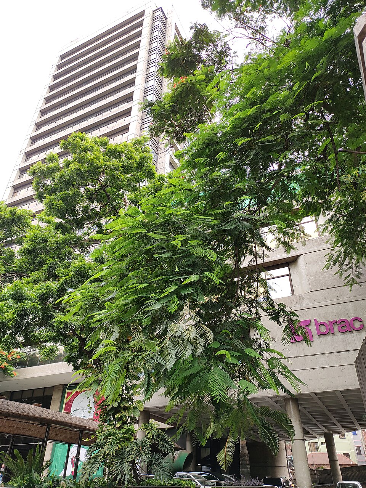
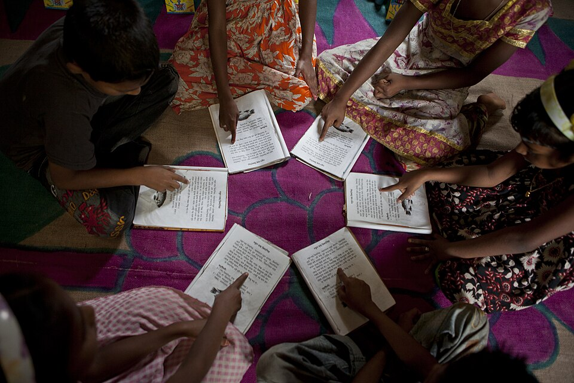
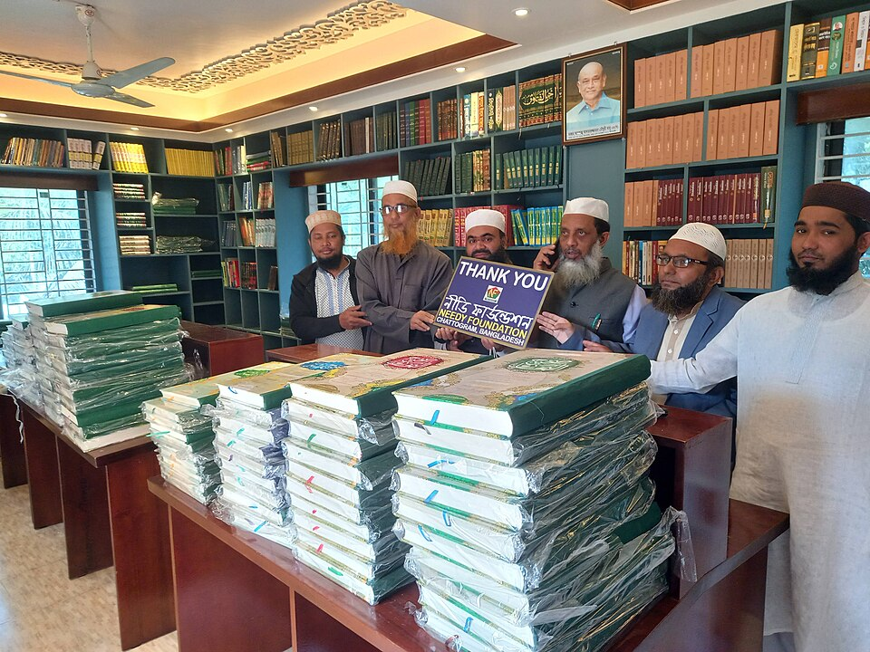
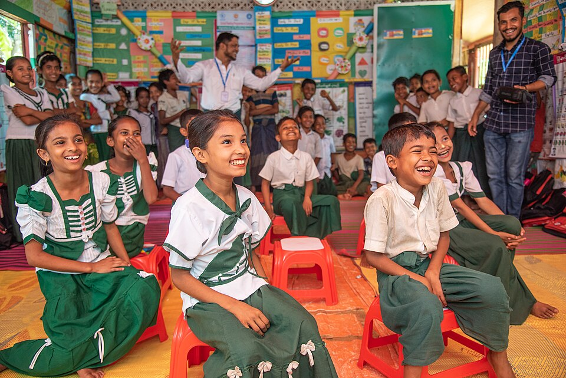
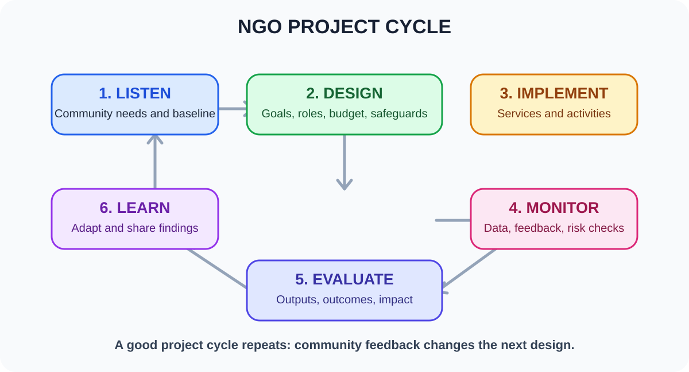
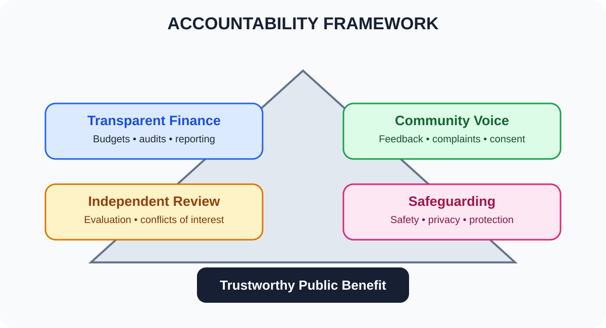
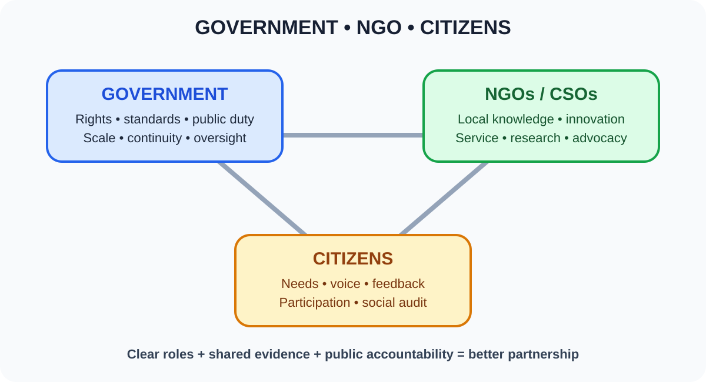

# Chapter 13 — অনানুষ্ঠানিক প্রতিষ্ঠান, সুশীল সমাজ ও NGO
> **BCS Written · Bangladesh Affairs · BPSC Subject Code 005**  
> **মূল ভাষা:** বাংলা; প্রশ্ন ও টেকনিক্যাল টার্ম: English  
> **Source review:** ২১ অক্টোবর ২০২৬ · **পাঠের বিন্যাস:** ধারণা → বাংলাদেশের প্রেক্ষাপট → আইন ও প্রতিষ্ঠান → সমালোচনামূলক বিশ্লেষণ → বিগত প্রশ্নের থিম → ৩৩টি Model Q&A → ৫/১০/২০ নম্বরের উত্তর।

[← মূল ১৬ অধ্যায়ের সূচি](../README.md) · [PYQ-based Essays](./PYQ-BASED-ESSAYS.md) · [English Quotations + Sources](./QUOTATIONS.md) · [🖼️ Visual Atlas (10 diagrams + 10 topic-linked internet photos)](./VISUAL-ATLAS.md)

> 📱 **Mobile-friendly visual notes:** ১০টি internet-sourced photograph সংশ্লিষ্ট পাঠের পাশে যুক্ত হয়েছে; প্রতিটি ছবির সঙ্গে caption, source ও licence দেওয়া আছে। ১০টি responsive SVG diagram Visual Atlas-এ রয়েছে। মূল অধ্যায় ও Atlas মিলিয়ে মোট embedded visual ২৯টি—৩০টির সীমার মধ্যে।

> [!TIP]
> 🟢 **পড়ার পদ্ধতি:** প্রথমে সংজ্ঞা, তারপর বাংলাদেশভিত্তিক উদাহরণ, সাংবিধানিক ভিত্তি, ভূমিকা ও সীমাবদ্ধতা পড়ুন। প্রতিটি উত্তরে **ধারণা → প্রমাণ/উদাহরণ → বিশ্লেষণ → মূল্যায়ন → উপসংহার** রাখুন।

## 🧭 বিষয়সূচি — সরাসরি অংশে যান

**দ্রুত নেভিগেশন:** [মূল ধারণা](#২-অধ্যায়ের-মূল-ধারণা--৮-মিনিটে) · [অনানুষ্ঠানিক প্রতিষ্ঠান](#৫-informal-institutions--অনানুষ্ঠানিক-প্রতিষ্ঠান-কী-ও-কেন-গুরুত্বপূর্ণ) · [Civil Society](#civil-society) · [NGO in Bangladesh](#৭-ngos-in-bangladesh--বিকাশ-ধরন-ও-অবদান) · [আইন ও নিয়ন্ত্রণ](#৮-constitutional-and-legal-framework--সংবিধান-ngoab-ও-mra) · [৩৩টি Model Q&A](#১৪-important-english-questions--৩৩টি-বাংলা-model-answer) · [Visual Atlas](./VISUAL-ATLAS.md) · [Model Essays](./PYQ-BASED-ESSAYS.md) · [Quotations](./QUOTATIONS.md)

| শেখার ধাপ | মূল অধ্যায় | প্রশ্ন ও পুনরালোচনা |
|---|---|---|
| [শিখনফল](#learning-goals) | [১. Informal Institutions](#informal) | [বিগত প্রশ্ন বিশ্লেষণ](#pyq) |
| [Key Terms](#keywords) | [২. Civil Society](#civil-society) | [৩৩টি English Questions + বাংলা উত্তর](#questions) |
| [এক নজরে বিষয়](#core-story) | [৩. NGO sector in Bangladesh](#ngos) | [Answer Writing Strategy](#strategy) |
| [Quick Revision Visual Notes](#visual-notes) | [৪. Constitution and legal framework](#law) | [৫/১০/২০ নম্বরের উত্তর](#worked) |
| [Source-based facts](#facts) | [৫. Role and contribution](#roles) | [One-page Revision](#revision) |
| [Quotations](./QUOTATIONS.md) | [৬. Challenges and reform](#challenges) | [Full Source Register](#sources) |
| [PYQ Essays](./PYQ-BASED-ESSAYS.md) | [৭. Government–NGO partnership](#partnership) | [Accuracy & limitations](#accuracy) |

## ১. Syllabus & Learning Goals — পাঠের উদ্দেশ্য

এই অধ্যায়ের কেন্দ্রীয় বিষয় হলো অনানুষ্ঠানিক প্রতিষ্ঠান, সুশীল সমাজ এবং বেসরকারি উন্নয়ন সংস্থা—এগুলো কীভাবে নাগরিক অংশগ্রহণ, সামাজিক সেবা, জবাবদিহি, অধিকার, অন্তর্ভুক্তি ও উন্নয়নকে প্রভাবিত করে। সরকারি সিলেবাসের সঙ্গে মিলিয়ে পড়তে [BPSC Written Syllabus, Bangladesh Affairs, Subject Code 005](https://bpsc.portal.gov.bd/sites/default/files/files/bpsc.portal.gov.bd/page/732e9da5_9514_4252_9a33_119f8c000cc5/SYLLABUS%20FOR%20BCS%20%28WRITTEN%29%20EXAMINATION.pdf) দেখুন।

এই অধ্যায় শেষে আপনি পারবেন:
- Formal institution, informal institution, civil society, CSO ও NGO-র পার্থক্য ব্যাখ্যা করতে।
- পরিবার, আত্মীয়তার নেটওয়ার্ক, সামাজিক রীতি, স্থানীয় নেতৃত্ব ও অনানুষ্ঠানিক সালিশের ইতিবাচক-নেতিবাচক প্রভাব বিশ্লেষণ করতে।
- বাংলাদেশের উন্নয়ন, নারী ক্ষমতায়ন, শিক্ষা, স্বাস্থ্য, দুর্যোগ ব্যবস্থাপনা ও অধিকার রক্ষায় NGO-র ভূমিকা উদাহরণসহ লিখতে।
- সংবিধানের ৩৭, ৩৮ ও ৩৯ অনুচ্ছেদের সঙ্গে নাগরিক অংশগ্রহণের সম্পর্ক ব্যাখ্যা করতে।
- NGO Affairs Bureau এবং Microcredit Regulatory Authority (MRA)-এর কাজের সীমা আলাদা করতে।
- NGO–সরকার অংশীদারত্বের সুফল, ঝুঁকি, জবাবদিহি ও নীতিগত সংস্কার মূল্যায়ন করতে।
- প্রশ্নের নির্দেশক শব্দ অনুযায়ী ৫, ১০ ও ২০ নম্বরের উত্তর সাজাতে।

## ২. অধ্যায়ের মূল ধারণা — ৮ মিনিটে

**মূল সূত্র:** সমাজে মানুষ শুধু আইন ও সরকারি প্রতিষ্ঠানের মাধ্যমে আচরণ করে না; সামাজিক রীতি, আস্থা, আত্মীয়তা, পেশাগত সংগঠন ও স্থানীয় নেটওয়ার্কও আচরণকে প্রভাবিত করে। এসব অনানুষ্ঠানিক নিয়মের সঙ্গে নাগরিক সংগঠন ও NGO যুক্ত হয়ে মানুষের দাবি, সেবা ও অংশগ্রহণকে সংগঠিত করতে পারে। তবে সামাজিক নেটওয়ার্ক যেমন পারস্পরিক সহায়তা বাড়াতে পারে, তেমনি পক্ষপাত, পৃষ্ঠপোষকতা, বৈষম্য বা ক্ষমতার অপব্যবহারও টিকিয়ে রাখতে পারে।

> [!IMPORTANT]
> **মনে রাখুন:** Informal institution ≠ NGO; Civil society ≠ NGO; NGO ≠ government. অনানুষ্ঠানিক প্রতিষ্ঠান হলো আচরণ-নিয়ন্ত্রণকারী সামাজিক নিয়ম ও নেটওয়ার্ক; সুশীল সমাজ হলো রাষ্ট্র ও মুনাফাভিত্তিক বাজারের বাইরে নাগরিক সংগঠন ও সম্মিলিত উদ্যোগের বিস্তৃত পরিসর; NGO হলো সেই পরিসরের একটি নির্দিষ্ট সংগঠন-ধরন।

### পরীক্ষায় সবচেয়ে গুরুত্বপূর্ণ ৭টি থিম

1. **Definition and distinction:** formal/informal institutions, civil society, NGO, CSO.
2. **Democracy and accountability:** citizen voice, social audit, transparency, rights monitoring.
3. **Inclusive development:** poverty reduction, education, health, women’s empowerment, disability inclusion.
4. **Bangladesh context:** grassroots participation, community networks, disaster response, local development.
5. **Constitution and law:** Articles 37–39; Foreign Donations (Voluntary Activities) Regulation Act, 2016 and current amendments; MRA framework for NGO-MFIs.
6. **Critical evaluation:** donor dependency, projectisation, weak evaluation, elite capture, accountability and civic space.
7. **Policy solutions:** independent but accountable organisations, transparent funding, local leadership, coordination, safeguarding and evidence-based evaluation.

## ৩. Key Terms — English term, সহজ বাংলা অর্থ ও পরীক্ষার প্রয়োগ

| English term | সহজ বাংলা অর্থ | পরীক্ষায় কীভাবে ব্যবহার করবেন |
|---|---|---|
| Formal institution | লিখিত আইন, বিধি ও আনুষ্ঠানিক ক্ষমতাসম্পন্ন প্রতিষ্ঠান | সংসদ, আদালত, স্থানীয় সরকার, সরকারি বিধি |
| Informal institution | অলিখিত সামাজিক নিয়ম, রীতি, সম্পর্ক ও প্রত্যাশা | আত্মীয়তা, সামাজিক রীতি, স্থানীয় নেটওয়ার্ক |
| Social norm | সমাজে গ্রহণযোগ্য বলে বিবেচিত আচরণের নিয়ম | লিঙ্গভূমিকা, পারস্পরিক সহায়তা, সামাজিক চাপ |
| Patron-client relationship | ক্ষমতাবান পৃষ্ঠপোষক ও নির্ভরশীল অনুসারীর অসম সম্পর্ক | স্থানীয় সেবা বা সম্পদ বণ্টনে পক্ষপাতের ঝুঁকি |
| Social capital | আস্থা, নেটওয়ার্ক ও পারস্পরিক সহযোগিতা থেকে পাওয়া সক্ষমতা | দুর্যোগে স্বেচ্ছাসেবা, কমিউনিটি উদ্যোগ |
| Civil society | নাগরিক সংগঠন ও সম্মিলিত উদ্যোগের বিস্তৃত পরিসর | পেশাজীবী সমিতি, অধিকার সংগঠন, স্বেচ্ছাসেবী নেটওয়ার্ক |
| CSO | Civil Society Organization; সুশীল সমাজভুক্ত সংগঠন | NGO, পেশাজীবী সংগঠন, ফাউন্ডেশন, কমিউনিটি সংগঠন |
| NGO | Non-Governmental Organization; সরকার থেকে পৃথক অলাভজনক সংগঠন | উন্নয়ন, ত্রাণ, স্বাস্থ্য, শিক্ষা বা অধিকারভিত্তিক কাজ |
| Advocacy | কোনো নীতি, অধিকার বা সামাজিক পরিবর্তনের পক্ষে সংগঠিত প্রচেষ্টা | গবেষণা, জনসচেতনতা, নীতি-সংলাপ |
| Service delivery | মানুষের কাছে সরাসরি সেবা পৌঁছানো | স্বাস্থ্যকর্মী, শিক্ষা, পানি, দুর্যোগ-সহায়তা |
| Social accountability | নাগরিকের মাধ্যমে সরকারি সেবা ও সিদ্ধান্তের জবাবদিহি দাবি | public hearing, citizen charter monitoring, social audit |
| Transparency | সিদ্ধান্ত, অর্থ ও কাজের তথ্য উন্মুক্ত রাখা | বার্ষিক প্রতিবেদন, audited accounts, procurement disclosure |
| Accountability | কাজের ব্যাখ্যা দেওয়া এবং ভুলের জন্য দায় গ্রহণ | অভিযোগ-প্রক্রিয়া, নিরীক্ষা, স্বাধীন পর্যালোচনা |
| Participation | সিদ্ধান্ত ও বাস্তবায়নে মানুষের অর্থবহ অংশগ্রহণ | কমিউনিটি পরিকল্পনা, পরামর্শ সভা |
| Empowerment | সিদ্ধান্ত নেওয়া ও অধিকার প্রয়োগের সক্ষমতা বৃদ্ধি | নারীর অর্থনৈতিক ক্ষমতা, নেতৃত্ব, সম্পদে প্রবেশ |
| Localization | স্থানীয় সংগঠন ও জনগোষ্ঠীর নেতৃত্বে উন্নয়ন | স্থানীয় বাজেট, স্থানীয় কর্মী ও স্থানীয় জ্ঞান |
| Safeguarding | সহিংসতা, শোষণ, হয়রানি ও ক্ষতি প্রতিরোধের ব্যবস্থা | শিশু সুরক্ষা, যৌন শোষণ প্রতিরোধ, অভিযোগ ব্যবস্থা |
| Conflict of interest | ব্যক্তিগত স্বার্থ সিদ্ধান্তকে প্রভাবিত করার ঝুঁকি | অনুদান, নিয়োগ, ক্রয় ও সুবিধাভোগী নির্বাচন |
| Projectisation | দীর্ঘমেয়াদি সামাজিক কাজকে স্বল্পমেয়াদি প্রকল্পে সীমাবদ্ধ করা | প্রকল্প শেষে সেবা বন্ধ হওয়ার ঝুঁকি |
| Impact evaluation | কার্যক্রমের কারণে বাস্তব পরিবর্তন হয়েছে কি না মূল্যায়ন | output, outcome ও impact আলাদা করা |

## ৪. পরীক্ষায় ব্যবহারযোগ্য তথ্য ও উৎস

> [!NOTE]
> 🔵 **Source-backed facts:** সংখ্যা লেখার সময় প্রতিষ্ঠান, প্রকাশনা/ডেটাসেট এবং সময়সীমা উল্লেখ করুন। প্রশাসনিক রেজিস্টারে থাকা NGO-র সংখ্যা দিয়ে বাংলাদেশের সব কমিউনিটি সংগঠন বা সব দেশীয় অলাভজনক প্রতিষ্ঠানের মোট সংখ্যা বোঝানো যাবে না।

| তথ্য / আইন | পরীক্ষায় প্রয়োগ | উৎস |
|---|---|---|
| সংবিধানের অনুচ্ছেদ ৩৭ | শান্তিপূর্ণ সমাবেশের অধিকার | [বাংলাদেশের সংবিধান](https://bdlaws.minlaw.gov.bd/act-print-367.html) |
| অনুচ্ছেদ ৩৮ | সমিতি বা সংঘ গঠনের অধিকার; আইনে নির্ধারিত যুক্তিসঙ্গত সীমা রয়েছে | [সংবিধান—মৌলিক অধিকার](https://bdlaws.minlaw.gov.bd/act-367/part-details-200.html?lang=en) |
| অনুচ্ছেদ ৩৯ | চিন্তা, বিবেক, বাক্‌স্বাধীনতা ও সংবাদপত্রের স্বাধীনতা | [সংবিধানের অনুচ্ছেদ ৩৯](https://bdlaws.minlaw.gov.bd/act-367/section-24587.html) |
| Foreign Donations (Voluntary Activities) Regulation Act, 2016 | বিদেশি অনুদাননির্ভর স্বেচ্ছামূলক কার্যক্রমে নিবন্ধন/অনুমোদন ও প্রকল্প-সংক্রান্ত বিধান; বর্তমান সংশোধিত পাঠ দেখতে হবে | [Laws of Bangladesh](https://bdlaws.minlaw.gov.bd/act-print-1197.html) · [NGO Affairs Bureau](https://ngoab.gov.bd/) |
| NGO Affairs Bureau portal | ২১ অক্টোবর ২০২৬-এ দেখা পোর্টালে ২,৮০৪টি নিবন্ধিত NGO দেখানো হয়েছিল; এটি NGOAB-এর প্রশাসনিক রেজিস্টারের snapshot, সব দেশীয় সংগঠনের census নয় | [NGOAB e-Service](https://e-service.ngoab.gov.bd/) |
| Microcredit Regulatory Authority | NGO-MFI-র লাইসেন্সিং, তদারকি ও microfinance operations-এ স্বচ্ছতা ও জবাবদিহির কাঠামো | [Bangladesh Bank—Regulator of Microfinance Institutions](https://www.bb.org.bd/en/index.php/financialsystems/regulator) |
| UN Charter, Article 71 | UN Economic and Social Council-এর NGO consultation-এর ভিত্তি | [United Nations Legal—Article 71](https://legal.un.org/repertory/art71.shtml) |
| BRAC-এর ইতিহাস | ১৯৭২ সালে যুদ্ধ-পরবর্তী ত্রাণ ও পুনর্বাসনের কাজ থেকে দীর্ঘমেয়াদি উন্নয়ন কার্যক্রমে রূপান্তরের উদাহরণ | [BRAC—Our History](https://www.brac.net/about-us/our-history/) |
| World Bank-এর CSO সংজ্ঞা | NGO-র চেয়ে বিস্তৃত civil society পরিসর বোঝাতে | [World Bank—Defining Broader Engagement with Civil Society](https://documents1.worldbank.org/curated/en/914211468322455786/pdf/341600ENGLISH01and1Options01PUBLIC1.pdf) |

## ৫. Informal Institutions — অনানুষ্ঠানিক প্রতিষ্ঠান কী ও কেন গুরুত্বপূর্ণ?

### ৫.১ সংজ্ঞা

**অনানুষ্ঠানিক প্রতিষ্ঠান (Informal Institutions)** হলো সমাজে প্রচলিত অলিখিত নিয়ম, রীতি, বিশ্বাস, প্রত্যাশা, সম্পর্ক ও সামাজিক অনুমোদন/নিষেধের এমন ব্যবস্থা, যা মানুষের আচরণকে প্রভাবিত করে। এগুলো সাধারণত সংসদে পাস করা আইন বা লিখিত বিধির মতো নয়; বরং পরিবার, আত্মীয়তা, প্রতিবেশ, ধর্মীয়-সাংস্কৃতিক অনুশীলন, পেশাগত নেটওয়ার্ক এবং স্থানীয় নেতৃত্বের মাধ্যমে টিকে থাকে।

অনানুষ্ঠানিক প্রতিষ্ঠান সবসময় খারাপ নয়। বিপদে প্রতিবেশীর সহায়তা, স্বেচ্ছাসেবা, পারস্পরিক আস্থা, স্থানীয় জ্ঞান ও কমিউনিটির সম্মিলিত উদ্যোগ সেবা পৌঁছাতে সাহায্য করে। আবার পিতৃতান্ত্রিক রীতি, সামাজিক বর্জন, বংশ বা পরিচয়ভিত্তিক পক্ষপাত, পৃষ্ঠপোষকতা এবং ক্ষমতাবানের চাপে দুর্বল মানুষের অধিকার ক্ষুণ্ণ হতে পারে।

### ৫.২ Formal বনাম Informal Institutions

| বিষয় | Formal institution | Informal institution |
|---|---|---|
| ভিত্তি | সংবিধান, আইন, লিখিত বিধি, আনুষ্ঠানিক পদ্ধতি | রীতি, সামাজিক প্রত্যাশা, সম্পর্ক, অলিখিত নিয়ম |
| প্রয়োগ | আদালত, প্রশাসন, নির্ধারিত শাস্তি/প্রক্রিয়া | সামাজিক অনুমোদন, সুনাম, চাপ, পারস্পরিক নির্ভরতা |
| উদাহরণ | সংসদ, আদালত, সরকারি দপ্তর, নিবন্ধনবিধি | আত্মীয়তার নেটওয়ার্ক, সামাজিক রীতি, স্থানীয় আস্থা |
| শক্তি | তুলনামূলকভাবে নির্দিষ্ট অধিকার ও পদ্ধতি | স্থানীয়ভাবে গ্রহণযোগ্য, দ্রুত ও সম্পর্কভিত্তিক |
| ঝুঁকি | জটিলতা, বিলম্ব, বাস্তবায়নের ঘাটতি | পক্ষপাত, অস্বচ্ছতা, বৈষম্য, ক্ষমতার অসমতা |
| সঠিক সম্পর্ক | আইন ও প্রতিষ্ঠান অধিকার রক্ষা করবে | ইতিবাচক সামাজিক সহযোগিতা আইনসম্মত কাজে সহায়তা করবে |

### ৫.৩ বাংলাদেশের প্রেক্ষাপটে প্রধান উদাহরণ

**পরিবার ও আত্মীয়তার নেটওয়ার্ক:** শিশু পরিচর্যা, বয়স্কদের সহায়তা, চাকরির তথ্য, অসুস্থতা ও দুর্যোগে সহযোগিতা দিতে পারে। তবে সম্পত্তি, শিক্ষা, পেশা বা সিদ্ধান্তে নারী ও তরুণদের কণ্ঠস্বর সীমিতও করতে পারে।

**প্রতিবেশ ও কমিউনিটি নেটওয়ার্ক:** বন্যা, ঘূর্ণিঝড়, অগ্নিকাণ্ড বা অসুস্থতায় দ্রুত সাহায্য, রক্তদান, আশ্রয় ও তথ্য ভাগাভাগি সম্ভব করে। কিন্তু সহায়তা যেন দল, ধর্ম, লিঙ্গ বা রাজনৈতিক পরিচয়ের ভিত্তিতে বণ্টিত না হয় তা নিশ্চিত করা দরকার।

**স্থানীয় নেতৃত্ব ও সালিশ:** স্থানীয় বিরোধ দ্রুত আলোচনায় মেটাতে পারে। কিন্তু সালিশের সিদ্ধান্ত আইন, ন্যায়বিচার ও মৌলিক অধিকারের বিকল্প নয়; জবরদস্তি, নারী-বিদ্বেষ, শিশুর অধিকার লঙ্ঘন বা ফৌজদারি অপরাধ আড়াল করার উপায় হতে পারে না।

**পৃষ্ঠপোষকতা ও clientelism:** কোনো ক্ষমতাবান ব্যক্তি বা গোষ্ঠীর সঙ্গে আনুগত্যের বিনিময়ে সুযোগ, সুবিধা বা সুরক্ষা পাওয়ার সম্পর্ক। এতে কিছু মানুষের দ্রুত সহায়তা মিললেও সেবা ও সম্পদে সমান অধিকার ক্ষতিগ্রস্ত হতে পারে।

#### বাস্তব উদাহরণ: গ্রামীণ নারীদের সম্মিলিত উদ্যোগ

*চিত্র-পাঠ:* দলীয় আলোচনা ও পারস্পরিক সহায়তা অনানুষ্ঠানিক প্রতিষ্ঠান ও সামাজিক পুঁজির ইতিবাচক দিক বোঝায়। **Credit:** Department of Foreign Affairs and Trade (DFAT), Australia; [CC BY 4.0](https://creativecommons.org/licenses/by/4.0/). [মূল ছবি ও licence](https://commons.wikimedia.org/wiki/File:A_women%27s_group_from_Rodrodha_village_gather_for_a_meeting._They_all_graduated_through_BRACs_Special_Targeting_Ultra_Poor_program_they_are_now_known_as_graduates_and_are_taking_part_in_a_project_called_group_home_visits._(10664330215).jpg).

### ৫.৪ মূল্যায়নের সূত্র

অনানুষ্ঠানিক প্রতিষ্ঠান মূল্যায়নে পাঁচটি প্রশ্ন করুন:
1. এটি কি স্বেচ্ছাসেবী সহযোগিতা বাড়ায়, নাকি ভয় ও চাপ তৈরি করে?
2. নারী, শিশু, প্রতিবন্ধী ব্যক্তি, সংখ্যালঘু ও দরিদ্র মানুষের কণ্ঠস্বর আছে কি?
3. সিদ্ধান্তের কারণ জানা যায় কি?
4. ক্ষতি হলে অভিযোগ বা প্রতিকার পাওয়ার পথ আছে কি?
5. প্রথাটি সংবিধান, আইন ও মানবাধিকারের সঙ্গে সামঞ্জস্যপূর্ণ কি?

> [!TIP]
> 🟢 **Exam line:** Informal institutions can strengthen social trust and collective action, but their contribution to development depends on inclusion, accountability and respect for rights.

## ৬. Civil Society — সুশীল সমাজের ধারণা, বৈশিষ্ট্য ও ভূমিকা

### ৬.১ সংজ্ঞা

**সুশীল সমাজ (Civil Society)** বলতে পরিবার, রাষ্ট্র ও মুনাফাভিত্তিক বাজারের বাইরে নাগরিকদের স্বেচ্ছামূলক সংগঠন, নেটওয়ার্ক ও সম্মিলিত উদ্যোগের বিস্তৃত পরিসর বোঝায়, যা মানুষের স্বার্থ প্রকাশ, সামাজিক সহযোগিতা, জনপরামর্শ, অধিকার রক্ষা ও জননীতির আলোচনায় অংশ নিতে পারে। World Bank-এর সংজ্ঞায় civil society organizations (CSOs) বলতে জনজীবনে উপস্থিত বিস্তৃত non-governmental এবং not-for-profit সংগঠন বোঝানো হয়েছে [S4]।

এর মধ্যে উন্নয়ন NGO ছাড়াও পেশাজীবী সমিতি, শ্রমিক সংগঠন, অধিকারভিত্তিক সংগঠন, ফাউন্ডেশন, কমিউনিটি সংগঠন, স্বেচ্ছাসেবী দল, গবেষণা প্রতিষ্ঠান এবং কিছু অলাভজনক নাগরিক নেটওয়ার্ক থাকতে পারে। সব নাগরিক সংগঠন NGO নয়, এবং সব NGO একই ধরনের কাজ করে না।

#### বাস্তব উদাহরণ: নাগরিকদের স্বেচ্ছামূলক সংগঠন

*চিত্র-পাঠ:* স্বেচ্ছামূলক সংগঠন ও জ্ঞান ভাগাভাগির নেটওয়ার্ক civil society-র একটি উদাহরণ; এটি সব CSO-র প্রতিনিধিত্ব করে না। **Credit:** Nasir Khan Saikat; [CC BY-SA 4.0](https://creativecommons.org/licenses/by-sa/4.0/). [মূল ছবি ও licence](https://commons.wikimedia.org/wiki/File:CC_Bangladesh_First_Chapter_Meeting_Group_Photo.jpg).

### ৬.২ সুশীল সমাজের প্রধান কাজ

1. **Voice and representation:** প্রান্তিক জনগোষ্ঠীর অভিজ্ঞতা ও দাবি নীতিনির্ধারকদের কাছে তুলে ধরা।
2. **Watchdog and accountability:** সরকারি সেবা, বাজেট ও নীতির ফল পর্যবেক্ষণ; তথ্যভিত্তিক প্রশ্ন করা।
3. **Public education:** স্বাস্থ্য, পরিবেশ, অধিকার, ভোট, দুর্যোগ ও আইন সম্পর্কে সচেতনতা বৃদ্ধি।
4. **Service and solidarity:** স্বেচ্ছাসেবা, কমিউনিটি সহায়তা ও দুর্যোগে সহযোগিতা।
5. **Policy research:** মাঠের তথ্য, গবেষণা ও নীতিপত্রের মাধ্যমে সিদ্ধান্তের মান উন্নত করা।
6. **Peaceful participation:** জনপরামর্শ, শান্তিপূর্ণ সমাবেশ, সংলাপ ও সংগঠিত নাগরিক উদ্যোগ।
7. **Social innovation:** স্থানীয় সমস্যার নতুন সমাধান পরীক্ষা ও কার্যকর পদ্ধতি বিস্তার।
8. **Inclusion:** নারী, শিশু, প্রতিবন্ধী ব্যক্তি, ক্ষুদ্র নৃগোষ্ঠী ও অন্য প্রান্তিক জনগোষ্ঠীর অংশগ্রহণের সুযোগ তৈরি।

### ৬.৩ সুশীল সমাজ ও রাষ্ট্রের সম্পর্ক

সুশীল সমাজের কাজ রাষ্ট্রের জায়গা দখল করা নয়। রাষ্ট্রের আইনি দায়িত্ব, সার্বজনীন সেবা, ন্যায়বিচার ও পুনর্বণ্টনের কর্তব্য থাকে; নাগরিক সংগঠন তথ্য, স্থানীয় জ্ঞান, উদ্ভাবন, তদারকি ও সেবায় সহায়তা দিতে পারে। একই সঙ্গে সুশীল সমাজেরও স্বচ্ছতা, নৈতিকতা, আর্থিক জবাবদিহি ও নিজস্ব ক্ষমতার সমালোচনা গ্রহণ করার দায়িত্ব আছে।

### ৬.৪ Civil Society বনাম NGO

| মানদণ্ড | Civil society | NGO |
|---|---|---|
| পরিসর | বিস্তৃত সামাজিক-নাগরিক পরিসর | নির্দিষ্ট সংগঠন-ধরন |
| কাঠামো | আনুষ্ঠানিক, অনানুষ্ঠানিক বা নেটওয়ার্কভিত্তিক হতে পারে | সাধারণত নির্দিষ্ট গঠনতন্ত্র ও ব্যবস্থাপনা থাকে |
| কাজ | অংশগ্রহণ, অধিকার, আলোচনা, সেবা, নজরদারি | উন্নয়ন, সেবা, ত্রাণ, গবেষণা বা advocacy |
| অর্থায়ন | সদস্য-চাঁদা, অনুদান, স্বেচ্ছাশ্রমসহ বিভিন্ন উৎস | অনুদান, প্রকল্প, সদস্য-অবদান বা বৈধ নিজস্ব আয় |
| উদাহরণ | পেশাজীবী সমিতি, নাগরিক নেটওয়ার্ক, অধিকার সংগঠন, NGO | BRAC-এর মতো উন্নয়ন সংস্থা; নির্দিষ্ট আইন অনুযায়ী নিবন্ধিত NGO |
| মূল পার্থক্য | umbrella concept বা বিস্তৃত ধারণা | civil society-র একটি অংশ হতে পারে |

## ৭. NGOs in Bangladesh — বিকাশ, ধরন ও অবদান

### ৭.১ NGO কী?

NGO বা Non-Governmental Organization হলো সরকার থেকে সাংগঠনিকভাবে পৃথক, সাধারণত অলাভজনক ও স্বেচ্ছামূলক সংগঠন, যা সামাজিক, মানবিক, উন্নয়ন, গবেষণা, অধিকার বা জনসচেতনতামূলক কাজে নিয়োজিত থাকে। NGO-র কাজ ও আইনি অবস্থান তার নিবন্ধন, গঠনতন্ত্র, কার্যক্রম এবং প্রযোজ্য আইনের ওপর নির্ভর করে।

### ৭.২ বাংলাদেশের NGO খাতের বিকাশ

বাংলাদেশে ১৯৭১ সালের মুক্তিযুদ্ধ ও যুদ্ধ-পরবর্তী পুনর্বাসনের প্রেক্ষাপটে ত্রাণ, পুনর্বাসন ও কমিউনিটি সহায়তার প্রয়োজন থেকে অনেক উন্নয়ন উদ্যোগ গড়ে ওঠে। BRAC-এর নিজস্ব ইতিহাস অনুযায়ী, সংস্থাটি ১৯৭২ সালে সুল্লায় ত্রাণ ও পুনর্বাসন কার্যক্রম দিয়ে শুরু করে; পরে শিক্ষা, স্বাস্থ্য, জীবিকা ও দারিদ্র্য হ্রাসের মতো দীর্ঘমেয়াদি কর্মসূচিতে বিস্তৃত হয় [S7]।

#### বাস্তব উদাহরণ: বাংলাদেশের একটি উন্নয়ন NGO-র সদরদপ্তর

*চিত্র-পাঠ:* BRAC Centre একটি পরিচিত উন্নয়ন সংস্থার সদরদপ্তরের বাস্তব উদাহরণ। ভবনের ছবি দিয়ে সংস্থার কার্যকারিতা প্রমাণ হয় না। **Credit:** ANKAN; [CC BY-SA 4.0](https://creativecommons.org/licenses/by-sa/4.0/). [মূল ছবি ও licence](https://commons.wikimedia.org/wiki/File:Brac_Centre,_Dhaka.jpg).

পরবর্তী সময়ে NGO-র কাজ স্বাস্থ্য ও পরিবারকল্যাণ, অনানুষ্ঠানিক শিক্ষা, ক্ষুদ্রঋণ ও আর্থিক অন্তর্ভুক্তি, নারীর ক্ষমতায়ন, কৃষি ও জীবিকা, দুর্যোগ ব্যবস্থাপনা, মানবাধিকার, পরিবেশ এবং শরণার্থী-সহায়তা পর্যন্ত বিস্তৃত হয়েছে। এই বিবর্তনকে একরৈখিক সাফল্যের গল্প হিসেবে নয়, বরং রাষ্ট্র, বাজার, দাতা, স্থানীয় সংগঠন ও জনগোষ্ঠীর পারস্পরিক সম্পর্কের পরিবর্তন হিসেবে বিশ্লেষণ করা উচিত।

### ৭.৩ NGO-র ধরন

- **Service-delivery NGO:** স্বাস্থ্য, শিক্ষা, পানি, স্যানিটেশন, দক্ষতা বা জীবিকার সেবা।
- **Advocacy NGO:** অধিকার, আইন, নীতি ও জনসচেতনতার পক্ষে কাজ।
- **Humanitarian NGO:** দুর্যোগ, সংঘাত বা বাস্তুচ্যুতির সময় জরুরি সহায়তা।
- **Research and policy organization:** তথ্য, গবেষণা, মূল্যায়ন ও নীতিপরামর্শ।
- **Community-based organization (CBO):** নির্দিষ্ট এলাকার মানুষের নিজস্ব সমস্যা ও উদ্যোগকে কেন্দ্র করে কাজ।
- **NGO-MFI:** ক্ষুদ্রঋণ বা microfinance কার্যক্রম পরিচালনাকারী প্রতিষ্ঠান, যাদের ক্ষেত্রে MRA-র প্রযোজ্য লাইসেন্স ও তদারকি কাঠামো গুরুত্বপূর্ণ।
- **Rights-based organization:** অধিকার সচেতনতা, আইনি সহায়তা, বৈষম্যবিরোধী উদ্যোগ বা নীতিগত নজরদারি।

### ৭.৪ NGO-র ভূমিকা — ক্ষেত্রভিত্তিক বিশ্লেষণ

**দারিদ্র্য হ্রাস ও জীবিকা:** দক্ষতা, সঞ্চয়, আর্থিক সেবা, কৃষি-সহায়তা, বাজার-সংযোগ ও জীবিকা বৈচিত্র্যে সহায়তা করতে পারে। তবে ঋণপ্রাপ্তি নিজে দারিদ্র্য দূর করে না; ঋণের খরচ, আয় অনিশ্চয়তা, বাজার, স্বাস্থ্যঝুঁকি এবং পরিবারের সিদ্ধান্তক্ষমতা বিবেচনা করতে হবে।

#### বাস্তব উদাহরণ: ক্ষুদ্রঋণ ও জীবিকার উদ্যোগ

*চিত্র-পাঠ:* এটি BRAC microfinance loan-এর সহায়তায় জীবিকা গড়ার একটি উদাহরণ। ঋণ নিজে দারিদ্র্য দূর করে না; আয়, বাজার, ঋণের শর্ত ও সিদ্ধান্তক্ষমতাও মূল্যায়ন করতে হয়। **Credit:** Department of Foreign Affairs and Trade (DFAT), Australia; [CC BY 2.0](https://creativecommons.org/licenses/by/2.0/). [মূল ছবি ও licence](https://commons.wikimedia.org/wiki/File:Bangladesh_microfinance_%2810676772556%29.jpg).

**শিক্ষা:** ঝরে পড়া কমানো, বিকল্প শিক্ষাপদ্ধতি, প্রাথমিক দক্ষতা, প্রাপ্তবয়স্ক শিক্ষা ও বিদ্যালয়ের বাইরে থাকা শিশুদের কাছে পৌঁছাতে পারে। স্থায়িত্বের জন্য সরকারি শিক্ষাব্যবস্থার সঙ্গে মান, স্বীকৃতি, শিক্ষক-সহায়তা ও তথ্যের সমন্বয় প্রয়োজন।

#### বাস্তব উদাহরণ: BRAC-এর প্রাথমিক বিদ্যালয়ে দলীয় শেখা

*চিত্র-পাঠ:* দলীয় অনুশীলন ও শিক্ষার্থীকেন্দ্রিক পদ্ধতি NGO-র শিক্ষা-সহায়তার উদাহরণ। ছবিটি ২০১২ সালের; বর্তমান ফলাফল বা জাতীয় পরিসংখ্যান নয়। **Credit:** Department of Foreign Affairs and Trade (DFAT), Australia; [CC BY 4.0](https://creativecommons.org/licenses/by/4.0/). [মূল ছবি ও licence](https://commons.wikimedia.org/wiki/File:Children_take_part_in_an_exercise_in_groups_inside_a_BRAC_primary_school_in_Manikganj._DFAT_funds_a_range_of_core_programs_including_its_education_work_primarily_in_formal_education._(10684966815).jpg).

#### বাস্তব উদাহরণ: শিক্ষা উপকরণ বিতরণ

*চিত্র-পাঠ:* শিক্ষা উপকরণ বিতরণ NGO-র সরাসরি service-delivery output-এর উদাহরণ। প্রকৃত outcome বুঝতে উপস্থিতি, শেখার অগ্রগতি ও দীর্ঘমেয়াদি ফলও মাপতে হবে। **Credit:** Needy Foundation (NF); [CC BY-SA 4.0](https://creativecommons.org/licenses/by-sa/4.0/). [মূল ছবি ও licence](https://commons.wikimedia.org/wiki/File:Education_materials_distribution_among_needy_students_under_Education_Project_of_Needy_Foundation_01.jpg).

**স্বাস্থ্য:** কমিউনিটি স্বাস্থ্যকর্মী, মাতৃ ও শিশুস্বাস্থ্য, পুষ্টি, সচেতনতা, স্বাস্থ্যতথ্য এবং সেবার সঙ্গে সংযোগ তৈরি করতে পারে। NGO সেবা সরকারি স্বাস্থ্যব্যবস্থার বিকল্প নয়; referral, quality standards, data privacy ও জবাবদিহি জরুরি।

#### বাস্তব উদাহরণ: কমিউনিটি স্বাস্থ্যকর্মীর কাজ

*চিত্র-পাঠ:* কমিউনিটি স্বাস্থ্যকর্মী স্থানীয় মানুষের কাছে স্বাস্থ্যতথ্য, মাতৃস্বাস্থ্য-সহায়তা ও সেবার রেফারেল পৌঁছাতে পারেন। এটি ২০১১ সালের ঐতিহাসিক ছবি, বর্তমান কর্মীসংখ্যার পরিসংখ্যান নয়। **Credit:** Lucy Milmo/DFID; [CC BY 2.0](https://creativecommons.org/licenses/by/2.0/). [মূল ছবি ও licence](https://commons.wikimedia.org/wiki/File:A_community_health_worker_conducting_a_survey_in_the_Korail_slum,_Bangladesh_(8630810827).jpg).

**নারীর ক্ষমতায়ন:** শিক্ষা, দক্ষতা, আয়, সম্পদে প্রবেশ, নেতৃত্ব, স্বাস্থ্য ও অধিকার সম্পর্কে সচেতনতা বাড়াতে পারে। প্রকৃত ক্ষমতায়ন যাচাই করতে শুধু প্রশিক্ষণপ্রাপ্ত নারীর সংখ্যা নয়; সিদ্ধান্তক্ষমতা, নিরাপত্তা, আয় নিয়ন্ত্রণ, সময়ের ব্যবহার ও সহিংসতার ঝুঁকিও দেখতে হবে।

#### বাস্তব উদাহরণ: বাল্যবিবাহ প্রতিরোধে সামাজিক সচেতনতা

*চিত্র-পাঠ:* বাল্যবিবাহ প্রতিরোধে সচেতনতা, শিক্ষা ও স্থানীয় অংশগ্রহণের উদাহরণ। সচেতনতার পাশাপাশি আইন প্রয়োগ, নিরাপদ অভিযোগ-ব্যবস্থা ও মেয়েদের শিক্ষায় ধারাবাহিক সহায়তা প্রয়োজন। **Credit:** DelwarHossain; [CC BY-SA 4.0](https://creativecommons.org/licenses/by-sa/4.0/). [মূল ছবি ও licence](https://commons.wikimedia.org/wiki/File:No_child_marrige_oath_in_Hajiganj_girls_high_school,_Bangladesh.jpg).

**দুর্যোগ ও জলবায়ু অভিযোজন:** ঝুঁকিপূর্ণ জনগোষ্ঠী চিহ্নিত করা, আগাম সতর্কতা পৌঁছানো, আশ্রয়, ত্রাণ, পুনর্বাসন ও স্থানীয় প্রস্তুতিতে সহায়তা করতে পারে। স্থানীয় জ্ঞান, প্রতিবন্ধীবান্ধব পরিকল্পনা এবং নিরপেক্ষ সহায়তা বণ্টন গুরুত্বপূর্ণ।

#### বাস্তব উদাহরণ: বাস্তুচ্যুত রোহিঙ্গা শিশুদের শিক্ষা ও সামাজিক সহায়তা

*চিত্র-পাঠ:* Cox's Bazar-এ বাস্তুচ্যুত শিশুদের শিক্ষা ও সামাজিক কার্যক্রমে প্রবেশাধিকার দিতে humanitarian partners কাজ করে। এটি Australian Humanitarian Partnership-এর ২০২৫ সালের ছবি; কোনো একক NGO-র একক কার্যক্রমের প্রমাণ নয়। **Credit:** Australian Humanitarian Partnership (AHP) Bangladesh; [CC BY-SA 4.0](https://creativecommons.org/licenses/by-sa/4.0/). [মূল ছবি ও licence](https://commons.wikimedia.org/wiki/File:Displaced_Rohingya_children_in_Bangladesh_-_000189753.jpg).

**অধিকার ও সুশাসন:** আইনি সচেতনতা, জনপরামর্শ, তথ্য-উন্মুক্ততা, গবেষণা, অভিযোগ সহায়তা ও সামাজিক জবাবদিহিতে অবদান রাখতে পারে। advocacy-কে প্রমাণ, আইনসম্মত পদ্ধতি ও শান্তিপূর্ণ অংশগ্রহণের সঙ্গে যুক্ত করা দরকার।

**পরিবেশ ও স্থানীয় সম্পদ:** পানি, বন, জীববৈচিত্র্য, দূষণ ও জলবায়ু বিষয়ে সচেতনতা ও স্থানীয় অংশগ্রহণ বাড়াতে পারে। প্রকল্প যেন স্থানীয় মানুষের ভূমি, জীবিকা বা সম্মতির ক্ষতি না করে তা যাচাই করা জরুরি।

## ৮. Constitutional and Legal Framework — সংবিধান, NGOAB ও MRA

### ৮.১ সংবিধানের প্রাসঙ্গিক অনুচ্ছেদ

| অনুচ্ছেদ | বিষয় | Civil society-র সঙ্গে সম্পর্ক |
|---|---|---|
| ৩৭ | শান্তিপূর্ণ সমাবেশ | নাগরিকদের শান্তিপূর্ণভাবে একত্র হওয়া ও জনমত প্রকাশের সাংবিধানিক ভিত্তি |
| ৩৮ | সমিতি বা সংঘ গঠন | নাগরিক সংগঠন ও ইউনিয়ন গঠনের অধিকার; অনুচ্ছেদে বর্ণিত আইনসম্মত সীমা প্রযোজ্য |
| ৩৯ | চিন্তা, বিবেক, বাক্‌স্বাধীনতা ও সংবাদপত্রের স্বাধীনতা | জনআলোচনা, তথ্য, সমালোচনা ও জবাবদিহির পরিবেশের ভিত্তি |

এই অধিকারগুলোকে সীমাহীন বলা যাবে না। সংবিধান নিজেই নির্দিষ্ট ক্ষেত্রে আইন দ্বারা আরোপিত যুক্তিসঙ্গত সীমাবদ্ধতার কথা বলে। পরীক্ষায় ভারসাম্যপূর্ণ উত্তর লিখুন: **অধিকার রক্ষা + আইনসম্মত সীমা + স্বচ্ছ ও নিরপেক্ষ প্রয়োগ + প্রতিকারের সুযোগ**।

### ৮.২ NGO Affairs Bureau কী করে?

NGO Affairs Bureau-এর ভূমিকা বিশেষভাবে বিদেশি অনুদান গ্রহণ করে স্বেচ্ছামূলক কার্যক্রম পরিচালনার ক্ষেত্রে গুরুত্বপূর্ণ। বিদেশি অনুদান গ্রহণকারী সংগঠনের নিবন্ধন, প্রকল্প-অনুমোদন, অনুদানের ব্যবহার, নিরীক্ষা ও প্রতিবেদন-সংক্রান্ত বিধান প্রযোজ্য আইন ও বিধিমালায় নির্ধারিত। বর্তমান আইন ও সংশোধনী সম্পর্কে [Laws of Bangladesh](https://bdlaws.minlaw.gov.bd/act-print-1197.html) এবং [NGO Affairs Bureau](https://ngoab.gov.bd/) দেখুন।

**গুরুত্বপূর্ণ পার্থক্য:** NGO Affairs Bureau-এর রেজিস্টারে থাকা সংখ্যাকে বাংলাদেশের সব দেশীয় NGO, স্থানীয় সমিতি, অনানুষ্ঠানিক নাগরিক নেটওয়ার্ক বা সব অলাভজনক প্রতিষ্ঠানের মোট সংখ্যা হিসেবে ব্যবহার করা যাবে না। বিভিন্ন ধরনের সংগঠনের নিবন্ধন ও তদারকির ক্ষেত্রে ভিন্ন আইন বা কর্তৃপক্ষ প্রযোজ্য হতে পারে।

### ৮.৩ Microcredit Regulatory Authority (MRA)

Bangladesh Bank-এর তথ্য অনুযায়ী, NGO-MFI খাতে স্বচ্ছতা ও জবাবদিহি নিশ্চিত করা এবং টেকসই প্রবৃদ্ধি সহায়তা করার জন্য Microcredit Regulatory Authority Act, 2006-এর অধীনে MRA প্রতিষ্ঠিত হয়। লাইসেন্সিং, তদারকি ও প্রয়োজনীয় প্রয়োগমূলক ব্যবস্থা এর গুরুত্বপূর্ণ কাজ [S6]। MRA-র বার্ষিক প্রতিবেদন ও বর্তমান নির্দেশনা দেখতে [MRA Annual Reports](https://mra.gov.bd/pages/annual-reports) ব্যবহার করুন।

### ৮.৪ আইন ও জবাবদিহির ভারসাম্য

সুশীল সমাজের স্বাধীনতা ও আর্থিক জবাবদিহি পরস্পরের বিরোধী হওয়া জরুরি নয়। সুশাসনের জন্য দরকার:
- স্পষ্ট ও প্রকাশ্য নিয়ম;
- সব সংগঠনের ক্ষেত্রে ন্যায্য ও সামঞ্জস্যপূর্ণ প্রয়োগ;
- বৈধ অর্থের উৎস ও ব্যয়ের হিসাব;
- স্বাধীন নিরীক্ষা ও বার্ষিক প্রতিবেদন;
- অভিযোগ ও আপিলের কার্যকর পথ;
- নিরাপদে মত প্রকাশ, সংগঠন ও শান্তিপূর্ণ অংশগ্রহণের সুযোগ;
- অপ্রয়োজনীয় প্রশাসনিক বিলম্ব ও অনিশ্চয়তা কমানো।

## ৯. Civil Society ও NGO-র অবদান: সমালোচনামূলক মূল্যায়ন

### ৯.১ কীভাবে উন্নয়নে অবদান রাখে?

**Last-mile service:** সরকারি সেবা যেখানে সহজে পৌঁছায় না, সেখানে স্থানীয় কর্মী ও কমিউনিটি নেটওয়ার্কের মাধ্যমে মানুষের কাছে পৌঁছানো।

**Innovation and learning:** নতুন পদ্ধতি ছোট পরিসরে পরীক্ষা, ফল পরিমাপ, ব্যর্থতা থেকে শেখা এবং কার্যকর সমাধান ছড়িয়ে দেওয়া।

**Voice and accountability:** মানুষের অভিযোগ, অধিকার ও বাস্তব অভিজ্ঞতা নীতি আলোচনায় আনা; বাজেট বা সেবার মান পর্যবেক্ষণ।

**Collective action:** এককভাবে দুর্বল মানুষেরা সংগঠিত হয়ে যৌথ দাবি, সহযোগিতা ও স্থানীয় উদ্যোগ নিতে পারে।

**Trust and inclusion:** দীর্ঘমেয়াদি সম্পর্ক, স্থানীয় ভাষা ও সংস্কৃতির বোঝাপড়া এবং প্রান্তিক জনগোষ্ঠীর সঙ্গে কাজের মাধ্যমে আস্থা তৈরি হতে পারে।

### ৯.২ NGO-র সীমাবদ্ধতা ও ঝুঁকি

| সমস্যা | কেন ঘটে | সম্ভাব্য প্রতিকার |
|---|---|---|
| Donor dependency | অর্থায়নের অগ্রাধিকার বাইরের দাতার হাতে বেশি থাকা | স্থানীয় অর্থায়ন, দীর্ঘমেয়াদি পরিকল্পনা ও আয় বৈচিত্র্য |
| Projectisation | স্বল্পমেয়াদি প্রকল্পের সময়সীমা ও output-কেন্দ্রিক চাপ | দীর্ঘমেয়াদি ফল, exit plan ও সরকারি ব্যবস্থায় handover |
| Weak accountability | সুবিধাভোগীদের বদলে শুধু দাতা/ব্যবস্থাপনার কাছে জবাবদিহি | community feedback, public reporting, independent audit |
| Elite capture | স্থানীয় ক্ষমতাবানরা সুবিধা ও সিদ্ধান্ত নিয়ন্ত্রণ করে | উন্মুক্ত নির্বাচন, inclusion audit, অভিযোগ ব্যবস্থা |
| Duplication | সরকারি ও NGO প্রকল্পের মধ্যে তথ্য/সমন্বয় ঘাটতি | স্থানীয় পর্যায়ের যৌথ পরিকল্পনা ও service mapping |
| Weak impact evidence | output-কে outcome বা impact ধরে নেওয়া | baseline, follow-up, comparison ও independent evaluation |
| Safeguarding failure | ক্ষমতার অসমতা, দুর্বল অভিযোগ-ব্যবস্থা | নিরাপদ reporting, survivor-centred response, staff training |
| Microcredit stress | আয় অনিশ্চয়তা ও ঋণ পরিশোধের চাপ | উপযুক্ত ঋণ-পরামর্শ, responsible lending, অভিযোগ নিষ্পত্তি |
| Politicisation | সংগঠনের সিদ্ধান্তে দলীয় বা ব্যক্তিগত স্বার্থের প্রভাব | স্বচ্ছ governance, conflict-of-interest policy |
| Civic-space constraints | আইন, প্রশাসন বা সামাজিক চাপের কারণে অংশগ্রহণ সীমিত হওয়া | স্পষ্ট নিয়ম, due process, আইনি সুরক্ষা ও সংলাপ |

### ৯.৩ সাফল্য কীভাবে মাপবেন?

NGO-র সাফল্য শুধু কতজনকে প্রশিক্ষণ দেওয়া হয়েছে বা কতটি সভা হয়েছে তা দিয়ে মাপা যথেষ্ট নয়। তিনটি স্তর আলাদা করুন:

- **Output:** কতজন সেবা পেয়েছে, কতটি প্রশিক্ষণ বা স্বাস্থ্যসেবা দেওয়া হয়েছে।
- **Outcome:** মানুষের আচরণ, সেবায় প্রবেশ, আয়, জ্ঞান বা সিদ্ধান্তক্ষমতায় কী পরিবর্তন হয়েছে।
- **Impact:** দীর্ঘমেয়াদে দারিদ্র্য, বৈষম্য, স্বাস্থ্যঝুঁকি বা সামাজিক বঞ্চনায় কী পরিবর্তন হয়েছে—এবং পরিবর্তনের কতটা প্রকল্পের কারণে হয়েছে তা কীভাবে জানা গেল।

ভালো মূল্যায়নে baseline, নির্দিষ্ট সূচক, নির্ভরযোগ্য তথ্য, নারী-পুরুষ ও অঞ্চলভিত্তিক বিভাজন, গোপনীয়তা, অংশগ্রহণকারীর মতামত এবং অনাকাঙ্ক্ষিত ক্ষতির বিশ্লেষণ থাকা দরকার।

## ১০. Government–Civil Society–NGO Partnership

রাষ্ট্র ও NGO-র অংশীদারত্ব সবচেয়ে কার্যকর হয় যখন দায়িত্ব, অর্থ, তথ্য, মানদণ্ড ও জবাবদিহি স্পষ্ট থাকে। NGO স্থানীয় উদ্ভাবন ও কমিউনিটি সংযোগ দিতে পারে; সরকার সার্বজনীনতা, মান, নীতি, বৃহৎ পরিসরের অর্থায়ন ও স্থায়িত্ব নিশ্চিত করতে পারে; নাগরিকেরা অগ্রাধিকার নির্ধারণ ও ফল যাচাইয়ে অংশ নিতে পারেন।

#### বাস্তব উদাহরণ: ঘূর্ণিঝড় সিডরের পর মানবিক সহায়তা

*চিত্র-পাঠ:* ২০০৭ সালে ঘূর্ণিঝড় সিডরের পর মানবিক সহায়তার ঐতিহাসিক দৃশ্য। ছবিটি US Navy relief mission-এর—এটিকে NGO-র নিজস্ব কার্যক্রম বলা যাবে না; দুর্যোগে সরকার, আন্তর্জাতিক অংশীদার ও স্থানীয় সংস্থার সমন্বয়ের প্রসঙ্গে ব্যবহার করুন। **Credit:** U.S. Navy; [Public Domain (US federal work)](https://commons.wikimedia.org/wiki/File:Bangladesh_Humanitarian_Assistance-Disaster_Relief_mission_DVIDS66788.jpg).

### কার্যকর অংশীদারত্বের ৭টি শর্ত

1. **Shared problem definition:** সমস্যা ও লক্ষ্য স্থানীয় মানুষের সঙ্গে নির্ধারণ।
2. **Clear roles:** কোন সেবা, অর্থ, তথ্য ও সিদ্ধান্তের দায়িত্ব কার—লিখিতভাবে নির্ধারণ।
3. **Transparent finance:** বাজেট, ক্রয়, নিরীক্ষা ও অর্থব্যয়ের প্রকাশযোগ্যতা।
4. **Community participation:** নারী, দরিদ্র, প্রতিবন্ধী ব্যক্তি ও প্রান্তিক জনগোষ্ঠীর অর্থবহ অংশগ্রহণ।
5. **Common standards:** নিরাপত্তা, তথ্য-গোপনীয়তা, সেবার মান ও অভিযোগ ব্যবস্থার ন্যূনতম মান।
6. **Outcome measurement:** যৌথ সূচক, সময়সীমা ও নিয়মিত ফলাফল পর্যালোচনা।
7. **Sustainability and exit:** প্রকল্প শেষ হলে সেবা, দক্ষতা, সম্পদ ও দায়িত্ব কীভাবে টিকবে তার পরিকল্পনা।

### নাগরিক অংশগ্রহণের ব্যবহারিক পদ্ধতি

- Community consultation: প্রকল্পের আগে সমস্যা ও অগ্রাধিকার শোনা।
- Citizen charter monitoring: সেবার প্রতিশ্রুত সময়, খরচ ও মান যাচাই।
- Social audit: বরাদ্দ, উপকারভোগী নির্বাচন ও বাস্তব কাজের তুলনা।
- Public hearing: অভিযোগ, প্রশ্ন ও সরকারি/NGO ব্যাখ্যার জন্য উন্মুক্ত সভা।
- Community scorecard: সেবাগ্রহীতার অভিজ্ঞতা ও সেবাদাতার প্রতিক্রিয়া একসঙ্গে পর্যালোচনা।
- Complaint and referral system: অভিযোগের নিরাপদ গ্রহণ, গোপনীয়তা, সময়মতো নিষ্পত্তি ও আপিল।
- Participatory evaluation: সুবিধাভোগী ও স্থানীয় সংগঠনের সঙ্গে ফলাফল বিশ্লেষণ।

## ১১. নীতিগত সুপারিশ — বাংলাদেশের জন্য বাস্তবসম্মত করণীয়

1. **Regulatory clarity:** NGO নিবন্ধন, নবায়ন, প্রকল্প অনুমোদন, রিপোর্টিং ও আপিলের নিয়ম সহজ ভাষায় প্রকাশ করা; বর্তমান আইন ও সংশোধনী নিয়মিত হালনাগাদ রাখা।
2. **Risk-based oversight:** ছোট ঝুঁকির সংগঠনের ওপর অপ্রয়োজনীয় প্রশাসনিক চাপ না বাড়িয়ে অর্থ, প্রকল্প ও ঝুঁকি অনুযায়ী তদারকি করা।
3. **Financial transparency:** নিরীক্ষিত হিসাব, প্রকল্পের বাজেট, দাতার শর্ত ও ফলাফলের সংক্ষিপ্ত প্রকাশযোগ্য প্রতিবেদন তৈরি করা।
4. **Local leadership:** স্থানীয় সংগঠন, কমিউনিটি কর্মী ও সুবিধাভোগীদের পরিকল্পনা ও বাজেটে সিদ্ধান্তের জায়গা দেওয়া।
5. **Independent evaluation:** ফলাফল ও অনাকাঙ্ক্ষিত ক্ষতি স্বাধীনভাবে যাচাই করা; শুধু সাফল্যের গল্প প্রকাশ না করা।
6. **Responsible microfinance:** ঋণগ্রহীতার সামর্থ্য, স্বচ্ছ শর্ত, অভিযোগ নিষ্পত্তি ও অতিরিক্ত ঋণঝুঁকি পর্যবেক্ষণ করা।
7. **Safeguarding:** শিশু ও ঝুঁকিপূর্ণ জনগোষ্ঠীর নিরাপত্তা, হয়রানি প্রতিরোধ এবং গোপনীয় অভিযোগ ব্যবস্থা বাধ্যতামূলক করা।
8. **Coordination:** উপজেলা/জেলা পর্যায়ে সরকারি দপ্তর, NGO ও কমিউনিটি সংগঠনের প্রকল্প-মানচিত্র ও সমন্বয় সভা গড়ে তোলা।
9. **Data quality:** একই সুবিধাভোগীকে একাধিক প্রকল্পে গণনা, দুর্বল baseline, অযাচাইকৃত দাবি ও ব্যক্তিগত তথ্যের অপব্যবহার রোধ করা।
10. **Constructive civic space:** বৈধ নাগরিক অংশগ্রহণ, গবেষণা, শান্তিপূর্ণ সমাবেশ ও জনপরামর্শের সুযোগ রক্ষা করা; অভিযোগ বা সমালোচনার জবাব তথ্য ও প্রক্রিয়ার মাধ্যমে দেওয়া।
11. **Exit and continuity:** প্রকল্প শেষে সরকারি সেবা, স্থানীয় অর্থায়ন বা কমিউনিটি-পরিচালনার মাধ্যমে কার্যকর সেবা বজায় রাখার পরিকল্পনা করা।
12. **Evidence-led policy:** NGO-র অবদানকে অন্ধভাবে প্রশংসা বা এককভাবে দোষারোপ না করে তথ্য, তুলনা ও স্বাধীন মূল্যায়নের ভিত্তিতে নীতি নির্ধারণ করা।

## ১২. Previous BCS Written Question Analysis — বিগত প্রশ্নের থিম

> [!WARNING]
> **PYQ evidence note:** নিচের প্রশ্নের ভাষা প্রকাশ্য তৃতীয়-পক্ষের প্রশ্ন-আর্কাইভ থেকে নেওয়া। আর্কাইভ নিজেই জানায় যে প্রশ্নগুলো BPSC-প্রকাশিত মূল প্রশ্নপত্র থেকে সরাসরি টাইপ করা নয় এবং কিছু বাদ পড়া বা টাইপিং-ভুল থাকতে পারে। তাই এগুলোকে **archive-reported** হিসেবে পড়ুন; মূল প্রশ্নপত্রের scan-এর সঙ্গে মিলিয়ে নেওয়া উত্তম।

### ১২.১ সরাসরি প্রাসঙ্গিক প্রশ্ন

**৪১তম BCS Written · Bangladesh Affairs · Question 22 · আর্কাইভে প্রদর্শিত নম্বরবণ্টন ৫+৫+১০**

- (ক) সুশীল সমাজ বলতে কী বোঝেন? — ৫
- (খ) NGO এবং সুশীল সমাজের মধ্যে পার্থক্য আলোচনা করুন। — ৫
- (গ) বাংলাদেশে নারীর ক্ষমতায়নে NGO-র ভূমিকা আলোচনা করুন। — ১০

Source: [BCS EXAM — 41st BCS Written Questions](https://bcsexam.org/written-questions/41st-bcs-written).

**কী শেখায়:** সংজ্ঞা, পার্থক্য এবং বিশ্লেষণ—তিন ধরনের উত্তরই প্রস্তুত রাখতে হবে। শুধু NGO-র সাফল্য লিখলে হবে না; civil society-র বিস্তৃত পরিসর, নারীর বাস্তব ক্ষমতায়নের সূচক এবং সীমাবদ্ধতাও লিখতে হবে।

### ১২.২ সম্পর্কিত প্রশ্ন ও থিম

**৪৭তম BCS Written · Bangladesh Affairs · Question 25 · ২০ নম্বর:** চিন্তা, বিবেক, বাক্‌স্বাধীনতা ও সংবাদপত্রের স্বাধীনতা সম্পর্কিত সাংবিধানিক বিধান এবং নাগরিকদের অভিজ্ঞতা বিশ্লেষণ করতে বলা হয়েছে। এটি সুশীল সমাজ, অধিকার সংগঠন, গণমাধ্যম ও civic space-এর সঙ্গে সম্পর্কিত। Source: [47th BCS Written archive](https://bcsexam.org/written-questions/47th-bcs-written).

**৩৮তম BCS Written · Bangladesh Affairs · Question 22:** ক্ষুদ্র নৃগোষ্ঠীর সংজ্ঞা ও বাংলাদেশের অর্থনৈতিক-সামাজিক ক্ষেত্রে তাদের অবদান নিয়ে প্রশ্ন সংরক্ষিত আছে। এটি সরাসরি NGO প্রশ্ন নয়; তবে inclusion, representation ও নাগরিক সংগঠনের ভূমিকা নিয়ে cross-topic প্রস্তুতিতে সহায়ক। Source: [38th BCS Written archive](https://bcsexam.org/written-questions/38th-bcs-written).

### ১২.৩ Question-pattern analysis

| প্রশ্নের ধরন | কীভাবে উত্তর সাজাবেন | অগ্রাধিকার |
|---|---|---|
| Define: Civil society | সংজ্ঞা + বৈশিষ্ট্য + ২টি উদাহরণ | খুব উচ্চ |
| Differentiate: NGO vs civil society | পরিসর, কাঠামো, কাজ, অর্থায়ন, উদাহরণ—তুলনামূলক সারণি | খুব উচ্চ |
| Discuss: NGO and women’s empowerment | শিক্ষা, আয়, সিদ্ধান্তক্ষমতা, স্বাস্থ্য, অধিকার + সীমাবদ্ধতা | খুব উচ্চ |
| Analyse: constitutional freedoms | Articles 37–39 + নাগরিক অংশগ্রহণ + অধিকার ও সীমার ভারসাম্য | উচ্চ |
| Evaluate: contribution to development | অবদান + প্রমাণ + সীমাবদ্ধতা + সুপারিশ | খুব উচ্চ |
| Suggest: accountability reforms | স্বচ্ছতা, নিরীক্ষা, community feedback, safeguarding, impact evaluation | উচ্চ |

**পরীক্ষার কৌশল:** সংরক্ষিত প্রশ্ন-আর্কাইভে সরাসরি NGO/civil society প্রশ্নের উপস্থিতি থাকলেও, প্রতিটি বছর একই থিম এসেছে—এমন দাবি করবেন না। সবচেয়ে নিরাপদ প্রস্তুতি হলো সরাসরি প্রশ্নের পাশাপাশি সংবিধান, নারী উন্নয়ন, সামাজিক অন্তর্ভুক্তি, সুশাসন ও নাগরিক অধিকারের সঙ্গে সংযোগ অনুশীলন করা।

## ১৩. Written Answer Strategy — প্রশ্নের নির্দেশক শব্দ অনুযায়ী

| Command word | কী করতে হবে |
|---|---|
| Define | এক–দুই বাক্যে সুনির্দিষ্ট সংজ্ঞা; প্রয়োজন হলে বৈশিষ্ট্য |
| Distinguish / Differentiate | একই মানদণ্ডে দুই ধারণার তুলনা; উদাহরণ |
| Describe | প্রধান বৈশিষ্ট্য ও বাংলাদেশের উদাহরণ |
| Explain | কী, কেন, কীভাবে—কারণ ও প্রক্রিয়া |
| Discuss | পক্ষে-বিপক্ষে যুক্তি, উদাহরণ ও ভারসাম্যপূর্ণ সিদ্ধান্ত |
| Analyse | কারণ, প্রক্রিয়া, ফলাফল ও পারস্পরিক সম্পর্ক |
| Evaluate / Assess | অবদান ও সীমাবদ্ধতার মানদণ্ড; প্রমাণ; চূড়ান্ত বিচার |
| Recommend / Suggest | নির্দিষ্ট করণীয়, দায়িত্বপ্রাপ্ত পক্ষ ও বাস্তবায়ন-শর্ত |

### ৫/১০/২০ নম্বরের কাঠামো

- **৫ নম্বর:** সংজ্ঞা + ৩টি মূল পয়েন্ট + একটি উদাহরণ/সংক্ষিপ্ত উপসংহার।
- **১০ নম্বর:** সংক্ষিপ্ত ভূমিকা + ৪–৬টি বিশ্লেষণাত্মক পয়েন্ট + বাংলাদেশের উদাহরণ + সীমাবদ্ধতা + উপসংহার।
- **২০ নম্বর:** সংজ্ঞা ও প্রেক্ষাপট + সাংবিধানিক/আইনি ভিত্তি + ক্ষেত্রভিত্তিক প্রমাণ + ইতিবাচক-নেতিবাচক মূল্যায়ন + বাস্তবসম্মত সুপারিশ + ভারসাম্যপূর্ণ উপসংহার।

**Source line in the exam:** “Source: Constitution of Bangladesh, Articles 37–39”; “Source: NGO Affairs Bureau, Foreign Donations (Voluntary Activities) Regulation Act, 2016, current consolidated text”; “Source: Bangladesh Bank, Regulator of Microfinance Institutions”; “Source: World Bank, Defining Broader Engagement with Civil Society.” URL লিখতে হয় না; প্রতিষ্ঠান ও নথির নাম ঠিক রাখুন।

## ১৪. Important English Questions — ৩৩টি বাংলা Model Answer

### A. Core Concepts

#### 01. What are informal institutions?
**বাংলা মডেল উত্তর:** অনানুষ্ঠানিক প্রতিষ্ঠান হলো সমাজের অলিখিত নিয়ম, রীতি, বিশ্বাস, সম্পর্ক ও প্রত্যাশা, যা মানুষের আচরণকে প্রভাবিত করে। পরিবার, আত্মীয়তার নেটওয়ার্ক, প্রতিবেশী সহযোগিতা, স্থানীয় নেতৃত্ব এবং সামাজিক রীতি এর উদাহরণ। এগুলো আস্থা ও সম্মিলিত উদ্যোগ বাড়াতে পারে; আবার পক্ষপাত, বৈষম্য ও পৃষ্ঠপোষকতার ঝুঁকিও তৈরি করে। তাই অনানুষ্ঠানিক প্রতিষ্ঠানের মূল্যায়নে অন্তর্ভুক্তি, স্বেচ্ছাসম্মতি, জবাবদিহি ও অধিকারকে মানদণ্ড করতে হবে।

#### 02. Distinguish between formal and informal institutions.
**বাংলা মডেল উত্তর:** Formal institutions লিখিত আইন, সংবিধান ও আনুষ্ঠানিক পদ্ধতির ভিত্তিতে পরিচালিত হয়; যেমন আদালত, সংসদ ও সরকারি দপ্তর। Informal institutions গড়ে ওঠে অলিখিত সামাজিক রীতি, নেটওয়ার্ক ও প্রত্যাশার মাধ্যমে; যেমন আত্মীয়তা ও স্থানীয় সহযোগিতা। Formal ব্যবস্থায় নির্দিষ্ট প্রক্রিয়া ও আইনি প্রতিকার থাকে, কিন্তু বাস্তবায়নে বিলম্ব হতে পারে। Informal ব্যবস্থা দ্রুত ও স্থানীয়ভাবে গ্রহণযোগ্য হতে পারে, তবে স্বচ্ছতা ও সমতার ঘাটতি দেখা দিতে পারে। দুটির সম্পর্ক অধিকারসম্মত হওয়া প্রয়োজন।

#### 03. What is civil society?
**বাংলা মডেল উত্তর:** Civil society হলো রাষ্ট্র ও মুনাফাভিত্তিক বাজারের বাইরে নাগরিকদের সংগঠন, নেটওয়ার্ক ও সম্মিলিত উদ্যোগের বিস্তৃত পরিসর। এর মধ্যে উন্নয়ন NGO, পেশাজীবী সংগঠন, অধিকার সংগঠন, ফাউন্ডেশন, কমিউনিটি সংগঠন ও স্বেচ্ছাসেবী নেটওয়ার্ক থাকতে পারে। সুশীল সমাজ জনমত প্রকাশ, নাগরিক অংশগ্রহণ, সেবা, গবেষণা ও জবাবদিহিতে সহায়তা করে। তবে কার্যকর ভূমিকার জন্য স্বাধীনতা, অন্তর্ভুক্তি, স্বচ্ছতা ও নিজস্ব জবাবদিহিও জরুরি।

#### 04. What is an NGO?
**বাংলা মডেল উত্তর:** NGO বা Non-Governmental Organization হলো সরকার থেকে সাংগঠনিকভাবে পৃথক, সাধারণত অলাভজনক সংগঠন, যা উন্নয়ন, শিক্ষা, স্বাস্থ্য, ত্রাণ, জীবিকা, গবেষণা বা অধিকারভিত্তিক কাজে যুক্ত থাকে। বাংলাদেশের NGO খাতে সেবা প্রদানকারী, মানবিক সহায়তাকারী, গবেষণা ও advocacy সংগঠন রয়েছে। NGO-র কাজের মূল্যায়নে শুধু কার্যক্রমের সংখ্যা নয়, মানুষের জীবনে ফলাফল, আর্থিক স্বচ্ছতা, নিরাপত্তা ও জবাবদিহি বিবেচনা করতে হবে।

#### 05. Differentiate between civil society and NGOs.
**বাংলা মডেল উত্তর:** Civil society একটি বিস্তৃত ধারণা; NGO হলো তার একটি অংশ হতে পারে। Civil society-তে NGO ছাড়াও পেশাজীবী সমিতি, নাগরিক নেটওয়ার্ক, শ্রমিক সংগঠন, কমিউনিটি সংগঠন ও অন্যান্য সম্মিলিত উদ্যোগ অন্তর্ভুক্ত হতে পারে। NGO সাধারণত নির্দিষ্ট কাঠামো, কর্মসূচি ও ব্যবস্থাপনায় কাজ করে; civil society-র অংশগুলো আনুষ্ঠানিক বা অনানুষ্ঠানিকও হতে পারে। তাই সব NGO-কে civil society-র অংশ হিসেবে বিবেচনা করা গেলেও সব civil society actor-কে NGO বলা যায় না।

#### 06. Why are informal institutions important in Bangladesh?
**বাংলা মডেল উত্তর:** বাংলাদেশের পরিবার, প্রতিবেশ, স্থানীয় নেতৃত্ব ও কমিউনিটি নেটওয়ার্ক সামাজিক সহায়তা, দুর্যোগ মোকাবিলা, তথ্য বিনিময় ও সম্মিলিত উদ্যোগে গুরুত্বপূর্ণ। এসব নেটওয়ার্ক দ্রুত সাহায্য পৌঁছাতে এবং স্থানীয় সমস্যা বুঝতে সহায়তা করে। তবে একই নেটওয়ার্ক ক্ষমতাবানদের প্রভাব, লিঙ্গবৈষম্য বা পরিচয়ভিত্তিক বর্জনও বাড়াতে পারে। তাই ইতিবাচক সামাজিক পুঁজি কাজে লাগিয়ে অনানুষ্ঠানিক সিদ্ধান্তকে সংবিধান, আইন ও মৌলিক অধিকারের সঙ্গে সামঞ্জস্যপূর্ণ করা জরুরি।

### B. Civil Society, Democracy and Rights

#### 07. Explain the role of civil society in democracy.
**বাংলা মডেল উত্তর:** সুশীল সমাজ নাগরিকদের দাবি সংগঠিত করে, জনপরামর্শে অংশ নেয়, অধিকার সম্পর্কে সচেতনতা বাড়ায় এবং সরকারি নীতির ফল পর্যবেক্ষণ করে। এটি নির্বাচনের মধ্যবর্তী সময়েও নাগরিক অংশগ্রহণ ও জবাবদিহির সুযোগ তৈরি করতে পারে। গবেষণা, শান্তিপূর্ণ সমাবেশ, পেশাজীবী আলোচনা ও কমিউনিটি উদ্যোগ গণতান্ত্রিক বিতর্ককে সমৃদ্ধ করে। তবে রাজনৈতিক নিরপেক্ষতা, তথ্যভিত্তিক কাজ, স্বচ্ছতা ও বিভিন্ন মতের প্রতি সম্মান না থাকলে সুশীল সমাজের বিশ্বাসযোগ্যতা কমতে পারে।

#### 08. How does civil society promote accountability?
**বাংলা মডেল উত্তর:** সুশীল সমাজ বাজেট ও সেবা-সংক্রান্ত তথ্য বিশ্লেষণ, সামাজিক নিরীক্ষা, জনশুনানি, নাগরিক সনদ পর্যবেক্ষণ, গবেষণা এবং অভিযোগ ব্যবস্থার মাধ্যমে জবাবদিহি বাড়াতে পারে। এতে সরকারি প্রতিষ্ঠান জনগণের অভিজ্ঞতা সম্পর্কে জানতে পারে এবং সেবার ঘাটতি সংশোধনের সুযোগ পায়। কার্যকর accountability-এর জন্য নির্ভরযোগ্য তথ্য, নিরাপদ অভিযোগ, অনুসরণমূলক ব্যবস্থা এবং সংশোধিত সিদ্ধান্তের প্রমাণ দরকার। শুধু প্রতিবেদন প্রকাশ নয়, অভিযোগের সমাধান ও বাস্তব পরিবর্তনও মাপতে হবে।

#### 09. Discuss the constitutional basis of civic participation in Bangladesh.
**বাংলা মডেল উত্তর:** বাংলাদেশের সংবিধানের অনুচ্ছেদ ৩৭ শান্তিপূর্ণ সমাবেশ, অনুচ্ছেদ ৩৮ সমিতি বা সংঘ গঠন এবং অনুচ্ছেদ ৩৯ চিন্তা, বিবেক, বাক্‌স্বাধীনতা ও সংবাদপত্রের স্বাধীনতার ভিত্তি দেয়। এই অধিকার নাগরিক সংগঠন, জনপরামর্শ, গবেষণা ও শান্তিপূর্ণ সমালোচনার জন্য গুরুত্বপূর্ণ। তবে অনুচ্ছেদগুলোতে আইন দ্বারা আরোপিত কিছু যুক্তিসঙ্গত সীমাবদ্ধতার কথাও রয়েছে। তাই সঠিক বিশ্লেষণে অধিকার, আইনের শাসন, স্বচ্ছ প্রয়োগ ও প্রতিকারের সুযোগ একসঙ্গে আলোচনা করতে হবে।

#### 10. What is social accountability?
**বাংলা মডেল উত্তর:** Social accountability হলো নাগরিক, কমিউনিটি ও সংগঠনের মাধ্যমে সরকারি সেবা, ব্যয় ও সিদ্ধান্তের ব্যাখ্যা দাবি এবং ফলাফল পর্যবেক্ষণের প্রক্রিয়া। এর পদ্ধতির মধ্যে সামাজিক নিরীক্ষা, জনশুনানি, নাগরিক সনদ পর্যবেক্ষণ ও community scorecard রয়েছে। এসব পদ্ধতি সেবার ঘাটতি শনাক্ত করে সরকার ও সেবাগ্রহীতার মধ্যে সংলাপ তৈরি করতে পারে। তবে ফল পেতে তথ্যপ্রাপ্তি, অন্তর্ভুক্তিমূলক অংশগ্রহণ, নিরাপদ অভিযোগ এবং সংশোধনমূলক পদক্ষেপ প্রয়োজন।

#### 11. How can civil society protect human rights?
**বাংলা মডেল উত্তর:** সুশীল সমাজ অধিকার বিষয়ে সচেতনতা, আইনি সহায়তা, গবেষণা, নীতি-সংলাপ, বৈষম্যের নথিবদ্ধকরণ এবং ঝুঁকিপূর্ণ মানুষের কাছে সেবা পৌঁছানোর মাধ্যমে মানবাধিকার রক্ষায় সহায়তা করতে পারে। অধিকারভিত্তিক সংগঠন নাগরিকদের অভিযোগ ও অভিজ্ঞতা নীতিনির্ধারকদের সামনে তুলে ধরে। তবে অভিযোগ যাচাই, গোপনীয়তা, ক্ষতিগ্রস্ত ব্যক্তির নিরাপত্তা, যথাযথ প্রক্রিয়া ও তথ্যের নির্ভুলতা নিশ্চিত করা জরুরি। অধিকার রক্ষার কাজকে দলীয় বা ব্যক্তিগত স্বার্থের পরিবর্তে নীতি ও প্রমাণের ভিত্তিতে পরিচালনা করা উচিত।

#### 12. What is the role of media in civil society?
**বাংলা মডেল উত্তর:** গণমাধ্যম তথ্য প্রকাশ, জনসমস্যা তুলে ধরা, সরকারি ও বেসরকারি প্রতিষ্ঠানের কাজ পর্যবেক্ষণ এবং নীতিগত বিতর্কের ক্ষেত্র তৈরি করে। অনুসন্ধানী প্রতিবেদন দুর্নীতি বা সেবার ঘাটতি প্রকাশ করতে পারে; একই সঙ্গে ভুল তথ্য, গুজব ও ব্যক্তিগত গোপনীয়তা লঙ্ঘনের ঝুঁকি থাকে। তাই স্বাধীনতা, তথ্য যাচাই, সংশোধনের সুযোগ, পেশাগত নৈতিকতা ও নাগরিকদের নিরাপত্তা গুরুত্বপূর্ণ। সংবিধানের অনুচ্ছেদ ৩৯ সংবাদপত্রের স্বাধীনতার সঙ্গে সম্পর্কিত।

### C. NGOs and Bangladesh Development

#### 13. Discuss the contribution of NGOs to Bangladesh’s development.
**বাংলা মডেল উত্তর:** বাংলাদেশের NGO খাত শিক্ষা, স্বাস্থ্য, জীবিকা, নারী ক্ষমতায়ন, আর্থিক অন্তর্ভুক্তি, দুর্যোগ ব্যবস্থাপনা ও সামাজিক সচেতনতায় অবদান রেখেছে। BRAC-এর ১৯৭২ সালের ত্রাণ ও পুনর্বাসন উদ্যোগ থেকে দীর্ঘমেয়াদি উন্নয়ন কার্যক্রমে রূপান্তর একটি উদাহরণ। NGO স্থানীয় জনগোষ্ঠীর কাছে পৌঁছানো ও নতুন পদ্ধতি পরীক্ষায় সহায়তা করতে পারে। তবে অবদান মূল্যায়নে প্রকল্পের সংখ্যা নয়, দীর্ঘমেয়াদি ফল, আর্থিক স্বচ্ছতা, স্থানীয় নেতৃত্ব ও সরকারি ব্যবস্থার সঙ্গে সমন্বয় বিবেচনা করা দরকার।

#### 14. Explain the role of NGOs in poverty reduction.
**বাংলা মডেল উত্তর:** NGO-রা দক্ষতা উন্নয়ন, শিক্ষা, স্বাস্থ্যসেবা, জীবিকা বৈচিত্র্য, সঞ্চয়, আর্থিক অন্তর্ভুক্তি ও বাজার-সংযোগে সহায়তা করতে পারে। দরিদ্র পরিবারের সক্ষমতা বাড়াতে এসব উদ্যোগ কার্যকর হতে পারে, বিশেষত যখন সেবা স্থানীয় চাহিদা অনুযায়ী তৈরি হয়। তবে ঋণ বা প্রশিক্ষণ একাই দারিদ্র্য দূর করে না; বাজার, কাজের সুযোগ, স্বাস্থ্যব্যয়, ঋণের শর্ত এবং সামাজিক নিরাপত্তা গুরুত্বপূর্ণ। তাই ফলাফল মাপতে আয়, স্থিতিশীলতা, সম্পদ, ঝুঁকি ও ঋণচাপ বিবেচনা করতে হবে।

#### 15. Evaluate the role of NGOs in women’s empowerment.
**বাংলা মডেল উত্তর:** NGO শিক্ষা, দক্ষতা, আয়, স্বাস্থ্য, অধিকার-সচেতনতা, সংগঠন ও নেতৃত্বের সুযোগ দিয়ে নারীর ক্ষমতায়নে অবদান রাখতে পারে। তবে প্রশিক্ষণ বা ঋণপ্রাপ্তির সংখ্যা প্রকৃত ক্ষমতায়নের পূর্ণ সূচক নয়। নারীর আয় নিয়ন্ত্রণ, পরিবারের সিদ্ধান্তে অংশগ্রহণ, চলাচলের স্বাধীনতা, নিরাপত্তা, সম্পদে প্রবেশ ও সময়ের ব্যবহার দেখতে হবে। কর্মসূচিতে পুরুষ ও স্থানীয় নেতৃত্বের সঙ্গে সংলাপ, সহিংসতা প্রতিরোধ, শিশু পরিচর্যার সহায়তা এবং নিরাপদ অভিযোগ ব্যবস্থা যুক্ত থাকলে ফল বেশি টেকসই হতে পারে।

#### 16. How can NGOs support education?
**বাংলা মডেল উত্তর:** NGO-রা প্রান্তিক শিশুদের কাছে পৌঁছানো, বিকল্প শিক্ষাপদ্ধতি, প্রাথমিক দক্ষতা, প্রাপ্তবয়স্ক শিক্ষা, শিক্ষক-সহায়তা এবং ঝরে পড়া কমাতে কাজ করতে পারে। স্থানীয় ভাষা, শিশুর নিরাপত্তা ও পরিবারের সঙ্গে যোগাযোগ গুরুত্বপূর্ণ। তবে দীর্ঘমেয়াদে শিক্ষার মান, স্বীকৃতি, প্রশিক্ষিত শিক্ষক, সরকারি ব্যবস্থার সঙ্গে সমন্বয় এবং প্রকল্প-পরবর্তী অর্থায়ন নিশ্চিত করতে হবে। শিক্ষায় NGO-র অবদান মাপতে উপস্থিতি, শেখার ফল, সমতা ও ধারাবাহিকতা একসঙ্গে দেখা প্রয়োজন।

#### 17. Explain NGO contributions to public health.
**বাংলা মডেল উত্তর:** NGO-রা কমিউনিটি স্বাস্থ্যকর্মী, মাতৃ ও শিশুস্বাস্থ্য, পুষ্টি, স্বাস্থ্যসচেতনতা, প্রতিরোধমূলক সেবা এবং সরকারি স্বাস্থ্যকেন্দ্রে referral-এ সহায়তা করতে পারে। দূরবর্তী বা সামাজিকভাবে বঞ্চিত জনগোষ্ঠীর সঙ্গে স্থানীয় কর্মীর সম্পর্ক সেবা গ্রহণ সহজ করতে পারে। তবে মানসম্মত চিকিৎসা, তথ্য-গোপনীয়তা, পেশাগত প্রশিক্ষণ, ওষুধের নিরাপত্তা ও অভিযোগ নিষ্পত্তি জরুরি। NGO-র স্বাস্থ্যকাজ সরকারি স্বাস্থ্যব্যবস্থার বিকল্প নয়; সমন্বিত referral ও জবাবদিহি প্রয়োজন।

#### 18. How can NGOs contribute to disaster management?
**বাংলা মডেল উত্তর:** দুর্যোগের আগে ঝুঁকি-সচেতনতা, আগাম সতর্কতা, কমিউনিটি প্রস্তুতি ও আশ্রয় পরিকল্পনায় NGO সহায়তা দিতে পারে। দুর্যোগের সময় ত্রাণ, স্বাস্থ্য, পানি, সুরক্ষা ও তথ্য পৌঁছাতে পারে; পরে পুনর্বাসন ও জীবিকা পুনর্গঠনে ভূমিকা রাখে। সহায়তা বণ্টনে নিরপেক্ষতা, প্রতিবন্ধীবান্ধব ব্যবস্থা, নারী ও শিশুর নিরাপত্তা এবং স্থানীয় নেতৃত্ব জরুরি। দীর্ঘমেয়াদি ঝুঁকি কমাতে প্রকল্পকে সরকারি দুর্যোগ ব্যবস্থাপনা পরিকল্পনা ও স্থানীয় প্রস্তুতির সঙ্গে যুক্ত করতে হবে।

#### 19. What is the role of NGOs in environmental protection?
**বাংলা মডেল উত্তর:** NGO-রা পরিবেশ শিক্ষা, পানি ও বর্জ্য ব্যবস্থাপনা, জীববৈচিত্র্য সংরক্ষণ, জলবায়ু অভিযোজন, স্থানীয় সম্পদ ব্যবস্থাপনা এবং দূষণ-সংক্রান্ত সচেতনতায় সহায়তা করতে পারে। কমিউনিটির অভিজ্ঞতা ও স্থানীয় তথ্য পরিবেশ নীতিকে বাস্তবসম্মত করতে পারে। তবে কোনো প্রকল্পের কারণে ভূমি, জীবিকা বা স্থানীয় জনগোষ্ঠীর অধিকার ক্ষুণ্ণ হচ্ছে কি না যাচাই জরুরি। পরিবেশগত ফল মাপতে baseline, দীর্ঘমেয়াদি পর্যবেক্ষণ ও স্থানীয় অংশগ্রহণ দরকার।

#### 20. Discuss the role of NGOs in human rights and legal awareness.
**বাংলা মডেল উত্তর:** NGO ও অধিকার সংগঠন আইন সম্পর্কে সচেতনতা, আইনি সহায়তার referral, বৈষম্য নথিবদ্ধকরণ, ভুক্তভোগীর সহায়তা এবং নীতিগত সংলাপের মাধ্যমে মানবাধিকার রক্ষায় ভূমিকা রাখতে পারে। কাজের সময় ব্যক্তিগত তথ্যের নিরাপত্তা, informed consent, অভিযোগের যাচাই এবং ক্ষতিগ্রস্ত ব্যক্তির মর্যাদা রক্ষা করতে হবে। সংগঠনের বিশ্বাসযোগ্যতা নির্ভর করে স্বাধীনতা, পেশাগত মান, স্বচ্ছতা ও নিরপেক্ষতার ওপর। নাগরিকদের অধিকার সম্পর্কে জানানোই যথেষ্ট নয়; প্রতিকার পাওয়ার পথও সহজ করা জরুরি।

### D. Regulation, Governance and Evaluation

#### 21. What is the role of the NGO Affairs Bureau?
**বাংলা মডেল উত্তর:** NGO Affairs Bureau বিশেষভাবে বিদেশি অনুদান গ্রহণ করে স্বেচ্ছামূলক কার্যক্রম পরিচালনাকারী সংগঠনের নিবন্ধন, প্রকল্প ও অনুদান-সংক্রান্ত অনুমোদন এবং প্রযোজ্য প্রতিবেদন/নিরীক্ষা বিধান বাস্তবায়নের সঙ্গে যুক্ত। এর লক্ষ্য আর্থিক স্বচ্ছতা ও আইনসম্মত কার্যক্রম নিশ্চিত করা। তবে NGOAB-এর প্রশাসনিক রেজিস্টার বাংলাদেশের সব দেশীয় সংগঠনের মোট সংখ্যা নয়। পরীক্ষায় বর্তমান আইন ও সংশোধিত পাঠের কথা উল্লেখ করুন এবং অন্য নিবন্ধন/তদারকি কর্তৃপক্ষের সঙ্গে এর পার্থক্য বুঝিয়ে লিখুন।

#### 22. Why is accountability important for NGOs?
**বাংলা মডেল উত্তর:** NGO-রা জনগণের আস্থা, অনুদান, তথ্য ও কখনও জনসেবা পরিচালনার দায়িত্ব পায়; তাই অর্থব্যয়, সুবিধাভোগী নির্বাচন, কর্মীর আচরণ ও ফলাফলের জন্য জবাবদিহি অপরিহার্য। নিরীক্ষা, বার্ষিক প্রতিবেদন, conflict-of-interest policy, নিরাপদ অভিযোগ ব্যবস্থা, safeguarding এবং স্বাধীন মূল্যায়ন বিশ্বাসযোগ্যতা বাড়ায়। জবাবদিহি যেন শুধু দাতার কাছে রিপোর্টিংয়ে সীমিত না থাকে; যাদের জন্য কাজ করা হয় তাদের মতামতও সিদ্ধান্তে প্রতিফলিত হতে হবে।

#### 23. What are the main challenges faced by NGOs in Bangladesh?
**বাংলা মডেল উত্তর:** সম্ভাব্য চ্যালেঞ্জের মধ্যে দাতা-নির্ভরতা, স্বল্পমেয়াদি প্রকল্প, সরকারি ও NGO কর্মসূচির পুনরাবৃত্তি, দুর্বল ফলাফল-পরিমাপ, স্থানীয় ক্ষমতাবানদের প্রভাব, আর্থিক স্বচ্ছতার ঘাটতি এবং অভিযোগ-ব্যবস্থার দুর্বলতা রয়েছে। সব NGO-র ক্ষেত্রে একই সমস্যা আছে—এমন দাবি করা উচিত নয়; প্রতিটি সংগঠনের প্রমাণ আলাদা। সমাধানে স্বচ্ছ অর্থব্যবস্থা, স্থানীয় নেতৃত্ব, স্বাধীন নিরীক্ষা, outcome evaluation, সমন্বয় এবং নিরাপদ অভিযোগ ব্যবস্থা জরুরি।

#### 24. How should NGO performance be evaluated?
**বাংলা মডেল উত্তর:** NGO-র কর্মক্ষমতা মূল্যায়নে output, outcome ও impact আলাদা করতে হবে। Output হলো কতজন সেবা পেয়েছে বা কতটি কার্যক্রম হয়েছে; outcome হলো মানুষের আচরণ, সেবাপ্রাপ্তি বা সক্ষমতায় পরিবর্তন; impact হলো দীর্ঘমেয়াদি সামাজিক পরিবর্তন। baseline, নির্ভরযোগ্য সূচক, অনুসরণমূলক তথ্য, স্বাধীন মূল্যায়ন, গোষ্ঠীভিত্তিক বিভাজন ও অনাকাঙ্ক্ষিত ক্ষতির বিশ্লেষণ দরকার। শুধু অংশগ্রহণকারীর সংখ্যা বা সফলতার গল্প দিয়ে কার্যকারণ প্রমাণ হয় না।

#### 25. What is responsible microfinance?
**বাংলা মডেল উত্তর:** Responsible microfinance হলো ঋণগ্রহীতার বাস্তব পরিশোধক্ষমতা, প্রয়োজন, স্বচ্ছ শর্ত, ন্যায্য আচরণ ও অভিযোগের প্রতিকার বিবেচনা করে আর্থিক সেবা দেওয়া। ঋণ দারিদ্র্য হ্রাসে সহায়ক হতে পারে, তবে আয় অনিশ্চিত হলে ঋণচাপ বাড়তে পারে। তাই ঋণগ্রহীতাকে শর্ত বোঝানো, অতিরিক্ত ঋণঝুঁকি পর্যবেক্ষণ, গোপন চার্জ না রাখা, উপযুক্ত অভিযোগ ব্যবস্থা এবং MRA-র প্রযোজ্য বিধান মানা জরুরি। ঋণকে একমাত্র উন্নয়ন-সমাধান হিসেবে উপস্থাপন করা উচিত নয়।

#### 26. How can the government and NGOs work together effectively?
**বাংলা মডেল উত্তর:** সরকার ও NGO যৌথভাবে সমস্যা নির্ধারণ, স্থানীয় সেবা মানচিত্র, স্পষ্ট দায়িত্ব, স্বচ্ছ বাজেট, সাধারণ মানদণ্ড, তথ্য বিনিময় ও ফলাফল মূল্যায়ন করতে পারে। সরকার সার্বজনীন সেবা, নীতি ও স্থায়িত্ব নিশ্চিত করে; NGO স্থানীয় জ্ঞান, উদ্ভাবন ও কমিউনিটি সংযোগ দিতে পারে; নাগরিকেরা পরিকল্পনা ও ফল যাচাইয়ে অংশ নেয়। অংশীদারত্বে দ্বৈত কাজ, স্বার্থের সংঘাত, তথ্যের অপব্যবহার ও প্রকল্প শেষে সেবা বন্ধ হওয়ার ঝুঁকি আগেই মোকাবিলা করতে হবে।

### E. Applied and Critical Questions

#### 27. What is social capital, and how can it help development?
**বাংলা মডেল উত্তর:** Social capital হলো সামাজিক আস্থা, নেটওয়ার্ক, পারস্পরিক সহযোগিতা ও সম্মিলিত কাজের সক্ষমতা। দুর্যোগে প্রতিবেশীর সাহায্য, স্থানীয় স্বেচ্ছাসেবা, কমিউনিটি সঞ্চয় বা তথ্য ভাগাভাগি এর ব্যবহারিক উদাহরণ। সামাজিক পুঁজি সমন্বয় খরচ কমাতে ও মানুষের উদ্যোগ বাড়াতে পারে। তবে বন্ধ নেটওয়ার্ক বাইরের মানুষকে বাদ দিতে পারে বা ক্ষমতাবানদের প্রভাব টিকিয়ে রাখতে পারে। তাই আস্থা ও সহযোগিতার পাশাপাশি অন্তর্ভুক্তি, উন্মুক্ততা ও অধিকারকে গুরুত্ব দিতে হবে।

#### 28. How can NGOs improve local governance?
**বাংলা মডেল উত্তর:** NGO-রা স্থানীয় সমস্যা চিহ্নিতকরণ, নাগরিক পরামর্শ, বাজেট সচেতনতা, সামাজিক নিরীক্ষা, জনশুনানি, সেবা পর্যবেক্ষণ ও কমিউনিটি নেতৃত্ব উন্নয়নে সহায়তা করতে পারে। এসব উদ্যোগ স্থানীয় সরকার ও নাগরিকের মধ্যে যোগাযোগ বাড়ায়। তবে NGO-কে নির্বাচিত স্থানীয় সরকারের বিকল্প হতে দেওয়া উচিত নয়; আইনগত দায়িত্ব, প্রতিনিধিত্ব ও জনজবাবদিহি বজায় রাখতে হবে। কার্যকর উদ্যোগে নারী ও প্রান্তিক মানুষের অংশগ্রহণ, উন্মুক্ত তথ্য এবং অভিযোগের অনুসরণমূলক ব্যবস্থা থাকা প্রয়োজন।

#### 29. How can civil society help achieve the SDGs?
**বাংলা মডেল উত্তর:** সুশীল সমাজ SDG-র অগ্রগতি সম্পর্কে জনসচেতনতা, স্থানীয় তথ্য সংগ্রহ, প্রান্তিক জনগোষ্ঠীর কণ্ঠস্বর, সেবা-সহযোগিতা এবং সরকারের জবাবদিহি বাড়াতে পারে। শিক্ষা, স্বাস্থ্য, দারিদ্র্য, লিঙ্গসমতা, পরিবেশ ও অন্তর্ভুক্তিমূলক প্রতিষ্ঠান—বিভিন্ন লক্ষ্যে নাগরিক সংগঠনের ভূমিকা থাকতে পারে। তবে অবদান পরিমাপে নির্ভরযোগ্য সূচক, সরকারি তথ্যের সঙ্গে সামঞ্জস্য এবং স্থানীয় বাস্তবতা গুরুত্বপূর্ণ। SDG অর্জনে রাষ্ট্রের দায়িত্ব NGO-র ওপর স্থানান্তর করা নয়; অংশীদারত্ব ও সক্ষমতা বাড়ানোই লক্ষ্য।

#### 30. What is localization in development?
**বাংলা মডেল উত্তর:** Localization হলো উন্নয়ন ও মানবিক সহায়তায় স্থানীয় সংগঠন, কর্মী ও জনগোষ্ঠীর নেতৃত্ব, জ্ঞান ও সিদ্ধান্তক্ষমতা বাড়ানো। এতে স্থানীয় চাহিদা ভালোভাবে বোঝা, দ্রুত সাড়া দেওয়া এবং প্রকল্প-পরবর্তী স্থায়িত্ব বাড়তে পারে। কিন্তু স্থানীয় সংগঠনকে শুধু বাস্তবায়নকারী হিসেবে রেখে বাজেট ও সিদ্ধান্ত অন্যের হাতে রাখলে প্রকৃত localization হয় না। ন্যায্য অর্থায়ন, দক্ষতা উন্নয়ন, ঝুঁকি ভাগাভাগি, নিরাপত্তা এবং স্থানীয়ভাবে নির্ধারিত অগ্রাধিকার প্রয়োজন।

#### 31. Discuss the risks of donor dependency.
**বাংলা মডেল উত্তর:** দাতা-নির্ভরতা হলে NGO-র অগ্রাধিকার স্থানীয় প্রয়োজনের বদলে অনুদানের শর্ত, সময়সীমা বা আন্তর্জাতিক প্রবণতায় প্রভাবিত হতে পারে। প্রকল্প শেষ হলে সেবা বন্ধ, কর্মী হারানো ও স্থানীয় সক্ষমতা নষ্ট হওয়ার ঝুঁকিও থাকে। প্রতিকারে স্থানীয় অর্থায়ন, একাধিক বৈধ অর্থের উৎস, দীর্ঘমেয়াদি পরিকল্পনা, স্বচ্ছ দাতা-শর্ত, স্থানীয় নেতৃত্ব এবং প্রকল্প-পরবর্তী handover দরকার। দাতার অর্থ নিজে সমস্যা নয়; সিদ্ধান্তক্ষমতা, স্থায়িত্ব ও জবাবদিহির ভারসাম্য গুরুত্বপূর্ণ।

#### 32. How can civic participation be made more inclusive?
**বাংলা মডেল উত্তর:** অংশগ্রহণকে অন্তর্ভুক্তিমূলক করতে সভার সময় ও স্থান সহজলভ্য করা, প্রতিবন্ধীবান্ধব ব্যবস্থা, নারী ও প্রান্তিক গোষ্ঠীর নিরাপদ অংশগ্রহণ, সহজ ভাষায় তথ্য, স্থানীয় ভাষা/মাধ্যম, যাতায়াত ও পরিচর্যার বাধা বিবেচনা এবং গোপনীয় মতামতের সুযোগ রাখা দরকার। শুধু সভায় উপস্থিতির সংখ্যা নয়, কে কথা বলেছে, কার মতামত সিদ্ধান্তে এসেছে এবং কে বাদ পড়েছে তা মূল্যায়ন করতে হবে। নিরাপদ অভিযোগ ও প্রতিকারের পথও জরুরি।

#### 33. Recommend reforms for a more effective NGO and civil-society sector in Bangladesh.
**বাংলা মডেল উত্তর:** প্রথমত, নিবন্ধন ও রিপোর্টিংয়ের নিয়ম স্পষ্ট, প্রকাশ্য ও ন্যায্য করতে হবে। দ্বিতীয়ত, আর্থিক নিরীক্ষা, বার্ষিক প্রতিবেদন, conflict-of-interest policy ও safeguarding জোরদার করতে হবে। তৃতীয়ত, স্থানীয় সংগঠন ও সুবিধাভোগীর সিদ্ধান্তক্ষমতা বাড়াতে হবে। চতুর্থত, NGO-র ফলাফল স্বাধীনভাবে মূল্যায়ন করে output, outcome ও impact আলাদা করতে হবে। পঞ্চমত, সরকার–NGO সমন্বয়, তথ্যের মান, দায়িত্বের স্পষ্টতা ও প্রকল্প-পরবর্তী স্থায়িত্ব বাড়াতে হবে। লক্ষ্য হওয়া উচিত স্বাধীনতা ও জবাবদিহির ভারসাম্য।

## ১৫. Worked Answer — ৫, ১০ ও ২০ নম্বর

### ৫ নম্বর: What is civil society?
**ভূমিকা:** সুশীল সমাজ হলো রাষ্ট্র ও মুনাফাভিত্তিক বাজারের বাইরে নাগরিকদের সংগঠন, নেটওয়ার্ক ও সম্মিলিত উদ্যোগের বিস্তৃত পরিসর।

**মূল পয়েন্ট:** এর মধ্যে উন্নয়ন NGO, পেশাজীবী সমিতি, অধিকার সংগঠন, কমিউনিটি সংগঠন ও স্বেচ্ছাসেবী নেটওয়ার্ক থাকতে পারে। এটি নাগরিক অংশগ্রহণ, জনসচেতনতা, সামাজিক সহযোগিতা ও জবাবদিহিতে অবদান রাখে। তবে কার্যকর ভূমিকার জন্য অন্তর্ভুক্তি, স্বচ্ছতা ও নিজস্ব জবাবদিহি জরুরি।

**উপসংহার:** গণতান্ত্রিক সমাজে সুশীল সমাজ রাষ্ট্রের বিকল্প নয়; বরং নাগরিক কণ্ঠস্বর ও জনজবাবদিহির একটি গুরুত্বপূর্ণ ক্ষেত্র।

### ১০ নম্বর: Differentiate between NGO and civil society.
**ভূমিকা:** NGO ও civil society পরস্পর সম্পর্কিত হলেও একই ধারণা নয়।

| মানদণ্ড | Civil society | NGO |
|---|---|---|
| পরিসর | বিস্তৃত নাগরিক পরিসর | নির্দিষ্ট সংগঠন |
| অংশ | NGO, নাগরিক নেটওয়ার্ক, পেশাজীবী সংগঠনসহ নানা actor | civil society-র একটি অংশ হতে পারে |
| কাজ | অংশগ্রহণ, advocacy, নজরদারি, সেবা | সেবা, উন্নয়ন, ত্রাণ, গবেষণা, advocacy |
| কাঠামো | আনুষ্ঠানিক বা অনানুষ্ঠানিক হতে পারে | সাধারণত নির্দিষ্ট সাংগঠনিক কাঠামো থাকে |
| উদাহরণ | পেশাজীবী সমিতি, কমিউনিটি নেটওয়ার্ক, অধিকার সংগঠন | উন্নয়ন NGO বা মানবিক সহায়তাকারী সংগঠন |

**বিশ্লেষণ:** civil society-র সব actor-কে NGO বলা যায় না। NGO-র কার্যকারিতা তার লক্ষ্য, স্থানীয় অংশগ্রহণ, অর্থায়ন, জবাবদিহি ও ফলাফলের ওপর নির্ভর করে।

**উপসংহার:** civil society হলো বিস্তৃত ছাতা-ধারণা; NGO তার একটি সংগঠনগত রূপ।

### ২০ নম্বর: Discuss the role of NGOs in women’s empowerment in Bangladesh.
**ভূমিকা:** নারীর ক্ষমতায়ন হলো শিক্ষা, স্বাস্থ্য, আয়, সম্পদ, নিরাপত্তা ও সিদ্ধান্ত গ্রহণে নারীর বাস্তব সক্ষমতা ও স্বাধীনতা বৃদ্ধি। NGO-রা সরকারি কর্মসূচির পরিপূরক হিসেবে বিভিন্ন ক্ষেত্রে ভূমিকা রাখতে পারে।

**শিক্ষা ও দক্ষতা:** প্রান্তিক নারীদের শিক্ষা, সাক্ষরতা, কারিগরি প্রশিক্ষণ ও ডিজিটাল দক্ষতা বাড়ানো কর্মসংস্থানের সুযোগ তৈরি করতে পারে।

**অর্থনৈতিক সক্ষমতা:** সঞ্চয়, উপযুক্ত আর্থিক সেবা, বাজার-সংযোগ ও উদ্যোক্তা সহায়তা নারীর আয় ও অর্থনৈতিক সিদ্ধান্তক্ষমতা বাড়াতে পারে। তবে ঋণকে একমাত্র সমাধান হিসেবে দেখা যাবে না; ঋণচাপ ও বাজারঝুঁকিও বিবেচ্য।

**স্বাস্থ্য ও অধিকার:** মাতৃস্বাস্থ্য, পুষ্টি, প্রজননস্বাস্থ্য, আইনি সচেতনতা ও সহিংসতা-প্রতিরোধমূলক সহায়তা নারীর মর্যাদা ও নিরাপত্তা বাড়াতে পারে।

**নেতৃত্ব ও অংশগ্রহণ:** নারী সংগঠন, কমিউনিটি নেতৃত্ব, স্থানীয় পরিকল্পনা ও জনপরামর্শে অংশগ্রহণ সিদ্ধান্ত গ্রহণে নারীর কণ্ঠস্বর বাড়ায়।

**সীমাবদ্ধতা:** প্রকল্প স্বল্পমেয়াদি হতে পারে; স্থানীয় পিতৃতান্ত্রিক রীতি, অনিরাপদ কর্মপরিবেশ, unpaid care burden, সম্পদে অসম প্রবেশ, দাতা-নির্ভরতা এবং দুর্বল ফলাফল-পরিমাপ কার্যকারিতা সীমিত করতে পারে। শুধু প্রশিক্ষণ বা ঋণপ্রাপ্তির সংখ্যা প্রকৃত ক্ষমতায়নের প্রমাণ নয়।

**সুপারিশ:** নারীর সিদ্ধান্তক্ষমতা ও সম্পদে প্রবেশ মাপা, নিরাপদ অভিযোগ ব্যবস্থা, childcare ও নিরাপদ চলাচল, সরকারি সেবার সঙ্গে সমন্বয়, স্থানীয় নারী নেতৃত্ব, স্বচ্ছ আর্থিক প্রতিবেদন এবং দীর্ঘমেয়াদি outcome evaluation নিশ্চিত করতে হবে।

**উপসংহার:** NGO নারীর ক্ষমতায়নে গুরুত্বপূর্ণ সহায়ক ভূমিকা রাখতে পারে; কিন্তু স্থায়ী পরিবর্তনের জন্য রাষ্ট্রীয় নীতি, সামাজিক মানসিকতা, অর্থনৈতিক সুযোগ ও নারীর নিজস্ব নেতৃত্ব একসঙ্গে প্রয়োজন।

## ১৬. Quick Revision Visual Notes — মোবাইল-উপযোগী চিত্র

### Visual 1 — Formal vs Informal Institutions

### Visual 2 — Civil Society Ecosystem

### Visual 3 — NGO Project Cycle

### Visual 4 — NGO Accountability

### Visual 5 — Government–NGO–Citizen Partnership

## ১৭. One-page Revision — পরীক্ষার আগে শেষবার

- **Informal institutions:** অলিখিত নিয়ম, সামাজিক রীতি, সম্পর্ক ও প্রত্যাশা; ইতিবাচক সামাজিক পুঁজি এবং নেতিবাচক পক্ষপাত—দুই দিকই লিখুন।
- **Civil society:** রাষ্ট্র ও মুনাফাভিত্তিক বাজারের বাইরে নাগরিক সংগঠন ও সম্মিলিত উদ্যোগের বিস্তৃত পরিসর।
- **NGO:** civil society-র একটি অংশ হতে পারে; সব civil society actor NGO নয়।
- **Constitution:** Articles 37, 38, 39—সমাবেশ, সংগঠন, চিন্তা-বিবেক ও বাক্‌স্বাধীনতার ভিত্তি।
- **NGO Affairs Bureau:** বিদেশি অনুদান গ্রহণ করে স্বেচ্ছামূলক কার্যক্রম পরিচালনাকারী সংগঠনের ক্ষেত্রে গুরুত্বপূর্ণ; সব দেশীয় সংগঠনের census নয়।
- **MRA:** NGO-MFI খাতে লাইসেন্সিং, তদারকি ও আর্থিক জবাবদিহি।
- **NGO roles:** education, health, poverty reduction, women’s empowerment, disaster response, rights, research and advocacy.
- **Critical balance:** service delivery + accountability; autonomy + lawful oversight; local knowledge + evidence; short-term output + long-term impact.
- **Best answer formula:** Definition → constitutional/legal basis → Bangladesh example → benefits → limitations → recommendations → balanced conclusion.
- **Direct archive-reported PYQ:** 41st BCS Written, Bangladesh Affairs Q22—civil society, NGO বনাম civil society, নারীর ক্ষমতায়নে NGO-র ভূমিকা।
- **Related archive-reported theme:** 47th BCS Written Q25—চিন্তা, বিবেক, বাক্‌স্বাধীনতা ও সংবাদপত্রের স্বাধীনতা।
- **Exam quotations:** [Chapter 13 English Quotations + Sources](./QUOTATIONS.md).
- **Source-backed essays:** [৮টি গুরুত্বপূর্ণ প্রবন্ধ](./PYQ-BASED-ESSAYS.md).

## ১৮. Full Source Register

- **[S1] BPSC:** *Syllabus for BCS (Written) Examination*, Bangladesh Affairs, Subject Code 005. [Official syllabus PDF](https://bpsc.portal.gov.bd/sites/default/files/files/bpsc.portal.gov.bd/page/732e9da5_9514_4252_9a33_119f8c000cc5/SYLLABUS%20FOR%20BCS%20%28WRITTEN%29%20EXAMINATION.pdf)
- **[S2] Government of Bangladesh:** *The Constitution of the People’s Republic of Bangladesh*, Articles 37–39. [Constitution text](https://bdlaws.minlaw.gov.bd/act-print-367.html)
- **[S3] Laws of Bangladesh:** *Foreign Donations (Voluntary Activities) Regulation Act, 2016*, current consolidated text and amendments. [Official law portal](https://bdlaws.minlaw.gov.bd/act-print-1197.html)
- **[S4] World Bank:** *New Players, New Scenarios: Defining Broader Engagement with Civil Society*. [World Bank document](https://documents1.worldbank.org/curated/en/914211468322455786/pdf/341600ENGLISH01and1Options01PUBLIC1.pdf)
- **[S5] NGO Affairs Bureau, Bangladesh:** current portal, instructions and administrative registry. [NGOAB](https://ngoab.gov.bd/) · [e-Service](https://e-service.ngoab.gov.bd/)
- **[S6] Bangladesh Bank:** *Regulator of Micro Finance Institutions*. [Official page](https://www.bb.org.bd/en/index.php/financialsystems/regulator) · [MRA annual reports](https://mra.gov.bd/pages/annual-reports)
- **[S7] BRAC:** *Our History*. [Official history](https://www.brac.net/about-us/our-history/)
- **[S8] United Nations:** *Charter of the United Nations, Article 71*. [UN Legal](https://legal.un.org/repertory/art71.shtml)
- **[S9] United Nations:** *Universal Declaration of Human Rights*. [Official text](https://www.un.org/en/about-us/universal-declaration-of-human-rights)
- **[S10] United Nations / OHCHR:** *Declaration on Human Rights Defenders*. [Official text](https://www.ohchr.org/en/instruments-mechanisms/instruments/declaration-right-and-responsibility-individuals-groups-and-organs-society-promote-and-protect-universally-recognized-human-rights-and-fundamental-freedoms)
- **[S11] United Nations:** *Sustainable Development Goals, Targets 16.7 and 17.17*. [Goal 16](https://sdgs.un.org/goals/goal16) · [Goal 17](https://sdgs.un.org/goals/goal17)
- **[Q1] BCS EXAM, secondary archive:** *41st BCS Written Questions*. [Bangladesh Affairs Q22](https://bcsexam.org/written-questions/41st-bcs-written)
- **[Q2] BCS EXAM, secondary archive:** *47th BCS Written Questions*. [Bangladesh Affairs Q25](https://bcsexam.org/written-questions/47th-bcs-written)
- **[Q3] BCS EXAM, secondary archive:** *38th BCS Written Questions*. [Bangladesh Affairs Q22](https://bcsexam.org/written-questions/38th-bcs-written)

## Accuracy, scope and limitations

1. এই অধ্যায়টি BCS Written প্রস্তুতির জন্য; BPSC-অনুমোদিত পাঠ্যবই নয় এবং নির্দিষ্ট নম্বরের নিশ্চয়তা দেয় না।
2. 41st, 47th ও 38th BCS প্রশ্নের উল্লেখ তৃতীয়-পক্ষের archive-reported তথ্য; মূল প্রশ্নপত্রের scan-এর সঙ্গে যাচাই না করে এগুলোকে official verbatim transcription বলা হয়নি।
3. NGOAB portal-এর নিবন্ধিত NGO-র সংখ্যা একটি সময়নির্ভর প্রশাসনিক snapshot; সব NGO, CSO বা informal network-এর পূর্ণ গণনা নয়।
4. NGO Affairs Bureau, MRA এবং অন্য নিবন্ধন কর্তৃপক্ষের কাজ এক নয়। আইন বা নির্দেশনা উদ্ধৃত করার আগে বর্তমান সরকারি consolidated text দেখুন।
5. NGO-র অবদান ও সীমাবদ্ধতা সংগঠন, প্রকল্প ও প্রেক্ষাপটভেদে ভিন্ন; একটি প্রতিষ্ঠানের অভিজ্ঞতা দিয়ে পুরো খাত সম্পর্কে সিদ্ধান্ত টানা উচিত নয়।
6. উদ্ধৃতির নির্ভুল ইংরেজি wording ও ব্যবহার-পরামর্শ আলাদা [QUOTATIONS.md]-এ দেওয়া হয়েছে।

[⬆️ Go to Contents](#top) · [PYQ-based Essays](./PYQ-BASED-ESSAYS.md) · [English Quotations](./QUOTATIONS.md) · [মূল সূচি](../README.md)

**ছবির কৃতিত্ব ও লাইসেন্স:** [ছবির উৎসতালিকা](../assets/photos/SOURCES.md)।
