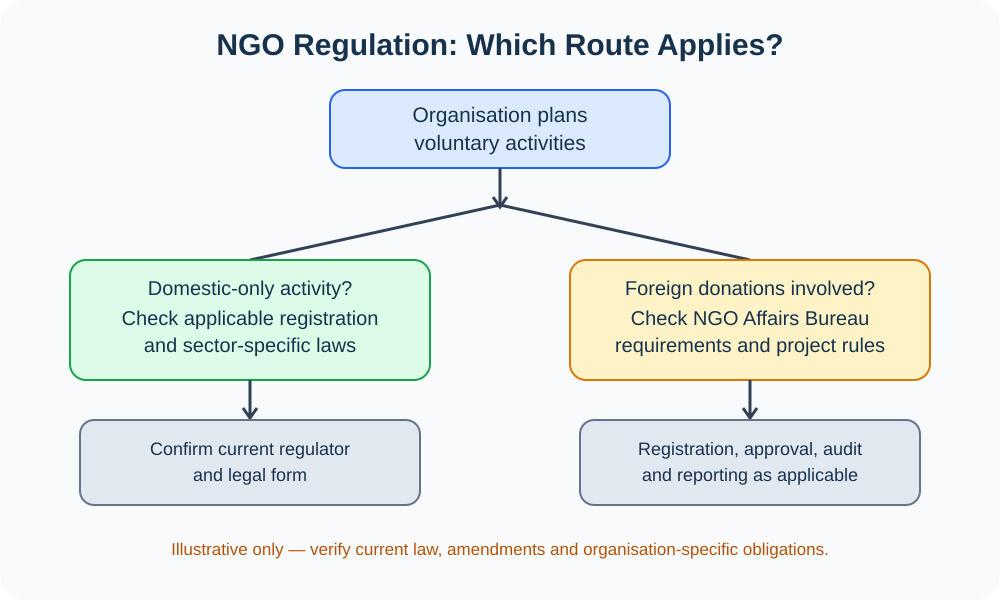

# Chapter 13 — Visual Atlas

[← Main Chapter](./README.md) · [Model Essays](./PYQ-BASED-ESSAYS.md) · [English Quotations](./QUOTATIONS.md) · [All chapters](../README.md)

> This chapter concerns institutions and civil society rather than physical geography, so an unrelated map would be misleading. This atlas provides ten explanatory diagrams and source-linked institutional visuals. Conceptual diagrams are not statistical data.

## Ten chapter-specific diagrams

### 1. Formal and informal institutions

### 2. Civil-society ecosystem

### 3. NGO project cycle

### 4. NGO accountability pillars

### 5. Government–NGO–citizen partnership

### 6. Citizen participation and feedback loop

### 7. NGO regulation decision pathway

### 8. Monitoring and evaluation results chain

### 9. Bangladesh development stakeholder map

### 10. Accountability dashboard

## Source-linked image and institutional references

These links lead to official or first-party sources. Open the source page and use its credited image/caption rather than an unattributed social-media picture.

| No. | Visual reference | Exam relevance | Source |
|---:|---|---|---|
| 11 | BRAC historical and community-development materials | Bangladesh NGO history | [BRAC — Our History](https://www.brac.net/about-us/our-history/) |
| 12 | BRAC programmes and field-work materials | Education, health, livelihoods | [BRAC official website](https://www.brac.net/) |
| 13 | NGO registration and regulatory material | Foreign-donation regulation | [NGO Affairs Bureau](https://ngoab.gov.bd/) |
| 14 | NGOAB e-service and registry information | Administrative data with access date | [NGOAB e-Service](https://e-service.ngoab.gov.bd/) |
| 15 | Microfinance regulatory resources | Licensing and supervision | [Microcredit Regulatory Authority](https://mra.gov.bd/) |
| 16 | Official population and socioeconomic reports | Evidence for development needs | [Bangladesh Bureau of Statistics](https://bbs.gov.bd/) |
| 17 | Constitution Articles 37–39 | Assembly, association and expression | [Laws of Bangladesh — Constitution](https://bdlaws.minlaw.gov.bd/act-print-367.html) |
| 18 | Foreign Donations (Voluntary Activities) Regulation Act, 2016 | Legal and compliance framework | [Laws of Bangladesh — Act 1197](https://bdlaws.minlaw.gov.bd/act-print-1197.html) |
| 19 | Civil-society engagement framework | Definitions and public participation | [World Bank — Civil Society Engagement](https://documents1.worldbank.org/curated/en/914211468322455786/pdf/341600ENGLISH01and1Options01PUBLIC1.pdf) |
| 20 | SDG 16 | Accountability and inclusive institutions | [United Nations — SDG 16](https://sdgs.un.org/goals/goal16) |
| 21 | SDG 17 | Partnerships | [United Nations — SDG 17](https://sdgs.un.org/goals/goal17) |
| 22 | UN Charter Article 71 | NGO consultation with ECOSOC | [UN Legal — Article 71](https://legal.un.org/repertory/art71.shtml) |
| 23 | Decent work framework | Worker voice and inclusive development | [ILO — Decent Work](https://www.ilo.org/topics-and-sectors/decent-work) |
| 24 | Human development reports | People-centred development | [UNDP Human Development Reports](https://hdr.undp.org/) |
| 25 | World Bank civil-society partnership materials | Participation and accountability | [World Bank — Civil Society](https://www.worldbank.org/en/about/partners/civil-society) |

## Chart and data integrity

No invented numerical chart is used here. For future statistics, cite a dated primary dataset and identify its unit, period, coverage and whether the data are administrative, surveyed, audited or estimated. NGOAB registration totals are not a census of every domestic voluntary organisation; MRA-licensed microfinance institutions are not synonymous with all NGOs.

## BCS Written use

1. Draw one clear diagram only when it supports the argument.
2. Label the diagram and explain its significance in one or two sentences.
3. Distinguish NGOs, civil society organisations (CSOs), community-based organisations (CBOs), interest groups and informal institutions.
4. For legal questions, verify current legislation and amendments before stating a rule.

[⬆ Main Chapter](./README.md) · [Model Essays](./PYQ-BASED-ESSAYS.md) · [Quotations](./QUOTATIONS.md) · [All chapters](../README.md)
