

# অধ্যায় ১৫ — জেন্ডার ইস্যু ও উন্নয়ন | Gender Issues & Development

**বিসিএস লিখিত · বাংলাদেশ বিষয়াবলি · বিষয় কোড ০০৫ · সিলেবাসের বিষয় ১৫**

[বইয়ের সূচি](../README.md) · [সরকারি সিলেবাস ও বিষয়ভিত্তিক মিল](../SYLLABUS-COVERAGE.md) · [উৎস ও যাচাইয়ের অবস্থা](../SOURCE-AUDIT.md) · [উত্তর লেখার নির্দেশিকা](../ANSWER-WRITING.md)

মূল ধারণা ও ব্যাখ্যা পড়ুন, বাংলাদেশের উদাহরণের সঙ্গে মিলিয়ে বিশ্লেষণ করুন, তারপর প্রশ্ন অনুযায়ী উত্তর লিখুন। সংখ্যার সঙ্গে তথ্যের সময়কাল এবং আইনি বক্তব্যের সঙ্গে প্রযোজ্য পাঠ দেখুন।

| অংশ | কী পড়বেন |
|---|---|
| [অংশ ক — মূলপাঠ](#book-text) | ধারণা, পটভূমি, বিস্তারিত আলোচনা, কারণ–প্রভাব ও নীতিগত মূল্যায়ন |
| [অংশ খ — লিখিত অনুশীলন](#written-practice) | প্রশ্নের উৎস, উত্তর-পরিকল্পনা, অনুশীলনী ও নমুনা উত্তর |
| [অংশ গ — পুনরালোচনা ও চিত্র](#revision-atlas) | সারসংক্ষেপ, মানচিত্র, চিত্র ও স্মৃতি যাচাই |
| [অংশ ঘ — উৎস ও যাচাই](#references-audit) | তথ্যসূত্র, উদ্ধৃতির সীমা ও যাচাইয়ের অবস্থা |

বিস্তারিত বিষয়সূচি

**অংশ ক — মূলপাঠ**

- [অধ্যায়ের মানচিত্র](#core-01)
- [৮ মিনিটে মূল ধারণা](#core-02)
- [বাংলাদেশের প্রেক্ষাপট: অগ্রগতি ও অসমাপ্ত কাজ](#core-03)
- [বাংলাদেশের আইন ও নীতির কাঠামো](#core-04)
- [বৈশ্বিক কাঠামো: SDG 5 ও উন্নয়ন](#core-05)
- [প্রধান বাধা: কারণ–প্রভাব–সমাধান](#core-06)
- [করণীয়: বহুমাত্রিক কর্মপরিকল্পনা](#core-07)

- [জেন্ডার, অবৈতনিক পরিচর্যা ও ক্ষমতায়নের পরিমাপ](#core-analysis)

**অংশ খ — লিখিত অনুশীলন**

- [BCS Written-এ উত্তর লেখার কৌশল](#practice-01)
- [বিগত প্রশ্ন বিশ্লেষণ: কীভাবে পড়বেন](#practice-02)
- [পরীক্ষামুখী সংক্ষিপ্ত মডেল উত্তর](#practice-03)
- [৩৩টি অনুশীলনী প্রশ্ন](#practice-04)

**অংশ গ — পুনরালোচনা ও চিত্র**

- [One-page revision](#revision-01)

**অংশ ঘ — উৎস ও যাচাই**

- [এই অধ্যায়ের যাচাইয়ের অবস্থা](#chapter-fact-check)
- [Source register](#sources-01)

---

## অংশ ক — মূলপাঠ

### অধ্যায়ের মানচিত্র

| অংশ | যা শিখবেন |
|---|---|
| Core narrative | Sex, gender, equality, equity, empowerment, development |
| Bangladesh context | শিক্ষা, স্বাস্থ্য, শ্রমবাজার, রাজনীতি, সম্পদ ও সিদ্ধান্ত গ্রহণ |
| Structural barriers | unpaid care, সামাজিক রীতি, সহিংসতা, বাল্যবিবাহ, ডিজিটাল বিভাজন |
| Laws & policy | সংবিধান, নারী ও শিশু নির্যাতন দমন আইন, বাল্যবিবাহ নিরোধ আইন, জাতীয় নারী উন্নয়ন নীতি |
| Global frameworks | SDGs, CEDAW, Beijing Platform for Action |
| Exam practice | প্রশ্ন-থিম, ৫/১০/২০ নম্বরের উত্তর কাঠামো, ৩৩টি অনুশীলনী |
| Quotations | English quotations, উৎস ও পরীক্ষায় প্রয়োগ |

---

### মিনিটে মূল ধারণা

**মূল বক্তব্য:** জেন্ডার সমতা শুধু নারীর অধিকার বা কল্যাণের বিষয় নয়; এটি মানবাধিকার, ন্যায়বিচার, উৎপাদনশীলতা, গণতন্ত্র ও টেকসই উন্নয়নের শর্ত। বাংলাদেশে মেয়েদের শিক্ষা, মাতৃস্বাস্থ্য, কর্মসংস্থান ও রাজনৈতিক অংশগ্রহণে অগ্রগতি হয়েছে; কিন্তু বাল্যবিবাহ, লিঙ্গভিত্তিক সহিংসতা, শ্রমবাজারে বৈষম্য, অবৈতনিক পরিচর্যার অসম বণ্টন, সম্পদে প্রবেশাধিকার ও ডিজিটাল ব্যবধান অগ্রগতিকে সীমিত করে।

#### মূল পরিভাষা

- **Sex:** প্রধানত জৈবিক বৈশিষ্ট্য-সম্পর্কিত শ্রেণিবিন্যাস।
- **Gender:** সমাজ ও সংস্কৃতির মাধ্যমে গড়ে ওঠা ভূমিকা, প্রত্যাশা ও ক্ষমতার সম্পর্ক।
- **Gender equality:** অধিকার, সুযোগ, সম্পদ ও সিদ্ধান্তে সমান মর্যাদা ও সুযোগ।
- **Gender equity:** বিদ্যমান অসুবিধা বিবেচনায় ন্যায্য ফলের জন্য প্রয়োজনীয় সহায়তা বা ব্যবস্থা।
- **Women’s empowerment:** নিজের জীবন, সম্পদ ও সিদ্ধান্তের ওপর কার্যকর নিয়ন্ত্রণ এবং সক্ষমতা বৃদ্ধি।
- **Gender mainstreaming:** আইন, বাজেট, পরিকল্পনা ও মূল্যায়নের প্রতিটি ধাপে জেন্ডার-প্রভাব বিবেচনা।
- **Intersectionality:** জেন্ডারের সঙ্গে শ্রেণি, প্রতিবন্ধিতা, জাতিসত্তা, বয়স, ভৌগোলিক অবস্থান ও অন্যান্য পরিচয়ের পারস্পরিক প্রভাব।
- **Unpaid care work:** শিশু, প্রবীণ, অসুস্থ ব্যক্তি ও পরিবারের জন্য বিনা মজুরিতে পরিচর্যা ও গৃহস্থালি কাজ।

> **পরীক্ষার পার্থক্য:** Equality মানে সমান অধিকার ও সুযোগ; equity হলো বৈষম্য দূর করতে প্রয়োজনমাফিক ন্যায্য ব্যবস্থা। Equity-কে equality-এর বিপরীত হিসেবে লিখবেন না—দুটি পরস্পর-সম্পূরক।

##### বাস্তব ছবি ১ — নারীদের সম্মিলিত উদ্যোগ ও সামাজিক ক্ষমতায়ন

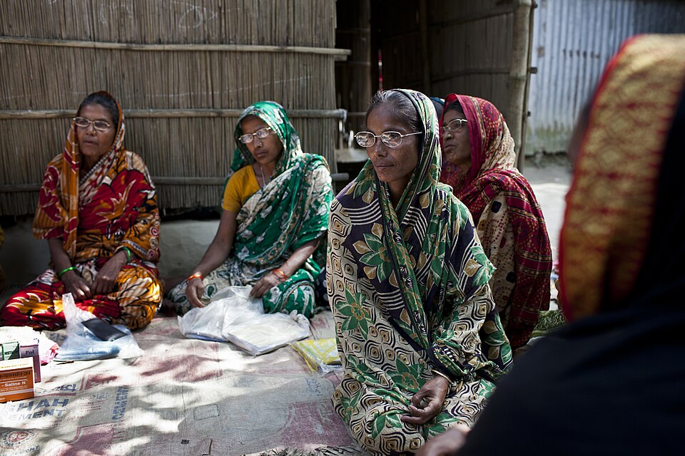

*পাঠের সঙ্গে সম্পর্ক:* দলীয় আলোচনা, পারস্পরিক সহায়তা ও স্থানীয় নেটওয়ার্ক নারীর সামাজিক পুঁজি ও সিদ্ধান্তে অংশগ্রহণের পথ তৈরি করতে পারে। ছবিটি একটি নির্দিষ্ট BRAC programme-এর ঐতিহাসিক উদাহরণ; সব নারীর অভিজ্ঞতার প্রতিনিধিত্ব করে না। **কৃতিত্ব:** Department of Foreign Affairs and Trade (DFAT), Australia; [CC BY 4.0](https://creativecommons.org/licenses/by/4.0/). [মূল ছবি ও লাইসেন্স](https://commons.wikimedia.org/wiki/File:A_women%27s_group_from_Rodrodha_village_gather_for_a_meeting._They_all_graduated_through_BRACs_Special_Targeting_Ultra_Poor_program_they_are_now_known_as_graduates_and_are_taking_part_in_a_project_called_group_home_visits._%2810664330215%29.jpg).

---

### বাংলাদেশের প্রেক্ষাপট: অগ্রগতি ও অসমাপ্ত কাজ

#### শিক্ষা

মেয়েদের বিদ্যালয়ে অংশগ্রহণ বাড়ানো বাংলাদেশের সামাজিক উন্নয়নের গুরুত্বপূর্ণ অর্জন। উপবৃত্তি, বিনা মূল্যের পাঠ্যপুস্তক, বিদ্যালয় সম্প্রসারণ ও জনসচেতনতা এতে ভূমিকা রেখেছে। তবে মাধ্যমিক-উত্তর পর্যায়ে ঝরে পড়া, বাল্যবিবাহ, নিরাপদ যাতায়াত, মাসিক স্বাস্থ্য-সুবিধা, STEM-এ অংশগ্রহণ এবং ডিজিটাল দক্ষতায় ব্যবধান রয়ে গেছে। শুধু ভর্তি নয়—শিখনফল, নিরাপত্তা, সমাপ্তির হার ও কর্মজীবনে রূপান্তরও মূল্যায়ন করতে হবে।

##### বাস্তব ছবি ২ — মেয়েদের শিক্ষা ও নিরাপদ বিদ্যালয়-যাত্রা

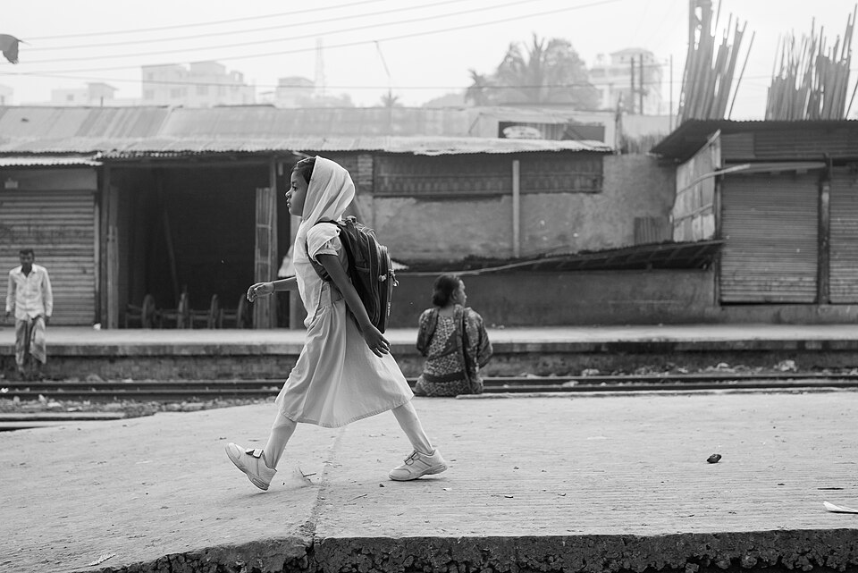

*পাঠের সঙ্গে সম্পর্ক:* মেয়েদের বিদ্যালয়ে প্রবেশাধিকার, নিরাপদ যাতায়াত ও শিক্ষার ধারাবাহিকতা জেন্ডার সমতার ভিত্তি। শুধু ভর্তি নয়—শিখনফল, বিদ্যালয় সমাপ্তি ও পরবর্তী কর্মজীবনের সুযোগও গুরুত্বপূর্ণ। **কৃতিত্ব:** Zamil Rahman; [CC BY 2.0](https://creativecommons.org/licenses/by/2.0/). [মূল ছবি ও লাইসেন্স](https://commons.wikimedia.org/wiki/File:A_girl_going_to_school_(26361323721).jpg).

#### স্বাস্থ্য ও প্রজনন অধিকার

মাতৃস্বাস্থ্যসেবা, পরিবার পরিকল্পনা, পুষ্টি, কিশোর-কিশোরীর স্বাস্থ্যশিক্ষা এবং জরুরি প্রসূতি সেবা নারীর সক্ষমতা ও পরিবারের কল্যাণে প্রভাব ফেলে। দরিদ্র, প্রত্যন্ত, চর, হাওর, পাহাড়ি ও উপকূলীয় এলাকার নারীরা সেবা, পরিবহন, ব্যয় ও তথ্যের বাধার মুখে পড়তে পারেন। স্বাস্থ্যনীতি প্রণয়নে গোপনীয়তা, informed consent, মর্যাদা ও বৈষম্যহীন সেবা নিশ্চিত করা জরুরি।

##### বাস্তব ছবি ৩ — কমিউনিটি স্বাস্থ্যকর্মী ও মাতৃস্বাস্থ্য

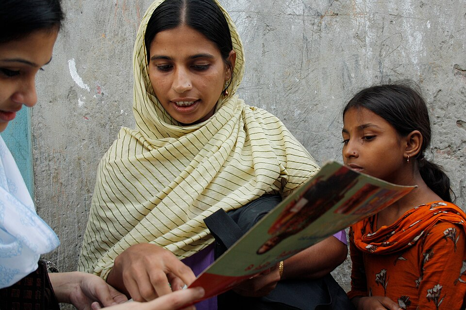

*পাঠের সঙ্গে সম্পর্ক:* স্থানীয় স্বাস্থ্যকর্মীরা স্বাস্থ্যতথ্য, গর্ভাবস্থা শনাক্তকরণ ও স্বাস্থ্যসেবায় রেফারেলের মাধ্যমে সেবার নাগাল বাড়াতে পারেন। এটি ২০১১ সালের ঐতিহাসিক ছবি—বর্তমান সেবা-আবরণ বা কর্মীসংখ্যার পরিসংখ্যান নয়। **কৃতিত্ব:** Lucy Milmo/DFID; [CC BY 2.0](https://creativecommons.org/licenses/by/2.0/). [মূল ছবি ও লাইসেন্স](https://commons.wikimedia.org/wiki/File:A_community_health_worker_conducting_a_survey_in_the_Korail_slum,_Bangladesh_(8630810827).jpg).

#### অর্থনীতি ও শ্রমবাজার

নারীর শ্রমশক্তিতে অংশগ্রহণ আয়, দারিদ্র্য হ্রাস, উৎপাদনশীলতা ও পরিবারের দর-কষাকষির ক্ষমতা বাড়াতে পারে। তৈরি পোশাক, কৃষি, ক্ষুদ্র উদ্যোগ, শিক্ষা, স্বাস্থ্য ও অনানুষ্ঠানিক খাতে নারীর অবদান গুরুত্বপূর্ণ। কিন্তু একই ধরনের কাজেও মজুরি ও পদোন্নতির ব্যবধান, নিরাপদ কর্মপরিবেশের ঘাটতি, মাতৃত্বজনিত কর্মবিরতি, childcare-এর অভাব, অনানুষ্ঠানিক কর্মসংস্থান এবং unpaid care burden নারীর আয় ও কর্মজীবন সীমিত করে।

**নীতিগত দিক:** সমমূল্যের কাজের ন্যায্য মজুরি, নিরাপদ গণপরিবহন ও কর্মস্থল, যৌন হয়রানি প্রতিরোধ, মাতৃত্ব ও পিতৃত্ব-সহায়ক ব্যবস্থা, সাশ্রয়ী childcare, দক্ষতা প্রশিক্ষণ, ঋণ ও বাজারে প্রবেশাধিকার এবং নারী উদ্যোক্তার ডিজিটাল সক্ষমতা।

##### বাস্তব ছবি ৪ — তৈরি পোশাকশিল্পে নারীর শ্রম

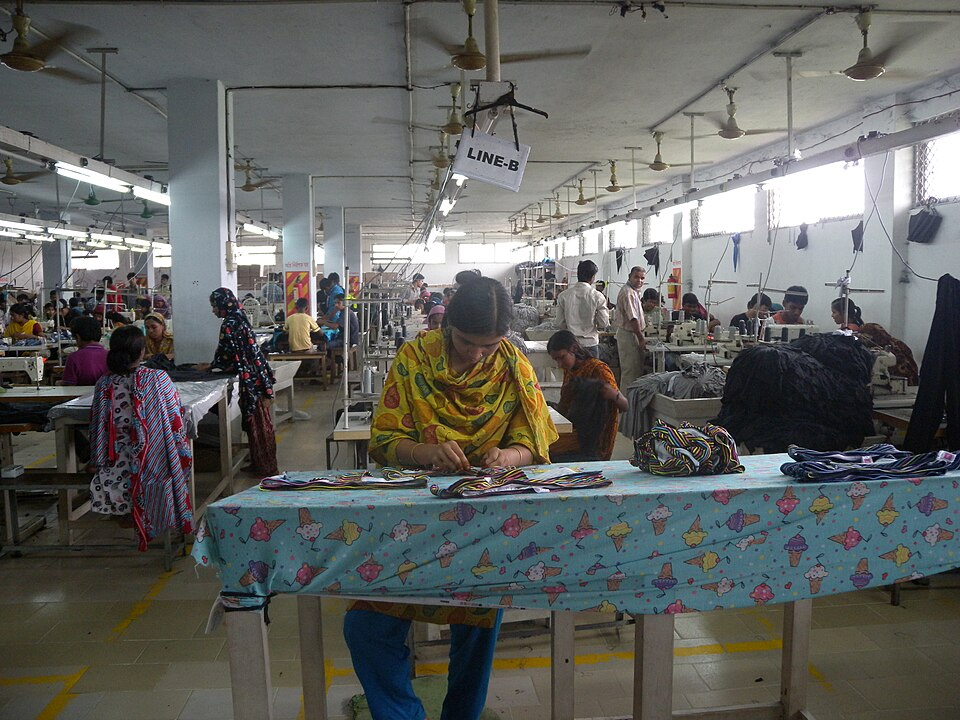

*পাঠের সঙ্গে সম্পর্ক:* তৈরি পোশাকশিল্পে নারীর অংশগ্রহণ আয়, রপ্তানি ও পরিবারের অর্থনৈতিক সক্ষমতায় অবদান রাখে। তবে সমমজুরি, নিরাপদ কর্মপরিবেশ, নেতৃত্বে উন্নতি, মাতৃত্ব-সহায়ক নীতি ও সাশ্রয়ী childcare-ও জেন্ডার-সমতাভিত্তিক উন্নয়নের অংশ। ছবিটি ২০১১ সালের; বর্তমান শ্রমপরিবেশের একক প্রমাণ নয়। **কৃতিত্ব:** Tareq Salahuddin; [CC BY 2.0](https://creativecommons.org/licenses/by/2.0/). [মূল ছবি ও লাইসেন্স](https://commons.wikimedia.org/wiki/File:Garment_factory_in_Bangladesh_Women_working.jpg).

#### রাজনৈতিক অংশগ্রহণ ও নেতৃত্ব

সংবিধান রাজনৈতিক অধিকার ও সমতার ভিত্তি দেয়। সংসদ, স্থানীয় সরকার, প্রশাসন, বিচারব্যবস্থা ও নাগরিক সমাজে নারীর উপস্থিতি নীতি-প্রণয়নে বিভিন্ন অভিজ্ঞতা যুক্ত করে। তবে প্রতিনিধিত্বের সংখ্যা একা যথেষ্ট নয়; প্রার্থী মনোনয়ন, দলের সিদ্ধান্ত, অর্থায়ন, রাজনৈতিক সহিংসতা, অনলাইন হয়রানি এবং নেতৃত্বের বাস্তব ক্ষমতাও বিবেচ্য।

##### বাস্তব ছবি ৫ — রাজনৈতিক প্রতিনিধিত্ব ও নেতৃত্ব

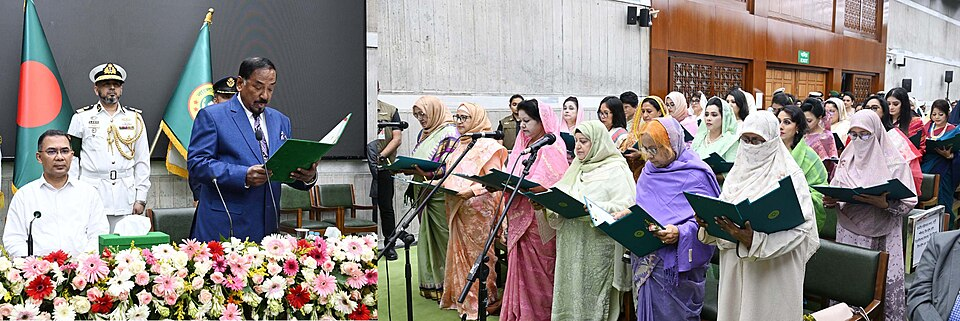

*পাঠের সঙ্গে সম্পর্ক:* সংসদে নারীর উপস্থিতি রাজনৈতিক প্রতিনিধিত্বের একটি দৃশ্যমান দিক। তবে প্রকৃত ক্ষমতায়ন বিচার করতে কমিটি, দলীয় সিদ্ধান্ত, নেতৃত্ব, বাজেট-নিয়ন্ত্রণ ও নীতিতে প্রভাবের বিষয়ও দেখতে হয়। **ছবির উৎস:** Bangladesh Press Information Department (PID); [বাংলাদেশে public domain](https://commons.wikimedia.org/wiki/File:2026-05-03_Oath_taking_of_Women_MPs_for_reserved_seats,_13th_National_Parliament,_Dhaka.jpg).

#### বাল্যবিবাহ ও লিঙ্গভিত্তিক সহিংসতা

বাল্যবিবাহের সঙ্গে দারিদ্র্য, নিরাপত্তাহীনতা, সামাজিক রীতি, শিক্ষার ব্যয় ও সংকটকালীন ঝুঁকির সম্পর্ক রয়েছে। এটি শিক্ষা অব্যাহত রাখা, স্বাস্থ্য, অর্থনৈতিক স্বনির্ভরতা এবং সিদ্ধান্ত গ্রহণে নেতিবাচক প্রভাব ফেলতে পারে। প্রতিরোধে আইন প্রয়োগের পাশাপাশি বিদ্যালয়ে ধরে রাখা, সামাজিক সুরক্ষা, কিশোর-কিশোরী-বান্ধব স্বাস্থ্যসেবা, জন্মনিবন্ধন, পরিবার ও ধর্মীয়-সামাজিক নেতাদের সম্পৃক্ততা দরকার।

নারী ও শিশুর প্রতি সহিংসতার মধ্যে পারিবারিক সহিংসতা, যৌন হয়রানি, ধর্ষণ, যৌতুক-সম্পর্কিত সহিংসতা, পাচার ও অনলাইন নির্যাতন অন্তর্ভুক্ত হতে পারে। ভুক্তভোগীকে দোষারোপ না করে নিরাপদ অভিযোগব্যবস্থা, চিকিৎসা ও মানসিক সহায়তা, আইনি সহায়তা, আশ্রয়, তদন্তের মান এবং বিচারপ্রাপ্তির গতি বাড়াতে হবে। আইন থাকলেই যথেষ্ট নয়; বাস্তবায়ন, সেবা ও সামাজিক প্রতিরোধ একসঙ্গে প্রয়োজন।

##### বাস্তব ছবি ৬ — বাল্যবিবাহ প্রতিরোধে সামাজিক সচেতনতা

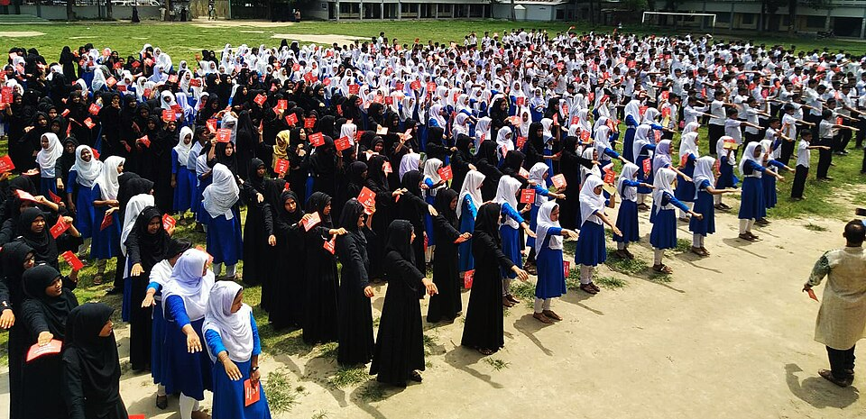

*পাঠের সঙ্গে সম্পর্ক:* বাল্যবিবাহ প্রতিরোধে বিদ্যালয়ে ধরে রাখা, জন্মনিবন্ধন, সামাজিক সচেতনতা, নিরাপদ অভিযোগব্যবস্থা ও আইন প্রয়োগ একসঙ্গে দরকার। একটি শপথ-অনুষ্ঠানের ছবি সচেতনতার উদাহরণ—এটি একা বাল্যবিবাহের হার কমার প্রমাণ নয়। **কৃতিত্ব:** DelwarHossain; [CC BY-SA 4.0](https://creativecommons.org/licenses/by-sa/4.0/). [মূল ছবি ও লাইসেন্স](https://commons.wikimedia.org/wiki/File:No_child_marrige_oath_in_Hajiganj_girls_high_school,_Bangladesh.jpg).

#### সম্পদ, ভূমি ও আর্থিক অন্তর্ভুক্তি

ভূমি, উত্তরাধিকার, ঋণ, ব্যাংকিং, বাজার, প্রযুক্তি ও উৎপাদন-সম্পদে প্রবেশাধিকার নারীর অর্থনৈতিক নিরাপত্তার সঙ্গে যুক্ত। আইনি অধিকার ও বাস্তব নিয়ন্ত্রণ এক বিষয় নয়: কাগজে সম্পদ থাকলেও সিদ্ধান্তে অংশগ্রহণ বা ব্যবহারাধিকার সীমিত হতে পারে। সহজ নিবন্ধন, আইনি সহায়তা, আর্থিক সাক্ষরতা, জামানতবিহীন উপযোগী অর্থায়ন, বাজারসংযোগ এবং সম্পদ-সংক্রান্ত তথ্যের প্রবেশাধিকার দরকার।

##### বাস্তব ছবি ৭ — কৃষিতে নারীর শ্রম ও উৎপাদন-সম্পদ

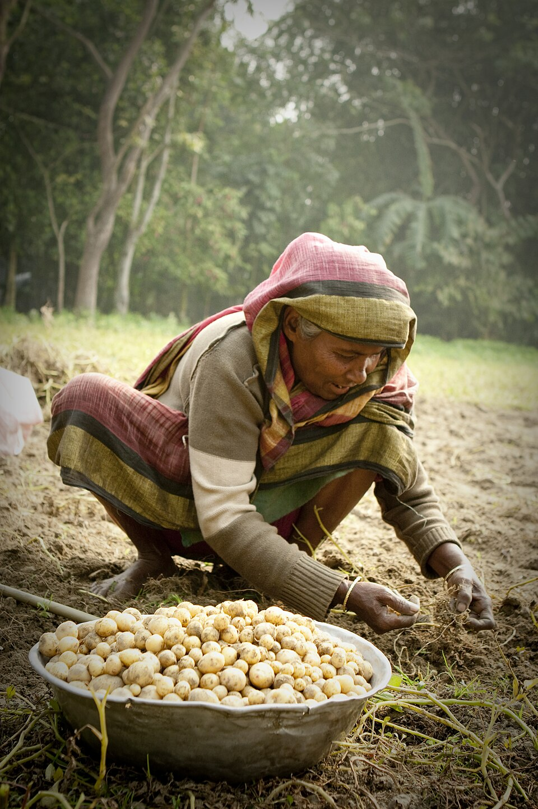

*পাঠের সঙ্গে সম্পর্ক:* কৃষিতে নারীর শ্রম দৃশ্যমান হলেও ভূমির মালিকানা, উত্তরাধিকার, ঋণ, প্রযুক্তি, বাজারে প্রবেশ ও আয়ের ওপর নিয়ন্ত্রণ আলাদা করে বিবেচনা করতে হয়। ছবিটি ২০১১ সালের একটি কৃষিকাজের দৃশ্য; এটি জাতীয় শ্রম-পরিসংখ্যান নয়। **কৃতিত্ব:** Hridoye Mati O Manush; [CC BY 2.0](https://creativecommons.org/licenses/by/2.0/). [মূল ছবি ও লাইসেন্স](https://commons.wikimedia.org/wiki/File:A_Bangladeshi_woman_works_on_a_potato_field.jpg).

##### বাস্তব ছবি ৮ — আর্থিক অন্তর্ভুক্তি ও ক্ষুদ্রঋণ

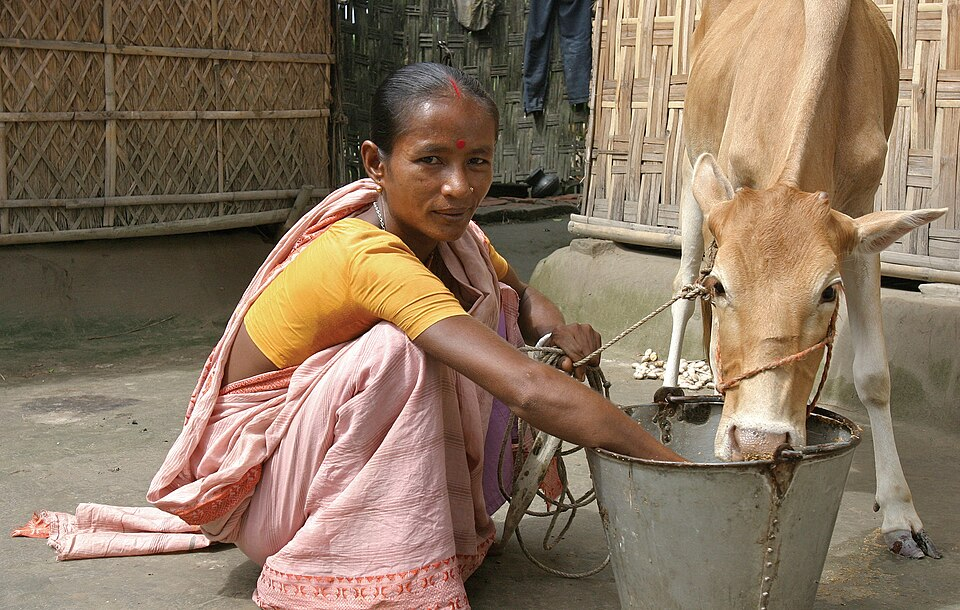

*পাঠের সঙ্গে সম্পর্ক:* উপযোগী অর্থায়ন নারীর উদ্যোগ ও জীবিকা গঠনে সহায়তা করতে পারে। কিন্তু ঋণের পাশাপাশি বাজার, আর্থিক সাক্ষরতা, সম্পদে অধিকার, ঋণের শর্ত ও সিদ্ধান্ত গ্রহণের ক্ষমতা জরুরি; ঋণ একাই ক্ষমতায়নের নিশ্চয়তা নয়। **কৃতিত্ব:** Department of Foreign Affairs and Trade (DFAT), Australia; [CC BY 2.0](https://creativecommons.org/licenses/by/2.0/). [মূল ছবি ও লাইসেন্স](https://commons.wikimedia.org/wiki/File:Bangladesh_microfinance_(10676772556).jpg).

#### জলবায়ু পরিবর্তন ও দুর্যোগ

ঘূর্ণিঝড়, বন্যা, নদীভাঙন, লবণাক্ততা ও জীবিকার পরিবর্তন নারী ও পুরুষকে একভাবে প্রভাবিত করে না। পরিচর্যার দায়িত্ব, সম্পদে সীমিত প্রবেশাধিকার, নিরাপদ আশ্রয় ও স্বাস্থ্যসেবার সীমাবদ্ধতা নারীর ঝুঁকি বাড়াতে পারে; আবার স্থানীয় জ্ঞান, সংগঠন ও অভিযোজনেও নারীরা গুরুত্বপূর্ণ ভূমিকা রাখেন। দুর্যোগ পরিকল্পনায় নারী, প্রতিবন্ধী ব্যক্তি, প্রবীণ ও প্রান্তিক জনগোষ্ঠীর অংশগ্রহণ; নিরাপদ আশ্রয়, আলাদা ও নিরাপদ স্যানিটেশন, মাতৃস্বাস্থ্যসেবা এবং জেন্ডার-বিচ্ছিন্ন তথ্য থাকা প্রয়োজন।

##### বাস্তব ছবি ৯ — জলবায়ু ঝুঁকি ও দুর্যোগ-সহনশীল অবকাঠামো

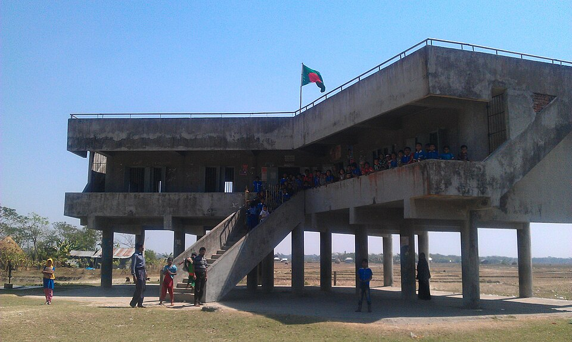

*পাঠের সঙ্গে সম্পর্ক:* বহুমুখী ঘূর্ণিঝড় আশ্রয়কেন্দ্র দুর্যোগে জীবনরক্ষা ও স্থানীয় প্রস্তুতিতে গুরুত্বপূর্ণ। জেন্ডার-সংবেদনশীল পরিকল্পনায় নিরাপদ স্যানিটেশন, মাতৃস্বাস্থ্যসেবা, গোপনীয়তা, প্রতিবন্ধী ব্যক্তির প্রবেশাধিকার এবং সিদ্ধান্তে নারীর অংশগ্রহণ নিশ্চিত করতে হয়। **কৃতিত্ব:** Helena Wright; [CC BY 2.0](https://creativecommons.org/licenses/by/2.0/). [মূল ছবি ও লাইসেন্স](https://commons.wikimedia.org/wiki/File:Cyclone_Shelter_(15265520285).jpg).

#### ডিজিটাল জেন্ডার বিভাজন

মোবাইল ও ইন্টারনেটের খরচ, ডিভাইসের মালিকানা, ডিজিটাল সাক্ষরতা, পরিবারের নিয়ন্ত্রণ, অনলাইন হয়রানি ও গোপনীয়তার ঝুঁকি নারীর ডিজিটাল অংশগ্রহণে বাধা হতে পারে। ডিজিটাল আর্থিক সেবা ও অনলাইন শিক্ষা সুযোগ তৈরি করলেও নিরাপত্তা, accessibility, স্থানীয় ভাষার কনটেন্ট ও ব্যবহারিক প্রশিক্ষণ জরুরি।

##### বাস্তব ছবি ১০ — ডিজিটাল অংশগ্রহণ ও নারীর জ্ঞান-নেটওয়ার্ক

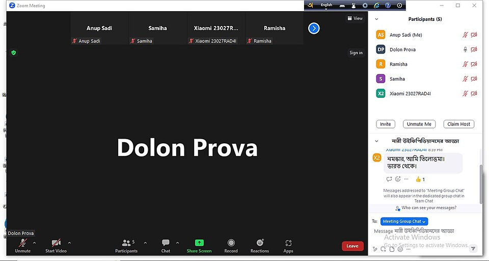

*পাঠের সঙ্গে সম্পর্ক:* নারীদের জ্ঞান-ভাগাভাগি ও ডিজিটাল-সামাজিক নেটওয়ার্কে অংশগ্রহণ দৃশ্যমান করার উদাহরণ। ডিজিটাল জেন্ডার বিভাজন কমাতে ডিভাইস ও ইন্টারনেটের সামর্থ্য, ডিজিটাল সাক্ষরতা, স্থানীয় ভাষার কনটেন্ট, গোপনীয়তা ও অনলাইন নিরাপত্তাও জরুরি। **কৃতিত্ব:** Anup Sadi; [CC BY-SA 4.0](https://creativecommons.org/licenses/by-sa/4.0/). [মূল ছবি ও লাইসেন্স](https://commons.wikimedia.org/wiki/File:Bangla_Wiki_Women_meetup.jpg).

---

### বাংলাদেশের আইন ও নীতির কাঠামো

| আইন/নীতি | পরীক্ষায় প্রাসঙ্গিকতা |
|---|---|
| গণপ্রজাতন্ত্রী বাংলাদেশের সংবিধান: অনুচ্ছেদ ২৭ | আইনের দৃষ্টিতে সমতা |
| অনুচ্ছেদ ২৮ | ধর্ম, গোষ্ঠী, বর্ণ, নারী-পুরুষ বা জন্মস্থানের ভিত্তিতে বৈষম্য-সংক্রান্ত সাংবিধানিক সুরক্ষা; নারীর পক্ষে বিশেষ বিধানের সুযোগও প্রাসঙ্গিক |
| অনুচ্ছেদ ২৯ | সরকারি নিয়োগে সুযোগের সমতা |
| অনুচ্ছেদ ১৯ | সুযোগের সমতা ও সামাজিক-অর্থনৈতিক বৈষম্য হ্রাসের রাষ্ট্রীয় অঙ্গীকার |
| নারী ও শিশু নির্যাতন দমন আইন, ২০০০ (সংশোধিত) | নির্দিষ্ট গুরুতর অপরাধের আইনগত প্রতিকার |
| বাল্যবিবাহ নিরোধ আইন, ২০১৭ | বাল্যবিবাহ প্রতিরোধের আইনগত কাঠামো |
| পারিবারিক সহিংসতা (প্রতিরোধ ও সুরক্ষা) আইন, ২০১০ | পারিবারিক সহিংসতার বিরুদ্ধে সুরক্ষা ব্যবস্থা |
| জাতীয় নারী উন্নয়ন নীতি, ২০১১ | নারীর সমঅধিকার, ক্ষমতায়ন ও উন্নয়ন-সংক্রান্ত নীতিগত কাঠামো |
| CEDAW (1979) | নারীর প্রতি বৈষম্য বিলোপে আন্তর্জাতিক কনভেনশন; বাংলাদেশের ratification ও reservations বিষয়ে উত্তর লেখার আগে UN Treaty Collection যাচাই করুন |
| Beijing Platform for Action (1995) | নারী উন্নয়নের ১২টি গুরুত্বপূর্ণ ক্ষেত্র নিয়ে বৈশ্বিক কর্মপরিকল্পনা |
| SDG 5 | জেন্ডার সমতা ও সকল নারী-কিশোরীর ক্ষমতায়ন |

**সতর্কতা:** আইন ও নীতির সর্বশেষ সংশোধন, কার্যকর ধারা ও সরকারি অবস্থান পরীক্ষার আগে Bangladesh Laws (Ministry of Law), BPSC বা UN Treaty Collection থেকে যাচাই করুন। সামাজিক রীতি ও আইনগত ন্যূনতম বয়সকে গুলিয়ে ফেলবেন না; আইনটির নির্দিষ্ট বিধান ও ব্যতিক্রম হুবহু যাচাই ছাড়া লিখবেন না।

---

### বৈশ্বিক কাঠামো: SDG 5 ও উন্নয়ন

**SDG 5**-এর লক্ষ্য হলো gender equality অর্জন এবং সব নারী ও মেয়েকে ক্ষমতায়ন করা। এর মূল থিম: বৈষম্য ও সহিংসতা দূর করা; বাল্যবিবাহ ও ক্ষতিকর প্রথা প্রতিরোধ; unpaid care work স্বীকৃতি; নেতৃত্বে সমান অংশগ্রহণ; যৌন ও প্রজনন স্বাস্থ্য ও অধিকার; সম্পদ ও প্রযুক্তিতে প্রবেশাধিকার; এবং কার্যকর নীতি ও আইন।

জেন্ডার সমতা অন্যান্য SDG-র সঙ্গেও যুক্ত: দারিদ্র্য (SDG 1), ক্ষুধা ও পুষ্টি (SDG 2), স্বাস্থ্য (SDG 3), শিক্ষা (SDG 4), শোভন কাজ (SDG 8), বৈষম্য হ্রাস (SDG 10), নিরাপদ নগর (SDG 11), জলবায়ু পদক্ষেপ (SDG 13) এবং কার্যকর প্রতিষ্ঠান (SDG 16)। তাই একে আলাদা “নারী বিষয়” না ধরে উন্নয়নের cross-cutting issue হিসেবে ব্যাখ্যা করুন।

---

### প্রধান বাধা: কারণ–প্রভাব–সমাধান

| বাধা | ফলাফল | সম্ভাব্য নীতি-সমাধান |
|---|---|---|
| পিতৃতান্ত্রিক সামাজিক প্রত্যাশা | শিক্ষা, পেশা ও সিদ্ধান্তে সীমাবদ্ধতা | পরিবার-বিদ্যালয়-কমিউনিটি সচেতনতা; পুরুষ ও ছেলেদের অংশগ্রহণ |
| unpaid care-এর অসম বণ্টন | সময়-দারিদ্র্য, কম আয় ও পদোন্নতি | childcare, care services, পিতৃত্বকালীন ছুটি, সময়-ব্যবহারের জরিপ |
| বাল্যবিবাহ ও ঝরে পড়া | দক্ষতা, স্বাস্থ্য ও আয়ের ক্ষতি | আইন প্রয়োগ, সামাজিক সুরক্ষা, বিদ্যালয়ে ধরে রাখা |
| সহিংসতা ও হয়রানি | নিরাপত্তা, স্বাস্থ্য ও চলাচলে বাধা | victim-centred service, জবাবদিহি, নিরাপদ পরিবহন ও কর্মস্থল |
| সম্পদ ও অর্থায়নে সীমাবদ্ধতা | উদ্যোগ ও উৎপাদনশীলতার ঘাটতি | সম্পদ-অধিকার সচেতনতা, অর্থায়ন, বাজার ও ডিজিটাল প্রশিক্ষণ |
| দুর্বল তথ্য ও বাজেট জবাবদিহি | নীতির ফল মাপা কঠিন | sex-disaggregated data, gender budgeting, ফলাফল মূল্যায়ন |

---

### করণীয়: বহুমাত্রিক কর্মপরিকল্পনা

1. **শিক্ষা:** মাধ্যমিক ও উচ্চশিক্ষায় ধরে রাখা, STEM ও TVET-এ প্রবেশ, নিরাপদ পরিবেশ এবং ডিজিটাল দক্ষতা।
2. **স্বাস্থ্য:** মানসম্মত মাতৃ ও প্রজনন স্বাস্থ্যসেবা, কিশোরীবান্ধব সেবা, পুষ্টি ও মানসিক স্বাস্থ্য সহায়তা।
3. **অর্থনৈতিক ক্ষমতায়ন:** সমমূল্যের কাজের ন্যায্য মজুরি, formalization, দক্ষতা, উদ্যোক্তা অর্থায়ন ও বাজারসংযোগ।
4. **Care economy:** সাশ্রয়ী childcare, প্রবীণ ও প্রতিবন্ধী ব্যক্তির পরিচর্যা-সেবা, পুরুষের পরিচর্যায় অংশগ্রহণ এবং সময়-ব্যবহারের তথ্য।
5. **সহিংসতা প্রতিরোধ:** পুলিশ, স্বাস্থ্য, আদালত ও সমাজসেবার সমন্বিত referral system; নিরাপদ অভিযোগ ও survivor-centred support।
6. **রাজনৈতিক নেতৃত্ব:** অর্থবহ প্রতিনিধিত্ব, নেতৃত্ব প্রশিক্ষণ, নিরাপদ রাজনৈতিক অংশগ্রহণ ও অনলাইন হয়রানির বিরুদ্ধে প্রতিকার।
7. **জেন্ডার-সংবেদনশীল বাজেট:** বরাদ্দের পাশাপাশি বাস্তব সুবিধাভোগী, ব্যয়, আউটপুট ও ফলাফল প্রকাশ।
8. **জলবায়ু ও দুর্যোগ:** পরিকল্পনা কমিটিতে নারীর অংশগ্রহণ, নিরাপদ আশ্রয় ও জেন্ডার-সংবেদনশীল সেবা।
9. **ডেটা ও জবাবদিহি:** বয়স, প্রতিবন্ধিতা, অঞ্চল, আয় ও অন্যান্য প্রাসঙ্গিক বৈশিষ্ট্য অনুযায়ী পৃথক তথ্য সংগ্রহ; গোপনীয়তা ও নিরাপত্তা রক্ষা।

[বিষয়সূচিতে ফিরুন](#top)

### জেন্ডার, অবৈতনিক পরিচর্যা ও ক্ষমতায়নের পরিমাপ

#### উপস্থিতি ও ক্ষমতার পার্থক্য

নারীর বিদ্যালয়ে ভর্তি, কর্মসংস্থান বা সিদ্ধান্ত গ্রহণের প্রতিষ্ঠানে উপস্থিতি গুরুত্বপূর্ণ; কিন্তু শুধু উপস্থিতি দিয়ে নিরাপত্তা, আয় নিয়ন্ত্রণ ও কার্যকর সিদ্ধান্তের ক্ষমতা সম্পূর্ণ বোঝা যায় না। SDG 5-এ বৈষম্য ও সহিংসতা দূর করার পাশাপাশি অবৈতনিক পরিচর্যার স্বীকৃতি, কার্যকর অংশগ্রহণ এবং নেতৃত্বের সমান সুযোগ আলাদাভাবে আছে। [UNDP, *Sustainable Development Goals*, Goal 5, targets 5.1–5.5](https://www.undp.org/sustainable-development-goals/gender-equality); লক্ষ্যগুলোর পাঠ দেখা হয়েছে ২২ অক্টোবর ২০২৬।

| ক্ষেত্র | শুধু সংখ্যা নয়, আরও কী দেখবেন |
|---|---|
| শিক্ষা | শিক্ষা সমাপ্তি, শেখার ফল, নিরাপত্তা ও দক্ষতার প্রয়োগ |
| কর্মসংস্থান | মজুরি, কাজের সময়, চুক্তি, নিরাপত্তা ও উন্নতির সুযোগ |
| রাজনৈতিক অংশগ্রহণ | নেতৃত্ব, কমিটিতে ভূমিকা ও সিদ্ধান্তে বাস্তব প্রভাব |
| সম্পদ | মালিকানা, ব্যবহার এবং বিক্রি বা বিনিয়োগের সিদ্ধান্তের ক্ষমতা |
| পরিচর্যা | সময়ের বণ্টন, সরকারি সেবা, শিশু ও প্রবীণ পরিচর্যার সহায়তা |

সারণিটি সম্পাদকীয় মূল্যায়নের ছক; বাংলাদেশের কোনো সূচকের বর্তমান পরিমাপ নয়। কর্মসংস্থানের তথ্য ব্যবহার করলে বয়সসীমা, শ্রমশক্তিতে অংশগ্রহণ, বেকারত্ব ও অনানুষ্ঠানিক কাজের সংজ্ঞা আলাদা করে দেখুন।

#### GDP-তে ধরা না পড়া মানেই মূল্যহীন নয়

নিজ পরিবারের জন্য করা অধিকাংশ অবৈতনিক গৃহস্থালি ও পরিচর্যা-সেবা জাতীয় হিসাবে উৎপাদনসীমার বাইরে থাকে; তাই সেগুলোর সামাজিক বা অর্থনৈতিক গুরুত্ব নেই—এমন সিদ্ধান্ত সঠিক নয়। সব অবৈতনিক উৎপাদনও একইভাবে বাদ পড়ে না: পণ্য উৎপাদন ও সেবা উৎপাদনের সীমা পৃথক। প্রাথমিক পদ্ধতিগত পাঠ: *System of National Accounts 2008*, অধ্যায় ৬, household services ও production boundary আলোচনা; [জাতিসংঘের PDF](https://unstats.un.org/unsd/nationalaccount/docs/SNA2008.pdf)।

**নীতিগত প্রয়োগ:** পরিচর্যার দায়িত্ব ভাগ, সুলভ সেবা, নিরাপদ যাতায়াত ও কর্মপরিবেশ, দক্ষতা এবং কার্যকর অভিযোগ নিষ্পত্তিকে একই পরিকল্পনায় যুক্ত করা যায়। শুধু ঋণ বা প্রশিক্ষণপ্রাপ্তের সংখ্যা দিয়ে ক্ষমতায়ন প্রমাণ না করে আয়, সিদ্ধান্তের নিয়ন্ত্রণ ও সহিংসতার ঝুঁকিও বিবেচনা করুন। SDG 5.4-এ সরকারি সেবা, অবকাঠামো, সামাজিক সুরক্ষা ও পরিবারের ভাগ করা দায়িত্বের বিষয়গুলো পাওয়া যায়।

[বিষয়সূচিতে ফিরুন](#top)

---

## অংশ খ — লিখিত অনুশীলন

**অনুশীলনের নিয়ম:** প্রথমে প্রশ্নের নির্দেশক শব্দ ও চাওয়া বিষয় নির্ধারণ করুন। এখানে দেওয়া নমুনা, সময় বা শব্দসংখ্যার পরামর্শ সম্পাদকীয় অনুশীলন; প্রশ্নপত্রের নির্দিষ্ট নির্দেশই প্রাধান্য পাবে। মূল BPSC প্রশ্নপত্রের পাঠ যাচাই ছাড়া archive-reported প্রশ্নকে যাচাইকৃত বিগত প্রশ্ন বলবেন না।

### BCS Written-এ উত্তর লেখার কৌশল

**২০ নম্বরের কাঠামো (প্রয়োজনমতো):**
- ভূমিকা ও সংজ্ঞা (প্রায় ১০%)
- বাংলাদেশের প্রেক্ষাপট ও অগ্রগতি (২০%)
- সমস্যা ও মূল কারণ (২৫%)
- আইন, নীতি ও SDG framework (১৫%)
- বাস্তবসম্মত সুপারিশ (২০%)
- ভারসাম্যপূর্ণ উপসংহার (১০%)

প্রশ্ন অনুযায়ী অনুপাত বদলাবেন। “আলোচনা কর” প্রশ্নে ইতিবাচক অগ্রগতি ও সীমাবদ্ধতা—দুই দিক লিখুন। “মূল্যায়ন কর” প্রশ্নে নীতির ঘোষিত লক্ষ্য, বাস্তবায়ন, ফলাফল, ঘাটতি ও উন্নতির উপায় তুলনা করুন। “সুপারিশ কর” প্রশ্নে কে করবে, কী করবে, কীভাবে এবং কোন সূচকে ফল মাপবে—এগুলো স্পষ্ট করুন।

#### উত্তরকে শক্তিশালী করার সূত্র: CLAIM

- **C — Claim:** সরাসরি মূল বক্তব্য।
- **L — Law/Literature:** সংবিধান, আইন, SDG বা গবেষণা।
- **A — Analysis:** কেন ও কীভাবে বিষয়টি প্রভাব ফেলে।
- **I — Illustration:** বাংলাদেশভিত্তিক উদাহরণ।
- **M — Measure:** সমাধান ও ফল মাপার সূচক।

---

### বিগত প্রশ্ন বিশ্লেষণ: কীভাবে পড়বেন

এই অধ্যায়ে নিচের প্রশ্নগুলোকে **syllabus-linked, high-yield practice prompts** হিসেবে সাজানো হয়েছে। মূল BPSC প্রশ্নপত্রের স্ক্যান/সরকারি আর্কাইভ থেকে বছর ও নম্বর স্বাধীনভাবে যাচাই করা না গেলে এগুলোকে “verified previous BCS question” বলা হচ্ছে না। বাস্তব PYQ দাবি করতে হলে মূল প্রশ্নপত্রের বছর, পৃষ্ঠা ও প্রশ্নের সঙ্গে মিলিয়ে নিতে হবে।

| প্রশ্ন-থিম | প্রস্তুতির অগ্রাধিকার | যে প্রবন্ধ/অংশ পড়বেন |
|---|---|---|
| নারীর ক্ষমতায়ন ও জাতীয় উন্নয়ন | খুব বেশি | প্রবন্ধ ১ |
| জেন্ডার সমতা: অগ্রগতি ও চ্যালেঞ্জ | খুব বেশি | প্রবন্ধ ২ |
| বাল্যবিবাহ ও নারী-শিশুর সুরক্ষা | খুব বেশি | প্রবন্ধ ৩ |
| নারীর অর্থনৈতিক অংশগ্রহণ ও unpaid care | খুব বেশি | প্রবন্ধ ৪ |
| সংবিধান, আইন ও আন্তর্জাতিক অঙ্গীকার | বেশি | প্রবন্ধ ৫ |
| জেন্ডার বাজেট ও SDG 5 | বেশি | প্রবন্ধ ৬ |
| জলবায়ু পরিবর্তন, দুর্যোগ ও নারী | বেশি | প্রবন্ধ ৭ |
| ডিজিটাল বিভাজন ও ভবিষ্যৎ কর্মসংস্থান | বেশি | প্রবন্ধ ৮ |

---

### পরীক্ষামুখী সংক্ষিপ্ত মডেল উত্তর

#### নম্বর: Gender equality বলতে কী বোঝায়?

Gender equality হলো নারী, পুরুষ ও সব লিঙ্গের মানুষের অধিকার, মর্যাদা, সুযোগ ও সিদ্ধান্ত গ্রহণে সমতা প্রতিষ্ঠা। এটি সবাইকে সব পরিস্থিতিতে একই সহায়তা দেওয়ার মধ্যে সীমাবদ্ধ নয়; বরং বৈষম্য সৃষ্টিকারী কাঠামোগত বাধা দূর করে সমান সুযোগ নিশ্চিত করে। বাংলাদেশের সংবিধানের অনুচ্ছেদ ২৭ ও ২৮, CEDAW এবং SDG 5 এ বিষয়ে গুরুত্বপূর্ণ কাঠামো। শিক্ষা, স্বাস্থ্য, কর্মসংস্থান, সম্পদ ও নেতৃত্বে সমান সুযোগ নিশ্চিত করা এবং সহিংসতা ও বৈষম্য প্রতিরোধ করা এর বাস্তব প্রয়োগ।

#### নম্বর: বাংলাদেশের উন্নয়নে নারীর ক্ষমতায়নের গুরুত্ব ব্যাখ্যা করুন।

নারীর ক্ষমতায়ন মানবসম্পদ উন্নয়ন, দারিদ্র্য হ্রাস, উৎপাদনশীলতা, শিশুর স্বাস্থ্য ও শিক্ষার উন্নতি এবং গণতান্ত্রিক অংশগ্রহণকে শক্তিশালী করে। শিক্ষিত ও সুস্থ নারী কর্মসংস্থান, উদ্যোক্তা কার্যক্রম এবং সামাজিক সিদ্ধান্তে অধিক অবদান রাখতে পারেন। তবে unpaid care burden, কর্মক্ষেত্রে বৈষম্য, সহিংসতা, বাল্যবিবাহ ও সম্পদে সীমিত প্রবেশাধিকার এই সম্ভাবনাকে বাধাগ্রস্ত করে। তাই মানসম্মত শিক্ষা ও স্বাস্থ্যসেবা, নিরাপদ কর্মক্ষেত্র, childcare, ন্যায্য মজুরি, অর্থায়ন, আইন প্রয়োগ ও নেতৃত্বের সুযোগ বাড়াতে হবে। অগ্রগতি পরিমাপে শুধু অংশগ্রহণ নয়—আয়, কাজের মান, নিরাপত্তা, সিদ্ধান্ত গ্রহণ ও সম্পদের ওপর নিয়ন্ত্রণও দেখতে হবে। অতএব নারীর ক্ষমতায়ন কল্যাণমূলক উদ্যোগ নয়; এটি অন্তর্ভুক্তিমূলক ও টেকসই উন্নয়নের বিনিয়োগ।

#### নম্বর: “জেন্ডার সমতা বাংলাদেশের টেকসই উন্নয়নের পূর্বশর্ত”—বিশ্লেষণ করুন।

**ভূমিকা:** টেকসই উন্নয়ন অর্থনৈতিক প্রবৃদ্ধির পাশাপাশি সামাজিক ন্যায়, মানবিক মর্যাদা, পরিবেশগত স্থিতিশীলতা ও ভবিষ্যৎ প্রজন্মের সক্ষমতা নিশ্চিত করে। জনসংখ্যার অর্ধেকের সম্ভাবনা কাঠামোগত বাধায় সীমাবদ্ধ থাকলে উন্নয়ন অন্তর্ভুক্তিমূলক হতে পারে না।

**অর্থনৈতিক মাত্রা:** নারীর শিক্ষা, দক্ষতা, নিরাপদ কর্মসংস্থান ও উদ্যোক্তা কার্যক্রম শ্রমশক্তির মান ও পরিবারের আয় বাড়ায়। কিন্তু মজুরি বৈষম্য, অনানুষ্ঠানিক কাজ ও unpaid care burden নারীর উৎপাদনশীল সময় কমায়। childcare, সমমূল্যের কাজের ন্যায্য মজুরি, প্রশিক্ষণ ও অর্থায়ন প্রয়োজন।

**সামাজিক মাত্রা:** মেয়েদের শিক্ষা, মাতৃস্বাস্থ্য, পুষ্টি এবং সহিংসতা থেকে সুরক্ষা মানব উন্নয়নকে শক্তিশালী করে। বাল্যবিবাহ ও বিদ্যালয় থেকে ঝরে পড়া প্রজন্মান্তরে দারিদ্র্য ও অসমতা পুনরুৎপাদন করতে পারে। পরিবার ও সমাজের অংশগ্রহণসহ আইন প্রয়োগ ও সেবার মান বাড়াতে হবে।

**রাজনৈতিক ও প্রাতিষ্ঠানিক মাত্রা:** নারীর অর্থবহ নেতৃত্ব নীতিতে বিভিন্ন সামাজিক অভিজ্ঞতা অন্তর্ভুক্ত করে। কেবল সংখ্যাগত প্রতিনিধিত্ব নয়, নিরাপত্তা, সিদ্ধান্তের ক্ষমতা, জবাবদিহি ও নেতৃত্ব বিকাশ জরুরি।

**জলবায়ু ও ডিজিটাল মাত্রা:** দুর্যোগ, জলবায়ু পরিবর্তন ও ডিজিটাল অর্থনীতির সুযোগ-ঝুঁকি নারী ও পুরুষের জন্য সমান নয়। পরিকল্পনা, তথ্য, আশ্রয়, প্রযুক্তি ও অর্থায়নে নারীর অংশগ্রহণ নিশ্চিত করতে হবে।

**করণীয়:** জেন্ডার-সংবেদনশীল বাজেট, sex-disaggregated data, care services, নিরাপদ কর্মপরিবেশ, সামাজিক সুরক্ষা, কার্যকর বিচারপ্রাপ্তি, স্থানীয় সরকারে অংশগ্রহণ এবং SDG 5-সংশ্লিষ্ট পরিমাপযোগ্য সূচক দরকার।

**উপসংহার:** জেন্ডার সমতা আলাদা খাত নয়; এটি শিক্ষা, স্বাস্থ্য, অর্থনীতি, শাসন ও জলবায়ু নীতির আন্তঃসম্পর্কিত ভিত্তি। আইন, বাজেট, সেবা ও সামাজিক রূপান্তর একসঙ্গে বাস্তবায়িত হলেই নারীর ক্ষমতায়ন বাংলাদেশের টেকসই উন্নয়নকে ত্বরান্বিত করবে।

---

### ৩৩টি অনুশীলনী প্রশ্ন

#### A. সংজ্ঞা ও ধারণা
1. Define gender and distinguish it from sex.
2. What is the difference between gender equality and gender equity?
3. Explain women’s empowerment.
4. What is gender mainstreaming?
5. What is unpaid care work and why does it matter?
6. Explain intersectionality with a Bangladesh-focused example.

#### B. ৫/১০ নম্বরের প্রশ্ন
7. Explain the constitutional basis of gender equality in Bangladesh.
8. Discuss the importance of girls’ education for national development.
9. Explain the relationship between child marriage and girls’ school dropout.
10. What are the major barriers to women’s labour-force participation?
11. Why is childcare an economic-development issue?
12. Discuss women’s access to land, finance and productive resources.
13. Explain the importance of women’s political participation.
14. How can digital inclusion support women’s empowerment?
15. Explain the relevance of SDG 5 to Bangladesh.
16. What is gender-responsive budgeting?
17. Discuss the role of men and boys in gender equality.
18. How can local government support women’s empowerment?

#### C. ২০ নম্বরের প্রবন্ধ
19. “Gender equality is a prerequisite for sustainable development”—analyse.
20. Evaluate the progress and remaining challenges of women’s empowerment in Bangladesh.
21. Examine child marriage as a development challenge and propose a multi-sector response.
22. Analyse unpaid care work and its effects on women’s economic participation.
23. Discuss laws and institutions for preventing gender-based violence in Bangladesh.
24. Assess the relationship between gender equality, poverty reduction and decent work.
25. Discuss gender-responsive climate adaptation and disaster management.
26. Examine the opportunities and risks of digital transformation for women.
27. Discuss the role of education, health and social protection in women’s empowerment.
28. Evaluate gender-responsive budgeting as a tool of public accountability.
29. Explain how women’s leadership can improve inclusive governance.
30. Analyse the links between CEDAW, the Beijing Platform for Action and SDG 5.
31. What reforms are needed to improve women’s safety in public spaces and workplaces?
32. How can Bangladesh reduce the gap between legal rights and women’s real control over assets?
33. Propose a measurable action plan to accelerate gender equality by 2030.

**সহায়ক অনুশীলন:** [মডেল প্রবন্ধ](./PYQ-BASED-ESSAYS.md) · [উত্তরসহ অনুশীলন](./QUESTION-ANSWERS.md) · [উদ্ধৃতি ও ভাবার্থ](./QUOTATIONS.md) · [অতিরিক্ত চিত্র](./VISUAL-ATLAS.md)

[বিষয়সূচিতে ফিরুন](#top)

---

## অংশ গ — পুনরালোচনা ও চিত্র

### One-page revision

#### Visual revision — diagram set

- 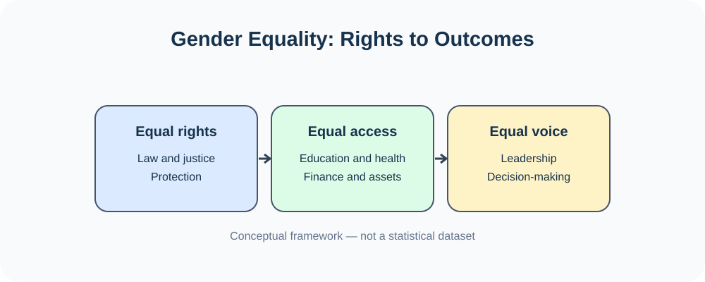
- 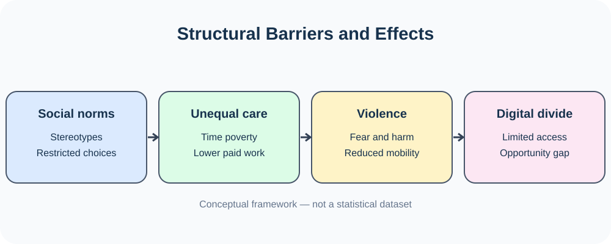
- 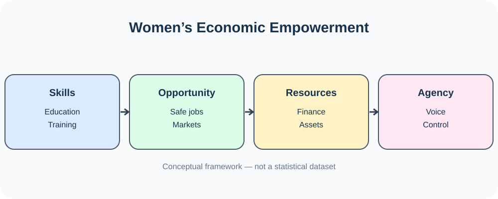
- 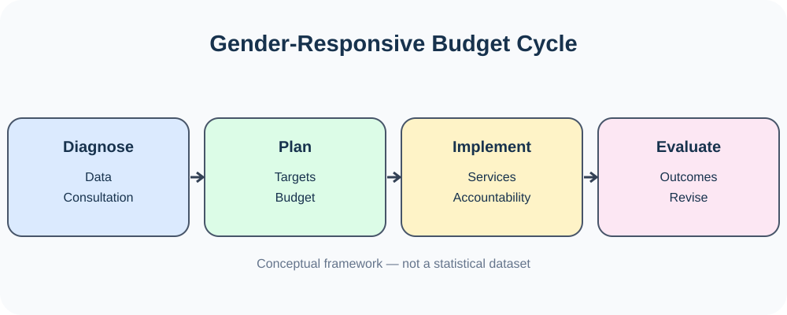
- 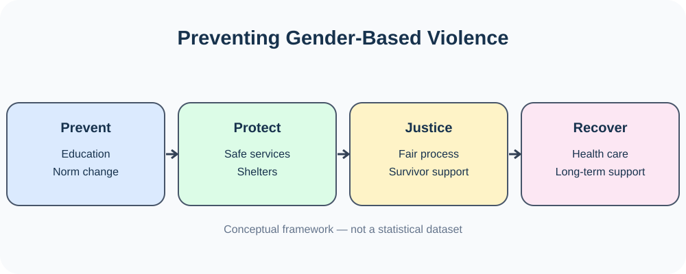
- 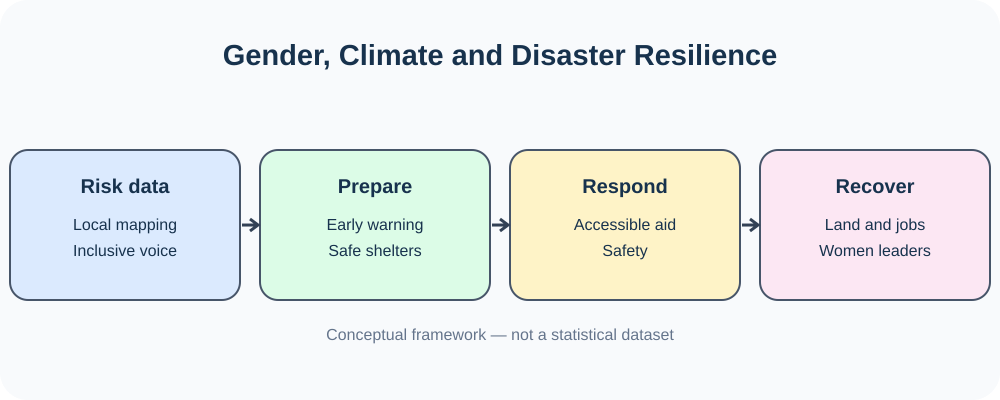
- 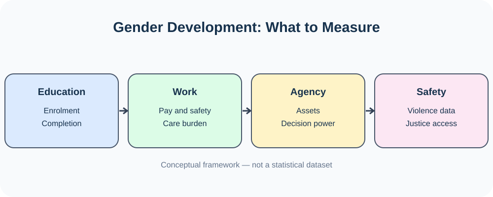
- 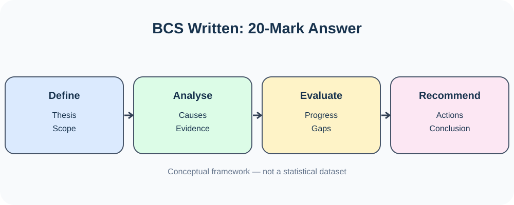

**পূর্ণ Visual Atlas:** [৮টি ডায়াগ্রাম ও ১৭টি প্রাতিষ্ঠানিক উৎস](./VISUAL-ATLAS.md) · [২৫টি উত্তরসহ প্রশ্ন](./QUESTION-ANSWERS.md)

- **Core idea:** rights + capabilities + resources + agency + safety.
- **5 key arenas:** education, health, work, leadership, protection.
- **5 structural barriers:** stereotypes, unpaid care, violence, unequal assets, digital divide.
- **Legal anchors:** Constitution Articles 19, 27, 28, 29; relevant domestic laws; CEDAW.
- **Global anchors:** Beijing Platform for Action; SDG 5; links to SDGs 1, 3, 4, 8, 10, 13 and 16.
- **Policy formula:** prevention + services + justice + economic opportunity + data + accountability.
- **Evaluation:** distinguish inputs, outputs and outcomes; use year-specific and sex-disaggregated data.
- **Exam structure:** definition → evidence/context → causes → laws/policy → solutions → conclusion.

[বিষয়সূচিতে ফিরুন](#top)

---

## অংশ ঘ — উৎস ও যাচাই

### এই অধ্যায়ের যাচাইয়ের অবস্থা

| শ্রেণি | এই সম্পাদনায় নির্দিষ্ট অবস্থা |
|---|---|
| VERIFIED | UNDP-র SDG 5.4–5.5; SNA 2008-এর নিজ পরিবারের জন্য গৃহস্থালি সেবার উৎপাদনসীমা। |
| UNVERIFIED | বাংলাদেশের প্রতিটি বর্তমান সূচক, আইন ও quotation bank-এর সব বাক্য পূর্ণ যাচাই হয়নি। |

যাচাই করা নির্দিষ্ট বক্তব্যের উৎস ও অবস্থান [উৎস-নিরীক্ষায়](../SOURCE-AUDIT.md) আছে। এই শ্রেণিবিন্যাস পুরো অধ্যায়ের সব দাবি যাচাই হওয়ার সনদ নয়।

### Source register

1. **Bangladesh Public Service Commission (BPSC)** — *Syllabus for BCS (Written) Examination*, Bangladesh Affairs, Subject Code 005. https://bpsc.portal.gov.bd/
2. **The Constitution of the People’s Republic of Bangladesh** — especially Articles 19, 27, 28 and 29. Bangladesh Laws portal: https://bdlaws.minlaw.gov.bd/
3. **Ministry of Women and Children Affairs, Bangladesh** — National Women Development Policy 2011 and policy materials. https://mowca.gov.bd/
4. **Bangladesh Laws, Ministry of Law, Justice and Parliamentary Affairs** — Child Marriage Restraint Act 2017; Domestic Violence (Prevention and Protection) Act 2010; Women and Children Repression Prevention Act 2000 and amendments. https://bdlaws.minlaw.gov.bd/
5. **United Nations Treaty Collection** — Convention on the Elimination of All Forms of Discrimination against Women (CEDAW), treaty status and reservations. https://treaties.un.org/
6. **UN Women** — Beijing Declaration and Platform for Action; gender equality and women’s empowerment resources. https://www.unwomen.org/
7. **United Nations Department of Economic and Social Affairs (UN DESA)** — Sustainable Development Goal 5 and targets/indicators. https://sdgs.un.org/goals/goal5
8. **Bangladesh Bureau of Statistics (BBS)** — *Gender Statistics of Bangladesh*, Labour Force Survey and relevant household/social statistics. https://bbs.gov.bd/
9. **International Labour Organization (ILO)** — gender equality, decent work, labour force and unpaid care work resources. https://www.ilo.org/
10. **World Bank** — Bangladesh gender data, women’s economic participation and development research. https://www.worldbank.org/en/country/bangladesh
11. **UNICEF Bangladesh** — child marriage, adolescent girls and education resources. https://www.unicef.org/bangladesh/
12. **UNFPA Bangladesh** — reproductive health, gender-based violence and child marriage resources. https://bangladesh.unfpa.org/

**Data integrity note:** This chapter intentionally avoids presenting unsourced or undated numerical claims as current statistics. For an exam answer, use the report title, institution and publication year, and verify the exact figure from the original report before quoting it. The practice prompts are not claimed to be verified verbatim BPSC past questions without primary-paper evidence.

**ছবির কৃতিত্ব ও লাইসেন্স:** [ছবির উৎসতালিকা](../assets/photos/SOURCES.md)।

[বিষয়সূচিতে ফিরুন](#top)

---

[আগের অধ্যায়](../Chapter-14/README.md#book-text) · [বইয়ের সূচি](../README.md) · [পরের অধ্যায়](../Chapter-16/README.md#book-text)
