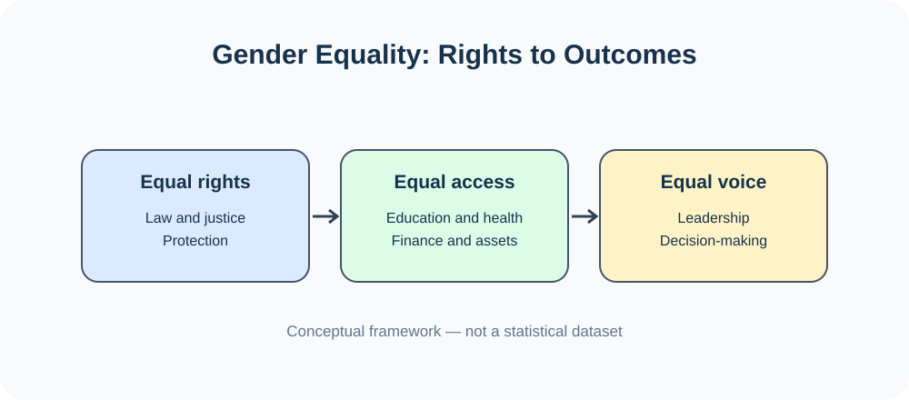
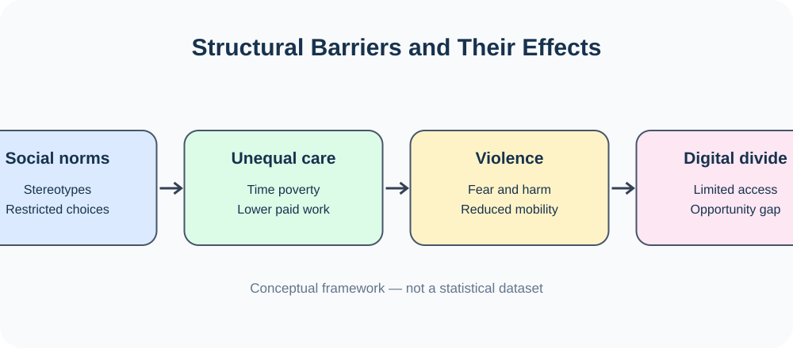
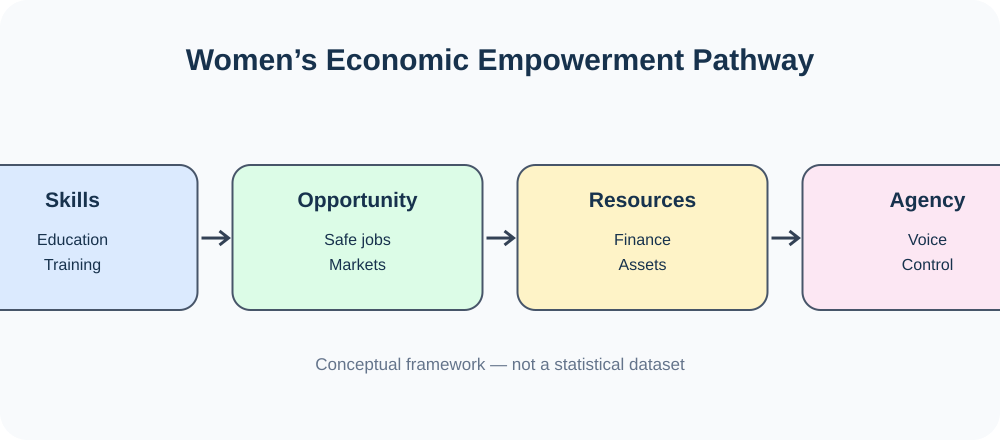
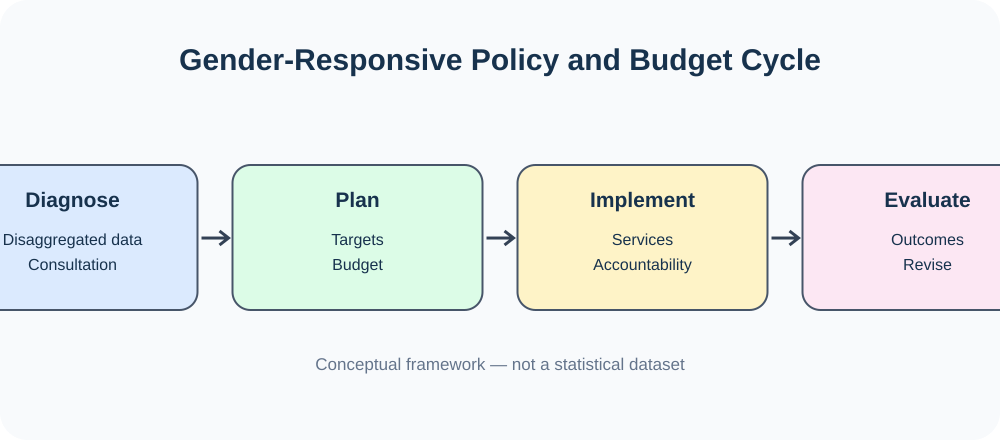
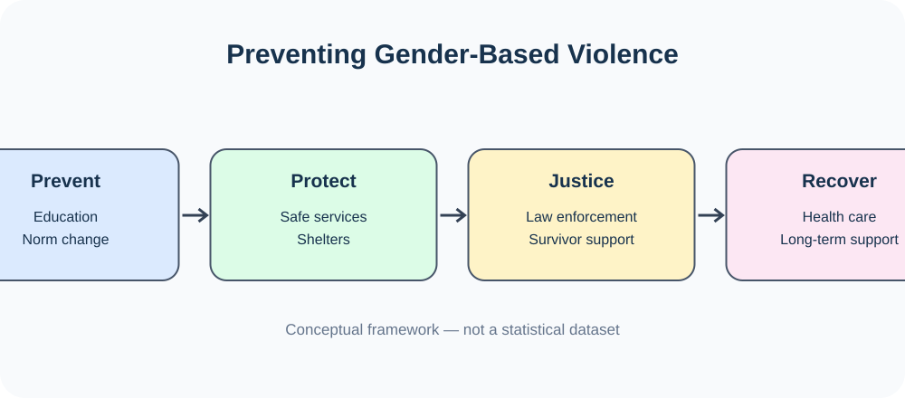
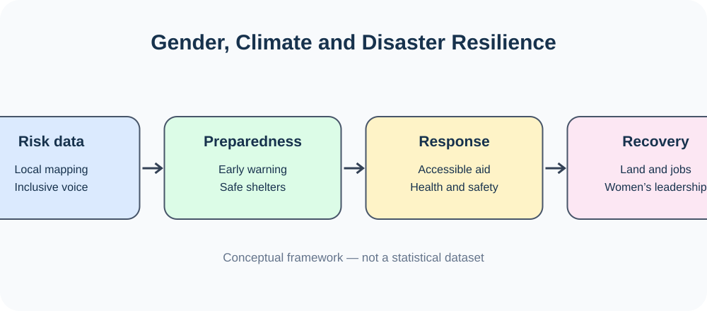
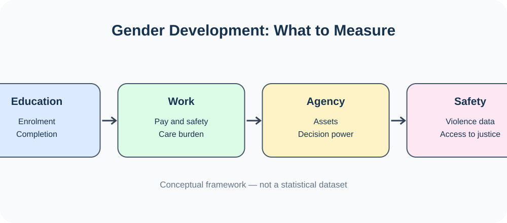

# Chapter 15 — Visual Atlas: Gender Issues and Development

[← Main chapter](./README.md) · [Model essays](./PYQ-BASED-ESSAYS.md) · [Quotations](./QUOTATIONS.md) · [All chapters](../README.md)

Gender is a cross-cutting social and development issue rather than a geographic topic; an unrelated map would mislead. This atlas prioritises chapter-specific diagrams and exact institutional sources. Diagrams are conceptual, not statistical claims.

## Eight chapter-specific diagrams

1. **Gender equality framework** — rights, access and voice. 
2. **Structural barriers** — social norms, unequal care, violence and digital exclusion. 
3. **Economic empowerment** — skills, decent opportunities, resources and agency. 
4. **Gender-responsive budgeting** — diagnose, plan, implement and evaluate. 
5. **Violence prevention and response** — prevention, protection, justice and recovery. 
6. **Climate and disaster resilience** — risk data, preparedness, response and recovery. 
7. **Gender indicators** — education, work, agency and safety. 
8. **BCS Written answer plan** — define, analyse, evaluate and recommend. 

## Exact institutional sources and relevant visuals/data

| No. | Resource | Use in this chapter |
|---:|---|---|
| 9 | [Bangladesh Bureau of Statistics — Violence Against Women Survey 2024, key findings](https://bbs.gov.bd/site/page/0090d893-5d87-46cb-a87e-98820598116a/) | National evidence on gender-based violence; cite report year and indicator definition. |
| 10 | [BBS — Latest Publications](https://bbs.gov.bd/site/page/b588b454-0f88-4679-bf20-90e06dc1d10b/Latest-Publications) | Official gender, labour and social statistics; check release date. |
| 11 | [UNFPA Bangladesh — 2024 Violence Against Women Survey](https://bangladesh.unfpa.org/en/2024-violence-against-women-survey) | Survey design, prevalence measures and policy context. |
| 12 | [UN Women — Gender data and SDG 5](https://www.unwomen.org/en/what-we-do/gender-equality) | Global gender equality framework and evidence. |
| 13 | [UN Sustainable Development Goal 5](https://sdgs.un.org/goals/goal5) | Targets on discrimination, violence, care work, leadership and reproductive rights. |
| 14 | [CEDAW — Convention text](https://www.ohchr.org/en/instruments-mechanisms/instruments/convention-elimination-all-forms-discrimination-against-women) | International legal framework against discrimination. |
| 15 | [ILO — Gender equality at work](https://www.ilo.org/topics-and-sectors/gender-equality) | Decent work, pay, occupational segregation and care. |
| 16 | [World Bank — Bangladesh overview](https://www.worldbank.org/en/country/bangladesh) | Country research, development indicators and economic participation. |
| 17 | [UNICEF Bangladesh — Child marriage](https://www.unicef.org/bangladesh/en/child-marriage) | Child marriage, adolescent girls and prevention. |
| 18 | [UNFPA Bangladesh](https://bangladesh.unfpa.org/) | Reproductive health, gender-based violence and population data. |
| 19 | [Bangladesh Ministry of Women and Children Affairs](https://mowca.gov.bd/) | National policies, programmes and official institutional context. |
| 20 | [Laws of Bangladesh — Child Marriage Restraint Act, 2017](https://bdlaws.minlaw.gov.bd/) | Verify current law text and exceptions directly; do not rely on summaries alone. |
| 21 | [Laws of Bangladesh — Domestic Violence (Prevention and Protection) Act, 2010](https://bdlaws.minlaw.gov.bd/) | Legal framework for protection and remedies. |
| 22 | [Bangladesh Constitution — official text](https://bdlaws.minlaw.gov.bd/act-print-367.html) | Equality before law, non-discrimination and public participation. |
| 23 | [ILO — Care work and care jobs](https://www.ilo.org/) | Unpaid care work, time poverty and decent-work policy. |
| 24 | [UN Women — Beijing Platform for Action](https://www.unwomen.org/en/digital-library/publications/2015/01/beijing-declaration) | Strategic areas for gender equality. |
| 25 | [UN SDG 10 — Reduced inequalities](https://sdgs.un.org/goals/goal10) | Intersectional and structural inequality. |

## Chart and image accuracy rules

- Do not use an illustrative diagram as measured data. Every numeric chart must state source, year, unit, population and definition.
- When quoting BBS or UNFPA survey findings, use the exact indicator and denominator; lifetime prevalence and past-12-month prevalence are not interchangeable.
- Avoid comparing estimates across surveys without checking sampling, age range, question wording and methodology.
- Use credited images from the linked official source pages. The links above are source pages, not a claim that each page has a single embeddable photo.

[⬆ Main chapter](./README.md) · [Model essays](./PYQ-BASED-ESSAYS.md) · [Quotations](./QUOTATIONS.md) · [Index](../README.md)
