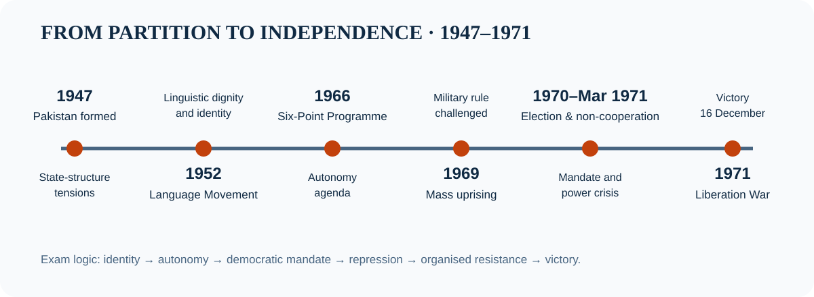
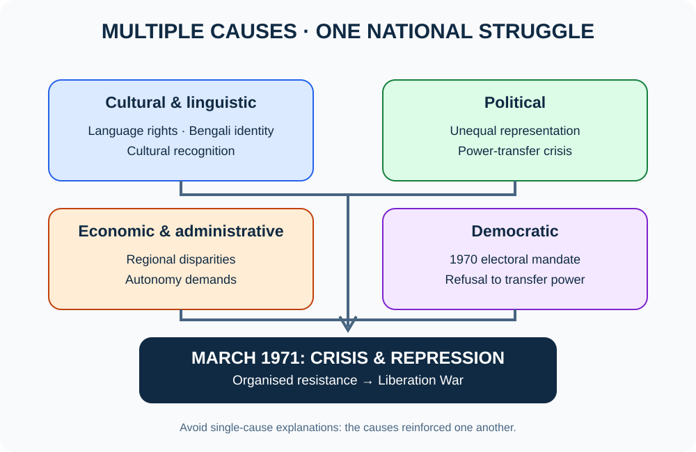
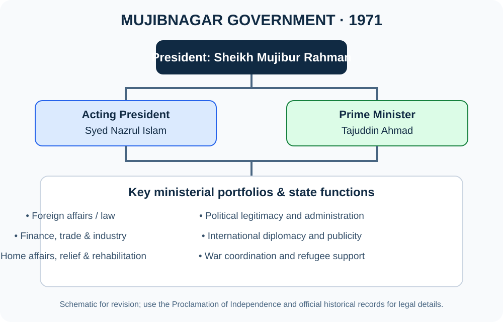
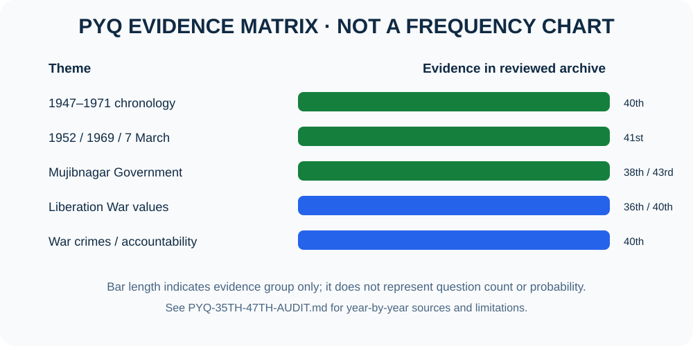

# Chapter 16 — মুক্তিযুদ্ধ ও তার পটভূমি | The Liberation War and Its Background

> **BCS Written · Bangladesh Affairs · Official Syllabus Unit 16**  
> **মূল ভাষা:** বাংলা; প্রশ্ন, key terms ও quotation: English  
> **Source review:** ২১ অক্টোবর ২০২৬ · **পাঠের কাঠামো:** ঐতিহাসিক ধারাবাহিকতা → কারণ–ফল বিশ্লেষণ → দলিল ও সময়রেখা → বিগত প্রশ্নের theme audit → প্রবন্ধ → model Q&A।

[← Bangladesh Affairs-এর মূল সূচি](../README.md) · [৩৫তম–৪৭তম BCS PYQ Audit](./PYQ-35TH-47TH-AUDIT.md) · [২৫টি উত্তরসহ Model Q&A](./BCS-WRITTEN-QUESTION-BANK.md) · [৮টি source-backed প্রবন্ধ](./PYQ-BASED-ESSAYS.md) · [২০টি English Quotations + Sources](./QUOTATIONS.md#verified-quotes)

> [!IMPORTANT]
> **পড়ার মূল সূত্র:** ভাষা ও পরিচয়ের দাবি → রাজনৈতিক-অর্থনৈতিক বৈষম্য → স্বায়ত্তশাসনের আন্দোলন → ১৯৭০-এর নির্বাচনী ম্যান্ডেট অস্বীকার → অসহযোগ → ৭ মার্চের ভাষণ → ২৫ মার্চের গণহত্যা ও প্রতিরোধ → মুজিবনগর সরকার ও মুক্তিযুদ্ধ → ১৬ ডিসেম্বর বিজয় → রাষ্ট্র পুনর্গঠন।

## বিষয়সূচি — Quick Navigation

| শেখার ধাপ | বিষয় | পরীক্ষার প্রস্তুতি |
|---|---|---|
| [শিখনফল](#goals) | [ঐতিহাসিক পটভূমি](#background) | [PYQ-theme audit](#pyq) |
| [Timeline](#timeline) | [আন্দোলনের পর্যায়](#movement) | [কারণ–ফল বিশ্লেষণ](#causes) |
| [৭ মার্চের ভাষণ](#march7) | [মুজিবনগর সরকার](#mujibnagar) | [যুদ্ধের কৌশল ও আন্তর্জাতিক প্রতিক্রিয়া](#war) |
| [গণহত্যা ও শরণার্থী](#atrocities) | [বিজয় ও প্রত্যাবর্তন](#victory) | [প্রবন্ধ](./PYQ-BASED-ESSAYS.md) |
| [পরিভাষা](#terms) | [অনুশীলনী](#questions) | [English quotations](./QUOTATIONS.md) |
| [এক পৃষ্ঠার revision](#revision) | [উৎসতালিকা](#sources) | [Accuracy note](#accuracy) |
| [Visual Atlas: ৬টি SVG diagram/chart](#visual-atlas) | [২৫টি answered model Q&A](./BCS-WRITTEN-QUESTION-BANK.md) | [৩৫তম–৪৭তম PYQ audit](./PYQ-35TH-47TH-AUDIT.md) |

## Visual Atlas — ৬টি revision diagram/chart

**ব্যবহারবিধি:** প্রতিটি ছবির ক্যাপশনে বিষয়, উৎস ও লাইসেন্স/ফাইল পৃষ্ঠা রাখা হয়েছে। মূল ছবি ও লাইসেন্সের জন্য caption-এর Commons link খুলুন। মুক্তিযুদ্ধের সেক্টর মানচিত্রটি ঐতিহাসিকভাবে প্রাসঙ্গিক; সীমানা ও কমান্ডের পরিবর্তন বোঝাতে সংশ্লিষ্ট সময় উল্লেখ করুন।

### A. ছয়টি দ্রুত revision diagram

**১. ১৯৪৭–১৯৭১ সময়রেখা**

**২. মুক্তিযুদ্ধের বহুমাত্রিক কারণ**

**৩. মুজিবনগর সরকারের কাঠামো**

**৪. মুক্তিযুদ্ধের সংগঠন ও সামরিক কার্যক্রম**

**৫. BCS Written ২০ নম্বরের উত্তর কাঠামো**

**৬. PYQ evidence matrix** — এটি সরকারি frequency chart নয়; নথিভুক্ত উদাহরণ ও audit status-এর visual summary।

> **Image integrity:** ছবিগুলো সংশ্লিষ্ট পাঠের পাশে বসানো হয়েছে; প্রতিটি ছবির caption-এ মূল file page, উৎস ও প্রযোজ্য licence রয়েছে। ছবিকে একা বিতর্কিত ঐতিহাসিক দাবির প্রমাণ হিসেবে ব্যবহার করবেন না.

---

## ১. শিখনফল ও সিলেবাসের সঙ্গে সম্পর্ক

BPSC-এর *Syllabus for BCS (Written) Examination*, Bangladesh Affairs (Subject Code 005), Unit 16-এ মুক্তিযুদ্ধের পটভূমি, ভাষা আন্দোলন, ১৯৫৪ নির্বাচন, ছয় দফা, ১৯৬৮–৬৯ গণঅভ্যুত্থান, ১৯৭০ নির্বাচন, অসহযোগ আন্দোলন, ১৯৭১, ৭ মার্চের ভাষণ, মুজিবনগর সরকারের গঠন ও কার্যাবলি, প্রধান শক্তি ও জাতিসংঘের ভূমিকা, পাকিস্তানি বাহিনীর আত্মসমর্পণ, বঙ্গবন্ধুর প্রত্যাবর্তন এবং ভারতীয় বাহিনীর প্রত্যাহার উল্লেখ আছে। [S1]

এই অধ্যায় পড়ে আপনি পারবেন:
- ১৯৪৭–১৯৭১-এর রাজনৈতিক ঘটনাগুলো কারণ–ফলসহ ব্যাখ্যা করতে;
- বাঙালি জাতীয়তাবাদের বিকাশে ভাষা, অর্থনীতি, প্রতিনিধিত্ব ও সাংস্কৃতিক পরিচয়ের ভূমিকা বিশ্লেষণ করতে;
- ৭ মার্চের ভাষণ, ১৯৭০-এর নির্বাচন ও মুজিবনগর সরকারের ঐতিহাসিক গুরুত্ব মূল্যায়ন করতে;
- মুক্তিযুদ্ধের সামরিক, কূটনৈতিক, মানবিক ও আন্তর্জাতিক মাত্রা একসঙ্গে তুলে ধরতে;
- ৫/১০/২০ নম্বরের উত্তর যুক্তি, তথ্য, প্রাসঙ্গিক quotation ও উপসংহার দিয়ে সাজাতে।

> [!NOTE]
> **Source policy:** BPSC syllabus হলো বিষয়-পরিধির প্রাথমিক উৎস। ঐতিহাসিক তথ্যের জন্য Liberation War Museum, Banglapedia, বাংলাদেশের সরকারি দলিল/আইন, UNESCO এবং স্বীকৃত গবেষণা ব্যবহার করুন। অনলাইন প্রশ্নব্যাংকে পাওয়া প্রশ্নকে মূল প্রশ্নপত্রের scan দিয়ে যাচাই না করা পর্যন্ত “archive-reported theme” বলা হয়েছে—নিশ্চিত BPSC PYQ দাবি করা হয়নি।

## ২. Key Terms — পরীক্ষার জন্য অপরিহার্য পরিভাষা

| English term | সহজ বাংলা ব্যাখ্যা | উত্তরে প্রয়োগ |
|---|---|---|
| Bengali Nationalism | ভাষা, সংস্কৃতি, ইতিহাস ও রাজনৈতিক অধিকারের ভিত্তিতে বাঙালির জাতিসত্তাবোধ | স্বাধীনতার দীর্ঘমেয়াদি পটভূমি |
| Political Representation | জনসংখ্যা ও ভোটের অনুপাতে রাজনৈতিক ক্ষমতা/প্রতিনিধিত্ব | ১৯৭০ নির্বাচন ও ক্ষমতা হস্তান্তর সংকট |
| Economic Disparity | অঞ্চলভিত্তিক সম্পদ, বিনিয়োগ ও সুযোগের বৈষম্য | পূর্ব–পশ্চিম পাকিস্তানের বৈষম্য |
| Autonomy | একটি রাষ্ট্রের কাঠামোর মধ্যে আঞ্চলিক স্বশাসন | ছয় দফা |
| Non-cooperation Movement | শাসনব্যবস্থার সঙ্গে অসহযোগ করে রাজনৈতিক দাবি বাস্তবায়নের আন্দোলন | মার্চ ১৯৭১ |
| Genocide / Mass Atrocities | জনগোষ্ঠী ধ্বংসের উদ্দেশ্যসম্পন্ন অপরাধের আইনি সংজ্ঞা বা ব্যাপক নৃশংসতা—প্রসঙ্গভেদে সঠিক শব্দ ব্যবহার জরুরি | ২৫ মার্চ ও ১৯৭১-এর সহিংসতা |
| Provisional Government | স্বাধীনতা সংগ্রাম চলাকালে অস্থায়ী সরকার | মুজিবনগর সরকার |
| Liberation War | স্বাধীনতা অর্জনের লক্ষ্যে পরিচালিত সশস্ত্র সংগ্রাম | ১৯৭১-এর সামরিক ও জনযুদ্ধ |
| Refugee crisis | সংঘাতের কারণে সীমান্ত অতিক্রম করে আশ্রয় নেওয়া মানুষের সংকট | আন্তর্জাতিক মানবিক মাত্রা |
| Surrender | সামরিক বাহিনীর আনুষ্ঠানিক আত্মসমর্পণ | ১৬ ডিসেম্বর ১৯৭১ |

## ৩. মুক্তিযুদ্ধের পটভূমি: ১৯৪৭ থেকে ১৯৭১

### ৩.১ রাষ্ট্রগঠনের সংকট ও পূর্ব–পশ্চিম পাকিস্তানের বৈপরীত্য

১৯৪৭ সালে ব্রিটিশ ভারত বিভক্ত হয়ে পাকিস্তান রাষ্ট্র গঠিত হয়। পূর্ব বাংলা পাকিস্তানের পূর্বাংশ হিসেবে অন্তর্ভুক্ত হলেও দুই অংশের মধ্যে প্রায় ১,৬০০ কিলোমিটার ভারতীয় ভূখণ্ড ছিল। ভাষা, সংস্কৃতি, অর্থনীতি ও প্রশাসনিক বাস্তবতায় দুই অংশের পার্থক্য ছিল গভীর। সংখ্যাগরিষ্ঠ জনগোষ্ঠী পূর্ব পাকিস্তানে বসবাস করলেও কেন্দ্রীয় সিদ্ধান্ত গ্রহণ, সামরিক নেতৃত্ব ও প্রশাসনের ক্ষমতা কাঠামোয় পূর্ব বাংলার প্রতিনিধিত্ব নিয়ে অসন্তোষ বাড়তে থাকে।

বৈষম্যকে শুধু “অর্থনৈতিক” বলে ব্যাখ্যা করলে অসম্পূর্ণ হয়। এর সঙ্গে যুক্ত ছিল ভাষার মর্যাদা, সাংস্কৃতিক স্বীকৃতি, নির্বাচিত প্রতিনিধিদের ক্ষমতা, সামরিকীকরণ এবং গণতান্ত্রিক ম্যান্ডেট অস্বীকার। এ কারণেই বাঙালি জাতীয়তাবাদ ক্রমে সাংস্কৃতিক দাবির গণ্ডি ছাড়িয়ে রাজনৈতিক আত্মনিয়ন্ত্রণের দাবিতে রূপ নেয়। [S2, S3]

### ৩.২ ভাষা আন্দোলন, ১৯৪৮–১৯৫২

উর্দুকে একমাত্র রাষ্ট্রভাষা করার প্রচেষ্টা পূর্ব বাংলার সংখ্যাগরিষ্ঠ বাংলা ভাষাভাষী মানুষের পরিচয় ও অধিকারবোধে আঘাত করে। ছাত্রসমাজ, বুদ্ধিজীবী ও সাধারণ মানুষের আন্দোলনের ধারাবাহিকতায় ২১ ফেব্রুয়ারি ১৯৫২-তে পুলিশের গুলিতে সালাম, বরকত, রফিক, জব্বারসহ আন্দোলনকারীরা শহীদ হন; বিভিন্ন ঐতিহাসিক তালিকায় নাম ও ঘটনার বিস্তারিত আলাদা করে যাচাই করা উচিত। ভাষা আন্দোলন বাংলা ভাষার রাষ্ট্রীয় স্বীকৃতির প্রশ্নকে গণতন্ত্র, মর্যাদা ও রাজনৈতিক অধিকারের বৃহত্তর আন্দোলনের সঙ্গে যুক্ত করে।

**ঐতিহাসিক তাৎপর্য:**  
১. ভাষাভিত্তিক সাংস্কৃতিক পরিচয় রাজনৈতিক চেতনার কেন্দ্র হয়ে ওঠে।  
২. ছাত্রসমাজ ও নাগরিক সমাজের সংগঠিত ভূমিকা দৃশ্যমান হয়।  
৩. পরবর্তী স্বায়ত্তশাসন ও স্বাধীনতা আন্দোলনের জন্য প্রতীক, স্মৃতি ও সংগঠনের ভিত্তি তৈরি হয়।  
৪. ২১ ফেব্রুয়ারি পরবর্তীকালে UNESCO-র International Mother Language Day হিসেবে আন্তর্জাতিক স্বীকৃতি পায়। [S4]

#### ১. ১৯৫২ সালের ভাষা আন্দোলন

**পরীক্ষায় প্রয়োগ:** ভাষা আন্দোলনের গণভিত্তি ও বাঙালি জাতীয়তাবাদের সাংস্কৃতিক শিকড়। Source/file page: [Wikimedia Commons — 1952 Bengali Language movement.jpg](https://commons.wikimedia.org/wiki/File:1952_Bengali_Language_movement.jpg) (file page lists public-domain status).

#### ২. শহিদ মিনার

**পরীক্ষায় প্রয়োগ:** ভাষা-শহিদদের স্মৃতি, সাংস্কৃতিক পরিচয় ও স্মৃতির রাজনীতি। Source/licence: [Wikimedia Commons file page](https://commons.wikimedia.org/wiki/File:Shaheed_Minar_of_the_Bengali_language_movement.jpg), CC BY-SA 4.0; attribution required.

### ৩.৩ ১৯৫৪ সালের যুক্তফ্রন্ট নির্বাচন

১৯৫৪ সালের পূর্ববঙ্গ প্রাদেশিক নির্বাচনে যুক্তফ্রন্টের বিজয় কেন্দ্রীয় শাসকগোষ্ঠীর নীতির বিরুদ্ধে জনমতের শক্তিশালী প্রকাশ ছিল। ভাষা, প্রাদেশিক স্বায়ত্তশাসন, কৃষক-শ্রমিকের দাবি ও গণতান্ত্রিক অধিকারের প্রশ্ন নির্বাচনী রাজনীতিতে গুরুত্বপূর্ণ হয়ে ওঠে। নির্বাচিত সরকার অল্প সময়ের মধ্যে বরখাস্ত হওয়া কেন্দ্র–প্রদেশ সম্পর্কের সংকটকে আরও তীব্র করে। এই ঘটনা দেখায়, ভোটের মাধ্যমে প্রকাশিত জনমত ও রাষ্ট্রীয় ক্ষমতার মধ্যে দ্বন্দ্ব রাজনৈতিক বৈধতাকে দুর্বল করতে পারে। [S2, S3]

### ৩.৪ ছয় দফা আন্দোলন, ১৯৬৬

শেখ মুজিবুর রহমানের ছয় দফা ছিল পাকিস্তানের ফেডারেল কাঠামোর মধ্যে পূর্ব পাকিস্তানের স্বায়ত্তশাসন নিশ্চিত করার কর্মসূচি। এর কেন্দ্রীয় বিষয়গুলো ছিল:
- প্রকৃত ফেডারেল সংসদীয় ব্যবস্থা ও জনসংখ্যাভিত্তিক প্রতিনিধিত্ব;
- কেন্দ্রীয় সরকারের ক্ষমতা প্রতিরক্ষা ও পররাষ্ট্রনীতিতে সীমিত রাখা;
- মুদ্রা ও পুঁজি পাচার-সংক্রান্ত সুরক্ষা;
- কর আরোপ ও রাজস্ব সংগ্রহে প্রাদেশিক ক্ষমতা;
- বৈদেশিক বাণিজ্য ও বৈদেশিক মুদ্রা আয়ে প্রাদেশিক নিয়ন্ত্রণ/সুরক্ষা;
- পূর্ব পাকিস্তানের নিজস্ব মিলিশিয়া বা আধাসামরিক বাহিনীর ব্যবস্থা।

ছয় দফাকে প্রায়ই “বাঙালির মুক্তির সনদ” বলা হয়। পরীক্ষার উত্তরে শুধু ছয়টি পয়েন্ট লিখে থেমে গেলে চলবে না; দেখাতে হবে—এ কর্মসূচি অর্থনৈতিক স্বায়ত্তশাসন, রাজনৈতিক প্রতিনিধিত্ব এবং কেন্দ্রীয় ক্ষমতার পুনর্বণ্টনকে এক সূত্রে এনেছিল। পশ্চিম পাকিস্তানি শাসকগোষ্ঠীর বিরোধিতা ও দমন-পীড়ন আন্দোলনকে আরও বিস্তৃত করে। [S2, S3]

### ৩.৫ আগরতলা মামলা ও ১৯৬৯-এর গণঅভ্যুত্থান

১৯৬৮ সালে শেখ মুজিবুর রহমানসহ কয়েকজনের বিরুদ্ধে আগরতলা ষড়যন্ত্র মামলা দায়ের করা হয়। মামলা ও রাজনৈতিক দমন-পীড়নের বিরুদ্ধে ছাত্রসমাজ, শ্রমিক ও সাধারণ মানুষের আন্দোলন ব্যাপক গণঅভ্যুত্থানে রূপ নেয়। ১৯৬৯ সালের আন্দোলন সামরিক শাসক আইয়ুব খানের শাসনকে সংকটে ফেলে; শেখ মুজিব মুক্তি পান এবং “বঙ্গবন্ধু” উপাধিতে অভিহিত হন। এই পর্যায়ে ছাত্রদের ১১ দফা কর্মসূচি, শ্রমিকের অংশগ্রহণ এবং জনতার প্রতিবাদ স্বায়ত্তশাসনের প্রশ্নকে গণতন্ত্র ও সামাজিক ন্যায়ের দাবির সঙ্গে যুক্ত করে। [S2]

### ৩.৬ ১৯৭০ সালের সাধারণ নির্বাচন ও ক্ষমতা হস্তান্তরের সংকট

১৯৭০ সালের সাধারণ নির্বাচনে আওয়ামী লীগ পূর্ব পাকিস্তানে নিরঙ্কুশ জনসমর্থন লাভ করে এবং পাকিস্তানের জাতীয় পরিষদে সংখ্যাগরিষ্ঠতা অর্জন করে। গণতান্ত্রিক রীতিতে এই ফল সরকার গঠন ও সংবিধান প্রণয়নের ম্যান্ডেট তৈরি করেছিল। কিন্তু জাতীয় পরিষদের অধিবেশন স্থগিত, ক্ষমতা হস্তান্তরে বিলম্ব এবং রাজনৈতিক আলোচনার ব্যর্থতা সংকটকে তীব্র করে। নির্বাচনী সংখ্যাগরিষ্ঠতার অধিকার বাস্তবায়িত না হওয়ায় স্বায়ত্তশাসনের দাবি স্বাধীনতার আন্দোলনে রূপ নেয়। [S2, S3]

**মূল বিশ্লেষণ:** ১৯৭১-কে আকস্মিক বিচ্ছিন্ন ঘটনা হিসেবে দেখা যায় না। দীর্ঘমেয়াদি বৈষম্য ও জাতীয়তাবাদের সঙ্গে ১৯৭০-এর নির্বাচনী ম্যান্ডেট অস্বীকার এবং সামরিক দমন-পীড়নের তাৎক্ষণিক সংকট যুক্ত হয়ে স্বাধীনতা যুদ্ধের পথ তৈরি করে।

## ৪. সময়রেখা — Timeline at a Glance

| তারিখ/সময় | ঘটনা | ঐতিহাসিক তাৎপর্য |
|---|---|---|
| ১৯৪৭ | পাকিস্তান রাষ্ট্র গঠন | দুই ভৌগোলিক অংশে রাজনৈতিক-প্রশাসনিক সংকটের সূচনা |
| ১৯৪৮–১৯৫২ | ভাষা আন্দোলন | ভাষা ও সাংস্কৃতিক অধিকারের গণভিত্তি |
| ২১ ফেব্রুয়ারি ১৯৫২ | ভাষা আন্দোলনে গুলি ও শহীদ | বাঙালি জাতীয়তাবাদের স্মারক দিন |
| ১৯৫৪ | যুক্তফ্রন্টের নির্বাচনী বিজয় | কেন্দ্রীয় নীতির বিরুদ্ধে জনমতের প্রকাশ |
| ১৯৫৮ | সামরিক শাসন | গণতান্ত্রিক রাজনীতির পরিসর সংকুচিত |
| ১৯৬৬ | ছয় দফা | স্বায়ত্তশাসনের সুস্পষ্ট রাজনৈতিক-অর্থনৈতিক কর্মসূচি |
| ১৯৬৮ | আগরতলা মামলা | রাজনৈতিক সংঘাত ও গণপ্রতিবাদের বিস্তার |
| ১৯৬৯ | গণঅভ্যুত্থান | আইয়ুব শাসনের পতন; শেখ মুজিবের মুক্তি |
| ডিসেম্বর ১৯৭০ | সাধারণ নির্বাচন | আওয়ামী লীগের সংখ্যাগরিষ্ঠ ম্যান্ডেট |
| ১ মার্চ ১৯৭১ | জাতীয় পরিষদের অধিবেশন স্থগিত ঘোষণা | অসহযোগ ও গণআন্দোলনের তীব্রতা বৃদ্ধি |
| ৭ মার্চ ১৯৭১ | বঙ্গবন্ধুর ঐতিহাসিক ভাষণ | প্রতিরোধ, প্রস্তুতি ও রাজনৈতিক দিকনির্দেশ |
| ২৫ মার্চ ১৯৭১ | Operation Searchlight; ব্যাপক সামরিক দমন | মুক্তিযুদ্ধের সশস্ত্র পর্যায় তীব্রতর |
| ২৬ মার্চ ১৯৭১ | স্বাধীনতার ঘোষণা-সংক্রান্ত ঐতিহাসিক ঘটনা | বাংলাদেশের স্বাধীনতা ঘোষণার স্মারক; দলিলের ভাষা ও সম্প্রচারের ক্রম নির্ভরযোগ্য উৎসে যাচাই করুন |
| ১০ এপ্রিল ১৯৭১ | স্বাধীনতার ঘোষণাপত্র গৃহীত | স্বাধীনতার সাংবিধানিক-রাজনৈতিক ভিত্তি |
| ১৭ এপ্রিল ১৯৭১ | মুজিবনগর সরকারের শপথ | অস্থায়ী সরকারের প্রকাশ্য আনুষ্ঠানিক সূচনা |
| ১৬ ডিসেম্বর ১৯৭১ | পাকিস্তানি বাহিনীর আত্মসমর্পণ | বিজয় ও স্বাধীন ভূখণ্ডে যুদ্ধের সমাপ্তি |
| ১০ জানুয়ারি ১৯৭২ | বঙ্গবন্ধুর স্বদেশ প্রত্যাবর্তন | যুদ্ধোত্তর রাষ্ট্র পুনর্গঠনের নেতৃত্বে প্রত্যাবর্তন |
| ১২ মার্চ ১৯৭২ | ভারতীয় বাহিনীর প্রত্যাহার সম্পন্ন হওয়ার প্রচলিত তারিখ | যুদ্ধোত্তর সার্বভৌমত্ব ও দ্বিপক্ষীয় সহযোগিতার প্রসঙ্গ; সুনির্দিষ্ট তারিখের জন্য প্রাথমিক সরকারি নথি যাচাই করুন |

> [!WARNING]
> **তারিখ-সংক্রান্ত সতর্কতা:** ২৬ মার্চের স্বাধীনতার ঘোষণা, ঘোষণাপত্রের ১০ এপ্রিল তারিখ, ১৭ এপ্রিল শপথ এবং বার্তা প্রচারের সময়/মাধ্যম এক বিষয় নয়। পরীক্ষায় এগুলো গুলিয়ে ফেলবেন না। কোনো নির্দিষ্ট শব্দে “প্রথম ঘোষণা” বা “প্রথম সম্প্রচার” জানতে চাইলে উৎস-সমর্থিত বর্ণনা ব্যবহার করুন।

## ৫. মার্চ ১৯৭১: অসহযোগ থেকে সশস্ত্র প্রতিরোধ

১ মার্চ জাতীয় পরিষদের অধিবেশন স্থগিতের ঘোষণার পর পূর্ব বাংলায় ব্যাপক প্রতিবাদ শুরু হয়। প্রশাসন, শিক্ষা প্রতিষ্ঠান, ব্যবসা ও দৈনন্দিন কার্যক্রমে অসহযোগ আন্দোলন ছড়িয়ে পড়ে। আওয়ামী লীগের নেতৃত্বে কেন্দ্রীয় সরকারের কর্তৃত্ব কার্যত চ্যালেঞ্জের মুখে পড়ে। এ আন্দোলন শুধু রাজনৈতিক সভা-সমাবেশে সীমিত ছিল না; প্রশাসনিক নির্দেশ পালন, রাজস্ব ও যোগাযোগ ব্যবস্থার ওপরও এর প্রভাব পড়ে।

#### ৩. ৭ মার্চের ভাষণ

**পরীক্ষায় প্রয়োগ:** অসহযোগ আন্দোলন, গণসংগঠন ও স্বাধীনতার রাজনৈতিক প্রস্তুতি। Source: [Wikimedia Commons file page](https://commons.wikimedia.org/wiki/File:Sheikh_Mujibur_Rahman_Delivering_7_March_Speech_of_Sheikh_Mujibur_Rahman_at_Ramna_Race_Course_Dhaka_1971-03-07_%28PID-0033891%29.jpg); verify the file page for attribution and reuse terms. Related authoritative record: [UNESCO Memory of the World](https://www.unesco.org/en/memory-world/historic-7th-march-speech-bangabandhu-sheikh-mujibur-rahman).

### ৭ মার্চের ভাষণের ঐতিহাসিক তাৎপর্য

১৯৭১ সালের ৭ মার্চ ঢাকার রেসকোর্স ময়দানে শেখ মুজিবুর রহমানের ভাষণ আন্দোলনকে ঐক্যবদ্ধ দিকনির্দেশ দেয়। ভাষণটিতে জনগণের অধিকার, রাজনৈতিক সমঝোতার শর্ত, প্রতিরোধের প্রস্তুতি এবং মুক্তির লক্ষ্য একত্রে উঠে আসে। ভাষণের তাৎপর্য তিন স্তরে ব্যাখ্যা করা যায়:

1. **রাজনৈতিক:** নির্বাচনী ম্যান্ডেট ও ক্ষমতা হস্তান্তরের দাবি স্পষ্ট করা।
2. **সংগঠনগত:** অসহযোগ, প্রস্তুতি ও প্রতিরোধের জন্য জনগণকে ঐক্যবদ্ধ করা।
3. **ঐতিহাসিক ও সাংস্কৃতিক:** বাঙালির আত্মনিয়ন্ত্রণের আকাঙ্ক্ষাকে শক্তিশালী প্রতীকে রূপ দেওয়া।

UNESCO ২০১৭ সালে ভাষণটিকে Memory of the World International Register-এ অন্তর্ভুক্ত করে। পরীক্ষায় এটিকে শুধু আবেগের ভাষণ না বলে রাজনৈতিক কৌশল, গণসংগঠন এবং ঐতিহাসিক স্মৃতির দলিল হিসেবে মূল্যায়ন করুন। [S5]

### ৭ মার্চের ভাষণ থেকে পরীক্ষায় লেখার মতো মূল বক্তব্য

- গণতান্ত্রিক অধিকার ও নির্বাচনী ম্যান্ডেটের প্রশ্ন;
- অসহযোগ আন্দোলনের মাধ্যমে প্রশাসনিক কর্তৃত্বকে চ্যালেঞ্জ;
- জনগণের আত্মরক্ষা ও প্রতিরোধের প্রস্তুতি;
- রাজনৈতিক সমঝোতার সুযোগ ও শর্ত;
- মুক্তি ও আত্মনিয়ন্ত্রণের আকাঙ্ক্ষা।

> [!TIP]
> **Answer formula:** Historical context → speech’s core messages → role in mass mobilisation → UNESCO recognition → balanced conclusion. ভাষণের দীর্ঘ অংশ হুবহু লেখার বদলে প্রাসঙ্গিক সংক্ষিপ্ত quotation ব্যবহার করুন; বাকি অংশ বিশ্লেষণ করুন।

## ৬. মুক্তিযুদ্ধের কারণ: Structural causes ও Immediate triggers

| কারণের স্তর | মূল উপাদান | কীভাবে যুদ্ধের দিকে নিয়ে যায় |
|---|---|---|
| ভাষা ও সংস্কৃতি | বাংলার রাষ্ট্রভাষার মর্যাদা নিয়ে বিরোধ | সাংস্কৃতিক অধিকার রাজনৈতিক পরিচয়ের অংশ হয় |
| রাজনৈতিক | সংখ্যাগরিষ্ঠতার ভিত্তিতে ক্ষমতা না পাওয়া; প্রাদেশিক স্বায়ত্তশাসনের বিরোধিতা | রাষ্ট্রের বৈধতা ও গণতান্ত্রিক আস্থা ক্ষতিগ্রস্ত হয় |
| অর্থনৈতিক | সম্পদ বণ্টন, বিনিয়োগ, রাজস্ব ও উন্নয়নে বৈষম্য নিয়ে দীর্ঘ অসন্তোষ | স্বায়ত্তশাসনের দাবি শক্তিশালী হয় |
| সামরিক ও প্রশাসনিক | ক্ষমতার কেন্দ্রীকরণ ও পূর্ব পাকিস্তানের প্রতিনিধিত্বের ঘাটতি | সিদ্ধান্ত গ্রহণে বঞ্চনার ধারণা বাড়ে |
| গণআন্দোলন | ভাষা আন্দোলন, যুক্তফ্রন্ট, ছয় দফা, গণঅভ্যুত্থান | সংগঠন, নেতৃত্ব ও রাজনৈতিক চেতনা বিস্তৃত হয় |
| তাৎক্ষণিক | ১৯৭০ নির্বাচনের ফল কার্যকর না হওয়া; আলোচনা ব্যর্থতা; ২৫ মার্চের সামরিক অভিযান | অসহযোগ থেকে সশস্ত্র মুক্তিযুদ্ধে রূপান্তর ঘটে |

**সমন্বিত মূল্যায়ন:** মুক্তিযুদ্ধের পেছনে একক কোনো কারণ ছিল না। দীর্ঘমেয়াদি বৈষম্য ও জাতীয়তাবাদ একটি স্বাধীনতার আন্দোলনের ভিত্তি তৈরি করে; নির্বাচনী ম্যান্ডেট অস্বীকার রাজনৈতিক সংকটকে চূড়ান্ত করে; ২৫ মার্চের সামরিক অভিযান শান্তিপূর্ণ রাজনৈতিক সমাধানের সম্ভাবনাকে ভেঙে দেয় এবং সশস্ত্র প্রতিরোধকে ব্যাপক করে তোলে।

## ৭. গণহত্যা, মানবিক বিপর্যয় ও শরণার্থী সংকট

১৯৭১ সালে সামরিক অভিযান ও সংঘাতের মধ্যে বেসামরিক মানুষ, ছাত্র, বুদ্ধিজীবী, নারী, সংখ্যালঘু এবং গ্রামীণ জনগোষ্ঠী ব্যাপক সহিংসতার শিকার হন। হত্যাকাণ্ড, যৌন সহিংসতা, অগ্নিসংযোগ, জোরপূর্বক বাস্তুচ্যুতি এবং সাংস্কৃতিক-শিক্ষাপ্রতিষ্ঠানে আক্রমণ যুদ্ধের মানবিক মাত্রাকে গভীর করে। বিপুলসংখ্যক মানুষ ভারতে আশ্রয় নেয়; শরণার্থী সংকট ভারতের প্রশাসন, অর্থনীতি ও আন্তর্জাতিক কূটনীতির ওপরও চাপ সৃষ্টি করে।

**সংখ্যা ব্যবহারের নিয়ম:** মৃত্যুর সংখ্যা, ধর্ষণের শিকার, শরণার্থী এবং বাস্তুচ্যুত মানুষের সংখ্যা বিভিন্ন সরকারি, গবেষণামূলক ও আন্তর্জাতিক উৎসে ভিন্নভাবে পাওয়া যায়। পরীক্ষায় নির্দিষ্ট সংখ্যা লিখলে উৎস, সংজ্ঞা ও অনুমানের সীমা উল্লেখ করুন। কোনো সংখ্যা যাচাই করতে না পারলে “millions of refugees” বা “widespread atrocities” ধরনের সংযত বর্ণনা ব্যবহার করুন এবং প্রতিষ্ঠিত উৎস উল্লেখ করুন। [S6, S7]

#### ৮. জাতীয় স্মৃতিসৌধ, সাভার

**পরীক্ষায় প্রয়োগ:** জাতীয় স্মৃতি, আত্মত্যাগ ও স্বাধীনতার প্রতীক। Source/licence: [Wikimedia Commons file page](https://commons.wikimedia.org/wiki/File:The_National_Martyrs%E2%80%99_Memorial.jpg); file page credits Shafiul Islam Shaikot.

#### ৯. মুক্তিযুদ্ধ জাদুঘর

**পরীক্ষায় প্রয়োগ:** দলিল সংরক্ষণ, মৌখিক ইতিহাস, প্রমাণ ও জাতীয় স্মৃতি। Source/licence: [Wikimedia Commons file page](https://commons.wikimedia.org/wiki/File:Bangladesh_Liberation_War_Museum.jpg), CC BY 2.0.

### বুদ্ধিজীবী হত্যাকাণ্ড

ডিসেম্বর ১৯৭১-এর শেষ পর্যায়ে বুদ্ধিজীবী হত্যাকাণ্ড বাংলাদেশের জ্ঞান, শিক্ষা, সংস্কৃতি ও ভবিষ্যৎ নেতৃত্বকে আঘাত করার একটি ভয়াবহ ঘটনা হিসেবে স্মরণ করা হয়। শিক্ষক, চিকিৎসক, সাংবাদিক, লেখক ও অন্যান্য পেশাজীবী নিহত হন। এ ঘটনা রাষ্ট্রগঠন-পরবর্তী মানবসম্পদ, স্মৃতি ও ন্যায়বিচারের আলোচনায় গুরুত্বপূর্ণ।

### নারী ও মুক্তিযুদ্ধ

নারীরা মুক্তিযুদ্ধে শুধু নির্যাতনের শিকার নন; তাঁরা আশ্রয়, খাদ্য, চিকিৎসা, তথ্য, সাংগঠনিক সহায়তা ও সরাসরি প্রতিরোধেও অংশ নেন। যুদ্ধকালীন যৌন সহিংসতার শিকার নারীদের অভিজ্ঞতা দীর্ঘদিন সামাজিক নীরবতা ও কলঙ্কের কারণে যথাযথ স্বীকৃতি পায়নি। পরীক্ষার উত্তরে তাঁদের বহুমাত্রিক ভূমিকা এবং যুদ্ধ-পরবর্তী মর্যাদা, চিকিৎসা, পুনর্বাসন ও স্মৃতির রাজনীতি উল্লেখ করা প্রয়োজন।

## ৮. মুজিবনগর সরকার: গঠন, নেতৃত্ব ও কার্যাবলি

স্বাধীনতার ঘোষণাপত্র ১০ এপ্রিল ১৯৭১-এ গৃহীত হয়; ১৭ এপ্রিল মেহেরপুরের বৈদ্যনাথতলায় অস্থায়ী সরকারের শপথ অনুষ্ঠিত হয়। স্থানটি পরে মুজিবনগর নামে পরিচিত হয়। বঙ্গবন্ধু শেখ মুজিবুর রহমান রাষ্ট্রপতি, সৈয়দ নজরুল ইসলাম অস্থায়ী রাষ্ট্রপতি, তাজউদ্দীন আহমদ প্রধানমন্ত্রী এবং অন্যান্য নেতারা সরকার পরিচালনায় দায়িত্ব পালন করেন। বঙ্গবন্ধু পাকিস্তানে বন্দি থাকায় অস্থায়ী রাষ্ট্রপতি কার্যনির্বাহী নেতৃত্ব দেন। নাম ও পদবির বিস্তারিত প্রাথমিক ঘোষণাপত্র ও সরকারি নথি অনুযায়ী লিখুন। [S8]

#### ৪. মুজিবনগর সরকার: ১৭ এপ্রিল ১৯৭১

**পরীক্ষায় প্রয়োগ:** অস্থায়ী সরকারের শপথ, বৈধতা ও মুক্তিযুদ্ধের প্রশাসনিক কাঠামো। Source/file page: [Wikimedia Commons — Provisional Government of BD.jpg](https://commons.wikimedia.org/wiki/File:Provisional_Government_of_BD.jpg); attribution/licence details are on the file page.

#### ৫. মুজিবনগর স্মৃতিসৌধ ও বাংলাদেশের মানচিত্র

**পরীক্ষায় প্রয়োগ:** মুজিবনগরের ভৌগোলিক অবস্থান, অস্থায়ী সরকারের শপথ এবং মুক্তিযুদ্ধের স্মৃতির মানচিত্রায়ন। Source/licence: [Wikimedia Commons file page](https://commons.wikimedia.org/wiki/File:Mujibnagar_Memorial_Bangladesh_Map._%E0%A6%AE%E0%A7%81%E0%A6%9C%E0%A6%BF%E0%A6%AC%E0%A6%A8%E0%A6%97%E0%A6%B0_%E0%A6%B8%E0%A7%8D%E0%A6%AE%E0%A7%83%E0%A6%A4%E0%A6%BF%E0%A6%B8%E0%A7%8C%E0%A6%A7_%E0%A6%AC%E0%A6%BE%E0%A6%82%E0%A6%B2%E0%A6%BE%E0%A6%A6%E0%A7%87%E0%A6%B6%E0%A7%87%E0%A6%B0_%E0%A6%AE%E0%A6%BE%E0%A6%A8%E0%A6%9A%E0%A6%BF%E0%A6%A4%E0%A7%8D%E0%A6%B0%E0%A5%A4.jpg); CC BY 4.0 according to the file page.

### প্রধান কার্যাবলি
1. স্বাধীনতার রাজনৈতিক ও সাংবিধানিক ভিত্তি তুলে ধরা;
2. মুক্তিযুদ্ধ পরিচালনার জন্য রাজনৈতিক নেতৃত্ব ও প্রশাসনিক কাঠামো গঠন;
3. যুদ্ধক্ষেত্রকে সেক্টরে ভাগ করে সামরিক সংগঠন ও সমন্বয়;
4. বিদেশে কূটনৈতিক যোগাযোগ, জনমত গঠন ও সমর্থন সংগ্রহ;
5. শরণার্থী ও যুদ্ধকালীন মানবিক সংকট মোকাবিলায় সমন্বয়;
6. স্বাধীন বাংলাদেশের রাষ্ট্রীয় বৈধতা ও ভবিষ্যৎ শাসনব্যবস্থার ভিত্তি স্থাপন।

**মূল্যায়ন:** মুজিবনগর সরকার মুক্তিযুদ্ধকে কেবল বিচ্ছিন্ন সশস্ত্র প্রতিরোধে সীমাবদ্ধ রাখেনি; এটি রাজনৈতিক বৈধতা, সামরিক সমন্বয়, কূটনীতি এবং রাষ্ট্রীয় ধারাবাহিকতার কেন্দ্র হিসেবে কাজ করেছে।

## ৯. মুক্তিযুদ্ধের সামরিক সংগঠন ও বিজয়

মুক্তিযুদ্ধ ছিল নিয়মিত বাহিনী, গেরিলা যোদ্ধা, স্থানীয় প্রতিরোধ এবং সাধারণ মানুষের সহায়তার সমন্বিত সংগ্রাম। যুদ্ধ পরিচালনায় অঞ্চলভিত্তিক সেক্টর সংগঠন, প্রশিক্ষণ, যোগাযোগ, গোয়েন্দা তথ্য, সরবরাহ এবং স্থানীয় জনসমর্থন গুরুত্বপূর্ণ ছিল। মুক্তিবাহিনীর অভিযান পাকিস্তানি বাহিনীর চলাচল ও নিয়ন্ত্রণকে চ্যালেঞ্জ করে। ডিসেম্বর ১৯৭১-এ ভারতীয় বাহিনী ও বাংলাদেশের মুক্তিবাহিনীর যৌথ সামরিক অগ্রযাত্রার মধ্যে যুদ্ধ দ্রুত চূড়ান্ত পর্যায়ে পৌঁছায়।

#### ৬. মুক্তিযুদ্ধের ১১টি সেক্টরের মানচিত্র

**পরীক্ষায় প্রয়োগ:** সেক্টরভিত্তিক সংগঠন, আঞ্চলিক প্রতিরোধ ও গেরিলা যুদ্ধ। Source/licence: [Wikimedia Commons sector map](https://commons.wikimedia.org/wiki/File:%E0%A6%AC%E0%A6%BE%E0%A6%82%E0%A6%B2%E0%A6%BE%E0%A6%A6%E0%A7%87%E0%A6%B6%E0%A7%87%E0%A6%B0_%E0%A6%B8%E0%A7%8D%E0%A6%AC%E0%A6%BE%E0%A6%A7%E0%A7%80%E0%A6%A8%E0%A6%A4%E0%A6%BE_%E0%A6%AF%E0%A7%81%E0%A6%A6%E0%A7%8D%E0%A6%A7%E0%A7%87%E0%A6%B0_%E0%A6%B8%E0%A7%87%E0%A6%95%E0%A7%8D%E0%A6%9F%E0%A6%B0%E0%A6%B8%E0%A6%AE%E0%A7%82%E0%A6%B9.svg); CC0/public-domain dedication on the file page. Historical boundary simplifications should not replace a dated operational map.

#### ৭. আত্মসমর্পণ দলিল, ১৬ ডিসেম্বর ১৯৭১

**পরীক্ষায় প্রয়োগ:** চূড়ান্ত বিজয়, আত্মসমর্পণ ও যুদ্ধের সামরিক সমাপ্তি। Source: [Wikimedia Commons file page](https://commons.wikimedia.org/wiki/File:1971_Instrument_of_Surrender_WaPo.jpg); check file-page source/licence before reuse.

### ১৬ ডিসেম্বর ১৯৭১

ঢাকায় পাকিস্তানি বাহিনীর আত্মসমর্পণের মাধ্যমে বাংলাদেশের বিজয় নিশ্চিত হয়। এই আত্মসমর্পণ শুধু সামরিক পরাজয়ের ঘটনা নয়; এটি জনগণের আত্মনিয়ন্ত্রণের সংগ্রাম, রাজনৈতিক নেতৃত্ব, মুক্তিযোদ্ধাদের ত্যাগ এবং আন্তর্জাতিক-আঞ্চলিক পরিস্থিতির সম্মিলিত ফল। তবে বিজয়ের পরও ধ্বংসপ্রাপ্ত অবকাঠামো, বাস্তুচ্যুত মানুষ, যুদ্ধাহত ব্যক্তি, পরিবার হারানো শিশু, অর্থনৈতিক বিপর্যয় ও পুনর্বাসনের বিশাল দায়িত্ব থেকে যায়।

## ১০. প্রধান শক্তি, জাতিসংঘ ও আন্তর্জাতিক প্রতিক্রিয়া

#### ১০. ১৯৭১-এর “Blood Telegram” দলিলের পুনরুৎপাদন

**পরীক্ষায় প্রয়োগ:** আন্তর্জাতিক কূটনীতি, মার্কিন কনস্যুলেটের প্রতিবাদ, মানবাধিকার ও শীতল যুদ্ধের প্রেক্ষাপট। Source/licence: [Wikimedia Commons file page](https://commons.wikimedia.org/wiki/File:Detail_of_Reproduction_of_the_Blood_Telegram_from_1971_Genocide_-_Liberation_War_Museum_-_Dhaka_-_Bangladesh_%2812826753894%29.jpg), CC BY-SA 2.0.

### ভারতের ভূমিকা
ভারত শরণার্থীদের আশ্রয়, প্রশিক্ষণ ও সহায়তা, কূটনৈতিক প্রচার এবং যুদ্ধের শেষ পর্যায়ে সামরিক অংশগ্রহণের মাধ্যমে গুরুত্বপূর্ণ ভূমিকা রাখে। একই সঙ্গে শরণার্থী সংকট ভারতের ওপর বড় অর্থনৈতিক ও প্রশাসনিক চাপ সৃষ্টি করে। মূল্যায়নে মানবিক, কূটনৈতিক ও সামরিক ভূমিকা পৃথক করে লিখুন।

### সোভিয়েত ইউনিয়ন, যুক্তরাষ্ট্র ও চীন
শীতল যুদ্ধের প্রেক্ষাপটে বাংলাদেশের সংকট আন্তর্জাতিক শক্তির প্রতিদ্বন্দ্বিতার সঙ্গে যুক্ত হয়। সোভিয়েত ইউনিয়ন ভারত–সোভিয়েত মৈত্রী চুক্তির পরিপ্রেক্ষিতে ভারতের কূটনৈতিক অবস্থানকে সমর্থন দেয়। যুক্তরাষ্ট্রের নিক্সন প্রশাসন পাকিস্তানের প্রতি ঝুঁকে ছিল; একই সময়ে মার্কিন কূটনীতিক ও নাগরিকদের কিছু অংশের প্রতিবাদও ঐতিহাসিক নথিতে আলোচিত। চীনের অবস্থানও পাকিস্তানের প্রতি সমর্থনমুখী ছিল। রাষ্ট্রীয় নীতি ও ব্যক্তিগত/কূটনৈতিক প্রতিবাদকে এক করে দেখা উচিত নয়। [S7, S9]

### জাতিসংঘের ভূমিকা
জাতিসংঘে শরণার্থী, মানবিক সহায়তা, যুদ্ধবিরতি ও নিরাপত্তা পরিষদের কূটনৈতিক বিতর্ক গুরুত্বপূর্ণ ছিল। কিন্তু নিরাপত্তা পরিষদে প্রধান শক্তিগুলোর মতভেদ এবং শীতল যুদ্ধের হিসাব কার্যকর ও দ্রুত রাজনৈতিক সমাধানকে সীমিত করে। পরীক্ষায় “UN did nothing” বা “UN solved the crisis” ধরনের একমাত্রিক দাবি এড়িয়ে, মানবিক সহায়তা ও রাজনৈতিক-নিরাপত্তা সীমাবদ্ধতা আলাদা করে মূল্যায়ন করুন।

## ১১. One-page Revision — ১ মিনিটে পুরো অধ্যায়

**মনে রাখার সূত্র: L–E–P–M–G–W**
- **L — Language:** ভাষা আন্দোলন, ১৯৫২
- **E — Election:** ১৯৫৪ যুক্তফ্রন্ট; ১৯৭০-এর সাধারণ নির্বাচন
- **P — Programme:** ১৯৬৬ ছয় দফা
- **M — Mass upsurge:** ১৯৬৯ গণঅভ্যুত্থান
- **G — Governance & Guidance:** ৭ মার্চের ভাষণ; মুজিবনগর সরকার
- **W — War & Victory:** ২৫ মার্চের অভিযান, মুক্তিযুদ্ধ, ১৬ ডিসেম্বর বিজয়

**২০ নম্বরের উত্তরের কাঠামো:** ভূমিকা → ঐতিহাসিক পটভূমি → ৪–৬টি কারণ/পর্যায় → নির্দিষ্ট তারিখ ও দলিল → বিশ্লেষণ/মূল্যায়ন → আন্তর্জাতিক ও মানবিক মাত্রা (প্রশ্নে প্রাসঙ্গিক হলে) → সুস্পষ্ট উপসংহার।

**সাধারণ ভুল এড়ান:** ৭ মার্চের ভাষণকে ২৬ মার্চের স্বাধীনতার ঘোষণার সঙ্গে এক করে লেখা; ১০ এপ্রিলের ঘোষণাপত্র ও ১৭ এপ্রিলের শপথ গুলিয়ে ফেলা; ১৯৭০-এর নির্বাচনকে ১৯৫৪-এর নির্বাচনের সঙ্গে মিশিয়ে ফেলা; অনির্ভরযোগ্য casualty figure-কে নিশ্চিত সংখ্যা হিসেবে লেখা; প্রশ্নে যা চাওয়া হয়েছে তার বদলে পুরো ইতিহাস লিখে ফেলা।

## ১২. Previous BCS Question Analysis — কী পড়লে একাধিক প্রশ্নের উত্তর হবে?

**[➡️ ৩৫তম–৪৭তম BCS year-by-year PYQ audit খুলুন](./PYQ-35TH-47TH-AUDIT.md)** · **[➡️ ২৫টি পূর্ণ মডেল উত্তর](./BCS-WRITTEN-QUESTION-BANK.md)** · **[➡️ ২০টি source-backed English quotation](./QUOTATIONS.md#verified-quotes)**

### প্রমাণ ও সীমাবদ্ধতা
এই অধ্যায়ের জন্য প্রকাশ্যে প্রচলিত BCS প্রশ্নসংকলনে দেখা যায় এমন বিষয়-থিমকে পরীক্ষামুখী করে সাজানো হয়েছে। **এগুলোকে BPSC-এর মূল প্রশ্নপত্রের হুবহু প্রতিলিপি বলা হচ্ছে না**; প্রতিটি প্রশ্নের বছর/শব্দচয়ন দাবি করতে হলে মূল প্রশ্নপত্রের scan দরকার। নিচেরগুলো **high-priority question themes**—নির্দিষ্ট বছরে এসেছে এমন নিশ্চয়তা নয়।

| Priority | High-priority question theme | কেন গুরুত্বপূর্ণ | যে উপাদান প্রস্তুত করবেন |
|---|---|---|---|
| Very high | Discuss the historical background of the Liberation War of Bangladesh. | পুরো অধ্যায়ের সমন্বিত প্রশ্ন | ১৯৪৭–১৯৭১ timeline, structural + immediate causes |
| Very high | Assess the significance of Bangabandhu’s 7 March Speech. | সিলেবাসে সরাসরি উল্লিখিত | রাজনৈতিক প্রেক্ষাপট, বার্তা, গণসংগঠন, UNESCO |
| Very high | Explain the causes and significance of the Six-Point Movement. | স্বায়ত্তশাসনের কেন্দ্রীয় অধ্যায় | ছয় দফার মূল বিষয় ও রাজনৈতিক তাৎপর্য |
| Very high | Evaluate the importance of the 1970 general election. | নির্বাচনী ম্যান্ডেট ও ক্ষমতা হস্তান্তর সংকট | সংখ্যাগরিষ্ঠতা, অধিবেশন স্থগিত, সংকট |
| Very high | Discuss the formation and functions of the Mujibnagar Government. | সরকারি সিলেবাসে স্পষ্ট | ঘোষণাপত্র, শপথ, নেতৃত্ব, সামরিক-কূটনৈতিক কাজ |
| High | Analyse the Language Movement as a foundation of Bengali nationalism. | পরিচয় ও রাজনৈতিক চেতনা | ১৯৪৮–১৯৫২, ভাষার মর্যাদা, পরবর্তী আন্দোলন |
| High | Assess the role of India and major powers in 1971. | আন্তর্জাতিক মাত্রা | শরণার্থী, কূটনীতি, সামরিক ভূমিকা, Cold War |
| High | Discuss the humanitarian consequences of the Liberation War. | মানবিক ইতিহাস ও ন্যায়বিচার | শরণার্থী, বেসামরিক ক্ষতি, নারী, বুদ্ধিজীবী |
| High | Explain the significance of 16 December 1971. | যুদ্ধের ফল ও রাষ্ট্র প্রতিষ্ঠা | আত্মসমর্পণ, বিজয়, পুনর্গঠন |
| High | Trace the transition from non-cooperation to armed resistance in March 1971. | ধারাবাহিক ঘটনাকে বিশ্লেষণ করার প্রশ্ন | ১ মার্চ, অসহযোগ, ৭ মার্চ, ২৫ মার্চ |

**PYQ strategy:** প্রতিটি থিমের জন্য একটি ২০ নম্বরের সমন্বিত প্রবন্ধ শিখুন; তারপর ভূমিকা ও উপসংহার বদলে ৫/১০ নম্বরের উত্তর লিখুন। মূল প্রশ্নপত্র পাওয়া গেলে প্রশ্নের ভাষা, সাল ও নম্বরবণ্টন আলাদাভাবে যাচাই করে নিন।

## ১৩. Practice Questions — English question, বাংলা উত্তর-পরিকল্পনা

নিচের ১০টি prompt দ্রুত self-test-এর জন্য। প্রতিটির পূর্ণাঙ্গ বাংলা model answer, Article/date/source ও পরীক্ষামুখী structure-এর জন্য [২৫টি Answered Model Question Bank](./BCS-WRITTEN-QUESTION-BANK.md) দেখুন।

1. **What were the major causes of the Liberation War of Bangladesh?**  
   পরিকল্পনা: দীর্ঘমেয়াদি কারণ (ভাষা, রাজনৈতিক ও অর্থনৈতিক বৈষম্য) + স্বায়ত্তশাসনের আন্দোলন + তাৎক্ষণিক সংকট + উপসংহার।

2. **Why is the Language Movement considered a turning point in Bengali nationalism?**  
   পরিকল্পনা: রাষ্ট্রভাষা বিরোধ → ২১ ফেব্রুয়ারি → সাংস্কৃতিক পরিচয় ও গণরাজনীতি → আন্তর্জাতিক স্বীকৃতি।

3. **Explain the significance of the Six-Point Programme of 1966.**  
   পরিকল্পনা: প্রেক্ষাপট → ছয় দফার বিষয় → স্বায়ত্তশাসন ও অর্থনৈতিক ক্ষমতা → গণআন্দোলনের প্রভাব।

4. **Assess the historical significance of the 1970 general election.**  
   পরিকল্পনা: নির্বাচনী ফল → গণতান্ত্রিক ম্যান্ডেট → ক্ষমতা হস্তান্তরের অচলাবস্থা → স্বাধীনতার পথে প্রভাব।

5. **Analyse the political significance of the 7 March Speech.**  
   পরিকল্পনা: প্রেক্ষাপট → মূল বার্তা → অসহযোগ ও প্রস্তুতি → জাতীয় ও আন্তর্জাতিক গুরুত্ব।

6. **Discuss the formation and functions of the Mujibnagar Government.**  
   পরিকল্পনা: ১০ এপ্রিল ঘোষণাপত্র, ১৭ এপ্রিল শপথ → নেতৃত্ব → সামরিক, কূটনৈতিক ও প্রশাসনিক কাজ → মূল্যায়ন।

7. **Evaluate the role of international actors in the Liberation War.**  
   পরিকল্পনা: ভারত → সোভিয়েত ইউনিয়ন → যুক্তরাষ্ট্র ও চীন → জাতিসংঘ → Cold War মূল্যায়ন।

8. **Discuss the humanitarian consequences of the Liberation War.**  
   পরিকল্পনা: বেসামরিক ক্ষতি, শরণার্থী, নারী, বুদ্ধিজীবী, পুনর্বাসন ও স্মৃতি।

9. **How did the non-cooperation movement lead to armed resistance?**  
   পরিকল্পনা: ১ মার্চ → প্রশাসনিক অসহযোগ → ৭ মার্চ → ২৫ মার্চ → সংগঠিত যুদ্ধ।

10. **Explain the significance of 16 December 1971 for Bangladesh.**  
    পরিকল্পনা: আত্মসমর্পণ → স্বাধীনতার বাস্তবায়ন → জাতীয় আত্মনিয়ন্ত্রণ → পুনর্গঠনের চ্যালেঞ্জ।

### Model answer skeleton — ১০/২০ নম্বর
**Introduction:** The Liberation War of Bangladesh was the culmination of a long struggle for linguistic, political, economic and democratic rights.  
**Body:** Explain the causes in chronological order; support each with a date, movement or institutional document; distinguish long-term causes from immediate triggers.  
**Analysis:** Show how the denial of democratic representation and the military crackdown transformed a political crisis into an armed struggle. Add humanitarian and international dimensions when relevant.  
**Conclusion:** The victory of 16 December 1971 established Bangladesh as an independent state, while the values of democracy, dignity and social justice remain central to interpreting the war.

## ১৪. Full Source Register — উৎস ও সরাসরি লিংক

| ID | প্রতিষ্ঠান / প্রকাশনা | কী যাচাই করবেন |
|---|---|---|
| S1 | **Bangladesh Public Service Commission (BPSC), _Syllabus for BCS (Written) Examination_, Bangladesh Affairs, Subject 005, Unit 16** — [Official PDF](https://bpsc.portal.gov.bd/sites/default/files/files/bpsc.portal.gov.bd/page/732e9da5_9514_4252_9a33_119f8c000cc5/SYLLABUS%20FOR%20BCS%20%28WRITTEN%29%20EXAMINATION.pdf) | সিলেবাসের বিষয়বস্তু |
| S2 | **Banglapedia, Asiatic Society of Bangladesh** — [Banglapedia search portal](https://en.banglapedia.org/) | Language Movement, Six-Point Programme, Mass Upsurge, Liberation War ও সংশ্লিষ্ট ঐতিহাসিক নিবন্ধ |
| S3 | **Bangladesh Liberation War Museum** — [Official website](https://www.liberationwarmuseumbd.org/) | দলিল, সাক্ষ্য, প্রদর্শনী ও মুক্তিযুদ্ধের ইতিহাস |
| S4 | **UNESCO, International Mother Language Day** — [UNESCO](https://www.unesco.org/en/days/mother-language) | ২১ ফেব্রুয়ারির আন্তর্জাতিক তাৎপর্য |
| S5 | **UNESCO, Memory of the World — Historic 7 March Speech of Bangabandhu Sheikh Mujibur Rahman** — [UNESCO Memory of the World](https://www.unesco.org/en/memory-world) | ভাষণের আন্তর্জাতিক documentary recognition; register entry অনুসন্ধান করুন |
| S6 | **UNHCR, The UN Refugee Agency** — [Global archive / history resources](https://www.unhcr.org/) | শরণার্থী সংকটের আন্তর্জাতিক প্রেক্ষাপট; সংখ্যা ব্যবহার করলে নির্দিষ্ট report ও year cite করুন |
| S7 | **United Nations Digital Library** — [UN Digital Library](https://digitallibrary.un.org/) | ১৯৭১-সম্পর্কিত নিরাপত্তা পরিষদ/সাধারণ পরিষদের নথি ও বিতর্ক |
| S8 | **The Proclamation of Independence of Bangladesh, 10 April 1971** — [Bangladesh Laws / legal portal](https://bdlaws.minlaw.gov.bd/) | ঘোষণাপত্রের পাঠ ও সাংবিধানিক গুরুত্ব; সরকারি দলিলের সঠিক পাঠ অনুসরণ করুন |
| S9 | **U.S. Department of State, Office of the Historian** — [Foreign Relations of the United States (FRUS)](https://history.state.gov/historicaldocuments) | ১৯৭১-এর মার্কিন কূটনীতি ও শীতল যুদ্ধের দলিল |

> [!WARNING]
> **Citation integrity:** এই তালিকার কিছু portal-এ বিষয়ভিত্তিক নথি অনুসন্ধান করতে হবে; সব লিংক নির্দিষ্ট একক নথির deep link নয়। উত্তর লেখার আগে নির্দিষ্ট নিবন্ধ/দলিল খুলে title ও প্রকাশনার তথ্য যাচাই করুন। অনিরীক্ষিত উদ্ধৃতি বা casualty figure হুবহু উদ্ধৃতি হিসেবে লিখবেন না।

## ১৫. Accuracy & Limitations — নির্ভুলতা নোট

- **Verified scope:** BPSC-এর সরকারি সিলেবাসে মুক্তিযুদ্ধ-সম্পর্কিত যে বিষয়গুলো তালিকাভুক্ত, অধ্যায়ের কাঠামো তা অনুসরণ করে।
- **PYQ audit:** উপরের প্রশ্নগুলো priority theme, BPSC-এর মূল প্রশ্নপত্র থেকে item-by-item verified transcript নয়।
- **Contested details:** casualty figures, wartime sexual violence estimates, exact broadcast chronology and some diplomatic claims can vary by source. Use primary documents and define the metric.
- **Quotations:** ইংরেজি quotation bank-এ ছোট, source-attributed excerpt ও exam-ready paraphrase আলাদা করা হয়েছে। কোনো paraphrase-কে হুবহু quote হিসেবে ব্যবহার করবেন না।
- **Exam writing:** তারিখ, দলিল ও প্রতিষ্ঠান দিয়ে যুক্তি সমর্থন করুন; উৎসের নাম লিখুন; প্রশ্নের বাইরে অপ্রয়োজনীয় ঘটনা যোগ করবেন না।

[⬆️ উপরে যান](#top) · [৩৫তম–৪৭তম PYQ audit](./PYQ-35TH-47TH-AUDIT.md) · [২৫টি answered model Q&A](./BCS-WRITTEN-QUESTION-BANK.md) · [📚 PYQ-based Essays](./PYQ-BASED-ESSAYS.md) · [২০টি English Quotations + Sources](./QUOTATIONS.md#verified-quotes) · [সূচিতে ফিরে যান](../README.md)
